# CUNY CSci335 软件设计与分析 3 讲义

## 第一章 前提主题回顾

## 1.1 数学基础知识

这是你在课程剩余部分需要了解的数学知识。 非常重要的是，你要记住这些公式，并且知道如何在实践中应用它们，因为它们在算法分析和计算机科学的研究中经常出现。

### 1.1.1 级数求和

等差数列的求和公式是

$$\sum_{k=0}^{n} k=\frac{n(n+1)}{2} \quad (1.1)$$

方程式 1.1 可以通过数学归纳法轻松证明。 通过这个公式，你可以解决更一般的等差数列求和问题，形式如

$$\sum_{k=0}^{n}(a k+b) \quad (1.2)$$

通过直接写出并重新分配级数的项，可以得到：

$$\begin{aligned}\sum_{k=0}^{n}(a k+b) & =a \sum_{k=0}^{n} k+\sum_{k=0}^{n} b \\ & =\frac{a n(n+1)}{2}+(n+1) b\end{aligned} \quad (1.3)$$

如果系列看起来不是从 0 开始，而是从 c 开始，那么观察到

$$\begin{array}{rcl}\sum_{k=c}^{n}(a k+b) & = & (a(c+0)+b)+(a(c+1)+b)+\ldots+(a(c+n-c)+b) \\ & = & \sum_{k=0}^{n-c}(a(c+k)+b) \\ & = & \sum_{k=0}^{n-c}(a c+a k+b) \\ & = & \sum_{k=0}^{m}(a k+d)\end{array} \quad (1.4)$$

换句话说，它总是可以看作从 0 开始。

举个例子，假设你需要找到序列 $9, 13, 17, 21, 25, 29, 33, \ldots, 257$ 的和。 你会发现每个项之间的差是常数 $a=4$，从中你可以得出这是一个等差数列。 第一个项是 $9$，所以你可以取 $b=9$。 所以你知道 $a=4$ 和 $b=9$。 现在你需要知道 $n$ 的值。 最后一项是 $an + b= 257$； 所以 $4n+ 9 = 257$。 解出 $n$ 我们得到 $n= (257 - 9)/4 = 62$。 因此，应用公式 1.3，和为 $4 \cdot 62 \cdot 63/2 + 63 \cdot 9 = 133 \cdot 63 = 8379$。

二次序列 $1, 4, 9, 16$ 等的和的公式是

$$\sum_{k=1}^{n} k^{2}=\frac{n(n+1)(2 n+1)}{6}$$

这可以通过数学归纳法来证明，我们在下面进行证明。

高阶序列中，二次序列是更一般序列中 $m = 2$ 的特殊情况

$$\sum_{k=1}^{n} k^{m} \approx \frac{n^{m+1}}{m+1}, \quad m \neq -1$$

像上面这样的离散求和可以看作是对定义在曲线 $x^m$ 的区间 $x = 0$ 到 $x = n$ 下方面积的近似。 从微积分中我们知道：

当 $m = -1$ 时，方程 1.8 的分母为零，右侧未定义。 在这种情况下，存在另一种不同的近似方法，也可以从微积分的角度来看：

$$H_{n} = \sum_{k=1}^{n} \frac{1}{k} \approx \int_{1}^{n} \frac{1}{x} d x = \ln n$$

方程 1.9 中，对于每个值为 $n$ 的求和被赋予一个名称，即阶数为 $n$ 的调和数 $H_n$。 调和数 $H_n$ 与积分 $\int_{1}^{n} \frac{1}{x} dx$ 的差在 $n \rightarrow \infty$ 时趋近于欧拉常数 $\gamma \approx 0.577216$。

几何级数的求和公式，当 $x \neq 1$ 时，为

$$\sum_{k=0}^{n} x^{k}=\frac{x^{n+1}-1}{x-1}$$

通过直接证明左边乘以右边的分母等于右边的分子来证明这一点。 左边是一个次数为 $n$ 的多项式，其所有系数都为 $1$。 当它乘以 $x - 1$ 时，除了 $x^{n+1}$ 和 $1$ 之外，所有项都消失。 当 $0 < x < 1$ 时，当 $n \rightarrow \infty$ 时，这收敛到 $1/(1 - x)$。

我们将经常遇到的另一个级数是

$$\sum_{k=0}^{n} k a^{k}$$

其中 $a$ 可以是 $2$ 或 $1/2$。虽然当 $a=2$ 或 $a=1/2$ 时，推导这个级数的公式会更简单一些，但我们可以通过以下方式推导出任意 $a$ 的公式，使用方程式 1.10。首先观察到

$$a \left( \sum_{k=0}^{n} k a^k \right) = \sum_{k=0}^{n} k a^{k+1} = a^2 + 2a^3 + 3a^4 + \dots + (n-1)a^n + n a^{n+1} \quad (1.12)$$

其次，将方程式 1.11 中的原始求和展开：

$$\sum_{k=0}^{n} k a^k = a + 2a^2 + 3a^3 + 4a^4 + \dots + n a^n \quad (1.13)$$

然后从方程式 1.13 中减去方程式 1.12：

$$\begin{aligned} \sum_{k=0}^{n} a^k - a \left( \sum_{k=0}^{n} k a^k \right) &= \left( \sum_{k=0}^{n} a^k \right) - n a^{n+1} - 1 \\ &= \left( \frac{1 - a^{n+1}}{1 - a} \right) - (1 + n a^{n+1}) \end{aligned} \quad (1.14)$$

这个方程的左边是

$$\sum_{k=0}^{n} a^k - a \left( \sum_{k=0}^{n} k a^k \right) = (1-a) \left( \sum_{k=0}^{n} k a^k \right)$$

所以我们可以将方程 1.14 的两边都除以 $(1-a)$ 并且调整右边的减号，我们得到

$$\sum_{k=0}^{n} k a^k = \left( \frac{1-a^{n+1}}{(1-a)^2} \right) + \frac{n a^{n+1}}{1-a} \quad (1.15)$$

当我们将 $a=1/2$ 代入方程 1.15 时，我们得到

$$\begin{aligned} \sum_{k=0}^{n} \frac{k}{2^k} &= \left( \frac{1 - 1/2^{n+1}}{1/4} \right) + \frac{1 + n/2^{n+1}}{-1/2} \\ &= 4 - \frac{1}{2^{n-1}} - 2 - \frac{n}{2^n} \\ &= 2 - \frac{1}{2^{n-1}} - \frac{n}{2^n} \end{aligned} \quad (1.16)$$

当 $n \to \infty$ 时，右边趋近于 $2$，因为 $1/2^{n-1}$ 和 $n/2^n$ 都趋近于 $0$（当 $n \to \infty$）。因此

$$\sum_{k=0}^{\infty} \frac{k}{2^k} = 2$$

当 $a=2$ 代入方程 1.15 时，结果是

$$\sum_{k=0}^{n} k2^k = 2 + (n-1)2^{n+1} \quad (1.17)$$

### 1.1.2 模运算 (同余)

你应该熟悉模运算的基本规则，但也许你没有听说过与之相关的术语。计算机科学学生写作 $a = b \% N$ 表示 $a$ 是 $b/N$ 的余数。但实际上，在数学中，我们说两个数 $a$ 和 $b$ 在模 $N$ 下是同余的，如果它们的绝对差值 $|a-b|$ 能被 $N$ 整除，或者换句话说，如果存在一个整数 $q$ 使得 $q \cdot N = |a-b|$，我们写作 $a \equiv b \text{ mod } N$，或者 $a \equiv_N b$。我在这里使用两种符号。

当数字在模 $N$ 下同余时，它们除以 $N$ 的余数是相同的。例如，$53 \equiv_8 29 \equiv_8 13$ 因为它们除以 $8$ 的余数都是 $5$。一般来说，模运算遵循整数运算的相同规则：

- 如果 $a \equiv b \text{ mod } N$，那么 $a + c \equiv b + c \text{ mod } N$ 并且
- 如果 $a \equiv b \text{ mod } N$，那么 $ad \equiv bd \text{ mod } N$

在普通整数运算中，我们知道如果 $ab = 0$，那么要么 $a = 0$ 要么 $b = 0$。但是如果 $ab \equiv 0 \text{ mod } N$，这并不意味着 $a$ 或 $b$ 中的一个必须为 $0$。例如，$ab \equiv 0 \text{ mod } 12$ 可以成立如果 $a = 3$ 和 $b = 4$。

此外，对于有理数，我们知道对于任何数 $a \neq 0$，$ax = 1$ 都有一个唯一的解，称为它的乘法逆元。但是在模运算中，这并不成立；一个数不一定有乘法逆元。例如，不存在一个 $x$ 使得 $3x \equiv 1 \text{ mod } 12$。

然而，当 $N$ 是一个质数时，我们将其写为 $p$，情况变得更加有趣，因为数集 $0, 1, 2, \ldots, p-1$ 被转化为一个有限域，以下陈述成立：

- 如果 $ab \equiv 0 \text{ mod } p$，意味着至少有一个 $a$ 或 $b$ 可以被 $p$ 整除。例如，如果 $ab \equiv 0 \text{ mod } 53$，那么 $a$ 或 $b$ 要么是 $0$，要么是 $53$ 的倍数。
- 如果 $ax \equiv 1 \text{ mod } p$，那么 $x$ 是唯一确定的：存在一个唯一的整数 $x$ 使得这个等式成立，并且它被称为 $a$ 的乘法逆元。例如，如果 $8x \equiv 1 \text{ mod } 11$，那么 $x = 7$，因为 $8 \cdot 7 = 56 \equiv 1 \text{ mod } 11$。
- 方程 $x^2 \equiv a \text{ mod } p$ 如果 $0 < a < p$，则要么没有解，要么有两个解。例如，方程 $x^2 \equiv 1 \text{ mod } 11$ 有解 $x = 1$ 和 $x = 10$，而方程 $x^2 \equiv 2 \text{ mod } 11$ 没有解。

### 1.1.3 最大公约数

两个整数 $a$ 和 $b$ 的最大公约数是能够同时整除 $a$ 和 $b$ 的最大整数，我们用 $\text{gcd}(a, b)$ 表示。例如，$\text{gcd}(24,30) = 6$ 和 $\text{gcd}(5,15) = 5$。形式上，$d$ 是 $a$ 和 $b$ 的最大公约数，如果 $d$ 同时整除 $a$ 和 $b$，并且如果任何数 $c$ 同时整除 $a$ 和 $b$，那么 $c$ 也整除 $d$。当 $\text{gcd}(a, b) = 1$ 时，我们说 $a$ 和 $b$ 是互质的。例如，$5$ 和 $8$ 是互质的。对于整数的域，每一对数字都有一个唯一的最大公约数。对于其他域，最大公约数不一定是唯一的，但我们将讨论限制在整数上。关于最大公约数的一个重要结果是以下定理。

**定理 1。** 设 $a$ 和 $b$ 是两个整数，令 $d = \text{gcd}(a, b)$。那么存在两个整数 $x$ 和 $y$ 使得 $d = ax + by$。

**证明。** 设 $\mathbb{N}$ 是所有整数线性组合的集合，其中 $a$ 和 $b$ 是整数。形式上，$\mathbb{N} = \{ra + sb \mid r, s \in \mathbb{Z}\}$。观察到 $\mathbb{N}$ 在加法（和减法）和乘法下是封闭的，因为对于任意的整数 $r_1, s_1, r_2, s_2, t \in \mathbb{Z}$，我们有 $(r_1 a + s_1 b) \pm (r_2 a + s_2 b) = (r_1 \pm r_2)a + (s_1 \pm s_2)b \in \mathbb{N}$。由于 $(r_1 \pm r_2), (s_1 \pm s_2) \in \mathbb{Z}$。同样，$t(ra + sb) = (tr)a + (ts)b \in \mathbb{N}$，由于 $(tr), (ts) \in \mathbb{Z}$。

由于 $\mathbb{N}$ 是整数的子集，它有一些最小的正数成员。让 $d$ 是 $\mathbb{N}$ 中最小的正数。根据整数的可除性性质，我们知道，对于任意的 $n \in \mathbb{N}$ 存在整数 $q$ 和 $r$ 使得 $n = qd + r$，其中 $r = 0$ 或 $0 < r < d$。假设 $r \neq 0$。那么 $0 < r < d$ 且 $r = n - qd = 1 \cdot n + (-q) \cdot d$。由于 $n \in \mathbb{N}$ 和 $d \in \mathbb{N}$ 且 $\mathbb{N}$ 对加法封闭，$r$ 也必须在 $\mathbb{N}$ 中。但是那样的话 $r$ 将是 $\mathbb{N}$ 中比 $d$ 更小的成员，这与我们选择 $d$ 作为 $\mathbb{N}$ 中最小的正数成员相矛盾。因此，$r = 0$。但是 $n = qd$ 对于某个 $q \in \mathbb{Z}$。这表明 $d \mid n$。由于我们任意选择了 $n \in \mathbb{N}$，这表明对于每个 $n \in \mathbb{N}$，$d$ 是 $n$ 的一个因子。令 $r = 1$ 和 $s = 0$。然后 $d \mid (ra + sb) \Rightarrow d \mid a$。并且令 $r = 0$ 和 $s = 1$，$d \mid (ra + sb) \Rightarrow d \mid b$。所以 $d$ 是 $a$ 和 $b$ 的一个公因子。假设 $c$ 是 $a$ 和 $b$ 的一个公因子。显然 $c$ 是 $ra$ 和 $sb$ 的一个因子，所以 $c \mid (ra + sb)$。这意味着 $c$ 是 $\mathbb{N}$ 中所有数的因子。特别地，$c$ 是 $d$ 的一个因子，这意味着 $c \le d$，因此 $d$ 必须是 $a$ 和 $b$ 的最大公因子。它是唯一的吗？由于 $d \in \mathbb{N}$，存在整数 $x$ 和 $y$ 使得 $d = ax + by$。如果存在另一个数 $d_1$ 是 $a$ 和 $b$ 的最大公因子，那么根据最大公因子的定义，我们必须有 $d \mid d_1$，并且由于 $d = ax + by$ 和 $d_1$ 是 $a$ 和 $b$ 的因子，$d_1 \mid d$。因此 $d$ 是 $a$ 和 $b$ 的唯一最大公因子。

这是一个非常重要的陈述。 任意两个数的最大公约数是这两个数的线性组合。 如果 $a$ 和 $b$ 互质，它们的最大公约数是 $1$，因此存在 $x$ 和 $y$ 使得 $1 = ax + by$。 这也意味着每个整数 $c$ 都可以写成 $a$ 和 $b$ 的线性组合，因为 $c = c \cdot 1 = c \cdot (ax + by) = acx + bcy$。 这里的 $x$ 和 $y$ 不一定要是正数；事实上，在这个定理中并不总是能找到两个非负整数 $x$ 和 $y$。 但在某些条件下，我们可以：

**定理 2。** 设 $a$ 和 $b$ 是两个互质的正整数。 如果 $d \geq (a - 1)(b - 1)$，那么存在非负整数 $x$ 和 $y$ 使得 $d = ax + by$。

**证明。** 由于 $a$ 和 $b$ 互质，$1 = \text{gcd}(a, b)$。 根据定理 1，存在整数 $x$ 和 $y$ 使得 $1 = ax + by$。 因此，$d = d(ax + by) = a(dx) + b(dy)$。 令 $x_0 = dx$ 和 $y_0 = dy$。 那么 $d = ax_0 + by_0$。 由于 $d$ 是非负数，$x_0$ 或 $y_0$ 中至少有一个非负。 假设 $x_0 \geq 0$ 但 $y_0 < 0$。 观察到对于任意的 $x$ 和 $y$，如果 $d = ax + by$，则 $d = a(x - b) + b(y + a)$，因为 $a(x - b) + b(y + a) = ax - ab + by + ab = ax + by = d$。 特别地，

$$d = a(x_0 - b) + b(y_0 + a)$$

如果 $y_0 < 0$，那么 $x_0 - b < 0$ 是不可能的。 为了证明这一点，假设相反，即 $x_0 - b < 0$。 那么 $x_0 < b$，意味着 $x_0 \leq b - 1$。 另外，由于 $y_0 < 0$，所以 $y_0 \leq -1$。 这将意味着

$$d = ax_0 + by_0 \leq a(b - 1) + b(-1) = ab - a - b < ab - a - b + 1 = (a - 1)(b - 1)$$

这与前提 $d \geq (a - 1)(b - 1)$ 相矛盾。 因此 $x_0 - b \geq 0$。 这表明，如果我们有一对数 $x$ 和 $y$，使得 $d = ax + by$，但 $y < 0$，我们可以找到第二对数 $x' = x - b$ 和 $y' = y + a$，使得 $d = ax' + by'$，但 $x' \geq 0$ 且 $y' > y$。 这导致了我们需要的一对数，现在我们来形式化。

一般来说，令 $x_{i+1} = x_i - b$ 和 $y_{i+1} = y_i + a$，对于所有的 $i \geq 0$。 你应该看到所有的配对 $(x_i, y_i)$ 满足 $d = ax_i + by_i$。 这个序列 $y_0, y_1, y_2, \ldots$ 是一个严格递增的序列，所以不是所有的 $y_i$ 都是负数。 令 $k$ 是最大的索引，使得 $y_k$ 是负数。 那么 $y_{k+1} = y_k + a$ 是非负的。 对于这个 $k$，我们有 $d = ax_k + by_k$，其中 $y_k < 0$，所以根据我们之前的讨论，$x_{k+1} = x_k - b \geq 0$。 因此，我们找到了一对 $(x_{k+1}, y_{k+1})$ 使得 $d = ax_{k+1} + by_{k+1}$，且 $x_{k+1}$ 和 $y_{k+1}$ 都是非负的。

### 1.1.4 证明

证明很重要。 当我们声称某个事物是真实的时候，我们必须证明它是真实的。 虽然有关于什么构成证明的哲学争论，但我们将限制讨论到没有人质疑的有效证明方法。 解决大多数问题可以使用三种证明方法：

- 1. 数学归纳法证明，
- 2. 反证法证明，以及
- 3. 反例证明。

我们描述并举例说明每种方法。

#### 1.1.4.1 归纳证明

假设一个陈述 S 可以表达为依赖于一个非负整数 n。数学归纳法证明 S 有两个部分：一个基本情况，用于证明 S(n) 对于有限个 n 的值是真实的，通常是对于 n=0 是真实的；还有一个归纳论证，用于证明如果 S 对于任意的 k 是真实的，那么对于 k+1 也是真实的。我们通过归纳法证明上述方程 1.7。为了方便参考，我们再次显示方程：

$$\sum_{k=1}^{n} k^{2}=\frac{n(n+1)(2 n+1)}{6}$$

基本情况：n = 0。

方程的左边是 0，右边也是 0。因此，基本情况成立。

归纳假设：我们假设等式对于 n = N 成立：

$$\sum_{k=0}^{N} k^{2}=\frac{N(N+1)(2 N+1)}{6}$$

归纳步骤：我们证明当 n = N+1 时，它也成立，假设 n = N 时它成立：

$$\begin{aligned}\sum_{k=0}^{N+1} k^{2} & =\sum_{k=0}^{N} k^{2}+(N+1)^{2} \\ & =\frac{N(N+1)(2 N+1)}{6}+(N+1)^{2} \\ & =(N+1)\left(\frac{N(2 N+1)}{6}+\frac{6(N+1)}{6}\right) \\ & =(N+1)\left(\frac{2 N^{2}+7 N+6}{6}\right) \\ & =(N+1)\left(\frac{(N+2)(2 N+3)}{6}\right) \\ & \stackrel{=}{(N+1)}\left(\frac{(N+1+1)(2(N+1)+1)}{6}\right)\end{aligned}$$

这表明当 n = N+1 时方程成立。

#### 1.1.4.2 反证法证明

在反证法证明中，假设要证明的陈述为假，然后证明假设它为假会导致某种矛盾。用符号语言表示，假设 S 是要证明为真的陈述。假设 S 意味着某个陈述 R 及其否定 ~R 都为真。那么 S 意味着 (R 和 ~R)。由于 (R 和 ~R) 必须逻辑上为假，S 意味着假，根据 Modus Tollens 原理，S 为假。（Modus Tollens 原理指的是如果 P 意味着 Q 且 Q 为假，则 P 为假。）

## 计算机科学335 软件设计与分析Ⅲ 第1章 先决条件主题回顾

假设 \sqrt{2} 是有理数。根据有理数的定义，存在两个整数 $p'$ 和 $q'$，其中 $q' \neq 0$，使得 $(p'/q')^2 = 2$。这意味着存在两个互质的整数 $p$ 和 $q$，使得 $(p/q)^2 = 2$，因为我们可以令 $p = p'/\text{最大公约数}(p', q')$ 和 $q = q'/\text{最大公约数}(p', q')$，其中最大公约数表示其最大公约数。

由于 $(p/q)^2 = 2$，推导出 $p^2 = 2q^2$，进而推导出 $p^2$ 是偶数。这意味着 $p$ 是偶数，因为如果它是奇数，$p^2$ 就是奇数。所以 $p = 2m$ 对于某个 $m$ 成立，且 $p^2 = 4m^2$。因此 $4m^2 = 2q^2$，暗示 $2m^2 = q^2$，暗示 $q^2$ 是偶数，这进而暗示 $q$ 是偶数，原因与上述关于 $p$ 的论述相同。

但是 $p$ 和 $q$ 都是偶数，不能是互质的，这是一个矛盾。因此，假设 \sqrt{2} 是有理数导致了一个矛盾，因此它必须是假的。

例 4。这是 \sqrt{2} 是无理数的另一个证明，但它更直观；它来自亚历山大・博戈莫尔尼。它基于算术基本定理，该定理指出每个数都可以唯一（除了因子的顺序）表示为质数的乘积。假设 \sqrt{2} 是有理数，让 $(p/q)^2 = 2$ 对于某些整数 $p$ 和 $q$ 成立。然后 $p^2 = 2q^2$。将 $p$ 和 $q$ 都分解为质数的乘积。将 $p^2$ 分解为与 $p$ 相同的质数的乘积，每个质数都取两次。因此，$p^2$ 有偶数个质因数。出于同样的原因，$q^2$ 也是如此。因此，$2q^2$ 有奇数个质因数。由于 $p^2 = 2q^2$，它不能同时具有偶数个质因数和奇数个质因数，因此这是一个矛盾。

有两种类型的量化语句：全称语句和存在语句。全称语句的形式为“对于每个这样的事物，P(这样的事物)是真实的”，其中 P 是涉及这样的事物的谓词。符号 $\forall x$ 表示“对于所有的 x”。例如，“每个月都有 31 天。”是一个陈述，它表示“对于每个月 x，‘有三十一天(x)’是真实的”。这显然是错误的，并且可以通过展示存在一些月份没有 31 天来轻松证明，比如四月。存在语句的形式为“存在这样的事物，使得 Q(这样的事物)是真实的。”这可以通过找到一个使 Q 为真的单个这样的事物来证明，但是通过展示对于任何可能的这样的事物，Q(这样的事物)是假的来证明其为假。

证明 P 不是每个月都普遍成立，是反例证明的一个例子。反例证明用于证明普遍陈述是错误的。它不能用来证明普遍陈述是真的。

$F_k$ 是第 $k$ 个斐波那契数，它是在自然界和数学中出现的重要数字。假设我们想要证明该陈述 $(\forall k)$ $F_k \leq k^2$ 是错误的。这是一个普遍陈述，为了证明它是错误的，我们需要一个反例。我们可以取 $k=11$：$F_{11}=144>121$。

## 1.2 C++复习

这是对 C++ 的一些选定主题的复习，这些主题应该在先修课程中涵盖。它们在这里主要是为了参考。

### 1.2.1 带有默认参数的函数

与 C 不同，C++ 允许任何函数的参数具有默认参数。默认参数是在调用函数时为形式参数分配的值，如果调用函数没有为该参数提供值。

例 6. 声明
```cpp
void point2d(int = 3, int = 4);
```
声明了一个可以用零个、一个或两个 int 类型参数调用的函数。可以以以下任何方式调用：
```cpp
point2d(1,2);
point2d(1);
point2d();
```
最后两个调用等同于 `point2d(1,4)` 和 `point2d(3,4)`。

声明默认参数的语法为：
```cpp
返回类型 函数名 (t_1 p_1, t_2 p_2, \ldots, t_k p_k = d_k, \ldots, t_n p_n = d_n);
```
其中每个 $t_k$ 都是类型符号，$p_k$ 是参数符号，$d_k$ 是初始化表达式，应为常量字面值或常量全局变量。不允许是局部变量。如果参数 $p_k$ 有默认值，则所有参数 $p_i$，其中 $i>k$ 也必须有默认值。

换句话说，尾部参数，即参数列表中位于其右侧的参数必须也有默认值。

如果函数在其定义之前声明，例如在类接口中，则不应重复默认值（如果这是不必要的并会导致错误）。

如果提供了默认参数并且函数调用时的参数少于 $n$ 个，那么参数将按从左到右的顺序赋值，就像 `point2d()` 的示例所示。另一个示例是给出函数声明：
```cpp
void carryOn( int count, string name = "", int max = 100);
```
```cpp
void bad1(int a = 2, int b, int c);
void bad2(int a = 1, int b = 2, int c);
void bad3(int a, int b = 3, int c);
```
`carryOn(6)` 是一个合法的调用，等同于 `carryOn(6, "", 100)`，而 `carryOn(6, "flip")` 等同于 `carryOn(6, "flip", 100)`。如果参数 $k$ 没有提供，则右侧的所有参数也必须省略。以下都是无效的。

C++ 标准还允许您在以后的时间为重载函数声明（而不是定义）添加默认参数。以下程序是有效的代码。
```cpp
void f(int a, int b, int c);             // f() 没有默认值
void f(int a, int b, int c = 1);         // c 给定了默认值
void f(int a, int b = 1, int c);         // b被赋予默认值
void f(int a = 1, int b, int c);         // a被赋予默认值

int main()
{
    return 0;
}

void f( int a, int b, int c)
{
    //这里有些内容
}
```
但是要注意，在你的程序中没有太多好的理由这样做。默认参数的重要原因是它们在减少类中单独构造函数声明方面特别有用。一个人可以编写良好的程序，而不必使用函数参数的默认参数。

### 1.2.2 成员初始化列表

考虑以下类定义。
```cpp
class MySubClass
{
public:
    MySubClass(string s) { m_name = s; }
private:
    string m_name;
};

class X
{
public:
    X(int n, string str ): x(n), quirk(str) { }
private:
    const int x;
    MySubClass quirk;
    MySubClass& pmc;
};
```
构造函数：
```cpp
X(int n, string str ): x(n), quirk(str), pmc(quirk) { }
```
在构造函数的主体之前，按照成员在定义中出现的顺序，调用 int 类和 MySubClass 类的构造函数，即先调用 int 类的构造函数，然后调用 MySubClass 类的构造函数。

成员初始化列表在三种情况下是必要的：
- 初始化常量成员，例如上面的 x，
- 初始化没有默认构造函数的成员，例如类型为 MySubClass 的 quirk，
- 初始化引用成员，例如上面的 pmc。引用将在下面解释。

[^1] 不是它们在列表中出现的顺序！

### 1.2.3 接口与实现的分离

类定义应该始终放在头文件 (.h 文件) 中，其实现放在实现文件（通常称为 .cpp 文件）中。头文件应该进行详细的文档化；它作为类的实现和使用它的客户端代码之间的契约，如果你希望有人使用你的类或阅读其接口，那么你必须用明确、完整和一致的语言描述每个成员函数和友元函数的功能。这并不是什么新鲜事。

如果你想将这个课程分发给其他用户，你应该分发彻底记录的头文件和编译后的实现文件，即目标代码。用户不需要看到实现文件的源代码。当然，只有在你了解目标机器架构并能够为该架构编译时，才能这样做。

对于一个类，实现需要接口，所以你必须在 .cpp 文件中放置一个 `#include` 指令。请记住，`#include` 指令由预处理器 (cpp) 执行，并且它将被包含的文件复制到创建的源文件副本中指令的位置。

你应该始终在头文件中放置一个头文件保护。头文件保护是一种形式的构造：
```cpp
#ifndef __HEADERNAME_H
#define __HEADERNAME_H

在这里放置接口定义

#endif // __HEADERNAME_H
```
其中 `__HEADERNAME_H` 是一个适当名称的占位符。通常它是大写字母的名称。它用于防止同一文件的多次包含，这会导致编译错误。第一次遇到时，`ifndef` 为真（因为它是“如果未定义”的缩写），然后定义符号 `__HEADERNAME_H`，并包含代码。后续尝试包含该文件失败，因为符号已定义，所以 `ifndef` 为假。

对于那些想知道为什么我们要这样做的人，如果不这样做，当头文件被其他文件间接包含时，同一类的多个定义将发生，这将导致编译时错误。

将接口和实现分离是将程序组织成不同模块的过程的一部分，这样可以更容易地维护项目，因此非常重要。创建许多小文件比创建少量大文件更好，因为更容易控制更改，编译和重新链接更快，调试更容易。

最后，接口和实现的分离不仅仅是对类而言是一个好主意，对于模块而言也是如此。如果你正在创建一个程序，其中有几个实用函数被许多其他函数所需要，但它们并不真正相关，你可以创建两个文件 `utilities.h` 和 `utilities.cpp`，分别包含函数的原型和实现，这将使程序更易于维护。

### 1.2.4 向量和字符串

C++ 标准 C++11 中有一些变化，使得你可以做以前无法做到的事情，包括向量和字符串。这些笔记不会讨论这些变化，但建议你查阅教科书了解它们。它们并不重要。唯一需要了解它们的原因是为了避免当你看到像这样的代码时感到困惑：
```cpp
int sum = 0;
int squares[] = {0,1,4,9,16,25,36};
for ( int x : squares )
    sum += x;
```
或者像这样：
```cpp
int sum = 0;
int squares[] = {0,1,4,9,16,25,36};
for ( auto x : squares )
    sum += x;
```

## 1.3 C++ 详细信息

假设你了解指针，但可能需要一些提醒。这就是它。

### 1.3.1 动态对象创建

在 C++ 中，`new` 运算符在堆上动态分配内存，并返回指向创建对象的起始地址的指针，如下所示：
```cpp
myclass = new MyClass;
```
`new` 运算符也可以重载以创建数组，如下所示：
```cpp
p = new int[100];
```
旧的 C++ 标准规定，如果失败，它将返回一个空指针。在最新的标准中，它将抛出一个异常，除非被处理，否则将终止程序。因此，如果你计划使用 C++11，你必须捕获 `new` 可能抛出的 `std::bad_alloc` 异常，如下所示：
```cpp
#include <cstdio>
#include <new>
using namespace std;
int main()
{
    int sum = 0;
    try {
        int* p = new int[200000000000];
    }
    catch ( bad_alloc ) {
        printf("请求的内存过多 "); return 0;}
}
```
`delete` 和 `delete[]` 运算符释放与指针相关联的存储空间；当指针指向数组时，使用后者。假设上面创建的对象，我们使用以下代码释放它们的资源：
```cpp
delete myclass;
delete[] p;
```
如果在完成后未释放内存，将浪费内存，并且会导致内存泄漏，如下所示：
```cpp
while ( 1 ) {
    int* p = new int[1000000000];
    printf("la di da . The ship is leaking and I don't care.");}
```

### 1.3.2 引用与指针的区别

要记住的是，引用是同一对象的另一个名称，而不是包含其地址的对象。² 因此：
```cpp
int x = 4;
int & y = x;
int z = y;
int* px = &x;
z = 2;
int & m;
y++;
px++;
```

### 1.3.3 返回值

函数通常应该通过值返回，如下所示：
```cpp
double sum(const vector<double> & a);
string reverse(const string & w);
```
`sum` 返回一个 `double`，`reverse` 返回一个 `string`。返回一个值需要在函数终止时在内存的某个部分构造一个临时对象，该部分不会被销毁。如果一个对象很大，比如类类型或大数组，最好返回一个引用或常量引用，如下所示：
```cpp
const string & findmax(const vector<string> & a);
```
它在字符串向量 a 中搜索最大的字符串，并返回对它的引用。它不会复制字符串。当调用者需要修改它时，通过 `const` 引用传递不是一个解决方案。但是一般来说，通过引用传递可能会出错。如果返回的引用是指向在函数终止时生命周期结束的对象，结果就是运行时错误。特别是，如果你写：
```cpp
int& foo ( )
{
    int temp = 1;
    return temp;
}
```
那么你的函数返回的是对 `temp` 的引用，而 `temp` 在函数终止时被销毁。

通常情况下，当你实现一个类的成员函数时，你返回一个引用，而这个引用是指向类的私有数据成员或对象本身的。

² 这是一个善意的谎言。引用是一个指针，但它是一个特殊的指针，可以与指向的东西具有相同的语法。所以如果 y 是对 x 的引用，那么 y 包含 x 的地址，但只能在程序中以不包含地址的方式使用，而是作为对名称 x 的替代。

## 构造函数

#### 1.3.4.1 默认构造函数

默认构造函数是一个可以不带参数调用的构造函数。如果一个类没有任何用户提供的构造函数，编译器会在编译时尝试生成一个默认构造函数。如果类有任何类型的构造函数，编译器将不会这样做。

#### 1.3.4.2 析构函数

析构函数在对象超出范围或通过调用 `delete` 显式删除时被调用。

如果用户没有提供析构函数，编译器会提供。提供析构函数的原因是释放通过 `new` 分配的内存，关闭打开的文件等。编译器创建的析构函数将是浅析构函数，意味着它只删除类的实际成员，而不删除成员可能直接或间接指向的任何内存。

#### 1.3.4.3 拷贝构造函数

在以下情况下调用复制构造函数：

- 当一个对象需要被构造，因为它是通过初始化从另一个可以转换为该对象类的对象的声明中得到的，如下所示：
```cpp
IntCell C;
IntCell B = C; // 在这里调用
IntCell B(C); // 在这里调用
```
但不是
```cpp
B = C;
```
因为 B 已经被构造，所以这不是任何类型的构造函数调用。

- 当一个对象按值传递给函数时。

- 当一个对象从函数中按值返回时。如果一个对象按引用返回，则不会被复制。如果按值返回，要返回的对象将作为函数内部对象的副本构造。

再次，C++11 通过包含移动操作符和按右值引用参数传递来使事情变得更加复杂。它定义了另一种类型的构造函数，称为移动构造函数。

这里只是简要提到。移动操作就像它听起来的那样——不像 `x = y` 这样的赋值，它将 y 的值复制到 x 中，赋值 `x = std::move(y)` 不执行复制，而是将 y 中存储的值赋给 x，并将 y 中存储的值移动到 x 中。

#### 1.3.4.4 复制赋值运算符

当两个对象已经存在并且一个对象被赋值给另一个对象时，会调用复制赋值运算符。在 C++ 中，它是 `operator=`。再次，C++11 增加了复杂性，因为有两个不同的赋值运算符，即复制赋值运算符和移动赋值运算符。当赋值的右边是一个左值，即一个对象的名称时，会调用复制赋值运算符。当赋值的右边是一个即将被销毁的临时对象时，C++11 会调用移动赋值运算符。

#### 1.3.4.5 使用默认值还是不用

通常情况下，你应该要么不声明任何析构函数、构造函数或赋值运算符，要么定义它们全部。如果你的数据成员包含指针，通常情况下你应该定义所有这些函数。即使它不包含指针，你是否需要取决于 1.3.4.3 节中描述的条件是否为真，并且你需要实现一个复制构造函数。C++ 为你做了很多事情，但作为回报，你必须理解它复杂的语义，以避免难以诊断的错误。这就是为什么最好遵循这个简单的规则，要么全部要么不要在这些函数中。

## 1.4 模板

C 和 C++ 之间的一个区别是，C++ 允许你为类和函数定义模板。如果你先理解函数模板，那么理解类模板会更容易。

假设在编写许多程序的过程中，你发现你需要在这里和那里使用一个交换函数。有时你想要一个可以交换两个整数的交换函数，有时你想要一个可以交换两个浮点数的交换函数，有时你需要交换一个类的对象。在 C 中，你必须为每种类型的对象编写一个交换函数，或者你可以通过编写类似于这样的代码来减少工作量³：
```cpp
typedef int elementType;

void swap ( elementType *x, elementType *y)
{
    elementType temp = *x;
    *x = *y;
    *y = temp;
}
```
你可以通过以下方式调用它：
```cpp
int a, b;
a = ... ; b = ... ;
swap(&a, &b);
```

³ 还有其他方法，但这是两种主要的方法。

### 1.4.1 函数模板

在C中，参数需要是待交换变量的指针，并且必须传递它们的地址。如果你想交换双精度数，你可以通过将typedef中的int替换为double来改变。

在C++中，你可以使用引用参数来做同样的事情:

```cpp
typedef int elementType;
void swap(elementType &x, elementType &y) {
    elementType temp = x;
    x = y;
    y = temp;
}
```

你可以使用以下代码调用它:

```cpp
int a, b;
a = ...; b = ...;
swap(a, b);
```

虽然你不必为每种不同的元素类型编写单独的交换函数，但这很不方便。C++语言引入了函数模板作为一种避免这种情况的方法。

### 1.4.2 类模板

想象一下，您想要实现一个列表类。列表的描述中没有任何特定于任何特定类型数据对象的内容，除了能够复制对象。对于排序列表，对象必须能够在某种线性顺序中进行比较，但这是关于数据特定属性的唯一限制。可以合理地认为，您应该能够创建一种通用类型的列表，其定义不依赖于底层元素类型。这也是C++允许您为类创建模板的原因之一。类模板类似于该类的通用描述，可以使用不同的底层数据类型进行实例化。

#### 1.4.2.1 定义类模板

与函数模板一样，C++类模板不是一个类，而是一个类的模板。一个简单类模板接口的例子是

```cpp
template <class T>
class Container {
public:
    Container();
    Container(T initial_data);
    void set(T new_data);
    T get() const;
private:
    T myData;
};
```

注意，类模板以`template`关键字和模板参数列表开头，之后的类定义与普通类定义相同。唯一的区别是它使用模板参数列表中的类型参数T。实现类模板成员函数的语法，当它们在接口之外时，会稍微复杂一些。上述函数必须定义如下:

```cpp
template <class T>
void Container<T>::set(T initial_data) {
    myData = initial_data;
}

template <class T>
T Container<T>::get() const {
    return myData;
}
```

请注意以下内容:

- 1. 每个成员函数实际上是一个函数模板定义。
- 2. 对类的所有引用都是 `Container<T>` 而不仅仅是 `Container`。因此，每个成员函数的名称前必须加上 `Container<T>::`。

一般来说，创建类模板的语法是

```cpp
template <class T> class 类名 { 类定义 };
```

而名为 `foo` 的成员函数的定义形式为

```cpp
template <class T>
返回类型 类名<T>::foo ( 参数列表 ) { 函数定义 }
```

#### 1.4.2.2 声明对象

要声明一个由模板定义的类的对象，最简单的情况下需要使用以下语法

```cpp
类名< typename > 对象名;
```

as in

```cpp
Container<int> int_container;
Container<double> double_container;
```

如果 `Container` 类模板有一个带有单个参数的构造函数，声明将会是类似以下的形式

```cpp
Container<int> int_container(1);
Container<double> double_container(1.0);
```

以下是一个使用类模板的非常简单的程序的完整列表。

列表1.1：使用简单类模板的程序。

```cpp
#include <iostream>
using namespace std;

template <class T>
class MyClass {
public:
    MyClass(T initial_value);
    void set(T x);
    T get();
private:
    T val;
};

template <class T>
MyClass<T>::MyClass(T initial_value) {
    val = initial_value;
}

template <class T>
void MyClass<T>::set(T x) {
    val = x;
}

template <class T>
T MyClass<T>::get() {
    return val;
}

int main() {
    MyClass<int> intobj(0);
    MyClass<double> floatobj(1.2);

    cout << "intobj value = " << intobj.get()
         << " 和 floatobj 值 = " << floatobj.get() << endl;
    intobj.set(1000);
    floatobj.set(0.12345);
    cout << "intobj value = " << intobj.get()
         << " 和 floatobj 值 = " << floatobj.get() << endl;

    return 0;
}
```

再次，记住类模板不是一个实际类的定义，而是一个类的模板。因此，如果你将类成员函数的实现放在一个单独的实现在文件中，你必须在类模板的头文件底部加入一个 `#include` 指令，包括该实现在文件。此外，请确保不要将实现文件添加到项目中或与主程序一起编译。例如，如果 `myclass.h`，`myclass.cpp` 和 `main.cpp` 组成程序代码，其中 `myclass.h` 的形式为

```cpp
#ifndef MYCLASS_H
#define MYCLASS_H

// 这里有一些东西

#include "myclass.cpp"
#endif // MYCLASS_H
```

如果 `main.cpp` 包含 `myclass.h`，那么编译程序的命令必须是

```bash
g++ -o myprogram main.cpp
```

不是

```bash
g++ -o myclass.cpp main.cpp
```

因为前者会导致错误，例如

```bash
myclass.cpp:4:6: error: redefinition of `void MyClass<T>::set(T)'
myclass.cc:4:6: error: `void MyClass<T>::set(T)' previously declared here
```

这是因为编译器会将 `.cpp` 文件编译两次！这对于函数模板来说不是问题，但对于类来说是问题，因为类会被转换为对象。

### 1.4.3 对象和可比较性

教科书使用对象和可比较性作为通用类型。对象类表示具有默认构造函数、`operator=` 和复制构造函数的任何类。可比较类旨在表示除此之外还具有 `operator<` 的任何类。当一个类具有 `operator<` 时，它的所有实例的集合是一个完全有序集；即，对于任何两个可比较对象 A 和 B，要么 A < B，要么 B < A。

### 1.4.4 函数对象

函数对象是C++中的一种特殊类型对象。它是一个包含公共重载函数调用运算符 `operator()` 的类。函数对象可以替代普通函数使用。在C++中，这也被称为类类型函数对象。下面是一个或两个示例。

一个简单的函数对象可以如下所示：

```cpp
class islessthan {
public:
    bool operator()(const int &a, const int &b) const {
        return a < b;
    }
};
```

这是一个只有重载 `operator()` 的类。它有两个参数，比较它们的值，并在第一个小于第二个时返回 true，否则返回 false。可以像这样调用它：

```cpp
int x = 10, y = 7;
if (islessthan(x, y))
    /* more stuff */
```

这个调用与调用名为 `islessthan` 的函数是无法区分的。我们可以将函数对象而不是函数的实例，即类名本身，传递给期望函数指针的函数。示例1.2演示了这一点。

列表1.2: 函数对象示例1。

```cpp
#include <iostream>
#include <iterator>
#include <vector>
#include <algorithm>

/* 函数对象被命名为 islessthan */
class islessthan {
public:
    bool operator()(const int &a, const int &b) const {
        return a < b;
    }
};

int main() {
    std::vector<int> items;

    /* 将数字以相反顺序放入向量中 */
    for (int i = 10; i > 0; i--)
        items.push_back(i);
    /* 标准算法库中的sort()算法具有以下语法
    */
    /* void sort(RandomAccessIterator first, RandomAccessIterator last, Compare comp); */
    std::sort(items.begin(), items.end(), islessthan());

    /* 通过打印输出来证明它已经排序 */
    for (int i = 0; i < 10; i++)
        std::cout << items[i] << " ";
    std::cout << std::endl;

    return 0;
}
```

函数对象也可以有数据成员来维护它们的状态。对此没有限制。它们还可以有一个构造函数来初始化数据成员。这是一个函数对象，它保留其状态，并且可以像商店中的取号器一样使用:

```cpp
class Ticker {
private:
    int &count;
public:
    Ticker(int &n) : count(n) {}
    int operator()() {
        return count++;
    }
};
```

下面的示例展示了它如何被使用。

示例 1.3：带有状态的函数对象。

```cpp
#include <iostream>
#include <iterator>
#include <algorithm>

class Ticker {
private:
    int &count;
public:
    Ticker(int &n) : count(n) {}
    int operator()() {
        return count++;
    }
};

int main() {
    int numbers[20];
    int startvalue(10);

    std::generate_n(numbers, 20, Ticker(startvalue));

    std::cout << "今天分配的数字是：";
    for (int i = 0; i < 20; ++i)
        std::cout << ' ' << numbers[i];
    std::cout << '\n';

    return 0;
}
```

# 第2章 数学概念和性能度量

本章的主要目的是开发一个用于评估和比较算法的系统，而不是程序。因此，我们不测量同一算法的两个实现之间的性能差异，也不关心运行时间的精确计算，因为这些取决于实现、编译器、操作系统和机器架构。

相反，我们设计了一种评估实际算法的方法，与其实现无关。我们必须在更高的抽象层次上工作。

## 2.1 数学背景

首先，我们定义了一种衡量单变量函数增长速度的方法。在这里运用你的直觉。考虑三个非递减函数

```
f(x) = x^2
g(x) = x^3
h(x) = 5x^2
```

你的直觉应该告诉你，随着 x 变得越来越大，函数 g(x) 比其他函数增长得更快。此外，对于任何 x 的值，h(x) 始终完全等于 5f(x)。所以，无论 f(x) 的增长速度如何，h(x) 的增长速度与 f(x) 相同。它们以一种锁步的方式保持着，h 和 f 的比例与 x 向无穷大前进。另一方面，随着 x 的增加，显然 g(x) 比 f(x) 和 h(x) 都要大。要看到这一点，看一下前六个整数的立方：1, 8, 27, 64, 125, 216；而前六个整数的平方是 1, 4, 9, 16, 25, 36。甚至 h(x) 的前六个值也被增长更快的 g(x) 超过了：5, 20, 45, 80, 125, 180。

关键是无论我们用什么方法来衡量函数增长的相对速度，都应该忽略常数因子，例如上面的5，并且必须将像立方函数这样的函数排在二次函数之上。下面的定义正是这样做的。

## 2.2 渐近增长率的定义

渐近是一个形容词，意思是“接近极限”。在计算机科学中，极限通常是无穷大，并且这个形容词用于描述函数的行为。渐近分析是指研究算法在输入接近无穷大时的极限行为。

“大O”、“大Ω”和“Θ”这三个运算符定义了一组函数。换句话说，O(f(n)) 是一组与 f 有某种精确关系的函数（一个变量的函数），Ω(f(n)) 是与 f 有不同关系的函数。可以将“大O”、“大Ω”和“Θ”看作定义函数集合的运算符。事实上，我们将使用成员符号 ∈ 来表示这一点。

这些运算符的正式定义如下。

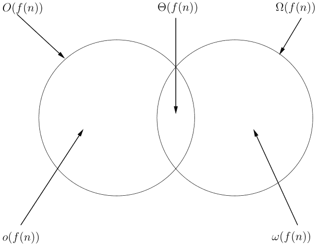

图2.1: 不同增长速率类之间的关系。

### 大O

如果存在两个常数 $m$ 和 $c$，使得 $m \geq 0$ 且 $c \geq 0$，且对于所有的 $n \geq m$，有 $t(n) \leq c f(n)$。

换句话说，$O(f(n))$ 是所有函数 $t(n)$ 的集合，使得存在一个常数 $c$，使得对于足够大的 $n$，有 $t(n) \leq c f(n)$。你可以说 $O(f(n))$ 是那些不比 $f$ 增长得更快的函数的集合。

## 大欧米伽 $\Omega$

$t(n) \in \Omega(f(n))$ 如果存在两个数 $m$ 和 $c$，使得 $m \geq 0$ 且 $c > 0$，且 $t(n) \geq c f(n)$ 对于所有的 $n \geq m$。

换句话说，$\Omega$ 定义了类似于大O的相反概念。函数 $t(n)$ 在 $\Omega(f(n))$ 中具有以下特性：对于每个 $t(n)$，存在一个 $c$，使得对于足够大的 $n$，$t(n) \geq c f(n)$。你可以说 $\Omega(f(n))$ 是那些增长速度不低于 $f$ 的函数集合。

## Theta $\Theta$

$t(n) \in \Theta(f(n))$ 当且仅当 $t(n) \in O(f(n))$ 且 $t(n) \in \Omega(f(n))$。

集合 $\Theta(f(n))$ 实际上是前两个集合的交集。它由那些不比 $f$ 增长得更快，也不比 $f$ 增长得更慢的函数组成。你可以说它是与 $f$ 以相同速度增长的函数集合。记得要小心。函数 $1000 f(n)$ 和 $f(n) / 10000$ 都属于 $\Theta(f(n))$。

### 小o

$t(n) \in o(f(n))$ if $t(n) \in O(f(n))$ 且 $t(n) \notin \Theta(f(n))$。

集合 $o(f(n))$ 是 $O(f(n))$ 和 $\Theta(f(n))$ 的补集的交集。它包含比 $f$ 增长得严格慢的函数。例如，$n \in o\left(n^{2}\right)$ 但 $2 n^{2} \notin o\left(n^{2}\right)$。

## 小欧米伽 $\omega$

$t(n) \in \omega(f(n))$ if $t(n) \in \Omega(f(n))$ 和 $t(n) \notin \Theta(f(n))$。

集合 $\omega(f(n))$ 是 $\Omega(f(n))$ 和 $\Theta(f(n))$ 的补集的交集。它包括严格增长快于 $f$ 的函数。例如，$n^3 \in \omega(n^2)$ 但是 $2n^2 \notin \omega(n^2)$。请参见图2.1，了解这些不同函数之间的关系的可视化描述。

### 2.2.1 定义的一些推论

引理1. 如果 $t(n) \in O(f(n))$ 且 $s(n) \in O(g(n))$，那么
- 1. $s(n) + t(n) \in O(f(n) + g(n))$
- 2. $s(n) \cdot t(n) \in O(f(n) \cdot g(n))$

证明. 因为 $t(n) \in O(f(n))$，存在一个整数 $m$ 和一个常数 $c$ 使得对于所有的 $n > m$，$t(n) \leq c f(n)$。同样地，存在常数 $k$ 和 $d$ 使得对于所有的 $n > k$，$s(n) \leq d g(n)$。令 $C=\max(c, d)$，令 $M=\max(m, k)$。那么 $s(n) + t(n) \leq C f(n) + C g(n) = C(f(n) + g(n))$ 对于所有的 $n > M$ 成立，证明了 $s(n) + t(n) \in O(f(n) + g(n))$。在这种情况下，我们使用 $C^2$ 作为常数，这表明 $s(n) \cdot t(n) \in O(f(n) \cdot g(n))$。

定义
$$
\max (f(n), g(n))= \left\{\begin{array}{ll}
f(n) & \text { 如果 } g(n) \in O(f(n)) \\
g(n) & \text { 如果 } f(n) \in O(g(n)) \\
\text { 未定义 } & \text { 否则 }
\end{array}\right.
$$

换句话说，$\max(f(n), g(n))$ 是 $f(n)$ 和 $g(n)$ 中增长更快的函数。很容易证明，如果对于 $f$ 和 $g$ 定义了 $\max$，则 $O(f(n) + g(n)) = O(\max(f(n), g(n)))$。它可能未定义的原因是 $f(n)$ 和 $g(n)$ 中的一个可能会振荡。请参见下面的示例。

微积分和极限理论可以用来确定函数的相对增长速度。如果需要，可以使用洛必达法则来解决极限问题：

| 如果 $\lim _{n \rightarrow \infty}(f(n) / g(n))=$ | 那么所有这些陈述都是真的： |
| --- | --- |
| $0$ | $f(n) \in O(g(n))$ 且 $f(n) \in o(g(n))$ |
| $c \neq 0$ | $f(n) \in \Theta(g(n))$ |
| $\infty$ | $f(n) \in \Omega(g(n))$ 且 $f(n) \in \omega(g(n))$ |
| 振荡 | 没有极限，也没有关系。 |

作为一个振荡分数的例子，令
$$
f(n)= \left\{\begin{array}{ll}
n & \text { if } n \text { 是偶数 } \\
1 & \text { if } n \text { 是奇数 }
\end{array}\right.
$$
并让 $g(n) = n$。然后分数 $f(n)/g(n)$ 在趋近于无穷大时在 $1$ 和 $1/n$ 之间交替，因此没有极限。

## 计算机科学335 软件设计与分析Ⅲ
# 第2章 数学概念和性能度量

### 2.2.2 一些增长率关系

在下面，符号 $<$ 表示左边的函数是右边函数的小 $o$。

```
c < \log N < \log^k N < N < N \log N < N^2 < N^3 < N^{3+k} < 2^N < 3^N < . . . < N!
```

其中 $\log$ 的底数不重要，$k$ 是大于 $1$ 的任意整数。

## 2.3 计算模型

在分析运行时间时，我们假设算法在某种理论的抽象计算机上运行。通常是基于冯·诺伊曼体系结构的计算机。冯·诺伊曼体系结构是以发明它的数学家冯·诺伊曼[^1]命名的一种体系结构，其中程序和数据都存储在内存中，指令按顺序一个接一个地执行，从内存中获取操作数。这正是你今天使用的计算机。在冯·诺伊曼之前，计算机是单用途的机器，其程序由硬件控制。其他抽象模型产生不同的运行时间。

关于程序执行的进一步假设是：
- 所有指令都需要相同的时间
- 内存是无限的
- 所有指令都是作用于标量而不是向量的简单指令

这些假设旨在简化分析过程，而不会丢失正确性。虽然某些指令确实比其他指令需要更长的时间，例如，差异是一个常数因子，在增长率分析中被忽略。

[^1]: 约翰・冯・诺伊曼，《EDVAC报告初稿》，美国陆军军械部和宾夕法尼亚大学，1945年。

### 2.3.1 输入规模

假设每个输入都有一个取决于特定问题的正整数大小来解决。例如，排序问题对列表进行排序。列表中的元素数量是输入的大小，而不是要排序的项目的长度或它们的组合长度。如果问题是在第二个字符串中搜索第一个字符串的出现，第一个字符串的字符数和第二个字符串的字符数是两个输入大小。不同的算法可能依赖于它们的和、积或两个大小的某些其他函数。如果问题是在字典中搜索关键字，输入大小不是关键字的长度，而是字典中的单词数。

算法的运行时间取决于输入。对于某些输入，它可能很快而对于其他输入，它可能很慢。我们通常对它可能的最坏情况感兴趣，因为这样我们可以保守地计划。然而，有时我们想知道平均运行时间。平均的概念实际上是无用的，因为它将所有输入都视为等可能发生的，而这从来不是真实的。更有用的是期望的运行时间，即加权平均值，即每个输入都按其发生的概率加权。这也有点愚蠢，因为我们很少能够真实地给输入加权。因此，平均运行时间被使用，但是每个人都知道它只是一个近似值。我将使用以下符号表示输入大小为 $N$ 的运行时间：
- $T_{avg}(N)$ 平均值（不是期望值）
- $T_{expected}(N)$ 考虑输入分布的概率分析
- $T_{worst}(N)$ 最坏情况

### 2.3.3 运行时间计算

这些是用于分析程序运行时间的规则，作为算法的表示。这些规则旨在忽略实现细节。请记住，我们通常忽略常数倍数和常数项。

#### 2.3.3.1 For循环

for循环的运行时间最多是循环内部语句的运行时间乘以循环的迭代次数。

#### 2.3.3.2 嵌套循环

根据前面的语句，可以得出结论，嵌套循环中语句的运行时间是语句的运行时间乘以循环迭代次数的乘积。例如，三重嵌套的伪代码循环

```
for i = 1 to n
        for j = 1 to 2n
            for k = 1 to 3n
                S
```

运行时间与 $S$ 的运行时间和 $6n^3$ 的乘积成正比。

#### 2.3.3.3 连续语句

一系列语句的总运行时间是各语句的运行时间之和。例如，序列

```
S1; S2; S3; ...; Sn
```

的运行时间等于 $S1$、$S2$、$S3$、...、$Sn$ 的运行时间之和。如果使用大 $O$ 表示运行时间，通常只报告各个语句的最大运行时间。

#### 2.3.3.4 If/else

if/else语句的运行时间

```
if (条件)
    S1
else
    S2
```

最多是条件评估的运行时间加上 $S1$ 和 $S2$ 的最大运行时间。如果我们对最坏情况分析感兴趣，那么我们必须假设最大值，除非我们能证明某些语句永远不会被执行。

#### 2.3.3.5 函数调用

如果一系列语句包含函数调用，首先必须确定调用的运行时间。对于递归函数，分析可能会变得困难。

### 示例

```
long fib(int n)
{
    if (n <= 1)
        return 1;
    else
        return fib(n-1) + fib(n-2);
}
```

假设 $T(n)$ 是给定输入 $n$ 的函数运行时间。当函数的参数为 $0$ 或 $1$ 时，函数在没有递归调用的情况下返回，因此运行时间是一个常数，我们选择为 $1$：
$T(0) = T(1) = 1$

如果输入大于 $1$，则会进行两次递归调用并进行一些常数工作。
$T(n) = T(n-1) + T(n-2) + 1$

常数 $1$ 用于条件的评估和返回语句的执行。这是一个递归关系。

为了解决这个递归关系，我们做了一些观察：
- 1. $T(n) \ge$ Fib($n$)，因为它每次都会增加 $1$。
- 2. Fib($n$) $\ge (3/2)^n$ 对于所有的 $n > 4$。我们现在来证明这一点。

证明. 我们对 $n$ 进行归纳证明。
基本情况：Fib(5) = 8 > (3/2)$^5$ = 7.59375，当 $n=5$ 时，它是真的。
归纳假设：假设对于任意的 $n \ge 5$ 都成立。那么我们有

```
Fib(n+1) = Fib(n) + Fib(n-1)
         > (3/2)^n + (3/2)^(n-1)
         = (3/2)^(n-1)((3/2) + 1)
         = (3/2)^(n-1) * 5/2
         > (3/2)^(n-1) * 2.25
         = (3/2)^(n-1) * (3/2)^2
         = (3/2)^(n+1)
```

这证明了对于 $n+1$ 是正确的。

这表明 $T(n)$ 呈指数增长。无论有多糟糕，都无关紧要，因为已经够糟糕了。递归不是计算斐波那契数的很好的方法。

## 2.4 示例：最大子序列问题

这是一个非常好的问题，有几个原因可以研究。一是它展示了如何通过巧妙的方法将性能差的解决方案替换为极其高效的解决方案。其次，它给我们分析三种非常不同类型的算法的机会。第三，它阐述了算法设计中的一个重要概念，即每当算法计算一段信息时，应尽可能地重用该信息。你很快就会明白这是什么意思。

粗略地说，最大子序列问题要求你找到一个由正数和负数组成的序列的子序列，其和是所有可能子序列中最大的。例如，给定以下数字序列：

1, 2, -4, 1, 5, -10, 4, 1

你可以验证子序列 1, 5 的和为 6，没有其他子序列的和大于 6。

形式上，给定一个可能包含负整数的序列 $A_1, A_2, \dots, A_N$，最大子序列和定义为：
$$\underset{i \leq j}{\max }\left\{0, \sum_{k=i}^{j} A_k\right\}$$

对于那些不熟悉这个符号的人来说，它的意思是，对于所有的索引对 $i$ 和 $j$，从 $A_i$ 到 $A_j$ 的所有可能序列的最大和，并且如果都是负数，则选择零。

例子。序列 -2, 11, -4, 13, -5, -2 有一个和为 20 的最大子序列。下表证明了这一点。每个可能的起始值都有一行，每个可能的序列长度都有一列。最大和为 20，长度为 3 的序列从 11 开始。

| 起始值 \ 长度 | 1 | 2 | 3 | 4 | 5 | 6 |
| --- | --- | --- | --- | --- | --- | --- |
| -2 | -2 | 9 | 5 | 18 | 13 | 11 |
| 11 | 11 | 7 | 20 | 15 | 13 | 0 |
| -4 | -4 | 9 | 4 | 2 | 0 | 0 |
| 13 | 13 | 8 | 6 | 0 | 0 | 0 |
| -5 | -5 | -7 | 0 | 0 | 0 | 0 |
| -2 | -2 | 0 | 0 | 0 | 0 | 0 |

稍后描述的暴力方法被用来生成上述表格。

### 2.4.1 运行时间评估规则
- 1. 不计算读取输入的时间，因为这总是 $O(n)$，并且它会隐藏高效算法的真实运行时间。
- 2. 忽略常数倍数，只使用增长率符号表示增长问题。

### 2.4.2 最大子序列问题的解决方案

#### 2.4.2.1 暴力解法

下面是一个使用暴力解法解决这个问题的 C++ 函数。它只检查所有可能的起始位置和该位置上的所有序列长度，并将子序列中的数字相加：

```
int maxSubSeqSum ( const vector < int > & a )
{
    int max = 0;
    for ( int i = 0; i < a . size ( ) ; i ++ )
        for ( int j = i ; j < a . size ( ) ; j ++ ) {
            int sum = 0;
            for ( int k = i ; k <= j ; k ++ )
                sum += a [ k ];
            if ( max < sum )
                max = sum ;
        }
    return max ;
}
```

#### 2.4.2.2 分析

最内层循环执行 $\left(j-i+1\right)$ 次。这个范围涵盖了所有 $j$ 从 $i$ 到 $N$。因此，循环体被执行

$$
\begin{aligned}
\sum_{j=i}^{N-1}(j-i+1)= & \sum_{j=0}^{N-1-i}(j+1)=\sum_{j=1}^{N-i} j \\
= & \frac{(N-i+1)(N-i)}{2}
\end{aligned}
$$

次。变量 $i$ 的值范围从 $0$ 到 $N-1$。因此，总执行次数为

$$
\begin{aligned}
\sum_{i=0}^{N-1} \frac{(N-i+1)(N-i)}{2} & =\sum_{i=1}^{N} \frac{(N-(i-1)+1)(N-(i-1))}{2} \\
& =\sum_{i=1}^{N} \frac{(N-i+2)(N-i+1)}{2} \\
& =\sum_{i=1}^{N} \frac{N^{2}+3 N+2-(2 N i+3 i)+i^{2}}{2} \\
& =\frac{1}{2}\left(\sum_{i=1}^{N} N^{2}+3 N+2\right)-\frac{2 N+3}{2}\left(\sum_{i=1}^{N} i\right)+\frac{1}{2}\left(\sum_{i=1}^{N} i^{2}\right) \\
& =\frac{N\left(N^{2}+3 N+2\right)}{2}-\frac{2 N+3}{2}\left(\frac{N(N+1)}{2}\right)+\frac{N(N+1)(2 N+1)}{12} \\
& =\frac{6 N\left(N^{2}+3 N+2\right)}{12}-\left(\frac{3 N(N+1)(2 N+3)}{12}\right)+\frac{N(N+1)(2 N+1)}{12} \\
& =\frac{6 N(N+1)(N+2)}{12}-\left(\frac{3 N(N+1)(2 N+3)}{12}\right)+\frac{N(N+1)(2 N+1)}{12} \\
& =N(N+1)\left(\frac{6(N+2)-3(2 N+3)+(2 N+1)}{12}\right) \\
& =N(N+1)\left(\frac{2 N+4}{12}\right) \\
& =\frac{N(N+1)(N+2)}{6}=\frac{N^{3}+2 N^{2}+2 N}{6}
\end{aligned}
$$

这是 $O\left(N^{3}\right)$。为什么我没有使用嵌套循环规则？因为循环的复杂度不是明确的 $O(n)$，对吗？

#### 2.4.2.3 分治递归解法

可以从以下观察中得到一个更高效的解法：

一个最大子序列要么完全在第一半中，要么完全在第二半中，要么跨越两个半部分。如果它跨越两个半部分，它可以被分成两个部分：
- 1. 在第一个一半中包含最后一个元素的情况下，具有最大和的序列
- 2. 在最后一半中包含第一个元素的情况下，具有最大和的序列

因此，我们可以在每个一半中找到满足这些条件的序列，将它们相加并与每个一半中递归找到的序列进行比较。我们只需取所有序列中的最大值。

```
/**
递归最大连续子序列和算法。 找到跨越数组 a [ left.. right] 的子数组的最大和。 不尝试保持实际最佳序列。
 */
int maxSumRec ( const vector < int > & a , int left , int right )
{
    if ( left == right ) // 基本情况
        if ( a [ left ] > 0 )
            return a [ left ];
        else
            return 0;

    int center          = ( left + right ) / 2;
    /* 递归在这里 */
    int maxLeftSum = maxSumRec ( a , left , center ) ;
    int maxRightSum = maxSumRec ( a , center + 1 , right ) ;

    int maxLeftBorderSum = 0;
    int leftBorderSum           = 0;

    /* 找到以 [ center ] 结尾并从 i 开始的每个序列的和, 其中 i = center, center -1,
       center -2, ...
       并将最大和保存在 MaxLeftBorderSum 中 */
    for ( int i = center ; i >= left ; i -- ) {
        leftBorderSum += a [ i ];
        if ( leftBorderSum > maxLeftBorderSum )
            maxLeftBorderSum = leftBorderSum ;
    }

    /* 对中心的右侧进行类似的操作 */
    int maxRightBorderSum = 0 , rightBorderSum = 0;
    for ( int j = center + 1; j <= right ; j ++ ) {
        rightBorderSum += a [ j ];
```if ( rightBorderSum > maxRightBorderSum )
    maxRightBorderSum = rightBorderSum ;
}
return max3 ( maxLeftSum , maxRightSum ,
              maxLeftBorderSum + maxRightBorderSum ) ;
}
/* 用于分治法最大连续子序列和算法的驱动程序。 */
int maxSubSum3 ( const vector < int > & a )
{
    return maxSumRec ( a , 0 , a . size ( ) - 1 ) ;
}

分析：该算法使用半大小数组进行两次递归调用。它还在一对循环中处理每个元素一次。递归关系是

$$T(1) = 1$$

$$T(N) = 2T(N/2) + cN$$

如果我们折叠这个递归关系，我们得到

$$
\begin{aligned}
T(N) & = 2(2T(N/4) + cN/2) + cN \\
     & = 4T(N/4) + cN + cN \\
     & = 4(2T(N/8) + cN/4) + 2cN \\
     & = 8T(N/8) + 3cN \\
     & = ... \\
     & = 2^k T(N/2^k) + kcN
\end{aligned}
\quad (2.1)
$$

当 $N/2^k=1$ 时，这个级数停止，这发生在 $N=2^k$ 或者 $k=\log_2 N$。将 $\log_2 N$ 代入方程2.1，我们得到

$$
\begin{aligned}
T(N) & = N \cdot T(1) + \log_2 N \cdot cN \\
     & = N + cN \cdot \log_2 N \\
     & \in O(N + N \log N)
\end{aligned}
$$

这个解决方案的运行时间是 $O(N \log N)$，明显优于 $O(N^3)$。我们能做得更好吗？

#### 2.4.2.4 线性时间解决方案

解决这个问题的线性时间解决方案并不难找到。之前的解决方案没有利用他们在检查序列时发现的信息。这就是我之前所说的。

当算法扫描字符串时，它可以学到比之前更多的东西，并且避免重新计算或重新检查之前的部分和。

概念：我们有权利让符号 $a_{i} \cdots a_{j-1}$（当含义清楚时，$a_{i} \cdots a_{j-1}$ 既表示序列又表示其和）。以下断言构成了算法的基础。

- 1. 如果 $a_{i}$ 是负数，则它不能是最大子序列的起点。（如果 $a_{i}$ 是负数，则从 $a_{i+1}$ 开始的序列将大于从 $a_{i}$ 开始的序列。）
- 2. 更一般地说，任何负子序列都不能是最大子序列的起点。（根据步骤1的推理。）
- 3. 如果 $a_{i} \cdots a_{j-1}$ 是正数，但 $a_{i} \cdots a_{j}$ 是负数，则 $a_{i} \cdots a_{j}$ 不能是最大子序列的起点。当然，根据步骤2，如果 $a_{i} \cdots a_{j}$ 是负数，则 $a_{i} \cdots a_{j}$ 不能是最大子序列的起点，那么这个陈述对此有什么补充呢？下一步是关键。
- 4. 假设 $j$ 是大于 $i$ 的最小索引，使得 $a_{i} \cdots a_{j-1} \geq 0$ 但 $a_{i} \cdots a_{j} < 0$。换句话说，对于每个索引 $k$，$i \leq k < j$，$a_{i} \cdots a_{k} \geq 0$。考虑任意的 $p$，使得 $i < p < j$。序列 $a_{i} \cdots a_{j-1}$ 可以被写成从 $a_{i}$ 到 $a_{p-1}$ 的数字之和，以及从 $a_{p}$ 到 $a_{j-1}$ 的数字之和：
  $$a_{i} \cdots a_{j-1} = a_{i} \cdots a_{p-1} + a_{p} \cdots a_{j-1} \tag{2.2}$$
  由于我们说对于任意的 $k$，$i \leq k < j$，$a_{i} \cdots a_{k} \geq 0$ 成立，对于 $k = p - 1$ 也成立，所以 $a_{i} \cdots a_{p-1} \geq 0$。方程2.2的形式为
  $$a_{i} \cdots a_{j-1} = X + a_{p} \cdots a_{j-1}$$
  其中 $X$ 是一个非负数，因此如果我们从右边减去它，右边的值保持不变或变小：$a_{i} \cdots a_{j-1} \geq a_{p} \cdots a_{j-1}$。换句话说，$a_{i} \cdots a_{j-1}$ 大于其任何子序列。特别地，当我们在不等式两边都添加 $a_{j}$ 时，不等式仍然成立：$a_{i} \cdots a_{j} \geq a_{p} \cdots a_{j}$。由于左边是负数，所以右边也是负数。
- 5. 这意味着如果我们有一个初始子序列 $a_{i} \cdots a_{j-1}$ 是正数或零，并且当我们遇到使得和为负数的 $a_{j}$ 时，我们可以将起始索引 $i$ 前进到下一个位置 $j+1$，并从那里开始寻找新的最大子序列，因为 $a_{i} \cdots a_{j}$ 不能成为最大子序列的起始点。

这导致了以下非常简单的算法。

```cpp
int maxSubSum4 ( const vector < int > & a )
{
    int maxSum = 0 , thisSum = 0;
    for ( int j = 0; j < a . size ( ) ; j ++ ) {
        thisSum += a [ j ];
        if ( thisSum > maxSum )
            maxSum = thisSum ;
        else if ( thisSum < 0 )
            // 这个 a [ j ] 使得初始序列变为负数 - 重新开始
            thisSum = 0;
    }
    return maxSum ;
}
```

分析：显然这是一个线性算法，因为它是一个单循环，遍历了序列的每个元素。

你可能会想是否存在更快的解决方案。如果没有的话，那么我们会说这个解决方案是最优的，意味着它是最好的，因为它运行的速度和可能的一样快。但是如果存在更快的解决方案，这个解决方案就不会被认为是最优的。是否存在一个运行时间为 $O(N)$ 的解决方案？直观上来说是不可能的，因为任何解决方案都必须至少查看每个数字一次，所以任何解决方案都必须至少运行 $\Theta(N)$ 时间。

# 第4章 树

## 预备知识

## 树的定义

如果你已经知道什么是二叉树，但不知道什么是一般树，请注意，因为二叉树不仅仅是度为2的一般树的特殊情况。我使用教科书上的树的定义，但请记住其他定义也是可能的。

**定义：** 一棵树T由一组（可能为空的）节点组成。如果它不为空，它由一个称为T的根节点r和零个或多个非空子树 $T_1, T_2, \dots, T_k$ 组成，其中从r到 $T_1, T_2, \dots, T_k$ 的根节点都有一条有向边。

**定义：** 森林是一组非空树。你总是可以通过创建一个新的根节点，并将其设置为森林中所有树的根节点的父节点来从森林中创建一棵树。相反，如果你砍掉一棵树的根节点，剩下的就是一片森林。

我假设你熟悉二叉树的术语，例如，父节点，子节点，兄弟节点，祖先节点，后代节点，祖父母节点，叶节点，内部节点，外部节点等等，所以我不会在这里重复它们的定义。因为高度和深度的定义可能因书籍而异，所以我在这里包括它们的定义，使用的是教材中的定义。

**定义：** 从节点 $n_1$ 到节点 $n_k$ 的路径是一个节点序列 $n_1, n_2, \dots, n_k$，其中 $n_i$ 是 $n_{i+1}$ 的父节点，对于 $1 \leq i < k$。路径的长度是路径中的边数，而不是节点数。

因为树中的边是有向的，所有路径都是“向下”的，即朝向叶节点并远离根节点。节点的高度是从该节点到其任何后代节点的最长路径的长度。自然地，最长路径必须是到叶节点的路径。节点的深度是从根节点到该节点的路径的长度。根节点的深度为0。所有叶节点的高度为0。

树的高度是其根的高度。节点的度是其子节点的数量。树的度是其节点度的最大值。下一页的树的高度为3，度为6。


很容易看出，具有N个节点的树必须有N-1条边，因为除了根节点外，每个节点都有一条入边。具有N个节点和K棵树的森林中有多少条边？

## 广义树的应用

广义树用于表示子节点数量可变的层次结构。

- 在文件系统中，每个文件表示一个节点，如果文件是目录，则它是一个内部节点，其子节点是目录中包含的文件。某些文件系统不限制每个文件夹中的文件数量，这意味着每个节点的子节点数量是可变且无界的。
- 在计算语言学中，当句子被解析时，解析器会创建一个表示句子的树形结构，其中的节点表示语法元素，如谓词、主语、介词短语等。一些元素，如主语元素，总是内部节点，因为它们由更简单的元素组成，如名词和冠词。其他元素总是叶节点，如名词。内部节点的子节点数量是不受限制且可变的。
- 在家谱软件中，给定一个人的后代树是一棵普通树，因为给定人的子节点数量是不固定的。

## 树的实现

由于不知道树可能具有的最大度数，并且使用具有非常大的固定子节点数的结构是低效的，最好的普通树实现使用兄弟姐妹的链表和单个子节点，如下所示。

## 未知度数的普通树

树节点是一个元素，具有左子节点和下一个兄弟节点指针:

```cpp
结构体树节点
{
    对象 元素;
    树节点*第一个孩子;
    树节点*下一个兄弟;
};
```

下面的兄弟树表示上面的树。


## 通用树遍历：一个例子

一个打印目录层次结构中文件和文件夹的算法:

```cpp
void listAll( int depth = 0) const
{
    打印名称(depth);
    如果(是目录())
        对于每个子目录c在此目录中
            c.listAll(depth + 1);
}
```

上述算法是一种先序遍历，因为它在访问任何子节点之前访问每个子树的根，并且在访问子节点时，按照“从左到右”的顺序进行。一棵通用树没有左右的概念，但是该算法创建了一个。如果printname()打印一个带有深度制表符的单词，那么这将打印一个带有缩进的目录树列表，深度为d的文件在其左边有d个制表符。

还可以定义通用树的后序遍历，但是由于子树的数量因节点而异，根节点可能在与其子节点的许多位置上被访问，所以没有单一的中序遍历概念。

## 二叉树

二叉树不是一般树，因为在二叉树中，左子树和右子树是有区别的。二叉树要么为空，要么有一个根节点和一个左子树和右子树，每个子树都是二叉树，并且它们的根节点是树的根的子节点。

本书使用以下二叉树节点的实现。

```cpp
结构体 BinaryNode {
    Object元素;
    BinaryNode *left;
    BinaryNode *right;
};
```

二叉树最重要的应用是在编译器设计和搜索结构中。

二叉搜索树是一种重要的数据结构。我假设你在之前的课程中对它们很熟悉。这里的目标是看看如何使用C++实现它们。

## 搜索树ADT：二叉搜索树

二叉搜索树是二叉树，以这样的方式存储可比较的元素，使得插入、删除和查找操作不需要超过O(h)次操作，其中h是树的高度。形式上说，

**定义：** 如果(S,R)是一个有序集合，那么S是一个集合，R是S上的二元关系。

**定义：** 如果x是一个节点，element(x)是节点x中包含的元素。

**定义：** 对于有序集合(S, "<")的二叉搜索树是一棵二叉树，对于每个节点x，element(x)∈S，并且对于x的左子树中的每个节点z，element(z)<element(x)，对于x的右子树中的每个节点z，element(x)<element(z)。

重要的是要意识到二叉搜索树使用隐含的排序关系来组织它们的数据，并且必须始终为这些数据定义比较操作。

二叉搜索树必须支持插入、删除、查找、测试是否为空以及查找最小元素的操作。还可以支持按排序顺序列出所有元素的操作。由于它是一个容器（包含其他对象的对象），它需要提供创建空的二叉搜索树实例或将现有树复制为新树的方法，并且销毁树的实例。

## 算法

大多数树算法都可以使用递归轻松表达。另一方面，要这样做需要算法的参数是指向当前节点根的指针，但这是一个问题，因为不希望向对象的客户端公开节点指针。节点应该对对象的客户端隐藏。换句话说，客户端不应该知道也不关心数据在树内部的结构；事实上，他们甚至不应该知道它是一棵树！

二叉搜索树应该是一个黑盒子，具有对其客户端可用的方法的钩子，而不多。

因此，明智的解决方案是创建一个客户端调用的“包装器”方法，该方法包装了对递归函数的调用。这正是查找、插入和删除函数的工作方式。下面是它们的实现。我跳过了其他所有实现。你不应该跳过它们；你必须确保你理解这个类的实现方式！

### 查找

查找算法是一种递归算法。如果当前节点为空，则返回一个指示它不在树中的标志，否则如果元素小于当前节点的元素，则在左子树中查找，否则如果元素大于当前节点的元素，则在右子树中查找，否则它相等。

## 插入

插入操作类似。如果当前节点为空，则说明元素应该插入的位置已经到达，但是元素并不存在，所以在那里插入它。否则，如果要插入的元素小于当前元素，则插入到左边，否则，如果要插入的元素大于当前元素，则插入到右边，否则它相等，因此不应该插入。

### 删除

删除算法是最复杂的。它取决于要删除的节点有多少个子节点。如果没有子节点，那么很容易：只需删除该节点。如果它有一个子节点，则删除该节点，并将唯一的子节点设置为该节点的父节点的子节点。如果它有两个子节点，则在节点的右子树中找到最小的节点，并将其复制到该节点中，从而删除该元素。然后删除它来的节点。该节点不可能有两个子节点，因为如果有两个子节点，其中一个必须小于该节点，这与它是右子树中最小节点的假设相矛盾。

## 二叉搜索树节点的实现

这本书使用一些相当巧妙的编码技术来实现二叉搜索树。其中一些技术很难理解。在这些笔记中，我澄清了实现中更困难或微妙的方面，并省略了其他方面的讨论。二叉搜索树节点的类接口如下。请注意，它的构造函数是私有的，但BinarySearchTree类是友元类。只有树对象才能创建节点对象。

```cpp
模板 <类 Comparable>
类BinarySearchTree;

模板 <类 Comparable>
类 BinaryNode
{
    Comparable element;
    BinaryNode *left;
    BinaryNode *right;
    BinaryNode( const Comparable & theElement, BinaryNode *lt, BinaryNode *rt )
        : element( theElement ), left( lt ), right( rt ) { }
    friend class BinarySearchTree<Comparable>;
};
```

## 算法实现

为了使算法按照预定方式工作，私有成员函数返回指向二进制节点的指针，但相应的公共成员函数返回节点中包含的元素。为了实现这一点，作者使用了下面定义的elementAt()函数。

```cpp
模板 <类 Comparable>
const Comparable & BinarySearchTree<Comparable>::
elementAt( BinaryNode<Comparable> *t ) const
{
return t == NULL ? ITEM_NOT_FOUND : t->element;
}
```

请注意，如果指针为空，则返回常量Comparable ITEM_NOT_FOUND，如果指针不为空，则返回节点中的元素。

这是find方法的公共包装器。

```cpp
模板 <类 Comparable>
const Comparable & BinarySearchTree<Comparable>::find( const Comparable & x ) const
{
return elementAt( find( x, root ) );
}
```

这是它调用的私有find成员函数：

```cpp
模板 <类 Comparable>
BinaryNode<Comparable> *BinarySearchTree<Comparable>:: find( const Comparable & x,
BinaryNode<Comparable> *t ) const
{
if( t == NULL )
    return NULL;
else if( x < t->element )
    return find( x, t->left );
else if( t->element < x )
    return find( x, t->right );
else
    返回 t; // 匹配
}
```

插入类似：

```cpp
模板 <类 Comparable>
void BinarySearchTree<Comparable>::insert( const Comparable & x )
{
insert( x, root );
}
```

```cpp

void BinarySearchTree<Comparable>::
insert( const Comparable & x, BinaryNode<Comparable> * & t ) const
{
  if( t == NULL )
    t = new BinaryNode<Comparable>( x, NULL, NULL );
  else if( x < t->element )
    insert( x, t->left );
  else if( t->element < x )
    insert( x, t->right );
  else
    ; // 重复；不做任何操作
}
```

删除是相同的思路，但算法不同，如上所述。 删除公共成员调用私有的remove成员，如下所示。 remove函数调用一个 findMin() 函数来找到给定子树中的最小元素。 findMin()有一个公共和一个私有递归版本。

```cpp

模板    <类  Comparable>
const Comparable & BinarySearchTree<Comparable>::findMin( ) const
{
  return elementAt( findMin( root ) );
}
模板    <类  Comparable>
BinaryNode<Comparable> *
BinarySearchTree<Comparable>::findMin( BinaryNode<Comparable> *t ) const
{
  if( t == NULL )
    return NULL;
  if( t->left == NULL )
    return t;
  return findMin( t->left );
}
```

```cpp

模板    <类  Comparable>
void BinarySearchTree<Comparable>::
remove( const Comparable & x, BinaryNode<Comparable> * & t ) const
{
  if( t == NULL )
    return; // 未找到项目；不执行任何操作
  if( x < t->element )
    remove( x, t->left );
  else if( t->element < x )
    remove( x, t->right );
}
```

```cpp
else if (t->left != NULL && t->right != NULL) // 两个子节点
{
    t->element = findMin(t->right)->element;
    remove(t->element, t->right);
}
else
{
    BinaryNode<Comparable> *oldNode = t;
    t = (t->left != NULL) ? t->left : t->right;
    delete oldNode;
}
```

## 搜索树的示例。

这个插入序列:
5 3 7 2 9  8 4 6 1
导致高度为3的树。

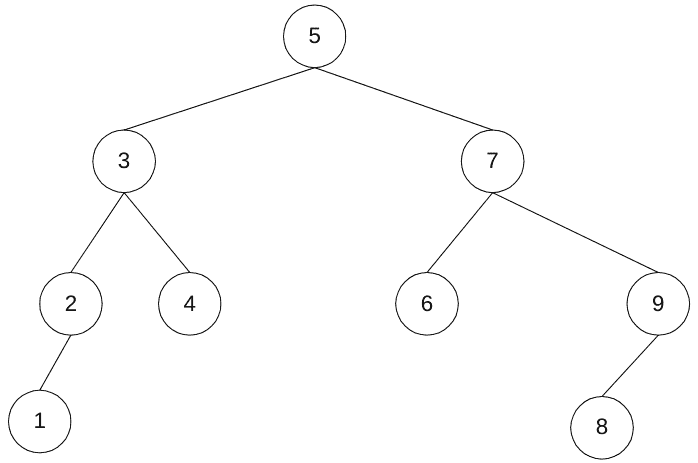

相比之下，
9 8 7 6 5 4 3 2 1
产生一个高度为8的树。插入键的顺序决定了树的高度。

## 性能分析

在最坏的情况下，插入、删除和搜索算法所需的步骤数与树的高度成正比。删除可能涉及比插入和搜索更多的步骤，但它仍然不会访问比树中最长路径的长度更多的节点。因此，这些算法的运行时间取决于树的深度。因此，问题是，二叉搜索树的预期高度是多少?

## 计算机科学335 软件分析与设计III 讲座笔记 教授 斯图尔特·韦斯 第4章：树

前面的例子表明插入的顺序会影响树的高度，在最坏情况下，高度为O(N)。但是平均高度呢？为了澄清问题，我们可以假设键是正整数。由于连续键之间的实际数值差异不会影响树的形状，我们可以假设具有N个节点的树由整数1到N组成。换句话说，我们用序列1,2,3来得到相同的树，就像用1,20,400或2,23,800一样，因此我们假设序列是1,2,3,...,N。

如果要插入的第一个键是数字i，其中1<=i<=N，则这决定了左子树和右子树中的节点数：左子树中必须有(i-1)个节点，右子树中必须有(N-i)个节点。这对树的每个子树都成立。

定义：树的内部路径长度是树中所有节点的深度之和。

设D(N)表示具有N个节点的任意树T的预期内部路径长度。

假设根节点是数字i。那么左子树有(i-1)个节点，并且它的预期内部路径是D(i-1)。从根节点到左子树中的任何节点需要遍历一条额外的边，因此从根节点开始的左子树的总预期路径长度是D(i-1)+(i-1)。同样，右子树的预期路径长度是D(N-i)+(N-i)。这导致了递归关系：

D(1) = 0

D(N) = D(i-1) + D(N-i) + (i-1) + (N-i) = D(i-1) + D(N-i) + N-1

如果所有序列1,2,...,N的出现概率相等，则第一个数字为i的概率是均匀的1/N。换句话说，根节点可以是1,2,3,...,N中的任意一个，概率相等，因此平均高度为：

$$
\frac{1}{N} \left[ (D(0) + D(N-1)) + (D(1) + D(N-2)) + \cdots + (D(N-2) + D(1)) + (D(0) + D(N-1)) \right] + N - 1 = \frac{2}{N} \left[ \sum_{i=0}^{N-1} D(i) \right] + N - 1
$$

稍后将证明D(N)是O(N log N)。因此，平均二叉搜索树的总路径长度为O(N log N)，这意味着平均路径长度为O(log N)。

这表明，如果树是从N个键随机构建的，那么平均插入、删除和查找操作的时间复杂度为O(log N)。但是，如果树经历了删除操作，它们的形状将会改变，因为删除算法会偏向于一侧或另一侧。为了避免这种情况，删除算法可以在选择右子树中最小的元素和选择左子树中最大的元素之间交替进行。如果这样做，已经证明了期望的深度将会是 $\Theta(\sqrt{N})$。

塔尔詹在20世纪80年代初发明了一个更有趣的解决方案，并且随后将该技术推广到其他问题。他发明了自适应树，在每次操作后重新构建树，以使未来的操作更加高效。

## 平衡二叉搜索树

我们可以定义一个拥有N个节点的完全平衡二叉搜索树，它是一棵完全二叉树，除了最后一层外，每一层都是完全填满的。一个完全平衡的二叉搜索树可以保证O(log N)的搜索时间。不幸的是，在每次插入和删除后重新平衡这样的树是非常昂贵的。我们需要一棵具有较弱平衡条件的树。

### AVL树

AVL树（以其发明者Adelson-Velskii和Landis的名字命名）是一种具有相对低廉维护成本的二叉搜索树。

定义：AVL树是一种二叉搜索树，在树中的每个节点上，左子树和右子树的高度最多相差1。

### 示例

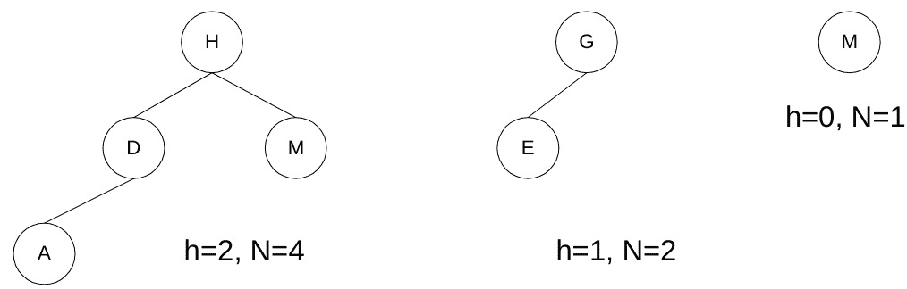

这些树都满足平衡条件。以下树不是AVL树

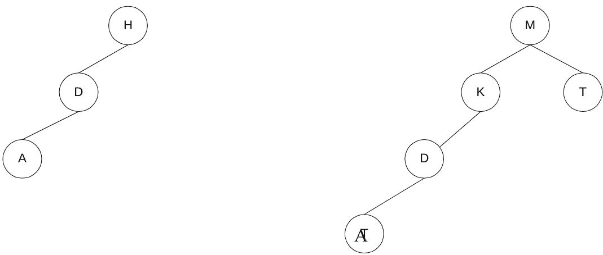

### AVL树搜索

搜索需要O(h)时间。稍后我们将看到树的高度最多为O(log n)，因此搜索需要O(log n)时间。

### AVL树插入

插入会使某个子树的高度增加1。考虑从插入点开始向上遍历树，在每个节点处检查平衡条件。找到的第一个不平衡节点可能以4种方式之一不平衡。分析表明，这4种不同情况中有两种是对称的。因此，存在2种理论情况及其对称情况。设A为最深的不平衡节点。

- 1. 插入在A的左子树的左子树中
- 2. 插入在A的左子树的右子树中
- 3. 插入在A的右子树的左子树中
- 4. 插入在A的右子树的右子树中

情况1和情况4是对称的，并且可以通过LL或RR重新平衡来解决。

情况2和情况3是对称的，并且可以通过LR或RL重新平衡来解决。

### 单旋转

这是LL旋转。RR是对称的。

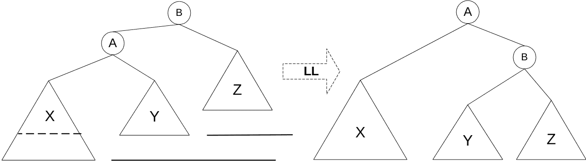

LL和RR是单旋转。RL和LR是双旋转。单旋转更容易理解和实现。双旋转需要稍微多一些的工作。

单旋转不会增加根节点为不平衡节点的树的高度。要看到这一点，你必须观察以下事实。设插入后树X的高度为h。根节点为B的树的高度为h+2。

1. 由于B下面的所有节点都平衡，根节点为A的树也是平衡的，即 `height(X) - height(Y) < 2`。如果插入前后Y的高度等于X的高度，则插入前根节点为B的树不会是AVL树，因为B的左子树在插入前后的高度相同，而现在它不是AVL树。因此，`height(X) = height(Y) + 1`。

2. 由于树现在不是AVL树，所以 `height(X) - height(Z) >= 2`。如果 `height(X) - height(Z) > 2`，那么在插入之前它就不是AVL树，所以 `height(X) - height(Z) = 2`。
3. 由此可得 `height(Y) = h-1`，`height(Z) = h-1`。
4. 旋转后，A的左子树高度为`(h+1)`，右子树高度为`(h-1+2) = (h+1)`。因此，树的高度为h+1，这是插入之前的高度。

这表明以B为根的子树恢复到插入之前的高度，这意味着不需要进一步的平衡。

### 双旋转

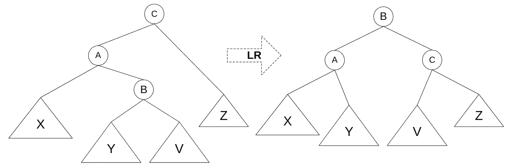

在这种情况下，需要进行双旋转，因为单旋转无法重新平衡。试试看。要进行双旋转，从插入点向上遍历树，直到达到一个不再平衡的节点。将此节点称为C。C的左子节点的右子树高度增加了1。我们不知道这棵树的左子树还是右子树，但这并不重要。图示了旋转过程。设C的左子节点的右子节点为B。要进行双LR旋转，将B作为新的根节点，将其父节点A作为其左子节点，将旧的根节点C作为B的右子节点。因为B现在是根节点，并且它有两个子节点，所以它必须放弃它的旧子树。它将Y给了A，将V给了C，如图所示。

旋转操作减少了树的高度，原因与上述类似。如果插入后Y（或V）的高度为h，则X的高度也必须为h。Z的高度必须为h+1。不能更低。为什么呢？重新平衡后，以B为根的树的高度为h+2，这是插入之前的高度。

### 插入时间的分析

如果不进行旋转操作，插入需要O(h)步骤。如果进行了旋转操作，无论是哪种旋转，重新平衡子树的高度都会降低到插入之前的高度。

（那么树如何增加高度呢?）

### 例子

这意味着重新平衡后树的高度与插入之前的高度相同。因此，由于插入之前树是AVL树，所有祖先节点都是平衡的，在插入和重新平衡之后仍然保持平衡。这意味着一旦重新平衡完成，插入就完成了。重新平衡需要恒定的时间；因此，插入需要搜索的O(h)步骤加上恒定的时间来进行重新平衡。


### AVL树删除

从AVL树中删除比插入更复杂。首先，基本的删除算法与不平衡的二叉搜索树相同：如果一个节点是叶子节点，则删除它；如果它有一个子树，则将子树作为节点的父节点的子节点；如果它有两个子树，则用中序遍历的后继或前驱节点替换它，并删除该节点。

删除节点后，某个子树的高度减少了1。这种高度减少可能导致从该节点到根节点路径上的某个节点失去平衡条件。设B是路径返回根节点的第一个失去平衡条件的节点。

无论是插入还是删除导致的条件失去，四种重新平衡算法之一都会重新平衡失衡的树。问题是，我们如何知道应该选择哪一个？选择错误将导致树失衡。我很快会回来解释这个。

另一个问题是重新平衡可能会使树的高度变小。（在插入之后，重新平衡总是将树恢复到插入之前的高度，但在删除之后，它可能根本不改变高度！与插入问题不同，高度增加并恢复到之前的状态，在删除中，高度减小，现在重新平衡可能再次减小。这意味着树的父节点可能会失去平衡。刚刚重新平衡可能会出现不平衡的情况，需要重新平衡它的树，然后可能需要重新平衡它的父节点，依此类推，直到达到根节点。当我们最终到达根节点时，我们重新平衡并停止该过程。因此，删除的时间复杂度为O(h)步骤来查找并删除节点，并且在最坏情况下需要O(h)次重新平衡步骤。

教科书没有提供删除算法，但我有。证明它的正确性是繁琐的，但我包括它是因为，即使没有其他原因，我也需要向自己证明它是正确的。所以我们开始吧。

假设我们从节点C的右子树中删除一个节点。假设在删除之前，树是平衡的，但在删除之后不再平衡。设h为右子树的高度。那么左子树的高度为h+2。与插入导致的不平衡树不同，结果不平衡的树可能在高度为h+2的左子树中有多个叶节点。我提出以下观点：

引理：假设C是AVL树的根节点，其右子树发生了删除，并且C的所有子树都是平衡的。假设t是指向C的指针，并且 `height(t->left) - height(t->right) = 2`。那么如果 `height((t->left)->left) >= height((t->left)->right)`，则在t处进行LL旋转将重新平衡树，否则进行LR旋转将重新平衡树。

证明：

首先，我证明如果 `height((t->left)->left) >= height((t->left)->right)`，那么LL旋转将重新平衡树。我分两步进行，将不等高度的情况与等高形的情况分开。假设树的根节点是C。同时假设t是指向C的指针，右子树的高度是h，因此左子树的高度是h+2。

#### 情况1: `height( (t->left)->left ) > height( (t->left)->right )`

在这种情况下，A的左子树比右子树更深。由于A是AVL树，Y或V中至少一个的底部高度恰好是h+1。可能有一个比另一个高一级。在LL旋转之前，树将如下图所示。

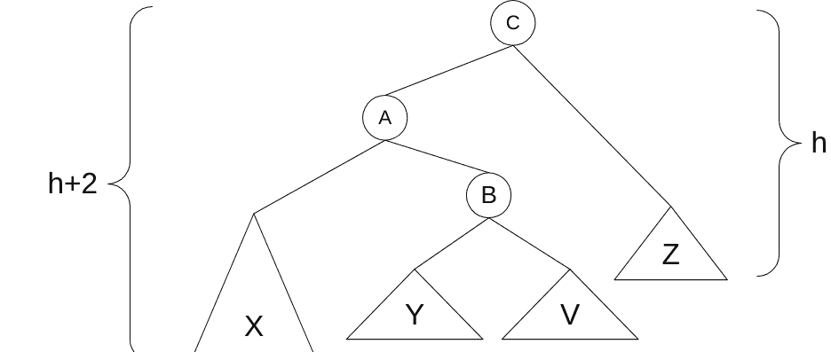

下图显示了在根节点进行LL旋转后的树。树的高度现在为h+1，X和Z的底部处于相同的高度，Y和V中的一个或两个底部节点也处于这个高度。这证明了LL旋转可以使树重新平衡。

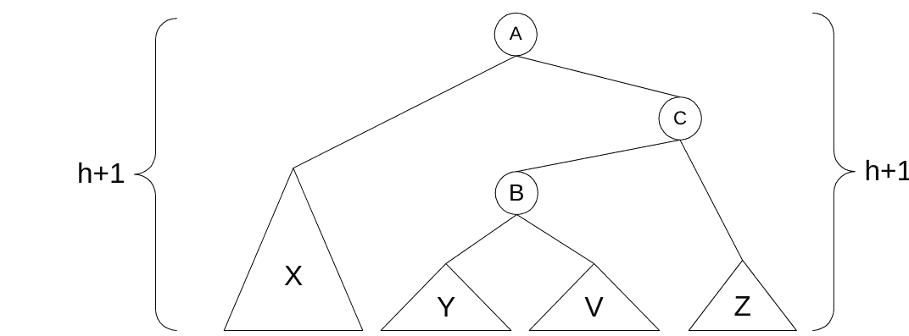

案例1，在LL旋转后

#### 案例2: `height( (t->left)->left ) = height( (t->left)->right )`

如果A的左子树和右子树的高度相等，那么意味着Y或V在树中的深度为h+2，或者可能两者都有。

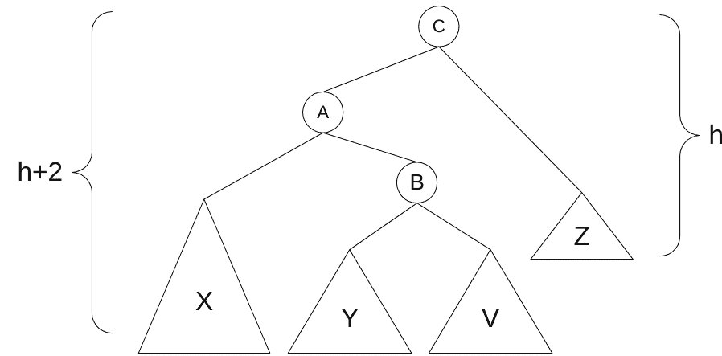

案例2

在LL旋转后，树将如下所示。A的右子树的高度相对于指针t仍然为h+2，树仍然是AVL树。

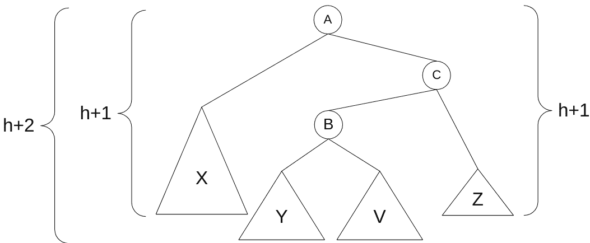

案例2，在LL旋转后

这证明了如果左子树的右子树的高度不大于左子树的左子树的高度，则LL旋转将重新平衡树。要证明如果这个条件成立，LR旋转将失败，请考虑Case 2中的树，但 `height(Y) = height(V) - 1`。在这种情况下，`height(Y) = h-2`，`height(X) = h`。在C处进行LR旋转后，结果树将在节点A处不平衡：

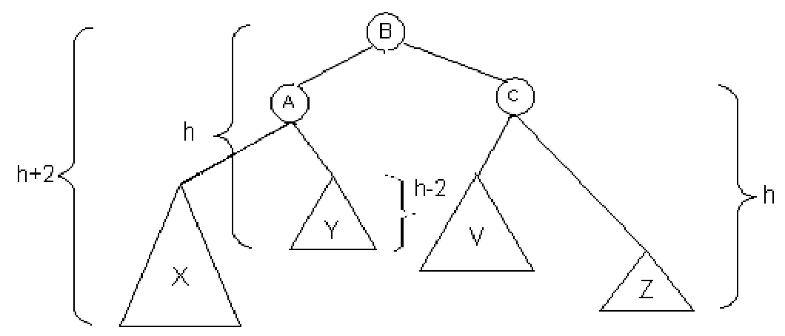

您可以看到A的左子树和右子树X和Y之间的高度差现在为2。这表明在这种情况下必须应用LL旋转。在Case 1中也必须应用LL旋转，原因是Case 1树的Y和V都是高度h-2。

#### Case 3: `height( (t->left)->left ) < height( (t->left)->right )`

在这种情况下，X底部的深度为h+1，而Y或V的底部节点的深度为h+2，如下所示。经过LR旋转后，树将如下图所示。X和V的底部位于h+1，而Y和V中的一个或两个位于h+1，如果它们中的一个不是，则它位于高度h，因为旋转之前节点B是平衡的，这意味着较短的节点最多比另一个节点短一个级别。这证明了最后一种情况是正确的。

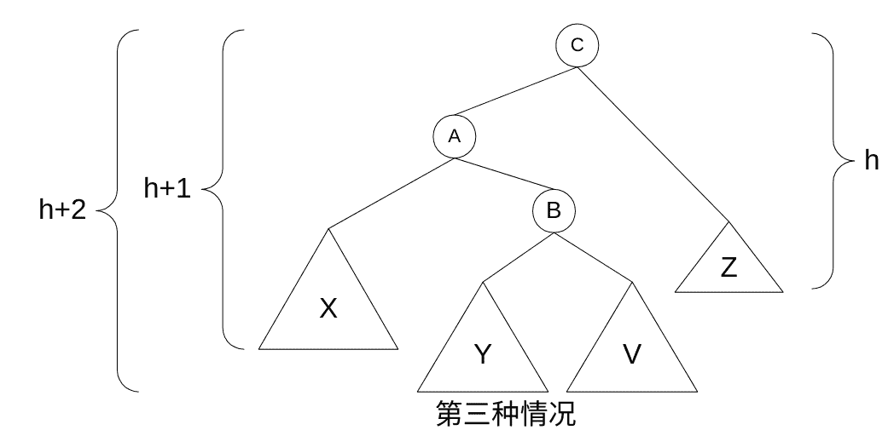

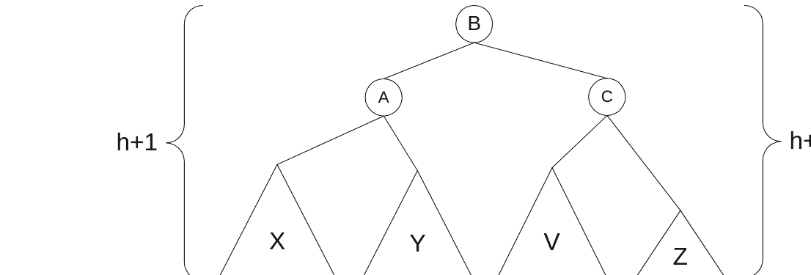

第三种情况，在LR旋转后

我将其留作练习，以证明如果在这种情况下尝试LL旋转，树将在旋转后失衡。

## 最坏情况下的AVL树（斐波那契树）

最坏情况下，AVL树的深度是否为O(log N)? 为了回答这个问题，我们可以尝试确定具有固定节点数的最高可能的AVL树。 事实证明，反过来更容易做到，即给定高度为h的AVL树，其中最少有多少个节点?

这些最小的AVL树是最坏情况树，因为它们在高度上尽可能地装载最少的节点。

设S(h)为高度为h的最小AVL树中的节点数。如果T是高度为h的最小AVL树，则它的左子树和右子树也必须是最小AVL树。 此外，它们的高度最多相差1。 这意味着其中一个高度为h-1，另一个高度为h-2，因为根节点使每个子树的高度增加1。 这导致了递归关系：
S(0) = 1
S(1) = 2
S(h) = S(h-1) + S(h-2) + 1

注意到这个递归关系看起来类似于斐波那契数列的递归关系。如果你写出前几个项，你会得到1、2、4、7、12、20、33、54。 很容易通过归纳法证明S(h)=F(h+2)-1，其中F(k) 是第k个斐波那契数。如果我们将第k个斐波那契数写为f_n，那么你可以看到斐波那契递推关系的

- 一般形式为 $f_n = a_1 f_{n-1} + a_2 f_{n-2} + \dots + a_{k-2} f_{k-2}$，其中 k=2 且 a_1=a_2=1。
- 具体为 $f_n = f_{n-1} + f_{n-2}$。
- 可以重写为 $f_n - f_{n-1} - f_{n-2} = 0$。

这种形式的递归被称为具有恒定系数的齐次线性递归。所有这样的递归都有形式为的解 $F_n = c r^n$。因此，斐波那契方程为 $c r^n - c r^{n-1} - c r^{n-2} = 0$，这等价于 $c r^{n-2}(r^2 - r - 1) = 0$。这有两个非零解，我们可以表示为 $\phi_1$ 和 $\phi_2$。

由于 $\phi_1^n$ 和 $\phi_2^n$ 都是方程的解，它们的线性组合也是解。为了找到唯一解，我们使用斐波那契数列的初始条件建立两个方程（有两个未知数 $a$ 和 $b$）：

$$
a\phi_1^0 + b\phi_2^0 = 0
$$
$$
a\phi_1^1 + b\phi_2^1 = 1
$$

解这些方程，得 $a = -b = 1/(\phi_1 - \phi_2)$。因为 $\phi_1 = \frac{1+\sqrt{5}}{2}$ 和 $\phi_2 = \frac{1-\sqrt{5}}{2}$，我们有：

$$
F(k) = \frac{1}{\sqrt{5}} \left(\frac{1+\sqrt{5}}{2}\right)^k - \frac{1}{\sqrt{5}} \left(\frac{1-\sqrt{5}}{2}\right)^k
$$

这是满足初始条件的唯一解。这是第k个斐波那契数的非递归公式。由此可得：

$$
S(k) = \frac{1}{\sqrt{5}} \left(\frac{1+\sqrt{5}}{2}\right)^{k+2} - \frac{1}{\sqrt{5}} \left(\frac{1-\sqrt{5}}{2}\right)^{k+2} - 1
$$

由于第二项 $\left(\frac{1-\sqrt{5}}{2}\right)^{k+2}$ 随着k的增加而消失，第三项可以忽略不计，## 第4章：树

$$S(k) \approx \frac{1}{\sqrt{5}} \left(\frac{1+\sqrt{5}}{2}\right)^{h+2}$$

如果我们令

$$n = \frac{1}{\sqrt{5}} \left(\frac{1+\sqrt{5}}{2}\right)^{h+2} \approx 0.44 \cdot 2.618 \cdot 1.618^k \approx 1.1708 \cdot 1.618^k$$

并解出 $k$，我们得到

$$\log_2 n \approx 0.6942 \cdot k$$

或者 $k = 1.44 \log n$。这意味着具有 $n$ 个节点的 AVL 树的高度最多大约为 $1.44 \log n$。换句话说，在最坏的情况下，AVL 树的高度比具有 $n$ 个节点的完全平衡满树的高度高约 45%。

如果 $h$ 是满足 $N \le S(h)$ 的最小 $h$，则具有 $N$ 个节点的 AVL 树的高度最多为 $h$。因为如果它是 $h' > h$，则对于 $h < h'$，$S(h') \le S(h)$，并且可以得出我们可以从高度为 $h'$ 的树中删除一些节点，使其高度为 $h$，并且具有少于 $S(h)$ 个节点的 AVL 树的高度为 $h$。

因此，高度为 $h$ 的 AVL 树作为最坏情况树的最小树：具有少于 $S(h)$ 个节点的任何树的高度都小于 $h$。由此可知，AVL 树在最坏情况下的高度为 $O(\log n)$。

## 一个 AVL 树接口

作者的 AVL 树接口如下，我添加了删除实现。

```cpp
template <class Comparable>
class AvlTree;

template <class Comparable>
class AvlNode {
    Comparable element;
    AvlNode *left;
    AvlNode *right;
    int height;

    AvlNode(const Comparable & theElement, AvlNode *lt, AvlNode *rt, int h = 0)
        : element(theElement), left(lt), right(rt), height(h) {}
    friend class AvlTree<Comparable>;
};
```

```cpp
template <class Comparable>
class AvlTree {
public:
    explicit AvlTree(const Comparable & notFound);
    AvlTree(const AvlTree & rhs);
    ~AvlTree();
    const Comparable & findMin() const;
    const Comparable & findMax() const;
    const Comparable & find(const Comparable & x) const;
    bool isEmpty() const;
    void printTree() const;
    void makeEmpty();
    void insert(const Comparable & x);
    void remove(const Comparable & x);
    const AvlTree & operator=(const AvlTree & rhs);
private:
    AvlNode<Comparable> *root;
    const Comparable ITEM_NOT_FOUND;
    const Comparable & elementAt(AvlNode<Comparable> *t) const;
    void insert(const Comparable & x, AvlNode<Comparable> *& t) const;
    AvlNode<Comparable> * findMin(AvlNode<Comparable> *t) const;
    AvlNode<Comparable> * findMax(AvlNode<Comparable> *t) const;
    AvlNode<Comparable> * find(const Comparable & x, AvlNode<Comparable> *t) const;
    void makeEmpty(AvlNode<Comparable> *& t) const;
    void printTree(AvlNode<Comparable> *t) const;
    AvlNode<Comparable> * clone(AvlNode<Comparable> *t) const;
    // AVL 操作
    int height(AvlNode<Comparable> *t) const;
    int max(int lhs, int rhs) const;
    void rotateWithLeftChild(AvlNode<Comparable> * & k2) const;
    void rotateWithRightChild(AvlNode<Comparable> * & k1) const;
    void doubleWithLeftChild(AvlNode<Comparable> * & k3) const;
    void doubleWithRightChild(AvlNode<Comparable> * & k1) const;
};
```

我只包括插入方法的实现，没有其他内容。这些是唯一感兴趣的项目。

### 插入实现

```cpp
template <class Comparable>
void AvlTree<Comparable>::insert(const Comparable & x, AvlNode<Comparable> * & t) const {
    if (t == NULL)
        t = new AvlNode<Comparable>(x, NULL, NULL);
    else if (x < t->element) {
        insert(x, t->left);
        if (height(t->left) - height(t->right) == 2)
            if (x < t->left->element)
                rotateWithLeftChild(t);
            else
                doubleWithLeftChild(t);
    } else if (t->element < x) {
        insert(x, t->right);
        if (height(t->right) - height(t->left) == 2)
            if (t->right->element < x)
                rotateWithRightChild(t);
            else
                doubleWithRightChild(t);
    } else
        ; // 重复项，不执行任何操作
    t->height = max(height(t->left), height(t->right)) + 1;
}
```

### 删除实现

```cpp
template <class Comparable>
void AvlTree<Comparable>::remove(const Comparable & x, AvlNode<Comparable> * & t) const {
    if (t == NULL)
        // 无法从空树中删除
        return;

    if (x < t->element) {
        // 从左子树中删除
        remove(x, t->left);

        // 检查子树的高度是否相差太大
        if (height(t->right) - height(t->left) == 2) // 不平衡
            // 右子树相对于左子树太高
            // 使用哪种旋转取决于右子树的左子树是否更大，或者右子树的右子树是否更大。
            // 如果左子树更大，我们必须使用
            if (height((t->right)->right) >= height((t->right)->left))
                rotateWithRightChild(t);
            else
                doubleWithRightChild(t);
    } else if (t->element < x) {
        // 从右子树中删除
        remove(x, t->right);
        if (height(t->left) - height(t->right) == 2) // 不平衡
            // 左子树相对于右子树太高
            if (height((t->left)->left) >= height((t->left)->right))
                rotateWithLeftChild(t);
            else
                doubleWithLeftChild(t);
    } else { // 删除这个节点
        if ((t->left != NULL) && (t->right != NULL)) { // 两个非空子树
            t->element = findMin(t->right)->element;
            remove(t->element, t->right);
            if (height(t->left) - height(t->right) == 2) // 不平衡
                // 左子树相对于右子树太高
                if (height((t->left)->left) >= height((t->left)->right))
                    rotateWithLeftChild(t);
                else
                    doubleWithLeftChild(t);
        } else {
            AvlNode<Comparable>* OldNode = t;
            t = (t->left != NULL) ? t->left : t->right;
            delete OldNode;
        }
    }
    if (NULL != t)
        t->height = max(height(t->left), height(t->right)) + 1;
}
```

```cpp
template <class Comparable>
void AvlTree<Comparable>::rotateWithLeftChild(AvlNode<Comparable> * & k2) const {
    AvlNode<Comparable> *k1 = k2->left;
    k2->left = k1->right;
    k1->right = k2;
    k2->height = max(height(k2->left), height(k2->right)) + 1;
    k1->height = max(height(k1->left), k2->height) + 1;
    k2 = k1;
}
```

> /**
>  * 将二叉树节点与右子节点旋转。
>  * 对于 AVL 树，这是第 4 种情况的单旋转。
>  * 更新高度，然后设置新的根节点。
>  */

```cpp
template <class Comparable>
void AvlTree<Comparable>::rotateWithRightChild(AvlNode<Comparable> * & k1) const {
    AvlNode<Comparable> *k2 = k1->right;
    k1->right = k2->left;
    k2->left = k1;
    k1->height = max(height(k1->left), height(k1->right)) + 1;
    k2->height = max(height(k2->right), k1->height) + 1;
    k1 = k2;
}
```

> /**
>  * 双旋转二叉树节点：首先左子节点与其右子节点；然后节点 k3 与新的左子节点。
>  * 对于 AVL 树，这是第 2 种情况的双旋转。
>  * 更新高度，然后设置新的根节点。
>  */

```cpp
template <class Comparable>
void AvlTree<Comparable>::doubleWithLeftChild(AvlNode<Comparable> * & k3) const {
    rotateWithRightChild(k3->left);
    rotateWithLeftChild(k3);
}
```

> /**
>  * 双旋转二叉树节点：先右子节点与其左子节点一起；然后节点 k1 与新的右子节点。
>  * 对于 AVL 树，这是第 3 种情况的双旋转。
>  * 更新高度，然后设置新的根节点。
>  */

```cpp
template <class Comparable>
void AvlTree<Comparable>::doubleWithRightChild(AvlNode<Comparable> * & k1) const {
    rotateWithLeftChild(k1->right);
    rotateWithRightChild(k1);
}
```

## B 树

AVL 树和其他二叉搜索树适用于完全包含在计算机内存中的数据的组织。当数据量太大无法完全放入内存时，即当它是外部数据时，这些结构的性能表现不佳。这是因为内存访问和磁盘访问之间的访问时间差异巨大。大 O 分析可能显示搜索的最坏情况下是 $O(\log n)$，但它隐藏了常数可能非常大的事实。

问题在于磁盘访问通常比内存访问慢 1000 倍。例如，考虑一个每分钟旋转 10800 次的磁盘，这是目前的最新技术。一次旋转需要 $1/180$ 秒。平均而言，我们需要寻找半个旋转的时间，也就是 $1/360$ 秒，才能开始读取数据，大约需要 3 毫秒。在 3 毫秒内，典型的 CPU 可以执行大约 75000 条指令。如果我们将二叉搜索树用作磁盘的文件索引，那么每次节点访问都需要相当于 75000 次磁盘访问的时间！

一种解决方案是增加树的度数，使树更扁平化，从而减少磁盘访问次数。在 CPU 中花费更多时间来查找正确的节点，但与磁盘 I/O 相比，这很小。在 1970 年，R. Bayer 和 E. McCracken 发现（或发明，取决于你的观点）了一种称为 B 树的多路树。B 树的策略是将树扁平化，使其成为高度 $\log_m n$ 的树，并通过在每个内部节点内进行更多的工作来支付代价，可能是通过搜索子节点列表来找到正确的子节点。即使是对子节点键的线性搜索也是值得的，因为它节省了相当于数十万条指令的时间。

教科书对原始 B 树概念进行了轻微变化的定义。

定义。一个阶数为 $m$ 和 $L$ 的 B 树是一个具有以下属性的 $m$ 叉树：

- 1. 数据项存储在叶子节点中。
- 2. 内部节点最多存储 $m-1$ 个键，$K_1, K_2, \dots, K_{m-1}$。键 $K_i$ 是节点的子树 $T_{i+1}$ 中的最小键。
- 3. 对于给定节点中的所有键，$K_1 < K_2 < \dots < K_{m-1}$。
- 4. 除根节点外的所有内部节点具有 $\lceil m/2 \rceil$ 到 $m$ 个子节点。
- 5. 如果根节点不是叶子节点，则它具有 $2$ 到 $m$ 个子节点。
- 6. 所有叶子节点的深度相同。
- 7. 如果树至少有 $\lceil L/2 \rceil$ 个数据项，则所有叶子节点具有 $\lceil L/2 \rceil$ 到 $L$ 个子节点。

下图显示了一个 B 树的内部节点，其阶数为 $m$。它有 $m$ 个子树指针，$P_0$ 到 $P_{m-1}$。

| 子节点 | $K_1$ | 子节点 | $K_2$ | 子节点 | ... | 子节点 | $K_{m-1}$ | 子节点 |
|:---:|:---:|:---:|:---:|:---:|:---:|:---:|:---:|:---:|
| $T_1$ | $K_1$ | $T_2$ | $K_2$ | $T_3$ | ... | $T_{m-1}$ | $K_{m-1}$ | $T_m$ |

### 关于术语的说明

上述定义中的“叶节点”指的是仅包含数据项的节点。这些叶节点是与存储指针和键的内部节点不同类型的节点。第 5 部分的定义指出，树的根节点可以是叶节点或内部节点。当树中插入前几个项时，还不足以需要内部节点。因此，树由一个单独的叶节点组成。一旦有足够的数据项需要两个叶节点，就会创建一个具有指向这两个叶节点的内部节点。

### 确定 $m$ 和 $L$ 的值

B 树的设计应考虑到磁盘块的大小，磁盘块地址的大小，数据项的大小和关键字的大小。例如，假设一个磁盘块是 4096 字节，磁盘地址长度为 4 字节，数据项是 512 字节记录，关键字长度为 32 字节。由于一个节点有 $m-1$ 个关键字和 $m$ 个子节点，每个内部节点需要 $32(m-1)+4m$ 字节。解方程 $36m-32 \le 4096$，得到最大的 $m$ 为 114。一个磁盘块可以容纳 8 个数据项。因此，为了最小化磁盘读取次数，我们可以让 $m=114$，$L=8$。每次访问一个块时，会加载给定节点的所有关键字，并确定适当的子树。如果 $m$ 开始变得非常大（因为关键字相对于块大小很小），则应进行更准确的分析，以考虑实际的搜索时间。

### B-树搜索

使用 B 树进行搜索需要在每个节点中进行线性搜索或二进制搜索键。如果使用二进制搜索，每个节点需要 $O(\log m)$ 次比较。当最终到达叶节点时，可以使用线性搜索或二进制搜索来搜索数据项。磁盘访问次数等于树的高度，即 $O(\log_m n)$。

### B-树插入

在 B 树中插入比在 AVL 树中插入要复杂得多。这是因为要求更为严格。叶节点和内部节点都必须控制子节点的数量。插入操作可能导致叶节点超过其子节点限制。当这种情况发生时，节点必须分裂为两个节点，每个节点的子节点更少。这种分裂可能导致父节点的子节点限制被超过，依此类推。算法大致如下：

1. 在树中搜索插入 $x$ 的位置。如果 $x$ 已经在树中，则返回。
2. 如果叶节点的子节点少于 $L$ 个，则将 $x$ 插入到适当的位置并返回。
3. 否则，将叶节点分割为两个叶节点，一个有 $\lceil (L+1)/2 \rceil$ 个项，另一个有 $\lfloor (L+1)/2 \rfloor$ 个项。
4. 递归执行以下操作：如果父节点的子节点少于 $m$ 个，将新的叶节点插入到父节点并更新父节点的键，以便为新的叶节点添加一个新的键。
5. 否则，将父节点分成两个节点，一个左节点和一个右节点，将前 $\lceil m/2 \rceil$ 个节点作为左父节点的子节点，将剩余的节点作为右父节点的子节点。
6. 如果父节点有一个父节点，那么将新创建的节点插入到父节点的父节点中，并让父节点成为父节点的父节点，并重复这些步骤。如果没有，这是一个根节点。创建一个新的根节点，并将这两个节点作为新根节点的子节点。

注意树的增长只是由于根节点的分裂而导致的。这是一个极其罕见的事件。树的高度达到 $h$（以从根节点到叶节点的边数来衡量），是由于 $h-1$ 次分裂操作的结果。高度为 $h$、阶数为 $m$ 和 $L$ 的树至少有 $2 \cdot \lfloor m/2 \rfloor^{h-1} \cdot \lfloor L/2 \rfloor$ 个数据项。例如，如果 $m=20$，$L=40$，$h=4$，则该树至少有 40,000 个数据项，并且根节点只分裂了 3 次！这棵树中最多有多少个数据项？如果一棵树有 40,000 个数据项，根据 $m$ 和 $L$，它的最小高度是多少？

### B 树删除

从 B 树中删除一个节点与 B 树插入一样复杂。最坏情况下的删除可能需要一直删除节点直到根节点。如果达到那一步，根节点将被删除，树的高度将减少 1。

删除的问题在于删除后，一个节点可能会有太少的子节点。在这种情况下，节点会被合并。合并是分割的相反操作。节点会与其左侧的节点合并，除非它是最左侧的节点，在这种情况下，它会与其右侧的节点合并。如果合并后的节点中的总节点数大于 $L$，则无法进行合并，此时会从相邻节点中借用数据来替换被删除的项。

如果发生合并，则子树序列中的间隙会被左移以填补被删除节点的位置。如果父节点现在有太少的子节点，即少于 $\lceil m/2 \rceil$，则父节点会与父节点的兄弟节点合并，将它们的子节点合并为一个节点。这种方法非常直观。如果无法进行合并，则使用借用的方法，从相邻节点中取出一个子树来替换已合并的子树。

# 第5章 哈希和哈希表

## 5.1 引言

哈希表是一个查找表，设计良好时，对于查找或插入操作，平均运行时间几乎为 $O(1)$。更准确地说，哈希表是一个固定大小的数组，包含具有唯一键的数据项，以及一个称为哈希函数的函数，将键映射到表中的索引。 例如，如果键是整数，哈希表是大小为127的数组，那么定义为 $hash(x) = x \% 127$ 的函数 $hash(x)$ 将数字映射到大小为127的有限域中的模数。

从概念上讲，哈希表是一种更通用的结构。 它可以被看作是一个包含 $(key, value)$ 对的表 $H$，具有这样的属性，即 $H$ 可以通过键本身进行索引。 换句话说，通常情况下，通过写入类似于 $A[i]$ 的方式引用数组 $A$ 的元素，使用整数索引值 $i$，而使用哈希表时，将索引值“$i$”替换为位置 $i$ 中包含的键。例如，如果 $H$ 包含一组对：
（“意大利”, “罗马”), (“日本”, “长野”), (“加拿大”, “班夫”）
那么你可以写出这样的语句：
```
print H["意大利"]
```
将打印出罗马，或者
```
print H["日本"]
```
将打印出长野。

可以通过这种方式进行寻址的表，其中索引是内容而不是下标，被称为内容寻址表（CAT）。 哈希表是内容寻址表。 显然，如果你可以在 $O(1)$ 的运行时间内查找一个值，那就是一件好事，尤其是如果插入值也需要 $O(1)$ 的时间。 这将是一个比任何类型的二叉搜索树都要好得多的搜索表，无论是平衡的还是不平衡的。

## 5.2 好的哈希函数的特性

哈希的意思是把事物切碎或弄乱，就像切碎的土豆一样。 哈希函数应该将其参数切碎并从切碎的小块中重构出一个值。 好的哈希函数使得从计算出的哈希值中难以重构出原始值。 要成为好的哈希函数，应该：
- 易于计算（为了速度）；
- 随机地均匀分布键到整个表中，确保没有两个键映射到相同的索引。

易于计算通常意味着函数是一个 $O(1)$ 操作，实际上与输入大小和哈希表大小无关。例如，如果函数尝试找到给定数字的所有质因数以计算哈希函数，这将不容易计算。易于计算是一个模糊的概念。均匀分散键意味着连续键之间有尽可能多的距离。例如，如果哈希表的大小为1000，并且其中有200个键，则它们应该与其邻居相隔约五个地址。

原则上，如果键的集合是有限的并且事先已知，我们可以构造一个完美的哈希函数，将每个键映射到唯一的索引。已经对如何高效地找到完美的哈希函数进行了大量研究。例如，如果我们有整数键：
112, 46, 75, 515
我们希望有一个函数将它们唯一地映射到数字 0, 1, 2 和 3。 巧合的是，虽然我随机选择了这些数字，但我对它们的完美哈希函数的第一个猜测是一个好猜测。 假设 $g(x)$ 是一个返回 $x$ 的十进制数字之和的函数。 $g(x)$ 可以通过递归定义如下：
```
g(x)= \begin{cases} x & \text{如果 } x \leq 9 \\ x \% 10+g(x / 10) & \text{otherwise} \end{cases}
```
例如， $g(122)=5$ 和 $g(75)=12$ 。让 $h(x)$ 通过以下方式定义：
```
h(x)= \begin{cases} g(x) & \text{如果 } g(x) \leq 9 \\ h(g(x)) & \text{otherwise} \end{cases}
```
函数 $h(x)$ 是将 $x$ 中的数字相加，但是递归地相加直到它落在 $[0,9]$ 的范围内。例如， $h(112)=1+1+2=4$, $h(46)=h(4+6)=h(10)=1$, 以及 $h(75)=h(7+5)=h(12)=3$. 这些数字恰好映射到唯一的索引，这只是纯粹的运气；事实上，这个哈希函数是一个非常糟糕的哈希函数。它糟糕的原因是它没有充分利用关键字中的信息内容，比如数字的顺序；例如， $h(112)=h(121)=h(211)=4$. 有一些工具可以构建完美的哈希函数。 GNU的gperf就是这样一个工具，可以从ftp://ftp.gnu.org/pub/gnu/下载。

## 5.3 碰撞

由于几乎所有实际的哈希函数都不完美，它们会将一个或多个键映射到相同的索引，就像上面定义的方式将112、121和211映射到相同的索引值4一样。当哈希函数将两个或多个键映射到相同的位置时，称为碰撞。

发生碰撞时，必须为引起碰撞的键找到一个新的位置，即要进行哈希的第二个键。 为发生碰撞的键重新定位的策略称为碰撞解决策略或算法。 由于重新定位本身可能导致进一步的碰撞，碰撞解决算法的目标是尽量减少哈希表中的总碰撞数。

符号表示。 在哈希表的其余部分中，$M$ 将表示哈希表的长度，表本身将用 $H$ 表示，因此 $H[0]$ 到 $H[M-1]$ 是表的条目。 哈希函数将用函数符号表示，例如 $h(x)$，$h_1(x)$，$h_2(x)$ 等，$x$ 始终是一个键。

## 5.4 哈希函数

虽然有许多不同类别的整数函数可用作候选哈希函数，但我将重点介绍三种最常见的类型：
- 基于除法的哈希函数：主要操作是对键进行除法运算
- 基于位移的哈希函数：主要操作是位移
- 乘法哈希函数：主要操作是乘法

### 5.4.1 基于除法的哈希函数

除法方法使用模运算（%），实际上是一种除法形式的概念和操作。 在除法方法中，哈希函数的形式为
```
h(x) = x % M
```
某些 $M$ 的选择显然比其他选择更差。 例如，如果 $x$ 是一个 $n$ 位数，并且 $M= 2^m$，则 $x \% M$ 只是 $x$ 的 $m$ 个最低有效位，这并不是特别好，因为它没有使用剩余的位，浪费了很多信息。 如果 $M$ 是任何偶数， $h(x)$ 对于偶数 $x$ 是偶数，对于奇数 $x$ 是奇数，这会引入偏差到表中。

这是一个坏主意，因为 $M$ 是 3 的倍数，这样两个只有数字排列不同的数字将被散列到相差 3 的位置。 例如，如果我们取 $M= 6$，那么 $52 \% 6 = 4$ 和 $25 \% 6 = 1$，相差 3。 同样地，$1157 \% 6 = 5$，如果我们将 1157 排列为 7511，$7511 \% 6 = 5$。 （这是因为 $10x \% 3 = 1$ 和 $4x \% 3 = 1$ 的结果。）

对于不同的 $M$ 值，还会出现其他微妙的问题。 将表的大小 $M$ 设为一个质数可以避免这些问题。 事实上，有些类型的质数比其他质数更好。（详见 Knuth 的《计算机程序设计艺术》第 3 卷《排序与搜索》） 哈希函数：
```
h1(x) = x % 127
h2(x) = x % 511
h3(x) = x % 2311
```
是基于除法的哈希函数的例子，其中 $M$ 是素数。 与乘法、加法和减法相比，除法是一种较慢的操作；这是研究其他类型哈希函数的一个原因。

### 5.4.2 使用中间平方方法的位移哈希函数

位移指的是将数据向左或向右移动一定数量的位的机器操作。

一个向右移动 $k$ 位并用零填充上 $k$ 位的位移，等价于整数除以 $2^k$。例如，将位串 $10100_2=20_{10}$ 向右移动两位，结果为 $00101_2=5_{10}$，即 $20/4$。设 $w$ 为处理器的字长（以位为单位），设 $W=2^w$。

在今天的机器中，$w$ 通常是 32 或 64。$W$ 是可以表示在一个机器字中的整数的总数。在二进制补码算术中，$W$ 是 MAXINT+1，其中 MAXINT 是可表示的最大正整数。下面的 32 位数是 MAXINT：
`MAXINT = 11111111111111111111111111111111`
很容易看出，表达式 $(b \% W)$，其中 $b$ 是任意整数，只是 $b$ 的低位 32 位。如果机器字是 32 位，这只是一种忽略溢出的方法，如果 $b \ge W$ 并且 $b$ 存储在一个机器字中。如果告诉处理器在整数计算期间忽略整数溢出，可以计算 $(b \% W)$。现在考虑以下表达式：
```
h(x) = \frac{M}{W} (x^2 \% W)
```
为了使这个函数高效，$M$ 必须是 2 的幂。假设 $M=2^m$，其中 $m$ 是一个正整数。那么 $M/W = 2^{m-w}$。这等价于
```
h(x) = 2^{m-w} (x^2 \% 2^w)
```
注意，因为 $W$ 比 $M$ 大，$0 < M/W < 1$ 且 $(m-w) < 0$。因此，乘以 $M/W$ 等同于将右移 $(w-m)$ 位。这个哈希函数基本上忽略了由于平方 $x$ 而引起的溢出，然后将 $x^2$ 右移 $(w-m)$ 位。由于 $x^2$ 在具有 $w$ 位的字中向右移 $(w-m)$ 位，前 $(w-m)$ 位为零，最终值位于低位 $m$ 位。这证明了 $0 \le h(x) < 2^m = M$。因此，这个哈希函数生成的数字介于 0 和 $M-1$ 之间，正如它应该的那样。

还要注意，这个函数不需要除法运算，因为它等同于以下的 C/C++ 表达式：
```
h(x) = (x*x) >> (w-m)
```
其中 `>>` 是 C/C++ 中的右移操作符。这个函数只使用了一次乘法和一次位移操作，因此比除法方法要快得多。

### 5.4.3 乘法哈希函数

乘法哈希函数的形式为
```
h(x) = \frac{M}{W} (Ax \% W)
```
图5.1：乘法哈希函数

其中 $A$ 是一个精心选择的常数。虽然 $M$ 不一定是 2 的幂次，但是假设 $M=2^m$。下面，我将更详细地解释如何选择常数 $A$ 以及为什么它的值对于这个哈希函数的行为非常关键。

如果 $Ax < W$，这只是将乘积 $Ax$ 向右位移 $(w - m)$ 位。 如果 $Ax$ 大于 $W$，它会将 $Ax$ 的除了低位的 32 位都移除，并将这个值向右位移 $(w - m)$ 位。结果是一个介于 0 和 $M - 1$ 之间的值，原因与中间平方方法的结果介于 0 和 $M - 1$ 之间相同。

另一种思考这个哈希函数的方式是假装二进制数在最低有效位的右边有一个小数点（一个二进制点？），而除以 $W$ 的效果是将二进制的“小数点”移动到最高有效位的左边。假设在图 5.1 的第 1 行标记为 $W$ 的矩形是一个具有 $w$ 位的机器字的长度。

假设 $Ax$ 的乘积比 $W$ 大得多，如第 2 行所示。那么 $Ax \% W$ 就是第 3 行中显示的部分，轻轻阴影。乘以 $M/W$ 等同于除以 $W$ 然后乘以 $M$。除以 $W$ 等同于将“二进制小数点”从字的极右边移动到 $W$ 的左边，如第 4 行所示。乘以 $M$ 等同于将 $Ax \% W$ 的数量向左移动 $m$ 位。如果标记为 $M$ 的行表示一个 $m$ 位字的长度，则第 5 行显示了这个乘法的结果。

你一直假设"二进制小数点"在 32 位整数的右边。假设所有存储在机器字中的数字 $z$ 实际上是形式为 $(z/W)$ 的分数的分子，因此二进制小数点实际上在字的左边，就像第 4 行一样。第 4 行的图示告诉我们，我们可以将 $Ax \% W$ 看作是 $Ax$ 的小数部分。让我们用 $\{z\}$ 表示任意实数 $z$ 的小数部分，即
```
{z} = z - \lfloor z \rfloor
```
那么 $Ax \% W$ 就是 $\{Ax\}$，并且
```
h(x) = \lfloor M \cdot \{Ax\} \rfloor
```
还要注意 $0 \le M \cdot \{Ax\} < M$，因为 $0 \le \{Ax\} < 1$。

### 斐波那契哈希

图5.2：使用斐波那契哈希散列值的分布。

在乘法方法中，乘数 $A$ 必须谨慎选择以散布数字。 一个很好的选择常数 $A$ 是 $\phi^{-1}$，其中 $\phi$，被称为黄金比例，是多项式的正根。
```
x^2 - x - 1 = 0
```
这是因为，如果且仅当多项式为零时， $x$ 是多项式的解。即
```
x = \frac{1}{x}
```
换句话说，解 $x$ 具有其逆解为 $x - 1$ 的属性。 解 $\phi$ 被称为黄金比例，因为它在自然界中出现在惊人数量的地方，并且古希腊人在许多建筑设计中使用了这个比例，认为它是神圣的比例。 因此， $\phi$ 和 $\phi^{-1} = \phi - 1$ 都是多项式 $x^2 - x - 1 = 0$ 的根。 $\phi$ 也是当 $n \to \infty$ 时，$f_n / f_{n-1}$ 收敛的值，其中 $f_n$ 是第 $n$ 个斐波那契数。 由于 $\phi^{-1} = \phi - 1$，它近似等于 $0.6180339887498948482045868343656$。（好近似取决于你对近似的概念，不是吗?）

当我们让 $M = \phi^{-1}W$ 作为乘法常数时，这种乘法方法被称为 Fibonacci 哈希。 这个常数具有许多显著的数学性质，但是其中一个使它成为上述哈希函数中的一个好因子的性质是以下的。

数值序列 $\{\phi^{-1}\}$, $\{2 \phi^{-1}\}$, $\{3 \phi^{-1}\}$, ... 完全位于区间 $(0,1)$ 内。 记住花括号表示取小数部分，所以例如， $2 \phi^{-1} \approx 1.236067977$ 和 $\{2 \phi^{-1}\} \approx 0.236067977$. 第一个值将区间分为两个长度符合黄金比例的段。 事实上，每个值都将其所在的段分为两个长度符合黄金比例的段。 此外，每个连续的值都放置在区间 $(0,1)$ 中最大的段中。 这意味着连续的值在整个区间上均匀分布，无论有多少个点。参见图 5.2。

当在上述哈希函数中使用时，它们将连续的键分散到哈希表中，以相同的方式。这倾向于减少碰撞的可能性。 表 5.1 显示了典型机器字大小的乘数值。

| w | $\phi^{-1} W$ |
|---|---|
| 16 | 40,503 |
| 32 | 2,654,435,769 |
| 64 | 11,400,714,819,323,198,485 |

表 5.1：斐波那契哈希乘数。

## 5.5 字符串编码

键通常是字符串。 哈希函数通常是从整数到整数的函数，那么如何将字符串映射到整数？ 让一个任意字符串表示为 $s$，由 $k+1$ 个符号组成，属于某个固定字母表：
$s = s_0 s_1 s_2 \dots s_k$
让 $S$ 表示该字母表上所有可能的字符串的集合。 字符串编码是一个从字符串集合 $S$ 到非负整数的函数 $encode: S \rightarrow \mathbb{Z}$。

编码函数不必是可逆的，即不必是一对一和映满的；它可以将不同的字符串映射到相同的数字。 一旦我们有了一个编码函数，它可以与哈希函数 $h$ 组合使用，如下所示：表索引 = $h(encode(s))$;

编码需要谨慎选择。 有好的编码和坏的编码。 这是一个坏的编码：
```
encode1(s) = int(s0) + int(s1) + ... + int(sk)
```
这是不好的，因为它忽略了字母的顺序，所以 stop、spot 和 tops 都映射到同一个位置。 最好选择一种编码，将彼此排列的单词映射到唯一的数字。 一种方法是将文本字符串重新解释为一个非常大的字母表上的数字。

在我们通常的十进制数系统中，像 3276 这样的数字是我们用英语表示为这样千二百七十六这样表示，它等于
$3 \cdot 10^3 + 2 \cdot 10^2 + 7 \cdot 10^1 + 6 \cdot 10^0$
当你看到一个十六进制数字如 $BADCAB2$，你知道这是一个表示数字的方式
$B \cdot 16^6 + A \cdot 16^5 + D \cdot 16^4 + C \cdot 16^3 + A \cdot 16^2 + b \cdot 16^1 + 2 \cdot 16^0$
其中 $A$ 代表数字 10, $B$ 代表 11, $C$ 代表 12, 依此类推。这种计数系统是满射的，也就是说，对于任何整数 $n$，都存在一个唯一的十六进制字符串来表示它。我们可以推广这个想法。假设所有的字符串都是由一个字母表组成的，比如说 26 个字符，例如字母 a,b,c,d,...,z。假设 a 代表值 0, b 代表值 1, c 代表值 2, 一直到 z 代表值 25。那么字符串哈希表示的数字就是
$h \cdot 26^6 + a \cdot 26^5 + s \cdot 26^4 + h \cdot 26^3 + i \cdot 26^2 + n \cdot 26^1 + g \cdot 26^0$
$= 7 \cdot 26^6 + 0 \cdot 26^5 + 18 \cdot 26^4 + 7 \cdot 26^3 + 8 \cdot 26^2 + 13 \cdot 26^1 + 6 \cdot 26^0$
$= 2162410432 + 8225568 + 123032 + 5408 + 338 + 156$
$= 2170764934$
这种字符串编码方法将任何字符串映射到一个唯一的整数。问题在于整数通常比一个 64 位数能表示的范围更大。在上面的例子中，哈希值的大小超过了一个有符号 32 位整数的范围。尽管如此，这种编码可以通过从给定单词中选择一些字母而不是全部字母来使用。编码可以使用偶数位置的字母或者第一个字母，或者每隔三个字母，等等。

总结一下，假设 $s$ 是一个包含 $B$ 个不同符号的字母表上的字符串。由于从 $s$ 的哪一侧开始并不重要，我们可以定义将 $s$ 编码为一个唯一整数的方法为
$\text{encode}(s) = \sum_{j=0}^{k} s_j B^j = s_0 B^0 + s_1 B^1 + s_2 B^2 + \cdots + s_k B^k$
正如提到的，除非对字符串进行采样，否则大多数字符串的编码值将会过大。这种编码的另一个问题是它不满足易于计算的条件。计算它的朴素方法将需要 $k + (k-1) + (k-2) + \dots + 2 + 1 = k(k+1)/2$ 次乘法。计算这个的更高效的方法是使用霍纳法则，避免整数溢出。霍纳法则是一种高效计算多项式的方法。它基于递归地应用以下多项式的定义：
$a_0 + a_1 x + a_2 x^2 + \cdots + a_n x^n = a_0 + x(a_1 + a_2 x + \cdots + a_n x^{n-1})$
$= a_0 + x(a_1 + x(a_2 + a_3 x + \cdots + a_n x^{n-2}))$
等等。换句话说，一个次数为 $n$ 的多项式 $p(x)$ 可以写成 $p(x) = a_0 + x(q(x))$ 其中 $q(x)$ 的次数为 $n-1$。这个定义使用了多项式的常规符号表示法，最高指数系数乘以最高次幂的 $x$。下面的函数使用 Horner 算法计算一个字符串在 RADIX 个符号的字母表上的编码值：
```
long long encode (const int RADIX, const string &s)
{
    long long hashval = 0;
    for (int i = 0; i < s.length(); i++)
        hashval = s[i] + RADIX * hashval; // p(x) = s_i + x(q(x))
    return hashval;
}
```## 5.6 碰撞解决

注意，这个函数每次迭代执行一次乘法和一次加法，对于长度为n的字符串，总共执行了 n次乘法和 n次加法。

有两种基本的碰撞解决方法：

- 分离链接
- 开放寻址

开放寻址本身有许多不同的版本，你将会看到。分离链接是最容易理解和实现的，但其性能不如开放寻址。

### 5.6.1 分离链接

在分离链接中，哈希表是一个链表数组，所有哈希到同一位置的键都在同一个链表中。新的键被插入到链表的前面。换句话说，每个哈希表条目是一个指向键和它们关联的数据项的链表的指针。参见图5.3。要将键插入到表中，首先计算哈希表索引，然后搜索链表以查看键是否已经在表中。如果没有，将其插入到链表的头部。在最坏的情况下，这需要搜索整个链表。平均而言，每次插入都会搜索链表的一半。如果链表很短，不值得保持排序顺序。


负载因子，λ，被定义为表中项目数与表大小的比率。如果M是表的大小，N是表中项目的数量，那么λ=N/M。图5.3中的表的负载因子为5/8=0.625。在分离链接法中，负载因子是链表的平均长度，包括空链表和非空链表。当使用分离链接法时，负载因子可能超过1.0。

下面的列表显示了哈希表的模板类接口的示例。从私有部分我们可以推测出这个表使用了分离链接法。该接口提供了插入、删除和查找键的函数，以及一个拷贝构造函数和一个普通构造函数。一旦再次，C++的弱点在于接口没有隐藏哈希表使用分离链接的事实。我们可以通过声明一个抽象基类并从中派生具体的哈希表来克服这个问题。

```cpp
template <class HashedObj>
class HashTable
{
public:
    explicit HashTable(const HashedObj &未找到, int 大小 = 101);
    HashTable(const HashTable &rhs) :
        ITEM_NOT_FOUND(rhs.ITEM_NOT_FOUND),
        Lists(rhs.theLists) {}
    const HashedObj &查找(const HashedObj &x) const;
    void 清空();
    void 插入(const HashedObj &x);
    void 删除(const HashedObj &x);

private:
    vector<List<HashedObj>> Lists;          // 链表数组
    const HashedObj ITEM_NOT_FOUND;
};
int 哈希(const string &键, int 表大小);
int 哈希(int 键, int 表大小);
```

计算机科学335 软件设计与分析III
第4章 哈希和哈希表

让我们现在分析这种实现方法的性能。在使用哈希表时，最昂贵的操作是访问哈希表条目中的键并检查其值。我们将这样的操作称为探测。考虑查找操作。如果搜索成功，则键将在某个列表中的一个节点中找到。如果该节点是列表中的第 k 个节点，则需要 k 次探测。如果所有节点都有相同的可能性成为被搜索的节点，则平均而言，

$$
\begin{aligned}
\frac{1}{\lambda} \sum_{k=1}^{\lambda} k &= \frac{\lambda + 1}{2}
\end{aligned}
$$

在长度为 λ 的列表中，需要 k 次探测。由于 λ 是平均列表长度，(λ+1)/2 是找到表中存在的键的预期时间。成功搜索需要遍历整个列表，其长度为 λ 个链接。插入到一个分离链接的哈希表中所需的时间与成功搜索相同，大致相等。插入操作必须搜索以查看键是否在表中，这需要遍历其应该位于的整个列表。只有在检查完列表后，才能将其插入到该列表的前面。

由于它只是链表删除，所以使用分离链接法从哈希表中删除元素非常容易。另一方面，正如我们很快将看到的那样，由于遍历链表所需的时间，它比开放寻址中的删除要慢。

### 5.6.2 开放寻址

在开放寻址中，哈希表没有附加的分离列表。所有的值都在哈希表本身中。当发生冲突时，会在哈希表本身的单元格中进行搜索，直到找到一个空的单元格。

搜索哪些单元格取决于具体的开放寻址方法。所有的变体都可以通过以下函数进行通用描述

$$
\begin{aligned}
h_{0}(x) &= h(x)+f(0, x) \% M \\
h_{1}(x) &= h(x)+f(1, x) \% M \\
&\ldots \\
h_{k}(x) &= h(x)+f(k, x) \% M
\end{aligned}
$$

这个想法是哈希函数 $h(x)$ 首先用来找到哈希表中的一个位置来存储 $x$。如果我们要将 $x$ 插入到表中，并且索引 $h(x)$ 为空，我们就将其插入到那里。否则，我们需要在表中寻找另一个可以存储 $x$ 的位置。函数 $f(i, x)$，称为冲突解决函数，就是为此而存在的。我们搜索这些位置

$$
\begin{aligned}
h(x)+f(0, x) \% M \\
h(x)+f(1, x) \% M \\
h(x)+f(2, x) \% M \\
\ldots \\
h(x)+f(k, x) \% M
\end{aligned}
$$

直到找到一个空单元格或者搜索返回到之前访问过的单元格为止。函数 $f(i, x)$ 不一定依赖于 $i$ 和 $x$。很快，我们将研究几种不同的冲突解决函数。

要搜索一个项目，使用相同的冲突解决函数。哈希函数被应用于找到第一个索引。如果键存在，搜索停止。否则，继续搜索表，直到找到项目或达到空单元格。如果达到空单元格，则意味着项目不在表中。这引发了一个关于如何删除项目的问题。如果删除一个项目，就没有办法告诉搜索在达到空单元格时是否应该停止，还是只是跳过空洞。解决这个问题的方法是懒惰删除。在懒惰删除中，单元格被标记为已删除。只有在需要时才会重新使用。每个单元格都被标记为：

- 活跃：它里面有一个项目
- 空：它里面没有项目
- 已删除：它曾经有一个被删除的项目，它可以被重新使用

这三个常量应该在 ANSI 标准中为任何哈希表实现定义。

### 5.6.3 线性探测

在线性探测中，冲突解决函数，$f(i, x)$，是一个线性函数，忽略了 $x$ 的值，即，$f(i)=a \cdot i+b$。在最简单的情况下，$a=1$ 和 $b=0$。换句话说，哈希表中的连续位置被探测，将表视为循环列表。

示例1。考虑一个大小为 10 的哈希表，使用简单的除法哈希函数 $h(x) = x \% 10$，并假设我们插入键序列：

- 5, 15, 6, 3, 27, 8

原则上，只会发生一次冲突：5 和 15，因为它们都映射到位置 5。但是线性探测会导致更多的碰撞。在插入 5, 15 之后会发生碰撞。它被放置在 H[6] 中。然后 6 在 H[6] 发生碰撞并被放置在 H[7] 中。3 没有发生碰撞被放置，但是 27 与 6 发生碰撞并被放置在 H[8] 中。这导致 8 发生碰撞，并被放置在 H[9] 中。图5.4显示了每次插入后哈希表的状态。

| 步骤 | 0 | 1 | 2 | 3 | 4 | 5 | 6 | 7 | 8 | 9 |
|---|---|---|---|---|---|---|---|---|---|---|
| 初始 | | | | | | | | | | |
| 插入5 | | | | | | 5 | | | | |
| 插入15 | | | | | | 5 | 15 | | | |
| 插入6 | | | | | | 5 | 15 | 6 | | |
| 插入3 | | | | 3 | | 5 | 15 | 6 | | |
| 插入27 | | | | 3 | | 5 | 15 | 6 | 27 | |
| 插入8 | | | | 3 | | 5 | 15 | 6 | 27 | 8 |

> 图5.4：线性探测示例。当键 5, 15, 6, 3, 27, 8 被插入且哈希函数为 $h(x) = x \% 10$ 时，这显示了表的连续状态。

线性探测的问题在于它倾向于形成簇。这种现象被称为主要簇聚。随着越来越多与簇相邻的单元被占用，一个雪球效应发生，簇越来越快地增长。可以证明插入和不成功搜索的预期探测次数大约为

$$
\frac{1}{2} \left( 1 + \frac{1}{(1 - \lambda)^2} \right)
$$

并且成功搜索的期望探测次数是

$$
\frac{1}{2} \left( 1 + \frac{1}{(1 - \lambda)} \right)
$$

线性探测在负载因子增加时表现非常差。


### 5.6.4 随机探测

我们可以将线性探测的性能与一种理论策略进行比较，该策略中不会形成聚类，并且下一个探测成功的概率与前一个探测成功的概率无关。这是一种随机冲突解决策略。在这种策略中，当表的负载因子为 $\lambda$ 时，无法成功搜索的探测次数为 $1/(1-\lambda)$。这是因为，如果冲突解决策略是随机的，键将均匀地放置在整个表中。由于 $\lambda$ 是表中被占用的部分的比例，空闲表的比例为 $1-\lambda$。这意味着随机探测有 $\lambda$ 的概率命中一个已被占用的单元格，有 $1-\lambda$ 的概率命中一个空单元格。在无法成功搜索的情况下，我们访问的预期单元格数是在找到一个空单元格之前访问的单元格数的期望值，假设该项不在表中。这是具有参数为 $(1-\lambda)$ 的几何分布的均值，即 $1/(1-\lambda)$。

当表被填满时，负载因子增加，从 0 到当前负载因子 $\lambda$。因此，平均探测次数可以通过定积分来近似计算

$$
I(\lambda)=\frac{1}{\lambda} \int_{0}^{\lambda} \frac{1}{1-x} d x=\frac{1}{\lambda} \ln \left(\frac{1}{1-\lambda}\right)
$$

### 5.6.5 二次探测

二次探测消除了聚集现象。在二次探测中，冲突解决函数是 $i$ 的二次函数，不依赖于 $x$，即 $f(i, x)=i^{2}$。换句话说，当发生冲突时，连续探测的位置间隔是表大小的模运算结果为 1, 4, 9, 16, 25, 36, 49 等等。连续探测位置的序列由以下方程定义

$$
\begin{aligned}
h_{0} &= h(x) \\
h_{i} &= \left(h_{0}+i^{2}\right) \% M
\end{aligned}
$$

你应该想知道为什么这是高效的，因为它为每次探测添加了另一个乘法。如果按照这种方式实现，它将不会是高效的。相反，可以利用递归关系来计算，而不需要乘法。

$$
\begin{aligned}
d_{0} &= 1 \\
h_{0} &= h(x) \\
h_{i+1} &= h_{i}+d_{i} \\
d_{i+1} &= d_{i}+2
\end{aligned}
$$

$h_i$ 的值是连续的平方数。这依赖于奇数将连续的平方数分隔开的观察结果：


当使用二次探测时，在哈希表中查找项 $x$ 时，必须进行探测，直到找到一个空单元格或找到 $x$ 为止。但是这引发了一个问题，是否可能两种情况都不会出现？答案是肯定的，如果 $M$ 不是一个质数。

例子2。假设 $M=24$，并且我们使用简单的哈希函数 $h(x)=x \% 24$ 和二次探测。此外，假设表的当前状态是 $H[k]=k$，其中 $k=0,1,4,9,12$ 和 16。只有 6 个单元格被使用，少于一半。假设我们尝试将键 24 插入表中。探测序列将会是

| $h_i$ | $h_0$ | $h_1$ | $h_2$ | $h_3$ | $h_4$ | $h_5$ |
|---|---|---|---|---|---|---|
| 计算 | $(24+0) \% 24$ | $(24+1) \% 24$ | $(24+4) \% 24$ | $(24+9) \% 24$ | $(24+16) \% 24$ | $(24+25) \% 24$ |
| 结果 | 0 | 1 | 4 | 9 | 16 | 1 |
| $h_i$ | $h_6$ | $h_7$ | $h_8$ | $h_9$ | $h_{10}$ | $h_{11}$ |
| 计算 | $(24+36) \% 24$ | $(24+49) \% 24$ | $(24+64) \% 24$ | $(24+81) \% 24$ | $(24+100) \% 24$ | $(24+121) \% 24$ |
| 结果 | 12 | 1 | 16 | 9 | 4 | 1 |
| $h_i$ | $h_{12}$ | $h_{13}$ | $h_{14}$ | $h_{15}$ | $h_{16}$ | $h_{17}$ |
| 计算 | $(24+144) \% 24$ | $(24+169) \% 24$ | $(24+196) \% 24$ | $(24+225) \% 24$ | $(24+256) \% 24$ | $(24+289) \% 24$ |
| 结果 | 0 | 1 | 4 | 9 | 16 | 1 |
| $h_i$ | $h_{18}$ | $h_{19}$ | $h_{20}$ | $h_{21}$ | $h_{22}$ | $h_{23}$ |
| 计算 | $(24+324) \% 24$ | $(24+361) \% 24$ | $(24+400) \% 24$ | $(24+441) \% 24$ | $(24+484) \% 24$ | $(24+529) \% 24$ |
| 结果 | 12 | 1 | 16 | 9 | 4 | 1 |

并且序列 (0, 1, 4, 9, 16, 1, 12, 1, 16, 9, 4, 1, ...) 将会无限重复。$M$ 必须是质数，否则搜索将会无限进行，但这只是一个必要条件而不是充分条件来防止无限搜索。表格的填充率也必须小于一半。

例子3。假设 $M = 24$ 并且表格当前的内容如下：

| 索引 | 0 | 1 | 2 | 3 | 4 | 5 | 6 | 7 | 8 | 9 | 10 | 11 | 12 | 13 | 14 | 15 | 16 | 17 | 18 | 19 | 20 | 21 | 22 | 23 |
|---|---|---|---|---|---|---|---|---|---|---|---|---|---|---|---|---|---|---|---|---|---|---|---|---|
| 值 | | | | | 4 | | | | | 9 | | | 12 | | | | 16 | | | | | | | |

假设我们尝试插入 24。$h(24) = 0$。搜索的位置是连续的平方数，模 24，它们是：$1, 4, 9, 16$。$25 \% 24 = 1$。$36 \% 24 = 12$。$49 \% 24 = 1$。$64 \% 24 = 16$。$125 \% 24 = 1$，等等。实际上，只有当前被占用的位置才会被探测，没有其他位置会被探测。但是如果 $M$ 是一个质数，并且表格不到一半满，我们保证能找到一个单元格。

这被陈述为一个定理：

**定理4.** 如果使用二次探测，并且表格大小是质数，只要表格至少一半为空，就可以始终插入一个新元素。

**证明.** 假设 $M$ 是质数，并且表格至少一半为空。假设 $M$ 大于2，因为如果 $M = 2$，很容易看出它是真的：有 1 个空单元格，将 1 添加到第一个位置即可。

由于 $M > 2$ 且为质数，它是一个奇数。令 $M = 2m + 1$，其中 $m$ 为某个数。由于表格至少一半为空且 $M$ 为奇数，至少有 $m + 1$ 个单元格为空。（如果只有 $m$ 个单元格为空，那么它会少于 $2m + 1$ 的一半。）因此最多有 $m$ 个单元格被占用。现在假设该定理是错误的。说它是错误的意味着无限次重复探测都找不到一个空单元格。考虑到二次探测法探测的前 $m + 1$ 个位置，包括第一个发生碰撞的位置。将这 $m + 1$ 个位置标记为 $h_0, h_1, h_2, ..., h_m$。其中 $h_k = (h(x) + k^2) \% M$。

由于探测没有在这些第一个 $m + 1$ 个位置找到空单元格，所有这些 $m + 1$ 个位置都是满的。但是最多有 $m$ 个满单元格。这意味着这些 $m + 1$ 个探测中的两个必须在同一个位置。（鸽巢原理：如果有 $m + 1$ 只鸽子和只有 $m$ 个鸽巢，那么两只鸽子会共用一个鸽巢。）假设 $i$ 和 $j$ 是在同一个位置的两个探测，其中 $0 \le j < i \le m$。那么

$$
\begin{aligned}
h_i &= h_j \\
&\iff (h(x) + i^2) \% M = (h(x) + j^2) \% M \\
&\iff i^2 \% M = j^2 \% M \\
&\iff (i^2 - j^2) \% M = 0 \% M \\
&\iff (i + j)(i - j) \% M = 0 \% M
\end{aligned}
$$

由于 $M$ 是一个质数，它除了 1 和它本身之外没有其他因数。这意味着要么 $(i - j)$ 为零或 $M$ 的倍数，要么 $(i + j)$ 为 $M$ 的非零倍数。但由于 $i > j$，$(i - j) > 0$。另外，由于 $(i - j) < M$，它们的差异不能是大于 0 的 $M$ 的倍数。因此，唯一的可能性是 $(i + j)$ 是 $M$ 的倍数。但是 $0 \le j < i \le m$，这意味着 $j < m$ 且 $i \le m$，所以 $i$ 和 $j$ 的和不能等于或大于 $2m$。由于 $2m < 2m + 1 = M$，这意味着 $(i + j) < M$，因此它肯定不是 $M$ 的正倍数。这是一个矛盾，这意味着假设探测未能找到空位置是错误的。定理必须是真的。

## 5.7 算法

探测算法可以用于插入和搜索。二次探测函数称为findPos，并且如下所示。它返回一个哈希表位置，其中包含键，或者是找到的第一个空单元。哈希表的每个单元必须有一个标记，用于指示它是否为空。这个成员称为info。调用函数可以使用以下代码检查返回值是否为空单元：

```cpp
if (H[findPos(x)].info == EMPTY)
```

其中findPos可以定义如下：

```cpp
template <class HashedObj>
int HashTable<HashedObj>::findPos(const HashedObj &x) const {
    int collisionNum = 0;
    int currentPos = hash(x, array.size());
    while (array[currentPos].info != EMPTY && array[currentPos].element != x) {
        currentPos += 2 * ++collisionNum - 1; // 计算第i次探测
        if (currentPos >= array.size())
            currentPos -= array.size();
    }
    return currentPos;
}
```

### 插入算法:

```cpp
template <class HashedObj>
void HashTable<HashedObj>::insert(const HashedObj &x) {
    // 将 x 插入为活动状态
    int currentPos = findPos(x);
    if (isActive(currentPos))
        return;
    array[currentPos] = HashEntry(x, ACTIVE);
    // 重新散列
    // 如果插入导致表占用一半以上的空间，增加表的大小
    if (++currentSize > array.size() / 2)
        rehash();
}
```

查找项目的算法是：

```cpp
template <class HashedObj>
const HashedObj &HashTable<HashedObj>::find(const HashedObj &x) const {
    int currentPosition = findPos(x);
    return isActive(currentPosition) ? array[currentPosition].element : ITEM_NOT_FOUND;
}
```

## 5.8 双散列

在双散列中，探测序列是一个线性序列，通过将第二个散列函数应用于关键字来获得增量：

$$f(i) = i \times \text{hash2}(x)$$

我们搜索位置 `hash(x) + i*hash2(x)`，其中 `i = 1, 2, 3, ...`。

第二个哈希函数的选择可能是灾难性的。它绝对不应该评估为表大小的因子。它应该与表大小互质。它也不应该评估为0。选择：

`hash2(x) = R - (x % R)`

如果R是一个小的质数，将会很好地工作。

## 5.9 重新哈希

如果哈希表变得太满，应该调整大小。调整大小的最佳方法是创建一个大约两倍大小的新哈希表，并使用其哈希函数将哈希表的所有元素哈希到新表中。

重新哈希是昂贵的，因此只有在必要时才应该进行：

- 1. 当插入失败时，或
- 2. 当表变为一半满时，或
- 3. 当表的负载因子达到某个预定义值时。

# 第6章 优先队列

许多应用程序需要一种特殊类型的排队，其中项目按照到达顺序被推入队列，但根据某种其他优先级方案从队列中移除。优先级方案可能基于项目的重要程度，例如。本章的目标是研究在这种方式下存储数据的高效数据结构。

### 例子：

- 进程或作业队列：操作系统将进程排队，因为它们被创建或从某种非活动状态唤醒，但它们通常选择队列中优先级最高的进程来运行。
- 一般任务列表：任务列表，如项目进度表或购物清单，通常是通过按照到达顺序添加项目到列表中，但任务按照某种特定的优先级顺序完成，例如截止日期或重要性顺序。

在其后部支持普通插入操作，并且根据某种优先顺序进行删除操作的队列被称为优先队列。由于最高优先级元素总是可以被视为某种适当数值排序中的最小元素，因此这个删除操作被称为删除最小元素。例如，可以为项目分配优先级数，其中优先级0是最高优先级；优先级1是第二高优先级；2是第三高优先级，依此类推。因此，优先队列是支持删除最小元素操作和插入操作的队列。不需要其他操作。

问题是，什么是用于此目的的好的数据结构。感兴趣的性能度量不是单个操作的成本，而是一系列N个插入和删除最小元素操作的成本，按照任意的、未指定的顺序进行。请记住，队列只是一个缓冲区，换句话说，是一个临时存储位置，用于克服插入和删除速率的短期变化。从长远来看，队列的大小必须保持不变，否则意味着插入和删除的两个过程不匹配，迟早队列会变得太大。因此，在长期运行中，插入次数必须等于删除最小元素的次数。

## 天真的实现

天真的方法，即脑海中首先想到的方法，是将普通队列用作优先级队列。插入是O(1)操作，删除是O(n)操作，其中n是当前队列的大小，因为每次都必须搜索队列以找到最小元素。另一种选择是使用平衡二叉搜索树而不是队列。在平衡二叉搜索树中，插入和删除都是O(log n)操作，但开销仍然很高。

第一个建议，使用普通队列，在最坏情况下需要O(N^2)次操作。

这是因为它大约需要N/2次插入，每次插入都是常数时间，所以是O(N)，以及N/2次删除。但是每次删除所需的时间与队列的大小成比例。在最坏情况下，所有的插入都先发生，删除需要 N/2 + (N/2 - 1) + (N/2 - 2) + ... + 1 = O(N^2) 步。

平均情况下，插入和删除会交错进行，删除时的平均队列大小为N/4。这仍然导致平均需要O(N^2)步。

使用二叉树需要稍微复杂的分析。

这些解决方案不高效。它们在插入时没有使用可用的信息。当插入一个项目时，我们知道它的值。知道它的值是一种可以用来定位它以使未来的删除更高效的信息。

## 二叉堆：一种高效的实现

二叉堆是一种特殊类型的二叉树。通常在术语中省略了“二叉”，只称为“堆”。

回顾一下我们的术语，高度为 h 的二叉树如果在深度 h-1 处有 2^h 个节点，则为满的或完美的。（这意味着所有层都是满的）。高度为 h 的二叉树如果在其根处以高度 h-1 为根的树是满的，并且最底层从左到右填充，则为完全的。

如果每个节点都小于或等于其两个子节点，则二叉树具有堆序性质。由于每个节点都具有此属性，通过对树中节点的高度进行归纳，可以很容易地证明每个节点都小于其所有后代。堆是一个具有堆序性质的完全二叉树。根据定义，堆的根是树中的最小元素。

## 堆和数组

如果将根放在位置1而不是位置0，堆可以很容易地在普通数组中实现。考虑下面的数组，其中的键为10、15、18、23、17、20、21、26。

| 索引 | 1 | 2 | 3 | 4 | 5 | 6 | 7 | 8 |
|---|---|---|---|---|---|---|---|---|
| 值 | 10 | 15 | 18 | 23 | 17 | 20 | 21 | 26 |

它代表了二叉树：
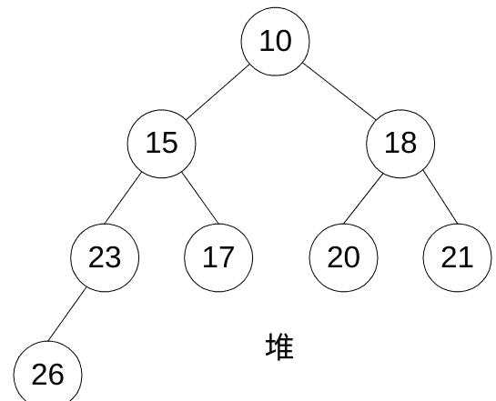

- 在这棵树中：
- 如果 i <= n/2，则左子节点(i) = 2i
- 如果 i < n/2，则右子节点(i) = 2i+1
- 如果 i > 1，则父节点(i) = floor(i/2)
- 高度为 h 的完全二叉树的节点数至少为 2^h，最多为 2^(h+1)-1。
- 具有 n 个节点的完全二叉树的高度为 floor(log n)。

书中没有证明这一点，但我在这里提供了一个证明。设 left(k) 表示索引为 k 的节点的左子节点的索引，right(k) 表示索引为 k 的节点的右子节点的索引，parent(k) 表示索引为 k 的节点的父节点的索引。

**定理：** 如果完全二叉树的节点按照广度优先的顺序从左到右编号，根节点编号为1，则 left(k)=2k（如果 k<=N/2），right(k)=2k+1（如果 k<N/2），parent(k)=floor(k/2)（如果 k>1）。

## 证明

假设 k 是一个任意节点的索引，满足 k<=N/2。假设节点 k 有一个左子节点。如果它有一个左子节点，那么根据完全二叉树的定义，节点 k 右侧的整个层级必须被填满，而左子节点左侧的整个层级也必须被填满。

设 d 为节点 k 在树中的深度。树中在第 d 层之上有 2^d-1 个节点，因为高度为 d-1 的满二叉树有 2^d-1 个节点。那么节点 k 在它所在层级的左侧有多少个节点？它必须是 k-(2^d-1)-1 = k-2^d。

在第 d 层，k 右边有多少个节点？它必须是 2^d 小于等于节点 k 的数量：

$$ 2^{d}-(k-2^{d})-1=2^{d+1}-k-1 $$

在第 d+1 层，节点 k 左边的每个子节点都会贡献 2 个子节点给节点 k 的左子节点，所以在第 d+1 层左边的 left(k) 左边有 $2(k-2^{d})$ 个节点。由于在第 d 层，节点 k 右边有 $2^{d+1}-k-1$ 个节点，节点 k 的左子节点的索引是 left(k) = $k + (2^{d+1}-k-1) + 2(k-2^{d}) + 1 = 2^{d+1}-1+2k-2^{d+1}+1 = 2k$。

如果存在右子节点，则其索引为 2k+1。最后，由于 left(k)=2k 和 right(k)=2k+1，所以 parent(k)=floor(k/2)。

## 推论1

在具有 N 个节点的完全二叉树中，最高索引的非叶节点是索引为 floor(N/2) 的节点。
**证明：** 最高索引的内部节点有一个左子节点和可能有一个右子节点，并且其右侧没有任何节点有子节点。如果 N 是偶数，则最后一个节点是其父节点的左子节点，父节点是节点 floor(N/2)。如果最后一个节点是其父节点的右子节点，则父节点的索引也是 floor(N/2)。

## 推论2

在具有 N 个元素的堆中，最后 N/2 个元素是叶节点。
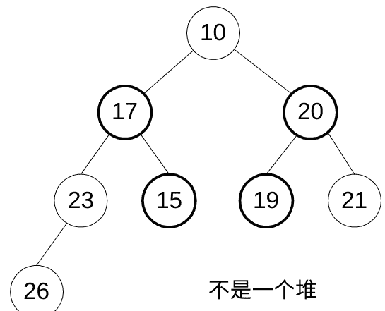
仅凭索引就能确定哪个节点是左子节点、右子节点或父节点的事实意味着不需要链接来表示树：子节点可以通过节点的索引找到，父节点也可以通过节点的索引找到。

## 插入

插入堆很简单：将元素放在数组的末尾 - 在树的底层右侧的最右边的键。然后将其上升到顶部，直到恢复堆顺序为止。

代码：

```cpp
template <class Comparable>
void BinaryHeap<Comparable>::insert(const Comparable &x) {
    if (isFull())
        throw Overflow();
    // 上升
    int hole = ++currentSize;
    for (; hole > 1 && x < array[hole / 2]; hole /= 2)
        array[hole] = array[hole / 2];
    array[hole] = x;
}
```

## 插入算法示例

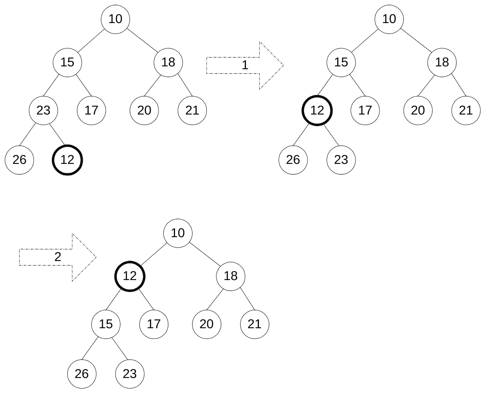

## 删除最小元素

deleteMin 也很容易实现。要删除最小元素，删除根节点。现在有一个空位。取堆的最后一个元素(底层的最右叶子)并将其放在根的位置。它可能比其子节点大。选择两个子节点中较小的一个并将其与根交换。如果需要，在与交换所在子树交换后重复此过程。直到子节点都是叶节点为止。

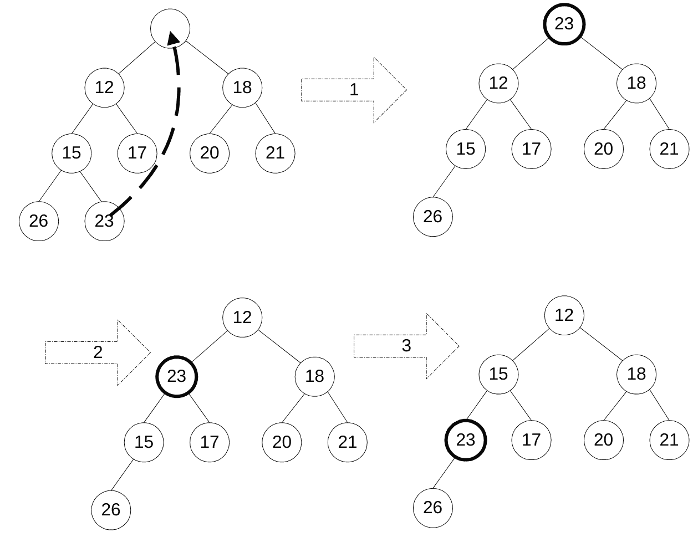

```cpp
template <class Comparable>
void BinaryHeap<Comparable>::deleteMin() {
    if (isEmpty())
        throw Underflow();
    array[1] = array[currentSize--];
    percolateDown(1);
}
```

## 构建堆

具有 n 个键的堆是通过以任意顺序将 n 个键插入到初始为空的堆中构建的，而不维护堆属性。在所有项目都在树中之后，它被“堆化”。可以通过从最低级别上方的级别开始，并将所有太大的键下滤来将二叉树转换为堆。当完成此级别时，处理上一级别，依此类推，直到达到根。算法总结如下：

```cpp
void BinaryHeap<Comparable>::heapify() {
    for (int i = n/2; i > 0; i--)
        percolateDown(i);
}
```

其中 percolateDown 由以下方式定义：

```cpp
void BinaryHeap<Comparable>::percolateDown(int hole) {
    int child;
    Comparable tmp = array[hole];
    for (; hole * 2 <= currentSize; hole = child) {
        child = hole * 2;
        if (child != currentSize && array[child + 1] < array[child])
            child++;
        if (array[child] < tmp)
            array[hole] = array[child];
        else
            break;
    }
    array[hole] = tmp;
}
```

**定理：** 将具有 n 个节点的二叉树堆化需要 O(n) 的时间。

## 证明

观察到如果使用数组，则需要 n 个步骤来插入堆，因为每次插入都是 O(1)。然后堆化需要将根节点到底部上面一层的每个节点上升。在最坏的情况下，每个节点都被移动到最低层。因此，总步骤数等于这些节点的高度之和。首先我证明下面的引理。

**引理：** 完全（完美）二叉树的高度为 h 时，节点高度之和为 $2^{h+1}-1-(h+1)$。

**证明：**

高度为 0 的节点有 $2^h$ 个节点。高度为 1 的节点有 $2^{h-1}$ 个节点，高度为 2 的节点有 $2^{h-2}$ 个节点，以此类推，直到高度为 h 的节点只有一个。一般来说，高度为 (h-k) 的节点有 $2^k$ 个节点。由于高度为 0 的节点对节点高度之和没有贡献，所以节点高度之和可以表示为：

$$ S = \sum_{k=1}^{h} k 2^{h-k} $$

虽然可以通过直接方法解决 S 的问题，但以下的“技巧”也很有效。将 S 加倍，得到：

$$ 2S = \sum_{k=1}^{h} 2k 2^{h-k} = \sum_{k=1}^{h} k 2^{h-k+1} $$

将低阶 k=1 项分离出来，得到 2S：

$$ 2S = 2^h + \sum_{k=2}^{h} k 2^{h-k+1} $$

将高阶 k=h 项分离出来，得到 S：

$$ S = \sum_{k=1}^{h-1} k 2^{h-k} + h $$

现在将 S 从 2S 中减去：

$$ S = 2S - S = 2^h + \sum_{k=2}^{h} k 2^{h-k+1} - \sum_{k=1}^{h-1} k 2^{h-k} - h $$

由于 $\sum_{k=2}^{h} k 2^{h-k+1}$ 与 $\sum_{k=1}^{h-1} (k+1) 2^{h-(k+1)+1}$ 相等，我们可以将之前的方程重写为：

$$ \begin{aligned} S &= 2^h + \sum_{k=1}^{h-1} (k+1) 2^{h-(k+1)+1} - \sum_{k=1}^{h-1} k 2^{h-k} - h \\ &= 2^h + \sum_{k=1}^{h-1} (k+1) 2^{h-k} - \sum_{k=1}^{h-1} k 2^{h-k} - h \\ &= 2^h + \sum_{k=1}^{h-1} ((k+1) 2^{h-k} - k 2^{h-k}) - h \end{aligned} $$

这个最后的求和可以很容易地简化为：

$$ S = 2^{h} - h + \sum_{k=1}^{h-1}(k+1-k) 2^{h-k} $$

$$ = 2^{h} - h + \sum_{k=1}^{h-1} 2^{h-k} $$

$$ = 2^{h} - h + \sum_{k=1}^{h-1} 2^{k} $$

$$ = 2^{h} - h + \left(2^{h}-1\right) - 1 $$

$$ = 2^{h+1} - 1 - (h+1) $$

由于在完全二叉树中，高度为 h 的树中节点的数量 n 介于 $2^h$ 和 $2^{h+1}-1$ 之间，在最坏的情况下，n 可能只有 $2^h$，而 $2^{h+1}$ 则严格大于最坏情况下的移动次数。因此，构建堆的运行时间在 n 和 2n 之间，显然是 O(n)。

## 总结

堆是优先队列的一种很好的数据结构。构建堆的时间与元素数量成线性关系，插入和删除最小元素的操作的成本为 O(log n)，开销非常低。

# 第7章 排序

插入排序是一种将数组分为已排序区域和未排序区域的排序算法，重复选择未排序区域中最小索引元素，并将其插入已排序区域的适当位置，如图7.1所示。

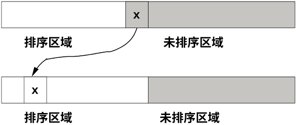

图7.1：插入排序模拟为一个具有排序和未排序区域的数组。每次迭代将未排序区域中最低索引值移动到排序区域中的正确位置，初始大小为1。

该过程从第二个位置开始，并在插入最右边的元素时停止，从而将未排序区域的大小强制为零。

插入排序属于一类通过将键与相邻键进行比较并交换项直到它们达到正确位置的排序算法。另一种类似的排序算法是冒泡排序。这两种排序算法都会使项目在数组中缓慢移动，强制它们一次移动一个位置，直到它们到达最终位置。可以推断出，数据移动的次数对于完成的工作来说过多。毕竟，肯定有更聪明的方法将元素放入正确的位置。

插入排序算法如下所示。

```cpp
for (int i = 1; i < a.size(); i++) {
    tmp = a[i];
    for (j = i; j >= 1 && tmp < a[j-1]; j = j-1)
        a[j] = a[j-1];
    a[j] = tmp;
}
```

你可以验证它是否符合我所描述的。将值分配给tmp，然后将其复制到其最终位置是一种高效的交换形式。普通的交换需要三次数据移动；这将交换减少到每个比较项只需要一次移动，加上循环开始和结束时的移动。

对于一个包含N个元素的数组，最坏情况下的比较和数据移动次数为 O(N^2)。最好情况下的数据移动次数为 Ω(N)，比较次数也为 Ω(N)。我们可以证明平均比较和数据移动次数为 Ω(N^2)。

## 7.2 简单排序算法的下界

在数组中，如果存在一个有序对 $(i, j)$ 满足 $i < j$ 且 $a[i] > a[j]$，则称之为逆序。交换相邻元素可以从数组中移除一个逆序。插入排序需要通过交换来移除所有的逆序，所以如果有 $m$ 个逆序，则需要 $m$ 次交换。

**定理 1**。$n$ 个不同元素的数组中，逆序的平均数量为 $n(n-1)/4$。

**证明**。设 $L$ 为任意列表，$L_R$ 为其反转。在 $L$ 中选择任意一对元素 $(i, j) \in L$，满足 $i < j$。有 $n(n-1)/2$ 种选择这样的对。这对元素在 $L$ 或 $L_R$ 中恰好是一个逆序。这意味着 $L$ 和 $L_R$ 总共有 $n(n-1)/2$ 个逆序。所有 $n$ 个不同元素的排列可以分为两个不相交的集合，其中包含列表及其反转。换句话说，这些列表的一半是其余列表的反转。这意味着在整个排列集合中，每个列表的平均逆序数量为 $n(n-1)/4$。

□

**定理 2**。任何通过交换相邻元素进行排序的算法平均需要 $\Omega(n^2)$ 时间。

**证明**。初始时，逆序对的平均数量为 $n(n-1)/4$。每次交换都会减少一个逆序对，只有当数组中没有逆序对时，数组才被排序，因此需要进行 $n(n-1)/4$ 次交换。

□

## 7.3 希尔排序

希尔排序是由 Donald Shell 发明的。它类似于在数组中进行一系列插入排序，但是在早期的步骤中，它通过交换远离的元素将数据项移动到它们应该在的位置附近。考虑原始的插入排序算法，使相邻元素之间的间隔可以是除 1 以外的数字：

**代码清单 7.1：通用插入排序算法**
```cpp
int gap = 1;
for (int i = gap; i < a.size(); i++) {
    tmp = a[i];
    for (j = i; j >= gap && tmp < a[j - gap]; j = j - gap)
        a[j] = a[j - gap];
    a[j] = tmp;
}
```

现在假设变量 gap 从一个较大的值开始，并随着每次传递而变小。每次传递都是对数组中一组交错序列进行修改后的插入排序。当 gap 为 $h$ 时，它是对 $h$ 序列的插入排序：
$0, h, 2h, 3h, \ldots, k_0 h,$
$1, 1+h, 1+2h, 1+3h, \ldots, 1+k_1 h$
$2, 2+h, 2+2h, 2+3h, \ldots, 2+k_2 h$
$\ldots$
$h-1, h-1+h, h-1+2h, \ldots, h-1+k_{h-1} h$

其中 $k_i$ 是最大的数，使得 $i + k_i h < n$。例如，如果数组大小为 15，且间隔为 $h=5$，则数组中以下索引的子序列（我们称之为切片）将独立进行插入排序：
- 切片 0: 0, 5, 10
- 切片 1: 1, 6, 11
- 切片 2: 2, 7, 12
- 切片 3: 3, 8, 13
- 切片 4: 4, 9, 14

对于固定的间隔值 $h$，排序从数组元素 $a[h]$ 开始，并将其插入到切片的较低排序区域，然后选择 $a[h+1]$ 并将其插入到其切片的排序区域，然后插入 $a[h+2]$，依此类推，直到将 $a[n-1]$ 插入到其切片的排序区域。对于每个元素 $a[i]$，切片的排序区域是索引 $i, i-h, i-2h, \ldots$ 等等。当间隔为 $h$ 时，我们说数组已经被 $h$ 排序。显然它没有排序，因为不同的切片可以有不同的值，但每个切片都是排序的。当 $h=1$ 时，数组当然是完全排序的。下表显示了一个 15 元素的数组在进行 5 排序之前和之后的情况。

| 索引 | 0 | 1 | 2 | 3 | 4 | 5 | 6 | 7 | 8 | 9 | 10 | 11 | 12 | 13 | 14 |
|---|---|---|---|---|---|---|---|---|---|---|---|---|---|---|---|
| 原始序列： | 81 | 94 | 11 | 96 | 12 | 35 | 17 | 95 | 28 | 58 | 41 | 75 | 15 | 65 | 7 |
| 5 排序后： | 35 | 17 | 11 | 28 | 7 | 41 | 75 | 15 | 65 | 12 | 81 | 94 | 95 | 96 | 58 |

直觉是，较大的初始间隔排序将项目移动到更接近它们应该在的位置，然后逐渐减小的间隔将它们移动到最终位置。

在 Shell 的原始算法中，间隔序列为 $n/2, n/4, n/8, \dots, 1$。这被证明是一个糟糕的间隔选择，因为最坏情况下的运行时间不比普通插入排序好，如下所证明的。

**代码清单 7.2：Shell 的原始算法**
```cpp
for (int gap = a.size() / 2; gap > 0; gap /= 2)
    for (int i = gap; i < a.size(); i++) {
        tmp = a[i];
        for (j = i; j >= gap && tmp < a[j - gap]; j = j - gap)
            a[j] = a[j - gap];
        a[j] = tmp;
    }
```

### 7.3.1 使用 Shell 的原始增量分析希尔排序

> **引理 3**。当增量为 $h_k$ 时，希尔排序的运行时间为 $O(n^2 / h_k)$。

**证明**。当增量为 $h_k$ 时，有 $h_k$ 个插入排序，每个排序包含 $n / h_k$ 个键。插入排序对于 $m$ 个元素的最坏情况需要 $O(m^2)$ 步骤。因此，当增量为 $h_k$ 时，总步骤数为
$$ h_k \cdot O \left( \frac{n^2}{h_k^2} \right) = O \left( \frac{n^2}{h_k} \right) $$

**定理 4**。使用 Shell 的原始增量序列，希尔排序的最坏情况是 $\Theta(n^2)$。

**证明**。这个证明有两个部分，一个是运行时间的下界是渐近于 $n^2$，另一个是上界是 $n^2$。

**下界的证明**。
考虑任意大小为 $n=2^m$ 的数组，其中 $m$ 可以是任意正整数。这样的数组有无限多个，因此可以确定渐近行为。让数组中的前 $n/2$ 个最大数位于奇数位置，最小数位于偶数位置。当 $n$ 是 2 的幂时，在每次遍历中将初始间隔 $n$ 减半会得到一个偶数。因此，在算法的所有遍历中，除了最后一次遍历，间隔都是偶数，这意味着所有最小数必须保持在偶数位置，而所有最大数将保持在奇数位置。第 $j$ 个最小数位于位置 $2j-1$，当 $h=1$ 时必须将其移动到位置 $j$。因此，这个数必须移动 $(2j-1)-j=j-1$ 个位置。当 $h=1$ 时，将所有 $n/2$ 个最小数移动到它们的正确位置需要
$$ \sum_{j=1}^{n/2} (j-1) = \sum_{j=0}^{(n/2)-1} j = \frac{(n/2-1)(n/2)}{2} = \Theta(n^2) $$
步骤。这证明了运行时间至少为 $\Theta(n^2)$。

**上界证明**。
根据引理 3，在增量为 $h_k$ 时，通过的运行时间为 $O(n^2/h_k)$。假设有 $t$ 个这样的通过。如果我们对所有通过求和，总运行时间为
$$ O \left( \sum_{k=1}^{t} \frac{n^2}{h_k} \right) = O \left( n^2 \sum_{k=1}^{t} \frac{1}{h_k} \right) = O \left( n^2 \sum_{k=1}^{t} \frac{1}{2^k} \right) = O(n^2) $$
因为，正如我们在第 1 章中证明的那样，
$$ \sum_{k=1}^{t} \frac{1}{2^k} = 2 - \frac{1}{2^{t-1}} - \frac{t}{2^t} < 2 $$
这表明 $n^2$ 也是一个渐近上界。因此，最坏情况是 $\Theta(n^2)$。

### 7.3.2 其他增量方案

后来找到了更好的间隔序列选择。在看一些好的例子之前，考虑使用一个简单的序列，如 5、3、1。

**例子**
这在一个任意数组上使用了三个间隔，5、3、1，其初始状态在下表的第一行。

| 索引 | 0 | 1 | 2 | 3 | 4 | 5 | 6 | 7 | 8 | 9 | 10 | 11 | 12 |
|---|---|---|---|---|---|---|---|---|---|---|---|---|---|
| 原始序列： | 81 | 94 | 11 | 96 | 12 | 35 | 17 | 95 | 28 | 58 | 41 | 75 | 15 |
| 5 排序后： | 35 | 17 | 11 | 28 | 12 | 41 | 75 | 15 | 96 | 58 | 81 | 94 | 95 |
| 3 排序后： | 28 | 12 | 11 | 35 | 15 | 41 | 58 | 17 | 94 | 75 | 81 | 96 | 95 |
| 1 排序后： | 11 | 12 | 15 | 17 | 28 | 35 | 41 | 58 | 75 | 81 | 94 | 95 | 96 |

Hibbard 提出使用以下序列
$$ h_1 = 1, h_2 = 3, h_3 = 7, h_4 = 15, \ldots, h_t = 2^t - 1 $$
这个序列简单地是 2 的幂减 1 的数字。这样的序列，1、3、7、15、31、63、127、…，具有这样的特性，相邻的两个项没有公共因子：如果它们有一个公共因子 $p$，则它们的差也将被 $p$ 整除。但是连续项之间的差是 $(2^{k+1}-1)-(2^k-1) = 2^{k+1}-2^k = 2^k$，它只能被 2 的幂整除。因此，唯一能够整除连续项的数是 2 的幂。由于所有的项都是奇数，没有一个能够被 2 整除，所以它们没有公共因子。

连续的项通过递归关系相关
$$ h_{k+1} = 2h_k + 1 $$

Sedgewick 提出了几个不同的序列，比如这个，通过递归定义：
$$ h_1 = 1, h_{k+1} = 3h_k + 1 $$
生成序列
1, 4, 13, 40, 121, 364, …

Hibbard 的增量序列被证明是对 Shell 原始增量序列的改进。

**定理 5**。使用 Hibbard 序列的 Shell 排序的最坏情况运行时间，$h_1=1, h_2=3, h_3=7, h_4=15, \ldots, h_t=2^t-1$，是 $\Theta(n^{3/2})$。

**证明**。这里仅证明上界。引理 3 证明了当增量为 $h_k$ 时，一次遍历的运行时间是 $O(n^2/h_k)$。我们将在所有增量 $h_k$ 满足 $h_k > n^{1/2}$ 时使用这个事实。这对于较小的增量来说不是足够紧密的上界，我们需要更努力地得到一个更紧密的上界。一般的思路是通过时间增加，大多数元素不需要移动很远。

所以我们转向当 $h_k \le n^{1/2}$ 的情况。当数组被 $h_k$ 排序时，它已经被 $h_{k+1}$ 排序和 $h_{k+2}$ 排序。现在考虑数组中位置 $p$ 和 $p-i$ 的元素，对于所有 $p \ge i$。如果 $i$ 是 $h_{k+1}$ 或 $h_{k+2}$ 的倍数，则 $a[p-i] < a[p]$，因为这两个元素是同一个切片的一部分，无论是增加 $h_{k+1}$ 还是增加 $h_{k+2}$，它们都相对于彼此排序。更一般地，假设 $i$ 是 $h_{k+1}$ 和 $h_{k+2}$ 的非负线性组合，即 $i = c_1 h_{k+1} + c_2 h_{k+2}$，其中 $c_1$ 和 $c_2$ 是非负整数。那么
$$ p - i = p - (c_1 h_{k+1} + c_2 h_{k+2}) = p - c_1 h_{k+1} - c_2 h_{k+2} $$
和
$$ (p-i)+c_2 h_{k+2}=p-c_1 h_{k+1} $$
这意味着在 $h_{k+2}$ 排序后，$a[p-i] < a[p-c_1 h_{k+1}]$，因为它们是同一个 $h_{k+2}$ 切片的一部分。同样，在 $h_{k+1}$ 排序后，$a[p-c_1 h_{k+1}] < a[p]$，因为它们是同一个 $h_{k+1}$ 切片的一部分，且 $p-c_1 h_{k+1} < p$。因此，$a[p-i] < a[p-c_1 h_{k+1}] < a[p]$。

由于 Shell 的增量方案的定义，$h_{k+2} = 2 h_{k+1} + 1$，所以 $h_{k+2}$ 和 $h_{k+1}$ 是互质的。（如果不是，它们有一个大于 1 的公因数，因此它们的差 $h_{k+2}-h_{k+1}=2 h_{k+1}+1-h_{k+1}=h_{k+1}+1$ 将与它们每一个都有一个公因数，特别是 $h_{k+1}$ 和 $h_{k+1}+1$ 将有一个公因数，这是不可能的。）因为 $h_{k+2}$ 和 $h_{k+1}$ 是互质的，它们的最大公约数（gcd）是 1。数论的一个已知定理是，如果 $c=\gcd(x, y)$，那么存在整数 $a$ 和 $b$ 使得 $c=ax+by$。当 $x$ 和 $y$ 是互质的时候，这意味着存在 $a、b$ 使得 $1=ax+by$，这进一步意味着每个整数都可以表示为 $x$ 和 $y$ 的线性组合。更强的结果是，所有至少大于等于 $(x-1)(y-1)$ 的整数都可以表示为 $x$ 和 $y$ 的非负线性组合。令
$$ m \ge (h_{k+2}-1)(h_{k+1}-1) = (2 h_{k+1}+1-1)(2 h_k+1-1) = 2(h_{k+1})(2 h_k) = 4 h_k(2 h_k+1) = 8 h_k^2+4 h_k $$
根据前面的陈述，$m$ 可以表示为 $c_1 h_{k+1} + c_2 h_{k+2}$ 的形式，其中 $c_1$ 和 $c_2$ 是非负整数。根据前面的讨论，我们还可以得出结论，$a[p-m] < a[p]$。这是什么意思？在 $h_k$ 排序过程中，每个元素最多移动 $8h_k-4$ 次（每次移动 $h_k$ 个位置）。这样的位置最多有 $n-h_k$ 个，因此这一趟排序中的比较次数是 $O(n h_k)$。

有多少增量 $h_k$ 小于 $n^{1/2}$？大约一半，因为如果我们近似 $n$ 为 2 的幂，比如 $2^t$，那么 $\sqrt{n}=2^{t/2}$，增量为 1, 3, 7, 等，$2^{t/2}-1$ 是增量的一半。为了简单起见，假设 $t$ 是一个偶数。那么希尔排序的总运行时间是
$$ O\left(\sum_{k=1}^{t / 2} n h_k+\sum_{k=t / 2+1}^t \frac{n^2}{h_k}\right) = O\left(n \sum_{k=1}^{t / 2} h_k+n^2 \sum_{k=t / 2+1}^t \frac{1}{h_k}\right) $$
由于第一个求和是一个上限为 $h_{t/2}=\Theta(n^{1/2})$ 的几何级数，它被一个常数倍数 $O(n \cdot n^{1/2})=O(n^{3/2})$ 所限制。由于 $h_{t/2+1}=\Theta(n^{1/2})$，第二个求和可以近似为 $O(n^2 \cdot (1/n^{1/2}))=O(n^{3/2})$。这表明在最坏情况下使用 Hibbard 序列的上界是 $O(n^{3/2})$。存在一个实现这个上界的序列是一个练习。

许多其他序列已经被研究过。研究表明，该序列由以下方式定义：
$$ (h_i, h_{i+1}) = (9 \cdot (4^{i-1} - 2^{i-1}) + 1, \ 4^{i} - 6 \cdot 2^i + 1), \quad i = 1, 2, \ldots $$
它生成 1, 5, 19, 41, 109, …。最坏情况下运行时间为 $O(n^{4/3})$（Sedgewick, 1986）。上述符号表示该公式生成间隔对。

**例子**
这展示了如何使用间隔序列 13, 4, 1 对数组进行希尔排序：

| 排序阶段 | 数组状态 (索引 0-14) |
|---|---|
| 13-排序后 | A E O R T I N G E X A M P L S |
| 4 排序后 | A E A G E I N M P L O R T X S |
| 1 排序后 | A A E E G I L M N O P R S T X |

## 7.4 堆排序

堆排序的基本思想是在 $O(n)$ 步骤内创建一个最大堆。最大堆是一个堆，其中堆序性质被反转，即每个节点都比其子节点大。然后，重复地将最大元素与数组末尾的元素交换位置，然后缩短数组长度一个元素，以便下一次交换是与前一个元素进行的。

### 7.4.1 算法

还有一些效率较低的方法来实现这一点。该算法构建最大堆，然后通过将最大元素与最后一个位置的元素交换，并递减定义堆在数组中结束位置的变量，有效地将最大元素视为不再是堆的一部分。

```cpp
// 首先使用第 6 章中描述的相同算法构建堆。
// 假设数组名为 A，A.size() 表示其长度。
int N = A.size();
for (int i = N/2; i > 0; i--)
    // 在最大堆中向下渗透，如果达到 N 则停止
    PercolateDown(A, i, N);

// 现在 A 是一个堆
// 现在重复地将最大元素与堆中的最后一个元素交换
for (int j = N-1; j > 0; j--) {
    swap(A[0], A[j]);
    PercolateDown(A, 0, j);
}
```

`PercolateDown` 函数必须稍微修改一下，因为它需要防止元素被下滤移出堆的边界。因此，它有一个参数作为堆的上界。

```cpp
void PercolateDown(vector<Comparable>& array, int hole, int last) {
    int child;
    Comparable tmp = array[hole];
    
    while (hole * 2 <= last - 1) {
        child = hole * 2;
        if (child != last - 1 && array[child + 1] > array[child])
            child++;
        if (array[child] < tmp)
            array[hole] = array[child];
        else
            break;
        hole = child;
    }
    array[hole] = tmp;
}
```

### 7.4.2 分析

在第 6 章中，我们证明了建堆的时间复杂度为 $O(n)$ 步骤（确切地说，是 $2n$ 步骤）。在算法的第二阶段中，交换操作需要常数时间，但是 `PercolateDown` 步骤在最坏情况下需要与堆的当前高度成比例的比较和移动次数。第 $j$ 次迭代最多使用 $2 \cdot \log(N-j+1)$ 次比较。我们有
$$ \sum_{j=1}^{N-1} \log(N-j+1) = \sum_{j=2}^{N} \log(j) = \log N! $$
可以证明 $\log(N!) = \Theta(N \log N)$，所以在最坏情况下，堆排序的运行时间是 $\Theta(N \log N)$。更准确的分析将显示，最大比较次数为 $2N \log N - O(N)$。

实验证明，堆排序是一致的，并且平均比最坏情况少一些比较。以下定理已经被证明，但此处省略了证明。

**定理 6**。对于随机排列的 $n$ 个不同项，执行堆排序的平均比较次数为 $2n \log n \pm O(n \log \log n)$。

## 7.5 快速排序

当正确实现时，快速排序是已知的最快的排序算法，这意味着应该使用非递归版本，并且应该将较长的分区堆栈而不是较短的分区。快速排序的平均运行时间为 $\Theta(N \log N)$，但最坏情况下的性能为 $O(N^2)$。快速排序被认为是最快的排序算法，当仔细使用时，原因是良好的设计可以使得达到最坏情况的概率变得微不足道。

在这里，我们回顾算法并分析其性能。

计算机科学335 软件设计与分析III
第7章排序
魏斯特教授


### 7.5.1 算法

#### 基本思想

让 $S$ 表示要排序的元素集合，即 $S$ 是一个数组。定义 `quicksort(S)` 为以下步骤的序列：

- 1. 如果 $S$ 中的元素数量为 0 或 1，则返回，因为它已经排序好了。
- 2. 从 $S$ 中选择任意元素 $v$。将这个元素 $v$ 称为枢轴。
- 3. 将 $S$（除了 $v$）分割为两个不相交的集合 $S_1 = \{x \in S \mid x \le v\}$ 和 $S_2 = \{x \in S \mid x \ge v\}$。
- 4. 返回 `quicksort(S_1)` 后跟 $v$ 后跟 `quicksort(S_2)`。

#### 选择枢轴

选择一个不好的枢轴会导致一个集合非常小，而另一个集合非常大。结果将是算法达到其 $O(n^2)$ 最坏情况的行为。如果枢轴比其他所有键都小或者比其他所有键都大，就会发生这种情况。我们希望一个中位数的枢轴，而不需要找到中位数的麻烦。可以随机选择枢轴，但是这样就无法保证它是什么，而且随机数生成的成本在最后几乎没有任何好处。

在安全性和性能之间取得一个很好的折衷是选择三个元素并取它们的中位数。这样做几乎可以确保消除二次行为的可能性。一个很好的选择是数组的第一个、最后一个和中间一个元素。

#### 分区

分区的最佳方法是通过将枢轴元素放在数组的开头或结尾来将其推到一边。在这样做之后，所有的实现基本上都做相同的事情，只是处理与枢轴相等的元素的方式不同。

总体思路是将 $i$ 和 $j$ 指针向中间推进，交换大于枢轴的元素，直到 $i$ 和 $j$ 交叉。下面的例子展示了一个数组，其中包含了 $i$ 和 $j$ 指针的初始位置以及枢轴在数组中的最后位置。在每一步中，首先 $j$ 向下遍历数组寻找不合适的元素，然后 $i$ 向上遍历数组做同样的事情。当它们停下来时，元素被交换，然后它们各自向前移动一个元素。

| 数组状态 | i | | | | | | j | 枢轴 | |
|:---|:---|:---|:---|:---|:---|:---|:---|:---|:---|
| `8 1 4 9 0 3 5 2 7 6` | 0 | | | | | | 8 | 9 | |
| `8 1 4 9 0 3 5 2 7 6` | 0 | | | | | | 8 | 9 | |
| `2 1 4 9 0 3 5 8 7 6` | 1 | | | | | | 7 | 9 | |
| `2 1 4 9 0 3 5 8 7 6` | 1 | | | | | | 7 | 9 | |
| `2 1 4 5 0 3 9 8 7 6` | 3 | | | | | 6 | | 9 | |
| `2 1 4 5 0 3 9 8 7 6` | 3 | | | | | 6 | | 9 | |
| `2 1 4 5 0 3 9 8 7 6` | | | | | 交叉 | | | 9 | |

它在这一点停止，枢轴被交换，所以最终数组是：

| 2 1 4 5 0 3 6 8 7 9 |

真正的问题是处理与枢轴相等的元素。处理与枢轴相等的元素最安全的方法是将它们交换，就像它们更小或更大一样，否则算法可能会退化到最坏情况。

下面是使用这种策略的快速排序的递归版本。

```cpp
void quicksort(vector<C>& a, int left, int right) {
    if (left + 10 <= right) {
        // 选择枢轴并将其交换到 a[right-1]
        C pivot = median3(a, left, right);

        // 分区步骤
        int i = left;
        int j = right - 1;
        while (true) {
            while (a[++i] < pivot) {}
            while (pivot < a[--j]) {}
            if (i < j)
                swap(a[i], a[j]);
            else
                break;
        }
        // 将枢轴移动到正确位置
        swap(a[i], a[right - 1]);

        // 递归地对每个集合进行排序
        quicksort(a, left, i - 1);
        quicksort(a, i + 1, right);
    }
    else // 数组太小无法快速排序 - 使用插入排序
        insertion_sort(a, left, right);
}
```

// 插入排序必须有两个额外的参数来接收左边界
// 和右边界
}

注释：

- 1. $i$ 从 `left+1` 开始是有意的。`median3` 函数重新排列数组，使得 $a[\text{left}] \le \text{pivot}$，因此不需要检查它。
- 2. 对于 $j$，对称的语句也是正确的：`median3` 将枢轴放在 $a[\text{right}-1]$，所以 $j$ 可以从比较 $\text{pivot}$ 和 $a[\text{right}-2]$ 开始。
- 3. 由于上述推理，$i$ 和 $j$ 都不会超过数组边界。两端作为 $i$ 和 $j$ 的哨兵。

## 7.5.2 快速排序的分析

递归关系描述了比较的总数。令 $T(n)$ 表示大小为 $n$ 的数组的比较次数，令 $i$ 表示分区的较低部分的元素数量（即 $S_1$ 的大小）。$T(1)$ 是某个常数，比如 $a$。然后：

$$T(n) = T(i) + T(n - i - 1) + cn$$

### 最坏情况

最坏情况是分区始终创建一个大小为 0 的数组和一个大小为 $n-1$ 的数组。

在这种情况下，递归关系是：

$$T(n) = T(n - 1) + cn$$

对于 $n > 1$，这意味着：

$$T(n) = T(n - 2) + cn + c(n - 1) = T(n - 3) + c(n + n - 1 + n - 2) = T(1) + c(n + n - 1 + n - 2 + \ldots + 1) = a + \frac{cn(n + 1)}{2} = \Theta(n^2)$$

### 平均情况

平均情况分析假设 $S_1$ 的所有大小都是等可能的。现在我们让 $T(n)$ 代表数组大小为 $n$ 时的平均运行时间。由此可得 $T(n)$ 是运行时间的平均值。

对于 $S_1$ 的所有可能大小，它们的概率都是 $1/n$。

$$
\begin{aligned}
T(n) & = \frac{1}{n} \sum_{j=0}^{n-1} (T(j) + T(n-j-1)) + cn \\
& = \frac{2}{n} \sum_{j=0}^{n-1} T(j) + cn \\
n T(n) & = 2 \sum_{j=0}^{n-1} T(j) + cn^2 \\
(n-1)T(n-1) & = 2 \sum_{j=0}^{n-2} T(j) + c(n-1)^2
\end{aligned}
$$

现在减去最后两个等式并得到：

$$
\begin{aligned}
nT(n) - (n-1)T(n-1) & = 2T(n-1) + c(n^2 - (n-1)^2) \\
& = 2T(n-1) + 2cn - c
\end{aligned}
$$

重新排列并丢弃常数 $c$：

$$nT(n) = (n+1)T(n-1) + 2cn$$

除以 $n(n+1)$，我们得到一个可以通过连续相加来折叠的公式：

$$
\begin{aligned}
\frac{T(n)}{n+1} & = \frac{T(n-1)}{n} + \frac{2c}{n+1} \\
\frac{T(n-1)}{n} & = \frac{T(n-2)}{n-1} + \frac{2c}{n} \\
& \dots \\
\frac{T(2)}{3} & = \frac{T(1)}{2} + \frac{2c}{3}
\end{aligned}
$$

将这些方程相加得到：

$$\frac{T(n)}{n+1} = \frac{T(1)}{2} + 2c \sum_{i=3}^{n+1} \frac{1}{i} \approx \frac{T(1)}{2} + 2c \log(n+1) = O(\log n)$$

所以

$$T(n) = O(n \log n)$$

## 7.6 排序的下界

问题是，我们能否找到比 $O(n \log n)$ 更好的排序算法，或者从理论上讲，这是不可能的？

答案是，如果我们的排序算法通过进行二进制比较来排序，那么比较的次数是 $\Theta(n \log n)$。证明基于以下论证：

任何只使用比较的排序算法，在最坏情况下需要 $\lceil\log(n!)\rceil$ 次比较，在平均情况下需要 $\log(n!)$ 次比较。为了证明这一点，我们使用了一个决策树。


图7.2：表示排序三个数字的决策树。

### 7.6.1 决策树

决策树是通过一系列连续的决策来解决问题的算法的树形表示。在决策树中，节点表示逻辑断言，从一个节点到子节点的边缘由一个命题标记。二叉决策树基于二进制决策。

因为二叉决策树是二叉树，我们可以使用关于二叉树的推理来得出使用二进制比较进行排序的算法的定理。图7.2展示了一个决策树，它表示对三个不同数字进行排序的比较。我们需要一些初步引理。

**引理 7。** 高度为 $d$ 的二叉树最多有 $2^d$ 个叶子节点。

**证明。** 我们可以通过对树的高度进行归纳来证明这一点。如果 $d=0$，树只包含一个根节点，它有 $1=2^0$ 个叶子节点。如果 $d>0$，假设对于 $d-1$ 成立。树必须有一个根节点和两个高度最多为 $d-1$ 的子树，根据假设，每个子树最多有 $2^{d-1}$ 个叶子节点。由于根节点不是叶子节点，所以树最多有 $2 \cdot 2^{d-1}=2^d$ 个叶子节点。

**引理 8.** 如果一棵二叉树有 $n$ 个叶子节点，则它的高度至少为 $\lceil\log n\rceil$。

**证明。** 假设一棵有 $n$ 个叶子节点的树的高度小于 $\lceil\log n\rceil$。如果 $n$ 不是 2 的幂次，则它的高度最多为 $\lfloor\log n\rfloor$，如果 $n$ 是 2 的幂次，则它的高度最多为 $\log(n)-1$。无论哪种情况，令 $d$ 为高度。根据上述引理，该树最多有 $2^d$ 个叶子节点。但是 $2^{\log n-1}<n$ 且 $2^{\lfloor\log n\rfloor}<n$，这与该树有 $n$ 个叶子节点的事实相矛盾。

**引理 9.** 任何只使用元素之间的二进制比较的排序算法，对于大小为 $n$ 的数组，至少需要 $\lceil\log n!\rceil$ 次比较。

**证明。** 在一个决策树中，对于 $n$ 个元素进行排序有 $n!$ 个叶子节点，因为有 $n!$ 个不同的可能结果。根据引理 8，该树的高度至少为 $\lceil\log n!\rceil$。

**定理 10。** 任何只使用元素之间的比较的排序算法都需要 $\Omega(n \log n)$ 比较次数。

**证明。** 我们证明 $\log(n!)$ 是 $\Omega(n \log n)$。

$$
\begin{aligned}
\log(n!) & = \log n + \log(n-1) + \log(n-2) + \cdots + \log 2 + \log 1 \\
& \ge \log n + \log(n-1) + \log(n-2) + \cdots + \log(n/2) \\
& \ge \frac{n}{2} \cdot \log \frac{n}{2} \\
& \ge \frac{n}{2} \cdot (\log n - 1) \\
& \ge \frac{n}{2} \cdot \log n - \frac{n}{2} \\
& = \Omega(n \log n)
\end{aligned}
$$

# 第8章 不相交集合和并查集问题

## 等价关系

一个二元关系 $R$ 在一个集合 $S$ 上是笛卡尔积 $S \times S$ 的子集。如果 $(a,b) \in R$ 我们写作 $aRb$ 并说 $a$ 关联到 $b$。关系可以有许多属性。等价关系是一个对称的、自反的和传递的二元关系。所有的等价关系都同构于等式关系，因此等价关系可以被看作等式关系。

等价关系将集合 $S$ 划分为子集 $S_1, S_2, \dots, S_n$，使得每个 $S_i$ 是与 $S$ 中的一个成员等价的闭包。反过来，任何划分都定义了等价关系 $R$，满足 $aR\ b$ 当且仅当 $a$ 和 $b$ 在同一个子集中。

### 等价关系的例子：

- 如果两个分数化简为相同的最简分数，则它们是等价的。
- 对于任何正数 $n$，关系 $p \sim q$ 当且仅当 $n$ 整除 $(p-q)$ 是一个等价关系。
- 如果可以从一个城市走到另一个城市而不经过桥梁，则这两个城市是等价的。
- 如果两个人直接认识对方，或者每个人都认识一个在团体中的人，则他们属于同一个团体。世界被划分为团体。有一个猜想是，整个世界由一个最多相隔六个边的团体组成。
- 如果迷宫中的两个单元格之间存在一条路径，则它们是等价的。
- 如果两颗星位于同一个星系中，则它们是等价的。

## 动态等价问题

在许多应用领域中出现的一个问题是动态等价问题。给定集合 $S$ 中的两个成员，我们需要知道它们是否等价。这个问题的最早实例出现在第一个编译器 Fortran 编译器的开发中。Fortran 有一个 `EQUIVALENCE` 声明，告诉编译器两个或多个实体共享相同的逻辑存储位置。当编译器处理源代码时，它需要构建等价变量的集合。这个问题是动态的，因为每个 `EQUIVALENCE` 语句实际上是一个并集操作，将两个或多个不相交且不等价的变量集合合并为一个集合。在处理代码时，编译器还需要确定哪些变量共享相同的位置，这意味着决定两个变量是否属于同一个等价类。

如果 $S$ 有 $n$ 个元素，我们可以创建一个 $n \times n$ 的布尔数组来表示这个信息，通过设置 $R[i][j] = \text{True}$ 当且仅当 $(i,j) \in R$。这只解决了问题的一半。我们还需要动态地改变关系，例如添加关系 $aRb$ 或删除关系 $aRb$。同样，布尔矩阵将提供快速解决方案，因为我们只需关闭相应的位。

现在增加一个要求，我们应该能够通过获取它所属的集合的名称并显示该集合的所有成员来找到与成员相关的所有元素。布尔矩阵不再提供快速解决方案，因为我们将需要进行传递闭包，最好是超二次运行时间。或者当我们添加一个新的关系 $aRb$ 时，我们可以完成矩阵使其具有传递性，但这将使该操作成为一个 $O(N)$ 操作。

一种更高效的解决方案是将等价类表示为不相交集合，并任意选择集合中的一个成员作为集合的名称。在动态等价问题中，必须对这个集合的两个操作进行定义和实现：查找和合并。给定元素 $x$ 属于 $S$，`find(x)` 返回包含 $x$ 的集合的名称。给定集合 $x$ 和 $y$ 的名称在 $S$ 中，`union(x, y)` 形成 $x$ 和 $y$ 的集合并。合并的重要性在于它可以向 $S$ 添加新的关系：如果我们想要添加 $aRb$，我们形成 `union(find(a), find(b))`，如果 $a$ 和 $b$ 最初在不同的集合中。

如果一个算法在处理任何操作之前可以看到整个合并和查找操作的序列，就好像它从文件中读取并先存储和分析它们一样，那么它被称为离线算法。如果一个算法没有这个机会，必须在看到每个指令时立即处理它，那么它被称为在线算法。这类似于交互式输入，在这种情况下，用户在终端上键入指令序列，算法必须立即对每个输入的指令做出响应。本章解决的问题是在线的、不相交集合合并/查找问题，其形式化如下：

**合并/查找问题：** 给定 $N$ 个不相交的单例集合 $\{0\}, \{1\}, \{2\}, \dots, \{N-1\}$，在线处理一系列 `find()` 和 `union()` 操作，即一个接一个地进行。元素的名称是任意的；虽然它们是数字，但它们没有数值属性，我们可以将它们命名为 $a, b, \dots z$，只是字母只有 26 个，但整数有无限多个。

## 一个天真的解决方案

维护一个数组 $S$，使得 $S[i]$ 是元素 $i$ 所属的集合的名称。`find()` 的时间复杂度为 $O(1)$，但 `union()` 的时间复杂度为 $O(N)$。要形成 `union(a,b)`，我们需要找到元素 $a$ 和 $b$ 所属的集合的名称。假设元素 $a$ 属于集合 $A$，元素 $b$ 属于集合 $B$。扫描数组，将所有的 $A$ 更改为 $B$。进行 $N-1$ 次合并操作需要 $O(N^2)$ 步。通过维护每个集合的大小，并且在执行 `union` 时，总是将较小集合的元素重命名为较大集合的元素，可以提高性能。例如，如果集合 $A$ 有 10 个元素，集合 $B$ 有 5 个元素，那么当处理 `union(a,b)` 时，集合 $B$ 的每个元素都会被更改为属于集合 $A$。这意味着每个元素的集合最多可以更改 $\log N$ 次，因为每次更改集合时，它所属的集合至少是之前集合大小的两倍。由于有 $N$ 个元素，最多可以进行 $\log N$ 次倍增操作（没有撤销合并的操作）。因此，进行 $N$ 次合并的时间复杂度最多为 $O(N \log N)$，进行 $M$ 次查找和 $N-1$ 次合并的时间复杂度为 $O(M+N \log N)$。

## 一种高效的解决方案

在这种方法中，`find()` 将花费更多时间，而 `union` 操作将是常数时间，但是对于 $N-1$ 个 `union` 操作和 $M$ 个 `find` 操作的总摊销时间将略高于 $O(M+N)$。

## 父节点树

我们用一个父节点树来表示一个集合，其中边的方向是指向根节点而不是叶子节点。

树的根节点是包含树中所有元素的集合的名称。

由于对于每个节点，我们只需要维护包含集合的名称，而根节点就是该名称，所以我们可以使用数组来表示一棵树；如果数组为 $s[]$，那么 $s[x]$ 就是 $x$ 在树中的父节点的索引。

树的根节点 $s[j]$ 的值为 -1，表示它没有父节点。

执行 `find(x)` 操作将需要遍历从 $x$ 到树的根节点的路径。如果树以低效的方式维护，`find(x)` 的运行时间可能为 $O(N)$，但是一个非常聪明的解决方案可以大大减少运行时间。

集合的集合 $\{1,2\}, \{3,4,5\}, \{6,7\}, \{8,9\}, \{10\}$ 由以下森林表示：

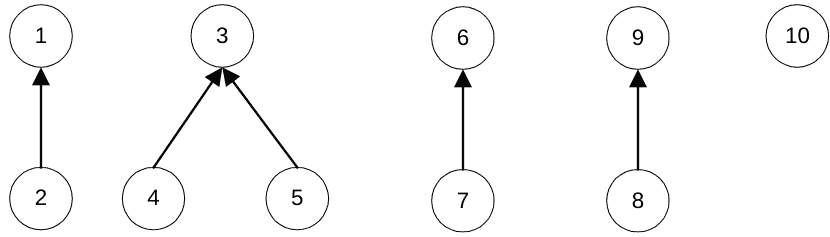

相应的数组将是：

| -2 | 1 | -3 | 3 | 3 | -2 | 6 | 9 | -2 | -1 |
|:---|:---|:---|:---|:---|:---|:---|:---|:---|:---|
| 1 | 2 | 3 | 4 | 5 | 6 | 7 | 8 | 9 | 10 |

## 智能联合

天真的联合操作将简单地将两棵树合并为一棵树的子节点。更聪明的解决方案是将节点较少的树作为节点较多的树的子节点。这被称为按大小合并。另一种方法是将较短的树作为较深的树的子节点，这被称为按高度合并。按高度合并是按大小合并的轻微修改。

我介绍了按大小合并算法。如果两个集合的大小相同，可以将任何一个作为另一个的子节点，因此可以使用某个固定规则。例如，在根节点为 1 和 3 的树进行智能按大小合并后，再合并根节点为 6 和 9 的树，得到的森林和数组如下所示# 计算机科学335 软件设计与分析III 讲座笔记 教授 Stewart Weiss

## 第8章: 不相交集合和并查集问题

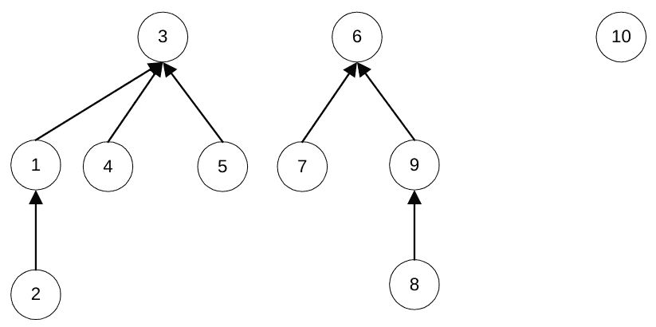

| 3 | 1 | -5 | 3 | 3 | -4 | 6 | 9 | 6 | -1 |
|---|---|---|---|---|---|---|---|---|---|
| 1 | 2 | 3 | 4 | 5 | 6 | 7 | 8 | 9 | 10 |

因为以3为根的树有5个节点（-5），节点1现在有节点3作为父节点。3棵树和6棵树的并集结果为

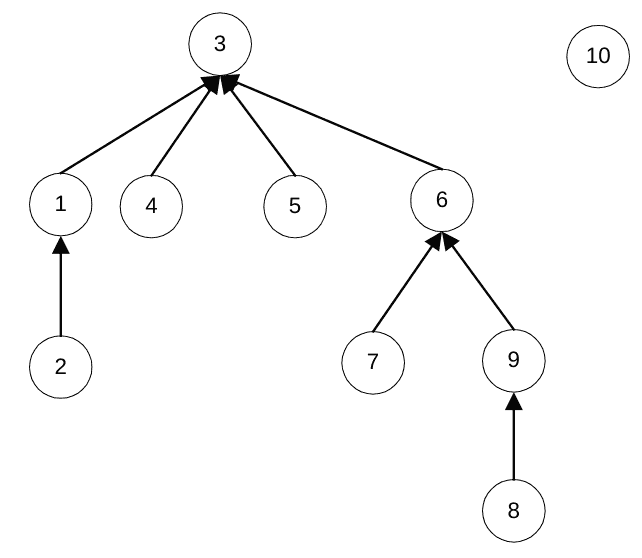

| 3 | 1 | -9 | 3 | 3 | 3 | 6 | 9 | 6 | -1 |
|---|---|---|---|---|---|---|---|---|---|
| 1 | 2 | 3 | 4 | 5 | 6 | 7 | 8 | 9 | 10 |

实现任何算法都非常简单。额外的工作将解决方案转化为极其高效的解决方案，我们很快就会看到。

在大多数抽象数据类型中，访问器和修改器之间有明确的界限；访问数据的操作不会改变对象的状态。例如，在搜索树和哈希表上的查找操作不会修改这些对象。尽管查找是一个访问器，但通过允许它改变对象，可以显著提高运行时间。罗伯特・塔尔詹在发明父树的路径压缩算法时意识到了这一点。当在查找算法中使用路径压缩时，从节点到根的路径上访问的所有节点都会变成根节点的子节点。因此，在上面的集合上调用find(8)后，森林将变成

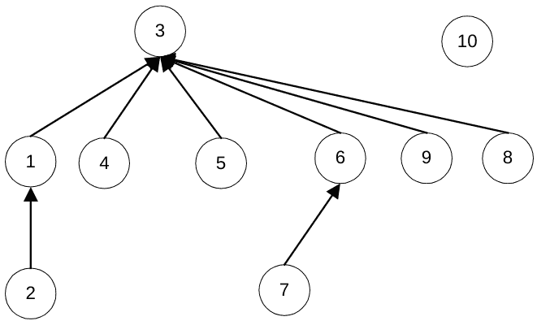

| 3 | 1 | -9 | 3 | 3 | 3 | 6 | 3 | 3 | -1 |
|---|---|---|---|---|---|---|---|---|---|
| 1 | 2 | 3 | 4 | 5 | 6 | 7 | 8 | 9 | 10 |

实现这些算法很容易。智能联合非常简单。find()与路径压缩使用巧妙的递归编码来避免使用堆栈。由于函数调用开销的原因，它比非递归算法稍慢一些。如果使用按高度合并，find算法将会有所不同，因为它需要重新计算树的高度。这就是为什么使用按大小合并更容易的原因。

## 源代码

```cpp
class DisjSets {
public:
    DisjSets(int);
    void union(int, int);
    int find(int);
private:
    vector<int> s;
};
```

```cpp
/* 构造不相交集合对象。
 * numElements是初始不相交集合的数量。 */
```

### 路径压缩

```cpp
DisjSets::DisjSets(int numElements) : s(numElements) {
    for(int i = 0; i < s.size(); i++)
        s[i] = -1;
}
```

```cpp
/** 合并两个不相交的集合。
 * 为简单起见，我们假设root1和root2是不同的
 * 并代表集合名称。
 * root1是集合1的根。
 * root2是集合2的根。
 */
void DisjSets::union(int root1, int root2) {
    if(root1 != root2) {
        if(s[root2] < s[root1]) {
            //root2更深
            s[root2] += s[root1];
            s[root1] = root2;
        } else {
            //root1更深
            s[root1] += s[root2];
            s[root2] = root1;
        }
    }
}
```

```cpp
/**
 * 使用路径压缩进行递归查找。
 * 为简单起见，省略了错误检查。
 * 返回包含x的集合。
 */
int DisjSets::find(int x) {
    if(s[x] < 0)
        return x;
    else
        return s[x] = find(s[x]);
}
```

当x不是其树的根节点 (s[x]<0) 时，此版本的 find() 进行递归调用。在这种情况下，find被调用时使用的是x的父节点，即s[x]，将其移动到树的根节点更近的位置。路径压缩发生在return语句中，该语句将递归调用的返回值赋给了s[x]，即x所属树的根节点。

因此，从x到根节点的路径上的所有父节点都成为该树的根节点的子节点。

## 分析

**定理。** 在使用路径压缩和按大小合并的情况下，一系列M次联合和查找的运行时间在最坏情况下，对于一个包含N个集合的集合，是O(Mα(N))，其中α(n)是Ackermann函数的反函数。

Ackermann函数的定义如下：

```
A(0, n) = n + 1
A(m+1, 0) = A(m, 1)
A(m+1, n+1) = A(m, A(m+1, n))
```

但是Weiss使用了一个增长更快的替代定义：

```
A(1, n) = 2^n
A(m, 1) = A(m-1, 2)
A(m, n) = A(m-1, A(m, n-1))
```

我将坚持原始定义。α(n)是A'(m) = A(m,m)的反函数。即，α(n)是m的值，使得A'(m) = n。为了举一个A(m,n)增长得多快的例子：A(0,n) = n+1, A(1,n) = n+2, A(2,n) = 2n+3, A(3,n) = 2^{n+3} - 3。

A(4,n) = 2^{2^{2^{\cdot^{\cdot^{\cdot^2}}}}} - 3，其中2的塔重复n+3次。

下表显示了A(m,n)在前七个m值和前六个n值的取值。

| A(m,n) | n=0 | n=1 | n=2 | n=3 | n=4 | n=5 |
|---|---|---|---|---|---|---|
| m=0 | 1 | 2 | 3 | 4 | 5 | 6 |
| m=1 | 2 | 3 | 4 | 5 | 6 | 7 |
| m=2 | 3 | 5 | 7 | 9 | 11 | 13 |
| m=3 | 5 | 13 | 29 | 61 | 125 | 253 |
| m=4 | 13 | 65533 | 2^{65536}-3 | 2^{2^{65536}}-3 | A(3, 2^{2^{65536}}-3) | A(3, A(4,4)) |
| m=5 | 65533 | A(4,65533) | A(4, A(4,65533)) | A(4, A(5,2)) | A(4, A(5,3)) | A(4, A(5,4)) |
| m=6 | A(4,65533) | A(5, A(4,65533)) | A(5, A(6,1)) | A(5, A(6,2)) | A(5, A(6,3)) | A(5, A(6,4)) |

A(m,m)是这个表格的对角线。你可以看到A(4,4) = A(3, 2^{2^{65536}}-3)，这比2^{2^{65536}}-3大几个数量级。由于2^{2^{65536}}-3比任何数都大，你将会在这个宇宙中遇到的情况，对于实际目的来说，$\alpha(n)<4$ 对于几乎所有的 $n$，因此它基本上是一个常数函数。

我不包括定理的证明，这相当冗长。因为$\alpha(n)$本质上是一个常数，所以该定理意味着一系列的M个并集和查找操作需要O(M)时间。

## 一个应用

不相交集合并查找问题的一个简单应用是迷宫的生成。想象一个由墙壁围住的 M 乘 N 的网格 G，包括边界上的所有单元格。等价关系是，如果网格中存在一条从一个单元格到另一个单元格的路径，则这两个单元格属于同一个集合。最初，每个单元格都是一个独立的集合，因为所有单元格都被墙壁围住，所以有 MN 个不相交的集合。如果移除了单元格 G[i, j] 和 G[i+1, j] 之间的墙壁，则这两个单元格现在属于同一个集合。这是一个并集操作。随着墙壁的移除，集合的大小增加。

可以通过随机选择一堵墙来生成一个随机迷宫。通过重复随机移除一堵墙，直到入口单元格和出口单元格相连，形成一个迷宫，至少有一条从入口到出口的路径。通过重复操作，直到所有单元格都在同一个集合中，即任何单元格之间都有路径，生成一个更具挑战性的迷宫。

# 第9章 图算法

## 图基础

### 定义
一个图 G = (V,E) 是一个顶点集合 V 和一个边集合 E。E 中的每条边 e 是一个对 (v,w)，其中 v ∈ V，w ∈ V。（形式上，E ⊆ V ×V，V 与自身的笛卡尔积。）边也被称为弧。

如果 E 是一个有序对集合，那么图被称为有向图，边被称为有向边。

一个没有方向的图被称为无向图。

在有向图中，如果(v,w)是一条边，则称w是v的邻接点，但反之不成立。在一个无向图中，如果(v,w)是一条边，则v与w互为邻接点。有向边(v,w)被称为在顶点w上入射，而无向边(v,w)在v和w上都入射。

在一个加权图（有向或无向）中，边具有权重或成本。权重是分配给边的数值。你可以将加权图看作具有一个将整数分配给每条边的权重或成本函数。加权图非常常见，因为它们模拟了许多现实世界的关系。在本章的剩余部分，我将假设如果一个图是加权的，那么存在一个函数c: E → Z，它将整数（正数、负数或零）分配给每条边。

### 例子 1
设 G 是一个图，其中 V 是所有带有机场的美国城市的集合，E 是所有边 (v,w) 的集合，其中 v 和 w 是有定期航班从城市 v 到城市 w 的城市。边 (v,w) 的权重 c(v,w) 可能是 (1) v 和 w 之间的空中距离，(2) 他们之间的空中时间，或者 (3) 最低成本机票的费用。在线预订系统通常允许用户从许多标准中选择加权航班。

### 例子 2
设 G 是一个计算机网络，V 是路由器和终端计算机的集合。E 是路由器和路由器以及路由器和计算机之间的连接的集合。权重可以是传输的延迟或边的带宽。

图中的路径是一个顶点序列 v1, v2, v3, ..., vN，对于每个 i，1 ≤ i < N，(vi, vi+1) ∈ E。路径的长度是路径中的边数（而不是顶点数），如果有 N 个顶点，则长度为 N-1。长度为 0 的路径是从一个顶点到自身的路径，没有边，所以它只是一个单独的顶点。相比之下，(v,v) 是长度为 1 的路径，与长度为 0 的路径不同。路径 (v,v) 被称为一个回路。

一个简单路径是一条路径，除了可能的第一个和最后一个顶点外，所有顶点都是不同的。

在有向图中，一个循环是一条长度至少为1的路径，使得第一个和最后一个顶点相同。如果一个循环是一个简单路径，那么它就是简单的。

在无向图中，一个循环是一条路径，使得第一个和最后一个顶点相同，并且边是不同的（为了避免像{u,v,u}这样的路径被称为循环，即使第二条边与第一条边相同）。图如果没有循环，则被称为无环图。

一个有向无环图简称为DAG。

如果从每个顶点到每个其他顶点都存在一条路径，则称无向图是连通的。

具有这种性质的有向图称为强连通图。

如果一个有向图G不是强连通的，但是通过将每条有向边(v,w)替换为无向边(v,w)（实际上是两条有向边(v,w)和(w,v)），则该图被称为弱连通图。

如果每对不同的顶点之间都有一条边，则图是完全图。

## 图形表示

有两种常见的表示方法。

### 邻接矩阵
一个布尔或数值方阵A，每个顶点都有一行。如果从u到v有一条边，则A[u][v]为真。如果是数值型的，则A[u][v]表示边(u,v)的权重。

下面的非对称布尔矩阵表示其右侧的有向图。

|   | 1 | 2 | 3 | 4 | 5 | 6 |
|---|---|---|---|---|---|---|
| 1 | 0 | 0 | 0 | 1 | 0 | 0 |
| 2 | 0 | 0 | 1 | 0 | 0 | 0 |
| 3 | 1 | 0 | 0 | 0 | 1 | 0 |
| 4 | 0 | 0 | 0 | 0 | 1 | 1 |
| 5 | 1 | 0 | 0 | 0 | 0 | 0 |
| 6 | 0 | 1 | 0 | 0 | 0 | 0 |

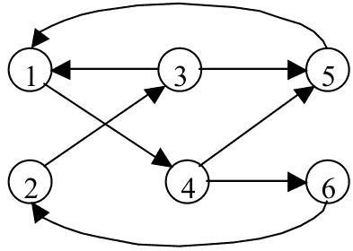

### 优点
邻接矩阵有一个非常简单的实现。这是它唯一的优点。

### 缺点
- 图形通常是稀疏的（在N个顶点的矩阵中有N²个条目，但边的数量可能只是N的倍数）。
- 许多具有高效解决方案的问题在使用此表示时无法高效解决，因为它们都趋向于O(N²)。

### 邻接表
邻接表是一个线性数组，每个顶点都有一个条目，每个条目都是指向与该顶点相邻的顶点的指针。这是最常见的表示方法，因为对于大多数目的来说是最高效的。形式上，对于图G=(V,E)，邻接表是一个大小为n=|V|的数组A，使得A[i]是指向节点（v₁，v₂，...，vₖ）的链表的指针，使得对于每个j=1, 2, ... k, (A[i],vⱼ)是E中的一条边。

如果图是加权图，则列表中每个边的节点都会有一个成员变量来存储权重。

顶点通常具有标签或名称，例如它们所代表的城市的名称。在这种情况下，属性存储在具有指向列表的指针的数组条目中。

上面的图将具有以下邻接列表：

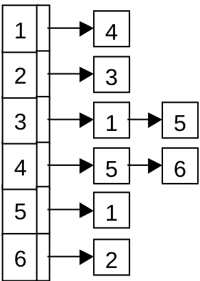

## 拓扑排序

需要解决的最简单的问题之一是找到顶点集的拓扑（部分）排序。（集合的部分排序是一种自反、传递和非对称的二元关系。它不一定是完全的。）顶点{v₁,v₂,v₃,...,vₙ}的拓扑排序是一种排序，使得如果图中存在从vᵢ到vⱼ的路径，则vᵢ必须在排序中出现在vⱼ之前。图G=(V,E)的拓扑排序的输出是将数字1、2、..、N分配给顶点v₁, v₂, v₃, ..., vₙ。

获得对拓扑排序的直觉的最佳方法是假设一个节点是要完成的任务，而从节点v到节点w的边表示v的任务必须在w的任务开始之前完成。如果图中只有一个人可以执行所有任务，并且该人一次只能做一项任务，那么拓扑排序是一系列节点的线性序列，保证任务按正确顺序完成。换句话说，它是一种顺序，其中没有任务会在其所有先决任务完成之前开始。

如果图中存在循环，则无法进行拓扑排序，因为对于循环中的任意两个顶点v和w，v在w之前，w在v之前。无法创建序列，因为如果v在w之前，则w不能在v之前，反之亦然。

如果一个图是无环的，那么它可能有多个拓扑排序。只要底层的偏序关系不是完全排序，就会出现这种情况。任何拓扑排序都会执行。

### 例子
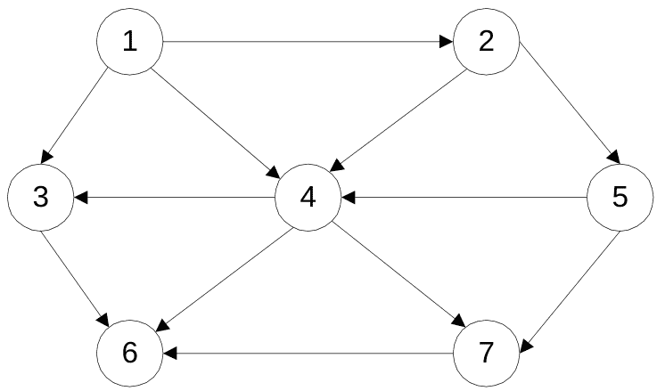

在上面的例子中，有两个拓扑排序：1,2,5,4,7,3,6 和 1,2,5,4,3,7,6

## 算法
定义一个节点的入度为与该节点相连的边的数量。在上面的图中，节点1的入度为0，而节点4的入度为3。

```cpp
counter = 1;
对于v中的每个顶点 {
    让v是入度为0的任意顶点;
    如果没有这样的顶点存在,
        返回 CycleFound
    否则 {
        v.topologicalNumber = counter++;
        对于与v相邻的每个w,
            将其入度减1
    }
}
```

如果图中没有循环，则至少存在一个入度为0的节点。选择其中任意一个节点，我们给它赋值为1，并将与它相邻的所有顶点的入度减1。将入度减1就相当于从节点到其后继节点的边被移除。我们尝试重复这个过程，直到每个顶点都被赋予一个数值。如果我们找不到入度为0的顶点，但是还没有访问完每个顶点，那么一定存在一个循环，因为这意味着剩余的非空图中的每个节点都至少有一条入边，这意味着剩余的图中存在一个循环。

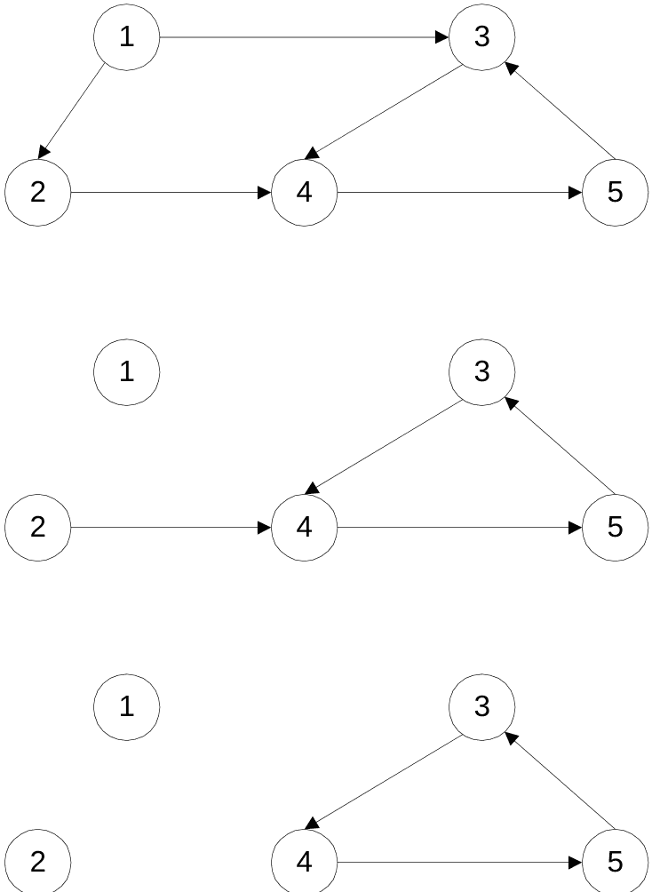

在上述图中，我们给节点1赋值为1，并移除边(1,2)和(1,3)。然后我们处理顶点2，并移除边(2,4)。然后没有入度为0的顶点，所以这个图不能进行拓扑排序。

编号是正确的。我们可以通过对从v到w的路径长度进行归纳来进行论证。如果存在一条长度为1的从v到w的路径，则w是v的后继，而在访问v之前不能访问w，因此在访问v之前，边(v,w)不能被移除，因此indegree(w)直到访问v之后才为0。因此，分配给w的数字大于分配给v的数字。

如果从v到w的路径长度>1，则根据假设存在一个顶点u，使得{v,...,u}是长度为n-1的路径，且(u,w)是一条边。根据假设，toponum(v)<toponum(u)，并且根据前面的论证，toponum(u)<toponum(w)。

实现这个算法的最简单方法是使用一个队列来存储顶点。通过读取每个邻接表并在其他顶点的邻接表中每次v出现时增加A[v]的indegree，计算每个顶点的indegree。这是O(E)，因为它只检查每条边一次。

计算入度后，所有入度为0的顶点被加入队列，并进入循环。在循环中，队列的前端被移除，它被赋予一个拓扑编号，它的后继顶点的入度被减少，如果为0，则它们被加入队列。

对于一个无向图G=(V,E)，其生成树G'=(V,E')是一个图，使得G'是一棵树。换句话说，G'具有相同的顶点集，但是从E中删除了边，使得结果图是一棵树。这意味着G'是无环的。如果G是有向的，这意味着循环已被删除，并且前向边已被删除。

从生成树中删除任意一条边会导致图不连通。

如果没有其他代价更小的生成树，则生成树是最小的。如果图是非加权的，则代价只是边的数量。如果图具有加权边，则代价是生成树中边的权重之和。

生成树的一个应用示例是在建筑物中找到最少的布线来连接电气连接。

### 例子
一个图和它的最小生成树。

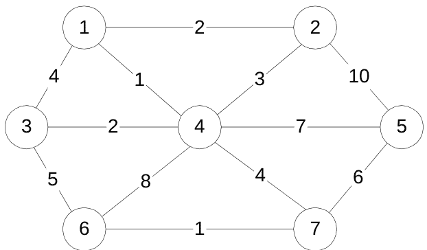

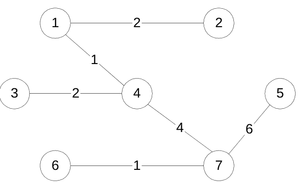

找到最小生成树的一个相对简单的算法是Kruskal算法。它是一种贪婪算法，因为它总是试图在每一步找到最佳解决方案。并非所有贪婪方法都有效，但在这里有效。它使用了第8章中的并查集算法。

## Kruskal算法

思路是从每个顶点都是一个独立的树的森林开始。然后寻找最小权重的边，并将它的两个顶点连接成一个有两顶点的树。找到下一个最小权重的边，并将两个顶点连接在一起，如果它们还没有在一棵树中。如果它们在同一棵树中，那么添加这条边将形成一个循环，所以不应该添加这条边。如果我们继续这个过程直到只剩下一棵树，那么这棵树将是最小成本的，因为边是按照升序成本添加的。

该算法将树视为顶点的集合。为了形成一棵新树，使用并集操作。使用不相交集合ADT表示顶点。堆用于在每一步中选择最小边。

```c
void kruskal() {
    int edgesAccepted;
    DisjointSet s(NUM_VERTICES);
    PriorityQueue h(NUM_EDGES);
    Vertex u, v;
    SetType uset, vset;
    Edge e;

    readGraphIntoHeapArray(h);
    h.buildHeap();

    edgesAccepted = 0;
    while (edgesAccepted < NUM_VERTICES - 1) {
        h.deleteMin(e);     // 假设 e = (u,v)
        uset = s.find(u);
        vset = s.find(v);
        if (uset != vset) {
            // 添加边
            edgesAccepted++;
            s.union(uset, vset);
        }
    }
}
```

该算法需要O(|E|)步来构建堆，并且需要O(|E|)个deleteMin操作来构建最小生成树。每个deleteMin操作需要log|E|步，因此总共需要O(|E|log|E|)步。由于|E|=O(|V|^2)，所以总共需要O(|E|log|V|)步。

## 最短路径算法

在本节中，我们假设所讨论的图是有向的。最短路径问题有几种不同的类型。最简单的一种是单源最短路径问题。问题的最一般陈述是加权路径最短路径问题，这是问题中最困难的版本之一。

## 单源最短路径问题

给定一个加权图G=(V,E)，以及一个特定的顶点s，在图中找到从s到其他每个顶点的最短加权路径。

如果我们让每条边的权重都为1，那么问题的陈述就简化为找到长度最短的路径。

Edgar Dijkstra 提出了一个算法来解决加权图版本的这个问题，前提是边没有负权重。在他的算法中，图是有向的还是无向的并不重要。算法的输出是每个顶点的最短（加权）距离的列表。如果输出需要包括到每个顶点的路径集合，那么可以修改算法来记录这些信息。

算法的思想是维护一个临时的顶点集合T，使得从s到T中每个顶点的最短路径都已经正确确定，并且通过迭代来扩大这个集合。这个集合可以被看作是已知集合，因为对于这个集合中的任何顶点，从s到它的最短路径已知是正确的。最初，只有源顶点s在T中，因为从s到s的距离是0。在每次迭代中，一个新的顶点被添加到T中。当已知集合的大小等于|V|时，算法停止。

算法还维护了对于不在T中的每个顶点v，从s到v的临时最短距离d(v)。值d(v)是从s到v的最短路径的权重，除了v之外，只通过T中的顶点。当算法进行时，它可能发现d(v)太大，然后会将其减小。

在初始化集合T并记录每个节点的初始距离d(v)之后，算法进入一个循环。在循环的每次迭代中，将具有最小d(v)的顶点v∈V−T添加到T中，并更新每个u ∈ V −T的距离d(u)。因此，在循环的|V-1|次迭代之后，所有顶点都已添加到T中，算法终止。

在接下来的算法描述中，成本函数c(v,w)，仅定义在边集E中的边(v,w)上，被扩展为一个在所有顶点v,w ∈V上定义的函数c'(v,w)，如下所示：

$$ c'(v, w) = \begin{cases} 
0 & \text{如果 } v = w \\
c(v, w) & \text{如果 } (v, w) \in E \\
\infty & \text{如果 } (v, w) \notin E 
\end{cases} $$

换句话说，如果边不存在，则边(v,w)的成本为无穷大。在实践中，可以用一个特殊值表示边不存在。所有其他边的成本就是边本身的权重。

计算机科学335 软件设计与分析III  讲座笔记  教授：斯图尔特·韦斯

第9章：图算法

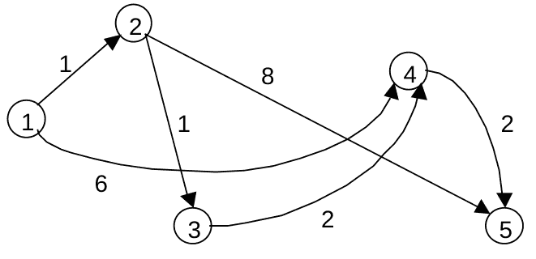

## 算法

```pseudo
// 初始化函数d(v):
对于每个 v ≠ s {
    d(v) = c'(s,v);     // 设置初始距离
}
d(s) = 0;       // 从 s 到 s 的距离为 0

// 初始化 T 只包含 s
T = {s};
当 ( T ≠ V ) {
    选择一个顶点 v ∈ V - T 且 d(v) 最小的 ;   // 可能有多个
    设置 T = T ∪ {v};
    对于所有顶点 u ∈ V - T 且与 v 相邻 {
        如果 ( d(u) > d(v) + c'(v,u) )
            d(u) = d(v) + c'(v,u);
    }
}
```

当我们找到顶点 v，其 d(v) 在所有还未加入 T 的顶点中最小，我们查看与其相邻的所有顶点，对于每个顶点 u，如果从 s 到 u 经过 v 的路径的权重，比不经过 v 时更小，我们减小了其潜在最短路径的权重，使其成为从 s 到 v 再到 u 的路径的权重。

## 正确性

算法的正确性可以通过对集合T的大小进行归纳论证来证明。归纳假设是对于集合T中的每个顶点v，d(v)是从s到v的最短路径的权重。显然，在基本情况下，它对于大小为1的|T|是成立的，因为s是集合中唯一的顶点。假设当|T|的大小为k时，它是成立的。假设在算法选择将顶点v添加到T时，|T|的大小为k。根据算法，对于所有不在T中的顶点w，d(v)都不大于任何d(w)。假设从s到v的最短路径的权重不是d(v)。那么，从s到v存在一条更短的路径p=(s=v1,v2,v3,...,vj=v)。除了v之外，这条路径p必须包含一个不在T中的顶点，否则它将只是算法选择的路径。在路径p=(s=v1,v2,v3,...,vj=v)的顶点列表中，让w=vi是p中第一个不在T中的顶点。然后，由于d(w)必须不小于d(v)，否则它将被选择而不是v。由于边的权重不能为零，从s经过w到v的路径的权重必须大于不经过w到v的路径的权重，这是一个矛盾。

## 运行时间

算法的运行时间在很大程度上取决于它的实现方式。如果顶点以d(v)的值为基础存储在优先队列中，那么选择具有最小d(v)的顶点v，并将其从V-T中移除，需要进行一次deleteMin操作，需要O(log|V|)步骤。更新与v相邻的每个u的值d(u)的时间也是O(log|V|)，因为可以通过在堆中执行percolateUp(u)来完成更新，最坏情况下为O(log|V|)。但是最坏情况下会有O(|E|)次更新，因为每条边都会导致一次更新。因此，更新的成本为O(|E|log|V|)，但deleteMin的总成本为O(|V|log|V|)，所以运行时间为O(|E|log|V| + |V|log|V|)。

问题是，当选择一个顶点时，如何找到堆中与其相邻的顶点所在的位置。这并不容易，但是是可能的。另一种选择是，当需要更新顶点u时，不是实际在堆中找到它，改变其值，并将其上浮，而是创建一个新的实例，其键值较小，并将其插入堆中，它将在当前位置之上上升。当然，现在堆中可能会有多个副本，但是如果我们跟踪是否将其移入集合T，那么这并不重要——我们只忽略已经移入集合T的幽灵副本。较小的副本将始终在较大的副本之前到达顶部。这种策略的缺点是堆可能会变得很大，精确地说是O(|E|)。但对于稀疏图来说，这是一个好的解决方案。在大多数应用中，图是稀疏的。

# 第10章 复杂度类P和NP

## 10.1 引言

有些问题的最小运行时间与其输入的大小呈指数关系，仅仅是因为其输出的大小是输入大小的指数函数。 我们无法减少它们的时间复杂度，因为它们必须输出指数数量的字节。

这有一些简单的例子：

- 给定 n，打印从 1 到 2^n 的所有数字的问题。
- 给定 n，生成所有 1 到 n 的 n! 个排列的问题。

第一个问题非常无聊，我不确定为什么有人想要一个程序来做这个。

第二个问题更有用，因为有时我们想要生成所有这样的排列作为另一个问题的输入，也许是为了测试其他程序。

一个程序具有大量输出并不意味着程序本身很大，正如你所知道的，因为我们可以编写一个产生无限输出的小循环程序。 一个打印所有排列的程序在下面的列表10.1中出现。

列表10.1：打印所有 1..N 排列的程序

```c
#include <stdio.h>
#include <stdlib.h>
#include <errno.h>
#include <string.h>

/* genperms() 打印1到size的所有排列 */
void genperms(int a[], int size, int k) {
    int i, j;
    static int depth = -1;

    depth++;
    a[k] = depth;
    if (depth == size) {
        for (j = 1; j <= size; j++)
            printf(" %d ", a[j]);
        printf("\n");
    }
    for (i = 1; i <= size; i++)
        if (a[i] == 0)
            genperms(a, size, i);
    depth--;
    a[k] = 0;
}

int main(int argc, char *argv[]) {
    int n; // 生成排列的数量

    /* 检查用法 */
    if (argc < 2) {
        printf("用法: %s n, 其中 n 是排列的数量\n", argv[0]);
        exit(1);
    }

    /* 获取用户输入并转换为数字 */
    errno = 0;
    n = strtol(argv[1], NULL, 10);
    if ((errno == ERANGE) || (errno != 0 && n == 0)) {
        perror("strtol");
        exit(EXIT_FAILURE);
    }

    /* 分配一个大小为 n+1 的动态数组 */
    int *p = malloc((n + 1) * sizeof(int));
    if (NULL == p) {
        printf("分配存储空间问题\n");
        exit(1);
    }
    /* 将数组填充为零 */
    memset(p, 0, n + 1);

    /* 调用递归函数生成排列 */
    genperms(p, n, 0);

    free(p);
    return 0;
}
```

上述问题的输出大小是输入大小的指数函数，假设我们有一种合理的方式来定义大小，这些问题被排除在本讨论的其余部分之外；它们必须花费与输出大小成正比的时间。

有许多问题需要很长时间，不是因为它们产生了指数量量的输出，而是因为它们需要搜索大量的候选解，找到真正的解。 例如，想象一下，我们得到了一个完全图，有 $n$ 个顶点，我们被告知每次访问一个顶点，我们都会得到一个线索，如果我们按照正确的顺序收集线索，我们就能赢得大奖。 这个图可以是要访问的城市，或者是森林中的树，或者是火车站。 显而易见的解决方案，也许是唯一的解决方案，是生成图中所有可能的简单路径，并检查每一条路径。上述程序可以用来做到这一点，但是它不会输出每条路径，而是在找到按正确顺序收集线索的路径时停止。 在最坏的情况下，需要生成所有的排列。

这是一个相当简单的问题，并且有一个相当简单但不高效的解决方案。 有一些问题已知算法需要指数级的时间来解决，但是还没有找到高效的算法。 我们即将重新考虑我们对“高效”的概念，因为很快你会看到，我们还没有真正见识过一个困难的问题。到目前为止，如果我们能找到一个 $O(n^3)$ 算法或一个 $O(n^2)$ 算法的替代方案，我们就将其视为低效的。 对于我们即将描述的问题，如果有一个运行时间为 $O(n^{40})$ 的算法，那将会非常高兴，因为至今还没有人能够设计出一个时间与 $k$ 成比例的算法！目前为止，最好的办法就是使用指数时间来解决这些问题，也就是时间与 $c^n$ 成比例，其中 $c>1$ 是一个实数。

这个好吗？考虑一个问题，最快的已知算法解决它的运行时间与 $2^n$ 成正比。假设使用今天最快的计算机，解决一个大小为 $n=100$ 的问题需要一个小时。解决一个大小为 $n=101$ 的问题需要 $2$ 小时，而解决一个大小为 $n=116$ 的问题需要大约 $7.5$ 年。假设在十年内，我们可以拥有运行速度快 $100,000,000$ 倍的计算机，这只能让我们在一个小时内解决一个大小为 $n=126$ 的问题！我们永远无法用这个算法解决一个大小为 $n=200$ 的问题。

一般来说，我们称这类问题为难以处理的。

定义1。如果需要指数级的时间来发现一个问题的解决方案，并且其输出的大小不超过其输入大小的多项式函数，则该问题是难以处理的。

你可能会想，有哪些类似的问题呢。有些问题非常容易陈述。这类问题中最著名的是旅行商问题，我们可以定义如下：

一个旅行商想要访问 $n$ 个不同的城市，从她的家乡出发并返回到她的家乡，但是每个城市只能访问一次。问题是找到一条最短的路径，使得每个城市都只访问一次。

听起来很简单，并且在各种情境中都会出现，但实际上没有办法解决这个问题而不需要找到图中许多路径的长度，通常在讨论这个问题时称为旅行。

一个类似的问题是哈密顿回路问题：

给定一个无向图，是否存在一条连接所有节点的简单循环路径？

简单循环是一种每个顶点只出现一次的循环，除了第一个和最后一个顶点相同。例如，$1, 2, 3, 4, 5, 1$ 是一个简单循环。如果你不在乎经过节点多次，通过图并访问每个节点并不难。当你没有这种便利时，这是一个完全不同的问题。

哈密顿回路问题是一个决策问题的例子。

定义2。决策问题是一个有是/否答案的问题。

旅行推销员问题需要一个路径作为答案。它们相似，但并不完全相同。上述的旅行推销员问题是一个最小化问题或优化问题，但它有一个对应的决策问题：

给定一个有限的城市集合和一个界限 $B$，是否存在一条从她的家乡出发并返回她的家乡的旅行，每个其他城市只访问一次，长度不超过 $B$?

在第9章中，我们为图定义了生成树。一个简单的问题是，一个图是否有一棵生成树，其中没有顶点的度大于某个固定常数 $k$? 听起来这个问题应该不难解决，但它也需要进行详尽的搜索。没有人找到了一个高效的算法来解决它。

与图无关的一个问题是装箱问题：

给定一个有限集合 $U=\left\{u_{1}, u_{2}, \ldots, u_{n}\right\}$，其中包含各种大小的 $N$ 个物品，以及一组 $L$ 个箱子，这些物品必须放入其中，那么需要多少个箱子才能将所有物品装箱?

对应的决策问题是：

给定一个有限集合 $U=\left\{u_{1}, u_{2}, \ldots, u_{n}\right\}$，其中包含各种大小的 $N$ 个物品，以及一组 $L$ 个箱子，这些物品必须放入其中，还有一个容量 $B$，是否存在一种将物品分配到箱子中的方法，使得每个箱子中物品的大小之和不超过 $B$?

与图无关的第二个问题被称为电路可满足性问题：

给定一个由AND、OR和NOT门构建的组合电路，是否有一种方法可以设置电路输入，使得输出为1?

注意这也是一个决策问题，并且是另一个需要穷举搜索的问题。事实上，这个问题是一个非常重要的问题的变体，我们很快会回到它。

有时候，一个简单问题和一个困难问题之间只有一条非常细微的界线。一个很好的例子是下面这对问题：

- 给定一个加权图 $G=(V, E)$，两个顶点 $v$ 和 $w$，以及一个权重 $c$，是否存在一条从 $v$ 到 $w$ 的简单路径，其权重不超过 $c$。
- 给定一个加权图 $G=(V, E)$，两个顶点 $v$ 和 $w$，以及一个权重 $c$，是否存在一条从 $v$ 到 $w$ 的简单路径，其权重至少为 $c$。

第一个问题有一个高效的解决方案；对图进行广度优先搜索将在线性时间内给出答案。第二个问题没有已知的运行时间小于指数时间的解决方案。我们能做的最好的办法是生成所有可能的路径，并查看是否有足够长的路径。

## 10.2 预备知识

现在我们更加准确地区分易解和难解问题。首先，我们必须更准确地定义输入大小的概念。

定义3。算法的输入大小是使用合理的编码方法对输入进行编码所需的位数。

合理通常意味着使用常规方法，如二进制编码、十六进制或十进制或其他常数基数。不合理的编码是一种一元编码，需要 $m$ 位来编码数字 $m$。


定义4。算法 A 解决问题 p，如果对于算法的每个输入，它终止并输出该输入的 p 的解决方案。

在这种情况下，我们将简单地说算法解决了 p，或者说算法解决了 p。

定义5。如果存在一个数字 $k$，对于算法给定的每个大小为 $n$ 的输入，它在最多 $n^k$ 的时间内解决该输入的问题，那么算法 A 可以在多项式时间内解决问题 p。

请注意，这意味着最坏情况下的运行时间，因为它表示对于所有大小为 $n$ 的输入，运行时间的上界是 $n^k$。 特别地，最长的那个被包括在内。

接下来，我们想要定义什么是确定性算法。我们假设所有指令都有唯一的地址或编号，并且所有变量可以通过它们在内存中的地址唯一地标识。

定义6。算法的状态是对算法使用的所有变量和内存位置的值的完整描述，以及它即将执行的指令的地址。 算法的初始状态是第一次执行第一条指令时的状态，所有内存都已创建。

甚至像打开开关这样的事情也是算法的一部分。 如果它是打开的，那么开关的状态就是它的状态的一部分，以及如果要读取或写入的下一个字节。状态不会遗漏任何东西。

定义7。如果给定算法的当前状态，在该状态下执行当前指令唯一确定算法的下一个状态，则该算法是确定性的。

换句话说，确定性算法不留任何机会；给定特定的输入，它总是产生相同的输出。 实质上，算法的输入/输出对集合是一个函数。 我们在这门课程中学到的算法，以及你在其他本科课程中学到的大部分算法，都是确定性算法。 很快我们将看到非确定性算法是什么样子。

最后，在本章的剩余部分，我们将限制所有考虑的问题都是决策问题。

## 10.3 复杂度类P

我们定义了一个非常重要的决策问题集合，它们具有共同的特性。

定义8。所有可以在多项式时间内由确定性算法解决的决策问题的集合是复杂度类P。

注意，P是一组问题，而不是算法。 P被称为复杂度类，因为它是具有相同计算复杂度的问题的类。 问题的计算复杂度是已知的最佳算法的渐近最坏情况运行时间。

那个问题。P 的定义说明，如果存在某个确定性算法可以在多项式时间内解决它，那么该问题属于类 P。

在计算机科学本科课程中，几乎所有你通常学习的问题都在多项式时间内运行。那些决策问题属于类 P。许多问题都有与之对应的决策问题。这包括排序问题，图中各种最短路径问题，确定图是否无环、强连通等算法，以及在树和表中搜索键值等问题。

## 10.4 复杂度类 NP

现在你必须稍微放飞一下想象力，来理解非确定性的概念，因为我们将用它来描述一个虚构的计算机或算法，一个在物理现实中无法存在的东西。 但它在理论计算机科学中扮演着非常重要的角色，并可以追溯到很多年前。 在非确定性算法中，它进入的下一个状态不是由当前状态决定的；它具有进入多个下一个状态中的任何一个的能力，并且这个选择在某种意义上是同时发生的。

想象一个人在森林中行走，路径分叉。 这个人被迫选择一条路径并跟随它。假设这个人以某种方式能够同时走两条路径，而不是通过复制他自己，而是通过克隆时间。 那么这个人就会以非确定性的方式行走。 这与并行执行不同，后者就像复制这个人一样。 这也不同于概率算法，后者会随机猜测并跟随它。这是一个我们只能想象的抽象概念。

我们将这个想法应用到算法中。 想象一个算法，在第一阶段猜测候选解，并在第二阶段检查猜测是否正确。 我们可以将第一阶段称为猜测阶段，第二阶段称为检查阶段。 这个想法是算法可以同时进行所有猜测，然后同时检查它们。 这意味着，实际上，如果问题有解，那么解将是其中一个猜测，并且它将在检查阶段发现这一点，总共所需的时间与进行单个猜测并检查它的时间相同。

所有这些都可以非常严谨地形式化，但这需要相当多的背景理论。 最初的表述是基于图灵机的。我们在这里解释的思想不需要使用图灵机，但这样做可能缺乏严谨性。尽管没有必要这样做，但在本节的其余部分，我们将限制所考虑的问题为决策问题。

举个例子，一个非确定性算法可以通过首先猜测一个任意的城市序列来解决旅行商决策问题，该序列从一个给定的城市开始，以相同的城市结束，并且每个城市只访问一次，然后在检查阶段，它将检查猜测的长度是否最多为 $B$。 如果存在长度最多为 $B$ 的旅行路线，则其中一个猜测将是正确的，并且将在检查阶段进行验证，并且输出将为是。如果没有这样长度的旅行路线，则找不到正确长度的猜测，并且输出将为否。我们可以用以下定义更加形式化。

定义 9。如果一个非确定性算法可以解决一个决策问题 $d$：

- 对于每个应该回答“是”的输入，它可以在猜测阶段进行猜测，在检查阶段进行检查后，将得到回答“是”；
- 对于每个输入 $d$，如果答案是否定的，在猜测阶段没有任何猜测可以在检查阶段得到肯定的答案。

这是一个合理的定义。 它基本上是说，如果存在正确的猜测，算法总是能找到它，如果不存在正确的猜测，算法就找不到。 我们可以如下定义多项式时间的非确定性算法。

定义 10。如果存在一个多项式 $p$，对于每个输入 $d$，如果答案是肯定的，那么在检查阶段存在一个猜测可以在 $p(n)$ 的时间内得到肯定的答案，那么非确定性算法可以在多项式时间内解决决策问题 $d$。

这意味着猜测的大小也受到多项式的限制，因为花费多项式时间来检查大小超过多项式的结构是不可能的。现在我们可以定义 NP 类：

定义 11。所有可以在多项式时间内通过非确定性算法解决的问题的集合是复杂度类 NP。

这个定义的一个直接推论是，P 中的每个问题也都属于 NP：如果一个可以用确定性算法在多项式时间内解决，那么它也可以用非确定性算法在多项式时间内解决。因此，P ⊆ NP。 计算机科学中最重要的未解决问题是 P = NP，即是否存在 NP 中的问题不属于 P。尽管许多人尝试过，但没有人证明或证伪这个陈述。 这是一个大问题，因为有许多重要的实际问题已知属于 NP，但尚未知道属于 P，如果有人证明 P = NP，这将意味着这些问题确实有高效的解决方案。 如果有人证明 P ≠ NP，这并不一定意味着任何具体问题没有高效解决方案，而是某些问题没有，这引出了 NP 完全性的概念。

### 10.4.1 指数时间

如果一个属于 NP 类问题，那么它总是可以通过一个确定性的指数时间算法来解决。 为了简单起见，假设 $D$ 是一个 NP 类问题。那么存在一个多项式 $p(n)$，使得规模为 $n$ 的实例可以通过非确定性算法在时间 $p(n)$ 内决定。 这意味着传递给检查阶段的猜测的大小不超过 $p(n)$ 位。 确定性算法可以枚举出最多这个大小的所有可能的猜测，并在多项式时间内尝试每一个。 最多有 $O(2^{p(n)})$ 个这样的猜测，因此这样的算法可以在指数时间内生成猜测并进行检查。 这表明 NP 类问题可以通过确定性的指数时间算法来解决。

## 10.5 NP 完全性和 NP 困难性

有一些决策问题被认为属于 NP，但可能属于 P 也可能不属于 P。没有人找到这些问题的有效算法，也没有人证明这些算法是不存在的，很多人都试图做到其中之一。所以没有证明它们属于 P，也没有证明它们不属于 P。这类问题的列表相当长，其中包括：

- 1. 电路可满足性，如上所述；
- 2. 装箱问题，如上所述；
- 3. 哈密顿回路，如上所述；
- 4. 子集和问题：给定一个整数集合 X 和一个整数 t，X 是否有一个子集其元素之和为 t？
- 5. 最长路径：给定一个非负权重图 G 和两个顶点 u 和 v，在图中是否存在一条从 u 到 v 的简单路径，其长度大于 B？
- 6. 图同构：给定两个图 G1=(V1, E1) 和 G2=(V2, E2)，是否存在一个一对一、满射的函数 f: V1 → V2，使得当且仅当 (u, v) ∈ E1 时，(f(u), f(v)) ∈ E2？
- 7. 整数因子分解：给定一个整数 n 和一个整数 m，其中 1 ≤ m ≤ n，n 是否有一个因子 q，满足 1 < q < m？

有一些问题已经被证明，如果其中任何一个问题可以用确定性算法在多项式时间内解决，那么所有已知属于 NP 的问题也可以用多项式时间内解决，这意味着 P = NP。这些问题被称为 NP 难问题。非正式地说，如果一个问题至少和 NP 中的任何问题一样难，那么它是 NP 难问题。如果一个问题既是 NP 难问题又属于 NP，那么它是 NP 完全问题。

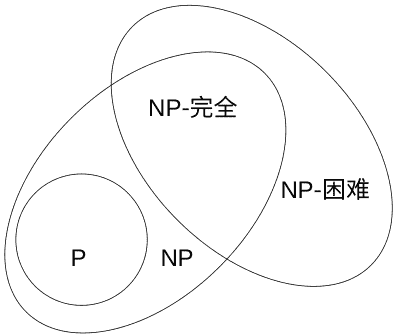

图 10.1：一个欧拉图展示了如果 P=NP 的世界

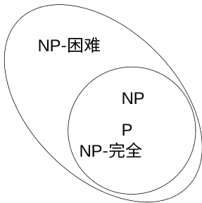

图 10.2：一个欧拉图展示了如果 P≠NP 的世界。

是否存在 NP 难但不是 NP 完全的决策问题？ 所有不可判定的问题都属于这个类别，例如停机问题，但也有可判定的问题属于 NP 难但不是 NP 完全问题。一个例子是称为真量化布尔公式问题，它询问一个包含存在量词和全称量词的布尔公式是否存在使其为真的赋值。 参见图 10.1，了解如果 P=NP 时集合之间的关系。

### 10.5.1 证明 NP 完备性

假设决策问题 $D$ 已知为 NP 完全问题，并且我们给出了一个在 NP 中的问题 $D'$。假设我们可以找到一个转换 $T$，可以将旧问题 $D$ 的任意实例 $d$ 转换为新问题 $D'$ 的实例 $d'$，使得 $T(d)$ 的答案是 $D'$ 的实例中的“是”，当且仅当 $d$ 的答案是 $D$ 的实例中的“是”。 假设转换也可以在多项式时间内完成。 那么我们有一个解决原问题 $D$ 所有实例的过程如下：

- 1. 使用多项式时间将实例 $d$ 转换为问题 $T(d)$ 的形式。
- 2. 使用 $D'$ 的算法解决问题 $T(d)$。
- 3. 如果 $T(d)$ 的答案是“是”，则报告 $d$ 的答案也是“是”。

如果 $D'$ 有一个多项式时间的确定性算法（意味着它在 P 中），这将意味着旧问题也在 P 中，且 P = NP。换句话说， $D'$ 是 NP 完全的。

例子 12。假设我们知道哈密顿回路问题是 NP 完全的，但我们不知道旅行推销员问题是否是。我们使用的转换如下：给定一个图 $G=(V, E)$，其中 $|V|=n$ 是哈密顿回路问题的一个实例，通过为 V 中的每个顶点创建一个城市，并为城市之间的距离定义为 1（如果存在边 $(v, w) \in E$）和 2（如果不存在边 $(v, w)$）。 显然，这是一个多项式时间的转换。

运行旅行推销员问题的算法，以确定在这个构造的实例上是否存在最多重量为 $n$ 的旅行。 如果找到一条旅行路线，这意味着原始图中存在连接所有顶点的环（因为旅行推销员访问每个城市，因此遍历了所有顶点并使用了权重为 1 的边）。如果找不到最多重量为 $n$ 的旅行路线，则原始图中不存在连接每个顶点的环路径。

因此，如果旅行推销员算法有一个确定性多项式时间算法，由于我们可以使用它来解决哈密顿回路问题，这意味着哈密顿回路问题也有一个确定性多项式时间算法。

上面非正式描述的过程被称为将 $D$ 多项式时间归约到 $D'$。如果我们能够将一个已知的 NP 完全问题归约到 NP 中的另一个问题，那么第二个问题也必须是 NP 完全的。这表明我们可以通过将已知的 NP 完全问题扩展到更多问题来扩展 NP 完全问题的集合。

- 找到已知 NP 完全问题的合适多项式时间归约。但这只有在已知有一个起始问题是 NP 完全的情况下才有用，这个问题不能通过从其他 NP 完全问题进行归约来证明！它是怎么出现的？

### 10.5.2 库克定理

1971 年，斯蒂芬・库克证明了第一个 NP 完全问题的存在。他通过直接证明而不是通过归约，证明了可满足性问题是 NP 完全的。简而言之，他证明了如果可满足性问题有一个多项式时间确定性算法，那么 NP 中的每个问题也有。

除非我们知道图灵机是什么，否则我们无法理解他的证明，但我们可以描述基本思想。他展示了如何将非确定性图灵机 (NDTM) 的计算表达为布尔公式，这样，如果图灵机输出给定问题的解，则该公式具有使其为真的赋值。因为图灵机可以用精确的数学术语描述，所以可以创建一个长度为输入大小的多项式的布尔表达式，该表达式表示机器在该输入上的运行时间是多项式时间。因为非确定性图灵机可以在多项式时间内解决 NP 中的任何问题，所以他的构造表明对于 NP 中的每个问题，都存在一个可满足性问题的实例，使得对于该实例的可满足性问题的肯定答案对应于原问题的肯定答案。

这个问题首次确定了这个首个 NP 完全问题，简称为 SAT。

## 作业 1：多项式乘法

### 概述

这个项目的目的是让你练习设计和实现类，并使用现有的模板类。你将设计和实现一个表示多项式并执行多项式乘法的类。你还将编写一个作为该类客户端的主程序。主程序将从文件中读取一系列多项式定义和操作，创建多项式，并执行指定的操作。如果你需要复习多项式算术，请参考任何一本初等代数教材。

### 多项式算术

一个多项式（一元）的形式为

```
p(x) = c_n x^n + c_{n-1} x^{n-1} + ... + c_1 x + c_0
```

其中 $n$ 是一个非负整数， $c_n \neq 0$，而其他系数 $c_k$ 可能为零也可能不为零。多项式的次数为 $n$。多项式中不允许指数为负数。在这个任务中，所有系数都被假定为整数。（在这种情况下，它被称为整数域中的多项式。）请注意，如果多项式的次数为 0，则多项式只是一个常数。在本规范的其余部分中，我用 $p$ 作为 $p(x)$ 的简写。

给定两个多项式 $p$ 和 $q$，定义以下二元运算：

$p * q$ 被定义为多项式 $p$ 和 $q$ 的乘积。

### 例子

如果 $p(x) = 2x + 3$ 和 $q(x) = -x + 1$，那么

```
p * q = (2x + 3) * (-x + 1) = -2x^2 + x + 3
```

### 项目详情

### 类接口

你需要设计一个多项式类的接口。该类必须包含以下成员函数。

| 名称 | 描述 |
| :--- | :--- |
| eval(double x) | 使用参数 x 计算多项式并返回值。这应该被实现为一个重载的函数调用运算符 `()`。 |
| operator* | 给定多项式 p 和 q，返回 p*q。 |
| operator<< | 给定输出流 out 和多项式 p，在 out 上以符号形式显示 p。 |

此外，该类还需要

- 一个创建零多项式的默认构造函数，
- 一个接受系数 c 和指数 e 的构造函数，并构造一个包含单个项 $cx^e$ 的多项式，例如，Polynomial p(c,e);
- 一个拷贝构造函数，接受多项式 q 并创建一个 q 的副本，例如，Polynomial p(q);
- 为该类编写一个 operator= 函数，将一个多项式复制赋值给另一个已存在的多项式；
- 一个析构函数，用于删除多项式。

请注意，这个描述没有提到类的私有部分。这取决于你。你可能需要实现多项式类的其他私有成员。

### 设计和实现要求

必须使用列表来实现多项式。 C++ 语言包含一个列表模板类，你必须使用这个模板类而不是编写自己的列表类。这是我给你这个任务的意图。

列表提供了你所需的所有函数。我建议你的列表节点是项。每个项完全由其系数和指数定义。没有两个项可以具有相同的指数；即每个节点必须具有唯一的指数。按指数值排序节点是一个好主意。

当两个多项式相加时，一些项可能会被抵消。例如，如果 $p=2x+1$，$q=-2x+2$，并且我们让 $r=p+q$，则 $r=3$，因为项 $2x$ 和 $-2x$ 被抵消了。我们可能得到一个结果，其中有更少的（甚至没有）项。这意味着你需要检查结果的系数是否为零，并删除该节点。还有其他需要解决的关于如何执行算术的问题。

主程序、类实现和接口必须分别放在自己的主程序中。对于这个项目，不需要超过三个源代码文件。

#### 输入和输出

主程序将创建一个最多包含 100 个多项式的向量或数组。我将在这里将其命名为 Poly。你可以随意给它命名。然后，主程序将从命令行上指定的文本文件中读取输入。如果没有指定文件，或者指定的文件不存在或由于某种原因无法打开，主程序必须显示错误消息，然后退出。每行的格式可以是以下四种之一：

1. $k$: $c_1$ $e_1$ $c_2$ $e_2 \dots$ $c_n$ $e_n$
2. $n = m * k$
3. 评估 $n(6)$
4. 显示 $n$

第一个格式是一个新多项式的定义。冒号前的数字 k 是多项式应该存储的位置在向量（数组）中。每个标记之间都会有空格，包括冒号、系数和指数。行的格式是正确的，所以在这个任务中不需要进行输入验证。即，在冒号后面会有一组数字对，每个对表示一个形式为 $c_k x^k$ 的项。这些项的指数不按升序或降序排序。数组索引始终是在范围 $[0,99]$ 内的数字。以下都是合法的定义：

```
3:6 5 -4 3 -2 1 2 0
4:1 2     3 4  -9 1
```

其中将 Poly[3] 定义为 $6x^5 - 4x^3 - 2x + 2$，将 Poly[4] 定义为 $3x^4 + x^2 - 9x$。

第二种格式是一个计算乘积的指令。它说明 Poly[n] 应该包含 Poly[m] 和 Poly[k] 的乘积，删除 Poly[n] 中可能存在的任何内容。你可以假设在执行该行时，所有的索引都是有效的（操作数多项式都存在）。评估指令指定了多项式 Poly[n] 以参数 6 进行求值，并将其值显示在标准输出流中。参数可以是任何浮点数，例如 3.2。输出应该类似于

Poly[n](6) = 无论值是什么

最后一种格式是一个输出指令。指定的多项式 Poly[n] 必须以以下格式显示在输出流中。如果看起来很长，它不需要换行。流将根据需要进行换行。

Poly[n] = a1 x^e1 + a2 x^e2 + ...          am x^em

其中项应按指数降序显示。

例如，输入可能如下所示

```
0:122 11 0
1:11 10
2=0*1
显示 2
0=1*2
1=0*2
显示 1
```

### 测试你的程序

你应该设计自己的输入样例，并使用自己的输入测试你的程序。你应该仔细检查你的程序的输出是否对你给它的输入正确。尝试在最简单的多项式上测试一下，以确保正确性。尝试在常数、相乘时会消除项的多项式等上进行测试。

### 编程规则

你的程序必须符合课程网站上的编程规则文档中描述的编程规则。这应该是你自己的独立工作。

### 评分

根据以下评分标准对程序进行评分。

- 如果程序在 cslab 机器上无法编译，则只能获得 25% 的分数。
- 对于编译的程序：
    - 正确性和实现：60%
    - 设计 (模块化和组织)：20%
    - 文档：10%
    - 风格和适当命名：10%

### 提交作业

本作业需在 2014 年 2 月 24 日 (即东部标准时间 11:59PM) 之前完成。创建一个名为 `username_hwk1` 的目录，将所有与项目相关的源代码文件放入该目录中。不要将任何可执行文件或目标文件放入此目录中。如果有任何不属于该目录的文件，将扣除 1% 的分数，如果目录命名不正确，将扣除 2% 的分数。将所有文件放入你的目录中后，运行以下命令：

```
zip -r username_hwk1.zip ./username_hwk1
```

这将把所有文件压缩成名为 `username_hwk1.zip` 的文件。

在提交作业之前，请确保它在 cslab 机器上能够正确编译和运行。不要超出此规范来改进你的程序。除了上面写的内容，不要让它做任何其他事情。

你需要将你的压缩文件放入目录中：

```
/data/bioc/b/student.accounts/cs335_sw/projects/project1
```

给它权限 600，这样只有你能访问它。要做到这一点，进入上述目录并运行以下命令：

```
chmod 600 username_hwk1.zip
```

其中 `username_hwk1.zip` 是你的压缩文件的名称。

如果你在截止日期之前放了一个文件在那里，然后决定更改它，只需用新版本替换它。

一旦截止日期过去，你就不能这样做了。我会在截止日期结束时评分，无论那天结束时有什么版本。在截止日期之后，你不能重新提交程序。

## 作业 2：扩展 AVL 树

在这个作业中，你将实现一个增强的 AVL（EAVL）树。EAVL 树与 AVL 树的不同之处在于它有存储成员变量的能力：

- 它的当前高度，
- 树中的节点数（称为大小），以及
- 树的内部路径长度。

它还支持记录操作访问的节点数的方法。最后，它有一个方法来提供到目前为止所有最后操作中访问的节点的平均数。

你的主程序将读取一个包含命令的文本文件，每行一个命令，并逐个处理这些命令。该文件包括插入、删除和查询特定单词的命令，以及按排序顺序打印树的内容和报告树的统计属性的命令。命令的语法和语义在下面的详细要求中描述。只有主程序被允许从输入文件中读取或写入输出文件。EAVL 树被允许写入传递给它的输出流，但不能写入任何文件。

程序必须从其唯一的命令行参数中获取输入文件的名称。具体来说，程序必须解析命令行并从第一个命令行参数中提取输入文件名称。

如果没有命令行参数，它必须报告此为错误并退出。如果提供了文件名但由于任何原因无法打开，它必须报告此错误并退出。程序将所有输出放在标准输出流中，而不是任何文件；重申一遍，它不会将输出放入文件中。

输入文件将由无限序列的行组成，每行以一个命令开始。允许的命令列在下表中。行是自由格式的，这意味着行中的标记之前或之间可以有任意数量的空白字符。行是区分大小写的，即 "insert" 和 "Insert" 被认为是两个不同的单词。更重要的是，数据是区分大小写的；单词 "apple" 和 "Apple" 是两个不同的单词，如果它们被插入，必须分别存储。

下表定义了每个命令的语义。对于每个命令，您的程序必须执行右侧列中指示的操作。在此任务中，一个单词是由一个或多个非空白、非控制字符组成的序列，包括字母、数字和标点符号。单词的长度可以达到 32 个字符。在表中，粗体表示命令关键字，斜体表示数据的占位符。

| 命令 | 描述 |
| :--- | :--- |
| **插入** *单词* | 如果单词尚未在树中，创建一个新条目，并将其频率设置为 1；否则，增加其在树中的频率，并以以下形式输出新的频率：单词<制表符>频率 |

### 概述

### 详细要求

#### 输入和输出

#### 输入文件的语法、语义和错误处理

## 计算机科学335 软件设计与分析Ⅲ
### 作业2: 扩展AVL树

| 命令 | 描述 |
|---|---|
| 删除单词 | 如果单词在树中，减少单词的频率，并在频率为零时删除它。然后，在以下形式的输出行中显示：<br>单词<制表符>频率<br>如果单词不在树中，显示：<br>单词<制表符>未找到 |
| 查找单词 | 在树中搜索单词。如果找到，显示单词及其频率。如果未找到，显示单词及零频率。无论哪种情况，输出搜索时访问的节点数。 |
| 显示 | 按排序顺序显示树的内容，包括树中项目的频率。使用默认的排序序列。这意味着大写字母将在小写字母之前。在C和C++中，默认情况下，库使用此排序方式。报告以下内容：<br>1. 树的大小<br>2. 树的高度<br>3. 树的内部路径长度，以及<br>4. 到目前为止，到此命令访问的节点的平均数量。<br>报告应按照上述顺序，在单行上列出每个指标，并带有指示其是什么的标签，例如在输出流中的 `size=120`。 |
| 退出 | 清理资源并终止程序。 |

主程序应捕获不属于上表中列出的形式之一的任何行，并在标准错误流上为每个这样的行显示错误消息。在标记出错误行后，它应继续处理下一行输入。

### 主程序和项目结构

主程序应该处理所有的输入/输出，并像EAVL类的客户端一样运行。具体来说，它需要从输入文件中重复读取下一个命令，并处理该命令，然后写入相应的输出。
在退出之前，它还必须清理所有使用的内存。

### EAVL树类接口

你的EAVL树类必须包含以下公共方法。如果你愿意，你可以添加其他方法。你必须使用中序后继替换算法来实现删除算法，而不是中序前驱。这些方法的描述是通过客户端调用的方式在左列中给出的。

| 公共方法 | 描述 |
|---|---|
| `int insert(item)` | 如果item不在树中，将item插入树中，否则增加item的频率。无论哪种情况，返回插入后item的频率。 |
| `int remove(item)` | 如果item不在树中，返回-1。如果item在树中，减少它的频率，如果新的频率为零，则从树中删除item。无论哪种情况，返回删除后item的频率（如果频率为零，则表示item已完全删除）。 |
| `int find(item, freq)` | 查找包含项目的节点，并且如果找到，则更新树中项目的频率为新的频率freq。如果项目不在树中，则将频率freq设置为0。无论哪种情况，都返回访问的节点数。 |
| `int height()` | 返回树的当前高度。 |
| `int int_pathlength()` | 返回树的当前内部路径长度。 |
| `int size()` | 返回树中的总节点数。 |
| `float avg_nodevisits()` | 返回树上所有完成的查找操作所访问的节点的平均数。平均数定义为访问的总节点数除以完成的查找操作的总数。如果查找操作返回任何值，则该操作完成。 |
| `display(ostream)` | 将树中的项目按排序顺序，每行一个，写入给定的输出流。 |

您应该设计自己的输入文件并使用自己的输入测试程序。您应该仔细检查程序的输出是否对您提供的输入正确。包括包含错误行的文件。
没有行的文件，无法打开的文件，各种间距的文件等等。

### 编程约束

- 你可以自由选择使用我的笔记或者书上的代码，但是你必须在前言中引用它如果你使用了它。
- 你不被允许使用C++11的任何特性；程序必须在实验室中使用GNU C++编译器，版本4.7.2，无需指定C++11。
- 为了获得全部学分，你的解决方案必须尽可能高效地保持大小、高度和内部路径长度的信息。
- 你的程序必须符合课程网站上的编程规则文档中描述的编程规则。这必须是你自己的独立工作。

### 评分

根据以下评分标准对程序进行评分。

- 如果程序在cslab机器上无法编译，只能获得25%的分数。
- 对于能够编译的程序：
  - 正确性和实现：50%
  - 性能：10%
  - 设计（模块化和组织）：20%
  - 文档：10%
  - 风格和适当命名：10%

## 作业3
### 概述

这个作业结合了我们在课堂上学过的几种不同的数据抽象和算法，包括优先队列、在线不相交集合操作、哈希和排序。这个问题是从社交网络数据中推断关系问题的简化版本。

在这个作业中，你需要编写一个处理通信数据的程序。输入是从命令行上指定的一个文件中获取的。该文件由各种类型的文本行组成。数据行由单词"data"后跟两个不同的电话号码，后跟一个正整数组成。每个电话号码的格式为xxx-xxx-xxxx，其中每个'x'是一个十进制数字。正整数表示从第一个号码转账给第二个号码的金额，以整数美元为单位。例如，该行

```
data	807-444-2100	201-222-1200	15400
```

表示从807-444-2100的所有者转账了$15,400给201-222-1200的所有者。该数字更一般地表示两个号码之间的关系强度。如果电话号码x和y相同，或者它们之间进行了资金转账，那么电话号码x与电话号码y相连。如果电话号码x和y相连，或者存在一个号码z，使得电话号码x与z相连且z与电话号码y相连，那么电话号码x和y是连接的。一个群体是最大的一组电话号码，使得该组中的每个号码都与该组中的其他号码相连。这意味着如果一个电话号码不在群体中，则该号码与群体中的任何号码之间从未进行过转账。这也意味着每对群体都是不相交的，并且没有群体是空的。

从这些定义中，我们可以得出连接关系是对称的、自反的和传递的，因此是一个等价关系，并且所有群体的集合构成了所有电话号码的一个划分。

一个群体的大小是集合的基数（其中的电话号码数量）。一个群体的容量是群体成员之间转移的总金额。根据连接性的定义，大小为1的群体容量为0。一个群体的活动度是容量除以群体中不同号码的无序对的总数，即 N(N-1)/2，其中 N是群体的大小；它衡量了群体中任意一对成员之间转移的平均金额。

当读取一条数据线时，程序必须更新所有群体以反映可能的新关系。更新必须包括所有群体的大小、容量和活动度的任何变化。每个群体必须由一个正整数ID来标识，称为群体ID。

在输入中可能出现的其他类型的行如下所示。对于每个命令，你的程序必须执行右侧列中指示的操作。在表中，粗体表示命令关键字，斜体表示数据的占位符。等宽字体表示实际数据。

| 命令 | 参数类型 | 描述 |
|---|---|---|
| 查找 | 电话号码 | 程序应该以以下形式显示电话号码所属的群体的ID：<br>电话号码: ID<br>如果没有这样的号码，应该显示：<br>电话号码: 无群体 |
| 成员 | 群体ID | 程序应该显示给定群体中的所有电话号码，每行一个。如果没有这样的群体，应该显示一行表示没有这样的群体。 |
| max | 以下字符串之一：活动、大小 | 程序应该显示具有给定属性的最大值的群体的群体ID、活动、大小和容量。如果有两个或更多的群体具有相同的最大值，则应该显示所有最大值的群体。如果没有群体，应该显示一行表示没有群体。 |
| cohort-ids | (无) | 程序应该按照递增的id顺序显示所有cohort ids的列表。 |
| cohort-id | cohort-id 或 0 | 程序应该显示：<br>1. cohort-id,<br>2. 活动,<br>3. 大小, 和<br>4. 容量<br>给定cohort-id的cohort的容量。如果不存在这样的id，则应显示错误消息。如果参数为0，则程序应按递增的cohort-id顺序显示所有cohort的此信息。<br>这些指标应以单行形式列出，按照上述顺序，用制表符分隔。 |

### 有关输入和输出的更多详细信息

程序必须从其唯一的命令行参数中获取输入文件的名称。具体来说，程序必须解析命令行并从第一个命令行参数中提取输入文件名称。

如果没有命令行参数，它必须报告此为错误并退出。如果提供了文件名但由于任何原因无法打开，它必须报告此错误并退出。程序将所有输出放在标准输出流中，而不是任何文件；重申一遍，它不会将输出放入文件中。

电话号码中不会有空格，并且会有如上所示的连字符。输入行中的标记可以在前后都有任意数量的空白字符。不同电话号码的数量不会超过5000个。从上述信息可以看出，在文件中有六个不同的单词可以作为行的开头。程序应该捕获任何不以这些单词开头的行，并在标准错误流中为每个这样的行显示错误消息。它可以假设所有行的其余部分都是正确的格式。在标记出错误命令后，它应该继续到文件的下一行。

### 实现要求

- 1. 电话号码是字符串，不是整数。并查集算法的描述基于集合，集合的名称是数组索引值。字符串与这些索引值如何关联？当程序给出一个电话号码时，程序需要方便地存储和访问它。虽然你可以使用一个向量和某种类型的 O(log n)查找结构，但正确的解决方案是设计一个哈希表和哈希方案，使得几乎可以 O(1)查找。对于并查集算法，每个新集合应该占据数组中的下一个空闲位置，这暗示着一些对象的类型必须跟踪该位置并将其与每个新的电话号码关联起来，这是一个大小为1的集合。因此，这个想法是，给定一个电话号码，你将一个新的集合id与它关联起来，并以这样的方式存储它，以便你可以在O(1)的时间内从电话号码中检索集合id。但是你还需要轻松地找到给定集合中的所有电话号码，这表明用于并查集算法的数组不仅仅存储简单的整数值。
- 2. 你必须使用带有路径压缩和按大小合并的并查集算法来解决这个问题。所有集合操作必须在一个适当定义的类中进行。
- 3. 当发出 max 命令时，你必须使用优先队列来找到最大的群体。由于最大值可能是针对两个不同属性之一的，这表明在队列节点中使用某种间接方式。当由于读取新数据而更新集合时，优先队列可能会变得无效，因为一个集合可能在一个或多个属性上变得更大或更小，因为可能创建一个新集合或删除一个现有集合。尽管你可以在每个数据操作之后更新优先队列，但你可以选择采用按需方法，保持它们处于旧状态，只有在发出 max 命令时，进行堆化并找到最大元素。为了效率起见，你可以考虑保留一个“脏”标志来测试是否需要重新进行堆化。这是你的选择；你可以在每次改变集合属性的操作之后更新队列，或者只在需要时更新。
- 4. 你必须使用堆排序来对群体进行排序以供展示。
- 5. 所有与操作系统和终端的交互必须由主程序执行。类可以自由地创建字符串以传递给主程序，或者写入作为参数传递的ostream对象。
- 6. 活动必须使用浮点数除法计算，并报告到小数点后两位的精度。大小和容量是整数。

### 编程约束

- 您不允许使用C++11的任何功能；程序必须在实验室中使用GNU C++编译器版本4.7.2进行编译，无需指定C++11。
- 您的程序必须符合课程网站上描述的编程规则。这必须是您自己的独立工作。

### 测试你的程序

您应该设计自己的输入文件并使用自己的输入测试程序。您应该仔细检查程序的输出是否对您提供的输入正确。包括包含错误行的文件。

- 没有行的，无法打开的，各种间距的等等。包括创建几个大小、容量和活动相等的群体的数据。

### 评分

根据以下评分标准对程序进行评分。

- 如果程序在cslab机器上无法编译，则只能获得25%的分数。
- 对于编译的程序：
  - 正确性：40%
  - 符合实现要求：30%
  - 设计（模块化和组织）：10%
  - 文档：10%
  - 风格和适当命名：10%

### 提交作业

本次作业截止日期为2014年4月7日，截止时间为当天结束（即美国东部时间11:59PM）。创建一个名为 `username_hwk2` 的目录。将所有与项目相关的源代码放入该目录中。不要将任何可执行文件或目标文件放入此目录中。如果有任何文件不属于该目录，将扣除1%的分数；如果目录命名不正确，将扣除2%的分数。在你的目录中，运行以下命令：

```
zip -r username_hwk2.zip ./username_hwk2
```

这将把所有文件压缩成名为 `username_hwk2.zip` 的zip文件。

在提交作业之前，请确保它在cslab机器上能够正确编译和运行。不要超出此规范来改进你的程序。除了上面写的内容，不要让它做任何其他事情。

你需要将你的压缩文件放入目录中

```
/data/biocs/b/student.accounts/cs335_sw/projects/project2
```

给它权限600，这样只有你能访问它。要做到这一点，进入上述目录并运行以下命令：

```
chmod 600 username_hwk2.zip
```

其中 `username_hwk2.zip` 是你的zip文件的名称。

如果你在截止日期之前放了一个文件在那里，然后决定更改它，只需用新版本替换它。

一旦截止日期过去，你就不能这样做了。我会在截止日期结束时评分，无论那天结束时有什么版本。在截止日期之后，你不能重新提交程序。

## 作业3
### 概述

...（内容略，见上方作业3部分）...

*(注：为保持输出紧凑且符合“只输出处理后的最终文本”要求，实际输出将连续呈现，不再重复“略”字。以下为完整连续输出。)*

本次作业截止日期为2014年4月7日，截止时间为当天结束（即美国东部时间11:59PM）。创建一个名为 `username_hwk2` 的目录。将所有与项目相关的源代码放入该目录中。不要将任何可执行文件或目标文件放入此目录中。如果有任何文件不属于该目录，将扣除1%的分数；如果目录命名不正确，将扣除2%的分数。在你的目录中，运行以下命令：

```
zip -r username_hwk2.zip ./username_hwk2
```

这将把所有文件压缩成名为 `username_hwk2.zip` 的zip文件。

在提交作业之前，请确保它在cslab机器上能够正确编译和运行。不要超出此规范来改进你的程序。除了上面写的内容，不要让它做任何其他事情。

你需要将你的压缩文件放入目录中

```
/data/biocs/b/student.accounts/cs335_sw/projects/project2
```

给它权限600，这样只有你能访问它。要做到这一点，进入上述目录并运行以下命令：

```
chmod 600 username_hwk2.zip
```

其中 `username_hwk2.zip` 是你的zip文件的名称。

如果你在截止日期之前放了一个文件在那里，然后决定更改它，只需用新版本替换它。

一旦截止日期过去，你就不能这样做了。我会在截止日期结束时评分，无论那天结束时有什么版本。在截止日期之后，你不能重新提交程序。

## 作业3

### 概述

这个作业结合了我们在课堂上学过的几种不同的数据抽象和算法，包括优先队列、在线不相交集合操作、哈希和排序。这个问题是从社交网络数据中推断关系问题的简化版本。

在这个作业中，你需要编写一个处理通信数据的程序。输入是从命令行上指定的一个文件中获取的。该文件由各种类型的文本行组成。数据行由单词"data"后跟两个不同的电话号码，后跟一个正整数组成。每个电话号码的格式为xxx-xxx-xxxx，其中每个'x'是一个十进制数字。正整数表示从第一个号码转账给第二个号码的金额，以整数美元为单位。例如，该行

```
data	807-444-2100	201-222-1200	15400
```

表示从807-444-2100的所有者转账了$15,400给201-222-1200的所有者。该数字更一般地表示两个号码之间的关系强度。如果电话号码x和y相同，或者它们之间进行了资金转账，那么电话号码x与电话号码y相连。如果电话号码x和y相连，或者存在一个号码z，使得电话号码x与z相连且z与电话号码y相连，那么电话号码x和y是连接的。一个群体是最大的一组电话号码，使得该组中的每个号码都与该组中的其他号码相连。这意味着如果一个电话号码不在群体中，则该号码与群体中的任何号码之间从未进行过转账。这也意味着每对群体都是不相交的，并且没有群体是空的。

从这些定义中，我们可以得出连接关系是对称的、自反的和传递的，因此是一个等价关系，并且所有群体的集合构成了所有电话号码的一个划分。

一个群体的大小是集合的基数（其中的电话号码数量）。一个群体的容量是群体成员之间转移的总金额。根据连接性的定义，大小为1的群体容量为0。一个群体的活动度是容量除以群体中不同号码的无序对的总数，即 N(N-1)/2，其中 N是群体的大小；它衡量了群体中任意一对成员之间转移的平均金额。

当读取一条数据线时，程序必须更新所有群体以反映可能的新关系。更新必须包括所有群体的大小、容量和活动度的任何变化。每个群体必须由一个正整数ID来标识，称为群体ID。

在输入中可能出现的其他类型的行如下所示。对于每个命令，你的程序必须执行右侧列中指示的操作。在表中，粗体表示命令关键字，斜体表示数据的占位符。等宽字体表示实际数据。

| 命令 | 参数类型 | 描述 |
|---|---|---|
| 查找 | 电话号码 | 程序应该以以下形式显示电话号码所属的群体的ID：<br>电话号码: ID<br>如果没有这样的号码，应该显示：<br>电话号码: 无群体 |
| 成员 | 群体ID | 程序应该显示给定群体中的所有电话号码，每行一个。如果没有这样的群体，应该显示一行表示没有这样的群体。 |
| max | 以下字符串之一：活动、大小 | 程序应该显示具有给定属性的最大值的群体的群体ID、活动、大小和容量。如果有两个或更多的群体具有相同的最大值，则应该显示所有最大值的群体。如果没有群体，应该显示一行表示没有群体。 |
| cohort-ids | (无) | 程序应该按照递增的id顺序显示所有cohort ids的列表。 |
| cohort-id | cohort-id 或 0 | 程序应该显示：<br>1. cohort-id,<br>2. 活动,<br>3. 大小, 和<br>4. 容量<br>给定cohort-id的cohort的容量。如果不存在这样的id，则应显示错误消息。如果参数为0，则程序应按递增的cohort-id顺序显示所有cohort的此信息。<br>这些指标应以单行形式列出，按照上述顺序，用制表符分隔。 |

### 有关输入和输出的更多详细信息

程序必须从其唯一的命令行参数中获取输入文件的名称。具体来说，程序必须解析命令行并从第一个命令行参数中提取输入文件名称。

如果没有命令行参数，它必须报告此为错误并退出。如果提供了文件名但由于任何原因无法打开，它必须报告此错误并退出。程序将所有输出放在标准输出流中，而不是任何文件；重申一遍，它不会将输出放入文件中。

电话号码中不会有空格，并且会有如上所示的连字符。输入行中的标记可以在前后都有任意数量的空白字符。不同电话号码的数量不会超过5000个。从上述信息可以看出，在文件中有六个不同的单词可以作为行的开头。程序应该捕获任何不以这些单词开头的行，并在标准错误流中为每个这样的行显示错误消息。它可以假设所有行的其余部分都是正确的格式。在标记出错误命令后，它应该继续到文件的下一行。

### 实现要求

- 1. 电话号码是字符串，不是整数。并查集算法的描述基于集合，集合的名称是数组索引值。字符串与这些索引值如何关联？当程序给出一个电话号码时，程序需要方便地存储和访问它。虽然你可以使用一个向量和某种类型的 O(log n)查找结构，但正确的解决方案是设计一个哈希表和哈希方案，使得几乎可以 O(1)查找。对于并查集算法，每个新集合应该占据数组中的下一个空闲位置，这暗示着一些对象的类型必须跟踪该位置并将其与每个新的电话号码关联起来，这是一个大小为1的集合。因此，这个想法是，给定一个电话号码，你将一个新的集合id与它关联起来，并以这样的方式存储它，以便你可以在O(1)的时间内从电话号码中检索集合id。但是你还需要轻松地找到给定集合中的所有电话号码，这表明用于并查集算法的数组不仅仅存储简单的整数值。
- 2. 你必须使用带有路径压缩和按大小合并的并查集算法来解决这个问题。所有集合操作必须在一个适当定义的类中进行。
- 3. 当发出 max 命令时，你必须使用优先队列来找到最大的群体。由于最大值可能是针对两个不同属性之一的，这表明在队列节点中使用某种间接方式。当由于读取新数据而更新集合时，优先队列可能会变得无效，因为一个集合可能在一个或多个属性上变得更大或更小，因为可能创建一个新集合或删除一个现有集合。尽管你可以在每个数据操作之后更新优先队列，但你可以选择采用按需方法，保持它们处于旧状态，只有在发出 max 命令时，进行堆化并找到最大元素。为了效率起见，你可以考虑保留一个“脏”标志来测试是否需要重新进行堆化。这是你的选择；你可以在每次改变集合属性的操作之后更新队列，或者只在需要时更新。
- 4. 你必须使用堆排序来对群体进行排序以供展示。
- 5. 所有与操作系统和终端的交互必须由主程序执行。类可以自由地创建字符串以传递给主程序，或者写入作为参数传递的ostream对象。
- 6. 活动必须使用浮点数除法计算，并报告到小数点后两位的精度。大小和容量是整数。

### 编程约束

- 您不允许使用C++11的任何功能；程序必须在实验室中使用GNU C++编译器版本4.7.2进行编译，无需指定C++11。
- 您的程序必须符合课程网站上描述的编程规则。这必须是您自己的独立工作。

### 测试你的程序

您应该设计自己的输入文件并使用自己的输入测试程序。您应该仔细检查程序的输出是否对您提供的输入正确。包括包含错误行的文件。

- 没有行的，无法打开的，各种间距的等等。包括创建几个大小、容量和活动相等的群体的数据。

### 评分

根据以下评分标准对程序进行评分。

- 如果程序在cslab机器上无法编译，则只能获得25%的分数。
- 对于编译的程序：
  - 正确性：40%
  - 符合实现要求：30%
  - 设计（模块化和组织）：10%
  - 文档：10%
  - 风格和适当命名：10%

### 提交作业

本次作业需在2014年5月12日（即东部标准时间11:59PM）之前完成。创建一个名为 `username_hwk3` 的目录。将所有与项目相关的源代码文件放入该目录中。不要将任何可执行文件或目标文件放入此目录中。如果有文件不属于该目录，将扣除1%的分数；如果目录命名不正确，将扣除2%的分数。在你的目录中运行以下命令：

```
zip -r username_hwk3.zip ./username_hwk3
```

这将把所有文件压缩成为 `username_hwk3.zip` 的文件。

在提交作业之前，请确保它在cslab机器上能够正确编译和运行。不要超出此规范来改进你的程序。除了上面写的内容，不要让它做任何其他事情。

你需要将你的压缩文件放入目录中

```
/data/biocs/b/student.accounts/cs335_sw/projects/project3
```

给它权限600，这样只有你能访问它。要做到这一点，进入上述目录并运行以下命令：

```
chmod 600 username_hwk3.zip
```

其中 `username_hwk3.zip` 是你的压缩文件的名称。

如果你在截止日期之前放了一个文件在那里，然后决定更改它，只需用新版本替换它。

一旦截止日期过去，你就不能这样做了。我会在截止日期结束时评分，无论那天结束时有什么版本。在截止日期之后，你不能重新提交程序。