# USC CSCI104 数据结构和面向对象设计讲义

大卫·肯普和令人惊叹的2013年秋季领队

2014年5月15日

# # 前言

这些讲义是基于2013年秋季南加州大学CSCI 104（数据结构与面向对象设计）课程提供给学生的课堂笔记。这门课通常在大一第二学期或大二第一学期上。学生们应该熟悉C++编程语言中的结构化编程、动态内存管理的基础知识以及递归。这两个特定主题的简要复习包含在笔记的开头部分，通常每个主题讲解一节课，但是对于这些概念不熟悉的学生来说，可能会在课程中遇到困难。

这些笔记主要从实现数据结构的角度出发，以激发面向对象设计的动机，呈现了我们喜欢的特定方式。与典型的以编程为主的本科生数据结构课程相比，这些笔记更加注重分析和高级主题的提及。至少目前，这些笔记并不打算取代一本真正详细的数据结构教材。我们目前使用的教材是Carrano和Henry的《数据抽象与问题解决》。

这些笔记是基于2013年秋季由CSCI 104的Sherpas记录的讲座笔记：Chandler Baker、Douglass Chen、Nakul Joshi、April Luo、Peter Zhang、Jennie Zhou。Douglass是主要的记录者，负责大约一半的笔记，并协调其他人的笔记。然后，这些笔记在David Kempe的帮助下得到了大幅扩展，并在2014年春季学期再次进行了扩展和重新组织，基本上形成了它们目前的形式。

## 目录

## 1 概述：为什么需要数据结构和面向对象思维

### 2 字符串和流：简要回顾

#### 2.1 字符串

#### 2.2 流

## 3 内存及其分配

### 3.1 变量的作用域

### 3.2 动态分配

### 3.3 指针

### 3.4 动态内存分配

#### 3.4.1 C风格

#### 3.4.2 C++风格

### 3.5 内存泄漏

## 4 递归

### 4.1 计算阶乘

### 4.2 二分查找

### 4.3 N皇后问题

### 4.4 关于递归函数的一些常见评论

### 4.5 递归定义

## 5 链表

### 5.1 实现链表

#### 5.1.1 链表操作

### 5.2 链表的递归定义

## 6 抽象数据类型

## 7 类和对象

### 7.1 头文件和声明

### 7.2 成员函数的实现

### 7.3 构造函数和析构函数

### 7.4 this指针

## 8 模板

### 8.1 const关键字

## 9 错误处理和异常

### 9.1 处理错误

### 9.2 设置标志位

### 9.3 异常

## 10 运行时间分析

### 10.1 哪种运行时间？

### 10.2 大O表示法的价值

### 10.3 获取上界和下界

### 10.4 实际计算上界

### 10.5 一些例子

## 11 运算符重载和复制构造函数

### 11.1 重载和运算符

### 11.2 运算符重载和类

### 11.3 友元访问

#### 11.3.1 友元类

### 11.4 一个示例：复数

### 11.5 复制构造函数

## 12 继承和多态

### 12.1 成员可见性、多重继承和调用基类方法

#### 12.1.1 继承和可见性

#### 12.1.2 多重继承

#### 12.1.3 调用基类方法

### 12.2 类关系

### 12.3 静态绑定与动态绑定

### 12.4 纯虚函数和抽象类

#### 12.4.1 为什么以及如何使用虚函数

### 12.5 继承中的构造函数和析构函数

## 13 数组列表

### 13.1 运行时间比较

## 14 栈和队列

### 14.1 快速概述

### 14.2 栈

#### 14.2.1 示例

#### 14.2.2 通用栈的实现

### 14.3 队列

#### 14.3.1 队列的实现

### 14.4 为什么使用限制性数据结构？

## 15 C++标准模板库

### 15.1 容器类的更多细节

#### 15.1.1 序列容器

#### 15.1.2 适配器容器

#### 15.1.3 关联容器

## 16 迭代器

### 16.1 一些初步尝试

### 16.2 迭代器

### 16.3 实现迭代器

### 16.4 更大的图景

#### 16.4.1 设计模式

#### 16.4.2 Foreach、Map、函数式编程和并行化

## 17 搜索列表并保持排序

### 17.1 在列表中搜索

### 17.2 插值搜索

### 17.3 保持列表排序

## 18 Qt和基于事件的编程

### 18.1 图形对象的布局

#### 18.1.1 布局

#### 18.1.2 小部件

### 18.2 基于事件的编程

#### 18.2.1 信号

#### 18.2.2 槽

#### 18.2.3 连接

### 18.3 将其组合起来

#### 18.3.1 从小部件获取数据

#### 18.3.2 控制流和主函数

#### 18.3.3 编译 Qt

## 19 排序算法

### 19.1 排序的应用

### 19.2 排序算法的稳定性

### 19.3 冒泡排序

### 19.4 选择排序

### 19.5 插入排序

### 19.6 归并排序

#### 19.6.1 归并排序的运行时间

### 19.7 快速排序

#### 19.7.1 运行时间

## 20 图：简介

### 20.1 基本定义和示例

### 20.2 图中的路径

### 20.3 图的抽象数据类型

#### 20.3.1 如何在内部实现ADT？

### 20.4 图搜索：BFS和DFS

#### 20.4.1 广度优先搜索（BFS）

#### 20.4.2 深度优先搜索（DFS）

### 20.5 PageRank

## 21 树和树搜索

### 21.1 基础知识

### 21.2 实现树

### 21.3 遍历树

### 21.4 搜索树

## 22 优先队列和堆

### 22.1 抽象数据类型：优先队列

### 22.2 优先队列的简单实现

### 22.3 使用堆实现

### 22.4 优先队列操作的运行时间

### 22.5 堆排序

## 23 2-3树

### 23.1 基础知识

### 23.2 搜索和遍历

### 23.3 插入和删除键：概述

### 23.4 插入键

### 23.5 删除键

#### 23.5.1 详细说明

#### 23.5.2 运行时间

## 24 通用B树和红黑树

### 24.1 更通用的B树

### 24.2 红黑树

#### 24.2.1 插入红黑树

## 25 哈希表

### 25.1 介绍和动机

### 25.2 定义哈希表

### 25.3 避免冲突和哈希函数的选择

#### 25.3.1 哈希函数选择的理论

#### 25.3.2 哈希函数的实践

#### 25.3.3 哈希函数的另一个应用

### 25.4 处理冲突：链式法和探测法

#### 25.4.1 链式法

#### 25.4.2 探测法

#### 25.4.3 用探测法实现哈希表

### 25.5 布隆过滤器

## 26 字典树和后缀树

### 26.1 字典树

#### 26.1.1 应用：路由和IP地址

#### 26.1.2 路径压缩

### 26.2 后缀树

## 27 Dijkstra算法和 A*搜索

### 27.1 Dijkstra算法

#### 27.1.1 Fibonacci堆实现

### 27.2 A* 搜索

#### 27.2.1 15数码问题

## 28 设计模式

### 28.1 观察者模式

### 28.2 访问者模式

### 28.3 工厂模式

### 28.4 适配器/包装器模式

# # 第1章 概述：为什么需要数据结构和面向对象思维

[注意：本章涵盖了大约0.75个讲座的内容。]

由于我们的入门CS课程（CSCI 103，或者对于早期的学生是CSCI 101），大多数学生可能在基本编程方面有一定的熟练程度，包括以下基本特性：数据类型 int, String, float/double, struct, 数组, ...

- 算术
- 循环 for, while 和 do-while
- 条件判断 if, else 和 switch
- 指针
- 函数 和一些递归
- 其他 输入/输出和其他有用的函数
- 面向对象编程 一些学生可能已经学过一点面向对象编程的知识，但是目前我们不会依赖这个。

原则上，这些特性足以解决任何编程问题。事实上，在原则上，只有 while循环， if条件判断，整数和算术就足够了。除了这些基础知识，我们学到的一切都是为了帮助我们编写更好、更快、更易于维护或理解的代码。编写“更好”的代码有两种方式：

1. 学习解决问题和概念性思想，让我们能够解决我们不知道如何解决的问题（即使我们原则上有工具），或者不知道如何快速解决问题。
2. 学习新的语言特性和编程概念帮助我们编写“感觉良好”的代码，即易于阅读、调试和扩展。

大多数学生在这个阶段可能会这样思考编程：有一些输入数据（可能是几个数据项或一个数组），程序执行命令以获得输出。因此，指令序列（算法）是我们思考的核心。

随着一个人成为更好的程序员，将数据本身放在思考的中心位置，并思考数据在程序执行过程中如何转化或改变，通常会很有帮助。当然，最终程序仍然大部分会做相同的事情，但这种观点通常会导致更好的（更易于维护、更易于理解，有时也更高效）代码。在这个过程中，我们将看到思考数据的组织对确定代码执行速度有多么重要。

例子1.1 在课堂上，我们做了以下例子。两个学生各自得到了一个包含班级所有学生姓名和电子邮件的列表。一个学生得到了按字母顺序排序的列表，而另一个学生的版本则包含了随机顺序的姓名。要求两个学生通过姓名查找一个特定学生的电子邮件。毫不奇怪，有序列表的学生速度更快。

这个例子告诉我们，我们组织数据的方式可以对我们解决计算任务的速度产生深远影响。如何组织数据以支持我们需要的操作是你将在这门课程中学到的核心问题。

我们所说的“支持我们需要的操作”是什么意思？让我们回到通过姓名查找电子邮件的例子。在这里，关键操作显然是“查找”操作，至少从查找者的角度来看是这样。但是当我们看整个大局时，这些数据项（学生和电子邮件的配对）必须以某种方式添加到那个形式中。有时，我们可能想要删除它们。所以，我们感兴趣的三个操作是：

- 将一个姓名和电子邮件插入列表中。
- 从列表中删除一个姓名。
- 查找给定姓名的电子邮件。

从加速查找操作的角度来看，排序列表比未排序列表要好得多。但是从插入项目的角度来看，保持未排序状态显然更好，因为我们可以将项目追加到列表末尾，而不必担心将项目放在正确的位置。至于删除，我们稍后会学到更多。

很容易想象出不值得保持列表排序的情况。例如，如果我们需要一直添加数据项，但很少查找它们（比如，某种灾难备份机制），那就不值得。或者，列表太短，即使扫描所有项目也足够快。

主要的要点是，“如何组织我的数据？”的答案几乎总是“取决于情况”。您需要考虑如何与数据进行交互，并在其目的的上下文中设计适当的结构。您经常会进行搜索吗？数据是以频繁的、短的块添加，还是偶尔以大块添加？您是否需要合并多个版本的结构？您需要对数据提出什么样的查询？

从前面的例子中，我们还可以看到另一个有趣的观察。我们说过，我们希望我们的数据结构支持添加、删除和查找操作。让我们比仅仅是一个学生列表更加通用一些。

- 添加（键，值）操作接收一个键和一个值。（在我们的例子中，它们都是字符串，但一般来说，它们不必是字符串。）它创建了键和值之间的关联。
- 删除（键）操作接收一个键，并删除相应的键值对。
- 查找（键）操作接收一个键，并返回相应的值，假设键在结构中。

这种类型的数据结构通常被称为映射，或者（在我们的教科书中）称为字典。

那么有序列表是映射吗？并不完全是。毕竟，无序列表也可以是映射。似乎有一些区别。主要的区别在于，“映射”这个词描述了我们想要的功能：数据结构应该做什么。另一方面，有序列表（或无序列表）是获得这种功能的一种具体方式：它说明了我们如何做到这一点。

这个区别非常重要。当你开始编程时，通常你只是直接开始计划你的代码。随着你承担更大的项目，与更大的团队合作，并且通常学会像计算机科学家一样思考，你会习惯于抽象的概念：将“什么”与“如何”分离。你可以与朋友一起工作在一个项目上，并告诉你的朋友你需要他/她提供的函数，而不必考虑它们将如何被实现。那是你朋友的工作。只要你的朋友的实现工作得很快，并且满足你规定的规范（比如，参数的顺序），你可以直接使用它。

所以我们通常会根据它提供的功能来思考地图或字典：添加、删除和查找。当然，它必须在内部存储数据，以便能够正确地提供这些功能，但它是如何做到的次要的——那是实现的一部分。这种数据和代码的组合，以及一个明确定义的函数接口，被称为抽象数据类型。

一旦我们开始意识到数据组织（例如使用抽象数据类型）在良好的代码设计中的重要作用，我们可能会改变我们对代码与数据交互的思考方式。当开始编程时，正如我们上面提到的，大多数学生会考虑传递一些数据（数组、结构体等）并对其进行处理。相反，我们现在认为数据结构本身具有帮助处理其中数据的函数。在这种思维方式中，只能在末尾添加内容的数组与可以在任何位置进行覆盖的数组是不同的，尽管存储数据的实际方式相同。

这自然地引导我们面向对象设计程序。一个对象由数据和代码组成；它基本上是一个带有函数的结构体，除了数据字段之外。这为开发更易读、可维护和“直观”的代码提供了很多思路。一旦我们思考对象，它们往往几乎变成我们心中的小人物。它们具有不同的功能，并以特定的方式相互交互。

以面向对象设计（和抽象数据类型）的思维方式，主要有助于实现封装：尽可能地屏蔽对象内部，以便在不对周围代码产生负面影响的情况下进行更改。教材将此称为数据的“墙壁”。封装有助于实现模块化，即确保可以更轻松地分析和测试代码的不同部分。

总结一下，本课程的学习目标有：

1. 学习实际实现数据结构以提供高效功能的基本和高级技术。其中一些技术需要扎实的基础，并且它们的分析将涉及更多数学领域，这就是为什么我们将同时借鉴您在CSCI 170中学习的材料。
2. 学习如何更抽象地思考代码，将代码设计中的“what”与“how”分离，并利用抽象数据类型来指定功能。
3. 学习关于良好的编程实践和面向对象设计，特别是与实现数据类型相关的内容。

# # 第二章 字符串和流：简要回顾

[注意：本章涵盖约0.25个讲座的内容。]

在这门课上，你经常需要读取和处理字符串，而C++中的输入和输出通常使用流来处理。虽然你应该在入门编程课程中学过这些内容，但我们会在这里进行简要回顾。

#### 2.1 字符串

在基本的C语言中，字符串只是字符数组的实现方式。没有单独的字符串类型。这意味着你需要分配足够的空间来存储可能接收到的任何输入字符串。这也意味着你需要一种特殊的方式来标记你实际使用的字符数组的大小：仅仅因为你在字符串中分配了80个字符，并不意味着你总是会使用全部80个字符。C语言通过将字符 \0 赋予特殊的角色来实现这一点。（这是字符编号为0，而不是实际的字符‘0’。）它标记了字符串中已使用部分的结尾。

C++中的string类使用起来要简单一些：特别是它隐藏了一些内存管理的细节，这样你就不必担心分配足够的空间。它还实现了一些常用的运算符，比如=(赋值)，==(比较)和+(字符串连接)。string类还包含许多其他非常有用的函数。由于在这门课程中，你将会对从文件中读取的数据进行大量处理，所以通过复习string类及其特性，你可能可以节省很多工作。

在C中，有一个非常有用的字符串函数，但据我们所知，在C++的标准实现中没有相应的函数，那就是strtok。它允许你将一个字符串分割成较小的块，使用任何一组字符作为分隔符。试试看吧！

#### 2.2 流

流是C++与文件、键盘、屏幕以及字符串交互的方式。它们通常分为读取流（键盘、文件、字符串）和写入流（屏幕、文件、字符串）。在所有情况下，它们基本上都是你从中提取（读取）或插入（写入）字符的序列。

它们是一种相对清晰的逐个读取和写入“项”的抽象。

你将与以下标准流进行交互。它们需要你 #include不同的头文件，也在此处列出。

| 流 | 目标 | 头文件 |
|---|---|---|
| cin | 键盘 | iostream |
| cout, cerr | 屏幕 | iostream |
| 输入文件流 | 要读取的文件 | 文件流 |
| 输出文件流 | 要写入的文件 | 文件流 |
| 字符串流 | 字符串 | 字符串流 |

cout和 cerr之间的区别有两个：首先，cout会缓冲其输出而不是立即打印，而cerr会立即打印。这使得cerr非常适用于输出调试信息，而你可能会将“真正”的输出写入cout。它们也是两个不同的逻辑流。这意味着如果你将输出重定向到文件（我们在评分时会这样做），默认情况下只有cout会被重定向。因此，如果你将调试信息打印到cerr，它仍然会显示在屏幕上，而不会被重定向。“污染”你的输出。最后，cerr经常以不同的颜色显示。这一切都是为了说：养成将所有“真实”输出打印到cout，将所有调试输出打印到cerr的习惯可能是好的。

要从输入流中提取项目，您使用>>运算符，要将项目插入输出流中，您使用<<。

关于从输入流中读取的一些值得记住的事情。（这经常让学生困惑。）

- 当从流中读取（例如，cin或ifstream myinput）时，您可以使用cin.fail()（或myinput.fail()）来检查读取是否成功。当一个读取失败（并且fail标志被设置）时，它将保持设置，直到您使用cin.clear()或myinput.clear()显式地重置它。在此之前，所有后续的读取都将失败，因为C++假设在您修复问题的来源之前，所有传入的数据都是不可靠的。
- 记住 >>会读取到下一个空白字符，包括空格、制表符和换行符。在手动输入时要小心。如果在第一个提示符处输入多个以空格分隔的项，它们将“提供”下几个提取。也就是说，如果你编写如下代码

```
cout << "请输入n: "
cin >> n;
cout << "请输入m: "
cin >> m;
```

并在第一个提示处输入“5 3”，它将把5读入到n中，把3读入到m中。
- 如果你想读取空格，而不是使用 >>，你应该使用 getline，例如cin.getline()或myinput.getline()。它允许你指定一个字符串来读取，最大字符数，以及停止的字符（默认为换行符），然后将其读入字符串中。该字符串以后可以进一步处理。请注意，在文件末尾使用getline时需要小心，并且要读取正确的标志位，以避免多次读取最后一行。
- 如果你想要“清除”流中剩余的字符，以免后续引起问题，你可以使用ignore()函数，它会忽略接下来的n个字符（你可以指定，默认为1个）。

#### 文件流和字符串流

文件流是C++中从文件中读取数据的典型方式。它们有两种类型：ifstream（用于读取文件）和ofstream（用于写入文件）。在使用之前，需要先打开文件流。一旦打开，它基本上可以像cin和cout一样使用。

请注意，在文件流中，当你读取超过文件末尾时，会出现失败的情况。这通常发生在你达到文件末尾之后，这经常会在使用getline时引起困惑。

关于文件流的另一件事是，在完成后，应该调用 close()关闭它们。

由于字符串是字符序列，就像文件一样，自然而然地将它们视为流。这是stringstream类型的用途。当你读取了一个完整的字符串并希望将其分割成较小的部分时，这非常有用，例如以空格分隔。你可以将字符串视为stringstream，并使用提取操作获取不同的项。这也是将字符串转换为整数的便捷方式。

作为建议，避免多次使用相同的stringstream对象——或者如果你这样做，至少确保重置它。

## 第3章

### 内存及其分配

> > [注意：本章涵盖约1个讲座的内容。]

在物理层面上，计算机内存由大量的触发器组成。每个触发器由几个晶体管组成，能够存储一个位。每个触发器都可以通过唯一的标识符进行寻址，因此我们可以读取和覆盖它们。因此，从概念上讲，我们可以将计算机的所有内存视为一个巨大的位数组，我们可以读取和写入。由于作为人类，我们不太擅长用位来进行思考和算术运算，所以我们将它们分组成更大的组，这些组合在一起可以用来表示数字。8位被称为1字节；除了字节之外，还有字（有时是16位，有时是32位）。因此，更常见的是，我们在概念上将计算机的内存视为一个大的（大约2³²大小）字节数组。许多东西都存储在这个内存中。

- 1. 所有程序使用的变量和其他数据。
- 2. 还有程序的代码，包括操作系统的代码。

编译器和操作系统一起协同工作，为您处理大部分内存管理工作，但了解底层发生了什么是很有教益的。

当您编译代码时，编译器可以检查原始数据类型并预先计算它们将需要多少内存。然后，所需的内存量被分配给程序在堆栈¹空间中。例如，考虑以下声明：

```
int n;
int x[10];
double m;
```

编译器可以立即看到代码需要 4 + 4 × 10 + 8 = 52 字节²。它将插入代码与操作系统交互，请求所需的字节数在堆栈上存储变量。在上面的示例中，编译器知道内存将如下所示：

它知道每个变量的确切内存地址；实际上，每当我们写入 n 时，它在内部被转换为“内存地址 4127963”之类的东西。

请注意，如果我们在这里尝试访问 x[10]，我们将访问与 m 相关联的数据，并可能读取（或覆盖）其中的一些位。这几乎肯定会对程序的其余部分产生非常不希望的后果。

当函数调用其他函数时，每个函数在被调用时都会获得自己的一块堆栈空间；它在那里保存所有的局部变量，但也有一个程序计数器，用于记住它在执行中的位置。

> > ¹ 这个空间被称为堆栈空间，因为随着函数的调用，它们的内存被添加到现有内存的顶部。当它们终止时，它们按照后进先出（LIFO）的顺序被移除。
> > ² 这是使用当前整数和双精度浮点数大小的情况。大约20年前，整数通常是2个字节，双精度浮点数是4个字节。您的代码不应该依赖于基本数据类型的当前大小。

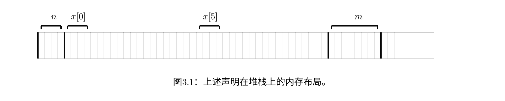

是。当函数完成时，它的内存块再次可用于其他用途。对于静态分配的变量，编译器可以处理所有这些。

### 3.1 变量的作用域

在谈论局部变量和堆栈时，我们应该简要讨论变量的作用域。全局变量当然可以在程序中的任何函数或代码块中访问。函数或代码块中的局部变量只在执行函数或代码块时存在。它通常存储在堆栈上。一旦函数或块终止，变量就会被释放。

当一个函数的执行被暂时中断时，例如因为在这个函数内部调用了另一个函数，变量会被存储在堆栈上，但是不活动，所以无法访问。考虑以下示例：

```
void foo (int x)
{
  int y;
  // 做一些事情
}
```

```
void bar (int n)
{
  int m;
  foo (n+m);
  // 做更多的事情
}
```

在这里，当 bar 调用 foo 时，函数 foo 无法访问变量 n 或 m。一旦 foo 完成，变量 x 和 y 将被释放，并永久丢失。bar 现在恢复并可以访问 n 和 m，但无法访问 x 或 y。

有时候你的代码中会有多个变量（在不同的部分）共享相同的名称。例如，你可能同时拥有一个全局变量 n 和一个在函数中的局部变量 n。或者你可能有如下的情况：

```
void foo (int n)
{
  int m = 10;
  // 做一些事情
  for (int i = 0; i < m; i ++)
   {
     int n = 3, m = 5;
     // 做一些事情
     cout << n << m;
   }
}
```

在这里，cout << n << m 语句将输出最内层的版本，即值为3和5。通常情况下，当有多个同名变量时，引用的是包含该变量的最小代码块内的变量。

### 3.2 动态分配

不幸的是，当我们在编译时不知道一个变量需要多少内存时，事情并不像静态分配的数组那么简单。假设我们想要做如下操作：

```
int n;
cin>>n;
// 创建一个包含n个整数的数组a
```

在编译时，编译器不知道数组需要多少内存。因此，它无法在堆栈上为变量分配空间³。相反，我们的程序需要在运行时显式地向操作系统请求正确数量的空间。这块内存是从堆空间中分配的⁴。

静态内存分配和动态内存分配的区别总结在下表中。要完全理解动态内存分配的工作原理，我们需要花一些时间来学习指针。

**表3.1：静态分配和动态分配内存的区别。**

| 静态分配 | 动态分配 |
|---|---|
| 大小必须在编译时知道 | 大小可能在编译时未知 |
| 在编译时执行 | 在运行时执行 |
| 分配给栈 | 分配给堆 |
| 先进后出 | 没有特定的分配顺序 |

### 3.3 指针

指针是指向内存中某个位置的“整数”——具体来说，它是一个字节的地址⁵。在C/C++中，通过在常规类型名称后面加上星号“*”来声明指针类型。因此，`int *p; char *q; int **b; void *v;` 都声明了指针。原则上，所有这些只是某个内存位置的地址，C/C++不关心我们在那里存储什么。用类型（如int）声明它们主要是为了程序员的利益：它可以防止我们搞乱存储在该位置的数据的使用。它还影响了对内存位置进行的某些算术运算的方式，我们将在下面解释。

指针通常用于两种目的：

- 1. 我们想要找出变量在内存中的位置，即获取指向该变量位置的指针。
- 2. 我们想要将指针指向的位置视为变量，即通过读取或覆盖来访问该位置的数据。

下面的代码片段展示了其中一些情况，以及我们可能遇到的陷阱。

```
int* p, *q; //指向两个整数的指针
int i, j;
i = 5; j = 10;
p = &i;    //获取i的地址并将其保存到p中
cout << p; //打印p的值（即i的地址）
cout << *p; //打印p指向的整数的值（即i的值）
*p = j;    //将p指向的位置（即i）的值替换为j的值
*q = *p; //将q指向的位置的值替换为p指向的位置的值
q = p;     //将指针p替换为q，使它们指向同一个位置
```

这里有几个值得注意的地方。

- 1. 最后两个命令都使 *p 等于 *q，但方式不同。在第一种情况下，我们将一个位置的值复制到另一个位置，而在第二种情况下，我们使两个指针都指向同一个位置。
- 2. 倒数第二个命令非常危险，很可能会导致运行时错误。我们还没有初始化 q，所以它指向一个任意的内存位置，很可能是位置0。我们正在尝试覆盖它，这很可能是程序不允许的。该位置可能属于操作系统或其他程序。
- 3. NULL是我们用于未初始化的指针变量，或者表示指针没有指向任何地方的特殊指针。如果我们尝试在p == NULL时写入 *p，会导致运行时错误。从某种意义上说，NULL实际上只是另一种表示0的方式；我们之前说过指针只是数字，而NULL指针指向内存位置0。在C++11中，有一个新的关键字用于表示这一点，即nullptr。如果你将编译器标志设置为编译C++11，你可以/应该使用nullptr代替NULL。
- 4. 事实上，早期对未初始化指针的观察表明，每当你有一个指针变量时，你总是在声明时立即将其赋值为NULL。所以在我们的例子中，我们应该写成 `int *p = NULL, *q = NULL;` 这样，如果我们后来忘记在解引用之前赋值，至少它会导致我们的程序崩溃，而不是可能处理一些从该位置读取的垃圾。这是减少调试时间的良好编码实践。
- 5. & 和 * 是彼此的反函数。因此，&*p 和 *&p 与p是相同的。（例外情况是，当应用于p==NULL时，&*p会引发运行时错误，而不是等于p。）

一般来说，指针很容易出错。一些经验法则（我们在课堂上讨论过）可以排除常见错误，但总的来说，很容易忘记正确地赋值指针，导致运行时错误。

我们之前讨论过指针基本上就是整数。它们的不同之处在于算术运算有些不同。当你有一个指向整数的指针p，并且你写p+1时，编译器会假设你想要的是下一个整数开始的地址，即比当前地址多4个字节。因此，通过写p+1来引用的实际地址实际上是在p的地址之后4个字节。

这就是指针类型的重要性，正如我们之前提到的。当你有一个void*时，加法实际上是指添加单个字节。对于其他所有类型，当你写p+k，其中p是指针，k是整数，这引用的是内存位置 p + k * sizeof(<type>)，其中<type>是指针p的类型。

### 3.4 动态内存分配

为了动态分配和释放内存，有两对函数，一对是C风格的，一对是C++风格的。在C中，分配内存的函数是malloc，释放内存的函数是free。在C++中，函数是new和delete。我们首先讨论C风格，因为它更接近实际的低级实现；然后我们会看到C++风格，它屏蔽了一些低级细节。

#### 3.4.1 C风格

函数 `void* malloc(unsigned int size)` 从操作系统请求 size 字节的内存，并将该位置的指针作为结果返回。如果由于某种原因，操作系统无法分配内存（例如，没有足够的可用内存），则返回 NULL。函数 `void free(void* pointer)` 释放位于 pointer 位置的内存以供重用。解决我们之前动态大小数组的问题的一个方法如下：

```
int n;
int* b;
cin >> n;
b = (int*) malloc(n*sizeof(int));
for (int i=0; i<n; i++)
    cin >> b[i];
```

为了请求空间来存储n个整数，我们需要计算出需要多少字节。这就是为什么我们要乘以sizeof(int)。使用sizeof(int)比硬编码常量4要好得多，因为这可能在现在或将来的某些硬件上不正确。

因为 malloc 返回一个 void*（它不知道我们想要用内存做什么），而我们想要将其转换为一个 int*。

为了良好的编码习惯，在解引用之前，我们应该检查 b==NULL，但是这个例子应该保持简短。

这里还要注意的一点是，我们可以像引用数组一样引用 b，并且我们写作 b[i]。编译器将其视为 *(b+i)，正如你可能还记得指针算术部分所述，这指向数组的第 i 个元素。实际上，这就是C/C++内部对待所有数组的方式；基本上，它们只是指针。

如果我们想要以复杂的方式手动进行所有指针算术来编写 b[i]，我们可以写成 `*((int*) ((void*) b + i * sizeof(int)))`。显然，这不是我们喜欢输入（或者必须理解）的方式，但是如果你理解这里发生的一切，你可能已经掌握了指针算术和类型转换的知识。

为了在使用完内存后将其返回给操作系统，我们使用函数 free，如下所示：

```
free(b);
b = NULL;
```

请注意，free 不会对指针 b 本身进行任何操作；它只会释放 b 指向的内存，告诉操作系统该内存可供重用。因此，建议您立即将指针设置为 NULL，以防止代码尝试篡改无效的内存。如果在其他地方引用 b，您将会得到运行时错误。如果您不将 b=NULL，操作系统可能会将该内存分配给另一个变量，并且您会意外引用/覆盖该变量。这种错误很难检测到，但通过在释放内存后立即将指针设置为 NULL 可以轻松避免。

#### 3.4.2 C++风格

C++提供了 new() 和 delete() 函数，它们为C语言的 malloc() 和 free() 提供了一些语法糖。基本上，它们免除了您计算所需字节数、指针转换以及提供更“类似数组”的语法的繁琐过程。我们的示例现在如下所示：

```
int n;
int *b;
cin >> n;
b = new int[n];
```

请注意，这里没有括号，而是用于表示项目数量的方括号。`new` 会自动计算所需的内存，并返回正确类型的指针。如果我们只需要一个整数的空间，可以写作 `int *p = new int;` 虽然对于单个整数来说并不是非常有用，但在后面动态分配对象时，这将变得非常重要，因为我们经常一次分配一个。

释放内存的等效操作是 `delete` 运算符，用法如下：

```
delete [] b;
delete p;
```

第一个示例释放了一个数组，而第二个示例释放了一个变量的单个实例（在我们的示例中是一个单独的整数）。这将释放指针指向的内存。与 `free` 一样，它仍然使指针本身指向相同的内存位置，因此在 `delete` 命令之后写上 `b = NULL` 或 `p = NULL` 是良好的编程风格。

### 3.5 内存泄漏

让我们更仔细地看一下动态内存分配可能出现的问题。

```
double *x;
...
x = (double*) malloc(100*sizeof(double));
...
x = (double*) malloc(200*sizeof(double)); // 现在我们需要一个更大的数组!
...
free(x);
```

这段代码将会编译成功，并且很可能不会立即崩溃。我们正确地分配了一个包含100个 `double` 的数组，在进行一些计算后，我们意识到需要更多的内存，于是分配了一个包含200个 `double` 的数组。

但请注意这里发生了什么。在进行第二次分配时，`x` 被覆盖为指向新分配的内存块的指针。此时，我们不再记得指向前一个内存块的指针。这意味着我们无法读取、写入或释放它。当代代码片段的末尾调用 `free(x)` 时，它成功释放了第二个分配的内存块，但我们无法告诉操作系统我们不再需要第一个内存块。因此，这800个字节将永远不会再次可用（直到我们的程序终止——但我们所知道的是，它可能在某个后端服务器上运行数年）。

这种情况被称为内存泄漏：可用内存逐渐从系统中泄漏出去。如果持续时间足够长，我们的程序可能会因此耗尽内存并崩溃。如果崩溃发生在长时间运行之后，很难诊断出崩溃原因。

在重新分配指针之前，保持紧密跟踪所保留的内存块，并确保释放指针指向的内存（使用 `free` 或 `delete`）。⁷ 上面代码的一个更好版本如下所示：

```
double *x;
...
x = (double*) malloc(100*sizeof(double));
...
free(x);
x = NULL;
x = (double*) malloc(200*sizeof(double));
...
free(x);
x = NULL;
```

⁷ 有一些用于检查代码中内存泄漏的工具，我们建议熟悉它们。最著名的一个工具是 `valgrind`，课程网页上包含一些链接。

这样，内存在我们仍然有指针指向它的时候就被释放了。你会记得，在释放内存后，立即将指针设置为NULL是一种良好的实践。在代码的中间，这似乎非常多余：毕竟，我们立即用另一个值覆盖了x。事实上，这是完全多余的。然而，我们仍然建议您添加这行代码；例如，您可能稍后在free(x)和对x的新赋值之间插入一些代码，否则可能会导致问题。如果您担心程序会浪费时间进行不必要的赋值，请不要担心——编译器几乎肯定会优化掉该赋值，最终代码将完全相同。

你可能会想到的一个问题是，我们是否可以通过设置 x = NULL; 而不调用 free(x) 来释放内存。那只会覆盖指针，但不会告诉操作系统可以回收内存。换句话说，这将导致内存泄漏。每当你想要将内存返回给系统时，必须明确地这样做⁸。

顺便提一下，如果你在网上或其他来源查找一些信息，请记住，用new或malloc分配变量的内存池称为内存堆。这与我们稍后将学习的名为堆的数据结构不同。不幸的是，人们（包括我们…）在命名这些方面并不完全一致。

> ⁸ 还有其他编程语言可以更多地为您处理垃圾回收和内存管理，但C/C++不是其中之一。

## 第四章

## 递归

[注意：本章涵盖了大约1.5个讲座的内容。]

### 4.1 计算阶乘

第一个例子是计算 n 的阶乘，它被定义为 n! = n · (n-1) · (n-2) · · · 2 · 1 = ∏_{i=1}^{n} i。当然，我们可以使用迭代（一个简单的 for 循环）来计算 n!。

```
int factorial(int n) {
    int p=1;
    for (int i=1; i<=n; i++)
        p*= i;
    return p;
}
```

这是一个完全有效的，甚至可能是最好的计算一个数字的阶乘的方法。但是，相反，我们想使用这个非常简单的例子来说明递归是如何工作的。

从定义上看，我们观察到0! = 1（根据定义），并且 n! = n · (n-1)!。这表明了一个递归解决方案：

```
int factorial (int n) {
    if (n==0) return 1;
    else return n*factorial(n-1);
}
```

注意，函数 factorial 调用了自身；这就是使这个实现成为递归实现的原因。学生们在刚开始思考递归时经常遇到困难。我们的本能往往是为计算制定一个完整的计划：首先将 n 与 n-1 相乘，然后与 n-2 相乘，依此类推，一直到1。在递归解决方案中，我们将大部分工作视为一个“黑盒子”：我们不真正担心带有参数 n-1 的调用将如何获得正确的结果，只是相信它会。（当然，这仅在函数实际上是正确的情况下才有效。）

在课堂上，我们通过一群学生来演示递归。每个学生负责计算一个特定的数字n的阶乘！负责计算5! 的学生依赖于另一个学生计算4! ，然后将那个学生的结果与5相乘。重要的是，计算5! 的学生不需要知道4! 是如何计算的；只要4! 的学生得到正确的结果，就可以直接使用。

重要的观点是计算5!的学生不需要知道4!是如何计算的；只要4!的学生得到正确的结果，就可以直接使用。

再次回顾一下，在递归解决方案中，我们不必考虑每一步，也不必跟踪各种中间结果，因为这些结果由其他函数调用返回为值。刚开始学习递归的学生通常会尽力让递归模拟循环，通过传递“全局变量”（或变量的指针，这是一样的）来改变和存储中间结果。

这种思维方式可能需要一段时间来适应，但一旦你牢牢掌握了它，很多事情——在CSCI 170中的归纳和在CSCI 270中的动态规划——将变得更容易理解。

几乎所有正确的递归函数都具有以下两个特点：

- 递归函数需要一个或多个基本情况：在某个点上，函数必须达到一个不再调用自身的点（例如阶乘的n==0的情况）。否则，函数将会无限调用自身，并最终耗尽堆栈内存。
- 递归调用必须具有比主输入更小的输入。在阶乘函数的情况下，factorial(n)中的递归调用是factorial(n-1)。在这种情况下，很明显n-1比n“更小”。在其他情况下，“更小”指的是数组的剩余大小，甚至是接近上限的数字。（例如，基本情况可以是i==n，而输入i的调用可以是i+1。）

让我们快速看两个违反这些条件的例子，并看看会发生什么。

```
int UCLAfact (int n) // 对我们的邻居学校表示歉意
{
  if (n == 0) return 1;
  else return UCLAfact (n); // 错误: 输入没有变小!
}
```

```
int NDfact (int n)
{
  return n*NDfact (n-1); // ...这不会停止!
}
```

这两个函数都不会终止。在第一个例子中，我们确实有一个基本情况，但递归调用的大小相同。当然，它是正确的，n!= n!（这是函数使用的），但它不能帮助我们计算它。在第二个例子中，递归调用中有一个较小的输入，但没有基本情况，因此该函数将继续以不同的值调用自身，直到永远（或直到耗尽堆栈空间并崩溃）为止。

### 4.2 二分查找

（注意：我们在2014年春季没有涵盖这个例子。但这是一个有用的例子，我们将回到它。）

诚然，计算阶乘并不是一个很好的例子来展示递归的有用性，因为迭代解决方案简短而优雅。然而，我们能够通过一个足够简单的一般设置来说明递归的一些重要特性。接下来，让我们来看一个稍微具有挑战性的任务：给定一个（预排序的）递增顺序的整数数组，找到目标元素的位置，如果不在数组中则返回-1。

这可以通过使用二分查找算法来实现：检查剩余数组的中间位置。如果元素存在，则完成搜索。如果所需元素较小，则继续向中间元素的左侧搜索；否则，继续向右侧搜索。相应的迭代解决方案如下所示：```c
int binarySearch(int n, int* b, int len)
{
    int lo = 0, hi = len, mid;
    while (lo <= hi) {
        mid = (hi + lo) / 2;
        if (b[mid] == n) return mid;
        else if (n < b[mid])
            hi = mid - 1;
        else lo = mid + 1;
    }
    return -1;
}
```

递归解决方案如下所示：

```c
int recSearch(int n, int* b, int lo, int hi) {
    if (hi < lo) return -1; // 不在数组中
    else
    {
        int mid = (hi + lo) / 2;     // 数组的中点
        if (n == b[mid]) return mid;      // 找到了
        else if (n < b[mid])
            return recSearch(n, b, lo, mid - 1); // 中点左边的元素
        else return recSearch(n, b, mid + 1, hi); // 中点右边的元素
    }
}

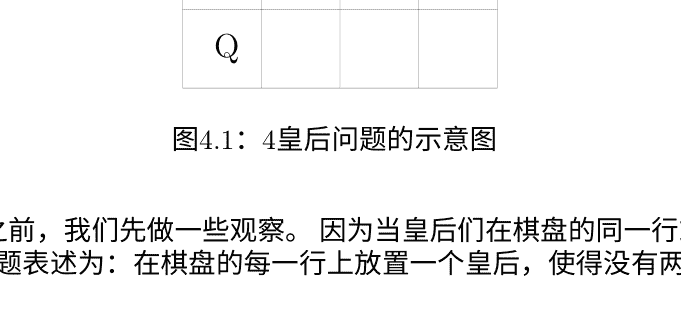

```

然后我们调用函数recSearch(n, b, 0, len)。 你更喜欢迭代还是递归解决方案可能是个人口味问题，但请注意递归解决方案的某种优雅之处。 当我们确定元素应该在哪里（左边还是右边）时，我们不需要更新变量并重复，而是简单地要求函数在那个（正确的）子数组中为我们找到它，并返回其返回值。

请注意，无论数组中的元素数量是偶数还是奇数，这两种实现都可以工作。 如果我们在递归调用中没有写 mid-1和 mid+1，那么当 lo == hi时，我们可能需要另一个基本情况。 让我们检查一下我们是否满足递归解决方案的上述两个条件：

- 如果数组为空（即lo < hi），函数将直接返回，报告未找到元素。
- 如果 n小于中点，则函数递归调用数组的左半部分；否则，递归调用右半部分。 无论哪种情况，因为我们至少消除了中点，剩余的数组大小都比之前小。

关于递归的一件令人困惑的事情是，函数似乎同时有许多“活动”版本。 像 n、 lo、 hi或 mid这样的变量的“值”是什么？ 毕竟，函数的不同调用将为它们赋予不同的值。 为了解决这个“难题”，请记住我们在内存概述中提到的局部变量存储在堆栈上，并由编译器和操作系统转换为内存位置。 因此，当函数recSearch(12, b, 0, 10)调用recSearch(12, b, 0, 4)时，它们的变量 lo、hi将转换为完全不同的内存位置。 当执行调用recSearch(12, b, 0, 4)时，值为lo=0, hi=4，mid=2将被计算。 在调用recSearch(12, b, 0, 10)时，我们有lo=0, hi=10, mid=5。 计算机对于相同的变量名没有问题，因为每次只有一个变量的含义在作用域内。

### 4.3 N皇后问题

我们在课堂上看到的递归的前两个例子都可以很容易地用简单的循环来编码，就像你们看到的那样。一般来说，如果你有一个递归函数，它只使用一次递归调用自身，那么往往可以很容易地用循环来替代。当函数多次调用自身时，递归变得更加强大（比如：它可以让你为那些没有递归会更加混乱的问题编写简短而优雅的代码）。

我们将在课堂上看到几个例子，其中包含一些巧妙的递归排序算法和其他算法。另一个非常常见的应用是通过一种称为回溯的技术来解决复杂问题的穷举搜索。在这门课上，我们以经典的n皇后问题作为这种技术的示例。

在n皇后问题中，你需要在一个n×n的棋盘（方形网格）上放置n个皇后。每个皇后占据网格上的一个方格，而且没有两个皇后占据同一个方格。如果两个皇后可以水平、垂直或对角线移动并击中对方所在的方格，则它们互相攻击。问题是要放置皇后，使得没有两个皇后互相攻击。例如，图4.1中所示的情况不是一个合法的解决方案：第1行和第2行的皇后在对角线上互相攻击（尽管其他皇后对是安全的）。
在我们尝试解决问题之前，我们先做一些观察。因为当皇后们在棋盘的同一行或同一列时会互相攻击，所以我们可以等价地将问题表述为：在棋盘的每一行上放置一个皇后，使得没有两个皇后在同一列或对角线上互相攻击。

我们可以通过拥有n个变量q[i]来解决这个问题，每个变量对应一个皇后。每个变量的取值范围是从0到n-1，尝试在理论上可能放置皇后的所有n个位置。在所有可能的n^n种放置皇后的方式中，我们检查它们是否合法，并在合法的情况下输出。当然，如果在搜索过程中两个皇后之间发生了攻击，放置更多的皇后也无法解决这个问题，所以我们可以尽早终止搜索以提高效率。

所以我们将有一个数组 q[0...(n-1)]，其中包含每个皇后在行中的位置。这些将是全局变量。此外，我们将有一个全局变量来表示网格的大小：

```c
int *q; // 皇后的位置
int n; // 网格的大小
```

然后，主要的搜索函数将具有以下形式：

```c
void search(int row)
{
    if (row == n) printSolution(); // 该函数显示布局
    else
    {
        for (q[row] = 0; q[row] < n; q[row]++)
        {
            search(row + 1);
        }
    }
}
```

这是大多数回溯解决方案的一般概述。在必须做出决策的每个点上，都要运行一个循环来遍历所有选项。然后递归调用剩余选择的函数。
当然，到目前为止，我们没有在任何地方检查解决方案是否合法，即没有皇后互相攻击。为了做到这一点，我们希望添加一个数组来跟踪哪些方格是安全的，哪些方格被之前放置的皇后攻击。我们将其捕捉在一个数组 t（表示“受威胁”），我们可以将其作为全局变量。（它是一个二维数组，可以转换为指向指针的指针。）

```c
int **t;
```

现在，我们需要检查我们尝试放置皇后的位置是否合法，并在这样做时更新可用位置。我们不仅仅要跟踪一个方格是否被任何皇后攻击，而是要跟踪有多少个皇后攻击它。否则，如果我们只是将标志设置为true，并且两个皇后攻击一个方格，当我们移动其中一个时，很难知道该方格是否安全。
函数的更完整版本现在如下所示：

```c
void search(int row)
{
    if (row == n) printSolution(); // 该函数显示布局
    else
    {
        for (q[row] = 0; q[row] < n; q[row]++)
            if (t[row][q[row]] == 0)
            {
                addToThreats(row, q[row], 1);
                search(row + 1);
                addToThreats(row, q[row], -1);
            }
    }
}
```

我们仍然需要编写函数addToThreats，它会增加正确方格的威胁数量。该函数应标记同一列上的所有位置以及当前方格下方的两个对角线上的位置。对于后者，我们需要确保不离开实际的网格。仔细观察一下，你会发现以下函数可以实现这一点：

```c
void addToThreats(int row, int column, int change)
{
    for (int j = row + 1; j < n; j++)
    {
        t[j][column] += change;
        if (column + (j - row) < n) t[j][column + (j - row)] += change;
        if (column - (j - row) >= 0) t[j][column - (j - row)] += change;
    }
}
```

最后，我们需要编写我们的 main函数，读取大小，创建动态数组，初始化它们，并开始搜索。

```cpp
int main(void)
{
    cin >> n;
    q = new int[n];
    t = new int*[n];
    for (int i = 0; i < n; i++)
    {
        t[i] = new int[n];
        for (int j = 0; j < n; j++)
            t[i][j] = 0;
    }
    search(0);
    delete[] q;
    for (int i = 0; i < n; i++) delete[] t[i];
    delete[] t;
    return 0;
}
```

如果你还没有完全理解上面的解决方案是如何工作的，可以尝试在一个5 × 5的棋盘上手动追踪其执行过程，通过手动模拟所有 q[i]变量。 那可能会给你一个关于回溯的好主意。

### 4.4 关于递归函数的一些常见评论

从高层次上讲，递归有两种类型：直接递归和间接递归。 直接递归发生在一个函数 f调用自身的情况下。这是我们目前所见过的情况。间接递归虽然不太常见，但仍然相当普遍：你有两个函数f, g， f调用 g， g调用 f。 这种区别并没有什么特别深入的含义：我们在这里提到它主要是为了让你熟悉这些术语。 如果你使用间接递归并遇到编译器错误，问题可能是其中一个函数定义必须在前面，而当你定义该函数时，编译器还不知道另一个函数。解决方法如下（在示例中，我们假设我们的函数是从 int到 int的，但这并没有什么特别之处）：

```cpp
int f(int n); // 只是一个签名的声明（通常放在.h文件中）
```

```cpp
int g(int n)
{
    // 在这里插入g的代码，包括对f的调用
}
```

```cpp
int f(int n)
{
    // 在这里插入f的代码，包括对g的调用
}

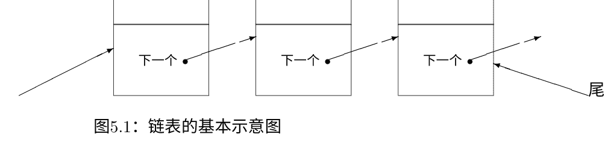

```

这样，当编译器到达 g的定义时，它已经知道存在一个函数 f；当它到达 f时，你已经定义了 g。

在直接递归中，如果函数只调用自己一次，还有两个常见术语： head递归和tail 递归。这些术语指的是递归调用发生的时间。如果它发生在函数的末尾，这被称为尾递归。尾递归特别容易用循环替代。 当递归调用发生在末尾之前（例如，在开头），这被称为头递归。头递归事实上可以轻松地做一些令人惊讶的事情，比如以相反的顺序打印字符串或链表。这个区别并不是一个很大的问题，但是了解这些术语可能是有好处的。

另一件需要记住的事情是，有一些编程语言（称为函数式语言）通常使用递归来解决所有问题。其中有几种甚至没有循环。这样的语言有一些例子，比如ML（或其变种OCAML）、Lisp、Scheme、Haskell、Gofer。还有其他的。其中一些（特别是ML）实际上在工业界中使用，而Lisp在Emacs编辑器中使用。

函数式语言使函数比过程式语言更加核心。编写一个以另一个函数作为参数的函数是非常典型的。例如，你可以考虑一个操作数组或列表的函数 g，并将另一个函数 f作为参数传递给它，它的作用是将 f应用于数组/列表的每个元素。（例如，你可以有一个将数组的每个条目转换为字符串的函数。）这个操作被称为 map。另一个常见的事情是有一个函数 h，它应用其他函数来计算整个数组/列表的单个输出。一个例子是将数组/列表的所有元素相加，或者计算最大值。这个操作被称为 reduce。

只应用这两种操作编写的程序通常可以很容易地在大型计算集群上并行化，这就是为什么 Map-Reduce 框架最近变得非常流行（例如，谷歌的 Hadoop）。它导致了对函数式编程某些方面的兴趣重新兴起。

从实际角度来看，当你编写函数式程序时，编译程序通常需要更长的时间，因为在 C++ 中导致奇怪行为的许多逻辑错误在函数式语言中甚至无法正确实现。一旦函数式程序正确编译，它比过程式程序更少出现错误（假设两者都是由相当有经验的程序员编写的）。

### 4.5 递归定义

到目前为止，我们已经讨论了递归作为一种编程技术。递归的几乎同样重要的应用是通过递归定义来简洁地指定对象。当我们定义列表、栈、堆、树等时，这些定义将非常有用。为了在需要时做好准备，我们在这里练习一些较简单的递归定义。其中的前几个例子你可以很容易地不使用递归来定义（就像我们之前使用递归作为编程技术的例子一样），而后面的例子可能更复杂（并且很难非递归地定义）。

- 1. 一个由（小写）字母组成的字符串可以是：（1）空字符串（通常写作 ε 或 λ），或者（2）一个字母 'a'-'z'，后面跟着一串字母。递归发生在情况（2），情况（1）是基本情况。当然，对于这个例子，我们可以简单地说一个字符串是由0个或多个小写字母组成的序列，这也是可以的。但是我们在这里练习递归的简单例子。
- 2. 非负整数可以是：（1）数字0，或者（2） n+1，其中 n是非负整数。在这里，不引用第一次出现的整数来定义整数可能有点困惑。递归可以帮助解决这个问题。它表示有一个第一个数（数字0），以及一种从一个数到下一个数的方法。从这个意义上说，4实际上只是0+1+1+1+1的简写。
- 3. 回文串可以是：（1）空字符串 ε，或者（2）单个字母 'a'-'z'，或者（3）字符串 xPx，其中 x是单个字母 'a'-'z'，P本身是一个回文串。在这里，我们需要两个基本情况；情况（3）是递归。注意，另一个回文的定义，“一个正反读起来一样的字符串”，是正确的，但更加过程化：它告诉我们如何测试一个字符串是否是回文（“它正反读起来一样吗？”），但它没有告诉我们如何描述所有的回文。
- 4. 一个简单的代数表达式由数字、变量、括号以及 + 和 * 组成。（我们忽略 - 和 / 以使其更简短。）我们将使用大量的括号并忽略优先级。我们现在想要表达类似“(5*(3+x))”这样的表达式是合法的，而“x ( 5 * * + )”是不合法的。我们可以递归地说以下是合法的表达式：
    - 任意数字。（这是一个基本情况，我们可以使用上面的数字定义。）
    - 任意变量。（这是另一个基本情况；我们可以使用字符串的定义。）
    - (⟨A⟩ + ⟨B⟩)，其中 ⟨A⟩和 ⟨B⟩都是合法的表达式。
    - (⟨A⟩ * ⟨B⟩)，其中 ⟨A⟩和 ⟨B⟩都是合法的表达式。

对于这个例子，你可能很难想出一个非递归的定义。
我们在这里写下的是一个“上下文无关文法”（或CFG）。有一些工具（一个叫做bison的程序，它是一个叫做yacc的较新版本），可以根据这样的递归定义自动生成用于解析符合定义的输入的C代码。 如果你想定义自己的输入格式或编程语言，它们非常有用。

- 5. 事实上，在之前的讨论中，你可以写出C或C++编程语言的完整递归定义。 事实上，这就是编程语言的规范方式。 如果没有递归，这将是非常无望的尝试。

# 第5章

## 链表

[注意：本章涵盖约1个讲座的内容。]

数组是一种很好的简单方式来存储数据块，但我们并不总是知道所需的数组大小。我们应该预留/分配多少空间呢？分配一个任意大小（比如1000）的空间并不是一个好主意，因为对于特定情况来说可能会太多或太少内存。动态大小的数组，在之前的讲座中我们已经见过，给了我们部分解决方案：至少，在编译时我们不需要知道数组的大小。但是在声明数组时，我们仍然需要知道它的大小。你认为Facebook在刚开始时应该把用户数组设多大？如果随着时间的推移，有越来越多的客户到来，猜测“正确”大小将非常困难。

在这门课上，我们将学习许多不需要预先知道元素数量的数据结构；相反，它们的大小可以动态改变。可能最简单的这种数据结构被称为链表；它很好地说明了我们将在以后多次看到的许多技术。

考虑一下数组（动态或静态分配）如何存储数据。每当新用户到来时，一个非常方便的处理方式就是只需请求操作系统将我们的内存块扩展到所需大小。然而，没有办法做到这一点，而且有充分的理由：我们数组后面的内存可能正在用于其他数据，因此扩展我们的数组可能会覆盖现有内存，就在我们数组的内存块之后。扩展数组的一种方法可能是在其他地方获取第二个内存块，并在我们第一个块的末尾放置一个指针来指示另一半的位置。这将失去数组的许多优势，例如能够进行简单的算术运算来查找元素。

但至少，原则上它可以解决问题。一旦我们这样考虑，我们可以走向极端，使我们的“数组”的每个元素都指向下一个元素，消除了数组的所有相似之处。这就是链表的定义：一系列的节点，每个节点在内存中指向下一个节点，并且每个节点包含一段数据。我们经常将链表表示如下：
图5.1：链表的基本示意图

链表可以无限制地扩展，无需事先声明初始大小。我们只需要在最后一个节点后面添加一个节点，并确保列表中原来的最后一个元素现在指向新的节点。

比较向量和链表可能会有启发性。

当然，我们在这里学习这些东西的一部分原因是我们想要在表面下了解向量这样的东西是如何工作的。有人将向量编程为抽象数据类型，使用了我们在这门课程中学习的原始类型。有人将向量编程为抽象数据类型，使用了我们在这门课程中学习的原始类型。

但是，还有一个根本的区别：向量实际上是分配一个动态数组并跟踪其大小。当大小不再足够时，将分配一个更大的数组。（通常，实现会将大小加倍，但这通常可以通过在创建时传递参数到向量中进行更改。）接下来，所有数据将从旧数组复制到新数组。这个复制可能会减慢数据结构的使用。更重要的是，向量提供了一种我们可能需要或不需要的功能：即通过索引访问元素。链表实际上不允许这样做。另一方面，链表专门用于廉价地添加元素和遍历所有元素。就像对于几乎任何关于“我应该使用哪种数据结构？”的问题一样，答案是“这取决于”。也就是说，它取决于您经常需要使用哪些类型的操作。

最后，学习链表的主要原因是通过深入理解链表来练习动态内存和递归，并为我们在课程后期看到的更复杂的数据结构做准备；它们依赖于与链表许多相同原理，但更加复杂。通常最好先练习简单的例子。

一些类比可以记住链表的如下内容：

- 儿童的寻宝游戏。父母为第一个宝藏提供线索。当孩子们找到线索时，他们去那里，并找到一个宝藏，里面有下一个线索的便条。按照那个线索，他们到达第二个宝藏，那里有另一个带有下一个宝藏线索的便条，依此类推。线索起到指针的作用。
- “刺客”游戏，每个参与者都得到另一个参与者的名字，以约定的方式“杀死”对方（用玩具枪射击，用塑料勺触摸等）。当一个参与者被“杀死”时，他的杀手继承他的下一个任务，胜利者是最后的幸存者。再次，可以将作业视为形成一个链表（除了尾部指向头部）。
- 还有几个顺序事件的类比，如多米诺骨牌、火车车厢等。这两个例子的好处在于“指针”的明确性。

### 5.1 实现链表

链表中的每个节点/元素都包含数据（如int、string等）以及指向相同类型的下一个节点/元素的指针。在这里，我们将构建一个整数链表 - 如何为其他类型进行修改将非常明显。为了跟踪这两个元素，我们创建一个称为Item的结构体。

```cpp
struct Item {
    int value;
    Item* next;

    Item(int val, Item* n)
    {
        value = val;
        next = n;
    }
};
```

每个Item都有一个int - 链表中的数据片段 - 和一个指向另一个节点的指针next。第一个节点将指向第二个节点，依此类推。对于最后一个节点，我们需要一种方法来确保要记住它后面没有节点。最常见的方法是将其 nextpointer指向 NULL，但有些人也将其链接到自身。

我们在 struct内声明的函数 Item用于简化初始化。 这样，我们可以只写类似于Item* p = new Item (5, NULL); 而不是Item *p = new Item; p->value= 5; p->next = NULL;这基本上与类的构造函数相同，我们将在大约一周后学习。

请注意，为了能够访问列表的第一个元素，我们需要一个指向第一个 Item的 headpointer。(如果我们失去了这个指针，就无法再访问列表的其余部分。）

#### 5.1.1 链表操作

至少，我们希望能够向列表中添加元素，删除元素并遍历整个列表。这里是如何实现它们的。

遍历：与数组不同，链表不提供直接访问第i个元素的功能。 相反，我们从第一个节点开始，然后重复访问下一个节点。 为了做到这一点，我们声明一个变量Item *p，它将跟踪我们正在查看的当前节点。p起始为指向头元素的指针。 然后在每次for循环的迭代中，我们将其更新为其下一个指针。所以代码看起来像这样：

```
c
void traverse (Item *head)
{
    for (Item *p = head; p != NULL; p = p->next)
        { // 对p进行一些操作，比如打印或读取其值
        }
}
```

我们还可以使用递归遍历列表，如下所示：

```
c
void traverse (Item *head)
{
    // 对头部进行一些操作，比如打印或读取其值
    traverse (head->next);
}
```

递归实现的好处（除了极其简单）是即使列表是单链表，也很容易使其以逆序遍历列表。 你只需要改变两个语句的顺序，在进行处理（比如打印）之前调用traverse (head->next)。 请注意，以逆序打印链表的任务是一个非常流行的工作/实习面试问题，因为它测试链表和递归的知识。

加法：我们获取输入的数据项并从中创建一个新的项。这个元素通常会被追加到列表的末尾，所以它的下一个指针将被设置为 NULL。 （我们也可以将其添加到列表的开头，这将改变下面的实现。）为了将其追加到列表的末尾，我们首先需要找到最后一个元素 tail，然后将其下一个指针设置为我们的新元素。

对于之前为空的列表，我们需要一个特殊情况，因为这时我们还需要设置头指针，它之前是 NULL。总结一下，添加新元素的代码如下所示：

```
c
void append (Item *&head, int n)
{
    Item *newElement = new Item (n, NULL);
    if (head == NULL) head = newElement;
    else {
```

```

Item *p = head;
while (p->next != NULL) p = p->next;
p->next = newElement;
}

```

请注意Item *&head的奇怪构造。我们想要传递列表的头部，它是一个Item *。但是我们可能还需要改变它（当它是NULL时），所以我们需要通过引用传递指针。

通过使用递归，可以得到一个稍微简短的实现：

```

void append (Item *&head, int n)
{
  if (head == NULL) head = new Item (n, NULL);
  else append (head->next, n);
}

```

请注意，递归和迭代实现都必须遍历整个列表才能找到最后一个元素。这似乎相当低效，而且没有必要。这就是为什么通常，不仅要维护一个head指针，还要维护一个tail指针指向列表的最后一个元素。这样，我们在添加东西时就不必每次都遍历整个列表。

删除：如果我们有一个指向列表中要删除的元素的指针Item *toRemove，我们最终会有命令delete toRemove;但在此之前，我们还需要确保列表的链接结构保持完整。为了做到这一点，我们需要一个指向toRemove前面的元素的指针prev，这样我们就可以设置prev->next = toRemove->next;。

获取指针的一种方法（如果存在的话，否则toRemove本身必须是列表的头部）是从列表的开头开始扫描，直到找到具有p->next ==toRemove的节点p。但那样会花费很长时间，而且很麻烦。

更好的解决方案是在每个Item中存储不仅指向列表中下一个元素的指针，还有指向前一个元素的指针。结果被称为双向链表，除非你有一个明确的理由偏好单向链表（比如面试或作业要求），否则你应该通常将你的链表设计为双向链表。在Item的定义中，我们添加了一行Item*prev;在添加元素的函数中，我们在第一种情况下设置newElement->prev = NULL，在第二种情况下设置newElement->prev = p。

对于删除一个元素，我们现在可以写出类似以下的代码：

```

void remove (Item *&head, Item *toRemove)
{
  toRemove->prev->next = toRemove->next;
  toRemove->next->prev = toRemove->prev;
  delete toRemove;
}

```

这将把前一个元素的下一个指针设置为要删除的元素的下一个指针，从而将其断开链接。第二行的操作也是类似的，只是针对前一个指针。虽然这看起来很好但是，当我们要删除的元素是列表的头部或尾部时（或者两者都是，对于只有一个元素的列表），我们必须更加小心。然后，toRemove->prev或toRemove->next可能为NULL，这意味着我们无法更改它们的指针。然而，在这些情况下，我们不需要更新相应的指针，因此实际的实现如下所示：

```
cpp
void remove (Item *&head, Item *toRemove)
{
    if (toRemove != head)
        toRemove->prev->next = toRemove->next;
    else head = toRemove->next;
    if (toRemove->next != NULL)
        toRemove->next->prev = toRemove->prev;
    delete toRemove;
}
```

正如我们所看到的，双向链表之所以存在的真正原因是它们使删除操作更加容易和清晰。（为了你自己的娱乐，你也可以实现单向链表的删除操作，并测量它的速度慢了多少。）另一个好处是双向链表可以很容易地从后向前遍历。有时，这被列为使用双向链表的原因，但我认为这是一个误导：首先，如果使用递归，即使对于单向链表，遍历链表从后向前也不难。其次，这并不是经常需要的功能。

一旦我们真正理解了在我们的Item中有一个（或两个）指向其他元素的指针的概念，我们可能会问为什么不在Item中有更多指向不同元素的指针。事实上，这正是我们在后面介绍更复杂的数据结构如树和堆时要做的。

### 5.2 链表的递归定义

尽管我们根据我们的讨论直观地知道什么是链表，但我们还没有正式定义它。换句话说，我们还没有明确说明如何区分‘链表’和‘非链表’。在试图提出一个定义时，我们的直觉告诉我们它是一堆项目，每个项目都有相关数据并指向另一个项目。但首先，其中一个项目不指向任何东西。

其次，这将包括许多节点，所有这些节点都指向一个或另一个节点。这不是我们想要的。我们可以尝试类似于‘一堆项目，每个项目都指向1个其他节点，并且被1个其他节点指向，除了一个节点不指向任何其他节点和1个节点没有被任何其他节点指向。’这是正确的，但有点繁琐。

为了保持定义简洁明确，我们可以借鉴我们之前几次讲座中看到的递归定义，将链表定义如下：

- 空列表是一个链表。
- 指向“更短”链表的节点是一个链表。

我们需要形容词“更短”来排除例如节点指向自身的单节点列表；在这种情况下，它将指向相同长度的链表。（请记住，对于递归函数和定义，我们只应引用“更小”的对象，在这里我们明确地这样做。）

## 第6章

### 抽象数据类型

[注意：本章涵盖约0.5个讲座的内容。]

如果我们从我们一直在做的链表中退后一步，我们可以思考它们所能实现的功能。假设我们看一下刚刚分析的版本，它允许我们做三件事：

- 1. 向列表中添加一个整数 $n$。
- 2. 从列表中删除一个项目。
- 3. 按照添加顺序打印列表中的所有项目。

如果我们只关心能够执行这三个操作，那么使用链表、数组、向量或其他方法来实现它们并不重要。我们真正想要的是一种在内部存储数据并允许我们使用这三个操作的数据结构。换句话说，我们关注的是我们想要做什么，而不是如何确切地实现它。链表是对如何的一个答案。精确地描述我们想要实现或正在实现的 $what$，即操作，是作为抽象数据类型（$ADT$）来规定的。$ADT$完全由它支持的操作来定义，如上面的操作。在这门课程中，我们将花费大量时间关注以下三个$ADT$。

列表：列表数据类型通过支持以下关键操作来定义（其中 T 表示任何类型，如 int、string或其他类型）：

- 1. $\mathrm{insert}(\mathrm{int~position},~\mathrm{T~value})$：在给定位置之前插入值，将所有后续元素向右移动一个位置。
- 2. $\mathrm{remove}(\mathrm{int~position})$：删除给定位置的值，将所有后续元素向左移动一个位置。
- 3. $\mathrm{set}(\mathrm{int~position},~\mathrm{T~value})$：用给定值覆盖给定位置。
- 4. $\mathrm{T~get}(\mathrm{int~position})$：返回给定位置的值。

因此，列表数据类型在功能上与数组非常相似，但它允许在移动所有其他元素的同时插入和删除元素。

请注意，这个定义并不完整。例如，它没有告诉我们position的合法值是什么，或者当它们超出范围时会发生什么。例如，如果我们试图在一个有2个元素的列表的第4个位置之前插入某个东西，应该发生什么？应该发出错误信号吗？应该用虚拟元素填充列表以使其成为可能吗？类似地，我们还没有说明其他操作的 position变量的合法范围是什么。在这里，我们的意图是对于除 insert之外的所有操作，position需要在0和 size-1之间（其中 size是列表中的元素数量），而对于insert操作，它需要在0和 size之间。

当然，我们还可以添加其他应该支持的函数，比如 `size()` 或 `isEmpty`。教科书列出了几个其他函数，但我们给出的这四个函数实际上是最重要的函数，它们最能定义一个 List。

你可能已经熟悉了C++中的 `vector` 和 `deque` 数据类型，它们是 List 数据类型的两种自然实现（并提供了一些其他函数）。但它们不是唯一的，我们很快会更深入地研究这个问题。

包（集合）：

一个称为 `Bag` 的集合（在教科书中称为 Bag）支持以下操作：

- 1. `add(T item)`：将项目添加到集合中。
- 2. `remove(T item)`：从集合中删除项目。
- 3. `bool contains(T item)`：返回集合是否包含给定项目。

这是一个数学集合的基本实现（参见 CSCI 170）。再次强调，我们的规范并不完整。例如，我们没有说明如果一个项目被多次添加会发生什么：是添加多个副本，还是只添加一个，是否会报错？如果添加了多个副本，那么 `remove` 会做什么？它只会删除其中一个还是多个？

通常，在一个集合中，我们只允许一个副本。如果我们想允许多个相同项的副本，我们称之为多重集合。

字典（映射）：

映射（或在教科书中称为字典）是一种用于创建和查询键和值之间关联的数据结构。键和值本身可以是任意数据类型 `keyType` 和 `valueType`。支持的操作有：

- 1. `add(keyType key, valueType value)`：将 `key` 映射到 `value`。
- 2. `remove(keyType key)`：移除 `key` 的映射。
- 3. `valueType get(keyType key)`：返回 `key` 映射的值。

再次说明，这有点不够明确。如果给定的 `key` 不在映射中会发生什么？现在 `remove` 和 `get` 应该做什么？它们会发出错误信号吗？另外，如果为相同的 `key` 添加了另一个映射，会发生什么？两个映射可以共存吗？会发出错误信号吗？新的映射会覆盖旧的映射吗？

通常情况下，不允许同一个键存在多个映射。数据类型基本上实现了从键到值的（部分）函数，一个键不能映射到函数中的多个值。

让我们稍微看一下这些抽象数据类型之间的共同点和区别。首先，它们都支持存储数据和访问数据；毕竟，它们是抽象数据类型。

List 和其他数据类型的一个重要区别是，列表真正关心顺序。一个列表中，数字2在位置0，数字5在位置1的情况与数字顺序相反的列表是不同的。另一方面，集合和映射都不关心顺序。一个元素要么在集合中，要么不在，但在集合中没有索引的概念。类似地，元素在映射中映射到其他元素，但元素的顺序或指定位置没有意义。

让我们通过一些应用程序来说明这一点，这些应用程序使用这些数据结构。对于诸如音乐播放列表、计算机程序中的行或书籍中的页面等事物，列表可能是一个好东西。对于所有这些事物，项目的顺序都很重要，以及通过索引（页面或播放列表中的位置）访问特定项目的能力。另一方面，对于任何类型的目录（学生记录或电子邮件地址、电话簿、单词字典、通过搜索查询查找网页）来说，映射是自然的选择。在这种情况下，存储项目的顺序并不重要，只要根据键轻松找到相应的记录即可。

虽然列表与映射在本质上有很大不同，但集合与映射实际上非常相似。主要区别在于对于映射，我们为存储的每个项目存储附加信息，而对于集合，我们只记住项目的存在（或不存在）。换句话说，集合是映射的一种特殊情况。

其中与每个键关联的值是一种从未使用的虚拟值。因此，我们不会真正关注实现 set。相反，我们将非常重视实现 map，然后 set 就会自然而然地出现。

当然，仅仅因为一个 List 本身与一个 map 是完全不同的对象，并不意味着我们不能使用一个来实现另一个。事实上，一种相当自然（尽管不太高效）的实现映射的方法是使用列表来存储数据。然而，重要的是要注意，这现在是一个“如何”问题：仅仅因为我们可以使用一种技术来解决不同的问题，并不意味着这两个是相同的。

学会选择最适合要求的 ADT 是一项重要的技能。这样，你可以将使用 ADT 的实现与 ADT 本身的实现分开，并更好地组织你的代码。

## 第7章

### 类和对象

[注意：本章涵盖约0.5个讲座的内容。]

上次，我们学习了抽象数据类型。抽象数据类型的概念与面向对象设计密切相关。在程序的面向对象设计中，我们将数据项与操作它们的操作组合到类中；类是数据类型，我们可以生成这些类的实例，称为对象。对象既包含数据，也包含操作数据的函数。

在指定类时，我们通常要注意将两个事物分开：（1）其他类可以调用的函数的规范。这类似于抽象数据类型的规范，通常在头文件（.h）中给出。（2）函数实际上如何执行其工作以及数据项如何在内部存储的实现。这在一个 .cpp文件中，并对其他类隐藏。隐藏它使我们能够在不需要更改使用我们类的其他代码的实现的情况下更改实现。在接下来的几节课中，我们将更详细地了解类和面向对象设计。

一个类几乎与抽象数据类型完全相匹配；你可以将其视为一个带有函数的结构体。一个对象是一种类型与类匹配的数据项；将类视为汽车的抽象概念及其支持的操作（加速、减速、按喇叭、开关灯等等）。而对象则是实现这些属性的特定汽车。因此，虽然只有一个“汽车”类，但可以有许多类型为“汽车”的对象。

还记得我们最近如何实现链表吗？在我们的 main函数中，我们有一个变量来表示链表的头部，并提供了用于追加和删除列表项的函数，以及用于打印（或处理）列表项的函数。从某种意义上说，数据存储和函数是相互关联的。没有数据来操作， append或 remove函数就没有用处，而数据没有这些函数来操作也无法帮助我们。类正是将它们组合在一起的方式。

一旦你对面向对象设计的思想有了更多经验，你会开始将你的对象视为不仅仅是代码的一部分，而是真实的实体，它们有时以复杂的方式相互交互，彼此通知彼此正在发生的事情，互相帮助等等。在面向对象语言（如C++或Java）中，一个更有经验的程序员的一个标志是能够将代码视为不仅仅是一行行的代码，而几乎是一个由不同对象组成的生态系统，每个对象都有自己明确定义的角色，并以有趣和有生产力的方式相互交互。

### 7.1 头文件和声明

作为第一步，我们的整数链表的类声明可能如下所示：

```

class IntLinkedList {
    void append (int n);
    void remove (Item *toRemove);
    void printlist ();
}

```

```
Item *head;
}
```

请注意，该类包括函数和数据（head）。还请注意，因为类包含指针 head本身，我们不再需要将链表的头传递给函数，就像之前那样。

当然，我们仍然需要实现这些函数。但在那之前，我们注意到这是世界其他地方真正需要了解我们的类的内容：他们需要知道要调用的函数和（也许）我们使用的变量。因此，这些部分应该放在一个头文件（扩展名为.h）中，而实际的实现将放在一个.cpp文件中。

头文件应该大量使用注释来描述函数的具体功能。例如，如果要删除的元素实际上不是列表的元素，会发生什么？打印列表时使用什么格式？

刚才我们说过，头文件还包含类内部的变量。虽然这是正确的，为了使我们的代码尽可能模块化，其他代码片段实际上不应该直接访问这些变量。例如，如果一周后我们决定使用向量实现相同的功能，我们不希望任何代码依赖于存在一个名为head的变量。

我们希望尽可能隐藏类的细节。

实现这一点的方法是将变量声明为 private：这意味着只有类中的函数可以访问这些变量，而其他代码则不能。（我们还可以将函数声明为 private，这主要用于内部辅助函数。）与 private变量/函数相反的是 public：这些可以被程序的所有其他部分使用。（还有一个 protected修饰符，我们将在后面学习继承时了解。）private、public和 protected被称为访问修饰符，因为它们修改了谁可以访问类的相应元素。我们的新的类声明版本如下所示：

```
class IntLinkedList {
  public:
    void append (int n);
    void remove (Item *toRemove);
    void printlist ();

  private:
    Item *head;
}
```

在这个上下文中，了解 get和 set函数也很重要。通常，你会声明一个类，你确实希望能够重写其中的元素。例如，考虑一下之前我们声明为 struct的 Item。相反，我们可以将其声明为 class，如下所示：

```
class Item {
  public:
    int value;
    Item *prev, *next;
}
```

为了在使用class时模拟struct的功能，需要将所有元素设为public。但是将所有元素设为public是非常糟糕的风格：它允许其他代码看到类的内部，这可能意味着将来更改会更困难。但是，如果我们将字段设为private，如何读取和更改value字段呢？答案是添加两个函数getValue和setValue，它们将读取/写入value变量。通常，这些函数可以非常简单，例如return value;或value。

这个例子的一个缺点是我们的remove函数实际上是使用指向元素的指针工作的。所以从这个意义上说，实现并没有真正隐藏起来。为了继续这个例子，我们应该暂时忽略这个问题。

之所以有这些函数，是因为你以后可能会改变主意。 例如，你可能会决定 value 是一个糟糕的变量名，你想将其称为 storedNumber。 但是如果你这样做，那么所有引用 value 的代码都会出错。 如果你有一个 getValue 和 setValue 函数，那么你只需要更改它们的实现。

更重要的是，get 和 set 函数允许您过滤掉非法值，或执行其他转换。 例如，如果您决定只存储正数，则可以在给定值为负数时创建错误（或执行其他操作）。 这种过滤在实现类似于存储一年中的某一天的 Date 类或其他需要限制可存储值的类时非常有用。

### 7.2 成员函数的实现

现在我们已经解决了头文件的问题，我们可以考虑实现，这将在名为 IntLinkedList.cpp 的文件中进行。在顶部，我们将包含头文件：

```
// IntLinkedList.cpp
#include "IntLinkedList.h"
```

然后，我们可以开始将函数与我们的 IntLinkedList 关联起来。实现类函数的语法形式如下：

```
void IntLinkedList::append(int n) {
    // 实现...
}
```

也就是说，函数名实际上是类名，后面跟着两个冒号，然后是函数的名称。这告诉编译器这段代码属于这个类。如果我们在方法签名中没有包含 IntLinkedList::，那么 append 就只是一个简单的全局函数。编译器无法知道我们的函数是属于一个类的，除非我们将其放在 class IntLinkedList { ... }（这是不好的风格），或者在签名中加上类名，就像我们刚刚做的那样。

对于函数的实际实现，我们可以基本上从之前的链表实现中复制代码 - 唯一的区别是现在，这些函数是类的成员函数，而不是全局函数，变量 head 是类的（私有）成员变量，而不是必须作为函数参数传递。所以我们不会在这里重复所有的代码。在类内部，你可以像全局变量一样处理所有变量（即使是私有变量）：所有成员函数都知道类的所有成员。

然而，在继续之前，让我们简要回顾一下我们漂亮的递归 traverse() 函数，我们可以使用它来打印整个列表，或者以相反的顺序打印。让我们来看看相反顺序的打印版本，并称之为 printreverse()。

```
void printreverse(Item *head)
{
    cout << head->value;
    printreverse(head->next);
}
```

在这里，head 指针并不总是指向实际的列表头部，而是在不同的函数调用中指向列表的不同成员。另一方面，函数的整体公共签名可能是

```
...
public:
    void printreverse();
...
```

那么我们如何实现递归函数呢？ 答案是我们声明一个私有的辅助函数。类似于

```
...
private:
    void _printreversehelper(Item *p);
...
```

然后，printreverse 的实现就是

```
void LinkedList::printreverse()
{ 
    _printreversehelper(head); 
}
```

### 7.3 构造函数和析构函数

现在我们可以使用我们的实现来创建一个类型为 IntLinkedList 的对象，并添加/删除元素：

```
// main.cpp
int main(void)
{
    IntLinkedList *myList = new IntLinkedList;
    for (int i = 1; i < 10; i++) myList->append(i);
    myList->printlist();
    return 0;
}
```

但是此时的一个问题是： head 变量在哪里初始化？ 之前，我们说过我们通过将 head=NULL 来表示一个空的链表。 我们如何确保当我们创建一个新的 IntLinkedList 对象时，指针实际上是 NULL 的？ 因为我们将变量设为私有，所以我们不能在循环之前添加一行 head=NULL; 。 所以也许，我们应该在 IntLinkedList 类中创建一个成员函数 initialize。 然后，我们只需要记得在生成对象后立即调用它。

幸运的是，C++有一种叫做构造函数的机制来实现这一点。 我们可以定义一个特殊名称的函数，在创建该类的新对象时自动调用。 那是放置初始化代码的正确位置。 构造函数的名称始终是类的名称，并且构造函数不返回任何内容。 构造函数将在创建对象时立即运行。 其形式如下：

```
IntLinkedList::IntLinkedList() {
    head = NULL;
}
```

请注意（再次）没有返回类型。 您可以拥有多个构造函数；例如，我们可以添加一个将列表初始化为已包含给定数字的元素的构造函数：

```
IntLinkedList::IntLinkedList(int n) {
    head = NULL;
    append(n);
}
```

如果我们定义了两个构造函数，创建对象时可以这样写

```
IntLinkedList *p = new IntLinkedList(), *q = new IntLinkedList(3);
```

第一个案例调用第一个构造函数（创建一个空列表），而第二个案例调用第二个构造函数（创建一个包含数字 3 的列表）。这通常对于将数据从一个对象复制到另一个对象，或者从文件或字符串中读取整个对象非常有用。（我们很快将学习更多关于这些所谓的复制构造函数的知识。）只要它们的签名（参数的数量或类型）不同，我们可以创建任意数量的构造函数。当然，它们都应该在头文件中声明，并在 .cpp 文件中实现。

与初始化类似，我们可能还希望在删除对象时销毁我们创建的数据对象。默认情况下，当我们在上面的代码中调用 delete myList; 时，它将释放用于存储指针 head 的空间，但不会释放链表元素的任何内存。这是一件好事 - 毕竟，其他代码可能仍然需要它们。因此，如果我们确实希望它们被删除，我们需要创建一个执行初始化的“相反”操作的函数。

这样的函数被称为析构函数，当对象被删除时，析构函数会自动调用。与构造函数一样，析构函数也有命名约定：它们的名称总是与类名相同，在前面加上波浪线：IntLinkedList::~IntLinkedList()。我们的析构函数实现将类似于以下内容：

```
IntLinkedList::~IntLinkedList()
{
    Item *p = head, *q;
    while (p != NULL)
    {
        q = p->next;
        delete p;
        p = q;
    }
}
```

## 7.4 this 指针

有时，在实现成员函数时，可能会遇到作用域问题，例如：函数具有与成员变量相同的局部变量名称。例如，假设我们为类 Item 编写一个 setValue 函数，它的代码如下：

```
void setValue(int value)
{ 
    // 在这里编写代码
}
```

现在，我们想要将类的 value 字段设置为变量 value，但是写 value=value 显然行不通，因为无论 value 实际上引用的是哪个变量（答案是函数的参数），value 的两个提及都将引用同一个变量。为了明确表示赋值或其他操作是针对函数所属对象的成员的，有关键字 this。

this 始终指向方法所属的对象。因此，我们可以写成 this->value 来引用对象本身的数据，并将上述代码写成：

```
void setValue(int value)
{ 
    this->value = value; 
}
```

这个 this 指针还有其他更重要的用途，你将在这门课程中学到一部分，更重要的是在你继续学习时。其中最重要的用途之一是当一个对象 A 生成另一个对象 B 时，B 需要知道 A 的身份。例如，A 可以是应用程序的主要部分，而 B 是在运行时创建的用户界面的一部分。现在，A 可能希望在用户按下某个按钮时，B 调用 A 中的某个函数。但是为了实现这一点，需要告诉 B A 的“身份”。通常情况下，当创建 B 时，会将 A 的 this 指针传递给 B，因此 B 会知道 A 的存在。

## 第8章 模板

> [注意：本章涵盖约0.5个讲座的内容。]

一旦我们仔细实现了一个类 IntLinkedList，我们可能会发现它非常好用，并且我们也想要一个字符串的 LinkedList。还有一个给用户的，还有给网页的，还有很多其他类型的对象。显而易见的解决方案是复制我们为整数编写的代码，然后在所有地方将单词 int 替换为 string。这将导致大量的代码重复。特别是，现在想象一下，在制作了 20 个不同的副本之后，我们发现 IntLinkedList 的原始实现实际上有一些错误。现在我们必须在所有副本中修复它们。

我们真正想要的是一种创建“通用” LinkedList 类的机制，它允许我们替换任何类型的数据，而不仅仅是 int 或 string。这样，我们就避免了代码重复以及由此带来的所有问题（特别是在调试和保持版本同步方面）。

C++ 中用于实现这一机制的称为模板。语法有点笨拙，并且由于 C++ 的实现方式，不幸地迫使我们放弃了一些良好的编码实践。（它最初并不是 C++ 设计的一部分，而是后来添加的，这就解释了为什么它不太顺畅。）

首先通过一个通用的 struct Item 的实现来解释定义模板类的基本方法：

```
template <class T>
struct Item
{
    T data;
    Item<T> *prev, *next;
}
```

这告诉我们我们正在定义一个模板类，它通常基于另一个类。我们现在将其称为类 T。通过编写这个，我们可以将 T 视为一个现有类的实际名称。

实际发生的是以下情况。假设在以后的某段代码中，我们想要为字符串创建一个 ListElement。我们现在将写入：

```
Item<string> *it = new Item<string>;
```

当编译器看到这段代码时，它会复制模板代码，并在任何看到 T 的地方，替换为 string。换句话说，它会自动进行我们想要避免手动操作的文本替换。当然，通过这种方式，我们只维护一段代码，其余部分只在编译时自动生成。这就是模板如何节省我们的工作。

现在我们可以将相同的思想应用到我们的 LinkedList 类中：

```
template <class T>
class LinkedList {
  public:
    LinkedList();
    ~LinkedList();
    void append(T value);
    void remove(Item<T> *toRemove);
    void printlist();

  private:
    Item<T> *head;
}
```

当我们实现模板类的成员函数时，语法如下：

```
template <class T>
void LinkedList<T>::add(T item) {
    // code
}
```

注意 `template <class T>` 行和类名中的 `<T>`。你必须在每个成员函数定义前面加上这些内容；否则，编译器怎么知道你正在实现模板类的成员函数。通常，如果出现“模板未定义”错误，可能是你漏掉了一个 `<T>`。（注意，标识符 T 是任意的 - 你可以使用 X 或 Type 或其他任何名称）。

```
template <class Y>
Y minimum(Y a, Y b)
{ 
    if (a < b) return a; else return b; 
}
```

关于模板值得注意的另一件事是，你不能只使用一种类型：你可以使用多个类型。例如，你会记得一个 map 有两种类型：一个是键的类型，一个是值的类型。我们可以这样指定：

```
template <class keyType, class valueType>
class map
{
    // 函数和数据的原型放在这里
}
```

模板是在 C++ 之上添加的，不是初始设计的一部分。这就是为什么语法相当不愉快，而“显而易见”的做法会导致各种编译器和链接器问题的原因。为了使事情正常工作，有时你需要偏离良好的编码实践，例如包含一个 .cpp 文件。请查阅课程编码指南，了解如何处理一些常见问题的详细信息。真的，在尝试编写任何带有模板的代码之前，请仔细阅读它。它将为你节省许多调试时间 - 承诺！

### 8.1 const 关键字

因为类型（上面所指的 T）可能很大，比如自定义类型（想想一个链表，每个项都是一个向量或一些复杂的 struct），通常最好通过引用传递参数，以避免复制整个项。因此，我们将修改上述定义的语法如下：

```
template <class T>
void LinkedList<T>::append(T &value) {
    // 代码
}
```

但是现在，因为 value 是通过引用传递的，它变得容易被覆盖：函数 append 将被允许更改 value 的字段。如果另一个人只看到函数签名，那么他怎么能确定 value 不会被覆盖？他们可能会担心 append 函数的副作用。解决这个问题的方法是使用 const 关键字，语法如下：

```
template <class T>
void LinkedList<T>::append(const T &value) {
    // 代码
}
```

通过添加 const，我们确保函数内的代码不能改变 value 或其字段的值（如果它是一个更复杂的变量）。如果我们包含试图改变 value 的代码，编译器将返回错误。使用 const 的主要目的是让其他使用该函数的人清楚地知道参数可以和不可以发生的情况。

另一种使用 const 的方式如下：

```
void LinkedList<T>::printlist() const {
    // 代码
}
```

在这种情况下，const 表示函数 printlist 不会改变调用它的对象，即在执行后，对象将保持相同的状态。这意味着函数不能改变对象的变量。将所有 const 函数标记为 const 是有帮助的。想象一下，你将一个链表作为 value 传递给上面的 append 函数；现在，你仍然可以调用 value.printlist()，因为它保证不会改变 value，因此不违反参数的 const 部分。

## 第9章 错误处理和异常

> [注意：本章涵盖约0.5个讲座的内容。]

### 9.1 处理错误

在上一堂课中，我们实现了一个链表。假设我们添加了一个函数 `T& get(int position)` 它返回给定位置的元素。现在，另一个人拿到了我们的代码写下了以下内容：

```
LinkedList<int> *LL = new LinkedList;
for (int i = 0; i < 10; i++) LL->append(i);
cout << LL->get(15) << endl;
```

当调用 `get(15)` 时，列表还没有 15 个元素。应该返回什么？ 如果我们通过列表运行了 15 步循环，这里的结果很可能是尝试解引用一个 NULL 指针，触发段错误。 程序将退出，使用我们的链表的人将不知道发生了什么错误（除非进行一些调试）。 此外，简单地结束程序可能不是正确的做法。 如何正确处理这个问题？

-   最简单的方法是声称这不是你的问题，并要求用户对代码的正确使用负责。 这属于更广泛的范式“垃圾进，垃圾出”。 这并不是一个完全不合理的立场；想要使用你的类的人应该确保在访问之前测试堆栈是否为空。但我们都知道，“应该”并不意味着“会”，而你编写代码的目标并不一定是帮助他人养成良好的习惯，而是自己编写良好的代码。
-   第二个想法是返回一个‘魔法’值，比如 -1。 当列表只包含正值时，这可能有效；程序员可以利用意外的返回值来调试他们的代码。然而，如果列表可以包含任何整数，就没有“安全”的魔法值。 对于更一般的列表（模板类型），这个解决方案是不可行的，因为我们甚至不知道应该返回什么。 此外，程序员可能选择忽略错误的返回值，这将导致错误逐渐上升。
-   第三种，也是稍微好一些的方法是使用 assert 语句。 一般来说，assert 语句是一种很好的调试技术。 例如，我们可以在 get() 函数的第一行插入语句 `assert (position<this->size())`。 (要使用 assert 语句，需要 `#include< cassert>`。) assert 语句只会在断言条件不成立时导致程序崩溃。虽然这仍然是一个崩溃，但至少它提供了更有用的信息，即打印出崩溃发生的行号和失败的条件。 这在调试中非常有帮助。 然而，程序仍然崩溃，这意味着它没有处理错误的选项。

这些解决方案仍然都涉及崩溃，这可能不是处理错误的最佳方式，例如，如果你正在运行一个主要网站的后端数据库，或者控制火箭或核电站的控制软件。相反，更好的做法是向我们函数的调用者实际发出信号，告诉他们发生了什么错误（以及是什么错误），并给他们处理错误的机会。

### 9.2 设置标志位

在 C 语言中，传统上通过使函数返回一个 bool 值而不是我们感兴趣的实际值，并通过引用在另一个变量中传递实际值来表示错误的方式。下面的例子说明了这一点：

```
template <class T>
bool LinkedList<T>::get(int position, T& val)
{
    if (position < this->size()) {
        Item<T> *p = head;
        for (int i = 0; i < position; i++)
            p = p->next;
        val = p->value;
        return true;
    } else return false;
}
```

这是一个重要的改进。一个小小的缺点是调用函数仍然可能忽略 bool 值，并简单地使用 val 中的未定义值。

### 9.3 异常

C++ 的解决方案是使用异常。异常允许我们以一种明确处理失败条件的方式提供有关操作成功与否的反馈。异常的基本用法如下：

1.  在失败的情况下，该方法通过“抛出”异常来通知调用代码。
2.  这个异常会在程序堆栈中向上传播，直到达到一个设计用于处理它的代码位置；然后在那里继续执行。
3.  如果找不到这样的代码，程序将终止。

作为示例，我们的 get() 函数的修订版本可能如下所示：

```
template <class T>
T& LinkedList<T>::get(int position) {
    if (position >= this->size()) throw logic_error("位置太大！");
    else {
        Item<T> *p = head;
        for (int i = 0; i < position; i++)
            p = p->next;
        return p->value;
    }
}
```

每当你想编写会抛出/处理异常的代码时，你应该 `#include<exception>`。原则上，任何类型的对象（甚至是整数或 Item）都可以被“抛出”并作为异常处理。然而，通常情况下，你只想使用从类 exception 继承的对象，因为它们包含一些标准方法可以告诉你异常的原因。C++还提供了一些预先实现的标准异常“类型”，可以在`#include <stdexcept>`中找到；例如，我们上面使用的`logic_error`类就包含在该头文件中。抛出与发生错误类型相对应的异常类型有助于理解发生了什么错误。

在可以合理处理异常的地方，我们使用`try-catch`结构来处理它。`try`用于可能引发异常的代码块；`catch`提供了在实际发生异常时要执行的代码。如果一段代码不知道如何处理异常，就不应该捕获它，而是让它上升到更高的层次，在那里可以合理处理。在我们之前的列表示例中，`main`函数现在可能如下所示：

```
// 主函数
try {
    cout << s->get(15) << endl;
    cout << "打印成功！" << endl;
} catch (logic_error &e) {
    cout << "发生逻辑错误！" << endl;
    cout << e.what();
}
```

在这里，如果/当异常发生时，执行`try`块终止（因此我们永远不会到达关于成功打印的第二行）；而是，程序跳转到第一个匹配的`catch`块异常。在我们的情况下，因为抛出了`logic_error`，所以`catch`块匹配，因此程序打印出消息。然后它还打印我们传递给构造函数的字符串（即“头指针为空！”），因为这是类`exception`中的`what()`函数返回的内容。存在`what()`函数的存在是使用派生自`exception`的类的原因之一。如果你编写自己的异常类，你应该继承自`exception`并重载虚函数`what()`来报告你的异常是关于什么的。¹

注意在上面的例子中，`e`是一个异常对象，通过引用传递。它包含一些数据在其中。例如，我们只是在其中放了一个消息字符串，但我们也可以放入引起异常的变量的描述。我们也可以编写自己的异常对象来抛出；例如，我们可能决定我们想要一个特定的异常类型来表示索引超出范围。

```
class OutOfBoundsException : public exception {
public:
    int pos;
    OutOfBoundsException(int d) {
        pos = d;
    }
};
```

然后，我们将特别抛出`OutOfBoundsException`而不是`logic_error`。一个`try`块可以与多个`catch`块关联，以处理不同类型的异常。在这种情况下，程序将执行与抛出的异常匹配的第一个`catch`块。这意味着更具体的异常类型应该在更一般的异常类型之前。

```
LinkedList<T> *L = new LinkedList<T>();
try {
    cout << L->get(3);
} catch (OutOfBoundsException &e) {
    cout << "数组索引超出范围" << endl;
    // 当索引超出范围时的特殊处理
} catch (exception &e) {
    cout << "一般类型的异常" << endl;
}
```

在这里，第一个块可能对数组索引超出范围的情况进行一些特殊处理，而第二个块可能对其他不太具体的错误进行较少具体的处理（例如只是一个错误消息）。如果我们将这两个`catch`块的顺序颠倒，那么对于`OutOfBoundsException`的特殊处理将永远不会生效，因为所有这些异常都已经在更一般的块中捕获。

¹ 我们很快就会学习关于继承和虚函数的知识。

## 第10章 运行时间分析

[注意：本章涵盖约1个讲座的内容。]

整个学期中一个经常出现的主题是：当我们设计和实现数据结构时，我们需要了解它们如何高效地支持不同的操作；这将帮助我们决定哪种数据结构适合特定的任务。这意味着要理解一个特定数据结构的优点和缺点。

在分析某些操作的运行时间时，有很多因素起作用：机器有多快？还有其他进程在运行吗？因此，仅仅依靠测量结果无法告诉我们整个故事。虽然对一系列输入进行经验性的运行时间测量很重要，但必须结合理论分析。

### 10.1 哪种运行时间？

当我们谈论算法的运行时，我们到底是指什么？即使我们解决了我们到底在计数什么，使用什么样的机器等问题，还有一个更基本的问题：哪个输入？显然，如果你有一个在数组上运行的算法，它的运行时间将取决于数组中的内容，或者至少取决于它们的大小。所以实际上发生的是我们有一个函数 $T$，它将输入 $I$ 映射到算法所需的时间，我们用 $T(I)$ 表示。对于算法运行时间的完整描述将简单地列出所有输入$I$的 $T(I)$。问题是什么？这样的I有无限多个（或者至少是一个非常大的有限数量），除非存在一个好的模式，否则这既不可行也不有用。因此，我们希望更简洁地总结所有这些信息。

通常，标准的方法是按大小将输入分组。大多数输入都有一个自然的大小度量，例如文件中的字节数或数组中的条目数。然后，我们可以写作 $I_n$ 表示所有大小为 $n$ 的输入集合。我们现在想要定义 $T(n)$，作为 $T(I)$ 对于所有输入$I\in I_n$ 的总结。然后，我们可以确定随着输入大小的增长，运行时间将如何增长，这告诉我们我们的解决方案在更大的场景中的可扩展性如何。

那么我们应该如何将运行时间组合成一个 $T(n)$？可能有三个自然的候选者：最坏情况、最好情况和平均情况。

最好情况可以定义为 $T_{\text{best}}(n) = \min_{I \in I_n} T(I)$。最好情况显然没有意义；想象一下向潜在客户承诺，只要他提供了程序优化的那个输入，它就会运行得足够快。这不是一个好的卖点。忘记“最好情况”的概念吧！平均情况更有意义。它可以定义为 $T_{\text{avg}}(n) = \frac{1}{|I_n|} \sum_{I \in I_n} T(I)$。平均情况也有缺点。想象一下，你正在为一辆自动驾驶汽车编写软件，它需要对前面的车辆做出反应。假设99%的时间，软件反应时间为0.01秒，1%的时间需要30秒。平均而言，所需时间远远少于半秒钟。但我不确定你会不会喜欢你的车撞车。¹

目前，我们关心的是“最坏情况”。最坏情况运行时间被定义为 $T_{worst}(n) = \max_{I \in \mathcal{I}_n} T(I)$。因为这是我们真正关心的唯一情况，在简洁起见，我们通常只写 $T(n)$，省略了“worst”下标。如果进行最坏情况分析，您可以自信地向客户（或合作者）承诺您的代码永远不会超过一定的时间。这是您想要的有用保证。

¹ 考虑“最佳情况”的唯一原因是：如果你能证明即使在最佳情况下，一个提议的想法非常慢，那么你可以明确地放弃它而不再考虑。

### 10.2 大O表示法的价值

接下来，我们需要考虑如何准确报告这些最坏情况的运行时间。使用哪台机器？显然，这可能会有所不同，因为某些计算机比其他计算机（快得多）。但最终，这不是我们算法或数据结构的属性，所以也许我们不应该用秒来衡量性能。我们可以考虑计算执行的操作次数如何？听起来更好，但这引发了一个问题，什么是“操作”？不同的处理器在是否具有一些简单操作（这称为RISC）以及是否实现了许多复杂操作方面有所不同。例如，`a[i]++`是一次操作吗？从技术上讲，我们首先必须读取 `i` 的值，然后使用它来读取 `a[i]`的值，然后递增它，然后将其写回其内存位置。所以是四个操作吗？还要看内存层次结构，可能更多。这是一个相当困难的决定。

这种细粒度的分析非常繁琐，也不能告诉我们数据结构是否真的好。为了不浪费时间在不重要的细节上，几乎所有关于数据结构和算法运行时间的理论分析都使用大O表示法进行。注意大O表示法不仅仅与算法的运行时间有关，你还可以将其应用于许多其他函数。只是计算机科学家最常需要它的领域。以下是关于大O表示法的复习，你应该在CSCI170中已经学过：

- 当我们说一个函数（称之为$T(n)$）是$O(f(n))$时，我们的意思是$T(n) \leq c \cdot f(n)$对于所有$n$。所以$T$永远不会比$f$乘以一个常数更大。
- 当我们说 $T$是 $\Omega(g(n))$ 时，我们的意思是对于所有的$n$， $T(n) \geq c' \cdot g(n)$。所以 $T$永远不会小于 $g$乘以一个常数 $c' > 0$。
- 最后，我们说 $T$是 $\Theta(f(n))$，如果它既是 $O(f(n))$，也是 $\Omega(f(n))$。这意味着在常数因子上， $T$和 $f$是相同的函数。

（一些教科书和资料只要求不等式对于所有的 $n \geq n_0$成立，对于某个 $n_0$。两个定义在 $T(n)$始终为正数时是相同的。微妙的区别只有在考虑可能为0的函数时才有影响，而我们在这里不会考虑。）

大O允许我们以一种精确的方式懒散地处理问题。我们清楚地知道我们忽略了什么（常数因子和因此也是低阶项），以及我们保留了什么：$T$的增长作为$n$的函数。后者是重要的部分：我们想要知道我们的数据结构或算法在规模变大（例如，存储在数据结构中的项目数量增加）时的性能如何。这正是大O表示法的用途。无论何时分析任何类型的算法或数据结构，我们建议不要说某个算法需要“n步”，而是说“$\Theta(n)$步”（或“$O(n)$步”）。这清楚地表明你理解“步骤”是一个模糊的概念，并且关注整体情况。

### 10.3 获取上界和下界

假设你有一个算法，并且你想找出一个你实际上可以理解的$T(n)$形式，并且这有助于你选择最佳算法。你需要做什么和证明什么？在这里，我们将抽象地讨论这个问题，在下一节中，我们将看到如何在实践中做到这一点。但首先，让我们问问自己为什么我们关心运行时间的下界，而不仅仅是上界。

假设我们有两种算法解决同一个问题。对于其中一种算法，我们已经证明 $n \leq T_1(n) \leq n^4$，而对于另一种算法，我们已经证明 $n^2 \leq T_2(n) \leq n^3$？（实际上，我们可能已经证明了 $T_1(n) = O(n^4)$和 $T_1(n) = \Omega(n)$，以及 $T_2(n) = O(n^3)$和 $T_2(n) = \Omega(n^2)$。）那么哪个算法更好呢？答案是我们不知道。对于这两种实现，可能性太广泛了，包括第一种更好的情况和第二种更好的情况。因此，理想情况下，我们希望上下界相匹配，以便进行比较。

这是我们得到 $T(n) = \Theta(f(n))$的情况，其中 $f$是我们可以理解的某个函数。

是否总是可能得到匹配的界限？原则上是的。对于每个函数（因此也对于$T(n)$，我们算法的最坏情况运行时间），都有一个正确的答案：某个 $f$使得运行时间为$\Theta(f(n))$。有时，确定这个 $f$可能非常复杂，这就是为什么有时我们的上界和下界不匹配的原因。在这门课上，通常不会太难。

我们确定 $T(n)$的第一个希望是：对于每个 $n$，只需找出该大小的最坏情况输入 $I$，然后计算在输入 $I$上的步骤数（用大O符号表示）。这将给出我们的运行时间。这种方法的问题在于确定实际最坏情况可能非常困难甚至不可能，因为它可能取决于很多因素。相反，我们通常使用不同的方法分析上界和下界。

1.  为了得到 $O(f(n))$的上界，我们必须证明对于每个输入 $I\in I_n$，运行时间最多为 $O(f(n))$。我们的做法是取一个任意的输入 $I$，通过我们的代码，计算（或上界）操作的数量。在此过程中，为了使问题简单化，我们忽略常数因子和增长速度小于主要项的项。这样，你就可以得到最坏情况下的运行时间的大O上界。
2.  学生们似乎对使用最坏情况运行时间的大Ω符号更感到困惑。毕竟，大Ω给出了一个下界，因此自然（但错误！）的假设是运行时间至少是某个函数 $g(n)$。这里的错误在于“总是”这个词。如果我们写“总是”，我们隐含地讨论的是最好情况下的运行时间。或者更确切地说，混淆可能是因为我们将“运行时间”替换为“最坏情况运行时间”，即我们试图证明对“运行时间”的上下界。作为一个稍微不同的例子，假设我们不是看运行时间，而是学生的身高，“最坏情况”意味着“最高的”。那么，要证明最坏情况很大，我们只需要找到至少一个非常高的学生，而不是证明所有学生都是这样的。

因此，当我们试图证明最坏情况下运行时间的下界时，只需展示存在一个大小为$n$的情况（对于每个$n$），算法需要$\Omega(g(n))$步。我们建议你多读几遍前面的段落，确保理解正确。

我们得到一个下界为$T(n) = \Omega(g(n))$的输入可能是最坏情况，这是一个不错的选择。但由于我们不一定知道实际的最坏情况，只需要有一个“相当糟糕”的输入，它所需的时间几乎与最坏情况相同。通常，找到一个“相当糟糕”的输入比找到实际最坏情况要容易得多。

因此，当我们拥有一个数据结构时，我们希望得到上界和下界。如果我们成功地证明$T(n) = O(f(n))$和$T(n) = \Omega(f(n))$（对于相同的函数$f$），我们已经证明了$T(n) = \Theta(f(n))$；在这一点上，我们基本上已经了解算法或数据结构的所有时间信息：除了忽略常数因子外，我们知道在大小为$n$的最坏情况输入上，该函数将花费常数倍的$f(n)$步。

如果我们知道 $T(n) = O(f(n))$和 $T(n) = \Omega(g(n))$，但 $f$和 $g$不相同，那么就有多个选择：

- 我们的大-O分析不够仔细，实际上任务需要 $O(g(n))$ 步。在这种情况下，算法可能比我们最初想象的要好。
- 我们的大Ω分析不够仔细，存在一些输入，它需要 $\Omega(f(n))$ 步。然后，算法可能比我们最初想象的更糟糕。
- 中间情况：也许我们的上界和下界都是错误的，正确答案可能在两者之间，像 $\Theta(\sqrt{f(n)g(n)})$。

再次总结一下：当你说一个算法的最坏情况运行时间是 $O(f(n))$ 时，你是说它最多不会超过 $c \cdot f(n)$ 步。当你说它是 $\Omega(g(n))$ 时，你是说有一些情况下它和 $c' \cdot g(n)$ 步一样糟糕。

这里有一个关于这些概念的小问题。可能大-Ω界限比大-O界限更大吗？例如，一个算法的运行时间可以是 $O(n^2)$ 和 $\Omega(n^3)$ 吗？答案是“不”，因为这意味着在某些情况下最多需要 $n^2$ 步，最少需要 $n^3$ 步，这是不可能的。

### 10.4 实际计算上界

希望现在你在抽象上明白你需要做什么。如果不明白，请重新阅读前一节。这是学生通常需要一段时间才能理解的事情，但一旦理解了，你就会跨越一个障碍。

但前一节并没有告诉你如何在实践中进行运行时间的上界处理。在非常基本的层面上，你要做的是计算步骤的数量，同时简化。这激发了推导大-O界限的以下规则：

1.  如果你有一个基本语句（例如 `a[i] ++;` 或 `if (x==0) return -1; else return x*x;`），那些只需要一些固定的步骤，我们将其写作 $O(1)$ 或 $\Theta(1)$。它们所需的时间不取决于输入的大小。
2.  如果你已经确定了两个函数或代码块的运行时间分别为 $T_1(n)$ 和 $T_2(n)$，现在你有一个包含这两个块的代码，那么你只需要将它们的时间相加：运行时间为 $T(n) = T_1(n) + T_2(n)$。
3.  这个思想可以推广到循环中。当你有一个循环（比如，从0到 $n-1$ 运行 $i$），你会执行 $n$ 个独立的代码块，一个是 $i=0$ 时的，一个是 $i=1$ 时的，依此类推，直到 $i=n-1$。执行它们的总时间为 $T(n) = \sum_{i=0}^{n-1} T_i(n)$。注意，我们在运行时间中添加了另一个变量 $i$ 作为下标：对于特定的 $i$ 运行块的时间通常（但不总是）取决于 $i$ 的值。
4.  递归函数可能有点难以分析。通常，当函数被调用时，使用大小为 $n$ 的输入，它会执行一些内部计算，总共需要时间 $f(n)$。然后，它会在较小的输入上调用自身一次或多次。假设这些递归调用的输入大小为 $n_1$，$n_2$，...，$n_k$（将 $k$ 视为 $2$，表示两个递归调用）。

这些递归调用需要多长时间？我们不确定，但我们有一个名字。在最坏的情况下，它们最多需要 $T(n_1), T(n_2), \dots, T(n_k)$ 步。这意味着我们知道 $T(n) \leq f(n) + T(n_1) + T(n_2) + \dots + T(n_k)$。这种关系被称为递归的递归关系，用于描述递归的运行时间。建立这种递归关系总是分析递归函数的第一步。第二步是解决递归，有时可能很困难。但至少建立它表明你理解如何计算运行时间，即使实际的数学很困难。

通常的做法是首先设置一个或多个求和（如果有一个或多个嵌套循环），或者设置递归关系，尽可能简化它们。即使你还不知道如何解决它们，也要始终将此作为第一步。

然后，第二步是确定你所设置的值（求和或递归）。有时候，这非常简单；有时候，它可能非常具有挑战性。对于求和，记住以下基本求和是很重要的：

- $\sum_{i=1}^n i = \frac{n(n+1)}{2} = \Theta(n^2)$。这被称为等差数列，作为计算机科学家，你必须知道它。更一般地说，$\sum_{i=1}^n \Theta(i^p) = \Theta(n^{p+1})$。（记住的规则是求和的行为与积分类似。）
- $\sum_{i=0}^n c^i = \frac{c^{n+1} - 1}{c - 1} = \Theta(c^n)$。这是等比数列，作为计算机科学家，你必须知道。
- $\sum_{i=1}^n 1/i = \Theta(\log n)$。这被称为调和级数，也经常有用。

在处理递归时，我们将在本学期晚些时候看到一些例子和基本技术，当我们到达递归排序算法时。在CS270中，您将更深入地学习这一点，在那里您将学习处理许多类型的递归的一般定理。

### 10.5 一些例子

作为第一个例子，考虑以下代码片段。

```c
for (int i = 0; i < n; i ++)
    for (int j = 0; j < n; j ++)
        a[i][j] = i*j;
```

我们上面看到的规则建议从内到外进行分析。`a[i][j] = i*j` 需要 $\Theta(1)$ 的时间。内部循环运行 $j$ 的值，而 $T_j'(n) = \Theta(1)$，正如我们所见。因此，我们得到内部循环需要的时间为 $T_i(n) = \sum_{j=0}^{n-1} \Theta(1)$。外循环运行在 $i$ 上，总时间为 $\sum_{i=0}^{n-1} T_i(n)$。我们成功地设置了求和，接下来，我们需要评估它。

幸运的是，这个很容易评估：$\sum_{j=0}^{n-1} \Theta(1) = n \cdot \Theta(1) = \Theta(n)$ 对于内部总和。现在，外部总和是 $\sum_{i=0}^{n-1} \Theta(n) = n \cdot \Theta(n) = \Theta(n^2)$。因此，上界是 $O(n^2)$。实际上，由于没有输入，每个输入都是最坏情况，我们的整个分析从一开始就是 $\Theta()$。我们得到了一个运行时间为 $\Theta(n^2)$。这个例子特别容易，因为内循环的运行时间不依赖于 $i$。让我们做第二个例子，稍微有点有趣：

```c
for (int i = 0; i < n; i ++)
    if (a[i][0] == 0)
        for (int j = 0; j < i; j ++)
            a[i][j] = i*j;
```

有两个小改动：我们添加了 `if` 语句，内部循环只运行到 $i$。我们分析的开头部分保持不变：最内层语句需要 $\Theta(1)$ 的时间。但是现在，当我们计算内部循环的运行时间时，我们得到 $T_i(n) = \sum_{j=0}^{i} \Theta(1)$。接下来，我们再往外一层，到 `if` 语句。

那是什么做的？这意味着在某些输入上，最后3行不需要 $T_i(n)$ 步，而只需要一个常数，即当 `a[i][0] == 0` 时。所以我们需要确信这部分仍然需要 $\Theta(\sum_{j=0}^{i} \Theta(1))$ 的时间。

上界 $O(\sum_{i=0}^{n-1} \sum_{j=0}^{i} \Theta(1))$ 很明确，因为我们最多为检查添加了常数次操作。对于下界 $\Omega(\sum_{i=0}^{n-1} \sum_{j=0}^{i} \Theta(1))$，我们希望找到一个确实每次执行内部循环的输入。这并不太难：如果我们选择一个糟糕的输入情况，在这种情况下 `a[i][0] == 0` 对于所有的 $i$，我们确实调用了那个循环。所以我们已经说服自己外部循环中的东西需要 $\Theta(\sum_{i=0}^{n-1} \sum_{j=0}^{i} \Theta(1))$ 的时间。

现在，我们可以再次看看外部循环，并总结循环内部发生的时间，这给我们 $\sum_{i=0}^{n-1} \Theta(\sum_{j=0}^{i} \Theta(1))$。所以我们已经建立了这个求和。现在第二步是实际评估它。

总和可以简化一下，去掉一个不必要的 Θ，并注意到 Σ_{j=0}^{i-1} Θ(1) = Θ(i)。所以现在我们有 Θ(Σ_{i=0}^{n-1} i)。这就是我们一个求和公式的应用，告诉我们结果是 Θ(n^2)。所以我们再次证明了 Θ(n^2) 的紧密界限。

此时，我们可能开始怀疑，每当我们有两个嵌套循环时，答案都是 Θ(n^2)。或者至少是它们运行次数的乘积。不幸的是，这是不正确的，许多学生都犯了这个错误。请确保充分理解这一点，以避免犯错。这里有一个例子，展示了可能发生的情况。

```
for (int i = 1; i < n; i = i*2)
    for (int j = 0; j < i; j ++)
        a[i][j] = i*j;
```

与之前一样，内部步骤需要 Θ(1) 的时间，所以内部循环需要的时间为 Σ_{j=0}^{i} Θ(1) = Θ(i)。但是现在，外部循环有点有趣。它并不遍历所有的 i，因为我们用 i++ 的地方写成了 i = i*2。所以我们只遍历2的幂次。因此，我们得到的运行时间是 Θ(1) + Θ(2) + Θ(4) + Θ(8) + ... + Θ(n)。那么这个值是多少呢？

让我们先看看这个求和中有多少项。由于每次都是翻倍的 i，所以有 log(n) 个项（向上或向下取整）。我们可以将这些项写成 2^0, 2^1, 2^2, ..., 2^{log(n)}。因此，运行时间为 Σ_{k=0}^{log(n)} Θ(2^k)。所以我们已经设置好了我们的总和，现在需要评估它。

要进行评估，我们可以应用几何级数公式，该公式告诉我们 Σ_{k=0}^{log(n)} Θ(2^k) = Θ(Σ_{k=0}^{log(n)} 2^k) = Θ(2^{log(n)}) = Θ(n)。所以运行时间是线性的，即使我们有两个嵌套循环！确保你理解这里发生了什么。

作为最后一个例子，让我们来看看如何建立递归关系。这是一段实际有点用处的代码。（你可能会发现这有点有趣。）

```
int *a;

void f (int l, int r, int d)
{
    for (int i = l; i <= r; i ++)
        a[i] += d;
    if (r > 1)
    {
        f(l, (l+r)/2 - 1, 0);
        f((l+r)/2, r, 1);
    }
}

int main ()
{
    a = new int[n];    // 假设 n 是2的幂
    for (int i = 0; i < n; i ++) a[i] = 0;
    f(0, n-1, 0);
    return 0;
}
```

为了快速练习，让我们分析一下 main 函数。循环的时间复杂度为 Θ(n)，返回语句的时间复杂度为 Θ(1)。变量 a 的声明时间复杂度为 Θ(1)，所以总时间复杂度为 Θ(n)，再加上 f 函数的时间复杂度。所以我们需要找出 f 函数的时间复杂度。

假设 T(l, r, d) 是在输入 l, r, d 下 f 函数的运行时间。这是三个变量，比我们平常用的多。首先，我们注意到不会影响运行时间，因为它只是添加到一些值上。所以我们可以忽略它。接下来，我们注意到 f 函数似乎从 l 到 r 运行一个循环，所以运行时间取决于 r - l。我们称之为 k。然后函数中的 for 循环的时间复杂度为 Θ(k)。而两个递归调用具有大小为 $k/2$ 的区域。因此，由于有两个递归调用，我们得到递归关系 $T(k) = \Theta(k) + T(k/2) + T(k/2) = \Theta(k) + 2T(k/2)$。

我们还不知道如何解决这个问题，但我们将在大约1.5个月后学习到。注意，设置递归已经是一半的工作，并且表明我们理解了运行时间方面的情况。

# 第11章 运算符重载和复制构造函数

[注意：本章涵盖约1个讲座的内容。] 在本章中，我们首先学习如何重载运算符，然后看看如何将它们结合起来创建更易读的代码，以利用我们广泛使用的运算符。我们还将看到复制构造函数在哪里和如何使用，并了解浅复制和深复制之间的区别。

### 11.1 重载和运算符

函数重载意味着具有相同名称但参数类型不同的多个函数。例如，当我们写下这样的代码时：

```
int minimum (int x, int y);
double minimum (double x, double y);
```

我们对minimum函数进行了重载。这样做是完全可以接受的，因为编译器可以根据参数判断使用哪个函数，比如写cout << minimum (a, b)。只有当你尝试使用完全相同的签名定义两个函数时，才会遇到问题：

```
bool foo (int x);
void foo (int y);
```

现在，如果你在一个整数 a上调用 foo(a)，编译器就不知道你指的是哪个函数，所以它不会让你编写这段代码。所以重载只是指具有相同名称的多个函数。

运算符是诸如 ==, !=, =(赋值), <=, +, -, ++, *(乘法和解引用), [], <<, >>等的符号。大多数运算符是二元的，即它们接受两个参数，例如 x==y,x=y, a+b, a[i]，但也有一些一元运算符，例如 !b, *x, i++，它们只接受一个参数。对于运算符，C++知道参数的位置。对于许多运算符 (==, <=, +, <<)，一个参数在运算符之前，另一个在之后。但是例如，对于 a[i]，一个参数在运算符的“中间”。

使用运算符实际上只是调用函数的简写。当你编写以下代码时：

```
if (a1 == a2) cout << "它们相等！";
```

它实际上被翻译为

```
if (operator==(a1, a2)) cout << "它们相等！";
```

如果你愿意，你可以直接在你的代码中写第二个版本。你不这样做的原因是它会更难阅读。所以从某种意义上说，运算符重载只是一些人称之为“语法糖”的东西：编程语言中并不真正增加功能，甚至不一定是好的编码实践（比如代码重用），只是让你的代码看起来更漂亮。例如，假设x，y是你自己编写的某个类的变量。类似于

```
if (x > 0) y++;
    else if (x == 0) y = 0;
          else y --;
```

比

```
if (isGreater(x,0)) addOne(y);
    else if (equals(x,0)) set(y,0);
          else subtractOne(y);
```

或

```
if (x.isGreater(0)) y.addOne();
    else if (x.equals(0)) y.setEqual(0);
          else y.subtractOne();
```

运算符的繁琐语法确实告诉了你如何一般性地重载运算符：你只需要重载一个名为 operator的函数，后面跟着运算符本身。例如，如果我们想要重载 *运算符，以允许将一个数字与一个字符串“相乘”（并将其定义为连接该字符串的多个副本），我们可以这样做：

```
string operator* (int n, string x)
{
    string s;
    for (int i = 0; i < n; i ++) s.append (x);
    return s;
}
```

现在我们可以这样写`cout << 5*"Hello"` 或`cout << operator*(5,"Hello")`。

### 11.2 运算符重载和类

迄今为止，运算符重载最常见的情况是在定义新类的上下文中。例如，如果你为复数定义了自己的类（如下所示），你会想要重载算术运算、相等性测试、赋值和其他一些操作。对于你定义的几乎任何类，你都可能想要重载赋值运算符、相等性测试 ==，还经常重载 <<，这样你就可以轻松地将其打印到屏幕或文件中，而不必编写单独的 print()函数来打印到cout、cerr和文件中。

类中运算符重载的语法如下所示。假设我们已经声明了一个类IntArray，它在内部存储了数组的大小和一个整数数组。现在我们想要添加一些操作符：

```
class IntArray {
    // 用于二元操作符
    // 模式: [返回类型] operator[操作符] ([右操作数])
    // 示例:
    bool operator== (const IntArray& otherArray) {
        if (this->size != otherArray.size) return false;
        else (for int i = 0; i < size; i ++)
            if (this->data[i] != otherArray.data[i]) return false;
        return true;
    }
    int & operator[] (int index) {
        return data[index];
    }
    // 用于一元运算符
    // 模式: [返回类型] operator[运算符]
    // 示例:
    IntArray & operator++ () {
        // 增加数据字段中的所有条目。
        for (int i = 0; i < size; i ++) data[i] ++;
        return *this;
    }
    private:
        int size;
        int *data;
}
```

现在我们可以这样写

```
IntArray firstArray, secondArray;
// 一些计算将数据放入变量中。
if (firstArray == secondArray) ++firstArray;
secondArray[0] = 0;
```

作为简写

```
IntArray firstArray, secondArray;
// 一些计算将数据放入变量中。
if (firstArray.operator==(secondArray)) firstArray.operator++;
secondArray.operator[](0) = 0;
```

两个小提示：首先，为什么我们有 ++ return *this? 我们不能将其类型设为void吗? 我们可以，但是然后我们就无法像cout << ++a这样写了，因为 ++a的类型将是 void。 其次，为什么operator[]通过引用返回其结果? 原因是我们希望能够覆盖它，就像我们在示例中所做的那样。 如果我们通过值返回它，那么覆盖将是不可能的。

我们经常重载的一种运算符是赋值运算符，因为我们经常想要为我们自己新定义的类的对象写入类似于x=y的内容。 当你定义赋值运算符时，会出现一些有趣的问题。 让我们尝试一下我们上面的class IntArray y:

```
IntArray & operator= (const IntArray & otherArray) {
    this->size = otherArray.size;
    this->data = new int[this->size];
    for (int i = 0; i < this->size; i ++)
        this->data[i] = otherArray.data[i];
    return *this;
}
```

我们刚刚从 otherArray复制了所有的数据。 为什么我们让赋值运算符返回 IntArray&而不是 void? 原因与之前的 ++运算符相同：它允许我们编写这样的语句例如a=b=c，这在其他类型中是常见的。因此，当我们写b=c时，输出的结果也必须是可以赋值给a的类型。

然而，我们还应该考虑上面的代码中的另一件事。我们的类IntArray具有动态分配的数据（在这里是一个内部数组），所以当我们写`this->data = new int[this->size]`时，我们创建了一个内存泄漏。在进行这个赋值之前，我们必须释放旧的data对象。所以假设我们在运算符的第一行添加了语句`delete [] data`。现在我们没问题了吗？

不完全。想想当我们写下这个语句时会发生什么`a = a`。虽然这不一定是一个非常有用的语句，但你不希望因为你错误的操作符实现而破坏其他人的代码。现在发生的是，首先，你删除了a中的所有数据，然后尝试将（已删除的）东西复制到a中。所以你只会复制垃圾，并且很可能会得到一个段错误（如果你幸运的话）或者非常奇怪的行为。所以你应该首先检查你是否将对象分配给自身；一旦确保了这一点，就可以安全地释放要分配给的对象中的旧数据，然后从其他对象中复制数据。这意味着我们还应该添加第一行if（this != &otherArray）。

### 11.3 友元访问

继续使用整数数组的例子，假设我们想要实现一个操作符，将数组的所有元素乘以相同的整数。我们可以按照以下方式实现：

```
类IntArray {
    // 其他内容
    IntArray operator* (int multiplier)
    {
        IntArray newArray;
        newArray.size = size;
        newArray.data = new int[size];
        for (int i = 0; i < size; i ++)
            newArray.data[i] = data[i] * multiplier;
        return newArray;
    }
}
```

现在，我们可以编写像`a*7`这样的代码，将类型为IntArray的整个对象乘以7。（同样，它是`7*a`的简写，意味着我们必须将我们的操作符定义为int的成员函数，但我们不允许这样做。因此，在这种情况下，我们将不得不回到我们之前看到的将操作符定义为非成员函数的方法。那将是`7.operator*(a)`的简写，这意味着我们必须将我们的操作符定义为int的成员函数，但我们不允许这样做。因此，在这种情况下，我们将不得不回到我们之前看到的将操作符定义为非成员函数的方法。

```
IntArray operator* (int multiplier, const IntArray & oldArray)
{ // 相同的实现 }
```

但现在，我们又遇到了另一个问题：我们的实现访问了私有数据字段和非成员函数的方法，这是不允许的。（我们忽略了我们可以使用赋值运算符和使用[]访问单个元素的事实。我们正在尝试学习一些新东西。）我们能做什么呢？我们可以将变量设置为公共的，但这将违背隐藏其他人不需要看到的变量的想法。我们真正想做的是说这些变量仍然是私有的，但我们将为这个特定的函数operator*做一个例外。C++有一种机制可以实现这一点：通过声明一个函数为类的friend，如下所示：

```
类IntArray {
    // 其他内容
    friend IntArray operator* (int multiplier, const IntArray & oldArray);
}
```

如果我们将这行代码放在类 IntArrray的定义中，我们就可以在类外部编写与上述完全相同的代码，并且可以访问私有变量。

当你想要声明为友元的函数带有模板参数（因为你的类是模板化的），你需要在类定义内部声明，并给它一个不同的符号名称以避免歧义。假设我们不仅有 IntArrray，还有一个名为MyArrray的模板类。现在我们将其写成如下形式：

```
template <class T>
class MyArray {
    // 其他内容
    template <class TT>
    friend MyArray<TT> operator* (int multiplier, const MyArray<TT> & oldArray);
}
```

请注意，我们将另一个模板参数命名为其他名称；在这里，我们使用了 TT。乘法运算数组很好，但你并不经常这样做。友元函数最常见的用途是实现输出流的 <<运算符。实现这一点的方法如下：

```
class IntArrray {
    // 其他内容
    friend ostream & operator<< (ostream & o, const IntArrray & a);
}

ostream & operator<< (ostream & o, const IntArrray & a)
{
    for (int i = 0; i < a.size; i++) o << a.data[i] << " "; o << "";
    return o;
}
```

再次注意，我们想要访问私有数据字段 a，所以我们声明 <<a为友元函数IntArrray。此外，现在你应该已经习惯了为什么我们在这里返回一个 ostream：这样我们就可以使用多个 <<来写cout << a << "Hello World"。

#### 11.3.1 友元类

以下内容与运算符重载直接相关，但由于我们正在讨论 friend函数，所以我们也应该谈谈 friend类。有时，您希望允许不仅一个函数，而是类X的所有函数都访问类A的所有私有成员。为此，您只需将X声明为A的 friend类即可。（与友元函数一样，这当然必须在A中声明，而不是在X中。）执行此操作的代码如下：

```
class A {
    public:
        friend class X;
    private:
        ...
}
```

这段代码将确保任何类型为X的对象都可以访问任何类型为A的对象的所有私有部分。

### 11.4 一个示例：复数

以下插图在课堂上没有涉及。但它更详细地展示了如何实际使用运算符重载（而前面的讨论可能有点抽象）。

假设我们想要实现一个复数类。回想一下，复数的形式为 $a + ib$，其中a，b是实数，$i$满足 $i^2 = -1$。复数的加法定义如下：$(a+ib) + (c+id) = (a+c) + i(b+d)$。

我们可以使用以下对一个非常基本的 Complex类的定义：

```
class Complex {
private:
    double re, im;
public:
    Complex (double re, double im) {
        this->re = re;
        this->im = im;
    }

    Complex (const Complex & toCopy) {
        // 在此添加一个复制构造函数。
        // 有关复制构造函数的详细信息，请参阅下一节。
        this->re = toCopy->re;
        this->im = toCopy->im;
    }

    Complex add (Complex other) {
        double reSum = re+other.re;
        double imSum = im+other.im;
        return Complex(reSum, imSum);
    }

    string toString() {
        return (""+re+ "+" +im+"i");
    }
}
```

现在，我们可以使用以下代码添加两个 Complex数并打印其和：

```
Complex c1 = Complex(1.5,-3.2);
Complex c2 = Complex(1.1,1.3);
Complex sum = c1.add(c2);
cout << sum.toString() << endl;
```

虽然这样做效果很好，但是写函数调用像 `add()` 和 `toString()` 有点繁琐。这使得理解代码比必要的困难。为了解决这个问题，我们可以使用刚才介绍的运算符重载的概念。除了拥有一个函数 `add()` 之外，我们还可以重载运算符 +，如下所示：

```
Complex operator+ (const Complex& other) {
    return add(*this, other);
}
```

现在，我们也可以使用快捷方式执行上面代码的第三行：

```
Complex sum = c1+c2;
```这与之前的代码段完全等效，但更容易理解。现在我们可以重载一些常用的运算符，以更好地掌握它。

```cpp
Complex operator- (const Complex & other) {
    double reDiff = re - other.re;
    double imDiff = im - other.im;
    return Complex(reDiff, imDiff);
}
```

```cpp
Complex operator* (const Complex & other) {
    // 如果你不记得复数的乘法，请查找复数乘法。
    double reProd = re*other.re - im*other.im;
    double imProd = re*other.im + im*other.re;
    return Complex(reProd, imProd);
}
```

```cpp
bool operator==(const Complex & other) {
    return (re==other.re && im== other.im);
}
```

```cpp
bool operator!=(const Complex & other) {
    return !(*this == other);
}
```

```cpp
bool operator< (const Complex & other) {
    double absSq = re*re+im*im;
    double otherAbsSq = other.re*other.re + other.im*other.im;
    return (absSq < otherAbsSq);
}
```

```cpp
bool operator<= (const Complex & other) {
    return (*this<other) || (*this==other);
}
```

```cpp
bool operator> (const Complex & other) {
    return !(*this<=other);
}
```

```cpp
bool operator>=(const Complex & other){
    return !(*this<other);
}
```

有了这些定义，我们现在可以对我们的 Complex 类进行算术和比较操作。为了能够打印它们，我们将重载运算符 `<<`。假设我们还没有 `toString()` 函数。那么，要输出复数，我们需要编写以下简单函数的代码。

```cpp
ostream &operator<<(ostream &out, const Complex & c) {
    out << (c.re+ "+" +c.im+"i");
}
```

由于我们要访问私有成员变量，我们需要将这个运算符定义为类 Complex 的友元函数，通过添加以下代码行

```cpp
friend ostream & operator<< (ostream &out, const Complex & c);
```

到 class Complex 的定义中。现在我们可以在一条语句中包含多个 `<<`，如下所示：

```cpp
Complex c1 = Complex(1,2);
Complex c2 = Complex(5,7);
cout << c1 << " + " << c2 << " = " << c1+c2 << endl;
```

### 11.5 复制构造函数

当我们开始讨论类和对象时，我们也简要提到了构造函数。现在明确提到的是，构造函数和任何其他函数一样，可以进行重载；也就是说，一个类可以有许多不同的构造函数，只要它们的签名（参数的数量或类型）不同即可。

一种几乎总是非常有用的构造函数类型是拷贝构造函数，它获取相同类型的另一个对象，并以某种方式“复制”其内容。它的签名通常是：

```cpp
class A {
    A (const A & otherA);
}
```

通过拷贝构造函数，我们可以按以下方式“复制”对象：

```cpp
A *a1;
// 一些代码将内容放入a1。
A *a2 = new A(a1);
// a2现在包含a1的副本。
```

复制构造函数应该复制多少？这是一个非常有趣的问题，取决于上下文。一种方法是精确复制对象的数据字段。这被称为“浅复制”，如果你不编写一个，C++会生成默认的复制构造函数。有时候，这不是你想要的。例如，在我们上面的整数数组 IntArray 的例子中，你将复制 size 和 data 变量。由于 data 是一个指针，现在你将有两个对象，它们的 data 指针指向相同的内存。如果你在其中一个对象中进行编辑，它将编辑另一个对象。也许这就是你想要的，也许不是。如果这不是你想要的，那么你想要的可能是将数组的所有内容复制到一个新位置。在这种情况下，你将进行所谓的“深复制”，并且你必须编写一个复制构造函数来正确执行它。深复制可能涉及一些工作：例如，对于链表，你将复制列表的每个元素，并在进行复制时正确地链接它们。但很多时候，这正是你从一个副本中想要的。所以确保你清楚地知道你想要复制什么和为什么。否则，你可能会得到令人惊讶的结果。

例如，假设对于我们的 IntArray，我们进行了浅拷贝，并且有以下的实现：

```cpp
class IntArray {
    // 其他内容
    IntArray (const IntArray & otherArray)
        { size = otherArray.size; data = otherArray.data; }
    ~IntArray ()
        { delete [] data; data = NULL; }
}

int main (void)
{
    IntArray a1;
    IntArray a2 (a1);
    return 0;
}
```

这个程序会导致段错误。问题在于 a2 是 a1 的浅拷贝。当程序终止时，两个对象的析构函数都会被调用，以便在离开之前清理它们的事务（例如，对象可能希望将一些数据存储在磁盘上）。假设 a1 先被销毁。然后，它的 data 被删除并释放。但是指针 a2.data 仍然指向该位置，当 a2 被销毁时，它尝试删除已经被释放的内存。有时，由于错误的拷贝构造函数类型，程序中的意想不到的部分可能会出现微妙的错误。

为什么复制构造函数如此重要？回到那个问题，让我们回到我们之前讨论的按值传递与按引用传递的问题。你还记得在这门课上，我们大部分参数都是通过引用传递的，然后声明为 const 以避免被修改。到目前为止，我们对于“传递大对象”和“当你按值传递一个复杂对象作为参数时会发生什么”还有点模糊。实际上，这是清楚的。C++会生成代码，使用复制构造函数来初始化你的局部变量。所以当你有以下代码时:

```cpp
int foo (A myAObject)
{ ... }
```

并且你调用 `foo(b)`，会发生的是 `myAObject` 通过复制构造函数从 `b` 初始化。所以，如果你的对象有一个良好的复制构造函数，它会按照你的期望进行按值传递，你的代码应该会执行得很好（除了一些可能会有一些复制的效率问题）。但是特别是当你编写模板类时，你如何确保每个被插入的类都有一个正确的复制构造函数？如果没有，可能会导致错误的行为。这就是为什么特别在模板类中，你尽量总是按引用传递的原因。

当函数通过值返回和通过引用返回时，完全相同的事情适用。当你通过值返回时，你分配给的变量（或者使用的地方）会通过局部变量或者你返回的表达式的拷贝构造函数进行初始化。同样，最好只返回那些你确定正确的拷贝构造函数已经被实现的东西。记住：当它没有被显式定义时，C++会生成一个执行浅拷贝的默认拷贝构造函数。特别是，如果你在对象内部动态分配了任何东西，那可能不是你想要的。

## 第12章
## 继承和多态

[注意：本章涵盖约1个讲座的内容。] 假设一个朋友已经编写了一个基于链表的整数（或者可能是模板化的）List类，你想要创建一个豪华版的。豪华版类 DeluxeLinkedList 会做同样的事情，除了它有一个 isEmpty 函数和你朋友的 print 函数的升级版本。有两种自然的实现方式。

1.  你可以在所有地方更改你朋友的代码。但是你的朋友可能不喜欢这样做；也许，他/她需要以特定的格式打印列表，而你却破坏了他/她的代码。特别是如果你们一起在一个项目上工作，可能同时需要两个版本，所以这不仅仅是选择“更好”的版本。
2.  你可以复制并粘贴你朋友的代码，并在复制的版本中进行修改。但是这也有问题：
    - 现在原始代码有两个版本，所以对一个版本的更改必须小心地复制到另一个版本中。特别是，如果你的朋友发现了他/她代码中的一个错误，现在必须在两个地方修复它（或者更多，如果你做了不同的版本）。
    - 复制/粘贴作为一种通用的编程技术非常不优雅。

这两种方法都需要你首先能够访问到你朋友的完整源代码，而不仅仅是编译后的目标文件和头文件。

解决方案被称为继承，它是面向对象设计/编程的核心概念。给定一个类A，继承允许你定义一个新的类B，它会自动复制A的所有数据和函数。此外，它还允许你根据需要修改和添加函数，并覆盖现有的函数。基本语法如下：

```cpp
class B : public A
{
    ...
}
```

这实际上只是将A中的所有内容复制粘贴到B中（除非你进行了覆盖）。不同之处在于，一旦A中的内容发生变化，B中也会使用变化后的版本，所以你只需要在一个地方修复问题，而且除非你使用模板（会带来一些问题），你甚至不需要访问A的实现，只需要头文件和编译版本即可。

当你这样做时，你继承的类（这里是A）被称为基类或超类，而继承的类（这里是B）被称为子类。由于在我们的思维中，A的代码被复制到B中，所以当你从头开始编写自己的类时，与重载函数相关的规则也适用：只要函数的签名（参数的数量或类型）不同，你可以重载函数名。但是，正如我们将要看到的，你还可以用B中具有相同签名的另一个函数替换A中的一个函数。

现在，我们希望我们已经理解了继承的基础知识，让我们通过继承 LinkedList 来构建 DeluxeLinkedList。

在课堂上，首先，我们添加了一个新的函数来测试列表是否为空：

```cpp
template <class T>
bool DeluxeLinkedList<T>::isEmpty () {
    return (size() == 0);
}
```

然后，我们用以下内容替换了 print 函数（之前使用递归以相反顺序打印列表）：

```cpp
template <class T>
void DeluxeLinkedList<T>::print() {for (Item<T> *p = head; p != NULL; p = p->next)cout << p->value
    << " ";cout << "";}
```

此外，我们将这两个函数头放在了里面

```cpp
template <class T>
class DeluxeLinkedList<T> : public LinkedList<T>
{
public:
    void print ();
    bool isempty ();
}
```

当我们尝试编译时，编译器报错，并声称我们的 DeluxeLinkedList 没有一个名为 head 的变量。我们难道不是继承自 LinkedList，它有一个名为 head 的变量吗？

问题是 LinkedList 中的 head 被声明为 private。关键字 private 使变量非常受限制：即使是继承类也无法访问该变量（尽管数据项当然存储在类中）。类似于 private 但允许所有继承类直接访问变量的版本是 protected。以下是一个关于哪些类可以访问一个类的变量或函数的总结：

- **public:** 每个人（其他类，这个类）都可以访问该字段。
- **private:** 只有同一类的对象可以访问该字段。类A的一个对象可以访问另一个类A的私有字段。
- **protected:** 只有同一类或继承类的对象可以访问该字段。

我们在 LinkedList 的定义中用 protected 替换了 private 这个词，然后事情就正常了。

### 12.1 成员可见性、多重继承和调用基类方法

继承引发了一些有趣的问题，例如子类（继承的类）是否可以访问超类的方法和变量，如何从多个类继承，以及在继承类中如何显式调用基类的成员函数。我们将在在这里讨论这些问题。

#### 12.1.1 继承和可见性

你可能想知道为什么我们要写 `class B : public A;`，特别是为什么我们需要在这里加上 `public` 这个词。当你有一个类B继承自A时，有时你想限制对在A中是 `public` 的变量的访问，即在B中将它们变为 `private` 或 `protected`。例如，你可能想继承链表的功能以便使用它，但对外界只显示一组不同的函数调用，并且将其他函数仅用于内部使用。那么，你会希望它们变为 `private`。为了做到这一点，你可以通过以下三种方式之一进行继承：

- `public`：A中的所有元素在B中具有与A中相同的保护级别，因此一切保持不变。
- `protected`：A中的私有元素在B中仍然是私有的，但是A中的 `protected` 和 `public` 元素在B中都变为 `protected`。换句话说，A中元素的最低保护级别现在是 `protected`。
- `private`：A中的所有元素在B中变为私有。

因此，通过写成 `class B : private A;`，我们可以确保B从A继承的任何内容都无法从其他类访问：无论是从B继承的类还是使用B类型对象的类。

当然，重要的是要记住，即使在私有继承时，A中的所有变量和函数仍然存在于B中，只是对外部世界不可访问。但是你可能在B中有一些使用现在是私有的A变量的函数，因此仍然可以间接访问这些现在是私有成员，只是不能直接访问。

#### 12.1.2 多重继承

C++允许一个类从多个类继承。我们强烈建议您不要使用这个特性，因为很多问题可能会出现。例如，如果您从两个具有相同名称的变量或函数的类继承，就会发生冲突。如果您发现自己从多个类继承，这往往意味着您应该重新考虑程序的类结构。

多重继承最常见的“合理”用途是当您想要真正继承一个类的功能，并添加函数以满足纯抽象类的所有规范时。（我们马上会讨论纯抽象类。）所以从第二个类开始，您实际上并不是“继承”，而是实现该类所需的函数。不幸的是，在C++中，唯一的实现方式就是多重继承。

在其他更自然的面向对象语言（如Java）中，纯抽象类和实际类是有区别的；在Java中，它们被称为接口。然后，你可以说你的课程继承一个类，并实现另一个接口。不幸的是，C++没有这样的机制，所以有时候你会被限制在多重继承中。

#### 12.1.3 调用基类方法

我们在 `DeluxeLinkedList` 类的实现中重写了 `print` 函数。如果有人真的想调用 `LinkedList` 版本的 `print` 会发生什么？例如，假设我们仍然想按照 `LinkedList` 的逆序打印元素，但是我们想在前后打印一条消息。C++允许你这样做，通过在调用前显式地放置类的名称。通常，要调用属于类A的函数，你会写

```cpp
A::函数名(参数);
```

所以具体到 `print` 函数的实现，我们会写

```cpp
template <class T>
void DeluxeLinkedList<T>::print () {
   cout << "这是高级版本的打印"; cout << "**********************"; LinkedList::print ();
   cout << "****************************************";}
```

注意 `print()` 函数不会递归调用自身，因为它调用了另一个版本。当然，如果我们没有添加与 `print` 相同名称的函数（就像我们在这里做的那样），我们可以省略 `A::` 部分，只需将其作为 `functionName(parameter)` 调用，因为该函数是继承的，并且是我们新类B的一部分。

### 12.2 类关系

当您构建一个大型项目时，通常会有几十个甚至几百个不同类的对象以不同的方式进行交互。虽然起初可能会感到压倒，但如果您仔细定义类的层次结构和关系，实际上有助于组织和理解代码的工作方式，而不仅仅是编写成千上万行没有太多结构的代码。形成关于项目组织方式的高级概念性想法可能非常有帮助。

以下三个是类之间非常标准的关系。然而，类之间还有更多的关系：一个叫做“设计模式”的主题探讨了许多不同的标准模式，其中类之间相互作用。我们将在本课程中看到一些简单的例子，包括迭代器和一些QT概念。

- **是一个：** 如果B是A的更具体版本，则我们说B是A。B具有A的所有功能，还有更多功能。例如，每只猫都是哺乳动物：它具有通用哺乳动物的所有能力，还有许多猫特有的能力。
  当你编写代码时，通常使用公共继承来实现是一个关系：你希望A的所有功能仍然可用，同时可能添加更多的函数或数据给B。
- **作为一个：** 使用A的功能来实现类B。对外部世界来说，B通常看起来完全不同，但在内部，它只是使用A的功能来实现的。例如，当你在某人的沙发上睡觉时，你是在使用“沙发”来实现“床”的功能。（你将“床”实现为“沙发” - 即使这与你使用动词“使用”来引用它的方式相反。）如果相反地，你坐在沙发上，你可能是在使用“沙发”来实现“椅子”的功能。
  当你编写代码时，通常使用 protected 或 private 继承来实现关系：你不希望其他类看到底层功能，只能看到使用它实现的新功能。
- **具有：** 如果B的字段之一是A类型，则B具有A。例如，你的汽车可能有一个收音机。这并不意味着你的汽车本身有一个“切换电台”的功能，而是它包含一个具有该功能的对象。
  具有关系不需要继承；它们只涉及在B中创建一个类型为A的成员变量。

具有关系和是关系之间的界限可能相当模糊，有时候，根据特定的设计问题，以两种方式思考解决问题是有意义的。例如，我们是将Map实现为List，还是Map包含一个List？在你的作业中，你实现了第二个版本，但主要是因为你还没有学习继承。有人可能会争论，实际上，应该将Map实现为List。这种区别往往会给学生带来一些困扰，所以确保你理解它。

### 12.3 静态绑定与动态绑定

我们看到，当一个类 B 继承自另一个类 A 时，它可以覆盖/替换一些已经存在于 A 中的函数。例如，我们的 DeluxeLinkedList 继承自更基本的 LinkedList，并且我们将 print 函数从一个更改为另一个。

继承对我们的一个好处是，当 B 继承自 A 时，它必须具有 A 类型对象的所有功能。因此，我们可以将 B 类型的对象分配给 A 类型的变量。换句话说，对于我们的 DeluxeLinkedList 从 LinkedList 继承的示例，以下代码是完全有效的：

```cpp
LinkedList<int> *p;
DeluxeLinkedList<int> *q = new DeluxeLinkedList<int>();
p = q;
p->print();
```

因为根据我们的继承关系，每个 DeluxeLinkedList 都是一个 LinkedList，所以我们可以将 DeluxeLinkedList 类型的对象分配给 LinkedList 类型的变量。并且因为 LinkedList 类型的对象具有 print 函数，我们可以调用它。

请注意，此任务仅适用于此方向：将一个更具体的对象分配给一个不太具体的变量。通过这种方式，我们可以确保实际对象具有所有需要的功能。反过来是不起作用的。想象一个现实世界的例子：我们有一个类“人类”和一个类“学生”，后者继承自“人类”。每个学生都具有通用人类的所有能力，以及一些额外的能力。当您需要一个人类执行特定任务（例如“献血”）时，您可以替换为一个学生。但是当您需要一个学生（例如“参加考试”）时，您不能替换任何人类，因为他们可能不是正确类型以知道如何执行必要的功能。

还要注意，这仅适用于公共继承。如果一个类私有或受保护地继承自另一个类，它不具有相同的可见方法和变量，因此您可能无法使用它。例如，如果您计划将您的“沙发”用作坐在上面，并将“床”实现为“沙发”，那么床就没有帮助了：通过隐藏“沙发”功能，它不能再用作沙发。

现在我们知道我们可以在任何需要 LinkedList 的地方使用 DeluxeLinkedList，那么接下来的问题是：由于 DeluxeLinkedList 和 LinkedList 都实现了不同版本的 print 函数，最后一行调用的是哪个版本？我们可以尝试两个参数：

1.  编译器知道 p 指向一个 LinkedList 类型的对象。它无法通过代码分析真正弄清楚这次（甚至不总是）p 指向的对象实际上是 DeluxeLinkedList 类型的。所以调用必须是 LinkedList 中定义的 print 版本。
2.  虽然编译器在编译时不知道 p 指向的具体是什么，但当实际调用函数时（在执行期间），它必须知道 p 指向的精确对象，而且恰好是 DeluxeLinkedList 类型的。因此，调用将是 DeluxeLinkedList 中定义的 print 版本。

事实证明，两者都是有效的参数。第一个版本是默认的。如果我们在代码中没有添加任何额外的指令，C++ 将调用与我们使用的变量的声明类型相对应的函数版本。这被称为静态绑定。

但有时候，我们真的希望发生第二个选项 - 我们将在一会儿看到一些例子。我们可以通过声明 print 函数为虚函数来告诉编译器这样做。我们只需在函数的定义中（父类和子类中都是如此）添加 `virtual` 这个词，就可以实现这一点：

```cpp
class LinkedList {
```...
virtual void print();
...

关键字 `virtual` 告诉编译器不要在编译时尝试确定调用哪个版本的函数，而是在运行时决定，当它精确知道对象的类型时。这个过程——在运行时确定调用哪个版本的函数——被称为动态绑定，与静态绑定相对应，后者是编译器在编译时确定调用哪个版本。

### 12.4 纯虚函数和抽象类

有时候，我们想在类中声明一个函数，但是不实现它；我们马上就会看到为什么。这样的函数被称为纯虚函数。声明完全存在于基类的头文件中，我们不需要从实现文件中关心它。语法是

```
class A {
public:
    virtual void print() = 0;
};
```

`=0` 部分告诉编译器该类不实现这个函数。当然，如果一个类中有一个或多个纯虚函数，那么该类不能被实例化。这样的类被称为抽象类。抽象类不能创建对象。毕竟，如果我们能创建对象，那么下面的代码会怎么执行?

```
A *obj = new A;
obj->print();
```

当我们执行 `obj->print()` 时，应该执行什么代码? 没有可调用的函数。

#### 12.4.1 为什么以及如何使用虚函数

创建纯虚函数的主要原因是强制继承类实现一个函数。例如，在上面的例子中，如果我们稍后实现从 A 继承的类 B 和 C，我们已经强制它们提供一个 `print()` 函数。所以我们可以安全地在它们上面调用 `print()` 函数。

这种东西在构建类的结构和避免代码（和错误）重复方面非常有用。

举个标准的例子，想象一下你正在开发一个图形程序，可以绘制基本形状。由于所有图形对象（矩形、圆形、多边形等）共享一些属性（例如颜色、线宽、线型等）和可能还有一些功能，您可能希望定义一个通用的 `GraphicsObject` 类来捕获这些。您还希望每个对象提供一些函数，例如 `draw`（绘制自身）、`resize` 或其他函数。但是在没有对象类型的具体定义（例如，圆形）的情况下，您还不知道如何实现这些函数。然而，您希望强制所有以后定义的 `GraphicsObject` 对象提供这些函数，以便您可以将它们放在一个大数组中并以相同的方式处理它们。换句话说，您想做类似以下的事情:

```
List<GraphicsObject> allMyObjects;
// 加载多个不同对象到列表的代码。
for (int i = 0; i < allMyObjects.size(); i++)
    allMyObjects[i].draw();
```

尽管 `allMyObjects` 可能包含许多不同类型的图形对象，只要它们都继承自 `GraphicsObject`，并且实现了 `draw()` 函数，上述代码就能正常工作。

要实现这一点的方法是声明纯虚函数 `draw()`、`resize()` 以及其他你想要的函数。现在，你后面定义的所有类（如 `Circle`、`Rectangle`、`Polygon` 等）都必须实现这个函数，以便从它们生成对象。

这种类型的东西也非常有用，可以指定一个抽象数据类型，并将其功能与实现分离。毕竟，我们之前说过，抽象数据类型是由它支持的函数所特征化的，而实现它们的方式可能有很多种。例如，前段时间，我们指定了一个名为 `Set` 的ADT，当作为抽象类编写时，它的样子如下。

```
template <class T>
class Set {
public:
    virtual void add(const T& item) = 0;
    virtual void remove(const T& item) = 0;
    virtual bool contains(const T& item) const = 0;
};
```

这只是说任何想要实现一个 `Set` 的类都必须提供这些函数。然后，另一个程序员可以创建一个 `LinkedListSet`，一个 `ArraySet`，一个 `VectorSet` 等等。所有这些类都会继承自 `Set` 并实现这些函数，尽管它们可能以非常不同的方式实现。通过继承自抽象类 `Set`，这些其他类确保非常容易互换，如下所示：

```
Set<int> *p;
p = new LinkedListSet<int>();
... // 一段时间后
delete p;
p = new ArraySet<int>();
```

在这里使用动态绑定（由 `virtual` 关键字表示），代码可以轻松调用每个函数的正确版本，我们可以互换使用不同的实现。

如果我们尝试定义一个非虚拟未实现的函数，会发生什么？

```
void add(int n) = 0;
```

这会导致错误。拥有一个非虚拟非定义的函数没有意义。如果它没有被定义，就无法调用它。如果它不是虚拟的，那么当我们稍后重写它时，编译器无法确定调用重写的版本，除非对象已经是类型 B，在这种情况下不需要继承。

使用虚拟函数的另一个经典原因是我们经常可以避免重写非常相似的代码。例如，想象我们正在实现一个抽象数据类型（比如 `List`），并专注于 `insert` 函数的变体。除了基本的 `insert` 版本，我们还想提供一系列特殊函数，比如 `push_back`（在末尾插入）、`push_front`（在开头插入），可能还有其他函数。

由于像 `push_back` 这样的函数可以用 `insert` 来描述，并且不管 `insert` 的实现如何，`push_back` 的功能都是一样的，我们可以编写以下代码：

```
template <class T>
class IncompleteList {
public:
    void push_back(const T& item);
    void push_front(const T& item);
    virtual void insert(int n, const T& item) = 0;
};
```

我们现在可以一劳永逸地实现 `push_back` 和 `push_front` 函数，并以这种方式重用代码。就像这样：

```
template <class T>
void IncompleteList<T>::push_back(const T& item) {
    insert(size(), item);
}
```

```
template <class T>
void IncompleteList<T>::push_front(const T& item) {
    insert(0, item);
}
```

然后，我们的 `LinkedList`、`ArrayList` 和 `VectorList` 就不需要从头开始实现每个函数 `push_back`、`push_front`，只需要提供缺失的 `insert` 即可。因为 `insert` 函数是虚函数，所以在执行 `push_front` 时，程序遇到 `insert` 时会在运行时确定调用哪个版本的 `insert`。

这个概念——在运行时确定调用哪个类成员函数的版本——被称为多态性，字面意思是“多种形式”：存储在变量中的对象可以是多种形式之一，并且执行将为当前对象执行“正确的操作”。

### 12.5 继承中的构造函数和析构函数

假设你有一个从A继承的类B。当你写下面这样的代码时会发生什么？

```
B *myB = new B();
```

首先，在堆上为B类型的对象保留适当的空间。但是，然后需要调用构造函数。显然，你希望调用B的构造函数，在我们的例子中是默认构造函数。但是，如果A有一些私有变量（B继承了这些变量），它们将如何被初始化？答案是，在调用B类的构造函数之前，C++会调用A类的构造函数。如果你没有明确指定要调用哪个A类的构造函数，C++将使用默认构造函数。如果你想调用另一个构造函数，你必须明确指定。

这是如何做的。假设A有一个将字符串作为参数传递的构造函数。对于B，你想要实现一个接受字符串和整数作为参数，并使用A的构造函数来创建对象。以下是代码的样子：

```
class B : public A {
public:
    B(string s, int n) : A(s)
    { // 这里是代码的其余部分 }
};
```

所以在构造函数的名称之后，你需要加上一个冒号，然后是你想要从超类调用的构造函数。再次强调：重要的是要记住，在C++中，总是先调用所有超类的构造函数，然后再调用类本身的构造函数。

那么析构函数呢？同样的论点表明，除了B的析构函数之外，我们还需要在某个时候调用A的析构函数。毕竟，A可能为私有变量动态分配了内存，唯一安全释放它的方法是由A的析构函数来处理。析构函数的调用顺序与构造函数相反。也就是说，首先调用B的析构函数，然后调用A的析构函数。这是有道理的，因为B的东西是建立在A的基础上的：所以我们需要先清理掉B的东西，然后才能安全地清理掉A的东西。

对于析构函数，由于类只有一个（没有参数），所以你不必担心显式调用其中一个。C++会为您处理析构函数调用链；您只需要意识到它，并且不要在B的析构函数中销毁A中将要再次销毁的任何数据。然而，无论何时您有继承或被继承的类，都应该将析构函数声明为虚函数。这非常重要，原因如下。回顾一下我们在图12.1中的例子。当我们调用 `delete p` 时，应该调用哪个析构函数？

显然，由于我们有一个 `DeluxeLinkedList` 类型的对象，它可能有额外的数据，所以调用它的析构函数很重要。但是如果析构函数不是虚函数，那么C++只能根据“官方”类型 `LinkedList` 来处理p。它会调用错误的析构函数，可能导致内存泄漏或更糟的情况。因此，任何有可能被继承的类，以及任何继承自其他类的类，都应该将析构函数声明为虚函数。

对于构造函数和析构函数，一般规则是继承类的构造函数和析构函数应该处理自己类的附加问题，但是将其他部分留给超类。

还要注意，如果你有一个抽象类，你不需要为它实现任何构造函数或析构函数——特别是对于纯抽象类，构造函数或析构函数没有意义。

## 第13章 数组列表

[注意：本章涵盖约0.5个讲座的内容。]

在第6章中，我们介绍了 `List` 数据类型作为本课程的三个核心数据类型之一。记住，列表基本上是一个可扩展的数组：你可以通过它们的数值索引来访问位置，并且可以获取、设置、插入和删除项目。因此，当我们需要一个更灵活的数组时，列表是正确的数据类型，这种情况发生在我们关心数据的特定顺序时。整个学期我们一直在使用基于链表的实现作为各种编程任务的运行示例。另一种实现方式是基于数组作为内部数据存储。事实上，这就是C++实现自己的 `vector` 类的方式。作为提醒，这里是 `List` 数据类型的核心函数的C++风格定义。

```
template <class T>
class List
{
    // 假设pos在范围内
    virtual void insert(int pos, const T& data) = 0;
        // 在位置pos之前插入数据
    virtual void remove(int pos) = 0;
        // 删除位置pos的数据
    virtual T& get(int pos) const = 0;
        /* 返回位置pos存储的数据
        实际上，你可能需要一个const版本和一个非const版本，
        但在这里，我们将专注于数据类型方面，而不是
        编程细节。 */
    virtual void set(int pos, const T& data) = 0;
        // 将位置pos的条目设置为data。
};
```

使用数组来内部存储数据将使读取和写入单个条目变得简单和容易，因为这正是数组擅长的。另一方面，数组并不适用于从中间删除元素或在中间插入元素。每当我们这样做时，我们都需要移动该位置右侧的所有项。此外，数组不会动态增长，只因为我们想要插入更多的内容。因此，当数组不再足够大时，我们需要分配一个新的更大数组，并复制所有数据。

因此，在内部，我们将需要三个（私有或受保护的）变量：

```
T *a;           // 包含所有数据的数组。
int length;     // 我们当前存储的元素数量。
int arraysize;  // 数组的大小，包括当前未使用的元素。
```

无论我们从哪个数组大小开始，可能会有一个时间点（在足够插入之后），数组不够大。那时，我们将分配一个更大的新数组，并将所有项目复制过去，然后将 `a` 指向新的更大的数组（当然，要释放旧数组以避免内存泄漏）。那个新数组应该有多大？有不同的方法：

+   将大小增加1。这样，我们永远不会“浪费”空间，因为数组的大小恰好足够容纳所有元素。但这也是低效的，因为每次添加新元素时，我们都必须复制整个数组。而复制是操作中最昂贵的部分。
+   一个自然的选择是在数组变得太小时将其大小加倍。这样一来，除了删除操作之外，数组的大小永远不会超过实际需要的两倍，我们也不会“浪费”太多空间。而且我们将在下面看到，这种方式也不会浪费太多时间进行数组复制。
+   作为一种介于两者之间的解决方案，我们可以通过某个因子而不是2来增加数组的大小，比如说，每次增加10%的大小。或者我们可以通过添加一个大于1的数字来增加它，比如说，每次数组增长时添加10个元素。

实现 `get` 和 `set` 函数非常简单，所以我们甚至不会在这里给出代码。对于 `insert` 函数，我们首先要做的是这样的：

```
template <class T>
void ArrayList<T>::insert(int pos, const T& value) {
    length++;
    if (length > arraysize)
        //分配新数组并复制内容
}
```

接下来，我们需要在位置 `pos` 上腾出空间，通过将从 `pos` 到 `length-2` 的所有条目向右移动一个位置来实现。我们的第一个想法可能是这样的：

```
for (int i = pos; i < length-1; i++)
    a[i+1] = a[i];
```

然而，这样做不起作用，因为我们用相同的初始值覆盖了所有内容。当我们到达位置 `pos+2` 时，我们已经用来自 `pos+1` 的值覆盖了它，而 `pos+1` 本身之前已经被来自 `pos` 的值覆盖了。修复这个问题最简单的方法是以相反的顺序移动元素。

```
for (int i = length-2; i >= pos; i--)
    a[i+1] = a[i];
```

请注意，起始索引为 `length-2`，因为我们已经在之前增加了 `length`，所以 `length-1` 是最后一个应该使用的元素，并且我们正在复制到位置 `i+1`。在我们将所有东西向右移以在位置 `pos` 上腾出空间后，我们可以使用 `a[pos] = value` 将元素写入那里。

`remove` 函数的实现非常相似。我们不需要调整数组的大小¹，也不需要写入新元素。但是我们需要将从 `pos+1` 到 `length-1` 的所有元素向左移动一个位置。这可以通过一个非常类似的循环来完成。请注意，在这里，循环将从左到右运行（从 `pos+1` 到 `length-1`），因为位置 `i` 的元素在覆盖位置 `i-1` 之前应该保存到位置 `i-1` 中。

> ¹ 可选地，当数组的未使用部分过多时，可以缩小数组。同样，当一半或更多未使用时，或者介于两者之间时，可以缩小数组。

### 13.1 运行时间比较

现在我们已经看到了两种实现（包括之前的链表实现），我们想要比较它们并找出哪种更好。由于它们对不同类型的操作具有不同的优势，我们将分析不同操作的运行时间，并用大 O 表示法来看看结果如何。

让我们从基于链表的实现开始。在这里，所有的函数首先必须找到给定位置 `i` 的元素，然后返回、更改、插入或删除。通过从链表头开始迭代来搜索位置 `i` 需要 Θ(i) 步。之后，所有的操作只需要常数时间来返回、覆盖位置 `i` 处节点的内容，或者更新常数个指针。因此，所有操作的运行时间都是 Θ(i)，尽管我们还要记住，这些时间都只是用于扫描列表，而不是覆盖——写入的数量是 Θ(1)。

对于数组，`get` 和 `set` 函数需要常数时间 Θ(1)，因为它们确切地知道要访问的元素。`remove` 和 `insert` 函数需要移动位置 `i` 右侧的所有元素。这些元素的数量为 Θ(n - i)，因此我们需要花费 Θ(n - i) 步来移动这些元素。因此，总结起来，我们得到以下的运行时间。

| 操作 | 链表 | 数组 |
| :--- | :--- | :--- |
| 获取 (i) | Θ(i) | Θ(1) |
| 设置 (i, 新值) | Θ(i) | Θ(1) |
| 删除 (i) | Θ(i) | Θ(n - i) |
| 插入 (i, 值) | Θ(i) | Θ(n - i) |

对于基于数组的实现，我们在插入操作上有点随意。我们没有考虑当数组需要增长时复制整个数组的成本。这将需要 Θ(n) 的时间，除了 Θ(n - i) 的时间。如果我们分配大小只比原来大一的新数组，每次插入都会产生这个时间开销，这会非常慢。

但是当我们总是将数组大小加倍（或乘以一个常数分数，如增加 10%），我们可以使用一个很好的分析技巧。在最坏的情况下，一个插入操作可能需要很长时间（Θ(n)）。但是如果我们观察许多插入操作的序列，那么对于每个需要 Θ(n) 时间的操作，将会有 n 个操作现在会很快，因为我们知道数组有 n 个空位置，直到它们被填满才会增长。因此，在所有操作的平均情况下，Θ(n) 的额外成本可以在接下来（或之前）的 n 个操作中平均分摊，因此每个操作的平均总成本实际上只有 Θ(n - i)。请注意，这里的平均值是针对一个操作序列的，而不是针对任意随机事件的。这种被一些人认为更高级的分析方法称为摊还分析，并且在分析更高级的数据结构时非常常见。

上表的要点是：如果我们主要进行 `get` 和 `set` 操作，毫无疑问，基于数组的实现比基于链表的实现要快得多。如果我们预计要进行大量的 `insert` 和 `remove` 操作，那么我们必须权衡 Θ(i) 和 Θ(n - i)。实际上，没有太大的区别：当我们访问链表的前半部分时，链表表现更好，而当我们访问后半部分时，数组表现更好。这并不能真正指导我们，除非我们有充分的理由相信我们的应用程序确实更喜欢其中的一半。

链表的一个优势在于它们的大部分工作只涉及对列表的扫描，而对于数组来说，大部分工作是复制数据。写入数据往往比读取数据花费更长的时间，所以我们预计基于数组的实现会稍微慢一些。

## 第14章 栈和队列

[注意：本章涵盖了大约0.75个讲座的内容。]

### 14.1 快速概述

栈和队列都是非常基本的数据结构，它们的功能可以实现非常快速。它们经常在算法和计算机系统内部扮演关键（尽管简单）的角色。令人惊讶的是，仅仅通过这样简单的结构，我们可以获得非常有趣的行为。

队列是商店排队的自然类比：元素一个接一个地到达，排队并按照到达的顺序从队列中移除。这使得队列的顺序是FIFO（先进先出）。具体而言，队列的功能如下：

+   添加一个元素。
+   查看最旧的元素。
+   移除最旧的元素。

我们可以将队列想象成一个传送带，上面放置着元素。队列的主要用途之一（除了模拟商店之类的场景）是管理对共享资源的访问（例如打印机或处理器）。实际上，打印机传统上在服务器上实现了一个队列：当用户尝试打印文档时，这些文档会被添加到队列中，并按照接收到的顺序进行处理，当打印机完成前一个作业时。

堆栈是将文件、盒子或其他重要物品堆叠在一起的自然类比。在任何时候，我们只能访问最近添加的项目，它位于顶部。要访问其他项目，我们首先需要处理并移除较新的项目。这使得堆栈成为后进先出（LIFO）的结构。堆栈的功能如下：

+   添加一个元素。
+   查看最近添加的元素。
+   移除最近添加的元素。

堆栈通常与物理堆栈（盒子/文件）进行类比。程序的大部分变量（除了放在堆上的变量）都保存在程序堆栈中。当程序中的一个函数调用另一个函数（或自身）时，它的所有变量（和状态）都保存在堆栈上，然后下一个函数开始执行。我们

实际上，在英国英语中，“queue”一词的意思是“排队”；那里的人们在杂货店里“排队”而不是“排队”。

[content]

在我们可以访问其他函数的变量之前，我们总是必须完成当前函数的执行（并删除其变量）。因此，通过显式实现一个栈，我们可以摆脱递归（这实际上是编译程序时发生的情况）。

当解析程序或其他类型的递归定义表达式时，栈特别有用。事实上，我们马上就会看到一个简单的例子。另一个现实世界的例子是洛杉矶联合校区（LAUSD）的招聘/解雇做法：当教师因预算不足而需要被解雇时，当前规则是最近被雇佣的教师首先被解雇。人们可能会争论这是否是一个合理的规则，但它确实实现了一个栈。

### 14.2 栈

正如我们之前所说，栈在编译器内部用于实现递归；一般来说，它们对于进行“从内到外”的计算非常有用，我们将在下面看到。让我们假设我们的堆栈存储某种类型的元素 T。堆栈提供给我们的功能更正式地地说是以下内容。

- 添加元素：`void push(const T& data)`
- 查看顶部（最近添加的）元素：`T top()`（有时也称为`T peek()`）。
- 删除顶部（最近添加的）元素：`void pop()`。

请注意，我们只能查看或删除堆栈顶部的元素。此外，在实践中，为了使堆栈更易于使用，您可能会添加一个函数`bool isEmpty()`，用于返回堆栈上是否有任何元素。但是上述三个功能才是使堆栈成为堆栈的关键。

与我们迄今为止看到的其他数据结构一样，我们希望正式定义什么是堆栈，什么不是堆栈。与以前一样，递归定义可能是最清晰和最简单的：堆栈要么是

- 1. 空栈，或者
- 2. 形式为`S.push(data)`的操作，其中 `S` 是一个栈，`data` 是一个数据项。

这告诉我们什么是栈，什么不是栈，但它并没有告诉我们栈函数的语义，即它们究竟做什么。栈的好处在于它们足够简单，我们可以使用公式完全指定它们函数的含义。有些人会将这些公式称为栈公理：

- 1. 对于所有的栈 S：`s.push(data).top() = data`。
- 2. 对于所有的栈 S：`s.push(data).pop() = S`。

这意味着在将某个元素推入栈后，如果读取栈顶元素，你将得到该元素。而如果在将某个元素推入栈后，移除栈顶元素，你将得到原始栈。这个定义并没有说明在对空栈调用 `pop` 或 `top` 时会发生什么。（换句话说，我们没有为递归栈定义的基本情况定义 `pop` 或 `top`。）这是有意的：我们无法为这些操作赋予真正的“正确”含义。当你实现一个栈时，当然你需要选择发生什么，并且你应该记录你的选择。但是对于那些真的不应该发生的情况，行为并不是高级抽象数据类型定义中需要考虑的事情，计划使用栈来解决一些更大的算法问题的人不应该依赖于错误输入的特定行为。

再次强调的第二件事是，堆栈功能可以用两行数学公式完全指定，而且是非常简单的两行。当我们稍后讲解队列时，这将不再可能。直观地说，对于堆栈，添加和删除是成对出现的，而对于队列，在添加元素和查看它之间可以有任意多的元素。

再次。这意味着为了指定队列操作的语义，必须使用更高级的数学规范。

在更深层次上，这种差异是为什么许多数学倾向的人更喜欢函数式编程的原因。递归本质上类似于堆栈：函数的行为可以总结，并在出现的地方进行替换。另一方面，分析循环需要一种称为不动点运算符的东西，这要求更少的直观性。因此，经过深思熟虑的递归解决方案通常更加健壮。

#### 14.2.1 示例

作为一个使用栈非常容易实现的示例，而且如果没有栈或递归，这个示例将一点也不明显，让我们来看看以下任务：给定一个由小写字母和开放和关闭的括号、方括号和大括号“（[{ }])”组成的字符串。目标是测试所有的括号/方括号/大括号是否匹配。为了说明这个任务，这里有一些例子：

- 1. “（[ab {c}]de()）”是正确的：所有的开放/关闭括号都匹配。
- 2. “（[ab]]”是不正确的：关闭的方括号与开放的括号不匹配。
- 3. “ab}”是不正确的：没有与关闭的大括号匹配的开放大括号。

现在我们概述一种使用栈的算法来识别字符串是否具有匹配的括号和方括号和大括号。

- 1. 栈开始为空。
- 2. 字符串从左到右逐个字符扫描。
    * 每次遇到开括号/方括号/圆括号时，将其压入栈中。
    * 遇到字母时，忽略它。
    * 当遇到闭括号/方括号/圆括号时，检查它是否与栈顶元素匹配。
        - 如果匹配，则将匹配的括号/方括号/圆括号从栈中弹出。
        - 如果不匹配，则表示输入有误（不匹配）。
        - 如果栈为空，则表示输入有误（缺少开括号）。
- 3. 如果栈在结束时不为空，则表示存在未匹配的开括号/方括号/圆括号，因此报错。

从某种意义上说，我们可以将上述算法视为一个非常基础的解析器。很容易想象在其中添加或乘以数字，或者在括号中放置C++代码。事实上，大多数语言解析器的实现（编程语言、逻辑公式、算术表达式等）都明确或至少隐式地使用栈（通过递归）。

当你使用上述技术编写公式解析器（例如简单计算器，或编程语言的解析器，或布尔公式的解析器）时，你会更进一步：每当遇到一个闭合括号时，你就知道你已经到达了一个表达式的结尾，现在可以进行评估了。通常情况下，你会从栈中弹出元素，直到获得完整的内部表达式，并将其值推回栈中。这样，你就可以从内部向外部评估公式。

稍微展望一下正式证明算法的正确性，我们希望证明算法确实做了正确的事情。当然，我们的直觉告诉我们它是正确的 - 否则，我们就不会想出这个算法。但有时候，我们会犯错误，不仅在实现上，还在逻辑上。

有一些数学上的技术可以证明程序/算法的正确性。这些技术基于对某些编程结构的公理化表述，例如我们上面关于栈函数的公理。无论何时一个程序包含递归或循环，这样的证明都是不可避免的。

关于使用归纳法。 对于循环，归纳法的正确性证明的关键要素是所谓的循环不变式：在每次循环迭代之后都为真的属性，使得在开始时为真是显而易见的（基本情况），如果我们能够证明它在结束时仍然成立，那么我们的程序就做对了。 然后，证明不变式从一个循环到下一个循环的保持，正是归纳法证明的归纳步骤。

虽然我们不会对这个算法进行完整的归纳法正确性证明，但对于好奇的学生，应该指出以下几点：该算法在输入字符串的所有字符上运行一个循环。 循环不变式的重要部分是，在任何时候，栈的顶部都是最近的未匹配的开括号/括号/大括号。 如果真的尝试进行证明，这还不足以使归纳步骤起作用。 实际上需要的假设是：在处理的任何阶段，栈中以从右到左的顺序包含所有当前未匹配的括号（从栈顶到栈底）。

#### 14.2.2 通用栈的实现

可以使用链表或数组来自然地（而且相当容易地）实现堆栈（只要我们动态调整大小，就像我们建议实现列表一样）
对于基于链表的实现，我们可以在头部或尾部插入和删除。 两者都很容易实现，尽管在头部插入和删除可能更容易，因为即使是单链表也可以：

- 要推入一个项目，创建一个新元素，将其链接到旧头部，并将其设置为新头部。
- 要读取顶部，返回头部的数据项。
- 要从堆栈中弹出，从列表中删除头部，并将其下一个元素设置为新头部。

请注意，对于这些操作，我们永远不需要访问任何元素的前一个元素。 我们也可以对链表的尾部执行类似的操作，但是为了弹出最后一个元素，我们需要知道它的前一个元素，它将成为新的尾部；因此我们需要一个双向链表，或者扫描整个列表来找到新的尾部。 后者当然是低效的。

使用数组的实现并不困难：我们有一个数组 a，并在某个变量中存储堆栈的大小，比如称为 size。

- 要推入一个项，我们将其写入 a[size]并增加 size。 如果我们现在超过了分配的数组大小，我们通过分配一个新的更大数组并复制数据来扩展数组，就像我们为 List数据类型所做的那样。
- 要读取顶部，我们只需返回 a[size-1]。
- 要从堆栈中弹出一个元素，我们减小 size。

对于这两种实现， top和 pop操作的运行时间显然是 O(1)，因为我们只返回一个直接可访问的元素，并且只更新了常数个指针或整数变量。 对于push，链表实现也显然是 O(1)。 对于数组实现，除了数组大小需要增加的情况（此时为Θ(n)），它是 O(1)。 然而，如果我们每次数组太小时都将数组大小加倍（而不是仅增加1），那么对于每个需要花费Ω(n)的操作，下一个 n个操作将不需要加倍，因此只需花费 O(1)。 总的来说，这些 n+1个操作花费 O(n)，这意味着平均而言，它们花费 O(1)。 这是“摊销分析”的另一个例子，它在Array List实现的上下文中进行了讨论。

### 14.3 队列

回想一下，队列提供了“先进先出”（FIFO） 的数据访问方式。 当元素被添加到队列中时，它们只能按照添加的顺序读取/删除。 队列（存储某种类型T的元素）的功能如下：

- 添加元素：`void enqueue(const T& data)`。
- 查看队列中最旧的元素：`T peekfront()`。
- 从队列中删除最旧的元素：`void dequeue()`。

与栈类似，在实践中可能还需要添加一个函数`bool isEmpty()`。再次注意与栈的对比：使用栈只能访问（读取/删除）最近添加的元素，而队列只允许访问最旧的元素。

与栈类似，我们可以正式定义什么是队列，什么不是队列。队列可以是：

- 1. 空队列，或者
- 2. 形式为`Q.enqueue(data)`的操作，其中 `Q`是一个队列，`data`是一个数据项。

正如我们上面讨论的，队列上的操作的确切语义更难指定，并且远远超出了我们在这门课上所能做的范围。（不幸的是，在USC，我们没有一门关于编程语言语义的课程。）

#### 14.3.1 队列的实现

就像堆栈一样，队列可以使用链表或数组来实现。

对于使用链表的实现，我们有两个选择：（1）在头部插入并在尾部读取/删除，或者（2）在尾部插入并在头部读取/删除。第二个版本稍微有点优势，因为只需要一个单链表就足够了：当我们删除时，我们只需要设置`head=head->next`（并释放旧的`head`）。为了在尾部删除，我们需要知道尾部的前驱，这将需要一个双链表或线性搜索。

对于使用数组的实现，与栈相比，我们现在需要两个整数索引：一个（称为最新的）用于数组中最新元素的位置，一个（称为最旧的）用于数组中最旧元素的位置。当添加新元素时，我们可以将其写入`a[最新的]`并递增最新的。要实现`peekfront`，我们可以返回`a[最旧的]`，要出队最旧的元素，我们只需将最旧的增加一。与之前一样，当添加新元素并超过当前数组大小时，我们需要扩展数组。

这种实现的一个缺点是可能会浪费很多空间。特别是如果队列长时间使用，一段时间后，最新的和最旧的可能会很大，这意味着大部分数组未使用。相反，我们可以使数组“环绕”，通过对索引最新的进行模数组大小的计算。这样更好地利用了空间，但现在我们必须小心，不要用新元素覆盖旧元素。这些都不是很大的障碍，但在实现时必须更加小心，这可能使基于链表的实现稍微更有吸引力。

运行时间分析与堆栈相同。所有操作都是 O(1)，因为它们只涉及少量变量的更新。与之前一样，唯一的例外是数组的可能扩展，可能需要Θ(n)的时间，如果数组大小加倍（或乘以某个大于1的数b），而不是添加某个元素，则可以摊销这个时间。

## 14.4 为什么使用限制性数据结构?

正如我们所见，堆栈只允许访问最近添加的元素，而队列只允许访问数据结构中最旧的元素。我们是否可以有一种数据结构，可以根据需要访问其中一个元素?

确实可以。有一种叫做 Deque的数据结构，正好可以实现这一点：它允许在两端添加和访问（读取/删除）元素。如果你理解了如何实现堆栈和队列，实现 Deque对你来说将很容易。那么为什么我们不在任何地方都使用 Deque，而不是堆栈或队列呢?

或者，更强烈地说：为什么我们不直接使用C++ vector类来实现所有的数据结构呢？它将栈、队列和List的功能结合在一起，就像我们在之前的讲座中定义的那样。所以它更加强大。

对于这个问题的一个答案是教学上的考虑：在这门课上，我们希望了解这些数据结构的内部工作原理，而不仅仅是使用一个强大的工具而不理解它。

第二个答案出现在我们需要自己实现数据结构的时候：如果一个数据结构提供了更多的函数，那么实现起来就更加困难，并且容易出现实现错误的地方。因此，如果我们自己实现它们，保持数据结构的简单性是有道理的。但是当我们使用编程语言提供的数据结构时，这个论点就不适用了。

第三个，也是经常适用的答案是，为了实现更多的功能，其他功能的实现可能不够高效。例如，为了实现常数时间访问每个元素， vector在内部被实现为一个数组。这可能会减慢其他一些函数的实现速度，如果我们不需要通过索引访问，那么这些函数的实现速度可能更快。

第四个，真正的答案在于我们编写的代码能够在未来轻松地被我们和合作者理解。如果你编写的代码中明确使用了类型为 Stack的变量，那么你清楚地表明你的代码只需要 Stack的功能，这将有助于其他人（以及你自己，如果你在几周或几个月后回顾代码时）解析你的代码逻辑。相反，如果你使用了 Deque或 Vector类型，其他人可能会想知道在你的代码的第1729行是否隐藏了访问特定元素的操作，或者是否需要同时访问 Deque的头部和尾部。这会使逻辑变得更加难以理解。因此，一般来说，提前思考代码的逻辑，并且只声明那些真正需要的数据结构是一个好主意。

当然，我们可以通过变量名来清楚地表达我们的意图，比如写成`vector<int> stack`。如果我们这样做，可能能够传达我们的意图。但是当然，另一种解释可能是我们最初写成了`Stack<int> stack`，然后后来意识到我们实际上需要额外的功能。但是因为我们不想在所有地方都重命名变量，所以我们只是将其类型更改为`vector<int>`，所以即使变量被称为 stack，它实际上并不是一个栈。因此，要点是你应该理想地声明变量为你实际需要的类型，不要给自己提供不打算使用的额外功能。特别是对于 Deque来说，你可能不会找到太多立即使用的场景，因为大多数情况下，你都需要 Stack或 Queue。

## 第15章

## C++标准模板库

[注意：本章涵盖约0.5个讲座的内容。]

到目前为止，我们已经学习并实现了很多抽象数据类型（ADTs），而且我们将在以后的课程中学习的大部分ADTs都已经在C++的标准模板库（STL）中预先实现了。STL还包含了几个常用算法的实现。

虽然许多学生肯定迫不及待地想要使用STL的实现而不是从头开始编写数据类型，但有些人可能会想为什么要使用STL。标准库的优势在于它们节省了我们的编码时间，更重要的是，它们经过了比我们自己的代码更仔细的调试。当我们自己的项目足够大时，我们希望避免除了高级逻辑之外还要调试基本数据结构。STL的内容可以大致分为以下几类：

容器：这些是数据结构；名称的由来是因为它们包含了项目。它们可以进一步分为以下几类：

- 1. 序列容器：这些是通过位置访问项目的数据结构，就像数组一样存储。我们课堂上的例子叫做 `List<T>`。
- 2. 关联容器：在这里，通过它们的“标识”或键访问项目。用户不知道元素存储在哪个索引上 - 实际上，可能没有明确的索引。我们见过的关联数据结构是 `Set`和 `Map`。
- 3. 适配器：这些是给你特定功能的受限接口，例如 `Stack`、 `Queue`或`Priority Queue`（我们很快会学习它）。它们通常是在其他类之上实现的，例如 `List<T>`。

算法：要使用预先实现的算法，你应该 `#include <algorithm>`。这些算法都存在于命名空间`std`中。它们大致分为以下几类：

- 1. 搜索和比较：这些主要是基于迭代器的。它们允许你在容器的所有元素上运行一些算法（将元素与给定元素进行比较，计算/添加所有元素等）。要使用这些算法，你需要传入一个容器的迭代器。回顾一下我们在迭代器的上下文中讨论的Map-Reduce范式，这些是典型的会贡献“Reduce”部分的函数。
- 2. 序列修改：这些会影响整个容器，比如用零填充数组，或对所有元素进行计算。它们也是基于迭代器的。在Map-Reduce范式的上下文中，这些算法将与“Map”部分相适应。
- 3. 杂项：这些主要包含排序算法，以及操作堆的算法，还有矩阵和分区。

### 15.1 容器类的更多细节

所有容器至少实现以下函数：

```
bool empty();
unsigned int size();
operator= is overloaded
iterators
```

`size()`函数并不告诉你容器中有多少元素，而是告诉你它可以容纳多少元素。

对于接下来描述的所有容器类，如果你想使用它们，你需要`#include<container-name>`，其中`container-name`是你想使用的容器的名称。你还必须要么使用`namespace std`要么在每个容器名称之前加上 `std::`。请记住，除了在你的主文件中，通常使用`namespace std`是一个坏习惯，因为它会强制包含你代码的每个程序都使用该命名空间，有时会导致变量名冲突。

#### 15.1.1 序列容器

正如我们上面提到的，序列容器类似于 `List<T>`类，它们通过索引位置实现对元素的访问。它们允许读取、覆盖、插入和删除。
此外，它们中的大多数还实现了交换和其他几个函数。有几个序列容器类，具有不同的权衡和实现方式。

`vector<T>`：这基本上是我们的 `List<T>`类型，内部使用扩展（倍增）数组实现。

`array<T>`：这实现了一个固定大小的数组，即它不会增长，也不提供 `insert` 或 `remove`操作。
    它的接口和功能基本上与标准数组相同。（它仅在C++11中可用。）
    与`T* a = new T[100]`相比，其主要优势在于它捕获数组索引超出范围并抛出异常，而不是导致段错误或其他错误。

`list<T>`：这是一个双向链表。它不允许通过索引访问。在C++11中，还有一个单向链表，称为`forward_list<T>`；它节省了一些内存。链表包含一些额外的链表特定操作，如合并和拼接链表。

`deque<T>`：这不是一个真正的双端队列，它将栈和队列结合在一起。相反，它是一种类似于`vector<T>`的数据类型，但是使用非连续的内存块实现。基本上，它在内部维护一个查找表，用于确定在请求特定索引时要访问的多个独立内存块。

由于在大小增长时不需要复制所有元素，插入元素更快。
另一方面，某些操作具有更复杂的实现，并且速度稍慢。如果你预计会花费大量时间来扩展数组，请考虑使用`deque<T>`而不是`vector<T>`。

#### 15.1.2 适配器容器

适配器容器之所以被称为适配器，是因为它们“适配”了另一个类的接口，并且不是从头开始实现的。它们提供特殊和受限的功能。STL中的三个适配器是`stack<T>`、`queue<T>`和`priority-queue<T>`，它们实现了我们在这门课程中学到的数据类型，或者（对于`priority-queue<T>`）即将学习的数据类型。

#### 15.1.3 关联容器

在顺序容器中，我们通过它们在容器中的位置来访问元素，所以元素存储的位置很重要。在关联容器中，我们只知道我们想要插入、删除和查找元素，但我们不关心它们存储在哪里或者如何存储，只要数据结构能够在我们想要访问它们时（通过它们的标识或键）找到它们就可以了。

到目前为止，我们见过的两种关联容器类型是 `Set<T>` 和 `Map<T1, T2>`。回想一下 `Set<T>` 提供了以下函数：

```
add(T item)
remove(T item)
bool contains(T item)
```

一个 `Map`/`Dictionary` 类似，但它创建了一个键（例如一个单词）和一个值（例如单词的定义）之间的关联。在STL和其他地方使用的名称通常是 `map`。一个 `map` 应该提供的函数有：

```
add (keyType & key, recordType & record)
remove(keyType & key)
recordType & lookUp (keyType & key)
```

虽然我们将 `add` 函数写成了带有两个参数的函数，但是在STL中实际实现的方式是只有一个参数，该参数的类型是两个单独类型的 `pair`（一个结构体）。

STL提供了 `set` 和 `map` 的实现，它们在几个参数上有所不同：

- `set<T>`：实现了一个集合，每个元素最多只能有一个副本，即没有两个元素可以有相同的键。
- `multiset<T>`：实现了一个多重集合，这意味着它可以包含多个具有相同键的元素。
- `map`：实现了一个从键到记录的映射，确保每个键最多只有一个副本。
- `multimap`：实现了一个从键到记录的映射，允许数据结构包含多个相同键的副本。

所有这些数据类型都是使用平衡搜索树实现的（我们将在一个月左右学习这个内容）。这意味着如果你想使用这些类型，你将需要为你的类型 `T` 提供一个比较运算符（即重载 `<=`、`<` 等）。

还有一种使用哈希表的替代实现（我们将在平衡树之后学习）。要访问这些实现，你可以在类型名称前面加上 `unordered` 这个词，例如 `unordered_map`。

哈希表的实现通常更快，但它取决于一个好的哈希函数的实现，你可能需要自己编写和提供适合你的类型 `T` 的哈希函数。另一方面，基于树的版本在按排序顺序迭代所有条目时非常快，因为它们在内部存储的方式就是这样。

## 第16章

### 迭代器

[注意：本章涵盖约1个讲座的内容。]

当我们将一组项目存储在数据结构中时，我们经常希望能够输出所有这些项目。例如，在集合的情况下，虽然我们的主要关注点是添加和删除项目（以及测试成员资格），但我们也希望能够输出所有项目。理想情况下，我们还希望这个过程快速。我们应该如何做到这一点？

### 16.1 一些初步尝试

一个解决方案是给想要输出内容的程序员访问我们数据结构内部的权限。例如，如果我们知道我们使用了链表，并且我们返回链表的头部，那么从头部开始，可以遍历链表的所有项。但是当然，这是一个糟糕的解决方案：它违反了我们隐藏实现的目标；我们的数据结构的用户应该只与指定的函数交互，而不知道内部发生了什么。

如果我们将数据结构的实现中再加入一个名为 `print()` 的函数，用于将所有项打印到 `cout` 中，那会怎么样呢？但是如果我们想要将它们打印到文件中呢？嗯，我们可以将它们打印到一个字符串中，然后将字符串写入 `cout` 或文件中。但是如果有人希望以不同的格式输出它们呢？或者有人只想输出满足特定条件的所有条目呢？我们可能最终会编写大量不同的输出函数。然后还可能编写实际处理项的其他函数。显然，这个解决方案也行不通。

另一种解决方案是在任何数据结构的基础上提供 `List` 类的接口：通过函数 `get(int i)` 按索引访问所有元素。这种方法效果更好，但效率不高：如果底层实现是链表，则获取第 `i` 个元素需要 `Θ(i)` 的时间，总共需要 `Θ(∑i=1n i)=Θ(n²)` 的时间。而如果我们只是遍历链表，时间复杂度只有 `Θ(n)`。这也是过度设计：我们不需要按索引访问元素；我们只想遍历它们。

经过一段时间的思考，希望能够得出的解决方案是引入一种“标记”，它在数据中传递，并记住之前的位置。如果数据结构的元素有某种有意义的顺序（例如 `List` 数据结构），那么我们的标记将按照该顺序遍历它们。如果元素的顺序没有意义（例如 `Set` 数据结构），则可以以任何顺序输出它们。

“标记”的实现方式可能会有所不同，这取决于数据结构本身的实现方式。如果数据存储在数组中，那么标记可能只是一个整数，表示我们当前所在的数组索引。如果数据存储在链表中，那么标记可能是指向当前元素的指针。理想情况下，标记的实现应该隐藏这些细节，只公开一个接口，通过这个接口，另一个函数可以逐个检索实际存储的元素，而无需了解标记的存在。

接下来，我们自问的一个问题是标记应该存储在哪里。第一个“显而易见”的选择是将其存储在数据结构本身内部。（这就是我们在作业4中所做的。）因此，对于我们新修改的 `Set` 类，事情可能看起来像下面这样：

```
class Set<T> {
    ... // 先前的Bag功能。
    T start(); // 启动遍历，返回第一个元素 // 可能是T或T&或T*，取决于我们希望如何实现它。
    T next(); // 内部推进标记，返回下一个元素
}

Set<T> set; // 已包含某些元素，不知何种方式

for(T elt = set.start(); 未到达末尾; elt = set.next())
    { // 处理elt，例如打印它；
    }
```

我们需要添加一种测试是否到达末尾的方法，这并不是很困难（例如，返回一个 `NULL` 指针或抛出异常）。到目前为止，实现的第一个问题是我们可能希望同时使用多个标记。然后，我们不能只使用 `start()` 和 `next()`，而是需要以某种方式对它们进行索引。因此，数据结构必须在内部存储一组标记（例如，作为一个集合/映射或其他形式）。这是可行的，但会变得有点繁琐。

另一个问题是，由于状态在 `Set` 中内部存储，`first()` 和 `next()` 函数不能是 `const` 的。因此，我们不能打印作为 `const` 传递的任何数据结构，即使实际上打印不会改变数据结构的内容。

出于这两个原因，更“标准”的解决方案是定义一个单独的类，其对象具有遍历数据结构元素的能力。

### 16.2 迭代器

这样的类通常被称为迭代器，所以我们从现在开始将使用这个术语，而不是“标记”。由于迭代器是一个包含一个标记的类/对象，它必须提供前进、解引用（即读取数据）以及比较相等或不相等的功能，以终止循环。为了可读性（类似于传统的 `for` 循环），这些函数通常使用运算符重载来实现。

被迭代的类必须具有以下功能：

- 返回一个初始化为开头的迭代器。这个方法通常被称为 `begin()`，并返回一个迭代器。
- 返回一个初始化为结尾的迭代器，以便我们可以测试何时完成。这个方法通常被称为 `end()`，并返回一个迭代器。

假设我们的 `Set<T>` 类使用内部链表实现，我们可以定义一个迭代器 `Set<T>::Iterator`（我们马上会看到如何做到这一点）。然后，在 `main()` 函数中，我们使用迭代器的方式可能如下所示：

```
int main()
{
    Set<int> LLS;
    for (int i=2; i<10; i++)
        LLS.add(i*i);

    LLS.remove(49);

    for (Set<int>::Iterator si = LLS.begin(); si != LLS.end(); ++si)
    {
        cout << *si << " ";
    }
    return 0;
}
```

正如你所看到的，我们使用比较来测试是否已经超过了最后一个元素的 `end()` 迭代器。为了推进迭代器 `si`，我们使用运算符重载，使其尽可能地类似于我们递增整数的典型循环。类似地，我们使用 `*si` 来解引用迭代器的当前值，就像我们使用指针一样。所以我们试图使代码尽可能地类似于以下代码：

```
int a[100];
for (int *x = a; x < a + 100; ++x)
    cout << (*x) << " ";
```

关于迭代器，有一件重要的事情需要记住，通常情况下，我们希望在迭代过程中避免修改底层数据结构。大多数数据结构不能保证在尝试修改时会发生什么，执行结果不可预测的操作总是一个坏主意。例如，迭代器的某些实现可能已经复制了所有的数据结构数据（因此它们不会受到任何更改的影响），而其他实现可能实时查看数据结构（并且会受到影响）。

### 16.3 实现迭代器

让我们首先看看如何为 `Set<T>` 实现一个 `Iterator` 类。首先，我们需要考虑内部需要存储的数据。我们需要有一个标记；由于我们使用链表实现 `Set<T>`，所以该标记将是指向 `Item<T>` 的指针。但我们还需要另一个字段：我们需要记住标记正在遍历的数据结构。例如，两个都指向元素7的标记，如果它们指向不同数组的元素7，则可能不相同（对于使用数组而不是链表的实现）。因此，我们还需要存储指向正在遍历的数据结构的指针。因此，该签名具有两个私有数据字段和一些下面讨论的方法：

```
template <class T>
class Set {
    class Iterator {
    private:
        const Set<T> *所属集合;
        Item<T> *当前项;

        Iterator(const Set<T> *s, Item<T> *p)
        {
            所属集合 = s;
            当前项 = p;
        }

    public: // 下面列出的函数
        friend class Set<T>;

        T & operator* () const
        { return 当前项->值; }

        bool operator== (const Set<T>::Iterator &other) const
        { return (当前项 == other.当前项 && 所属集合 == other.所属集合); }

        bool operator!= (const Set<T>::Iterator &other) const
        { return (!this->operator== (other)); }

        Set<T>::Iterator operator++ ()
        {
            当前项 = 当前项->下一项;
            return *this;
        }
    };
    // ... Set类的其余部分
}
```

关于实现，有几点需要注意：

- 注意我们将该类实现为 `Set<T>` 内部的嵌套类，这意味着它将被 `Set<T>::Iterator` 引用。嵌套类并不难理解，特别适用于诸如迭代器之类的情况，其中一个类只对另一个类有用。
- 为什么我们把构造函数设为私有？原因是我们不希望任何人为给定的集合生成迭代器并传递奇怪的指针。唯一被允许生成新迭代器的类应该是集合本身。通过将 `Set<T>` 设为友元，我们使得 `Set<T>` 的 `begin()` 和 `end()` 函数能够调用构造函数。
- 对于 `==` 运算符，我们比较指针 (`current` 与 `other.current`)，而不是它们的数据 (`current->data` 与 `other.current->data`)。这是有道理的，因为我们可能有一个包含相同数字多次的列表；仅仅因为它们相同并不意味着第5个元素上的标记等于第8个元素上的标记。还要注意，我们比较以确保两个迭代器都遍历相同的数据结构。
- 对于 `!=` 运算符，我们选择了简单的方法。相反，我们可以从头开始实现它（使用德摩根定理）。
- 对于增量运算符，我们不仅要移动标记，还必须声明其类型为 `Set<T>::Iterator`（而不是 `void`）。原因是人们可能想要写类似于 `cout << *(++bi)` 的代码，其中迭代器被移动并立即解引用。虽然有些人（包括我在内）认为这不是良好的编码风格，但你仍然应该支持它。

现在我们已经实现了 `Set<T>::Iterator` 类，我们可以为我们的 `Set<T>` 增加两个函数来返回起始和结束迭代器：

```
Set<T>::Iterator Set<T>::begin()
{ return Set<T>::Iterator(this, head); }

Set<T>::Iterator Set<T>::end()
{ return Set<T>::Iterator(this, NULL); }
```

再次说明一下我们在这里做了什么：

- 记住，C++关键字 `this` 在运行时确定，并且始终包含指向调用它的对象的指针。换句话说，一个对象可以使用关键字 `this` 来找出自己在内存中的位置。在我们的情况下，这被用来告诉迭代器正在遍历的对象的身份。另一个参数只是头部，即遍历应该从哪里开始。
- 对于 `end()` 函数，我们将 `NULL` 指针作为迭代器的 `current` 元素。原因是 `end()` 迭代器应该编码当 `for` 循环达到链表末尾时的情况，这发生在指针是 `NULL` 指针时。如果我们写成 `return Set<T>::Iterator(this, tail);`，那么通过观察上面的 `main()` 函数中发生的情况，你会注意到集合的最后一个元素不会被处理。

再次注意，迭代器如何让我们遍历容器的所有元素，而不需要了解任何内部细节。只有 `Set<T>` 和 `Set<T>::Iterator` 需要知道 `Set` 的实际实现方式。

基于链表的 `Set<T>` 的迭代器的实现非常直接。如果我们考虑如何为使用内部数组构建的 `Set<T>` 实现迭代器，我们很快会发现迭代器将在内部存储指向集合的指针，以及用作数组索引的整数。假设在内部，我们的 `ArraySet<T>` 将其数据存储在私有数组 `T *a` 中。现在，解引用将采用以下形式：

```
T operator* () const
{    return whoIBelongTo->a[current]; }
```

这意味着在我们想要返回一个项目的时候，我们需要访问数据结构中的一个私有变量，而迭代器没有这个权限。为了解决这个问题，我们将迭代器声明为 `Set<T>` 的友元类（除了将 `Set<T>` 声明为 `Iterator` 的友元类之外）。C++为我们提供了关键字，我们可以通过在 `ArraySet` 的定义中添加以下内容来实现：

```
template <class T>
class ArraySet<T> {
  ... // 旧的内容
public:
  friend class Iterator { ... }
}
```

虽然将私有字段和函数暴露给另一个类并不理想，但将它们暴露给一个或几个友元类是一个不错的折衷方案，考虑到我们从中获得的功能，同时仍然将信息隐藏在大多数其他类中。

在我们的实现中，我们只编写了一个前增量运算符。你可能想知道如何重载后增量运算符？毕竟，通过编写 `Iterator operator++ () { ... }` 我们将会重载前增量运算符。C++如何区分它们？答案基本上是一个技巧。要实现后增量运算符，你需要编写 `Iterator operator++ (int dummy) { ... }`。`dummy` 只是一个占位变量。实际上你不需要传递任何整数给你的 `operator++`。这只是一种告诉C++你正在重载哪个 `operator` 的方法。另外，注意如果 `T` 是一个结构体，我们可能需要访问它的字段，所以我们可能会写 `(*it).field1` 来解引用迭代器。通常情况下，我们更喜欢写 `it->field1`。实际上，如果你重载了 `->` 迭代器，你可以这样做。我们在这里给出的是你应该为你的迭代器实现的最小功能，但如果你认为你将来会再次使用它，或者其他人可能会使用它，你应该实现更多的运算符，使它尽可能地看起来像一个实际的指针。

### 16.4 更大的图景

#### 16.4.1 设计模式

到目前为止，在这门课程中，我们已经看到了对象以不同类型相互交互的标准方式：继承，一个类包含另一个类类型的字段，一个类抛出一个异常类的成员，就是这样。这是我们第一个例子，展示了类以更复杂的方式相互交互：我们有一个类的“工作”是遍历另一个类并提供一些功能（访问元素），这在原始类中无法自然处理。换句话说，我们将一个特定功能从一个类中抽象出来放到了另一个类中。

一旦我们更全面地理解面向对象编程的思想，就会发现将对象视为具有自己的身份，在更大的组件系统中扮演角色，并以特定方式相互交互是非常有趣的。由于迭代器的概念通常非常有用，它已被确定为许多设计模式之一。设计模式是识别对象相互交互中经常发生的方式的重要方法，它们有助于设计结构良好、易于后续扩展的大型软件系统。因此，它们是软件工程领域的重要组成部分。我们将在第28章中更详细地讨论它们。

#### 16.4.2 Foreach、Map、函数式编程和并行化

我们已经看到，对于几乎所有的数据结构（例如STL中的数据结构），我们现在都希望使用迭代器并编写以下形式的循环：

```
for (Iterator it = structure.begin(); it != structure.end(); ++it)
{
    // 处理 *it
}
```

由于代码的形式始终完全相同，只是处理元素的方式不同，我们可以尝试更进一步地简化它。通过将对 `*it` 的处理实现为一个函数 `f`，我们可以实现一个函数：

```
void for_each (Iterator start, Iterator end, Function f)
{
    for (Iterator current = start; current != end; ++current)
        f(*current);
}
```

事实上，C++实现了一个几乎相同的函数，只有一些小的差异。要使用C++的函数，你的迭代器必须继承自抽象类 `iterator`（需要 `#include<iterator>`）。你需要实现你的函数，并将其传递进去。你已经在之前的作业中见过将函数指针作为基本思想传递的例子——这是我们第一次将其作为更一般的思想来看待。

虽然使用 `for_each` 函数只能节省一点输入，但它具有概念上的优势：它能够清楚地解释代码的运行过程。例如，通过使用这个函数，你清楚地表明你只是将相同的函数应用于每个元素，并且没有状态从一次迭代传递到下一次迭代。事实上，这种（以及几种类似的）结构经常出现，因此在STL中预先实现了这种结构。

这种构造方式，即将一个函数作为参数传递给另一个函数，然后在内部应用它，是函数式编程的关键构造之一。将一个函数应用于集合中的每个元素的特殊情况被称为映射范式。换句话说，`for_each` 在C++中实现了映射范式。

再深入思考一下，映射范式是并行处理的地图-归约范式的一半。这是一种非常流行的技术，用于在大量（数十万）的机器上进行大规模并行化的大数据计算，这是谷歌和其他公司的核心。

## 第17章 搜索列表并保持排序

[注意：本章涵盖约0.5个讲座的内容。]

### 17.1 在列表中搜索

回到学期初，让我们更详细地思考一下在列表中查找一个特定元素的问题。假设列表存储在我们的数据类型 List 的对象中。我们希望找出列表中是否存在特定项，如果存在，还要找出它的位置。假设 List 的实现方式是，访问任何元素只需要 Θ(1) 的时间。

第一种方法是使用一个 for 循环进行线性搜索。从列表的开头开始，一直运行到末尾（或者找到元素为止），并尝试列表中的每个索引。这个方法的时间复杂度是 O(n)，其中 n 是列表的长度，因为我们对每个元素最多只需要做常数次操作。在最坏的情况下，时间复杂度是 Ω(n)，因为我们可能需要遍历所有元素才能确定元素不在列表中。即使我们要查找的元素只在后半部分，我们仍然需要遍历一半的列表，这仍然给出了 Ω(n) 的时间复杂度。因此，这个算法的总时间复杂度是 Θ(n)。

虽然看起来不是特别好，但如果列表中的项目是无序的，我们没有太多其他选择。然而，如果列表中的项目（比如整数或字符串）是有序的，那么我们可以用二分查找做得更好。伪代码如下所示：

```
二分查找（元素x）{
    检查剩余元素的中位数。
    如果等于x，我们找到了并且完成了。
    否则：
        如果x小于中位数元素，则在左半部分进行二分查找。
        否则
        在右半部分进行二分查找。
}
```

接下来，我们想要仔细分析二分查找的运行时间。需要多少步骤？每次检查中位数时，剩余数组的大小最多是当前数组大小的一半。（有时候，我们可能会很幸运地立即找到元素，但我们在这里寻找最坏情况的上界。）如果我们已经非常有经验地分析算法的运行时间，我们可以将递归调用一个大小为原数组一半的数组视为运行时间将是 O(log n) 的明确迹象。

然而，我们大多数人还没有那么经验丰富，所以我们将更加仔细地推导出确切的公式。设 T(n) 为在大小为 n 的数组上进行二分查找的最坏情况运行时间。然后，我们可以利用几周前学过的知识来表示二分查找的运行时间的以下递归关系：T(n) ≤ 1 + T(n/2), T(1) = 1。解释是，我们总是花费一步（或者一个常数步骤）来查看中间元素，除非我们很幸运地找到了元素，否则我们递归地需要检查另一个大小最多为 n/2 的数组。根据 T 的定义，这需要 T(n/2)。

（更准确地说，我们应该用 ⌈ T(⌈(n-1)/2⌉) ⌉ 来替换 T(n/2)，以确保所有的数字都是整数。然而，运行时间分析的经验告诉我们，向上或向下取整几乎从来不是运行时间分析的关键部分，如果省略掉上取整或下取整可以使计算更容易，通常是值得的。）

此时，我们可能会想知道是否可以通过不检查中间，而是检查 3/4 点来改进。如果我们这样做，并且碰巧遇到元素在较小的一侧的情况，我们会做得更好。但另一方面，如果我们要查找的元素在较大的部分中，我们将花费更多剩余时间，即 T(3n/4)。作为计算机科学家，我们对这种情况持悲观态度，因此我们需要在假设我们将对大小为 3n/4 的数组进行递归调用的情况下分析最坏情况。

不等式 T(n) ≤ 1 + T(n/2), T(1) = 1 相当精确地捕捉了二分查找的运行时间，但它实际上并没有给我们一个可以轻松使用的公式来“感受”运行时间。因此，我们希望有一个闭合解，即没有递归或求和的解。

为了到达那里，让我们展开递归几步：T(n) ≤ 1 + T(n/2) ≤ 1 + (1 + T(n/4)) ≤ 1 + (1 + (1 + T(n/8)))。在展开的过程中，我们注意到每次将数组大小减半时都会增加 1。经过 k 步骤（也就是添加 k 次数字 1），剩余的数组大小为 n/2^k。当数组大小（最多）为 1 时，递归停止，这意味着当 n/2^k ≤ 1。解这个方程得到 k 的值，我们可以保证只要 k > log₂(n)，我们就会停止。（实际上，在这门课程中，除非另有说明，所有对数都是以 2 为底的，所以我们从现在开始省略底数。）由于每次迭代都会执行恒定的工作量，我们猜测 T(n) = Θ(log n)。猜测是好的，特别是如果有好的推理支持。但是让我们正式证明这一点。每当你证明涉及 (1) 递归或 (2) 循环（for 或 while）的算法时，可以肯定你的证明中会用到归纳法。这种情况也不例外：我们将对数组大小 n 使用归纳法。

首先，为了使这个猜测的证明工作，我们需要更加小心：例如，对于 n=1，结果将是 Θ(0)，这意味着不需要时间。因此，我们修改我们的猜测为 T(n) ≤ log(n) + 1。我们的基本情况是 n=1：在这里，T(1) 是常数（因为我们的数组大小为 1），我们将其视为 1。右边是 log(1) + 1 = 0 + 1 = 1。所以基本情况成立。对于归纳步骤，我们通常从 n 到 n+1 进行归纳。但请注意，在这里，我们是以 T(n) 来表示 T(⌈(n-1)/2⌉)，而不是以 T(n-1) 的形式。所以我们的“常规”归纳法不起作用。最简单的解决方法是使用强归纳法。¹ 强归纳假设表明对于所有 m < n : T(m) ≤ 1 + log(m)。我们必须证明 T(n) ≤ 1 + log(n)，并且可以使用强归纳假设来证明任何数字 m < n。关于 T(n) 我们知道什么？我们唯一知道的是递归关系 T(n) ≤ 1 + T(⌈(n-1)/2⌉)。我们可以检查——无论 n 是偶数还是奇数，⌈(n-1)/2⌉ < n。因此，我们实际上可以将归纳假设应用于 ⌈(n-1)/2⌉。这给出了 T(⌈(n-1)/2⌉) ≤ 1 + log(⌈(n-1)/2⌉) ≤ log(n)。使用对数规则，我们可以将右边重写为 log(n)。将其代入我们得到 T(n) ≤ 1 + log(n)，正如我们所希望的。这完成了归纳步骤，从而完成了证明。我们还可以使用归纳法证明二分查找实际上是正确的，特别是它总是能找到列表中实际存在的任何元素。由于时间限制，我们在课堂上没有讲到这个，但鼓励有兴趣的学生自行研究。

对于熟悉归纳证明的学生来说，值得注意的是，在这里进行归纳的“干净”方式是对 ⌊log(n)⌋ 进行归纳，而不是 n。我们可以写成 k = ⌊log(n)⌋。然后，我们的归纳步骤实际上是从 k 到 k+1，常规的归纳就足够了。但是如果我们不想进行这种变量替换，强归纳是另一种正确的方法，尽管可能有点过度。

### 17.2 插值搜索

如果我们回到在电话簿中搜索的初始示例，我们可能会注意到作为人类，我们并不完全执行二分查找。例如，如果我们正在寻找 Algorithm 先生或 Algorithm 女士，我们可能不会从电话簿的中间开始。相反，我们知道预期的条目范围，并且这表明该条目可能靠近开头，所以我们立即靠近开头进行搜索。如果我们在页面上找不到它，例如因为我们找到了 Boole 先生，我们可能会从开头到当前页面的 1/3 处前进。

我们将执行的算法称为插值搜索。它的工作原理如下：我们需要假设存在某种方式将条目转换为整数，以便我们可以对它们进行基本的算术运算。假设我们剩下一个数组 a[ℓ … r]，左右端点为 ℓ, r；我们正在寻找一个条目 x。条目的范围是 a[ℓ] … a[r]，因此如果条目均匀分布，我们期望 x 大约是一个分数 $$\frac{x-a[\ell]}{a[r]-a[\ell]}$$ 插入数组中。因此，我们将在位置 m = ℓ + (r - ℓ) · $$\frac{x-a[\ell]}{a[r]-a[\ell]}$$ 进行下一次搜索。然后，我们将像二分搜索一样进行递归。实际上，插值搜索与二分搜索完全相同的代码，只是计算不同的 m 而已。

从某种意义上说，插值搜索在数组的一部分（x）上更快地缩小范围。事实上，可以证明如果数组的元素“大致均匀分布”（在一个精确的数学意义上，超出了本讲座的范围，但并不特别困难），那么插值搜索可以在 O(log(log n)) 步骤内找到 x，这是非常快的。但请注意，这仅在元素均匀分布时有效。构造一些相对奇怪的输入，使得插值搜索与线性搜索一样，从左到右扫描数组并不是很困难。这些实例包含了许多以相同字母开头的人的群集。我们不会在这里提供它，但你可以手动计算出这样的输入，这可能会让你感到有趣。

### 17.3 保持列表排序

为了获得排序列表（二分搜索，甚至插值搜索）的所有好处，我们必须确保它始终保持排序。以前，我们的列表类型有函数

```
void set (int pos, const T & data);
const T & get (int pos) const;
void insert (int pos, const T & data);
void remove (int pos);
```

对于 get，不需要做任何改变。对于 remove，只需移除位置 pos 上的项目是有意义的，这不会导致列表变得无序。
函数 set 真的没有意义。如果我们选择覆盖一个元素，那么如何保证结果是有序的呢？我们应该不允许覆盖。
同样，允许我们在任意位置插入一个元素也没有太多意义。相反，我们应该有一个函数 insert-sorted (const T & data)，它将自己找到合适的位置来插入元素。

接下来，我们想要看看执行排序插入和后续查找和搜索所需的时间。

- 1. 如果我们使用数组，那么我们可以使用二分查找来找到数据应该插入的位置 — 这需要 O(log n) 的时间。但是在此之后，我们必须移动/复制数据以腾出插入的空间，在最坏情况下，这将需要 Θ(n) 的时间，例如，每次元素需要插入到数组的前半部分时。因此，插入的时间复杂度为 Θ(n + log n) = Θ(n)。
作为回报，获取函数的运行时间为 O(1)，因此我们现在可以在 O(log n) 的时间内运行二分查找来查找元素。这是一种权衡 — 较慢的插入与更快的搜索 — 但是保持数组排序可能是值得的。特别是，如果我们有许多（快速）查找操作的话，这是值得的。元素，并且较少（昂贵的）插入。当然，很快我们将学习到既快速又高效的数据结构。

另一种方法是先插入一堆元素（不保持列表排序），然后在此前未排序的列表运行排序算法。正如我们将在几周后学到的那样，一个数组可以在 Θ(n log n) 的时间内排序；虽然我们不希望经常这样做，但如果有一段时间不需要数组排序，这可能是一个值得考虑的替代方案。

- 2. 使用链表，在已知位置后插入一个元素只需要 Θ(1) 的时间。但是找到正确的位置需要 Θ(n) 的时间。原因是链表上的 get 函数非常慢，因为我们需要线性扫描：读取位置 i 需要 Θ(i) 的时间，正如我们在前几节课中学到的那样。因此，线性搜索实际上是找到正确位置的更好选择，排序插入需要 Θ(n) 的时间，就像数组一样。

我们得到什么作为回报？绝对什么都没有！因为 get 函数需要 Θ(n)，如果我们在链表实现的有序列表上实现二分查找，每一步二分查找都需要 Θ(n)，这将总共需要 Θ(n log n) 的时间。换句话说，二分查找比线性查找要慢得多，在链表上实现它完全没有意义。因此，除非对于按顺序打印非常重要，否则没有太多理由保持链表的有序状态。

## 第18章 Qt和基于事件的编程

[注意：本章涵盖约1个讲座的内容。]

Qt（发音：cute）是一个跨平台应用程序开发框架，用于开发图形用户界面（GUI），可以使用多种不同的语言（如 C++、Java、Python、Ruby）进行编程。我们在这门课程中学习 Qt 编程有三个主要原因：

- 1. 它可以使你的应用程序看起来更漂亮。
- 2. 在 Qt 中开发的 GUI 必然基于继承和组合，因此它们是对为什么这些概念有用的一个很好的实际说明。
- 3. 在 CSCI 201 中，你将更深入地学习事件驱动的 GUI 编程，而在这里稍微了解一下可能会使它在以后更加直观。

在编写基于事件的 GUI 代码时，代码设计与你通常设计输入输出应用程序的方式有一些不同。具体来说，我们将研究 (1) 图形对象的布局，(2) 基于事件的编程，以及 (3) 将它们整合在一起（并进行编译）。

### 18.1 图形对象的布局

在设计 GUI 时，有许多常见的图形对象出现在应用程序中，例如按钮、文本字段（用于显示和输入）、单选按钮（用于从多个选项中选择一个）、复选框等。不同的是使用哪些对象、如何标记它们、如何排列它们以及在按下它们或输入内容时会发生什么。但由于足够的功能保持不变（以及显示的大部分内容保持不变），因此为每种常见类型的图形对象都有一个类是有意义的。用户可以看到或与之交互的图形对象在 GUI 上通常被称为小部件（widgets），所以我们在这里坚持使用这个名称。

构建用户界面的两个基本概念是小部件和布局。小部件 do 实际工作，而布局确定小部件相对于彼此的位置。

#### 18.1.1 布局

布局是一个抽象概念，用于描述小部件的排列方式。常见的布局方式包括水平排列、垂直排列、二维固定尺寸数组或者每行都有标签和输入字段的“表单”布局。对你来说最相关的布局可能是以下几种：

```
QHBoxLayout: 将添加的所有项水平放置在一起（从左到右）。
QVBoxLayout: 将添加的所有项垂直放置在一起（从上到下）。
QGridLayout: 将项按照给定尺寸的二维网格排列。单个项可以占据网格中的多个单元格。
QFormLayout: 具有两列的更专业的布局，第一项是描述性标签，第二项是用于输入的字段。这种布局适用于为多个参数输入值/字符串的表单。
```

要将小部件添加到已生成的布局中，可以使用该函数

```
void addWidget (QWidget *w);
```

您还可以通过使用该函数在布局内添加布局

```
virtual void addItem (QLayoutItem *item);
```

这是因为所有布局都继承自抽象类 QLayout，该类又继承自 QLayoutItem（小部件也是如此）。

为什么要将布局放在其他布局中？例如，您可能希望在顶部放置 4 个按钮（基本控件）。在其下方，您可能希望有一些文本字段，用于输入不同参数的值，并在其下方显示消息或文件内容的位置。您可以通过在高级垂直布局中嵌套一些水平和表单布局来实现这一点。设计良好的用户界面并不总是容易的，但这些基本原语为您提供了很大的灵活性。还有一些集成开发环境，您可以通过点击和拖动来创建这些布局，就像在 Excel 中创建嵌套表格一样。

布局有许多参数，可以用来改变它们的外观。这实际上不是你在课堂上学习的东西，而是在需要时通过查看在线的类定义来进行实验的。我们只是想让你意识到这一点。

#### 18.1.2 小部件

小部件是用户实际交互的东西。所有小部件都继承自基类 QWidget。这意味着对于任何布局，您可以传入任何您想要的小部件，布局不会介意。此时，我们建议您暂停一下，回想一下一些概念的继承和基类的简单性。试想一下，如果没有使用继承，您将如何编写一个通用工具包，让程序员设计他们自己的任意按钮、文本框等布局。真的，我们鼓励您在此时中断阅读 5-10 分钟，并思考一下如何计划这个没有继承的工具包。

好的，你已经考虑了一段时间了吗？不容易，对吧？另一方面，一旦我们有了基类的概念，以及许多不同的小部件类从中继承，就会变得非常清晰。因为每个布局类都继承自 QLayout，它们都有函数 void addWidget (QWidget *w)。而且，因为每个小部件类都继承自 QWidget，所以它们都可以作为参数 w 传递进来。因此，任意的小部件都可以添加到任意的布局中。

布局如何知道某个东西是按钮还是文本字段？它不知道，也不需要知道。对象本身知道，并且由于重要的函数是虚函数，当——比如——用户点击它时，或者对象需要被绘制时，正确的函数会被调用。布局只需要知道有一个对象，并且该对象有一个函数可以告诉布局它有多大（以便布局可以适当地安排它）。注意这里面向对象设计的美妙之处，以及隐藏信息除了必须知道的信息之外的好处。

那么，已经有哪些小部件可以供你使用呢？下面是一些常见的小部件列表 - 这个列表并不完整，如果你需要特定的东西，你应该在 Qt 的文档中多找找。要使用任何小部件，你需要 #include 相同名称的头文件。

QPushButton: 一个可以按下的按钮（通常带有文本）。
QToolButton: 一个快速访问命令或选项的按钮。
QCheckBox: 一个可以勾选的框，通常带有标签。复选框通常用于可以选择多个选项的情况。
QRadioButton: 一个可以勾选的按钮，通常带有标签。单选按钮通常用于从多个给定选项中选择一个的情况。
QComboBox: 一个组合按钮和下拉列表，例如用于选择多个选项中的一个（例如地址的州）。
QLabel: 用于显示文本或图像的位置。
QLineEdit: 单行文本编辑器。
QScrollArea: 一种用滚动条包围另一个小部件的方法。
QTabBar: 创建带有选项卡的对话框。
QSlider: 垂直或水平滑块，用于控制显示或输入值。
QSpinBox: 通过递增/递减或直接输入来输入值的方法。
QMenu: 用于整个菜单的小部件（例如菜单栏、上下文菜单等）。
QMainWindow: 用于应用程序的整个主窗口的小部件。它已经为您创建了菜单栏、状态栏和其他几个区域，供您放置内容。您可以直接访问这些对象并添加内容，而不必从头开始创建所有内容。

还有更复杂的预先编写的界面，例如用于输入日期、时间或两者的界面，或从日历中选择、选择字体或颜色等。在设计自己的应用程序时，请查看已有的内容。

这些类的构造函数允许您传递关键信息，例如用于标记按钮的文本和其他信息。与布局一样，您可以设置或更改小部件的许多参数以改变外观。这些参数可以是特定于小部件的（例如颜色或字体，或者在单击时按钮显示为“按下”程度），也可以是更高级别的，例如显示所有内容的样式。（例如，界面是否看起来像 Windows 还是 Mac？）您可能会在使用 Qt 时了解这些参数。

假设您需要一个尚不存在的小部件。例如，假设您想要一个根据其他事物的值改变颜色的按钮（例如，用户是否已经选中同意支付大量费用的框）。这个按钮还不存在。您现在是否需要从头开始编写一个全新的按钮类？

答案是“不”。再次，面向对象编程可以帮助你。正如你所学到的，通过使用继承，即使没有访问权限，你也可以修改现有的代码。你需要做的是继承自 QPushButton 类，并编写自己的 ColorChangingPushButton 类，保留几乎所有内容，但覆盖一个或几个虚函数。

在这里，最常需要覆盖的关键函数是 paintEvent 函数，它在对象需要被绘制时被调用。在这里，你通常会先调用父类的 paintEvent 函数（以确保按钮或其他对象的基本绘制正确），然后添加一些自己的代码来展示你想要展示的内容。

### 18.2 基于事件的编程

到目前为止，我们已经知道如何布局小部件，并且知道如何选择要显示的小部件。但是，当用户点击按钮、输入文本框或将鼠标悬停在特定区域上时，我们如何指定实际发生的事件？

到目前为止，在我们的cin，cout模型中，它非常简单。程序等待用户输入；这些东西进入一个字符串或整数或类似的东西，然后我们继续计算。但在这里，我们不是等待只有一个特定的输入。用户可以做很多不同的事情。在许多情况下（例如游戏），即使用户现在没有输入任何内容，我们也希望程序继续执行某些操作。

GUI通常使用基于事件的编程方式来处理事务。通常的工作方式如下。你编写自己的函数，比如foo。你希望的是，每当用户点击特定的按钮时，调用foo函数。现在的难题是：编写QPushButton类的人对foo函数一无所知，所以他们无法在QPushButton的任何地方添加任何代码来调用foo。那么，你如何在其中添加调用foo的代码呢？

`void addFunctionToCallWhenPressed (void (*f)(void));`

（还记得之前见过的函数指针吗？这里正是它们派上用场的地方。） 然后，我们可以添加以下代码：

`myPushButton.addFunctionToCallWhenPressed (foo);`

现在，myPushButton是一个QPushButton，它可以在内部存储一系列函数指针，并在有人按下按钮时调用它们。只要我们的函数foo是一个没有参数的void类型函数，这一切都会顺利进行。

这种方式存在一些不适用的原因，而更加优雅的解决方案是以下方式（这基本上是Java AWT的实现方式）。我们可以定义一个接口（即完全抽象类）Runnable如下：

```cpp
class Runnable {
  virtual void run () = 0;
}
```

换句话说，任何对象都可以是Runnable类型，只要它有一个run()函数。现在，我们可以在QPushButton中添加以下函数：

`void addObjectToCallWhenPressed (Runnable *r);`

现在，不再调用我们的函数foo（并将其作为全局函数），我们可以定义一个类如下：

```cpp
class FooClass : public Runnable {
  virtual void run () {
    // 在这里编写之前在void foo()中的代码
  }
}
```

现在，如果我们定义一个FooClass类型的对象fooObject，我们可以添加

`myPushButton.addObjectToCallWhenPressed (&fooObject);`

在内部，QPushButton可以保持一个 Runnable 类型的对象列表。每当按钮实际被按下时，QPushButton对象可以遍历其列表，并对列表中的每个成员调用函数run()（该函数必须存在，因为对象是 Runnable 类型的）。这将是一种优雅的方式来建立按钮被按下和执行函数之间的连接。

你应该在这里暂停一会儿（再次）来理解这个，并注意方法的优雅之处。你有一些在它们被编程之前就应该实现的功能按钮。他们只知道会有一些其他对象，它们的函数应该被调用。同样地，你有一些对象（类型为 Runnable）将实现你想要的实际功能。它们完全不需要知道它们是否会被按钮或菜单项甚至是普通的cin，cout代码调用。它们只知道当 run()函数被调用时，它们应该做一些有用的工作。所以，我们已经清晰地将GUI与实际功能分离，但我们可以连接它们，因为每个人都在实现特定的函数接口（添加一个要调用的对象和 run()函数）。这种范式是许多基于事件的编程的核心。

好的，我们已经详细讨论了与Qt实现事件驱动编程不完全相同的相关方式。那么Qt是如何实现的呢？

这种方法基于所谓的信号和槽。信号由小部件发出（触发），槽是在信号发出时调用的函数。然后，Qt需要将这两者连接起来。重要的是要记住，一个信号可以与多个槽连接（例如，当你按下按钮时，可以调用多个函数），一个槽可以与多个信号连接（例如，当你按下按钮或从菜单中选择命令时，可以调用相同的函数）。

#### 18.2.1 信号

要在对象内部定义一个信号，你可以使用关键字signals：（它的使用方式与你目前使用的public：和private：相同）。例如，你可以定义一个类

```cpp
class Sender : public QObject
{
    Q_OBJECT
public:
    Sender () {}
    sendASignal (int number) { emit send(number); }
signals:
    void send (int k);
}
```

这里有几个需要注意的事项。首先，Q_OBJECT只是一个关键字，你需要在任何时候使用它，以便Qt对Qt语法进行一些预编译（另请参阅下一节的讨论）。其次，关键字 signals 实际上不是C++语言的一部分 - 如果你只运行 g++，它将无法编译。Qt将用其预处理中的其他代码替换它。通过使用 signals关键字，你声明了一个信号，但实际上不需要提供函数体，因为它只是一个符号引用。最后，有趣的事情发生在sendASignal中。在这里，我们 emit信号，这将使信号存在，以便槽函数可以处理它。

粗略地说，将会发生的是，无论你在哪里说emit send (number)，编译器都会替换为你实际想要调用的函数（来自另一个对象）。

#### 18.2.2 槽

要声明一个插槽，即一个可以响应信号调用的函数，你可以使用关键字 slots:，如下所示：

```cpp
class Receiver : public QObject
{
    Q_OBJECT
public:
    Receiver () {}

public slots:
    void receive (int k)
    { std::cout << k; }
}
```

这看起来就像一个普通的类定义，除了（再次）关键字 Q_OBJECT，以及接收函数不仅是一个公共函数，而且是一个公共插槽。 这意味着它可以与另一个对象的信号连接起来。

#### 18.2.3 连接

到目前为止，我们可以创建类型为 Sender 和 Receiver 的对象，但发送者还不能向接收者发出任何信号。现在我们想要的是将信号的发射（使用 emit signal(number)）连接到接收某些东西（在receive(k)）上。其语法如下所示：

```cpp
int main ()
{
    Sender s;
    Receiver r;

    QObject::connect (&s, SIGNAL(send(int)), &r, SLOT(receive(int)));
    s.sendASignal(5);
}
```

connect是QObject类中的一个静态函数（这意味着它不访问任何成员变量）；因此，你不需要一个实际的QObject类型的对象，可以直接在类上调用这个函数。

它有四个参数: 指向信号所属对象的指针（这里是s），该对象中的信号（这里是函数stub send(int)），指向槽所属对象的指针（这里是r），以及最后是该对象中的槽（这里是receive(int)）。这个函数的作用就是我们一直在讨论的：它将基本上替换掉任何出现的行emit send(n)为r->receive(n)。然后，恰好在正确的位置调用正确的函数。

这段代码的作用是打印数字5。一旦你真正理解了为什么，你可能会掌握大部分基于事件的编程。

### 18.3 将其组合起来

GUI布局和基于事件的方法是需要了解的关键要素。 但是还有一些其他的事情我们还没有讨论到。

#### 18.3.1 从小部件获取数据

首先，你如何从表单中获取信息？例如，假设你有一个带有“确定”按钮和几个字段的表单，人们在其中输入他们的姓名和电子邮件地址。可能，仅仅输入内容本身不应该触发任何操作，只有当你按下按钮时才会触发。但是按钮并不知道这些字段的值。所以当“确定”按钮发出一个信号时，对应的槽如何知道文本字段的值？

我们的做法是将按钮发出的信号连接到主窗口的一个槽上。主窗口包含所有其他小部件，因此它可以查询它们的内容，然后进一步处理，要么自己处理，要么调用另一个负责处理的方法。（请注意，因为你自己将编写主窗口类，继承自 QWidget 或相关类，所以你完全控制哪些函数你的类调用，而且你不需要使用任何信号槽方法来处理它 - 当然，你也可以使用。）

要查看小部件内部的数据，可以查看各个小部件的文档。例如，如果你有一个用于输入字符串的 QLineEdit 对象，它有一个 text()函数，返回你实际输入的字符串。（但是，请注意它返回的不是标准的C++字符串，而是一个 QString 对象。幸运的是， QString 提供了一个 toStdString()方法，将字符串作为标准的 C++ 字符串返回，所以你可以很容易地获取它。）

#### 18.3.2 控制流和主函数

那么，一旦你编写了所有这些窗口、信号和槽，并连接了所有东西，你的 main 函数到底做什么呢？事实证明，几乎什么都不做。通常，你的 main 函数会如下所示：

```cpp
int main (int argn, char **argv)
{
    QApplication a (argn, argv);
    MyMainWindow w(构造函数的参数);
    w.show ();
    return a.exec();
}
```

我们在这里假设你编写了自己的 MyMainWindow 类。即使你生成自己的窗口（静态地，如此处，或动态地），它也不会显示，直到你调用它的 show()函数。

QApplication 是 Qt 的一种特定类型的对象（你需要 #include <qapplication.h>）；它的工作是为你处理幕后的一切。所以你要做的就是生成一个这样的对象（它喜欢被给予命令行参数，这样它就可以了解任何可能改变外观的参数），然后通过调用它的 exec()函数将控制权交给它。此时，Qt 接管，窗口上的按钮按下将调用相应的函数。

exec()函数将根据其执行过程中发生的情况返回一个值，即它将信号执行是否成功。

### 18.3.3 编译Qt

因为 Qt 不完全符合标准 C++，所以为了编译它，你不能只是运行 g++。相反，你首先通过一个预编译器运行它，该预编译器将从你的代码中生成一堆额外的文件，以包含所有的窗口和基于事件的内容；它还会添加一些在幕后工作的代码。之后，你可以运行你的正常编译器。

要编译一个 Qt 程序（假设 Qt 已正确安装），请按照以下步骤进行：

1.  调用 qmake -project。这将扫描当前目录中包含 Qt 语法的代码，并生成一个平台无关的项目文件（扩展名为.pro）。
2.  调用 qmake。这将读取 Qt 生成的 .pro 文件（或者你手动编辑的文件），并生成一个真正的 Makefile，用于编译你的代码并将其与所有的 Qt 库链接起来。
3.  调用制作。这将进行实际的编译和链接，并显示出错误（如果有）。对于大多数调试，你只需要再次运行制作，而不需要前两个步骤，但如果你更根本地改变了依赖关系，你可能需要重复前两个步骤。

## 第19章

## 排序算法

[注意：本章涵盖了大约2.5个讲座的内容。] 接下来，我们将学习如何对项目进行排序。为了对项目进行排序，我们需要能够比较它们，即确定某个项目 x 是否小于、大于或等于另一个项目 y。排序的目标是将这样的项目数组/列表/向量按非递减或非递增的顺序排列。非递减基本上与增加相同，只是我们允许多个相等的数字。例如，2 3 3 5 7 9 是一个按非递减顺序排列的整数数组（但不是递增的，因为它重复了一个项目）。

严格来说，说一个数组或列表是有序的意味着 ∀i ∈ S : a[i+1] ≥ a[i]，其中 S = {0, 1, 2, ..., size – 2} 是数组中所有索引的集合。此外，为了声称一个算法对数组进行排序，不仅最终数组需要排序，还必须包含相同的元素。否则，我们可以使用以下愚蠢的算法来获得一个有序数组:

```cpp
for (int i = 0; i < n; i ++)
    a[i] = 0;
```

显然，这不是我们想要的结果。

### 19.1 排序的应用

排序在许多方面都很有用，包括以下几点:

-   了解排序算法有助于说明算法设计和分析的核心概念，这将在算法课程中更深入地讲解。
-   人类通常更喜欢有序的数据来阅读。
-   有序数组更容易进行搜索，例如使用二分搜索。
-   排序使得发现数据项的模式或统计量（如中位数或其他时刻）更加容易。
-   排序通常有助于比较列表（或集合）以及执行诸如集合交集、查找两个列表是否包含相同元素、查找列表中是否存在重复项等操作。

作为最后一类问题的示例，我们在课堂上解决了以下问题：给定两个数字列表，判断这两个列表是否包含相同的数字。班上一半的学生被要求使用未排序的列表来解决这个问题，而另一半学生使用排序的列表。使用排序列表的学生比使用未排序列表的学生快得多。

如果列表已经排序，我们可以简单地同时遍历两个列表。如果我们发现列表中的某个位置不同，这就是我们需要得出结论的全部证据。如果我们到达了末尾都没有找到这样的位置，那么这两个列表是相同的。当列表的大小为n时，运行时间为Θ(n)。

当列表是无序的时候，我们不能比遍历一个列表并且对于每个元素在另一个列表中查找更好的方法，这需要进行线性搜索。因为我们需要对第一个列表的每个元素都遍历第二个列表的每个元素，所以运行时间为Θ(n²)。

因此，排序确实加快了计算两个集合是否相同的目标。对于许多其他类似的问题，对一个或两个列表进行排序可以将性能从Θ(n²)提高到Θ(n)。这些类型的问题也是经典的面试问题，因为它们既考察了排序的知识，又考察了问题解决能力。

我们很快将学到，有一些算法可以在Θ(n log n)的时间内对一个包含 n个元素的数组进行排序。因此，在我们的集合相等性示例中，先对两个列表进行排序实际上比在无序列表上计算交集要快。一般来说，当面试官告诉你要在O(n log n)的时间内解决一个问题时，他的预期解决方案很有可能使用数组排序。（当然，还有其他问题可以很好地在O(n log n)的时间内解决。但在学生早期职业生涯的面试问题中，排序在O(n log n)算法中非常突出。）

### 19.2 排序算法的稳定性

我们之前说过，排序算法必须具备两个绝对必要的特性：(1) 输出必须是有序的，(2) 它必须仍然包含相同的元素。第三个特性不是必需的，但通常很有用。它被称为稳定性：如果排序后具有相同值的两个元素，在排序之前它们的相对顺序保持不变，则算法是稳定的。举个例子，考虑以下输入：3(红色) 5 1 3(蓝色)：我们有两个不同的元素，都具有值为3。下面是稳定排序的输出： 1 3(红色) 3(蓝色) 5。下面的输出也是有序的，但是不稳定的：1 3(蓝色) 3(红色) 5。

当我们有多个排序标准时，算法的稳定性非常有用，这在实现电子表格或数据库系统时经常发生。例如，假设你想按照GPA对所有的USC学生进行排序；如果两个学生的GPA相同，则按字母顺序排序这两个学生。

解决这个问题的一个方法是定义 a和 b的关系为：如果(a.GPA < b.GPA || (a.GPA == b.GPA && a.name < b.name)), 则a < b。这种方法可以工作，但是这样做需要我们在需要另一个决胜规则时定义越来越多的排序规则。

另一种替代方案可能更方便，首先按姓名排序，然后按GPA排序。如果我们使用稳定的排序算法，学生之间的字母顺序仍然存在，即仍然是相同GPA的学生之间的决胜规则。

### 19.3 冒泡排序

我们在课堂上提出的第一个排序算法是冒泡排序。在冒泡排序中，我们将第一个元素与第二个元素进行比较，如果它们的顺序不正确，则交换它们，然后将第二个元素与第三个元素进行比较，必要时交换，以此类推。一旦我们到达数组的末尾，我们就知道最大的元素在那里 - 它已经“冒泡”到了顶部。现在，我们从第一个元素重新开始，如此循环，提前一个位置终止。这个最多重复n − 1次。代码如下:

```c++
for (int i = n-1; i > 0; i--) {
    for (int j = 0; j < i; j++) {
        if (a[j] > a[j+1]) {
            a.swap(j, j+1);
        }
    }
}
```

这个算法是稳定的，因为它只在后一个元素严格大于前一个元素时才交换两个元素，所以相等的元素会保持原始顺序。 要正式证明基于for循环的算法的正确性，典型的技术是使用归纳法对迭代进行证明。 这种类型的证明的归纳假设也被称为循环不变式：它捕捉到在运行算法时每次循环迭代后变量的一个属性。 虽然我们在这里不会进行正式的归纳证明，但思考一下循环不变式是值得的，因为它也能揭示算法的工作原理。 在这里，循环不变式是在k次迭代后，以下内容是正确的：

-   数组的最后 k个位置包含最大的 k个元素，并且已排序。（前 k个位置不一定已排序。）
-   整个数组仍然包含与开始时相同的元素。

我们将通过对k进行归纳来证明这个命题。 当 k= 0 时，它显然成立，而当我们证明了k = n时，它意味着整个数组已排序。 BubbleSort的循环不变式的图示如图19.1所示。

图19.1：Bubble Sort的循环不变式的图示。

为了分析算法的运行时间，我们从最内层循环开始——与我们分析其他基于循环的算法一样。 内部的 for循环包含一个语句，无论输入的大小如何，它总是在常数时间内运行，给出了Θ(1)。 这个 for循环使得这个语句运行Θ(i)次，所以内部循环的总运行时间为Θ(i)·Θ(1) = Θ(i)。

注意到内部 for循环的运行时间实际上取决于算法当前所处的迭代，因此内部循环所花费的时间也不同。 例如，第一次运行循环时，i的值是n-1，所以循环需要n步。 最后一次循环时，i的值是1，意味着内部循环只运行1或2步。 要分析整个算法的运行时间，我们需要考虑外部循环的总时间。 这个时间是通过对所有外部循环的迭代中内部循环的执行时间求和得到的。 因此，像往常一样，在分析循环时，我们得到一个求和的公式：

`$$\sum_{i=1}^{n-1} \Theta(i) = \Theta(\sum_{i=1}^{n-1} i) = \Theta(n(n-1)/2) = \Theta(n^2).$$`

这些步骤中的大部分都是非常简单的操作，关键步骤是算术级数的应用（你应该已经非常熟悉了，还有几何级数）。

所以我们已经看到冒泡排序的时间复杂度是$\Theta(n^2)$，也就是说它是一个二次算法。请注意，它还需要二次数量的交换，而不仅仅是比较。有时候，人们认为比较操作稍微便宜一些，并且仔细区分这两者。实际上，冒泡排序实际上非常糟糕，它是我们在这门课上将要学习的三个二次算法中最差的一个。事实上，正如你从课程网站上发布的链接中所看到的，即使奥巴马总统也知道不要在数组上使用冒泡排序。

### 19.4 选择排序

选择排序的基本思想是找到最小的元素，并将其一次性放到正确的位置（数组的第一个位置），然后继续处理第二个位置和第二小的元素，以此类推，直到所有元素都在正确的位置上。因此，我们可以将选择排序写成如下形式：

```
for (int i = 0; i < n - 1; i++) {
    int smallestNumIndex = i;
    for (j = i + 1; j < n; j++) {
        if (a[j] < a[smallestNumIndex]) { smallestNumIndex = j; }
    }
    a.swap(i, smallestNumIndex);
}

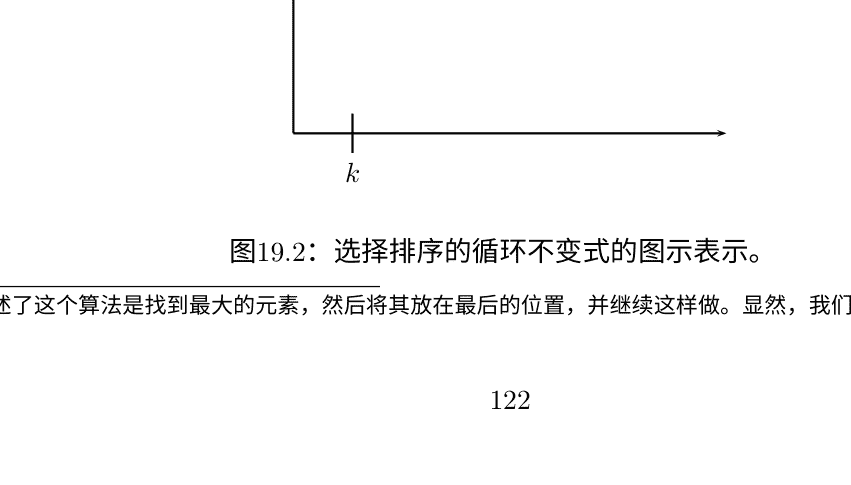


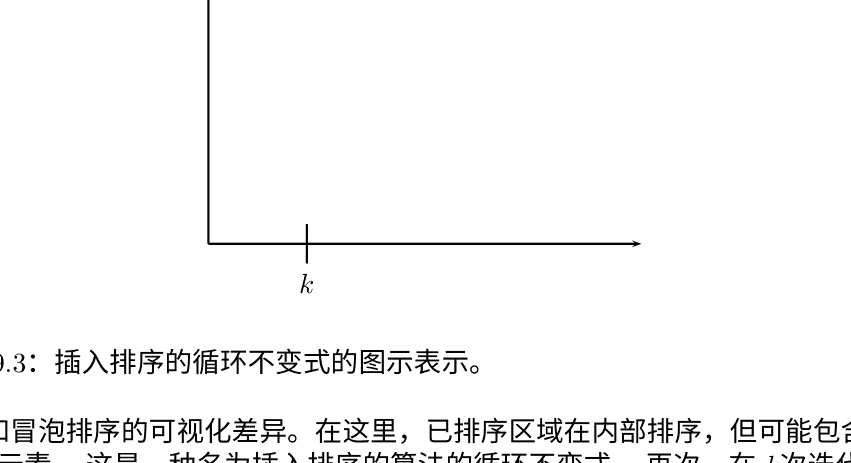

```

选择排序也是稳定的，因为我们总是选择相等元素中较早的进行交换。这是因为我们只有在找到严格较小的元素时才更新smallestNumIndex。

同样，我们需要考虑循环不变式来证明该算法的正确性。在这里，它看起来类似于冒泡排序，只是针对数组的开头而不是结尾。在任何数字 $k$ 迭代之后，以下条件成立：

-   数组的前 $k$ 个位置包含最小的 $k$ 个元素，并且已经排序。（最后的 $n - k$ 个位置不一定已经排序。）
-   整个数组仍然包含与开始时相同的元素。

再次，我们将使用归纳法证明这个命题。从图19.2可以直观地表示如下：
在分析中，最内部的部分需要$\Theta(1)$的时间，因此内循环的运行时间为$\Theta(n-i)$。因此，总运行时间为 $\sum_{i=0}^{n-2} \Theta(n-i)$。为了计算这个求和，最好的方法是手动计算不同 i 值时发生的情况。对于 i=0，我们有 n-i=n。对于 i=1，我们有 n-i=n-1，依此类推。最后，对于 i=n-3，我们有 n-i=3，对于 i=n-2，我们有 n-i=2。所以总和与 $\sum_{i=2}^{n} \Theta(i)$ 相同。现在，我们可以添加 i=1 项（因为它只会将 $\Theta(1)$ 添加到总和中），并得出总和为 $\Theta(\sum_{i=1}^{n} i)=\Theta(n^2)$（就像我们对冒泡排序所做的那样）。实际上，选择排序比冒泡排序稍微好一些，因为它只需要 $O(n)$ 次交换（尽管比较次数仍然是 $\Theta(n^2)$）。

### 19.5 插入排序

当我们分析选择排序并思考循环不变式时，我们发现在 $k$ 次迭代后：

-   数组的前 $k$ 个位置包含最小的 $k$ 个元素，并且已经排序。（最后的 $n-k$ 个位置不一定已经排序。）
-   整个数组仍然包含与开始时相同的元素。

让我们思考一下，如果我们只有“前 $k$ 个位置已排序”，而不考虑它们是否包含最小的 $k$ 个元素，我们将得到什么算法或不变式。这将给我们提供以下可视化效果：
图19.3：插入排序的循环不变式的图示表示。

注意选择排序和冒泡排序的可视化差异。在这里，已排序区域在内部排序，但可能包含比未排序区域中的某些元素更大的元素。这是一种名为插入排序的算法的循环不变式。再次，在 $k$ 次迭代之后：

-   数组的前 $k$ 个位置已排序。
-   整个数组仍然包含与开始时相同的元素。

插入排序算法的工作原理如下：对于每个位置按顺序，假设你刚刚“发现”了元素 a[i]，并将其放在数组的位置0和i之间的正确位置。重复这个过程，直到整个数组排序完成。实际上，这就是许多人排序一手牌的方式，一张一张地拿起它们，并将它们插入到手中当前的正确位置。在代码中，它看起来如下：

```
for (int i = 1; i < n; i++) {
    int j = i;
    while (j > 0 && a[j] < a[j-1])
    {
        a.swap(j, j-1);
        j --;
    }
}
```

这个算法也是稳定的。原因是它从不交换相等的元素。

接下来，让我们分析插入排序的运行时间。while循环内的命令需要$\Theta(1)$的时间，所以内部的while循环，从$i$到0运行，需要$\Theta(i)$的时间。因此，整个算法的运行时间为$\sum_{i=1}^{n-1} \Theta(i) = \Theta(n^2)$，这个计算现在应该是很熟悉的。

虽然插入排序也是一个二次算法，但在实践中并不那么糟糕，对于$n \leq 10$来说，它被认为是最快的排序算法。事实上，我们接下来要看到的更快的递归算法的实现，通常会在较小的数组大小时切换到插入排序。

实现也可以进行一些优化。正如你所看到的，在内部循环中有很多交换操作。通过将$a[i]$存储在一个单独的变量$t$中，然后只需将每个$a[j-1]$复制到$a[j]$，最后将$t$复制到其正确的位置，可以稍微改进一下。这样可以用一个赋值语句替换每个交换，这样循环的速度应该提高约3倍。

### 19.6 归并排序

接下来，我们将学习两个经典的$O(n \log n)$算法：归并排序和快速排序。两者都使用递归和分治范式。这两个算法在理论上和实践中都非常快，并且它们还展示了一些非常核心的算法思想。

一般来说，算法设计中的分治范式考虑算法的三个阶段：

-   **分割**：将输入分割成一个或多个较小的输入。这些输入可能重叠，但在较简单的示例中，它们通常不重叠。
-   **递归**：对每个较小的集合递归地解决问题。
-   **合并**：将这些解决方案合并成一个来解决原始问题。这也被称为“征服”步骤。

我们之前已经看到了一个非常简单的分治法的例子，即二分查找。在那里，分割步骤是将要搜索的元素$x$与数组的中位数元素$a$（即位置$n/2$的元素）进行比较。这将数组分成一个较小的输入，即现在已知$x$位于其中的数组的一半（除非我们幸运地找到了元素）。递归步骤是仅对那一半进行递归调用，并且合并步骤是微不足道的：它只是返回递归步骤的结果，没有任何其他工作。

归并排序算法符合分治法的范式，具体如下：

-   **分割**：不做太多事情，只是将数组分成两个（大致）相等大小的部分。
-   **递归**：递归地对两个部分进行排序。
-   **合并**：这是所有工作完成的地方：将两个已排序的部分在一次线性时间内合并。

更正式地说，代码如下所示：

```
void MergeSort(T a[], int l, int r)
{
    if (l<r) { // 否则，只有一个元素，已经排序
        int m = floor((l+r)/2);
        MergeSort(a, l, m);
        MergeSort(a, m+1, r);
        Merge(a, l, r, m); // 这是下面给出的一个单独的函数
    }
}
```

Merge函数的实现如下：

```
void Merge (T a[], int l, int r, int m)
{
  T temp[r+1-l];
  // 追踪两个子数组，将其复制到一个临时数组中
  int i = l, j = m+1, k = 0;
  while (i <= m || j <= r) // 至少一个子数组包含另一个元素
    {
      if (i <= m && (j > r || a[i] < a[j]))
        // 左子数组中的下一个最小元素
        { temp[k] = a[i]; i ++; k ++; }
      else { temp[k] = a[j]; j ++; k ++; }
        // 右子数组中的下一个最小元素
    }
  // 现在将合并后的数组复制到原始数组中
  for (k = 0; k < r+1-l; k ++)
    a[k+l] = temp[k];
}

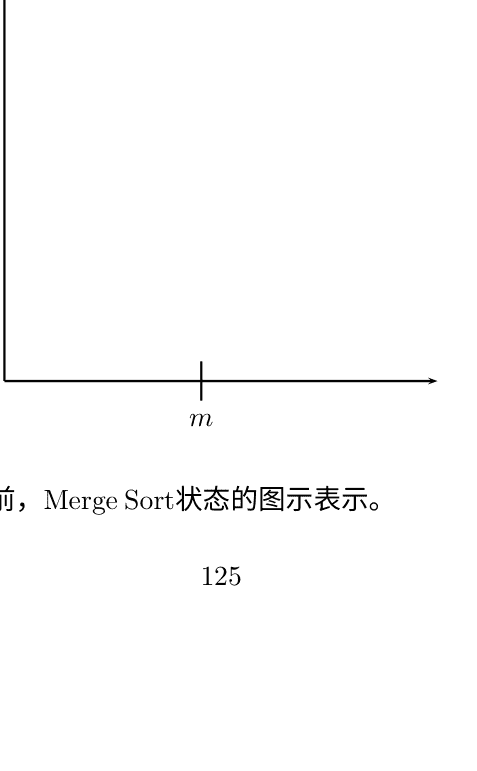


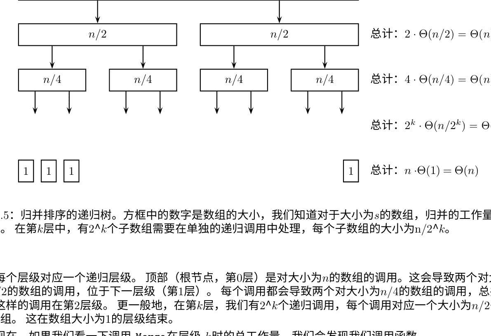

```

对于许多递归算法，MergeSort的不变式实际上就是算法的正确性条件，表达如下：

执行MergeSort(a, l, r)后，a在l和r之间排序，并包含与原始数组相同的元素。

最有趣的可视化是在两个递归调用之后，但在Merge步骤之前绘制数组的状态。
当然，由于所有实际工作都发生在 Merge 函数内部（其余部分只是递归调用，没有实际计算），假设不变性的艰苦工作将来自于分析 Merge 函数。我们用以下引理²来捕捉它的工作方式

引理 19.1 如果调用 Merge(a, l, r, m)，使得 a 在 l 和 m 之间有序，在 m+1 和 r 之间有序，那么在 Merge 运行后，数组在 l 和 r 之间有序，并且包含相同的元素。

为了证明这个引理，由于 Merge 主要使用一个循环，我们必须提出一个谨慎的循环不变式，并通过适当的循环计数器的归纳证明它。在这里，这将是 i+j 在 Merge 函数中。详细的证明可能有些乏味，但并不真正困难。
一旦我们证明了这个引理，Merge Sort 的正确性证明实际上非常简单。我们不会在课堂上进行证明，但它实际上只是插入归纳假设和引理。

#### 19.6.1 归并排序的运行时间

如果我们更仔细地看一下归并排序算法，我们会注意到在大小为 n 的数组上的运行时间如下累积：

1.  首先，我们花费时间 $O(1)$ 来计算 m。
2.  然后，我们对大小为 $\lfloor (n-1)/2 \rfloor$ 和 $\lceil (n-1)/2 \rceil$ 的数组进行两次递归调用归并排序。
3.  最后，我们调用 Merge。Merge 通过一个循环遍历两个子数组，始终增加其中一个 i 和 j。因此，它需要时间 $\Theta(n)$。

让我们用 $T(n)$ 来表示归并排序在大小为 n 的数组上的最坏情况运行时间。我们还不知道 $T(n)$ 是多少 - 毕竟，这就是我们现在要解决的问题。但我们知道它必须满足以下递归关系：
$$T(n) = T(\lfloor (n-1)/2 \rfloor) + T(\lceil (n-1)/2 \rceil) + \Theta(n),$$
$$T(1) = \Theta(1).$$
$$T(0) = \Theta(1).$$
最后两种情况只是递归到底的基本情况。第一个方程式的推导如下：我们计算出数组大小为 n 时的运行时间是 Merge（和计算 m 的时间），即 $\Theta(n)$，再加上两个递归调用的时间。我们还不知道这两个递归调用需要多长时间，但我们知道它们必须是分别应用于相应数组大小的函数 T。

通过一些经验，我们实际上意识到在这种类型的递归中，无论是向上取整还是向下取整，以及是 $(n-1)/2$ 还是 $n/2$，都没有太大关系。如果你对此感到担心，你可以解决细节并验证它们。当然有些情况下这很重要，但直到你开始分析相当复杂的算法和数据结构（在那时，你已经学得非常好，不需要这些讲义），你总是可以忽略这些小细节，以便进行分析。所以我们得到了一个更简单的递归：
$$T(n) = 2T(n/2) + \Theta(n),$$
$$T(1) = \Theta(1)。$$

这种类型的递归在分治算法的分析中经常出现。更一般的形式是 $T(n) = a \cdot T(n/b) + f(n)$，其中 a 和 b 是常数，f 是某个函数。你将在 CSCI270 中学习如何解决这个更一般的情况，包括一个被称为主定理的定理（尽管名字并不难）。但实际上，用手解决这个问题并不太难。通过手工解决这种递归的典型方法是绘制递归树，计算出工作量每个层级和层数的数量，然后将它们相加。这给出了一个关于 $T(n)$ 的猜想的公式。 这个猜想可以通过对 n 进行（强）归纳来验证。 经过一些经验后，一个人可能会省略归纳证明（因为它总是非常相似的），但是现在，通过归纳验证是非常重要的。

递归树如图19.5所示：
图19.5：归并排序的递归树。方框中的数字是数组的大小，我们知道对于大小为s的数组，归并的工作量是$\Theta(s)$。 在第k层中，有$2^k$个子数组需要在单独的递归调用中处理，每个子数组的大小为$n/2^k$。

每个层级对应一个递归层级。 顶部（根节点，第0层）是对大小为 $n$ 的数组的调用。 这会导致两个对大小为 $n/2$ 的数组的调用，位于下一层级（第1层）。 每个调用都会导致两个对大小为 $n/4$ 的数组的调用，总共有4个这样的调用在第2层级。 更一般地，在第 $k$ 层，我们有 $2^k$ 个递归调用，每个调用对应一个大小为 $n/2^k$ 的数组。 这在数组大小为1的层级结束。

现在，如果我们看一下调用 Merge 在层级 $k$ 时的总工作量，我们会发现我们调用函数 $2^k$ 次，每次对大小为 $n/2^k$ 的数组进行操作。 由于 Merge 的运行时间与数组大小成线性关系，我们得到 $2^k \cdot \Theta(n/2^k) = \Theta(n)$。 因此，每个层级的总工作量为 $\Theta(n)$。

接下来，我们计算层级的数量。 由于数组大小每增加一层就减半，且从 $n$ 开始到1结束，层级的数量为 $\log_2(n)$。（严格来说，应该是 $\lceil \log_2(n) \rceil$，但这些细节不影响运行时间分析。）因此，总工作量在所有层级上的求和为 $\Theta(n \log_2 n)$。 请记住，所有对数函数在常数因子上是相同的（基数转换），所以我们可以简单地写作 $\Theta(n \log n)$，并且不指定基数。

现在，我们有一个相当有根据的猜想，即 $T(n) = \Theta(n \log n)$。 但我们想要非常正式地证明这个猜想。 每当我们想要正式分析递归算法的运行时间时，归纳法是选择的证明技巧，因为为了证明更大的数组，我们将依赖于较小数组的相同结果。 这要求我们写出一个正式的归纳假设和陈述。

首先，为了避免在 $\Theta()$ 符号中可能出现的错误（在递归和 $\Theta()$ 结合时存在一些微妙之处），让我们假装递归实际上是：
$$T(n) = 2T(n/2) + n,$$
$$T(1) = 1。$$
摆脱所有 $\Theta()$ 符号。 然后，我们还想要将猜想的精确形式具体化，即说
$T(n) = n(1 + \log_2 n)$
你可能会想知道“1+”突然从哪里来。 当我们看到基本情况 $n= 1$ 时，我们注意到 $T(1) = 1$ 是我们想要的，但是如果我们只有 $n \log n$，因为 $\log(1) = 0$ (无论基数如何) ，我们将会有0。 添加“1+”是一个试错的结果 。

我们现在将通过对 $n$ 进行 (强) 归纳来证明这个猜想。 对于基本情况 $n= 1$，我们通过递归得到 $T(1) = 1$ ，并且我们的公式给出了 $1 \cdot (1 + \log_2 1) = 1 \cdot (1 + 0) = 1$，所以基本情况成立。

接下来，我们陈述归纳假设。 因为我们正在进行强归纳，所以我们可以假设对于所有 $k < n$，命题 $T(k) = k(1 + \log_2 k)$ 是成立的。 我们想要证明 $T(n) = n(1 + \log_2 n)$。 注意这里正常归纳和强归纳之间的区别。在正常归纳中，我们只能假设假设对于 $k = n -1$ 成立，而使用强归纳，我们可以假设对于所有 $k < n$ 成立，包括 $k = n -1$。 当在这里，递归公式 $n$ 是基于除了 $n -1$ 之外的其他参数的值时，这是很有用的；在我们的情况下，这是 $n/2$。

为了实际证明这一点，我们首先使用我们对 $T(n)$ 唯一确定的事实，即
$T(n) = 2T(n/2) + n$
现在，我们需要处理那些 $T(n/2)$ 项。 在这里，我们将归纳假设应用于 $k = n/2$。 我们可以这样做，因为 $n \ge 2$ 意味着 $n/2 < n$。 然后，我们得到
$T(n) = 2 T(n/2) + n \stackrel{I.H.}{=} 2 \cdot \frac{n}{2} (1 + \log_2(n/2)) + n = n(1 + \log_2 n - 1) + n = n(1 + \log_2 n)$
这正是我们想要展示的，所以归纳步骤完成了，我们完成了归纳证明。

### 19.7 快速排序

归并排序是我们第一个演示的分治排序算法。 另一个经典代表是快速排序。 归并排序在分割步骤中几乎不做任何工作 - 它只计算 m, 即数组的中间位置。 相反，合并步骤是所有工作发生的地方。 快速排序则完全相反：它在分割步骤中完成所有艰苦的工作，然后递归调用自身，在合并步骤中实际上什么都不做。

快速排序中的划分步骤确保将所有较小的数字移动到数组的左侧（但不对其进行排序），将所有较大的数字移动到数组的右侧（同样不进行进一步排序），然后在两侧上递归调用自身。 这种划分是通过一个pivot元素 p来完成的。 左侧将只包含不大于 p的元素，而右侧将只包含不小于 p的元素。（根据实现方式，等于 p的元素可能分布在任一侧，或者实现方式可能选择将它们全部放在一侧。） 一旦完成这个划分步骤，我们就知道左侧的元素永远不会需要出现在右侧，反之亦然。 因此，在递归排序两侧之后，整个数组将被排序。

请注意，数组的左侧和右侧的大小不一定相同，甚至不近似。 在归并排序中，我们仔细确保将数组分成两个相等的部分。 在快速排序中，我们也可能得到两个部分，但这需要选择数组的中位数作为枢轴。 更正式地说，快速排序算法如下所示。

```
void QuickSort (T a[], int l, int r) {
    if (l < r) {
        int m = partition(a, l, r);
        QuickSort(a, l, m-1);
        QuickSort(a, m+1, r);
    }
}
```

正如你所看到的，基本上所有的工作都必须在分区函数中完成，其代码如下：

```
int partition (T a[], int l, int r) {
    int i = l; // i将标记这样一个位置，即i左侧的所有元素都小于或等于枢轴。

    T p = a[r];
    for (int j = l; j < r; j++) {
        if (a[j] <= p) { // 找到一个要放在左侧的元素
            a.swap(i, j); // 将其放在左侧
            i++;
        }
    }
    a.swap(i, r); // 将枢纽元素放在正确的位置上
    return i;
}
```

partition函数通过数组运行一个循环，并将小于枢纽元素的元素移动到数组的左侧，同时跟踪边界（i）：小于枢纽元素的元素和可能（或已经）大于枢纽元素的元素。这是一个完全足够的partition函数实现，但是它使用了大约两倍于必要的交换次数。（在大O表示法中，这并不重要，但在实践中，这个因子2可能非常重要。）稍微聪明一点的实现方式是使用两个计数器i，j，一个从左侧开始，另一个从右侧开始。当 $a[i] > p$ 且 $a[j] < p$ 时，交换 i 和 j 处的两个元素。否则， i增加， j减少，或者两者都进行。

当计数器相交时，函数结束。对于 $a[i] = p$ 的索引 i，需要稍微小心，这就是为什么在课堂上我们介绍了更简单但更慢的版本。但这并不难解决。

再次，因为快速排序是一种递归算法，正确性陈述只是整体正确性条件，并且我们不需要循环不变式：在执行 $QuickSort(a,l,r)$ 之后，a在l和r之间被排序，并且包含与原始数组相同的元素。

引理19.2 当 $partition(a,l,r)$ 返回值 m 时，数组 a 仍然包含相同的元素，并且具有以下属性：(1) 每个位置 $l \le i < m$ 满足 $a[i] \le a[m]$，(2) 每个位置 $m < i \le r$ 满足 $a[i] \ge a[m]$。

我们可以将这个引理可视化为图19.6中所示，以图形方式呈现快速排序算法的主要见解（就像我们对其他排序算法所做的那样）：为了证明这个引理，我们再次需要归纳法。由于 partition主要由一个循环组成，我们需要一个循环不变式，形式上捕捉 partition的工作概要。我们在这里不会做这个，但这并不太难。一旦我们有了这个引理，快速排序的正确性证明就非常直接了。它只是在数组大小上使用强归纳，并应用引理和归纳假设。这是一个你应该能够很容易自己解决的问题。

#### 19.7.1 运行时间

为了分析快速排序的运行时间，我们使用与归并排序相同的方法（对于许多递归算法来说是常见的，除非它们完全明显）。我们让 T(n) 表示快速排序算法在大小为 n 的数组上的最坏情况运行时间。为了掌握 T(n)，我们逐行查看算法。调用 partition 需要 Θ(n) 的时间，因为它对数组进行一次线性扫描，再加上一些常数时间。然后，我们有两个对快速排序的递归调用。我们让 k = m - 1 - l 表示左子数组的大小。那么，第一个递归调用需要时间 T(k)，因为它是对大小为 k 的数组的调用。第二个递归调用将需要时间 T(n-1-k)，因为右子数组的大小为 k-1-k。因此，快速排序的总运行时间满足递归关系式

```
T(n) = Θ(n) + T(k) + T(n-1-k),
T(1) = Θ(1).
```

这看起来比归并排序的递归式要复杂一些，如果我们对 k 一无所知，我们无法真正解决这个递归式。但为了对其有所了解，我们可以稍微尝试一下，并探索不同可能的 k 值。

- 1. 对于 k = n/2，递归式变得简单得多：T(n) = Θ(n) + T(n/2) + T(n/2-1)，正如我们在归并排序的上下文中讨论过的那样，我们可以简化为 T(n) = Θ(n) + 2T(n/2)。这正是我们已经解决过的归并排序的递归式，因此快速排序的运行时间将为 Θ(n log n)。
- 2. 在另一个极端是 k=0（或者类似地，k = n-1）。然后，我们只得到 T(n) = Θ(n) + T(0) + T(n-1)，而且由于 T(0) = Θ(1)，这个递归变成了 T(n) = Θ(n) + T(n-1)。这个递归展开为 T(n) = Θ(n) + Θ(n-1) + Θ(n-2) + ... + Θ(1)，所以 T(n) = Θ(∑_{i=1}^{n} i) = Θ(n^2)。

对于 k=0 或 k = n-1，运行时间与简单算法一样糟糕，实际上，对于 k=0，快速排序与选择排序基本相同。当然，如果只有 k=0 和 k = n-1 这两种情况不出现在实践中，这个二次运行时间就不是问题。但实际上，它们确实会出现：使用我们实现的枢轴选择，只要数组已经排序（递增或递减），这些情况就会发生，而这实际上应该是一个简单的情况。如果数组几乎排序，它们也会发生。这在实践中是相当可能的，例如，因为数组可能已经排序，然后只是因为一些新插入而稍微混乱了一下。

正如我们所看到的，选择枢轴对快速排序的性能非常重要。我们最喜欢的枢轴是中位数，因为它确保 k = n/2，给出了最佳解 T(n) = Θ(n log n)。实际上，有线性算法可以找到中位数；它们并不特别困难（特别是随机算法非常简单；确定性算法则更加巧妙），但更适合在算法课程中讲解。

当然，我们不必精确地找到中位数。只要存在某个常数α>0，使得αn ≤ k ≤ (1-α)n对于所有递归调用，我们将得到 T(n) = Θ(n log n)。然而，随着 α →0，隐藏在Θ中的常数变得越来越糟糕，因为快速排序中的数组大小变得越来越不平衡。

所以，如果我们能够总是选择一个枢轴 p such that 至少有25%的数组元素小于 p and 至少有25%的数组元素大于 p，我们会非常高兴。注意，数组中一半的元素实际上满足这个条件，即在排序后的版本中，它们位于数组位置 n/4...3n/4。不幸的是，现在我们真的不知道如何找到这样的枢轴。（可以用与找中位数相同的思路来做。）

但我们可以做的一件事是选择数组中的一个 random element 作为枢轴。这不会 always guarantee 枢轴满足这个好的25%的性质，但平均来说，这种情况发生的概率是一半。所以，一半的时间，子数组的大小至少减少25%，这足以确保我们只有 O(log n) levels of recursive calls，并且运行时间为 O(n log n)。对于 Randomized Quick Sort 的分析并不特别困难，但需要大约一节课的时间，所以我们在这里跳过它 - 你可能会在 CSCI270 中看到它。但是，可以证明期望的运行时间 E[T(n)] = Θ(n log n)。注意，当算法进行随机选择时，像 Randomized Quick Sort 一样，运行时间变成了一个随机变量。可以证明，不仅期望的运行时间是 Θ(n log n)，而且大部分时间都是这样。

在实践中，随机快速排序表现得非常好。实现相同结果的另一种方法是先真正随机地打乱数组，然后在打乱后的数组上运行默认的快速排序算法。从数学上讲，这是等效的。

顺便说一下，这是如何随机打乱一个数组的方法：

```
for (int i = n-1; i > 0; i --)
    a.swap (i, rand()%(i+1));
```

这确保了数组的每个排列在最后都是等可能的。不要尝试通过重复交换随机对的元素来打乱它，就像下面这样：

```
for (int i = 0; i < MAXSWAPS; i ++)
    a.swap (rand()%n, rand()%n);
```

这确实会给你一个真正随机的数组，但是需要比通常运行的交换次数更多。这实际上是数学的一个有趣领域（马尔可夫链和随机游走的混合时间分析），主要结果是在数组实际上看起来随机之前，你需要 MAXSWAPS = Ω(n log n) 成对交换。

## 第20章

# 图：简介

[注意：本章涵盖大约2个讲座的内容。]

### 20.1 基本定义和示例

一个图是一组“个体”及其“两两关系”。这些个体被称为节点或顶点（单数：顶点），有时也被称为点（主要是数学家）。这些关系被称为边（如果它们是有向的，则也被称为弧），有时也被称为线。

现实世界中的许多事物可以通过图形来自然表示。例如：

- 计算机网络（包括互联网）
- 社交网络（如友谊、敌对、工作监督、家庭关系、性接触、迷恋等）请注意，其中一些关系（如友谊、敌对或性接触）是根据定义无向的，即自动互惠的，而其他关系（工作监督、迷恋）则不一定如此。
- 道路系统或其他交通网络（火车路线、城市间航班等）再次注意，有些边是双向的（双行道），而其他边则不是。
- 金融网络，如公司之间的投资或金融义务，在董事会之间重叠，以及其他情况。
- 政府不同部门/实体之间的监督。
- 万维网和其他超文本。
- 还有很多其他情况，包括物理接近度、体育队之间的比赛、物种之间的共生或捕食行为，以及生物/化学系统中的反应。

在过于热衷于将一切都建模为图形之前，我们应该记住图形只能捕捉两两关系。例如，假设你正在尝试建模一组学生（节点），以及他们是否一起上课。有三个学生，$A$、$B$和$C$。如果你在所有三对（$A, B$）、（$B, C$）和（$A, C$）之间有一条边，那可能意味着三个人都在一起上课，或者有三个不同的课程，一个是$A$和$B$一起上的，一个是$B$和$C$一起上的，还有一个是$A$和$C$一起上的。图形无法区分这两种现实情况。如果我们真的想要建模这种差异，有两种不同的方法。

- 1. 一种方法是从图形转移到超图：超图具有超边，可以包含多个节点。然后，一个超边{\( A, B, C \)}可以捕捉到这三个学生都在同一个班级里。在大多数标准的大学课程中（包括在USC这里），超图是没有深入讲解；主要原因是关于图的很多非常美丽和有用的结果，而对于超图的大多数扩展则不那么有用或美丽。
- 2. 另一种方法是在我们的图中包含两种完全不同类型的节点：学生和班级。然后，如果学生在班级中注册，我们在学生节点和班级节点之间绘制一条边。我们不会在学生之间或班级之间有任何边。这将完全捕捉到我们感兴趣的场景。这样的图（两种不同类型的节点，仅在不同类型的节点之间有边）被称为二分图。它们通常非常有用，并且有许多非常有趣的结果。你可能会在CS170、CS270和可能的更高级别课程中看到其中一些。

为了讨论图，我们需要学习一些术语并达成一致的符号[^1]：

- 通常用 $V$ 表示所有节点的集合，用 $E$ 表示所有边的集合。它们的大小分别为 $n = |V|$ 和 $m = |E|$。在讨论图时，使用 $n$ 和 $m$ 的这种意义非常标准，所以你应该避免偏离它。图通常表示为 $G= (V, E)$。
- 顶点通常被命名为 $u, v, w$，边被命名为 $e, e^{\prime}$， $f$。
- 边可以是有向的或无向的。无向边模拟自动互相关联的关系（例如朋友、兄弟姐妹、结婚、同班或双向街道连接）。有向边模拟不一定互相关联的关系（例如暗恋、父母、上司、或单向街道连接）。有向边也经常被称为弧。
- 所有边都是无向的图被称为无向图。所有边都是有向的图被称为有向图。同时包含两种类型的图有时被称为混合图。
- 为了可视化图形，我们通常将节点绘制为圆圈（或点或矩形），将边绘制为线条（不一定是直线）。当边是有向的时候，我们将它们绘制为箭头。
- 当两个节点 $u$ 和 $v$ 之间存在一个无向边 $(u, v)$ 时，我们称 $u$ 和 $v$ 是相邻的（思考：邻居）。当边是有向的时候，人们通常避免使用“相邻”这个术语以防止混淆。
- 在无向图中，节点 $v$ 的度数（记为 $degree(v)$，或 $deg(v)$，有时只写为 $d(v)$ 或 $d_v$）是 $v$ 所属的边的数量。在有向图中，我们通常仔细区分出度（出边数，用 $outdegree(v)$（或 $d_{out}(v)$ 或 $d^{+}(v)$）表示）和入度（入边数，用 $indegree(v)$（或 $d_{in}(v)$ 或 $d^{-}(v)$）表示）。

当你进行一些基本计算（计数）时，你会发现一个具有 $n$ 个节点的图最多可以有 $n^2$ （或 $n(n-1)$ 或 $n(n-1)/2$）条边，这取决于我们是否允许一个节点与自身相连，并且边是有向的还是无向的。在任何这些情况下，最大数量是 $\Theta (n^2)$。我们称具有 $\Theta (n^2)$ 条边的图为密集图，并且具有远少于 $n^2$ 条边的图为稀疏图。

[^1]: 当然，这个列表远非完整：还要在教科书中阅读一些更多的术语。你还可能在CS170和CS270中学到更多知识。
[^2]: 对于这门课程，我们只能使用“直观”的描述。细心的学生对于大 $O$ 符号的舒适使用会注意到，在单个图中讨论边的数量为 $\Theta (n^2)$ 是没有意义的，因为 $O$ 和 $\Omega$ 符号只对函数定义。我们实际上是在谈论一簇图，包括任意大的图，其边集增长为 $\Theta (n^2)$。对于“稀疏图”，我们将故意保持不明确。在不同的上下文中，不同的定义很方便。有时，我们可能只是意味着边的数量不是 $\Omega (n^2)$（我们用一个小 $o$ 表示），在其他情况下，我们可能希望边的数量为 $O(n)$ 或 $O(n \log n)$ 或 $O(n^{1.5})$。

### 20.2 图中的路径

在用图模型对世界进行建模时，路径是最有用和核心的概念之一：它捕捉了从一个节点到另一个节点的能力，不仅仅通过一条直接的边，而是通过一系列的边。

路径的形式化定义是一系列 k ≥ 1 个节点 v₁, v₂, …, vₖ，使得对于每个 i，都存在一条从 vᵢ 到 vᵢ₊₁（有向或无向）的边。从这个意义上说，路径完全捕捉了我们按顺序遍历多条边的能力。请注意，我们明确允许 k = 1 的情况，即一个节点本身也是一条路径。尽管这条路径通常不是特别有趣，但它通常帮助我们避免在证明中处理特殊情况。我们将在下一堂课中学习如何实际计算顶点之间的路径。

到目前为止，路径可能会重复相同的节点或边。如果我们想排除这种情况，我们可以讨论简单路径：如果路径不包含重复的节点，则称其为简单路径。循环（有时也称为回路）是一条从同一节点开始并结束的路径。如果两个节点 u 和 v 之间存在无向路径，则称它们为相连的。（对于有向图也有类似的定义，但这些术语使用较少。）因此，如果可以从一个节点到达另一个节点，则它们是相连的。

如果图中的每对顶点都是连通的，则称为无向图连通图。如果对于图中的每对顶点 u、v，存在从 u 到 v 的有向路径和从 v 到 u 的有向路径，则称为有向图强连通图。

节点之间的路径在许多情况下非常有用。在道路网络中，它们是任何类型的路径规划（MapQuest、Google地图驾驶建议、GPS）所需的主要概念。在计算机网络中，它们是从一个计算机到另一个计算机路由数据包的地方。在社交网络中，它们告诉我们你是否通过一系列朋友与其他人相连。在我们讨论的大多数其他图的示例中，您可能会发现有用的应用程序。

### 20.3 图的抽象数据类型

在实现图时，我们再次将其视为抽象数据类型：存储的信息（内部）以及与数据交互的函数。在内部，我们需要存储节点和边。在这两种情况下，我们可能希望将一些数据与它们关联起来。对于节点，这可以是社交网络用户的一些信息，或者网络中的计算机，或者道路地图上的交叉口。对于边，这可能是道路的长度或方向，或者友谊的强度（以交换的电子邮件数量或其他方式衡量），或者一家银行欠另一家银行的金额，或者航班的费用。当这些数据在课程的后期变得更加相关时，我们将回到它们；现在，我们只关注基本的图结构，并记住将来我们经常希望在节点或边上存储更多信息。抽象数据类型应该提供给我们的函数（至少）如下：

- 添加和删除一个节点。
- 添加和删除一条边。
- 测试特定边（u, v）是否存在。
- 对于节点 u，列出其所有出/入边或所有相邻节点。

后者在寻找节点之间的路径时特别有用（以及其他一些情况，稍后我们会看到）。对于它们来说，一个很好的实现方式是通过迭代器，即函数返回一个最终会输出所有出边的迭代器。（另一个函数将返回一个迭代器，用于遍历所有入边；对于无向图，我们可能希望遍历所有相邻节点的迭代器。）通过使用迭代器实现，我们可以继续隐藏其他类对于抽象数据类型如何在内部存储图信息的细节，只暴露最少量的必要信息。

#### 20.3.1 如何在内部实现ADT？

有两种自然的方式来在内部存储图。在这两种情况下，我们将节点本身存储在数组、链表、列表或集合中。

- 1. 通过邻接表实现：对于每个节点，存储与其相邻的所有其他节点的列表。（可以使用ADT集合、ADT列表、链表或动态增长数组来实现。）如果图是有向的，我们将存储两个单独的列表：一个用于出边，另一个用于入边。
列表的元素可以是指向其他节点的指针，或者（如果节点本身存储在数组中）是整数，即其他节点在数组中的索引。

- 2. 通过邻接矩阵实现：存储一个 $n \times n$ 的矩阵（二维数组） $A$。在位置 $A[u, v]$ 存储从 $u$ 到 $v$ 是否存在一条边。（这可以是一个布尔值，或者可能是存储长度、成本或其他信息的整数。）
在位置 $A[u, u]$ 中存储的内容取决于我们的图模型。在某些情况下，将其视为存在一条从 $u$ 到自身的边是有意义的，而在其他情况下则不是。没有强制规定我们必须选择其中之一，我们应该使用使我们的计算任务最简单的方法。

在比较这两种方法时，我们应该始终考虑我们预计更频繁执行的操作。让我们比较一下这两种实现中哪些操作更昂贵或更廉价。

- 1. 对于添加或删除节点，邻接矩阵会有更多的开销，因为改变矩阵的大小涉及到大量的重新分配和复制。对于计算机科学家需要解决的许多应用程序来说，节点集合的变化往往比较少见，而其他处理正在进行。

- 2. 测试图中是否存在边 $(u, v)$ 是邻接矩阵的特长。它只涉及到在已知位置的二维数组中查找一次，并且所需时间为 $O(1)$。
对于邻接表，我们没有那个信息可以直接使用。相反，我们需要遍历所有 $u$ 的出边列表，并查看 $v$ 是否在列表中。这将需要 $\Theta(\text{出度}(u))$ 的时间，这可能会很大。（当我们学习更好的集合实现时，这将变得更快，但即使如此，时间也不会降到常数。）

- 3. 列出所有出/入边 $u$ 是邻接表的特点。由于它们明确地存储了这些信息，它们只需遍历它们的 Set/List，这需要时间 $\Theta(\text{outdegree}(u))$ 或 $\Theta(\text{indegree}(u))$。
对于邻接矩阵，我们没有存储这些信息，所以我们必须遍历节点 $u$ 的整个行（或列），并找到所有值为1或 true 的条目。这将需要 $\Theta(n)$，如果度数很小，情况可能会更糟。

- 4. 我们还可以比较这两种实现的内存需求。对于邻接矩阵，我们需要存储一个 $n \times n$ 的数组，这显然需要 $\Theta(n^2)$ 的内存。
对于邻接表，我们存储所有的入边和出边，这给我们一个总的内存需求为 $\Theta(\sum\limits_v (v\text{的入度} + v\text{的出度}))$。要计算这个和，注意当我们求所有入度的和时，每条边只会被计算一次，因为它对一个节点的入度贡献了1。
因此，所有入度的和是 $m$，出度的和也是类似的。因此，上面的和等于 $2m$，即 $\Theta(m)$。因此，总的存储需求是 $\Theta(n + m)$（因为我们还需要存储所有节点的信息）。

因此，对于稀疏图来说，邻接表比邻接矩阵更节省空间，而对于稠密图来说，在内存方面并没有太大的区别。

我们上面看到，每种存储图的方式都有其优点和缺点。如果内存不是太大的问题（现在很少是问题——计算时间往往比内存更成为瓶颈），一种可能的方法是在内部将整个图存储两次。当用户查询是否存在边$(u, v)$时，我们使用邻接矩阵来回答，而当用户查询节点$u$的所有邻居时，我们使用邻接表。

这种方法的缺点（除了使用两倍的内存）是我们需要执行两次图的更新：一次在邻接矩阵上，一次在列表上。因此，更新操作（例如添加或删除节点或边）将比以前慢两倍。然而，这可能是值得的：对于许多图来说，更新比查询频率要低得多。例如，在构建GPS时，将道路或交叉口添加到道路网络的情况比寻找两个位置之间的路线要少得多。同样，在社交网络中，用户添加/删除好友的频率比阅读好友更新的频率要低得多。在这些情况下，为了在查询中获得更快的响应，对更新进行额外的投资是非常值得的。

对于感兴趣的学生来说，这种在更新时间进行更多“预处理”以加快后续操作的“查询时间”是数据结构中一个重要且活跃的方向。许多论文正在尝试找到有用的内部表示方法，以比我们上面考虑的“默认”表示方法更快地回答关于连通性或短路径的查询。

### 20.4 图搜索：BFS和DFS

关于图形最常被问到的一个问题是以下变种之一：

- 是否存在从 $u$到 $v$的路径？
- 从 $u$到 $v$的最短路径是什么？（可以根据跳数、距离或边上存储的成本来计算。）
- 从 $u$到图中的每个其他节点的距离是多少（或者从$u$可以到达的每个节点的距离是多少）？

所有这些问题都属于广泛的图搜索或计算最短路径（或仅仅是路径）的领域。这些问题有许多重要的应用：

- 1. 通过利用道路网络（优化距离或时间）、航空公司或火车网络（优化时间或成本）等方式，寻找从一个地方到另一个地方的快速或廉价的方法。
- 2. 在社交网络中寻找社交距离。其中一个著名的例子是凯文·贝肯游戏，玩家们试图构建连接给定演员或女演员与演员凯文·贝肯之间的电影短序列。如果两个演员在至少一部电影中合作过，则它们之间存在一条边。³
- 3. 在一个游戏中（通常是一个谜题或逻辑游戏），是否有一种方法根据规则（滑动箱子、方块、改变开关、移动等）从给定的初始状态到达给定的目标状态？
- 4. 计划从一个状态到达另一个状态的想法更加普遍，并且超越了游戏范畴。机器人需要计划一系列的移动来将它们从一个配置转移到另一个配置。许多系统需要计划一系列的动作来执行。

人们可以提出更多的例子：大量的现实世界问题可以非常自然地建模为在适当定义的图中进行最短路径搜索。因此，图搜索算法是计算机科学家必须熟悉的最核心的概念之一。

正如我们上面简要提到的，具体实例可以在几个参数上有所不同：

> ³数学家们的版本是Erd"os数，其中两位数学家通过合著至少一篇论文相连，而Erd"os数是指到传奇的匈牙利数学家Paul Erd"os的跳数。

我们只是想知道是否存在一条路径，还是需要找到它？
如果我们要找到一条路径，我们是想要最短路径，还是任意路径都可以？
如果我们不需要找到它，我们是需要节点之间的确切距离，还是只需要知道是否存在一条路径？
边是否与长度/成本相关联，还是我们只关心跳数？
如果边与成本相关联，它们可以是负数吗？

对于前三个问题，事实证明仅仅询问是否存在一条路径并不能使问题变得更容易，因此我们将研究的算法实际上会找到一条路径；而最“自然”的算法（BFS）实际上会找到一条最短路径。另一方面，边长度/成本使问题变得更具挑战性，我们将在课堂上学习如何处理它们。负边缘成本并不是非常困难，但略微超出了这门课程的范围 - 你可能会在CSCI 270中学到它们。

#### 20.4.1 广度优先搜索（BFS）

广度优先搜索（*BFS*）是一种相当简单的算法，它找到从给定节点 $u$ 到所有节点 $v$ 的最短路径（按照跳数计算）。*BFS* 的思想是以层次方式“探索”图。

- 第0层是节点 $u$ 本身。
- 第1层包含所有与节点u有直接边 $(u, v) \in E$ 的节点 $v$。
- 第2层包含所有与第1层中的某个节点 $v$ 有直接边 $(v, w) \in E$ 的节点 $w$。但是，它不包括已经在第1层中的节点。
- 更一般地，第 $k$ 层包含所有与第 $k - 1$ 层中的某个节点 $v$ 有直接边，但是 $w$ 本身不在之前的层中的节点 $w$。

递归定义的层非常好。使用这个定义，很容易证明第 $k$ 层的节点与 $u$ 的距离恰好为 $k$。然而，要实现这个算法，我们将不得不逐个处理节点，因为一次处理整个层不是标准的编程功能。

当我们按顺序处理节点时，我们希望确保在处理到下一层的节点之前，所有来自第k层的节点都已经被处理过了。因为我们在第k层之前“发现”了（通过算法）第k层的节点，这意味着我们应该按照它们被发现的顺序来处理节点。

我们已经见过一种支持这种需求的数据结构：先进先出队列（FIFO队列）。事实上，FIFO队列是广度优先搜索算法的核心部分。

在描述和分析中，我们将使用$d^*(v)$表示从$u$到$v$的实际距离，$d[v]$表示算法计算出的距离。当然，我们希望它们是相同的，但我们需要实际证明一下。我们假设节点以整数$0,1, \ldots, n-1$编号，这样我们可以简单地将与节点相关的值存储在大小为$n$的数组中。除了距离数组$d[v]$之外，算法还会计算一个前驱节点数组$p[v]$：对于每个节点$v$（除了$u$），它是前一层中与$v$相连的节点。例如，在图20.1中，$p[w_{3}] = v_{3}$，$p[x] = w_{10}$。另一方面，$p[w_{1}]$可能是$v_{1}$或$v_{2}$，这取决于这两个节点被探索的顺序。为了简化符号，我们将把这些数组视为全局变量。

```
int d[n]; // 将存储从u到其他节点的距离
int p[n]; // 将存储u到其他节点的最短路径上的前驱节点
```

```
void BFS (int u) {
    bool visited[n] = {false}; // 没有节点被访问过
    Queue<int> q(); // 空队列开始
    visited[u] = true; d[u] = 0;
    q.enqueue (u);
    while (!q.empty()) {
        int v = q.peekfront();
        q.dequeue ();
        for (对于所有与v有边(v,w)的节点w) // 使用某个迭代器
            if (!visited[w]) {
                visited[w] = true;
                d[w] = d[v] + 1;
                p[w] = v;
                q.enqueue(w);
            }
    }
}
```

算法的思想如下：我们从一个种子节点$u$开始。它与自身的距离显然为0。然后，for循环将$u$的所有邻居节点添加到队列中。
每当我们处理一个节点$v$（出队），我们查看它的所有出边。边可能导致我们已经见过的节点，这种情况下我们不应该再次处理它 - 如果我们这样做，可能会意外地增加距离标签。如果我们之前没有见过节点$w$，则将其标记为“已访问”（以便不再处理它），并正确设置其距离和前驱节点。前驱节点是边（$v$, $w$）允许我们发现$w$的节点$v$，并且从$u$到$w$的最快路径是先到$v$，然后再走一步，所以距离比$v$多一。最后，我们将$w$添加到队列中，以便稍后处理。

虽然我们不会在这门课上进行BFS的形式正确性证明，但我们希望大致思考一下BFS如何确保正确性。显然，FIFO队列是必不可少的，我们应该思考它到底保证了什么。一个有效的循环不变式如下所示。在while循环的每个点上，以下内容是正确的：

1.  对于所有节点$v$, 如果$visited[v] == true$, 则$d[v]$和$p[v]$的值是正确的。也就是说，$d[v] = d^*(v)$, 而$p[v]$是从$u$到$v$的最短路径上的最后一跳节点。
2.  队列中节点的距离是有序的。设$v_{1}, v_{2}, ..., v_{k}$是队列中的节点，按照它们被插入的顺序排序。（$v_{1}$已经在队列中最久，$v_{k}$是最近添加的。）那么，$d[v_{1}] \leq d[v_{2}] \leq ... \leq d[v_{k}]$。
3.  队列中的节点都来自于两个相邻的层。 也就是说，$d[v_k] \leq d[v_l] + 1$。

在编写BFS代码时，忘记这部分是一个常见的错误。
虽然这可能看起来有点复杂，但是如果你仔细思考，你会希望看到FIFO队列如何近似地处理节点层。 通过对 while循环的迭代进行归纳，正确性证明将建立循环不变量。

接下来，让我们分析BFS算法的运行时间。 首先，我们注意到visited数组的初始化，虽然写成一行，实际上需要Θ(n)的时间。 所有其他单个命令都需要Θ(1)的时间。 因此，像往常一样，我们将从内到外分析循环。 for循环遍历节点v的所有出边。 如果我们的迭代器实现得当（例如，我们对图使用了邻接表），那么对于节点v，这将需要Θ(出度(v))的时间。 while循环内的所有其他代码都需要Θ(1)的时间，因此循环的一个迭代内的总时间为Θ(1 + 出度(v))。 （通常，我们会省略1。我们现在保留它的原因是可能出度(v) = 0，这种情况下我们的分析会声称迭代需要0时间，这是不正确的。 ）现在，像往常一样，我们注意到while循环可能遍历所有节点，因此运行时间是一个求和。

$\sum_v \Theta(1 + \text{出度}(v)) = \Theta\left( \sum_v 1 + \sum_v \text{出度}(v) \right) = \Theta(n + m)$.

加上初始化的Θ(n)，BFS的总运行时间为Θ(n + m)，与图的大小成线性关系（仅读取图作为输入所需的时间）。 因此，BFS是一种快速算法。

#### 20.4.2 深度优先搜索（DFS）

广度优先搜索按照距离起始节点 u逐层处理图。 这正是FIFO队列的优点。 缺点是搜索算法在图的不同区域之间跳跃。 例如，在图20.1中跟踪执行后，可以看到在处理u, v1, v2, v3之后，算法不会停留在v1及其邻居，而是跳转到w1。 当你只想要最短路径时，这当然不是问题，但有时候，你想要通过保持局部性来探索图—这有时是其他算法的一部分。 为了局部地探索图，我们希望在切换到图的其他部分之前，首先探索“围绕v”的所有节点。

我们可以通过用LIFO堆栈替换BFS算法中的FIFO队列来实现这一点。
这样，最近添加的节点将是下一个被探索的节点，这确保了算法保持在节点的邻域中。 除了这一个词的改变，算法完全相同。
这个算法被称为深度优先搜索（DFS），因为它首先探索节点的邻域，然后深入该区域，然后再去其他部分的图。
当然，DFS不一定会找到最短路径。 例如，在我们的图20.1中，它将首先从v1到v2，将其距离设为2，并且永远不会重新访问这个选择。 请注意，这是可以接受的 - 当我们想要最短路径时，不使用DFS。 为此，您将使用BFS。 但由于d[v]值不再真正捕捉到任何特别有用的信息，我们可以通过完全删除这些数组来简化算法。

DFS的运行时间显然也是Θ(n + m)，因为我们只是将一个数据结构替换为另一个，并且所有操作都需要相同的时间。
使用递归而不是栈的DFS有一种替代（甚至更简单）的实现方式。

```
bool visited[n] = {false};

void DFS (int u) {
    对于 (u, v) 在E中的所有节点v    //再次使用迭代器
        if (!visited[v]) {
            visited[v] = true;
            p[v] = u;
            DFS(v);
        }
}
```

在这种实现中，我们不必明确担心栈 - 递归会自动为我们处理栈。

### 20.5 PageRank

熟悉线性代数的学生（希望你们大多数人）会记得“矩阵”是该领域的核心概念。我们对邻接矩阵感兴趣，这是纯巧合吗？并不完全是。
矩阵有很多有趣的用途，例如加法、乘法、寻找特征向量和特征值等。事实证明，其中一些在计算图的属性时具有非常有用的含义，而当今图论中最令人兴奋的研究之一就是基于邻接矩阵（以及其轻微变化）的有趣计算。这个领域被称为光谱图论，其中一些结果非常复杂。但其他情况则相对直接可接触，现在我们将看一个更简单且更有用的例子。

图形自然模拟的许多事物之一是超链接文本，例如万维网。如果我们考虑编写一个网络搜索引擎的任务，其中最大的问题之一是如何识别不仅包含特定单词（例如“图形”）的页面，而且还要找到最好的页面。（Google目前报告了大约8600万个结果，这对用户来说太多了，无法手动检查。）当然，理想的解决方案是搜索引擎实际上能够理解文本并找出页面的内容以及其是否有用。但是理解自然语言是一项非常困难的任务，即使在今天，仅仅确定一段文本的主题也是相当困难的，更不用说找出文本是否在该主题上是用了。

实际上，在互联网早期（1990年代中期），大多数搜索引擎都非常糟糕，因为它们仅基于文本。给Google带来巨大优势的关键洞察力是查看网页的链接结构以确定哪些页面是好的。Google是斯坦福大学的两位研究生的研究项目，但它比竞争对手好得多，很快就成为了一个严肃的产品。回顾起来，使用链接的想法是显而易见的，但当时并不明显。

使用链接的想法是，如果页面A链接到页面B，则这在某种程度上表示A对B的认可。因此，其他条件相同，如果我们正在查看两个包含搜索词的页面A和B，并且A具有比B更多的入链，则我们会认为A比B更好。这将是我们使用链接的第一版草案。

一旦我们开始以这些术语思考，我们就会意识到并非所有的链接都是平等的。来自纽约时报的入链可能比来自朋友或亲戚的入链更有力地认可页面。换句话说，来自本身就很好的页面的链接应该对被认为是好的页面做出更大的贡献。
当然，现在，我们的定义变得自我引用：为了知道一个页面是否好，我们需要知道链接到它的页面是否好。这似乎是循环的，但正如我们马上会看到的，它实际上有一个很好的解决方案。

链接不平等的另一种方式是出链的数量。如果我们确定A和B是同样好的页面，并且A只有一个出链指向C，而B有10,000个出链，其中一个指向D，那么我们预计从A到C的链接会提供更多支持（因为它是经过精心选择的），而从B到D的链接则不会（它只是众多链接中的一个，可能是目录或“电话簿”中的一部分）。

将所有这些放在一起，我们可以说每个页面 i 都有一个质量分数 q_i，并且这些分数必须满足以下方程：

$$q_i = \sum_{j: j \rightarrow i} \frac{1}{\text{出度}(j)} q_j$$

因此，每个页面 j 将其自身的质量平均分配给所有链接到的页面。这样就涵盖了我们之前想要涵盖的所有内容。请注意，为了使这个方程成立，即线性方程组有解，我们需要假设（或确保）每个页面都链接到自身。

> 5有时，链接是用来嘲笑或贬低另一个页面的，但这些链接明显是少数。

我们还可以将这个线性方程组转化为更标准的矩阵-向量系统表示。设 $A$ 为有向图的邻接矩阵，其中 $A = (a_{i,j})$, $a_{i,j} = 1$ 表示 $i$ 链接到 $j$, $a_{i,j} = 0$ 表示不链接。（正如我们之前提到的，如果对于所有的 $i$, $a_{i,i} = 1$ 会更好。）然后，我们可以写成

$$M = \left( \begin{array}{cccc} \frac{1}{\text{出度}(1)} & 0 & \cdots & 0 \\ 0 & \frac{1}{\text{出度}(2)} & \cdots & 0 \\ 0 & 0 & \ddots & 0 \\ 0 & 0 & \cdots & \frac{1}{\text{出度}(n)} \end{array} \right) \cdot A.$$

然后，我们可以将之前的线性方程组重写为 $\vec{q} = M^T \cdot \vec{q}$，你可能还记得， $T$ 表示矩阵的转置，即沿着主对角线镜像。这意味着 $\vec{q}$ 是 $M$ 的特征向量，对应的特征值为1。

我们可以以不同的方式解释相同的线性方程组。假设一个人，我们称之为随机冲浪者，从某个节点 $i$ 开始。在每一步中，他随机点击当前页面的一个出链，并跟随该链接。然后，他从那里继续。因为每个出链都以概率 $\frac{1}{\text{out-degree}(i)}$ 被选择，所以在1步后，他以该概率位于每个端点。然后，我们以这种方式继续，我们可以看到向量 $(M^T)^k \cdot (0, \ldots, 0, 1, 0, \ldots, 0)$ 准确地捕捉到在 $k$ 步后每个节点的概率。

但这也揭示了我们迄今为止方法的一个缺陷：一旦冲浪者到达一个没有出链（除了指向自身）的节点 $j$，他将永远不会去其他地方。那些是唯一可能被困住的地方，结果是，在长期运行中，唯一具有非零概率的状态是那些没有出链的状态。这不完全是我们想要的。

解决方案是一个小技巧。仍然思考我们的随机冲浪者，为了让他摆脱困境，我们还允许他跳到一个随机位置。在每一步中，以一定的概率 $\alpha$，冲浪者跳到一个均匀随机的新节点（即任何节点，无论是否由边连接）；剩余的概率 $1 - \alpha$，冲浪者沿着当前页面的一个随机外链进行跟随。在实践中，人们通常选择 $\alpha = 15\%$ 或类似的值。数值 $1 - \alpha$ 也被称为阻尼因子。现在我们可以重新书写我们的线性系统，如下所示。让

$$B = (1 - \alpha)M + \alpha \cdot \frac{1}{n} \cdot \left( \begin{array}{cccc} 1 & 1 & \cdots & 1 \\ 1 & 1 & \cdots & 1 \\ 1 & 1 & \ddots & 1 \\ 1 & 1 & \cdots & 1 \end{array} \right).$$

这是描述修改后冲浪者过程的新转移矩阵。我们现在可以将 $\vec{p} = B^T \cdot \vec{p}$ 写成我们的方程组。换句话说，我们想要的质量向量是 $B$ 的特征向量，其特征值为1。

向量 $\vec{p}$ 被称为图 $G$ 的 $PageRank$ 向量，其邻接矩阵为 $A$。要在网络搜索中使用它，可以首先计算 $PageRank$ 向量，然后按照它们的 $PageRank$ 值对所有符合条件的页面进行排序（例如，包含搜索词的所有页面）。更好的页面通常会排在前面。$PageRank$ 是 $Google$ 在创立时的关键洞察。当然，现在的 $Google$ 已经有了很多额外的想法，其中包括许多特殊情况的处理，以及从数十亿次搜索中学到的东西等。注意，我们还可以在其它环境中应用 $PageRank$。每当我们相信链接会赋予某种状态或重要性时，都可以使用它。例如，我们可以用它来识别社交网络中的重要人物，或者计算机网络中的重要服务器。

为了实际计算 $PageRank$ 向量，我们可以使用几乎任何通用的线性系统求解技术，比如你在中学学到的高斯消元法。然而，由于 $\alpha$ 的相对较大值，迭代方法会非常快速地收敛，可能是一种更好的方法，至少在计算速度方面是如此。

你从一个任意的向量 $\vec{p}_0$ 开始。在每次迭代中，你计算 $\vec{p}_{t+1} = B^T \vec{p}_t$。当 $t \to \infty$ 时， $\vec{p}_t$ 将始终收敛到我们要找的特征向量 $\vec{p}$。实际上，这对于几乎任何矩阵都适用——基本上，任何矩阵 C对应的图 (当 c_{i,j}= 0时，有边 (i, j)) 是连通的。 对于一般的矩阵 C，这种迭代方法的收敛速度可能非常慢。 然而，对于PageRank算法来说，迭代方法会快速收敛，通常在30-100次迭代后就能得到很好的近似结果 (即使对于非常大的图形也是如此)。

## 第21章

### 树和树搜索

> > [注意：本章涵盖约1个讲座的内容。]

### 21.1 基础知识

树是一种特殊类型的图。我们可以从两个不同的角度来思考它们，最终得到相同的定义。

- 树是一个无向连通图，没有环。
- 树“类似于”链表，每个节点最多有一个 prevpointer（只有一个节点没有），并且允许有多个 nextpointer。

一个没有环的无向图，可能连接也可能不连接，被称为森林。换句话说，森林由一个或多个树组成。

在现实世界中，我们可以使用树来建模很多事物：家谱（通过从一个人到他们的父母、祖父母等，或者从一个祖先到他/她的子女、孙子女等），文件系统层次结构，物种之间的进化树（有点像家谱），人类语言、公式或编程语言的解析，由BFS计算的图中的最短路径等等。

在这门课程中，树作为许多更复杂数据结构的基础非常有用，并且通常在不同操作的运行时间方面提供了比线性结构（如数组或链表）更好的权衡。在设计数据结构时使用树时，我们通常将树视为有向的。树有一个指定的根节点，并且所有边都指向它。树的术语有点混合了植物学和家谱的概念。

- 如果节点 u 有一条指向节点 v 的有向边，我们称 u 是 v 的父节点，v 是 u 的子节点。如果 u 有一条指向节点 v1、v2 的有向边，则 v1 和 v2 是兄弟节点。
- 根节点是唯一一个没有父节点的节点。由于每个其他节点都可以从根节点到达，如果我们拥有所有的边，只需要访问根节点就可以找到所有其他节点。
- 可以通过长度为1或更长的路径从 u 到达的节点被称为 u 的后代节点。可以通过长度1或更长的路径到达 v 的节点被称为 v 的祖先节点。
- 叶节点是没有子节点的节点。至少有一个子节点的节点被称为内部节点。
- 在讨论根树时，节点 v 的度指的是从该节点出发的边的数量。例如，如果一个节点从其父节点有一条边，而向其子节点有两条边，则其度数为2（尽管如果我们将其视为无向树，则度数为3）。

- 树的子树是节点和边的子集，它们（单独）是连接的。最常用的子树是由节点 v 及其所有后代组成的子树。这些被称为以 v 为根的子树。
- 经常有用的是思考节点的层级。对于任何节点 v，v 的层级是从根到 v 的路径中的节点数。因此，根本身位于第1层，其子节点位于第2层，其孙子节点位于第3层，依此类推。（某些来源可能从第0层开始 - 确保您使用与您交谈的人相同的符号。）
- 树的高度是其节点中最大的层级。

就像这门课中的其他结构一样，我们可以使用递归来形式化地定义根树。

1. 一个根节点 r 本身就是一棵根树。（根据我们将空树称为“根树”的看法，我们也可以将空树作为基本情况。）
2. 如果 T1, T2, …, Tk 是以 u1, u2, …, uk 为根的树，那么通过添加一个节点 t 和有向边 (t, u1), (t, u2), …, (t, uk)，我们得到了一棵根树。

这种对树的递归定义通常与处理树上数据的递归算法非常自然地对应，我们很快就会看到。

在设计数据结构时，有一些特定的根树子类经常被使用，因此我们在这里强调它们:

1. 如果每个节点的度数恰好为0或 d，则树是一个 d叉树。二叉树是一个2叉树。我们强调，有时我们允许一个节点只有一个子节点的例外情况，正如我们将在下面看到的那样。
2. 如果所有叶子节点在同一层级上（因此添加一个节点需要形成一个新的层级），则 d叉树是满的。
3. 完全性比满性稍微宽松一些。完全 d叉树的所有叶子节点都在第 h层或第 h - 1层。通常，在讨论完全树时，我们还假设子树之间存在自然的“从左到右”的顺序，并要求第 h层的叶子节点尽可能靠左。

我们将使用许多树来实现数据结构，其中大部分是二叉树，但也有一个重要的例外，即所谓的2-3树，在这种树中，每个内部节点的度数要么是2，要么是3。

### 21.2 实现树

树是一种特殊类型的图，因此我们可以使用通用的图实现（邻接矩阵或邻接表）来实现它们。邻接矩阵并不是很自然，原因有两个:

1. 我们很少需要判断两个特定节点是否由边连接，但我们经常需要遍历给定节点的所有子节点。
2. 树非常稀疏（n-1个节点有 n个边），因此邻接矩阵会非常浪费空间。

邻接表更加自然。但我们可以简化它们一点，因为我们知道每个节点只有一个入边（除了根节点，它没有入边）。因此，我们不需要一个完整的入边列表，只需存储一个指向父节点的指针（对于根节点，该指针为 NULL）。这给我们提供了以下节点结构。

```cpp
template <class T>
class Node {
    T data;
    Node<T>* parent;
    List<Node<T>*> children;
};
```

根据子节点的顺序是否重要，我们可以使用一个`Set<Node<T>*> children`代替 `List`。对于算术表达式的解析树，子节点的顺序显然很重要，因为$5-2$和$2-5$是不同的。对于其他一些树，重要性就不那么大了。

我们的许多树都是二叉树，这种情况下我们不需要一个子节点列表，而是可以有两个指针指向子节点。

```cpp
template <class T>
class Node {
    T data;
    Node<T> *parent;
    Node<T> *leftChild, *rightChild;
};
```

在这两种情况下（二叉树或更一般的情况），请注意我们存储的是指向其他节点的指针，而不是像`Node<T> parent`这样的东西。这很重要：理想情况下，我们希望为每个节点生成一个对象，然后让其他节点指向它。如果我们存储节点本身（而不是指针），那么为每个邻居创建一个新副本，并跟踪结构将变得困难。

一种替代动态生成节点对象的方法是将所有节点存储在一个数组中。然后，不再存储指向父节点和子节点的指针，而是将它们的索引作为整数存储。这将为二叉树（以及一般树的类似思想）提供以下结果：

```cpp
模板 <class T>
类 Node {
    T data;
    int parent;
    int leftChild, rightChild;
};

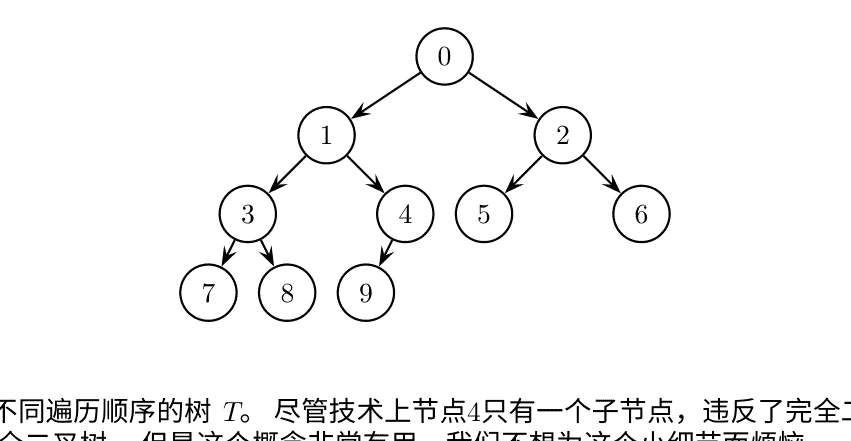

```

如果树是一个完全二叉树，这甚至可以进一步简化。如果我们从$1$开始对节点进行编号（根节点为$1$），通过一点实验，我们发现节点$i$的父节点始终是节点$\lfloor i/2 \rfloor$，而两个子节点分别是$2i$和$2i+1$。如果我们将根节点编号为$0$，公式看起来有点不同，但并不难理解。它也很自然地推广到$d$叉树。

### 21.3 遍历树

遍历树意味着仅访问树的每个节点一次。这通常是通过递归完成的，按照树的递归定义进行。遍历叶子节点非常简单 - 我们只需根据需要执行操作（例如打印或进行计算）。遍历内部节点$v$涉及访问节点本身，并递归访问每个子树的根节点$u_1$，$u_2$，...，$u_k$（对于$k \ge 1$）。

主要区别在于相对时间：我们是先遍历子树还是先访问节点$v$本身？这正是后序遍历和前序遍历之间的区别。如果树是二叉树，先遍历左子树，然后访问节点$v$，然后遍历右子树也是有意义的。这个顺序被称为中序遍历。我们将用以下树的遍历来说明这三种遍历方式：

在后序遍历中，我们首先访问所有子树，然后处理根节点。因此，伪代码如下所示：
图21.1: 用于演示不同遍历顺序的树 T。尽管技术上节点4只有一个子节点，违反了完全二叉树的定义，但我们仍将 T视为完全二叉树。但是这个概念非常有用，我们不想为这个小细节而烦恼。

```cpp
void traverse (Node<T>* r) {
    对于r的每个子节点u
        traverse(u);
    处理r的数据，例如输出或其他操作;
}
```

如果我们将其应用于我们的示例树，我们将得到以下序列: 7 8 3 9 4 1 5 6 2 0。在前序遍历中，我们首先处理根节点，然后访问所有子树。通过仅交换后序遍历伪代码中的两个部分的顺序，我们可以获得这段代码。

```cpp
void traverse (Node<T>* r) {
    处理r的数据，例如输出或其他操作;
    对于r的每个子节点u
        递归调用traverse(u);
}
```

对于前序遍历，我们树中的访问顺序是: 0 1 3 7 8 4 9 2 5 6.

最后，对于二叉树，还有中序遍历，在这种遍历中，我们先访问左子树的所有节点，然后访问根节点，最后访问右子树的所有节点。我们得到以下伪代码：

```cpp
void traverse (Node<T>* r) {
    traverse (r->leftChild);
    处理r的数据，例如输出或其他操作;
    traverse (r->rightChild);
}

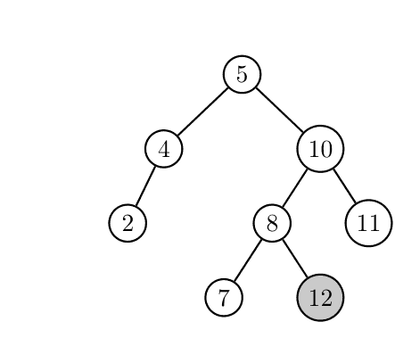


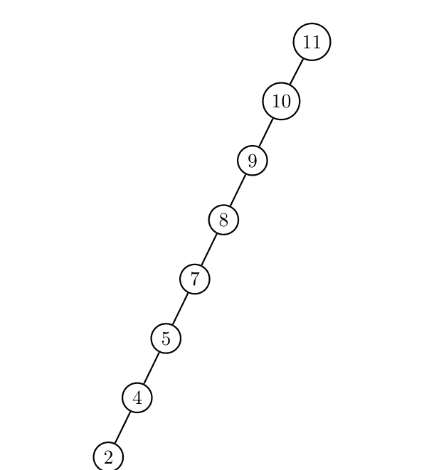

```

在我们的示例树中，访问顺序是: 7 3 8 1 9 4 0 5 2 6 中序遍历对于二叉树来说是最自然的。如果一个节点有超过2个子节点，就需要决定何时处理自己的数据。如果一个节点有d个子节点和d-1个数据片段（而不仅仅是一个），那么在子节点和数据片段之间交替处理是有意义的，事实上，我们稍后将在讨论2-3树时看到这一点。

### 21.4 搜索树

使得（二叉）树成为搜索树的关键属性是在每个节点v处都满足以下条件：设v节点中的键为k，T1和T2为v的左子树和右子树。那么，T1中的所有键都小于（或等于）k，而T2中的所有键都大于（或等于）k。

图21.2给出了一个用于说明这个概念的示例树：
图21.2：搜索树属性的示意图。该属性几乎在任何地方都得到满足。唯一的例外是标记为“12”的灰色节点。它位于标记为“10”的节点的左子树中，违反了左子树中所有键都小于节点本身键的属性。

让我们来看看如何在树中搜索一个值。假设我们要在以v为根的树中查找键k。有三种情况：

1. 如果树是空的（即空树），那么k不在树中，我们会报告（例如，使用异常）。
2. 如果v.data == k，则键在根节点，我们可以直接返回根节点。
3. 如果k < v.key，则搜索树属性保证k要么在v的左子树中，要么根本不在树中。因此，我们在左子树中递归搜索。
4. 在最后一种情况下，k > v.key，我们在右子树T2中递归搜索k。

注意这种搜索与二分搜索的相似性。我们重复查询“中间”值，然后决定在其中一个子部分中递归。事实上，从搜索树中很容易获得所有条目的排序数组：对树进行中序遍历。搜索树相对于排序数组的优势在于，我们可以每次只稍微调整树的结构，而不必为每次插入移动大量的项。因此，搜索树的搜索速度与二分搜索一样快（非常快），但是如我们稍后将看到的，插入和删除也非常快。

到目前为止，我们已经断言在搜索树中进行搜索是快速的，并且根据我们在图21.2中的示例，看起来确实如此。当我们对上述搜索算法进行分析时，我们发现每个步骤都需要恒定的时间，并且搜索级别增加一级。因此，搜索一个项目的时间为Θ(height(T))。每当高度较小，比如O(log n)，搜索树的性能就会很好。但是高度总是会很小吗？请看图21.3中的示例。

这棵树看起来根本不像一棵树 - 它基本上是一个链表。但是当然，从技术上讲，它是一棵树。它的高度是n，即元素的数量，因此搜索将非常慢。为了保持高度较小，理想情况下，我们的树应该是接近平衡的：对于任何节点，其子树的高度差不应该太大。这样，树将几乎看起来像一棵完全二叉树，并且很容易看出完全二叉树的高度为O(log n)。但是我们如何确保树保持相对平衡？我们很快就会学到 - 敬请关注。
图21.3：一个退化的搜索树。在这里，对数字“1”的搜索将花费与元素数量成线性关系的时间，因为它只会变成线性搜索。

## 第22章

### 优先队列和堆

[注意：本章涵盖约1个讲座的内容。]

在课堂上，我们之前已经看到了两种管理共享资源访问的简单结构：队列和堆栈。堆栈按照LIFO（后进先出）的顺序访问数据，与队列的FIFO（先进先出）顺序相反。在现实世界中，我们经常使用队列来实现某种公平性的概念，因为我们认为先到的人应该先得到服务。例如：

1. 餐厅或杂货店的排队队伍。当顾客到达时，我们希望对他们公平，所以我们按照他们到达的顺序为他们提供服务。
2. 操作系统。通常，当操作系统运行时，有不同的程序需要访问相同的资源（内存、处理器、打印机等）。也许，它们应该按照请求的顺序获得访问权限。

这些队列按照到达顺序处理项目，并且不自然地包含不同的优先级。例如，餐厅可能希望优先考虑已经预订的顾客。操作系统应该优先授予处理鼠标和键盘输入的代码更高的优先级，而不是一些长时间运行的科学计算。其他例子包括以下内容：

- 机场着陆权。有燃油不足或紧急情况的飞机应该具有高优先级进行着陆。提前到达的飞机可能会被给予较低的优先级。
- 医院急诊室访问。虽然一般来说，患者可能按照到达顺序进行处理，但是急需医疗救治的患者（枪击受害者？心脏病发作？）应该优先于骨折或高烧患者。

因此，我们希望有一种支持更灵活性的数据结构，即为项目分配优先级，并按照优先级顺序进行处理，同时添加和删除项目。

### 22.1 抽象数据类型：优先队列

优先队列是一种支持以下操作的数据类型。其关键能力包括：

1. 添加一个带有优先级的项目。
2. 返回当前存储的最高优先级项目。
3. 从队列中删除最高优先级的项目。（如果存在最高优先级的项目并列，则返回和删除的项目应该是相同的。）

请注意，没有办法返回或删除除最高优先级项目之外的任何项目。
优先队列有一个特定的目的，即按优先级处理项目；为了实现这个目标，不需要访问其他元素。这与队列和栈类似，我们只能一次访问或删除一个特定的项目。

为了找到最高优先级的项目，我们需要能够比较优先队列中存储的两个类型为 T的项目的优先级。有（至少）两种自然的实现比较的方式。

1. 数据类型 T本身允许对象的优先级比较，例如通过重载比较运算符。因此，对于任意两个对象T a, b，我们可以直接测试是否a < b，它返回它们优先级的比较结果。因此，优先级存储在对象内部。
2. 优先级被单独保留，例如作为整数。然后，当我们向优先级队列添加新项时，我们还需要告诉优先级队列项的优先级是什么。然后，队列需要为每个项存储两个东西：T数据和int优先级。通过这种方法，优先级仅在插入项时确定。

第一种方法可能更容易实现，但第二种方法可能更灵活。特别是，如果您希望在不同的上下文中使相同的项具有不同的优先级（想象一下将同时访问急诊室和餐厅的人，有或没有预约），则优先级不能是项本身的固有属性。

为了简化符号并专注于基本要点，这些讲义将以第一种方法呈现抽象数据类型，即我们假设 T重载比较运算符。
实际上，第二种方法可能是更好的选择。¹ 现在我们已经讨论了对象如何进行比较，我们可以明确规定ADT优先队列应该支持的函数：

```cpp
template <class T>
class PriorityQueue {
    void add (const T & item); // 向优先队列中添加一个项
    T peek() const;           // 返回最高优先级的项
    void remove();            // 移除最高优先级的项
    bool isEmpty();           // 判断优先队列是否为空
    void changePriority (T & data);
                // 改变一个项的优先级。
                // 教科书中没有包括这个，但它在许多应用中非常有用，我们稍后会看到}

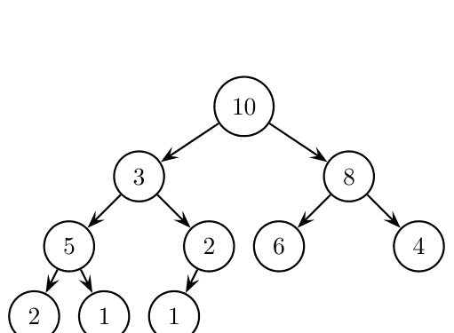

```

上面，我们讨论了航班降落权、医院急诊室和操作系统作为优先队列的一些应用领域。说实话，计算机科学家很少需要实现医院入院系统；即使在操作系统中，拥有处理进程优先级的最佳数据结构也不是特别重要——因为进程的数量并不多。

学习优先队列的真正原因是因为它们在搜索算法中的作用，这是人工智能和路线规划等应用中的关键部分。构建一个人工智能（对于许多游戏）通常涉及探索状态空间（对于游戏来说，这可以是所有棋子或角色所在的位置，它们的个体状态等）。有些状态是好的，有些是坏的，我们希望找到一种方法从当前状态到达一个好的状态。由于通常存在大量的状态，以智能的顺序探索它们至关重要 - 这就是像A*搜索和Dijkstra算法这样的算法所做的。它们为状态分配数值，并始终下一个探索最有希望的状态。从该状态，可能会发现几个新状态，并且根据其优先级考虑它们进行探索。

> 另一种方法，可能更好，是在类型为T的对象上实现一个单独的比较函数，并在初始化时将其传递给数据结构。可以通过传递指向比较函数的指针或Comparator对象来实现。

这个应用程序还建议了为什么一个函数`changePriority`可能会有用。例如，假设在到目前为止的探索过程中，你找到了一种方法让你的游戏角色到达某个地方，但代价是几乎失去了所有的能量。如果那个地方被怪物包围，现在探索可能就不值得了。但是假设通过探索其他东西，我们现在发现了一种方法，可以在几乎保持所有能量的情况下到达同样的地方。现在，从那个状态开始探索应该具有更高的优先级，因为它看起来更有希望。换句话说，我们现在想要改变这个状态的优先级。

正如我们上面讨论的，根据我们对应用程序的思考方式，我们可以将优先级视为一个项目固有的属性，或者仅在将项目添加到数据结构时确定。在前一种情况下，优先级在项目创建时分配，而在后一种情况下，它在调用 `add`时分配。

一个自然的问题是，我们是否应该允许优先级队列中同时存在具有相同优先级的项目。如果允许，那么无法保证`peek`返回的是哪一个（并且由`remove`删除的是哪一个，尽管通常情况下，你希望保证是同一个）。毕竟，如果它们具有完全相同的优先级，根据定义，它们每个都同样重要。如果这不是你想要的，那么你应该修改优先级的定义，以按照你想要的方式解决冲突。例如，如果你想按照先进先出的顺序解决冲突，那么优先级应该是一个对（原始优先级，添加时间）的组合，如果项目 `a`具有更高的优先级，或者具有相同的原始优先级并且更早的添加时间，则优先级比项目 `b`更高。

### 22.2 优先队列的简单实现

请注意，即使“优先级队列”中有“队列”一词（因为存在一些概念上的相似之处），将其实现为队列也不是一个好主意；事实上，甚至不清楚如何实现。

两种简单的实现方式是使用（未排序或已排序的）链表或数组。对于链表或未排序数组（或 `List`类型），实现如下：

添加：将项目添加到链表的尾部或头部，或添加到数组的末尾。这需要Θ(1)的时间。

查找：要返回最高优先级的元素，我们现在必须搜索整个数组或列表，因此需要Θ(n)的时间。

删除：要删除最高优先级的元素，我们首先必须找到它（线性搜索）。在数组中，我们还必须移动数组内容以填充空隙。因此，这需要Θ(n)的时间。

因此，链表或未排序数组非常适合插入元素，但不适合查找高优先级元素（或删除它们）。另一种选择是按优先级对数组（或 `List`或链表）进行排序，将最高优先级放在数组的末尾。然后，实现方式如下：

添加：在数组或列表中使用二分搜索查找正确的位置（`O(log n)`），在链表中使用线性搜索。找到正确的位置后，在那里插入元素。在数组中，这涉及将插入元素右侧的所有元素向右移动一个位置。因此，在任何情况下，成本为Θ(n)。

查看：返回最后一个元素，因此运行时间为Θ(1)。

删除：删除最后一个元素，例如通过减少 `size`计数器，因此需要Θ(1)的时间。

因此，排序的数组或链表在查找和删除高优先级元素方面速度很快，但以线性插入成本为代价。

### 22.3 使用堆实现

“排序数组”实现优先级队列朝着正确的方向发展：通过将最高优先级的元素放在指定位置，确保我们可以轻松访问它。但除此之外，它还有一些缺点。

过度杀伤。仅仅为了访问最高优先级的元素，并不需要保持数组完全排序 - 只需要它“有点”排序，这样在移除最高优先级元素后，下一个元素可以从少数几个备选项中找到。

这正是堆的巧妙思想所在。² 堆是一种具有以下附加关键属性的完全二叉树：

堆属性：对于每个节点 \( u \)，其内容的优先级至少与所有子节点的优先级一样高。³
图22.1：最大堆的堆属性示例。给定的树是一棵完全二叉树。它在除一个节点外的所有节点上都满足堆属性：具有优先级3的节点有一个子节点（其左子节点）具有优先级5，这是不应该发生的。请注意，对于任何节点来说，它的哪个子节点具有更高的优先级并不重要，只要两个子节点都不比节点本身的优先级高即可。

请注意，当我们使用堆实现优先队列时，我们有责任确保树保持完全二叉树，并且保持堆属性。

我们之前提到过，堆应该是一个完全二叉树。这意味着所有叶子节点之间的层级差最多为1，并且最底层的叶子节点尽可能靠左。正如我们在之前的讲座中讨论的那样，这意味着堆可以很容易地存储在一个数组中。为了将根节点放在0位置，而不是1（之前的做法），现在对于任意节点 \( i \)，其父节点位于数组索引 \( \lfloor (i-1)/2 \rfloor \)，而子节点位于 \( 2i+1 \) 和 \( 2i+2 \)。（当我们从1开始标记时，父节点位于 \( \lfloor i/2 \rfloor \)，子节点位于 \( 2i \) 和 \( 2i+1 \)。）

我们现在可以开始实现优先队列的函数了。我们假设二叉树存储在一个数组 a 中，根节点在 a[0] 位置。变量 size 记录当前存储在数组中的元素数量，所以初始值为0。我们不用担心超出数组大小的问题 - 这可以通过使用我们的 List<T> 数据类型来解决，而不是实际的数组。

Peek：这非常简单，因为最高优先级的元素总是在根节点上。

```cpp
T peek() const { return a[0]; }
```

Add：当我们添加一个元素时，我们首先要考虑在哪里添加它。由于我们想要保持“完全二叉树”的特性，实际上只有一个位置可供选择：作为一个新的叶子节点，尽可能靠左。（在数组位置上，这意味着将其插入到 a[size] 位置。

但是，如果新添加的元素具有更高的优先级比其父节点高，则将其插入那里可能会违反堆属性。因此，在添加元素后，我们需要修复堆属性。我们通过交换来实现。

² 数据结构 heap 只与用于分配对象的堆内存共享名称；不要混淆两者。
³ 如果我们使用整数优先级构建堆，则由我们决定较大还是较小的整数编码较高的优先级。将最小的数字放在顶部的堆称为最小堆，将最大的数字放在顶部的堆称为最大堆。显然，通过切换比较运算符或将所有数字乘以-1，很容易从一个堆变为另一个堆。

如果需要，将其与其父节点交换，并继续在该节点上进行，使元素“向上滴落”，直到其实际具有低于其父节点的优先级，或达到根节点。这给我们带来了以下结果：

```cpp
void add (const T & data)
{
    size++;
    a[size-1] = data;
    trickleUp(size);
}
```

```cpp
void trickleUp (int pos)
{
    if (pos > 0 && a[pos] > a[(pos-1)/2])
    {
        swap (a, pos, (pos-1)/2);
        trickleUp((pos-1)/2);
    }
}
```

删除：在尝试删除最高优先级的元素时，我们的第一个想法可能是从数组中直接删除该元素。但是，没有根节点就无法构成树。这可能会建议我们将根节点填充为具有较高优先级的子节点之一，然后在子节点上递归。这种方法的问题是，当我们到达树的最低层时，我们可能会将一个叶子节点从“中间”交换上来，即违反了“完全二叉树”属性的一部分，该属性要求叶子节点尽可能靠左。

一种改进的方法是将最后一个叶子的内容移动到根节点中。这样，我们就知道正在移动的叶子是哪一个。剩下的部分，我们只需要进行交换操作，将这个新的根节点向下传递到它实际属于的位置。这给我们带来了以下解决方案。

```cpp
void remove ()
{
    swap (a, 0, size-1); // 将最高优先级的元素与最右边的叶子进行交换
    size --;             // 我们希望将前一个根节点视为“已删除”
    trickleDown (0);     // 向下传递，使前一个叶子去到它应该去的地方
}
```

```cpp
void trickleDown (int pos)
{
    if (pos不是叶子节点)           // 实现测试为 2*pos+1 < size
    {
        i = 优先级最高的子节点的位置:
        // 如果只有一个子节点，返回该子节点。
        // 否则，使用比较来确定哪个子节点具有最高优先级
        if (a[i] > a[pos])
        {
            交换 (a, i, pos);
            下滤 (i);
        }
    }
}
```

### 22.4 优先队列操作的运行时间

接下来，我们分析优先队列操作的运行时间。由于交换、已知位置的数组访问、返回等操作都是常数时间，我们得出 peek() 的运行时间为 Θ(1) ——毕竟，最高优先级的元素已知在根节点上。对于 add() 和 remove()，除了下滤 (trickleUp()) 和上滤 (trickleDown()) 之外，其他操作都是常数时间，因此我们只需要分析这两个函数的运行时间。

在这两种情况下，函数中都会进行一定量的工作 (上滤 (trickleUp()) 或下滤 (trickleDown())) ，然后使用下一个更高或更低级别的节点进行递归调用。因此，工作量为 Θ(树的高度)。 所以我们的目标现在是确定一个具有 n 个节点的完全二叉树的高度。 我们将通过首先解决逆问题来实现：高度为 h 的完全二叉树中的最小节点数是多少?

为了使树的高度为 h，我们必须至少在第 h - 1 层上有一个节点。 每个位于层次 i=0，...， h -3 层至少有两个子节点。 因此，节点数量从一层到另一层翻倍，我们在每个层次 i < h - 1 有 2^i 个节点，并且在第 h - 1 层至少有一个节点。 将它们在所有层次上求和，得到的结果是 1 + Σ_{i=0}^{h-2} 2^i = 1 + (2^{h-1} - 1) = 2^{h-1}。 我们计算的这个和是一个几何级数，作为计算机科学家，这是你必须掌握的一种级数。

所以现在，我们知道一个有 h 层的树至少有 2^{h-1} 个节点，所以当 n ≥ 2^{h-1} (因为树有 h 层) 时，我们可以解出 h 并得到 h ≤ 1 + log_2(n) = Θ(log n)。 所以我们证明了一个有 n 个节点的完全二叉树的高度为 Θ(log n)。

将它们放在一起，我们得到 add() 和 remove() 的时间复杂度为 Θ(log n)。 现在我们可以创建一个表格，记录不同实现所需的时间。

|      | 未排序数组 | 排序数组 | 堆       |
| ---- | ---------- | -------- | -------- |
| 添加 | Θ(1)       | Θ(n)     | Θ(log n) |
| 查看 | Θ(n)       | Θ(1)     | Θ(1)     |
| 删除 | Θ(n)       | Θ(1)     | Θ(log n) |

表22.1: 优先队列实现的比较。

对于我们在这门课上见过的其他任务，对于“哪种数据结构最好？”的通常答案是“取决于情况”。但在这里，情况并非如此。 堆显然是实现优先队列的最佳数据结构。 虽然在单个操作上，未排序数组和排序数组中的某一个可能会胜过堆，但对于优先队列，每个元素通常只插入一次，删除一次，并在删除之前查看一次。 因此，一系列的插入、查看和删除操作对于其他数据结构来说需要 Θ(n^2)，而对于堆来说只需要 Θ(n log n)，速度更快。

### 22.5 堆排序

现在我们有一个实现了 add, remove 和 peek 的 ADT，时间复杂度为 O(log n)。 我们已经知道了哪些算法，我们想要重复地找到最大的元素然后将其删除吗？
确实，我们知道。 如果我们回顾一下几周前的选择排序，我们可以描述如下⁴:

```
for (int i = n-1; i > 0; i --)
{
    令 j 是 a 在 0 和 i 之间的最大元素;
    a.swap (i,j);
}
```

⁴当时，我们描述它为重复地找到最小的元素并将其放在数组的开头。 等价地，我们可以重复地找到最大的元素并将其放在数组的末尾。

以前，我们运行一个循环来找到 $j$。但是现在，我们有了更好的方法。我们可以首先将数组的所有元素放入最大堆中。由于有 $n$ 个元素，并且每个元素最多需要 $O(\log n)$ 的时间来添加，所以这需要时间 $O(n \log n)$。（前几个实际上需要更少的时间，因为堆几乎是空的；但对于大多数元素来说，它仍然是 $\Theta(\log n)$，所以我们无法改进分析。）然后，我们可以重复地找到最大的元素并将其放在最终位置。找到它的时间复杂度为 $O(1)$，删除它的时间复杂度为 $O(\log n)$，由于我们这样做了 $n - 1$ 次，整个过程的时间复杂度也是 $O(n \log n)$。这个算法被称为堆排序，它是一种非递归的 $O(n \log n)$ 算法，非常酷。（我们递归地实现了 trickleDown 和 trickleUp，但它们也很容易以迭代的方式实现。）

当你看到它时，你会意识到你实际上可以将数组本身用作堆。你可以从 $n - 1$ 到0调用 trickleUp 来开始。之后，数组满足堆的性质。
然后，我们将位置0与 $n - 1$ 交换，并将 size 减一，然后从0开始向下滴落。我们重复这个过程 - 每次，我们都将一个更多的元素放在其最终位置，并告诉堆它现在“拥有”数组的一个更少的元素。所以我们甚至不需要任何额外的内存或数据结构。

顺便说一句，明显的实现中 HeapSort 不稳定，因为堆对数组索引给予了非常不同的解释。使其稳定需要至少一点额外的内存 $\Theta(n)$，即基本上是数组的另一个副本。

# 第23章
# 2-3树

[注意：本章涵盖约1个讲座的内容。] 在接下来的几章中，我们将学习两种常见的实现映射的方式：搜索树和哈希表。请记住，在映射中，我们存储键和值之间的关联。我们需要能够插入和删除这样的关联，并查找给定键的关联值。我们已经在第21.4节中简要预览了搜索树。在那里，我们只显示了图形表示中的键。

在本章和下一章中，我们将做同样的事情。然而，尽管我们在图表中只显示键，但暗示着对于每个键，也有一个关联的值存储，并且查找这个值实际上是研究树的主要原因。

此外，对于映射，通常假设每个键只能有一个副本。如果您明确希望有多个相同的键副本，您可以称之为多映射。这会使一些实现细节变得更加混乱，我们希望在这里专注于基本要点。因此，从现在开始，在我们的所有示例中，键之间不会有重复的可能性。

### 23.1 基础知识

虽然许多搜索树（包括我们在第21.4节中介绍的示例）是二叉树，但我们在这里深入分析的树不是二叉树。2-3树与二叉搜索树的不同之处在于每个节点包含1或2个键。除非它是叶子节点，一个具有1个键的节点恰好有2个子节点，一个具有2个键的节点恰好有3个子节点。这可以进一步推广：我们可以构建具有 m 个键的树，其中每个非叶子节点有 m+1 个子节点。我们稍后将看到2-3-4树（其中节点具有1-3个键），实际上，使用节点具有几百或几千个键的树是有原因的。

此外，我们稍后将看到，在向2-3树添加键的临时步骤中，有时会有具有3个键和4个子树的节点；同样，在删除键的过程中，有时会出现具有0个键和一个子树的节点。

我们很快就会看到这些异常。2-3树的定义特性如下：

+   所有叶子节点必须在同一层级上。
+   对于只有一个键 k 的节点，二叉搜索树的特性成立：左子树中的键都小于 k，右子树中的键都大于 k。
+   对于有两个键 k1<k2 的节点，三个子树 T1，T2，T3 满足以下特性：
    1.  所有 T1 中的键都小于 k1。
    2.  所有 T2 中的键都严格位于 k1 和 k2 之间。
    3.  所有 T3 中的键都大于 k2。

在构建这些树的过程中，我们的任务是确保定义特性始终成立。 稍后我们将看到如何做到这一点。 我们还将看到如何进行搜索，以及为什么树的深度是 $O(\log n)$。为了实现2-3树，我们需要一个稍微修改过的节点版本，以适应多个键和值。该类的结构如下：

```
template <class KeyType, class ValueType>
class Node {    // 变量可以是公共的，也可以添加getter/setter
    int numberKeys;
    KeyType key[2];      // 为2个键预留空间
    ValueType value[2]; // 为相应的值预留空间
    Node* subtree[3];    // 指向最多3个子树的指针
}
```

在内部，用动态内存结构和指针存储2-3树可能是最好的方法，将根指针存储在某个地方。 最初，当树为空时，我们可以将根指针设置为 NULL。 随着插入的发生，树的节点数量和高度都会增长，所以显然，我们不希望提前固定它的大小。

我们也可以尝试将树存储在数组中（就像我们对优先队列所做的那样），但会失去所有这样做的优势，因为不再可能进行索引计算。当树是完整的和二叉的时候，很容易找出给定节点的子节点是哪些，但在这里，它将取决于许多其他节点的度数，这将花费太长时间来查找。

### 23.2 搜索和遍历

关于2-3树的第一个有用观察是，就像其他搜索树一样，它们使得搜索关键字和按排序顺序输出所有关键字变得非常容易。
要搜索一个关键字，我们只需将二叉树的搜索过程推广即可。当请求一个特定的关键字，并且我们在具有给定根节点的子树中搜索时，我们将关键字与 r->key[0]（以及 r->key[1]，如果 r 有两个关键字）进行比较。如果找到了关键字，那就太好了。否则，我们可以确定递归搜索哪个（或三个）子树。代码如下所示：

```
ValueType search (KeyType key, Node *r) const
{
    if (r == NULL) throw KeyNotFoundException;
    else {
        if (key < r->key[0]) return search (key, r->subtree[0]);
        else if (key == r->key[0]) return r->value[0];
        else if (numberKeys == 1 || key < r->key[1]) return search (key, r->subtree[1]);
        else if (key == r->key[1]) return r->value[1];
        else return search (key, r->subtree[2]);
    }
}

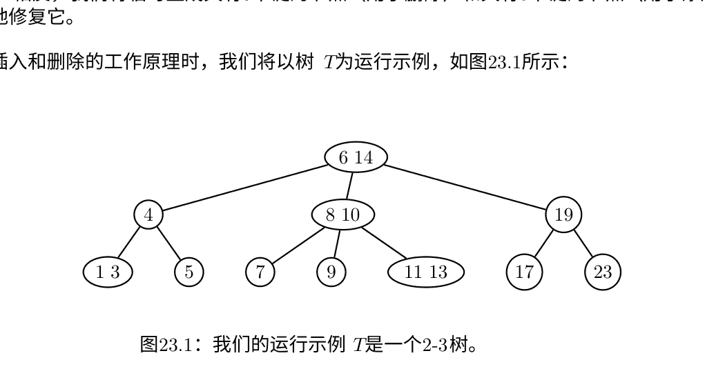


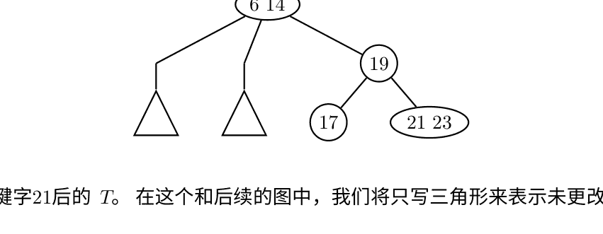


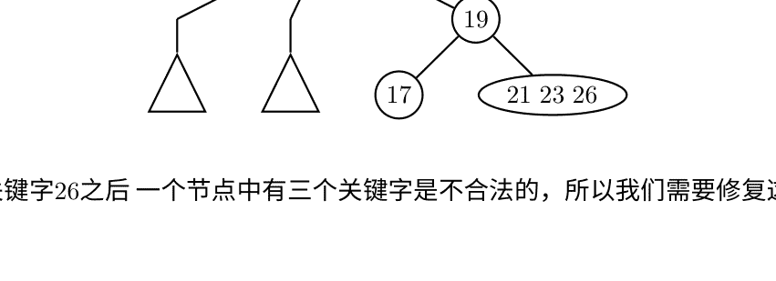


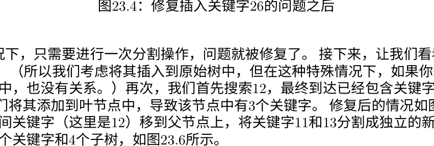


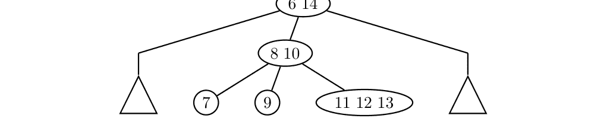


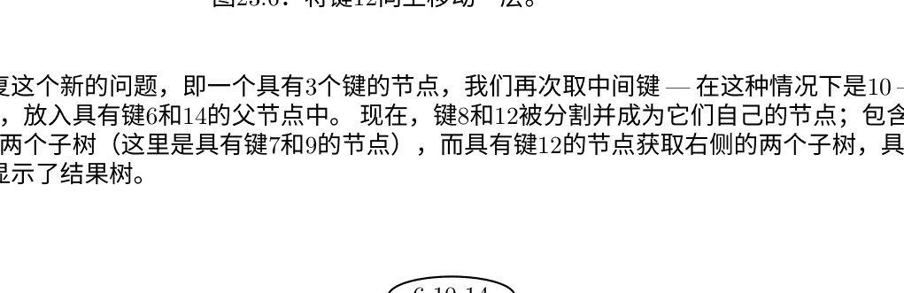


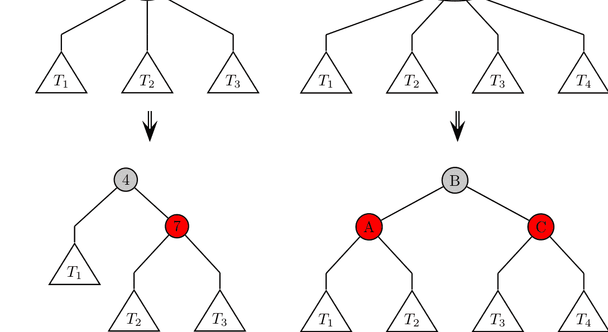


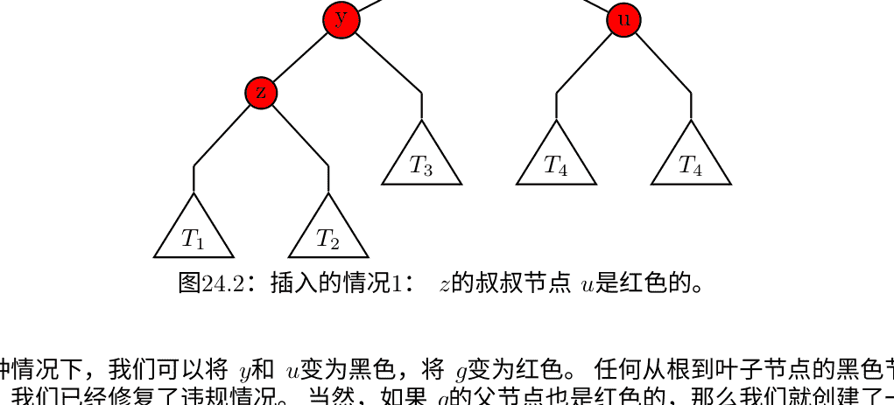


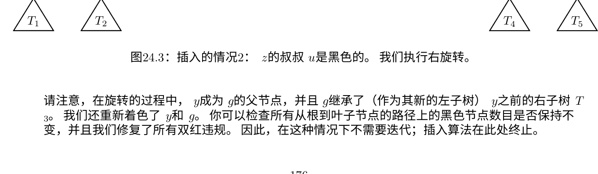


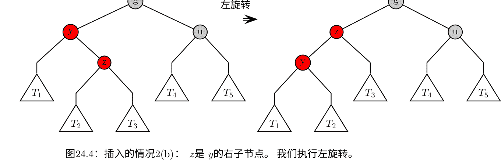


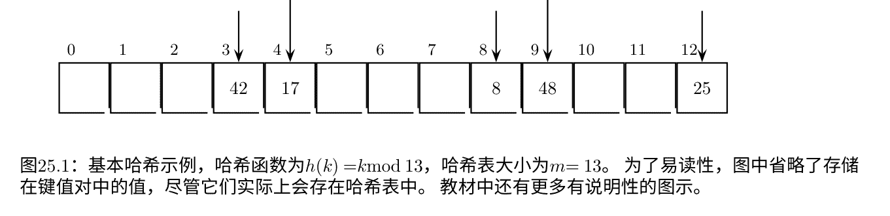


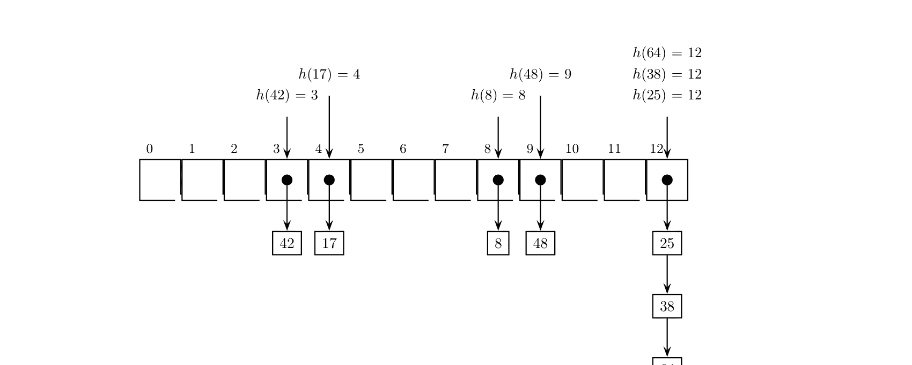


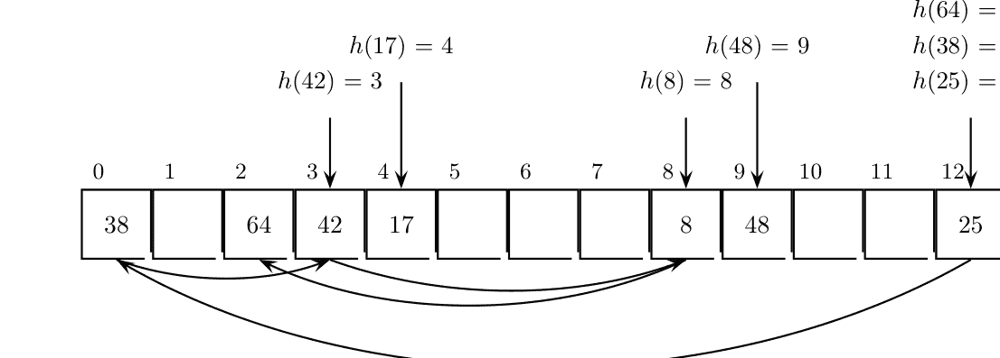


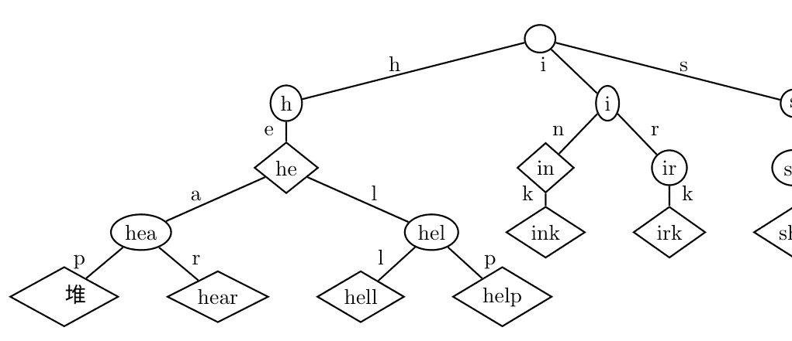


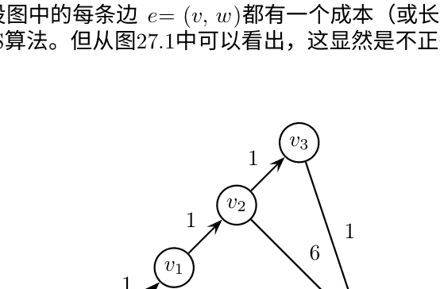

```

为了按排序顺序遍历所有的键，我们只需使用深度优先中序遍历（见第21.3节）。也就是说，在任何节点上，我们首先递归访问整个左子树，然后是键（或左键，如果存在两个），然后是中间树（如果存在），右键（如果存在），最后是右子树。这是从二叉树到2-3树的中序遍历的自然推广。

这描述了如何在搜索树上实现有序迭代器。这是搜索树作为地图数据结构相对于哈希表的主要优势之一。对于哈希表来说，实现高效的迭代器要困难得多。（哈希表有其他优势来弥补。）

### 23.3 插入和删除键：概述

在实现2-3树上的插入和删除时，我们应该记住以下几点：

+   在操作完成后，2-3树的属性必须始终保持，以保持树的平衡。因此，我们必须确保所有叶子节点位于同一层级，两个键的节点有三个子节点，一个键的节点有两个子节点，并且一个节点中不能有除了1或2个键之外的任何数字。
+   在搜索树中，所有插入和删除通常（对于2-3树来说绝对）发生在叶子节点上；这比在内部节点上进行更容易处理。
+   通常，除了添加或删除键之外，还需要预处理（用于删除）和/或后处理（用于恢复各种属性）。

更具体地说，我们发现对于优先队列，插入或删除键的方法是暂时违反堆属性，然后使用递归函数修复它。对于2-3树，我们将做同样的事情。

在做这样的过程中，我们将永远不会违反第一个属性（所有叶子在同一层级）；恢复这个属性将非常困难。相反，我们将临时生成具有0个键的节点（用于删除）和具有3个键的节点（用于添加），然后系统地修复它。

在解释插入和删除的工作原理时，我们将以树 T 为运行示例，如图23.1所示：
### 23.4 插入键

每当我们向树中插入一个键（或者更准确地说，一个键值对），我们首先进行搜索，当然是不成功的。（如果我们找到了它，那就是一个重复项，所以我们会抛出异常或者以其他方式表示该键已经在映射中。）然后将其插入到搜索终止的叶子节点中。如果叶子节点之前只有一个键，现在就有两个键了，一切都很好。但是，如果叶子节点已经有两个键，那么现在就有三个键了，所以我们需要修复它。我们将通过观察向我们的示例树 T 插入多个键的效果来看如何修复它。

首先，让我们来看一下将21插入到 T 的情况。为了做到这一点，我们搜索21。当我们这样做时，我们将在已经包含关键字23的节点处终止。这个叶节点只有一个关键字，所以我们可以简单地添加21。结果只会产生局部变化，我们的树现在看起来如图23.2所示：

这很容易。当然，我们不总是那么幸运能够插入到只有一个关键字的节点中。所以接下来，让我们看一下在插入21后得到的树中插入26时会发生什么。关键字26也属于具有21和23的节点，所以当我们将它添加到节点中时，该叶节点现在包含三个关键字，如图23.3所示：
图23.2: 在插入关键字21后的 T。在这个和后续的图中，我们将只写三角形来表示未更改或不特别有趣的部分。
图23.3: 插入关键字26之后 一个节点中有三个关键字是不合法的，所以我们需要修复这个问题。

为了修复这个问题，我们可以将一个有3个关键字的节点分割，将其中间的关键字移到父节点上，并将另外两个关键字分别变成只有一个关键字的节点。在我们的例子中，23被移到了当前只包含关键字19的节点中，将其变成了一个包含19和23的节点。另外两个元素，21和26，被分割成两个独立的节点（因为父节点现在是一个有两个关键字的节点，所以它可以支持三个子节点），并且这些节点成为包含19和23的节点的子节点。修复后的树如图23.4所示。
图23.4: 修复插入关键字26的问题之后

所以在这种情况下，只需要进行一次分割操作，问题就被修复了。 接下来，让我们看看当我们将12插入到T中会发生什么。（所以我们考虑将其插入到原始树中，但在这种特殊情况下，如果你想将其插入到已经插入了21和26的树中，也没有关系。） 再次，我们首先搜索12，最终到达已经包含关键字11和13的叶节点。 再次，我们将其添加到叶节点中，导致该节点中有3个关键字。 修复后的情况如图23.5所示。 与之前一样，我们将中间关键字（这里是12）移到父节点上，将关键字11和13分割成独立的新节点。 但是现在，父节点有3个关键字和4个子树，如图23.6所示。
所以我们需要修复这个问题。
为了修复这个新的问题，即一个具有3个键的节点，我们再次取中间键 — 在这种情况下是10 — 并将其向上移动一层，放入具有键6和14的父节点中。现在，键8和12被分割并成为它们自己的节点；包含8的新节点获取左侧的两个子树（这里是具有键7和9的节点），而具有键12的节点获取右侧的两个子树，具有键11和13。图23.7显示了结果树。
现在，我们又将问题向上移动了一层。根节点现在包含三个键6、10和14。所以我们做同样的事情：将中间键（这里是10）推到上一层，并将另外两个键分割成单独的节点，每个节点继承两个子树。结果显示在图23.8中。此时，我们最终获得了一个合法的2-3树，并且过程终止。请注意，我们现在增加了树的高度。有些学生在课堂上想知道，如果我们总是在叶子节点插入，树怎么可能增长高度。现在我们知道了。它在根部增长，即使插入发生在叶子节点。

需要记住的重要事情是，每当一个节点有太多的键时，你将中间的键移到父节点，并将剩下的两个键分成两个新的节点。左节点继承了两个左子树，而右节点继承了两个右子树。

下面是伪代码，帮助你理解如何一般性地插入2-3树。

### 插入一个新的键

-   1. 搜索键。如果找到了，处理重复键。
    否则，我们已经找到了键所属的叶子节点。
-   2. 将键插入到叶子节点。
    如果叶子节点之前只有一个键，现在我们已经完成了。
-   3. 否则，我们现在必须修复叶子节点。

### 修复一个有3个键（a b c）的节点：

-   1. 如果有父节点，将b移到父节点中。
    （否则，为树创建一个新的根节点，只包含b。）
-   2. 创建一个只有a作为键的节点，并将其作为b节点的左子节点。
-   3. 创建一个只有c作为键的节点，并将其作为b节点的右子节点。

注意，按照我们定义的插入方式，它保持了2-3树的特性：在创建新的根节点时，所有子树的层数同时增加一层，而对于任何其他节点，层数不增加。

让我们尝试分析运行时间。找到正确的叶节点需要$\Theta(h)$的时间，其中 $h$是树的高度。实际将键插入树中只需要$\Theta(1)$的时间。将任何三键节点分解为新的较小节点需要$\Theta(1)$的时间，并且我们最多需要对树的每一层执行一次此操作，因此需要$\Theta(h)$的时间。

接下来，我们想要计算2-3树的高度。我们可以像之前计算树高度一样进行。如果树的高度为 $h$，因为所有叶节点位于同一层，并且每个内部节点至少有2个子节点，它至少具有与完全二叉树相同层数的节点数（加上一个），这给出了树高的上界$\log_{2}(n)$，就像我们之前在堆的上下文中计算的那样。另一方面，具有最大度数3的 $h$层树在第0层最多有$1$个节点，在第1层有3个节点，在第2层有9个节点，一般地，在第$k$层有$3^k$个节点，总共最多有 $\sum_{k=0}^{h-1} 3^k = \frac{3^h - 1}{2}$个节点。

，给出了 $h \geq \log_{3}(2n) \geq \log_{3}(n)$。因此， $h$在$\log_{3}(n)$和$\log_{2}(n)$之间，并且这两个数在彼此之间相差不大。因此，插入的运行时间为$\Theta(\log(n))$。 （我们可以忽略对数的底数，因为它们只相差常数因子。）

### 23.5 删除键

要从2-3树中删除一个键（及其值），我们当然首先要找到它。一旦我们找到了这个键，从内部节点中删除它将会非常复杂。因此，在2-3树（以及几乎所有搜索树）中，我们总是首先确保只从叶节点中删除键。为了做到这一点，我们要搜索下一个较大的键（或者可能是下一个较小的键，但为了具体起见，我们将坚持使用下一个较大的键）。这是通过首先沿着要删除的键右边的边下降来实现的。（也就是说，如果键是左键，则是中间边，如果键是右键，则是右边。）然后，我们总是沿着所有节点的最左边的边下降，直到我们到达一个叶节点。在那一点上，该叶节点中最左边的键就是后继键。

一旦我们找到了后继节点，我们就将其与我们想要删除的键进行交换。这样做是安全的，因为没有其他元素可能会错位 - 所有右子树中的元素都大于后继节点。现在，我们想要删除的键位于叶子节点中，我们可以从那里开始。删除算法将从叶子节点开始删除一个键，然后可能向上传播必要的修复操作。到目前为止，最简单的情况是叶子节点包含两个键。然后，我们只需删除该键，然后完成操作。

否则，我们现在有一个不包含键的叶子节点。我们不能只删除叶子节点，因为这将违反所有叶子节点在同一层级的2-3树属性。因此，我们需要找到修复树的方法。我们在叶子节点级别和更高级别执行的操作是相同的，因此我们将更一般地描述问题情况。

当我们需要修复某个东西时，我们有一个内部节点，没有键，只有一个子树挂在上面。在基本情况下，这个子树只是 NULL，但是随着我们向上传播（递归或迭代），会有其他子树。因此，问题的情况如图23.9所示。（黑色节点没有键，下面只有一个子树，对于叶子节点来说是空的。）

为了处理这个问题情况，我们根据空节点有多少个邻居以及它们各自有多少个键来区分几种情况。

-   1. 如果空节点有一个有两个键的兄弟节点，那么该节点可以从兄弟节点借一个键。这种情况的一个典型版本如图23.10所示：
    如果空节点有两个兄弟节点，情况类似。当紧邻的兄弟节点有两个键时，我们可以做同样的事情（将兄弟节点的一个键推到父节点，将父节点的键推到空节点）。当相隔两个节点的兄弟节点有两个键时，我们将一个键向上推，将父节点的键推到中间子节点，将中间子节点的键推到父节点。
-   2. 如果空节点的兄弟节点没有两个键，那么下一个情况是空节点有两个兄弟节点（即父节点有两个键）。在这种情况下，空节点可以从父节点借用一个键，借助于兄弟节点的帮助。典型情况如图23.11所示。
    如果不是右子节点，而是父节点的中间或左子节点为空，那么情况基本相同。
-   3. 最后一种情况是空节点只有一个兄弟节点，并且该兄弟节点只包含一个键。在这种情况下，我们无法立即解决问题。相反，我们将合并父节点和

将两个键合并为一个节点，并将空节点上移一级，我们将在那里尝试解决它。因此，这是我们需要递归（或迭代方法）的唯一情况，而其他情况都可以立即解决问题。这种情况如图23.12所示。

-   4. 最后一种情况。如果空节点现在是根节点，则可以安全地删除它。它的一个子节点（T的根节点）成为树的新根节点，树的层级减少了一级。

这涵盖了所有情况；每种情况都有一些子情况，取决于哪个子节点为空，但它们都遵循相同的模式。

请注意，这些操作仔细地保持了所有属性：叶子节点保持在相同的层级，每个节点在解决问题后都有一个或两个子节点，并且树仍然是一个2-3搜索树。

#### 23.5.1 详细说明

为了说明如何应用上述规则，让我们从示例树中删除一些键 T，但同时添加了另一个键16。结果树如图23.13所示。

现在，让我们看看当我们想要删除键14时会发生什么。正如我们之前提到的，从内部节点中删除键是一件非常麻烦的事情，所以我们将14与其后继者16进行交换（向右走一次，然后向左走）。将14（要删除的键）与其后继者16进行交换的结果如图23.14所示。

现在，可以安全地从叶子节点中删除该键。请注意，这保持了搜索树的属性，因为后继者可以安全地取代我们要删除的键。现在，删除14的结果如图23.15所示。

删除键14非常容易：交换后，其叶节点包含两个键，这使得删除键变得安全。接下来，让我们看看如果删除键5会发生什么。那个键在一个节点中，所以在我们删除它之后，我们有一个空的叶节点。这种情况如图23.16所示。在这里，空节点有一个具有两个键1和3的兄弟节点，所以我们可以应用上面列表中的第一条规则。在这种情况下，我们可以将键从父节点移到节点中，将兄弟节点中的一个键移到父节点中。结果是图23.17中的树：

接下来，让我们看看当一个节点有两个兄弟节点，并且具有两个键的兄弟节点是最远的时候，从兄弟节点借用键是如何工作的。为了看到这一点，让我们看看如果我们接下来删除键7会发生什么。中间阶段如图23.18所示。

这次，从兄弟节点借用一个键仍然有效，但需要进行更多的中间步骤。我们仍然处于第一种规则情况下，但它的工作方式有些不同。来自兄弟节点的键11被移动到上方

父节点；从父节点移动键10到另一个兄弟节点，同时从另一个兄弟节点移动键9到父节点。最后，我们可以将键8移动到空节点。结果只在局部重新排列，并显示在图23.19中。

接下来，让我们看看当没有兄弟节点可借用时会发生什么。为了看到这一点，我们接下来删除键8。结果树显示在图23.20中。

现在，我们不能直接从兄弟节点借用。但是在这里，幸运的是，空节点有一个带有两个键的父节点，所以可以应用第二条规则，从父节点借用一个键，再从相邻的兄弟节点借用另一个键。图23.21显示了结果树。

接下来，让我们看看从树中删除键17的效果。删除的第一步在图23.22中显示。

现在，在这个层级上没有简单的方法来解决问题：我们必须应用第三条规则，将问题升级一级。为此，我们将父节点中的一个键与兄弟节点中的一个键组合成一个具有两个键的节点，并使父节点为空。换句话说，我们得到了图23.23所示的树：

在更高的层次上，我们现在有一个具有两个键的父节点，因此我们可以应用第二条规则并从父节点借用来解决问题，得到图23.24所示的树。

当然，我们有点幸运-如果父节点只有一个键，我们可能不得不将问题传递给更高的层次，可能一直传递到根节点。 然而，一旦根节点为空，就可以安全地删除它（第四条规则），从而将树的高度减少1。

#### 23.5.2 运行时间

当我们看运行时间时，我们发现重新排列树只是在节点之间移动常数个指针和键（和值）。因此，上述所有操作的时间复杂度为 $O(1)$。如果我们应用规则1、2或4，那么时间复杂度为 $O(1)$。在第3种情况下，我们可以继续迭代或递归，但是每个层次的树最多执行一次重新排列操作。 由于我们已经计算出2-3树最多具有 $\log_2(n)$ 层次，因此每个操作的运行时间为 $O(\log n)$。因此，总结起来，

我们得到使用2-3树时，所有操作的时间复杂度为\(\Theta(\log n)\)。 （构造需要在插入或删除时向上传播所有层级的树并不困难。）
对于许多数据结构，我们说选择哪个取决于上下文。 普遍认为，搜索树（以及我们接下来要介绍的哈希表）比基于数组、向量或列表的字典实现更好。 如果你需要一个关联结构，请不要使用线性结构 - 使用树或哈希表。

## 第24章 通用B树和红黑树

> [注意：本章涵盖约1个讲座的内容。]

### 24.1 更通用的B树

我们刚刚看到2-3树是B树的一种特殊情况。原则上，我们可以实现具有几乎任意组合的B树，每个节点中的键的数量都有上下界限制。一般来说，我们可以使每个节点至少有b个子节点（因此有b-1个键），最多有b'个子节点（因此有b'-1个键），只要b'≥2b-1。

让我们看看为什么是这样，并且这个b'≥2b-1的限制是从哪里来的。首先，当然，我们需要允许一些特殊情况。如果我们选择b=5，但是我们的树总共只包含2个键，那么我们不能让每个节点至少包含4个键。所以我们允许一个节点少于最小键数。

在一般的B树中搜索是2-3树搜索的明显推广。当在以u为根的树T中查找一个键时，我们使用线性搜索将其与u中的所有键进行比较。如果找到了，那就太好了。如果没有找到，我们至少已经确定了两个连续的键$k_i < k_{i+1}$，使得$k_i < key$且$k_{i+1} > key$。然后，我们知道我们需要递归地在子树$T_{i+1}$中进行搜索。

要插入，与之前一样，我们找到键应该插入的位置，并将其插入到该叶节点中。如果键的数量仍然最多为b'-1，那么我们就完成了。但是如果键的数量现在是b'，即太大了，我们需要拆分节点。我们将其分成两个节点，每个节点具有$\lfloor(b'-1)/2\rfloor$和$\lfloor b'/2 \rfloor$个键，同时将中间键传递给父节点。然后，我们对父节点进行递归或迭代，就像对2-3树一样。现在，我们也可以看到为什么需要$b' \geq 2b-1$。毕竟，从拆分中创建的两个新节点必须是合法的，所以我们需要$b-1 \leq \lfloor(b'-1)/2\rfloor$，这由$b' \geq 2b-1$保证。

要删除一个键，我们需要执行与2-3树相同的初始步骤，即如果需要的话交换键，然后从节点中删除一个键。删除后，当一个节点的键过少时，情况就变得困难了。在这种情况下，我们会尝试从兄弟节点、父节点或合并父节点与兄弟节点并递归的方式来借用键。现在有更多的情况，但处理方式是相同的。如果你要为大b实现这个功能，而不是手动编写不同的情况，你可以使用for循环来进行键的交换。

好的，现在我们知道通用B树是如何工作的了。但是为什么有人要使用它们而不是漂亮的2-3树呢？它们更加复杂，实现起来通常也不那么高效，因为你需要在每个节点内进行线性搜索，这对于大b来说可能会变得相当昂贵。

将b的值增加到很大（数百或数千）的主要原因是有时地图无法完全存储在主内存中，而是存储在磁盘上。特别是在旧时代，当内存非常稀缺（想象一下4k的主内存）时，这意味着需要大量从磁盘加载数据，而磁盘加载的速度要慢几个数量级。特别是，定位磁盘上的记录是很慢的 - 一旦找到它，读取连续的内存块会快得多。因此，目标是使树尽可能地浅，通过给它一个更大的分支因子。如果你给每个节点的出度为1000而不是2，那么树的深度将是$\log_{1000}(n)$而不是$\log_2(n)$，这个值大约小了一个数量级，因此磁盘访问次数减少了10倍。

这个想法是我们将带入一个具有1000个键的节点。在内存中进行线性搜索仍然要快得多，所以我们知道下一步该去哪里，并带入另一个具有许多键的节点。这样，当树对于主内存来说太大时，我们可以做得更好。教科书更详细地讨论了外部存储器（硬盘）的数据结构，但我们在这门课上不会深入讨论。

我们想要快速查看的B树的一个特殊情况是2-3-4树。因此，节点可以有1、2或3个键，相应地有2、3或4个子节点。2-3-4树在某些方面确实比2-3树有一些优势，因为可以更快地实现插入。（基本上，这个想法是当你沿着树向下搜索时，当你看到一个已经有3个键的节点时，看起来你可能需要稍后分裂这个节点。所以你可以立即预防性地将其分裂，当你到达叶子节点时，你可以插入一个键而不需要将任何插入传播回根节点。）2-3-4树的轻微缺点是在实现它们时：现在需要考虑更多从兄弟节点或父节点借用的情况，代码会变得稍长一些。

然而，对于我们来说，引入2-3-4树的实际主要原因是为了为红黑树做铺垫。

### 24.2 红黑树

2-3树和2-3-4树是完全合适的数据结构。但是有些人更喜欢他们的树是二叉的，而且有一些经典的二叉搜索树数据结构，任何计算机科学学生都应该学过。最常见的两种是AVL树和红黑树。在这门课上，我们学习红黑树。

正如我们在搜索树开始时讨论的那样，重要的是保持高度受到 $O(\log n)$ 的限制，这样搜索（插入和删除）才能快速进行。为了做到这一点，你希望搜索树是“平衡的”，也就是说给定节点的所有子树在高度或节点数上都是“相似”的。诸如红黑树或AVL树之类的构造的目标是在树上施加一些规则，这些规则可以轻松地维护（每次插入或删除的时间复杂度为 $O(\log n)$），并确保高度不会增长得太快。对于AVL树，这些规则涉及比较两个子树中节点的数量，并确保它们不会相差太大。对于红黑树，这些规则涉及对节点进行着色，这将产生类似的效果。

理解红黑树有两种方式：一种是介绍颜色规则，这些规则似乎相当任意。另一种方式是意识到红黑树实际上是将2-3-4树（或2-3树）压缩成二叉树的方法。我们将从第二种方式开始思考，因为它更直观。然后我们将看到红黑树的奇怪规则只是这种编码方式的结果。

为了将2-3-4树转换为二叉树，我们需要弄清楚当一个节点有3个或4个子节点时该怎么办，因为二叉树中不允许这样的情况。解决方案非常简单：我们用一个小的子树来替换一个节点，这个子树有2个或3个节点。这在图24.1中有所说明。

我们可以看到，由于这个操作的结果，每一层最多被分成两个新的层，所以树的高度最多翻倍。特别地，它保持在 $O(\log n)$ 的时间复杂度。另外，请注意，由于这个操作的结果，不是所有的叶节点现在都在同一层，但它们大致在同一层（相差不超过2倍）。

在图中，我们已经添加了与红黑树定义相对应的颜色编码。当我们将一个节点分割成2个或3个节点时，我们会将顶层着色为黑色（在图中为灰色），而将底层（1个或2个节点）着色为红色。

定义红黑树的一种方式就是通过执行我们刚刚描述的操作从2-3-4树中获得的树。这也是你的教科书提供的动机。另一种定义捕捉到了通过这种方式获得的树的实际属性。

定义24.1 红黑树是具有以下附加属性的二叉搜索树：

-   - 每个节点要么是红色，要么是黑色
图24.1：将2-3-4树转化为二叉树。图中显示了具有3个和4个子节点的节点，以及我们构建的相应的小二叉树。

- 所有 *NULL*指针（空子树）都是黑色的；这些虚拟树有时被称为哨兵。
- 红色节点只能有黑色的子节点。（然而，黑色节点可以有任意颜色的子节点。）
- 对于从根到叶子的任意路径，路径上的黑色节点数量必须相同。
- 根节点是黑色的。

这些属性的一个推论是，每个红黑树的高度最多为 2 log₂(n)。

当然，得到红黑树的一种方法是从2-3-4树开始，然后按照我们刚刚展示的方式进行转换。但是在实践中，你不希望只是为了转换而构建一个数据结构；你希望你的数据结构能够独立工作。因此，我们将看看如何直接在红黑树上实现操作（搜索、插入——我们将在本课程中跳过删除）。

要搜索一个键，你可以忽略颜色。它们只在插入或删除项时才重要，因为树在改变时需要保持平衡。

#### 24.2.1 插入红黑树

要插入一个键，像往常一样，在树中搜索它（失败）。然后，它作为红色叶子的唯一内容插入。如果该叶子的父节点是黑色的，那就没问题；我们仍然有一个有效的红黑树。（注意，在2-3-4树中，这对应于插入到仍然有空间容纳另一个键的节点中。）然而，父节点实际上可能是红色的，这种情况下我们可能违反了红节点只能有黑子节点的规则。我们不能只是将节点或其父节点重新着色为黑色，因为这会增加一个根-叶子路径上的黑节点数，但不是每个路径都增加；就像对于2-3树来说，保持所有叶子在同一级别很重要一样，对于红黑树来说，不违反“根-叶子路径上的黑节点数”属性也很重要，因为恢复起来会很困难。所以我们想要解决的情况是，我们当前正在查看的节点 z是红色的，它的父节点 y是红色的。我们假设 y 本身是其父节点 g（也就是 z的祖父节点）的左子节点。否则，在接下来的所有内容中交换“左”和“右”。 注意 g必须是黑色的，因为在插入红色叶子之前，树中没有任何颜色违规。 我们根据 z的叔叔节点u（即 g 的另一个子节点，除了 y之外）的颜色，区分两种情况。

- 如果 u也是红色的，则出现了图24.2中的情况。
图24.2： 插入的情况1： z的叔叔节点 u是红色的。

在这种情况下，我们可以将 y和 u变为黑色，将 g变为红色。 任何从根到叶子节点的黑色节点数保持不变，我们已经修复了违规情况。 当然，如果 g的父节点也是红色的，那么我们就创建了一个新的违规情况，但我们可以迭代地解决它，因为它比较高两级。 如果 g是根节点，那么现在我们是安全的；或者更确切地说，我们可以将其重新着色为黑色以恢复该规则。

- 如果 u是黑色的，那么重新着色是无效的：将 g变为红色会减少通过 u的路径上的黑色节点数目。 所以我们实际上需要做一些工作。 （到目前为止，我们只是重新着色，但是没有改变树的结构。） 让我们先看看更简单的情况：当 z是 y的左子节点时。 然后，我们处于图24.3所示的情况，并且我们可以通过图中所示的旋转来修复它。
图24.3： 插入的情况2： z的叔叔 u是黑色的。 我们执行右旋转。

请注意，在旋转的过程中， y成为 g的父节点，并且 g继承了（作为其新的左子树） y之前的右子树 T3。 我们还重新着色了 y和 g。 你可以检查所有从根到叶子节点的路径上的黑色节点数目是否保持不变，并且我们修复了所有双红违规。 因此，在这种情况下不需要迭代；插入算法在此处终止。到目前为止，我们假设 $z$ 是 $y$ 的左子节点。当 $z$ 是 $y$ 的右子节点时会发生什么？这是图24.4中所描述的情况。如你所见，我们通过对 $z$ 和 $y$ 进行左旋转来处理这个情况，即比右旋转低一级。
图24.4：插入的情况2(b)：$z$ 是 $y$ 的右子节点。我们执行左旋转。

这并没有真正解决问题 - 我们仍然有两个红色节点，其中一个是另一个的子节点。我们只是改变了哪个是子节点，哪个是父节点。但请注意，现在我们可以将 $y$（而不是 $z$）视为问题节点，$y$ 现在是其父节点的左子节点。因此，在这一点上，我们可以应用前一种情况的右旋转，然后问题就解决了。

在插入过程中，红黑树的操作可能不像2-3树那样直观。旋转是修复二叉搜索树的自然方式。但是如果你对旋转操作记不住，你可以从2-3-4树中重新推导出来。你可以问自己：“2-3-4树会怎么做？”也就是说，你将红黑树重新解释为2-3-4树，观察正确的操作，然后将该操作“翻译”成红黑树。当然，这不是你实现的方式——将红黑树转换为2-3-4树需要线性时间，这会完全破坏你的运行时间。但这是一种帮助你理解或记住操作方式的有用方法。

注意，第一种情况（红色叔叔）对应于在一个满节点中插入键并需要拆分它的情况——这就是重新着色的作用。第二种情况是当节点不满时，但你可能需要在局部重新调整树，使其恢复为正确的“翻译”2-3-4树的形式。

我们在课堂上没有讲解关键字的删除，并且在这些笔记中也不包括它。它包含了更多的情况，而且长的情况区分并不是特别直观。和往常一样，要删除一个关键字，首先要搜索它，如果需要的话，将元素与叶子中的后继元素交换。之后，有许多旋转和重新着色的情况，如果你真的想知道，你可以在各种教科书中查找它们，或者通过问自己“2-3-4树会怎么做？”来推导它们。

## 第25章 哈希表

> > [注意：本章涵盖了大约2.5个讲座的内容。]

### 25.1 介绍和动机

我们已经开始研究高效实现 mapADT的方法。平衡搜索树（如2-3树或红黑树）效果非常好。但在实践中，最常用的选择是哈希表。它们的分析不像“美丽”或“干净”，但另一方面，它们在实践中往往效果更好。而且，对它们的充分理解引发了很多有关计算性质的有趣问题。

为了激发哈希表的定义，让我们思考一下如果我们确定所有的键都是介于0和999999之间的整数，我们将如何实现一个映射。在这种情况下，就不需要通过平衡树来获得 O(log n)时间了。相反，我们可以简单地定义一个数组 ValueType a[1000000]。所有元素都被初始化为某个特定值 ⊥表示“未使用”。每当我们添加一对 (key, value)时，我们只需设置a[key] = value，这是因为我们假设 key始终是介于0和999999之间的整数。查找元素同样简单，删除元素也一样。所有这些操作都需要 O(1)的时间，所以它几乎是映射的完美实现，当它起作用时。

当然，这种方法的问题在于它只适用于可能键的集合很小的情况——在这里，只有1000000个可能的键。如果键是10位数（比如USC ID），那么需要一个大小为10^10的数组，这将超出普通计算机的处理能力。如果我们再增加几位数，或者键的长度达到80个字符，我们需要的数组将会非常大。

如果我们跟随一段时间的USC学生ID的思路，我们会注意到以下情况：确实，有10^10个不同的ID，但其中只有大约50000个在任何给定时间内被使用，包括所有当前的学生、教职员工。所以，如果我们声明一个大小为10^10的数组（即使假设我们有足够的空间），实际上我们只使用了很少的位置，大部分都是空的。相反，50000个项目应该很好地适应大小为100000的数组中。唯一的问题是？我们不知道哪个元素应该放在哪个数组位置上。毕竟，这正是我们的ADT映射在第一次应该做的事情。

但是这暗示了以下的方法。我们定义一个相当大的数组 a，比如在我们的USC ID示例中是300000。然后，我们有一个函数 h：键 → {0, 1, ..., 299999}，将键映射到数组的整数范围内。当我们添加/删除/查询一个键 k时，我们查找数组中的位置 h(k)，即我们读取/写入位置 a[h(k)]。这正是哈希表的思想。

### 25.2 定义哈希表

要讨论任何类型的映射，我们需要有键和值的空间。让我们用 K来表示所有可能键的空间（例如我们的USC ID示例中的所有10位数字ID，或者最多80个字符的所有字符串的集合），用 V来表示所有值的空间（例如所有USC学生/员工记录）。不同键的可能数量是一个重要的数量 — 我们用 |K|来表示。在最基本的情况下（稍后我们将看到一些更复杂的变体），哈希表是一个大小为 m 的数组 a，每个条目 a[i] 包含一个键 k ∈ K 和一个值 v ∈ V 的对 (k, v)。关于哈希的最重要的事情是如何将给定的键映射到哈希表中的位置。这是通过哈希函数 h: K → {0, …, m-1} 来完成的。理论上，任何这样的函数 h 都可以用作哈希函数；然而，我们很快就会看到一些哈希函数比其他函数更好。图25.1以图形方式说明了哈希的基本原理，其中哈希函数 h(k) = k mod 13，并且哈希表的大小为 m=13。
图25.1：基本哈希示例，哈希函数为 h(k)=k mod 13，哈希表大小为 m=13。为了易读性，图中省略了存储在键值对中的值，尽管它们实际上会存在哈希表中。教材中还有更多有说明性的图示。

- add(k, v)：将键值对 (k, v) 写入数组位置 h(k)，即设置 a[h(k)] = (k, v)。
- remove(k)：用某个表示未使用的元素覆盖位置 h(k)，即将 a[h(k)] = ⊥。
- get(k)：返回存储在位置 h(k)（与 k 相关联的）值，即 return a[h(k)].v。

当然，我们可以立即看到这种基本实现存在一个问题：如果两个键 k, k′ 映射到相同的数组位置 h(k) = h(k′)，那么每当 k′ 在 k 之后添加时，它将覆盖 k 的条目，我们的基本实现将丢失关于 k 的所有存储信息。当 h(k) = h(k′) 时，这被称为哈希函数中的冲突。在我们的基本实现中，冲突将是完全毁灭性的。在图25.1中，注意到我们在位置 i=12 处有三个键（25、38和64）的冲突。

碰撞实际上是哈希表的核心，我们所有的工作都将投入到（1）尽可能避免它们，以及（2）在它们出现时如何处理。我们将在第25.3节和第25.4节中更详细地讨论这些问题。

关于哈希表的另一个重要概念是所谓的负载因子。我们的哈希表的大小为 m，这意味着它最多可以容纳 m 个项目。但我们也关心当前实际存储在数组中的元素数量，我们用 s 表示。比率 α = s/m 被称为哈希表的负载因子。当它很小时，表中有很多空间。如果它超过1，我们可以确保发生了碰撞。回到图25.1，假设我们找到了一种方法来避免在碰撞的情况下覆盖元素并将元素放在其他位置，负载因子将为7/13。

### 25.3 避免冲突和哈希函数的选择

在处理冲突时，我们的第一个希望是完全避免它们。然后，我们可以使用我们简单而美好的实现。可惜，这是不可能的。如果 n > m，即哈希表中的键比位置多，根据鸽巢原理1，必定存在至少两个键 k, k′ 使得 h(k) = h(k′)，因此我们可以确保存在可能的冲突。任何包含k和k'的数据集都会发生冲突。因此，只有当n ≤ m时才有可能避免冲突，而这种情况在实践中并不常见。教科书和其他资料将完全无冲突的哈希函数称为完美哈希函数；虽然拥有一个完美哈希函数会很好，而且完美哈希函数的概念很吸引人和启发人，但在实际应用中，完美哈希函数是无法实现的。对于所有实际目的来说，完美哈希函数是无法实现的，尽管拥有一个完美哈希函数会很好，而且完美哈希函数的概念很吸引人和启发人。

现在我们知道，在最坏的情况下，无法避免碰撞，如果n > m。但是我们期望多快发生碰撞呢？如果我们进行最坏情况分析，即假设世界对我们不利，那么我们需要假设世界“故意”选择了k, k'作为我们看到的前两个键来创建碰撞。但是出于我们将要看到的原因，对于哈希表，我们通常喜欢在假设随机键的情况下进行分析。那么我们需要抽取多少个随机键才能期望看到第一个碰撞？我们可以抽取m个可能的索引h(k)，如果任意两次抽取的索引相同，则发生碰撞。这正是生日悖论的一个例子，因此我们预计第一个碰撞将在键号Θ(√m)附近发生。换句话说，即使我们认为键是随机抽取的（这对哈希表应该很友好），第一个碰撞应该在负载因子α=Θ(1/√m)附近发生。这就是为什么我们需要在下面处理碰撞的更多原因。

#### 25.3.1 哈希函数选择的理论

那么什么才是一个好的哈希函数？首先，它本身应该足够容易计算快速。此外，它应该尽可能地分散键，以避免碰撞。所以显然，下面这个虽然计算速度快，但是是最差的哈希函数：∀k:h(k) = 0。

##### 模运算

假设键是整数，一个很好地分散键的函数将是h(k) = k mod m，它将键包裹在数组中。

这是一个好的哈希函数吗？首先，它很容易计算。就实际使用而言，它还不错，但是它也存在一些潜在问题。让我们回到我们的USC ID的例子，看看可能会发生什么问题。假设对于每个USC的学生和员工，最后4位数字总是表示加入USC的年份。并且假设我们的哈希表的大小m = 10000。然后，取k mod m将会准确地去掉最后4位数字。但是现在，所有的h(k)的值将在1920-2013之间。

因此，我们的大数组中只有94个条目被使用，导致了很多（不必要的）冲突。

键具有相似的模式是很常见的，其中字符串的特定位置编码了特定的信息，并且这些信息对许多项来说是相同的。然后，我们会在特定的位数上得到非常聚集的键项，如果哈希函数不能打破这些聚集，它们最终会导致哈希表中的很多冲突。这对于函数 h(k) = k mod m（当m是2的幂或10的幂时）是绝对正确的。最好的选择是一个不会有这种模式的数字，而素数是最好的选择。

原因是素数在定义上与任何其他数字都是互质的。特别地，假设你的键具有许多键具有相同的尾部数字序列（基于2、10或其他进制）。这意味着存在许多键 k ∈ K具有相同的值（k mod 2^d）或（k mod 10^d）。（为了具体化，我们假设这是在二进制中进行的，因此所有未来的引用都将是2^d而不是10^d的引用。）如果我们取两个这样的键k, k' ∈ S，它们的差值 k - k' 将是2^d的倍数。这意味着只有当差值能被m整除时，它才能被m整除。是 $m \cdot 2^d$ 的倍数。（这是我们使用 $m$ 的素性的地方。）但是，如果差值不能被 $m$ 整除，那么 $(k \mod m) = (k' \mod m)$，所以 $k$ 和 $k'$ 不能映射到同一个位置，除非 $k - k'$ 是 $m \cdot 2^d$ 的倍数。这反过来意味着每个键 $k \in S$ 只能与 $S$ 中其他键的 $1/m$ 分数发生碰撞，这意味着哈希函数尽可能地将键分散在 $S$ 中。

所以使用质数作为数组大小的优势 $m$ 是它可以将一定集合 $S$（或多个集合）的键均匀分布在数组中。但为什么我们只关注那些特定的集合 $S$ 呢？换句话说，为什么将共享某个后缀的键分散在自然表示（基于2或基于10）中更重要？实际上，这些模式可能比其他更深奥的模式更常见。但是，如果我们想更深入地探索底层数学，我们应该深入挖掘。

##### 随机映射

如何最好地打破所有模式？确保打破所有模式的一种方法是将每个键 $k$ 映射到一个独立且均匀随机的索引 $i \in \{0, \dots, m-1\}$。这样做很好，因为它肯定会打破所有模式。它会很好地分散键。唯一的问题是什么？

这样做将完全不可能再找到一个项目，因为我们把它放在一个随机位置。除此之外（不幸的是致命的）问题，随机映射将是一个很棒的哈希函数。

因此，将项目映射到随机位置显然是没有意义的。但是这种直觉在我们的分析中确实有帮助。从某种意义上说，随机映射设定了我们应该追求的“黄金标准”，减去了随机性。在实际中分析哈希的效果时，我们很少关注哈希函数的所有细节。因此，当我们有一个好的哈希函数时，我们通常会假装它创建了一个足够接近实际随机映射的东西，以便我们可以假装它实际上是随机的（用于分析的目的）。然后，我们可以假装键实际上是从 $K$ 中随机选择的，这将极大地简化我们的分析。还记得之前我们在谈论生日悖论时说过，我们可以将哈希分析为键是随机的吗？事后来看，这就是正当的理由。

实际上，我们有一种方式可以随机映射项目，这是一种标准技术，至少在理论上是如此。我们有一大堆哈希函数。当我们初始化哈希表时，我们从集合中随机选择一个。因为它是一个固定函数，我们知道如何计算它并找到东西。但是因为它是随机选择的，它具有许多随机映射的良好特性。这种技术被称为通用哈希。

我们还没有说过为什么任何非随机函数 $h$ 应该被允许像随机函数一样进行分析。如果我们不翻转硬币、掷骰子或测量放射性衰变（这在实践中是一个很好的随机源），那么什么使得某些非随机的东西“类似随机”？在计算机科学的复杂性理论中，有一个巨大而活跃的研究领域，即伪随机性，它与哈希算法密切相关。让我们更深入地探讨一下。

##### 复杂性理论视角

我们应该分散哪些键，以及为什么？回到鸽巢原理，它的强化版本说，如果你将 $n$ 只鸽子映射到 $m$ 个鸽巢中，那么至少有一个鸽巢中有 $\lceil n/m \rceil$ 只鸽子。所以如果 $n$ 远大于 $m$（考虑 $n=10^{20}$，$m=10^8$），那么一定存在某个数组项 $i$，至少有 $10^{12}$ 个键 $k$ 满足 $h(k)=i$。让我们称这组键为 $S$。$S$ 中的这些键并不分散，因为它们被专门设计成对我们选择的哈希函数 $h$ 非常糟糕。如果自然界对我们真的很恶劣，它只会给我们来自 $S$ 的键，不管我们如何处理冲突，哈希表都会变得非常低效。

所以这里的关键洞察是：尽管鸽巢原理保证了存在一个集合 $S$，其中所有的键都发生碰撞在同一个位置，但鸽巢原理的证明本质上是非构造性的，因此它并没有告诉我们如何找到这样一个集合，除非穷举搜索所有的N个键。如果找到集合 $S$ 实际上非常困难，那么我们可以相信自然界不可能执行所有必要的计算来提供给我们一个恶意输入。或者至少，人类不会在选择要输入到我们的映射中的数据项时意外执行这些计算（例如他们选择的USC ID号码）。让我们更加形式化一些。 对于任何数组索引 i，令H^{-1}(i) = \{ k \in K \mid H(k) = i\} 表示所有映射到数组位置 i 的键 k 的集合。 如果给定 i，计算 H^{-1}( i)是困难的，我们称H为单向哈希函数。 或者，换句话说，给定目标位置 i，找到至少一个映射到 i 的哈希键 k 是困难的。 （当然，记住给定键 k，计算 H( k)应该总是容易的 - 重要的是反转计算应该是困难的。） 如果故意计算一个映射到 i 的键是困难的，那么我们预期不会意外计算出一堆映射到同一位置的键。

如果这个理解起来有点困难，那就回去多读几遍。 将“易于计算”的概念定义为“模式”是非常强大的，它是计算机科学理论的核心，并且完全理解它可能会大大拓宽你对计算的视野。

现在，如果你理解了这个概念，你可能会问：什么是“难以计算”？ 事实证明，在计算复杂性理论中，对于这个问题有很多不同的概念。 在中心是一个叫做NP难度的概念，你将在CS270课程中学习到它。 如果存在一种自然的哈希函数，以可证明的方式，计算 h^{-1}(i)的问题是NP难的，那将非常好。 不幸的是，这是一个未解决的问题。 单向哈希函数的存在（或不存在）是一个非常重要的研究课题，对计算复杂性理论甚至加密和安全性都有深远的影响。 ³

回到与随机性的联系，如果自然界不能（高效地）区分我们的哈希函数 h 是否实际上是随机的，或者只是一个单向哈希函数，那么这使得我们的哈希函数“几乎和随机一样”好，这是对伪随机性的一个自然定义：如果没有快速发现模式，那么一个函数就是伪随机的。

再次，第25.3.1节在第一次和第二次阅读时可能会更加复杂，所以确保花足够的时间消化它。

#### 25.3.2 哈希函数的实践

正如我们上面所说的，在实践中，哈希函数 h 应该计算速度快，并且应该将项很好地分布在表中。

计算哈希函数的第一部分是将项映射到整数，因为它们最终应该到达那里。 也许最简单的方法是写下描述项的字符序列（例如，一个字符串，或者将更复杂的东西转换为字符串），然后以二进制形式查看它。 在实践中，如果我们只使用某些字符（例如，只有小写字母），我们可以选择另一种转换（例如，‘a’: 1, ‘b’: 2, ..., ‘z’: 26)。 这样可以避免一些额外的零。

一旦我们获得了一个数字 k，无论如何，我们可以对它进行许多操作。 最后，我们肯定要对数字取模 m，以使其保持在数组范围内。 其他一些标准方法是折叠数字，通过将所有数字相加（当哈希表非常小的时候，这是有意义的），或者添加数字的加权组合。 例如，在Java中实现的哈希函数基本上是以31进制读取数字/字符串，以打破模式。 （将权重设为质数的幂也是一个好主意。） 如果你在Google和维基百科上搜索，你会发现许多哈希函数，大多数都不太难计算。

#### 25.3.3 哈希函数的另一个应用

回到我们对哈希和随机性的复杂理论观点，你可能已经注意到一个完全不同的应用。 考虑存储用户密码的问题。 如果你将密码以明文形式存储在文件中，那么如果有人闯入中央计算机，你的用户就会陷入严重的麻烦——攻击者现在可以读取所有用户的密码，并且由于他们可能在其他网站上重复使用密码，还可以闯入他们的账户。 信不信由你，一些大公司确实遇到了这个问题，他们将密码以明文形式存储。

相反，你应该将密码存储为哈希值。换句话说，当用户注册时使用密码 $p$，你将 $p$ 的哈希值 $h$ 存储在文件中。当用户尝试登录并输入密码 $p'$ 时，你计算 $p'$ 的哈希值 $h(p')$ 并测试 $h(p')$ 是否等于 $h(p)$。如果是，则允许用户登录；否则，密码明显错误。请注意，你不需要存储 $p$ 本身。确实，有可能用户输入的密码 $p'$ 与 $p$ 发生碰撞。但是，如果你有一个好的哈希函数，并且 $m$ 足够大，那么这种情况非常不可能发生。而且，优点是即使有人可以访问你的数据库，也无法破解 $p$，因为哈希函数很难反转。

为了使这个工作起来，一个简单的启发式哈希函数（类似于模算术和数字的加权组合）将不再起作用。我们现在需要一些实际上很难逆转的函数。这样的哈希函数被称为加密哈希函数。其中最著名（并广泛使用）的两个是MD5和SHA。我们不会在这门课上详细介绍它们的定义，但你可以通过谷歌轻松找到它们。它们的实现并不是很困难，尽管速度比简单的启发式函数慢一些。所以你可能不想使用它们来实现哈希表。

如果你曾经为自己的公司实现用户数据库，请记住遵循这个做法——密码永远不应该明文存储在任何地方。（还有其他方法可以使它们更安全，包括一种称为“盐”的技术。）

### 25.4 处理冲突：链式法和探测法

我们现在已经深入探讨了什么是一个好的哈希函数的问题。但正如我们从一开始所说的，不管哈希函数有多好，当负载因子达到 $α = Θ(1/√m)$ 时，很可能会出现碰撞，即使很早。例如，如果你有一个有1000000个元素的哈希表，在第1500个元素时就会出现第一个碰撞，而哈希表中有998500个元素未使用。所以我们需要处理碰撞。

#### 25.4.1 链式法

虽然大多数教科书都从探测开始，但链式法实际上更容易理解和实现，用于处理冲突。核心思想是用数组或链表替换每个数组条目 $i$，其中存储映射到 $i$ 的所有元素。因此，当另一个键 $k'$ 映射到 $i$ 时，我们将条目 $(k', v')$ 追加到 $i$ 处的列表中，而不是覆盖 $i$ 处的条目。当我们查找键 $k$ 时，我们在 $i$ 处的列表中进行线性搜索，删除 $k$ 时也是如此。链表（或可能是可扩展数组）在这里可能是一个更好的选择，而不是固定大小的数组。⁴链式法在下图25.2中进行了说明，以我们的初始示例为例：

##### 运行时分析

效率将取决于特定位置 $i$ 上的列表有多长。如果它们很短（常数长度），那么所有操作都将非常快。随着列表变得越来越长，运行时间将被 $i$ 处的列表中的线性搜索所主导。

所以我们想要弄清楚列表的长度。如果负载因子是 $α$，那么平均列表长度将恰好是 $α$。但是当然，这并不意味着最长的列表长度会是 $α$，即使哈希函数是完全随机的。如果列表长度非常不均匀，那么大多数查询可能是针对长列表中的元素。如果我们写 $ℓ_0, ℓ_1, ..., ℓ_{m-1}$ 表示索引为0、1、...、m-1（记住 $s = \sum_i ℓ_i$ 是哈希表中元素的总数），那么平均查询时间为 $Θ(1 - \sum_i ℓ_i^2 / s)$：原因是以概率 $ℓ_i / s$ 从 $a[i]$ 中选择一个元素进行查找，查找时间为 $Θ(ℓ_i)$。因此，大型列表对平均查询时间有很大影响。

（这个例子有点类似于大学在报告平均班级规模时经常犯的一个“错误”。如果你提供10个班级，而第1个班级有910名学生，而其他班级每个班级只有10名学生，那么

⁴原则上，我们可以变得复杂，实际上为每个条目 $a[i]$ 都有小的子哈希表或平衡搜索树。这在实践中可能效果还不错，但不清楚它是否比仅仅使用更大的数组并选择一个好的哈希函数要好多少。
“平均”班级规模为100，即 1/1000 · (910 + 9·10)。另一方面，大多数学生真正经历了一个庞大的班级规模，所以平均经验班级规模是 1/1000 · (910² + 9·10²) = 829。

那么我们认为哈希表中最大的列表有多大？为了分析这个问题，我们将假设键的分布是随机的。然后，我们将随机地将 s 个键分布到 n 个哈希桶中。这种类型的分析通常被称为“球进箱子”，因为我们可以将物品看作“球”，随机投入“箱子”中；然后我们想要了解关于箱子统计的事实。使用在CS170（二项式和联合界限）中应该见过的标准概率计算，分析这个问题并不难。

最有趣的情况是当 s = Θ(m) 时，即项目数量是哈希桶数量的常数分数。然后，最大的哈希桶的大小最多为 O(log m)，概率很高。

另一方面，我们也可以证明，它最终将以高概率为 Ω(log m) 结束。5因此，当在一个适度加载的哈希表中搜索其中一个 m 个项目时，我们应该预计花费 Θ(log s) 的时间。有趣的是，尽管哈希表中的许多搜索只需要常数时间（如果列表很短），但我们在搜索树中看到的对数时间确实会再次出现。

刚才我们讨论的过载哈希桶的想法引出了另一个重要的观点：当哈希表过载（因此效率低下）时，通常最好将数组变大。当扩展数组时，当然需要将所有项目重新哈希到它们的新位置，因为一般来说它们的当前位置（假设为 k mod m）与它们的新位置（k mod m'）不同，其中 m' 是新的数组大小。正如我们将看到的，这对于探测来说更加强烈适用。

作为一个经验法则，哈希表的负载因子通常应保持在1/2以下。

#### 25.4.2 探测法

“链接”思想的替代方案被称为探测或开放寻址。在这里，我们只有一个数组 a of pairs，没有列表、桶或子数组。因此，当发生冲突时，我们需要找到一个新的位置。

> 当 s ≥ m log(m) 时，即哈希表被 α = Ω(log m) 过载时，相同类型的分析表明，任何桶中的最大负载将以高概率变为 Θ(α)。换句话说，大数定律发挥作用，桶将更加均匀（过）负载。

要放置键。假设我们要将一个键 k 插入位置 i = h(k)，但 a[i] 已经被其他一些对占据。所以 k 需要去别的地方，进入某个位置 i'，我们以后可以找到它。不同探测规则之间的区别在于它们如何搜索 i'。

##### 线性探测

可能最简单的探测规则是线性探测：如果位置 i 被占用，接下来尝试 i+1, i+2, i+3, ...直到找到一个空位置。线性探测在实践中和理论上都是一个非常糟糕的想法。假设我们已经达到了一种状态，其中一半的项位于位置 0, ..., m/2，而剩下的位置是空的。现在，在我们有用的随机性假设下，下一个键 k 属于位置 i ∈ {0, ..., m/2} 的概率是 1/2。对于所有这样的位置 i，线性探测将 k 放在位置 m/2 + 1。换句话说，以概率 1/2，下一个项将被放置在 m/2 + 1，通常经过一次长时间的线性探测搜索。因此，大的聚簇有扩大的趋势。

更正式地说，如果你看一下当前的簇（连续占用数组位置的 1 个或多个序列），并且 c_j 是簇 j 的大小，那么簇 j 增长 1 的概率是 c_j / m。无论何时，当你有一些数量的增长速率（或增长概率）与它们当前的大小成比例（就像这里的情况一样），你就会有一个“富者越富”的动态，这将导致大小分布的重尾。换句话说，从数学上讲，我们预计会有一些非常大的簇，实践中确实如此。因此，线性探测是一个糟糕的想法。

##### 二次探测和双重散列

二次探测的工作原理如下：当键 k 应该映射到 i = h(k) 的位置，但位置 i 已经被占用时，你按顺序检查数组位置 i+1, i+4, i+9, ..., i+j², ... 优点是从 i 和 i-1 开始的序列看起来非常不同，所以你不会因为很多键映射到不同位置但在同一个块中而产生聚集。例如，假设键 k 最终存储在 i+9 的位置，因为 i+1 和 i+4 也已经被使用。现在，键 k' 出现了，它属于 h(k') = i+1。位置 i+1 已经被占用，但幸运的是，k' 现在尝试位置 i+2, i+5, i+10, ..., 所以它不会经过不成功的序列 i+4, i+9。我们只能从实际碰撞中得到聚集，即项对 k, k' 满足 h(k) = h(k')，而这样的情况会少得多。二次探测在下图 25.3 中有示例。

为了处理这些类型的冲突，我们可以使用双重散列。在这里，探索一个关键字 k 的位置序列取决于它最初所属的位置 i，还取决于实际的关键字 k 本身，因此即使在 h 下发生冲突的不同关键字也会探测到不同的序列。更正式地说，除了 h 之外，我们还有一个辅助散列函数 h'。然后，如果 i = h(k) 被占用，k 的下一个探测位置是 i + h'(k), i + 2h'(k), i + 3h'(k)，等等。这样，我们可以更好地分散探测位置在元素之间。如果你打算使用探测实现散列，这是一个不错的选择。

#### 25.4.3 用探测法实现哈希表

我们刚刚深入讨论了如何实现 add 函数：我们计算 i = h(k)。如果 [i] 处未使用，我们将 k 放在那里。否则，我们探测一系列位置，并将 k（以及相应的值）放在其中的第一个空位置上。

当然，使用探测时，及时扩展哈希表是非常重要的。对于链接法，当负载因子变高时，我们不得不搜索许多更长的列表。对于探测法，如果达到 α ≥ 1，则表已满，我们无法添加任何新元素。

要搜索键 k（即实现 get），我们基本上做相同的事情。我们从 i = h(k) 开始。如果键 k 存储在位置 i 处，我们找到了它，并返回相应的值。否则，我们按照相同的探测序列进行。一旦我们探测到包含 k 的位置，我们就找到了它，并返回

> > 6如果你感兴趣，你可以尝试编写一个快速模拟器并自行验证，将 300000 个元素放入一个 1000000 个元素的哈希表中，然后绘制占用的数组位置。
值。如果在探测序列中，我们遇到一个空位置，那就意味着 $k$ 不在数组中，我们可以终止。

那么，剩下的就是删除一个键 $k$。当然，要删除 $k$，我们首先需要找到它的位置，就像我们刚刚描述的那样进行 get操作。然后，我们将该位置标记为未使用，这样它就变得可用了。到目前为止还不错。

但是现在有一个大问题。假设我们删除了一个存储在 $i$ 位置的键 $k$。还有另一个键 $k'$，它的哈希值$(k') = (k)$ 在某个时候被添加到了位置 $i$ 被占用的情况下。假设我们将它存储在 $i+1$ 位置。在我们从位置 $i$ 删除 $k$ 后，我们收到了对 $k'$ 的 get请求。我们查看位置 $i$，发现它是空的。所以我们推断 $k'$ 不在数组中。换句话说，我们已经删除了让我们继续探测 $k'$ 的链接， $k'$ 无法再被找到了。

这是一个严重的问题，事实上，当使用探测时，从哈希表中删除项是相当复杂的。一种解决方案是在每次删除后完全重新排列哈希表（例如，重新哈希所有内容），但这显然是低效的。大多数教科书（包括我们的教科书）通常完全忽略这个问题，或者写一些类似“删除项非常具有挑战性”的内容。至少一个正确的解决方案是为曾经被占用过的表格单元格设置一个特殊的标记“已删除”，然后删除它们。这与用于表示完全空白单元格的$\bot$标记不同。这样，当我们后续进行探测时，我们知道在遇到“已删除”单元格时继续探测。

这种方法的缺点是，经过一段时间后，表格中的大多数单元格可能被标记为“已删除”，使得搜索非常缓慢（特别是当要搜索的键不在表格中时）。最好在删除足够多的元素后，跟踪已删除的元素数量，并定期重新哈希整个哈希表。但实际上，在实践中，如果你真的要实现哈希表，最好只使用链式存储。

### 25.5 布隆过滤器

我们之前提到过，映射和集合在本质上非常相似。记住，集合在一组键上实现了以下三个函数：

- add (KeyType k) : 将键添加到集合中。
- remove (KeyType k) : 从集合中移除键。
- bool contains (KeyType k): 返回集合是否包含特定键。

当我们不存储任何值（或者存储一个虚拟值）时，可以将集合视为映射的特殊情况。当我们使用哈希表来存储集合时，仍然需要将完整的键 k 存储在位置 h(k) 中；否则，当发生冲突时，我们将无法正确回答集合是否包含特定键的问题，因为我们无法确定位置 h(k) 是由 k 还是由另一个键 k'（满足 h(k') = h(k)）占据的。存储键可能占用相当大的空间。例如，如果键是100个字符的字符串，则每个键在哈希表中占用约200字节的存储空间。在本节中，我们将开发一种名为 Bloom Filters 的数据结构，它将“近似”地存储集合，也就是说，某些查询将被错误地回答。作为回报，它将更加节省空间。

在布隆过滤器中，通常不实现键的删除操作，所以我们也会忽略它。让我们回到存储键的原因：为了避免碰撞的灾难性影响。不过，假设我们愿意冒这个风险。那么，我们可以将哈希表作为一个由单个位组成的数组 a。当我们添加键 k 时，我们将 a[h(k)] 设置为 true。要检查键 k 是否在集合中，我们返回 a[h(k)]。

> 备注25.1 顺便说一下，当你想存储一个位数组时，使用 bool 类型的数组并不理想。虽然一个 bool 只编码一个位，但它在计算机中占用更多的内存。存储位数组的方法是声明一个 int 类型的数组，并逐个访问位。你可以通过掩码来实现：要获取数字 x 的第 j 位，你可以计算 `x & (1 << j)`（与一个只在位置 j 上有零的字符串进行按位“与”运算）。要访问整个第 j 位，你可以访问 `a[j / 32] & (1 << (j % 32))`。

那有什么问题吗？当 k 和 k' 之间发生冲突时，并且键 k' 已经放入表中（所以 a[h(k')] 已经设置为 true），我们也会对是否 k 在表中返回 true。这被称为 false positive：数据结构说“是”，即使正确答案是“否”。但请注意，这种方法不会产生 false negatives：当数据结构回答“否”时，键确实不在集合中。

到目前为止，我们定义的假阳性的可能性相当高。为了降低假阳性的可能性，布隆过滤器标记的不是一个位置，而是每个键的多个位置，并检查这些相同的位置。具体来说，布隆过滤器有 j 个不同的哈希函数 h_1, h_2, ..., h_j。现在，这两个函数的实现如下：

- 要添加一个键 k，我们设置 a[h_i(k)] = true，其中 i = 1,2, ..., j.
- 要检查键 k 是否存在，我们检查每个 a[h_i(k)] 是否为 true，其中 i = 1,2, ..., j.

首先，很明显我们仍然不会出现假阴性。因为当添加一个键时，我们将所有位置都设置为 true，如果其中一个位置为 false，则说明我们没有添加该键，因此它不存在。但是仍然有可能出现假阳性：不同的位置可能被多个不同的键设置为 true，因此当我们检查时，它们都是 true。

让我们分析一下这种情况的可能性性。为此，正如我们之前讨论的那样，我们假设我们有良好的哈希函数，因此我们可以将它们视为基本上是随机的。假设我们正在检查位置 x。那么位 x 被设置为 true 的概率是多少？

首先，让我们只看一个关键字 k 和一个哈希函数 h_i。当 h_i(k) = x 时的概率为 1/m，所以当 h_i(k) = x 时的概率为 1 - 1/m。因此，所有 h_i(k) 与 x 不同的概率为 (1 - 1/m)^j。

现在，如果我们已经将 s 个关键字插入到哈希表中，所有 s 个关键字都完全错过位置 x 的概率（即 h_i(k) = x 对于所有的 i 和 k）为 ((1 - 1/m)^j)^s = (1 - 1/m)^{js}。因此，至少有一个关键字已经将位置 x 设置为 true 的概率为 1 - (1 - 1/m)^{js}。为了使这个表达式更容易处理，我们可以使用对于小的 y 值，我们有 e^y ≈ 1 + y 的事实，并将其应用于 y = -1/m。然后，先前的概率大约为 1 - e^{-js/m}。

> 7 在这里，我们将哈希函数视为独立的。这是一个研究者一直在研究的相对复杂的问题，但对于我们的目的来说，独立性是一个合理的假设，而处理如何生成独立的随机哈希函数可能有点超出了入门课程的范围。

因此，我们检查一个键 $k$ 的所有 $j$ 位置都设置为 true（即使我们还没有将 $k$ 添加到集合中）的概率是 $(1 - e^{-js/m})^j$。

假设负载因子为 $\alpha = s/m$。现在最佳的哈希函数数量是多少？通过一点微积分，我们可以得到 $j = \frac{1}{\alpha} \ln(2)$，将其代入我们的表达式中得到概率

$$(1 - e^{-js/m})^j = (1 - e^{-j\alpha})^j = (1 - e^{-\ln(2)})^j = 2^{-\frac{1}{\alpha} \ln(2)}$$

接下来，我们想要确定我们需要多大的布隆过滤器才能在我们的集合中容纳至少 $s$ 个元素，并且以最多 $p$ 的错误概率。因此，我们要解决 $2^{-\frac{m}{s} \ln(2)} \leq p$ 对于 $m$。我们首先将其改为 $2^{\frac{m}{s} \ln(2)} \geq 1/p$，然后在两边取对数并解出 $m$，得到 $m \geq \frac{s \ln(1/p)}{-(\ln 2)^2} \approx 2s \ln(1/p)$（因为 $(\ln 2)^2 \approx 0.48 \approx \frac{1}{2}$）。

这是什么意思？假设你希望错误概率最多为0.1%，所以 $p = 1/1000$。因为 $\ln(1000) \approx 7$，所以你需要的表大小约为 $14s$。换句话说，为了获得1/1000的错误正例率，你需要每个键存储约14位。如果你想要1%的错误正例率，那么每个键大约需要9.2位。你应该使用的哈希函数数量约为 $\ln(2) \approx 0.7$ 除以负载因子，所以对于0.1%的错误正例率，大约需要10个哈希函数，对于1%的错误正例率，大约需要7个哈希函数。这两个值在实践中常用——通常，实际布隆过滤器的哈希函数范围在2-20之间。

布隆过滤器在过去几年中成为一个非常热门的话题，特别是在“大数据”（例如，Google的Big Table，Chrome的某些部分以及比特币中）的背景下。通常情况下，你不会在关键应用中使用它们来存储一个集合。相反，你会将它们用作简单的预过滤器。如果布隆过滤器说“否”，那么你也可以回答“否”。当它说“是”时，你开始一个更昂贵的后处理步骤来确保你不搞砸。当你有较小的集合，并且大多数答案实际上是“否”时，这种方法效果很好。

## 第26章
## Tries和后缀树

[注意：本章涵盖约1个讲座的内容。]

我们现在已经看到了两种很好的用于映射的数据结构：哈希表和平衡搜索树。作为一种通用技术，它们非常好用。但在某些情况下，我们知道我们的键是特定类型的，并且通过使用这些信息，我们可以设计出更高效的映射。特别是在键是字符串时，这一点已经得到了探索。

字符串键非常频繁，并且通常是大型数据集的一部分。考虑以下应用：

- 搜索引擎：你有一个大型文本语料库（所有网页），并且正在寻找其中某些子字符串的出现。虽然你可以花一些时间进行预处理，但查找应该很快。
- 文本编辑器：人们经常编写长篇文档，其中一个需要的功能是在文本中查找（或替换）某些单词的出现。同样，查找函数应该几乎瞬间运行，而预处理可能需要一些时间（通常会在用户编写文本时进行）。
- DNA和蛋白质序列：在生物学和计算生物学中，许多重要的工作都涉及在长字符串中查找字符串。长字符串可以是基因组序列（由集合 {A, C, G, T} 中的数百万个字符组成）或蛋白质序列（在一个由20个字母组成的字母表上书写）。

基因组序列中的子字符串可能表明某些疾病的基因倾向。两个基因组之间的共同子字符串可以告诉我们关于两个物种的共同祖先的信息；或者在人类的情况下，如果我们观察到几个患有相同类型癌症的患者，并且他们有一个很少有其他人拥有的子字符串，我们可以调查这个子序列是否编码了这种特定的癌症。

因此，在给定的长字符串中找到给定关键字（在这种情况下通常称为模式字符串）的出现是非常重要的；我们稍后还会讨论一些相关的问题。

让我们从平衡搜索树作为解决方案开始思考。如果我们将n个字符串作为键放入搜索树中，并且每个字符串的长度为Θ(ℓ)，那么为了找到给定的键，我们必须在树的Θ(log n)层上进行搜索。到目前为止，我们假设键之间的比较需要时间 O(1)，但是当我们考虑长度为 ℓ 的字符串时，我们可能需要重新考虑这个假设。更现实的情况是，比较两个字符串需要时间Θ(ℓ)，因此使用字符串的二叉搜索树的总时间为Θ(ℓ log n)。我们希望能够做得更好，这正是我们将在接下来的章节中探讨的内容。

### 26.1 字典树

名称“trie”源自单词“retrieval”的中间字母，因为它是一种设计用于文本检索的数据结构。发明者将其发音为“tree”，但这导致了足够多的混淆，现在的通用发音是“try”。

为了解释trie的工作原理，让 S 成为我们希望存储的字符串集合。 trie被组织成一棵树，但不一定是二叉树。树的每条边都标有一个字母。首先，考虑 S 中每个单词的第一个字母，即集合 $L_0 = \{s[0] \mid s \in S\}$。根节点有且仅有一个出边与 $L_0$ 中的每个字母对应。每条边的终点都标有与边标签相同的字母 $x \in L_0$。

现在，对于 $L_0$ 中的每个字母 $x$，令 $L_1^x = \{s[1] \mid s \in S, s[0] = x\}$ 为在 S 中以字母 $x$ 开头的字符串的第二个位置出现的所有字母的集合。标有 $x$ 的节点有一条出边，对应于 $L_1^x$ 中的每个元素，边的标签为相应的字母。对于每条这样的边，例如标签为 $y$ 的边，终点被标记为 $xy$。

更一般地，假设我们有一个标有字符串 $s'$ 的节点，它是字符串 $s \in S$ 的长度为 $k$ 的前缀；也就是说，$s'$ 由 $s$ 的前 $k$ 个字符组成。然后，对于每个字符 $x$，如果存在一个字符串在 S 中，其前缀是连接 $s' \circ x$ 的话，我们就从标有 $s'$ 的节点出发，有一条指向标有 $s' \circ x$ 的节点的边，边上标有 $x$。

当一个节点中的字符串 $s$ 实际上在集合 S 中时，我们会将该信息以及相应的值存储在对应的节点中。

如果这听起来有点奇怪和抽象，一个例子可能会更好地说明。图26.1展示了单词“heap”、“hear”、“hell”、“help”、“he”、“in”、“ink”、“irk”、“she”的字典树。
图26.1：给定单词的字典树。椭圆形节点只是内部节点。菱形节点与键值对相关联。沿着任意路径读取边标签将准确给出节点的字符串。

如何在字典树中搜索应该很明显。你从根节点开始。在第一步中，你将第一个字符与离开根节点的边进行比较。如果没有匹配项，则 $t$ 不在映射中。如果有匹配项，则沿着该边继续（迭代或递归）从新的根节点开始，并使用 $t$ 的下一个字符。当你沿着所有字符的边走完 $t$ 后，你就到达了对应的节点。

由于每个单个字符的比较仅需要$\Theta(1)$的时间，整个搜索过程将需要$\Theta(|t|)$的时间，这几乎是最优的，因为肯定至少需要查看整个单词一次才能搜索到。

构建字典树应该很清楚：你逐个插入单词，按照已有的边沿插入每个单词 $s$ 只要你能够，并在必要时分支出去。

请注意，字典树在每个位置上不必为每个可能的字符都有边。它只需要为那些实际上在至少一个字符串中出现的字符有边，按照这些特定的字母进行。

因此，字典树的大小最多为字符串中所有单词长度的总和。

#### 26.1.1 应用：路由和IP地址

当你与另一台计算机进行通信，比如与Google的服务器或其他网站进行通信，或者与你正在玩的在线多人游戏的主机机器进行通信时，你的计算机如何知道将请求发送到哪里，服务器如何知道将相关数据发送到哪里？答案是，为了在互联网上进行通信，每台计算机必须有一个IP地址，这可以看作是它的身份证。¹

在目前仍广泛使用的IP v4中，该地址由32位组成。（IP v6有更长的地址。）这32位通常写作 x.y.z.w，其中每个数字x、y、z、w都有8位，因此介于0和255之间。前8位（x）定义了一个子网络，大致对应于一个主要提供商或类似实体。后面的数字越来越具体，w通常是特定于你的计算机的。

当你想要向主机发送请求时，比如说，google.com，你首先需要一个IP地址。为了做到这一点，你的计算机知道（通常通过自己的子网络）一个域名服务器（DNS），它的工作是提供从名称到IP地址的映射。所以你的计算机首先联系它的DNS，它告诉它IP地址是64.233.180.175。（Google有一整个IP地址范围，但这是其中之一。）然后，你的计算机将尝试向64.233.180.175发送一条消息。

你通常没有直接连接到你要访问的主机，所以相反，你的请求会通过互联网上的许多路由器进行路由。你可以将每个路由器看作是一种专门的硬件，它的工作是找出在通往目的地的（希望相对较短的）路径上下一步应该去哪里。

由于路由器通常连接到大量其他路由器和机器，路由器需要知道将目的地为64.233.180.175的消息传递给哪个其他路由器。这就是我们需要实现一个映射的地方：键是IP地址，值是传递消息的出站链接。这需要运行非常快，因为路由器需要处理大量的消息；事实上，大部分这些操作都是通过硬件实现的，而不是软件，以使它们更快。

目的地的IP地址可以被视为一个由4个字符组成的字符串，其中每个“字符”可以选择在0，...,255之间。这种观点表明，正确的数据结构（实际使用的）应该是一个trie。例如，由于所有以64.233.180开头的地址都属于Google，路由器根本不需要查看最后一个字符。事实上，它甚至可以仅仅查看开头的64就能决定将消息路由到哪里，可能是因为所有以64开头的地址都在同一个区域（互联网）中。

在计算机科学中，树结构的这种想法非常常见，其中树的某些部分被细分得更细致（因为你需要更具体的信息），而其他部分则没有。例如，许多用于存储图形对象的最重要的数据结构（如四叉树、八叉树、KD树）都基于这个想法，在某种形式上。Trie是学习这个想法的一种好而简单的方式。

#### 26.1.2 路径压缩

如果你回顾一下图26.1中的trie，你会注意到它有点浪费。即使它们只有一个出边，我们仍然生成了很多中间节点。通过将这些路径压缩成一条边，我们可以节省一些内存，也许还可以节省遍历时间。当我们尝试在当前路径的某个点上插入一个新单词，其路径分支出当前路径时，我们可能需要将这样的边再次拆分。但这可能是值得的。在图26.2中，我们以压缩形式绘制了相同单词集的trie。

请注意，根据定义，每个内部节点要么包含一个键本身，要么必须至少有两个外向边；否则，我们将剪枝此节点。

### 26.2 后缀树

现在你已经理解了字典树和压缩字典树，后缀树将会很容易。给定长度为 n 的字符串 s，以 i 为起始的后缀是子字符串 s[i : n-1]，即它由 s 的最后几个字符组成。

¹"代表“互联网协议”。

从位置 i 到末尾的位置。以0为起始的后缀就是整个字符串 s。现在， s的后缀树就是所有后缀的压缩字典树。为了稍微正式一些，我们也可以这样定义：一个用于 n字符字符串 s的后缀树是：

+   1. 一棵有 n个叶子的树，标记为0, . . . . , $n - 1$（或等价地，对于所有的 i，子字符串 $s[i : n - 1]$）。
2. 每个非叶节点至少有两个子节点。
3. 每条边都标有 s的子字符串。
4. 如果 e, $e'$是从同一节点出发的边，则 e 和 $e'$的标签必须以不同的字符开头。
5. 对于任何以叶子标记为 i的根-叶路径，路径上标签的连接等于 $s[i : n - 1]$。

在更详细地讨论为什么后缀树如此有用之前，让我们看一个例子，通过绘制字符串MISSISSIPPI的后缀树来展示。在字符串末尾始终添加一个特殊字符（例如'$'）是一种标准惯例；这有助于确保我们可以按照上述描述绘制树。结果如图26.3所示。

为了更好地理解我们如何构建这个后缀树，首先考虑将每个叶子直接插入到根节点下面。那几乎可以工作，但它违反了第四个属性。所以以'I'开头的所有后缀必须共享相同的第一步。由于'I'后面跟着不同的字母，我们必须有一个标记为'I'的边。从那里，下一个字符可以是'P'、'S'或'$'。如果下一个字符是'P'，我们实际上知道所有下一个字符（只有一个以'IP'开头的后缀），所以我们可以将叶子放在那里。对于'$'也是一样。如果下一个字母是'S'，那么有两个选项，但它们共享'SSI'下一个，所以我们可以用整个子字符串标记边。我们可以继续这样做。我们在这里手动构建了树，如果你采用我们可能会使用的算法，它可能是$\Theta(n^2)$。真正酷的是，有一种算法——Ukkonen算法——可以在$\Theta(n)$时间内构建一个后缀树。另外，请注意，由于我们压缩了路径，后缀树始终具有 $O(n)$个节点：它有 n个叶子，每个内部节点的度至少为2。如果我们不进行路径压缩，那么你可以看到字符串“abcde...xyz”将具有$\Omega(n^2)$个节点，这意味着我们无法在 $O(n)$时间内构建它。xyz”。

那么为什么后缀树如此有用，以至于字符串教材都要花费数百页来介绍它们呢？让我们来看一些应用以及如何轻松解决它们：

+   - 在字符串中查找模式字符串：在这里，我们可以简单地修改我们原始的搜索算法以使用tries中的多个字符。因此，它的时间复杂度为 $O(m)$，总时间复杂度（包括构建后缀树）为 $O(n + m)$，即仅需查看每个字符串一次的时间。

将此与字符串搜索的“显而易见”（蛮力）算法进行比较。你将尝试$(n - m)$个起始位置，然后逐个字符与相应的 m个字符进行比较。这将需要 $\Theta(m(n - m)) = \Theta(mn)$，即字符串长度的乘积。 转向 $\Theta(n + m)$ 是一个巨大的改进。

有两种经典算法可以解决这个字符串匹配问题，它们的运行时间为 $O(n + m)$： Boyer-Moore和Knuth-Morris-Pratt。传统上，算法课程会花费大量时间来讲解这两个算法，它们虽然不是非常复杂，但也不是很难。 一旦你知道如何在线性时间内构建后缀树（这也不是一件简单的事），你就不再需要这些专门的算法了。

当然，字符串匹配是一项非常重要的任务，正如我们在本章介绍中所看到的例子一样。

+   - 计算 $t$ 在 $s$ 中出现的次数：这与前面的问题非常相似，但我们通常需要对Boyer-Moore或Knuth-Morris-Pratt算法进行重大修改。现在，我们可以找到另一个非常简单的算法。 按照 $t$ 的后缀树路径到达某个节点 $v$。 现在只需计算以 $v$ 为根的子树中的叶子节点数量。 这就是 $t$ 在 $s$ 中出现的次数。

+   - 找到 $s$ 和 $t$ 的最长公共子串，即在 $s$ 和 $t$ 中都出现的最长字符串 $w$。 同样，这个问题在计算生物学中有应用，你可能想要寻找两个物种或个体之间最长的基因重叠。 （通常情况下，你可能会满足于近似匹配，即几个不匹配的字符也可以。但这个例子仍然说明了这类问题的重要性。）

基于后缀树的解决方案有几种。 其中最简单的一种是为字符串 $s\#t\$ 构建后缀树，其中‘#’和‘$’都是新的特殊字符。 对于后缀树的每个节点，标记它是否对应于出现在$s$中的字符串，在$t$中的字符串，或者两者都有。 （这可以通过Ukkonen算法来完成。 ） 现在，只需寻找标记有$s$和$t$的最深的节点-这可以通过在树的所有节点中进行线性时间搜索来轻松完成。

因此，我们得到了一个线性时间算法，对于这个问题来说，最初看起来甚至$O(nm)$都是相当雄心勃勃的。

后缀树还有相当多类似的应用。 好处在于它们统一了许多不同的字符串匹配算法：几乎所有最快的算法都可以通过构建后缀树，然后做一些非常简单的事情来实现。 因此，了解后缀树对于设计高效算法来说是一种非常有帮助的工具。

## 第27章
## Dijkstra算法和 $A^*$搜索

[注意：本章涵盖约1个讲座的内容。]
早些时候，我们研究了在图中寻找最短路径的问题，并使用了广度优先搜索（BFS）来解决这个问题。当时，我们的图没有任何边的成本或权重。当存在边的成本时，任务变得更加有趣：这时，等效的算法被称为 Dijkstra算法$^{1}$。

当我们只有图和边的成本/权重时，Dijkstra算法是正确的选择。
但通常情况下，我们会有更多的信息，比如地理信息，可以用来指导最短路径搜索以加快速度。利用额外信息的改进版本的Dijkstra算法被称为$A^*$搜索，在人工智能领域尤为重要。

### 27.1 Dijkstra算法

正如我们所说，我们现在假设图中的每条边 $e= (v, w)$ 都有一个成本（或长度） $c_e = c[v][w] \geq 0^{2}$
首先，我们可以尝试运行BFS算法。但从图27.1中可以看出，这显然是不正确的。
当我们处理 $u$（起始节点）时，我们将 $v_1$ 和 $w$ 添加到队列中。接下来我们处理 $v_1$，并添加 $v_2$。但是当我们处理 $w$ 时，我们已经完成了它，并且不会再次访问其距离标签。所以我们认为它距离 $u$ 为10，但实际上它距离为4。
我们在这里犯了一个错误，处理 $w$ 过早。节点 $v_2$ 是一个更好的候选节点，因为它离 $u$ 更近；它离u更近意味着它可能位于一个

> 1 以计算机科学领域的关键先驱之一Edsger Dijkstra命名的算法
2当边缘具有负成本时，情况会变得更加复杂。Dijkstra算法不再适用，但是由Bellman和Ford提出的稍慢一些的算法可以使用；你可能会在CS270中学到那个算法。

从u到w的实际最短路径（就像这里一样），所以我们不能得出从u到w的距离的任何结论，直到我们确保没有另一条更短的路径。
这表明节点不应该只存储在队列中。当一个新添加的节点（比如我们的例子中的v₂）离u更近时，它应该被允许在其他节点之前被处理。但是我们已经看到了一个完全为此目的构建的数据结构：优先队列。因此，Dijkstra算法基本上是通过用优先队列替换BFS算法中的队列来获得的。除了这个改变，我们只需要进行一些小的修改，主要是为了处理一个节点的估计距离可能会多次更新的事实。例如，在我们的示例中（图27.1），当我们探索v₂时，我们将w的距离估计更新为8而不是10，但是后来我们将其更新为4，这是最终值。我们得到的更正式的算法如下：

```

int d[n];        // 将从u存储距离
int p[n];        // 将存储从u到节点的最短路径上的前驱节点
int c[n][n];     // 包含边的成本

void Dijkstra (int u) {
    bool visited[n] = {false}; // 还没有访问任何节点。
    PriorityQueue<int> pq ();
    /* 空优先队列开始。我们假设优先队列总是返回具有最小d[v]值的元素，并且
       可以处理更新元素的d[v]值。 */

    visited[u] = true; d[u] = 0;
    pq.add (u);
    while (!pq.isEmpty()) {
        int v = pq.peek();
        pq.remove ();
        对于（所有具有边（v，w）的节点w）
            if (!visited[w] || d[v] + c[v][w] < d[w]) { // 找到了到w的更短路径
                d[w] = d[v] + c[v][w];
                p[w] = v;
                if (!visited[w])
                {
                    visited[w] = true;
                    pq.add(w);
                }
                else pq.update(w);
            }
        }
    }
}

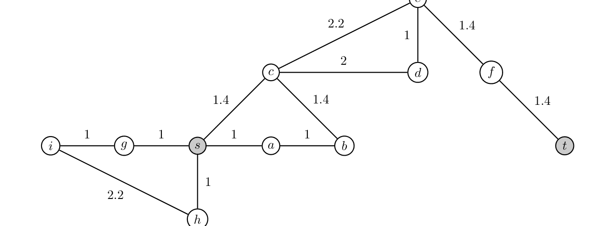


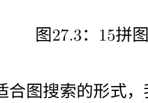

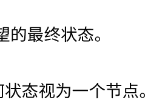


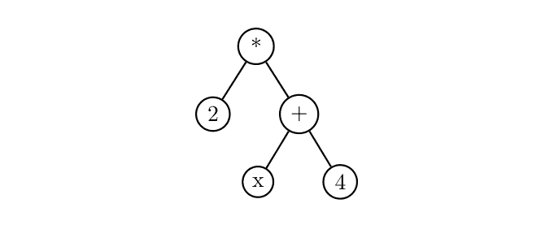

```

注意与BFS算法的强烈相似性。主要的变化是我们使用了优先队列而不是普通队列，并且我们有一个额外的条件，允许我们处理一个节点 w：不仅当节点还没有被访问过时，而且当我们找到了一个严格更短的距离来到达 w时。在后一种情况下，节点已经在优先队列中，所以我们不需要添加它，而是需要更新相关的值。

当我们第一次学习优先队列（在第22章）时，我们没有讨论如何在其优先级发生变化后更新条目。很明显，当其优先级变高（即距离变小）时，我们应该将元素向上移动。而当优先级变小时，我们应该将其向下移动。不太明显的是，我们如何在堆中找到它，以便我们可以将其向上或向下移动。通过对所有元素进行线性搜索将需要 Ω(n) 的时间，这完全违背了使用堆的初衷。解决这个问题最明显的方法是在图的节点的结构中存储一个整数索引，描述元素在堆中的位置。然后，任何时候在堆中，如果两个元素交换位置，我们可以以额外的恒定成本更新它们的条目。如果我们不喜欢在节点的结构中存储堆信息（因为它实际上不是节点描述的一部分，而是算法的一部分），我们可以在优先队列内部有另一个数组：该数组告诉我们每个节点（按照它们在图中的原始顺序）在堆中的位置。

无论哪种方式，都很容易实现查找操作，以便我们每一步只产生恒定倍数的成本。

Dijkstra算法的正确性证明将使用对 while 循环的迭代进行归纳。在循环不变式的表述上需要更加小心，你可能会在CSCI 270（或CSCI 570或670，如果你选修）中看到它。我们不会在这里详细介绍，尽管它并不是非常困难。运行时间分析比BFS更有趣。现在， remove() 和 add()操作都需要 Θ(log n) 时间（而 peek() 仍然是 Θ(1)）。因此， for 循环的内容需要 Θ(log n) 时间，由于它执行了 Θ(out-degree(v)) 次， for 循环的总时间是 Θ(out-degree(v) log n)。这反过来给出了 while 循环内部的内容需要 Θ((1 + out-degree(v)) · log n) 的时间，现在我们必须像往常一样对所有节点 v 进行求和：

$$
\sum_{v} \Theta((1 + \text{出度}(v)) \cdot \log n) = \Theta(\log n \cdot (\sum_{v} 1 + \sum_{v} \text{出度}(v))) = \Theta(\log n \cdot (n + m)).
$$

对于Dijkstra算法，尽管原则上我们可能会有 m < n 的情况，就像BFS一样，但人们通常忽略了 n + m 的部分，只是将运行时间描述为 Θ(m log n)。虽然不是完全线性时间，但仍然非常快，是优先队列的一个很酷的应用。事实上，Dijkstra算法和 A* 搜索真的是计算机科学家需要关注优先队列的主要原因。

#### 27.1.1 Fibonacci堆实现

我们在这里还应该提到一种叫做斐波那契堆的数据结构，它可以更快地实现Dijkstra算法。它基于堆，但有很多改变。我们经常在CSCI 670中教授它。要点是，虽然删除操作仍然需要 Θ(log n)，但插入和更新操作的摊销时间为 O(1)。我们之前简要提到过摊销：它意味着虽然操作的实际最坏情况时间可能更长，但每当一个操作花费更长时间时，它总是在之前进行了几次更便宜的操作，所以平均时间更快。这里的平均值不是基于任何随机性。即使我们有一个最坏情况的操作序列，例如，如果存在一个 Ω(log n) 的更新操作，那意味着它之前必须有 Ω(log n) 的时间复杂度为 O(1) 的操作。因此，这些时间的平均值将为 O(1)。

我们之前见过的一个更简单的例子是使用向量数据结构来实现栈。当向量的大小加倍时，将元素推入栈上的时间为 Ω(n)，即使通常是常数时间。但由于这种情况只发生在每 Ω(n) 次操作中，推入元素的平均时间为 1/n · (n · O(1) + 1 · Θ(n)) = O(1)。

一旦你在 O(1) 时间内完成更新（以及插入），运行时间分析就可以得到改进。每个节点只被插入和从优先队列中移除一次，总共需要 Θ(n log n) 的时间。每个节点的值最多每个入边更新一次，因此更新操作的总数是 O(m)，并且每个操作的时间为 O(1)。因此，使用斐波那契堆的Dijkstra算法的运行时间为 O(m + n log n)，当图不稀疏（具有超线性数量的边）时，速度要快得多。

实现斐波那契堆需要很多工作，并且需要很多开销。但是对于足够大的图 - 可能超过100,000或1,000,000个节点 - 斐波那契堆的实现在实践中实际上会加速Dijkstra算法。

### 27.2 A* 搜索

如果没有额外的信息可用于指导搜索，那么Dijkstra算法是最优的。但通常情况下，有更多的信息可用，聪明的算法应该使用它。例如，想象一下你正在规划从USC到LAX的最快路线。虽然可能有不同的路径需要探索，但你可能不会首先尝试去洛杉矶市中心和帕萨迪纳的路线。也许在足够的交通或建筑情况下，最后可能是最好的选择，但不应该是首要探索的事情。
规划从USC到LAX的最快路线。虽然可能有不同的路径需要探索，但你可能不会首先尝试去洛杉矶市中心和帕萨迪纳的路线。也许在足够的交通或建筑情况下，最后可能是最好的选择，但不应该是首要探索的事情。

让我们通过一个例子来探索一下，如图27.2所示：

假设在图27.2的例子中，我们想要从 $s$ 到 $t$ 找到一条路径。这些距离大致上是节点之间的欧几里得距离。

Dijkstra算法从 $s$ 开始，会将 $a, c, g, h$ 放入优先队列中。接下来，它会处理 $a$，并添加 $b$。然后是 $g$ 和 $h$。这似乎有点浪费。从图中我们可以很清楚地看到，去 $g$ 或者 $h$ 对于我们快速到达 $t$ 是非常不可能的。毕竟，它们离 $t$ 比 $s$ 本身更远。尽管现在看起来可能是正确的选择，例如，如果我们从 $g$ 到 $t$ 添加了一条长边，并且删除了从 $f$ 到 $t$ 的边。但是从现在的情况来看，首先探索 $b$ 看起来更有希望，可能还有 $c$。这是因为它们离目标更近（以直线距离而不是图距离衡量），这表明我们应该先尝试它们。

这个想法 - 估计一个节点距离目标有多远，并根据此决定要探索的节点下一个 - 是 $A^*$搜索的核心思想。更正式地说，$A^*$需要一个节点上的低估距离启发式函数 $h(v)$ 在节点 $v$ 上定义。重要的属性是 $h(v) \leq d(v, t)$，即到目标的估计距离不能超过实际距离。在我们的例子中，如果我们假设边上写的数字是欧几里得距离，那么直线距离始终不会超过最短路径距离，这必须经过一系列多个边。

现在，$A^*$算法的定义与Dijkstra算法完全相同，只是优先级队列中每个节点 $v$ 的优先级是 $d[v] + h(v)$。这里，$d$ 仍然是距离估计，与以前一样。所以请注意，距离仍然更新为相同的值，我们只改变了优先级队列的优先级，即节点被探索的顺序。让我们看看三个自然例子的距离启发式函数，如果我们在欧几里得平面上搜索节点的路径，就像我们的例子一样：

1. $h \equiv 0$。这显然是一个低估。不幸的是，这对我们没有太大帮助。事实上，你会注意到在这种情况下我们确切地得到了Dijkstra算法。
2. $h(v) = d(v, t)$，即 $v$ 到 $t$ 的实际最短路径距离。这将是一个非常准确的启发式算法 - 实际上，$A^*$搜索算法将直接找到最短路径，不会有任何错误的转弯。缺点是计算 $h(v)$ 会回到我们试图解决的问题：找到最短路径。所以这个启发式算法的问题在于它计算起来太耗时，没有用处。
3. $$h(v) = ||v - t||_2$$ 即从 $v$ 到 $t$ 的直线距离。这是一个相当不错的启发式算法，并且计算速度快。为了更好地说明，我们将使用这个启发式算法来解释图27.2中的例子。

要记住的要点是，你希望 $h$ 是：（1）低估，（2）计算速度快（比最短路径搜索要快得多），（3）尽可能接近实际距离。

让我们看看 $A^*$ 搜索在图27.2的示例上会做什么。让我们估计从 $t$ 到各个节点的距离如下（对于精确值，请使用勾股定理）：

| s | t | a | b | c | d | e | f | g | h | i |
|---|---|---|---|---|---|---|---|---|---|---|
| 5 | 0 | 4 | 3 | 4.1 | 2.2 | 2.8 | 1.4 | 6 | 5.1 | 7 |

我们只有一个 $s$。当我们处理它时，我们将节点 $a$ 添加到优先队列中，其优先级为 $1 + 4 = 5$，节点 $c$ 的优先级为 $1.4 + 4.1 = 5.5$，节点 $g$ 的优先级为 $1 + 6 = 7$，节点 $h$ 的优先级为 $1 + 5.1 = 6.1$。所以我们接下来探索的是节点 $b$，其优先级为 $(1 + 1) + 3 = 5$。（我们可以看到这里是从 $s$ 到 $t$ 的直线上。）所以下一个要探索的节点是 $b$，我们不会更新 $c$ 的优先级，因为新路径更长。从优先队列中提取的下一个节点是 $c$，即使它从 $s$ 到 $g$ 和 $h$ 的边比较长：这就是 $A^*$ 的显著不同之处。处理 $c$ 时，我们将节点 $d$ 添加到优先队列中，其优先级为 $(1.5 + 2) + 2.2 = 5.7$，将节点 $e$ 添加到优先队列中，其优先级为 $(1.5 + 2.5) + 2.8 = 6.8$。所以我们接下来探索的是节点 $d$ - 注意我们再次试图直接前往 $d$。处理 $d$ 不会添加任何有用的信息。接下来是节点 $h$，因为其优先级为 $6.1$。处理 $h$ 时，我们将节点 $i$ 添加到优先队列中，其优先级为 $(1 + 2.2) + 7 = 10.2$。所以我们接下来我们探索的是节点 $e$，并将节点 $f$ 添加到优先队列中，其优先级为 $(4 + 1.4) + 1.4 = 6.8$。注意这与节点 $e$ 的优先级相同，因为我们在直线上到达 $t$。所以我们接下来探索的是节点 $f$，并找到优先级为 $6.8$ 的节点 $t$，找到了最短路径。

回顾一下，我们尽可能地选择直线路线，但不得不绕道而行。但是与Dijkstra算法相比，我们从未处理过 $g$ 或 $i$，因为它们的方向是错误的。

#### 27.2.1 15数码问题

$A^*$ 算法最常用于人工智能规划中的上下文。当规划解决一个拼图（无论是像魔方一样的玩具拼图，还是涉及多个移动的现实任务）的一系列动作时，我们可以将世界的状态看作是一个图。该算法具有可用于操作世界的动作，并且每个动作将世界从一个“状态”转换为另一个。目标是找到从已知起始状态到所需结束状态的最短长度或成本的动作序列。

作为示例，让我们看看著名的15拼图。它在一个 $4 \times 4$ 的网格上进行，有15个可以水平或垂直滑动的方块（编号为 $1, 2, \ldots, 15$，或者上面有图案）。由于任何给定时间只有一个空位，只有相邻的方块可以滑动到该空位。图27.3显示了一个可能的起始（或中间）状态和期望的结束状态的示例。
图27.3：15拼图的中间状态和期望的最终状态。

为了将15拼图建模为适合图搜索的形式，我们将棋盘的任何状态视为一个节点。因此，该图有 $16!$ 个节点，数量非常庞大。我们甚至无法将整个图生成到内存中。

如果可以通过滑动一个方块从一个状态到达另一个状态，则两个状态之间存在一条边。边是无向的，因为可以通过将方块滑回原来的位置来撤销移动。由于我们只计算移动的次数，每条边的代价为1。再次强调，这种技术——找到正确的状态空间来构建图——在应用图搜索中非常常见。

因为所有边的代价都是1，我们可以应用BFS算法。但是这需要$\Theta(n + m)$的时间，而我们刚刚意识到 $n=16!$ ，这是一个非常大的数。因此，在这里使用 $A^*$搜索几乎是必需的。我们希望将搜索引导到方块处于其最终位置或接近最终位置的状态。最简单的启发式函数是独立地查看每个方块，并计算其与目标位置的距离，然后将行数和列数相加。（这被称为两个位置之间的曼哈顿距离，或 $L_1$距离，表示为 $\|y - x\|_1$。）现在，我们将所有方块的距离相加得到启发式函数 $h$。这是一种低估的启发式函数的原因是，每次移动只能将一个方块移动一个位置，因此至少需要这么多步才能到达最终位置。已知更好的启发式函数，事实上，已经有很多研究论文写过关于15拼图和其他拼图的良好 $A^*$启发式函数。

# 第28章

## 设计模式

> [注意：本章涵盖约0.5个讲座的内容。]

在整个学期中，当你学习面向对象设计时，我们强调了它的主要优点是能够通过将功能分离并将其放在适当的位置上，以及通过将接口（类提供的函数）与实现（如何执行它们）隔离开来，从而在以后清晰地重用代码。在此过程中，除了继承作为一种自然的扩展机制之外，我们还看到了不同类的对象可以以更有趣的方式相互交互的更多方式，每个对象在更大的任务中扮演特定的角色和责任，并以预先指定的方式相互交互。

也许最不平凡的两个是迭代器范例（在第16章中讨论）和Qt中插槽和信号之间的交互（在第18章中）。这些是设计模式的例子：对象之间可以以某种规律发生交互的方式，考虑到这些方式在类结构的设计中，将使以后扩展和重用代码更容易。

设计模式是软件工程广泛领域中的许多重要方面之一，当你学习CSCI 201和更重要的软件工程课程CSCI 310时，你会更多地了解它们。现在，为了更多地展示给你如何思考类和它们之间的交互，我们将讨论一些常见的设计模式。其中一些是显而易见的，一些非常聪明，一些只是C++或Java编程语言中弱点的解决方法。这里有比我们讨论的更多的设计模式 - 这只是给你一点点的味道。对于对学习更多感兴趣的学生，我们推荐Gamma、Helm、Johnson和Vlissides的经典著作“设计模式”以及许多在线资源。

### 28.1 观察者模式

观察者模式是我们在讨论Qt时已经看到的一种行为，其中一个类中的槽对应于另一个类中的信号。更一般地说，观察者设计模式适用于当你有一个对象具有一些状态（可能会改变，例如，因为用户输入值），而其他对象需要随时了解第一个对象的任何变化，例如，因为它们显示对象的内容。

经典的例子是将数据表作为第一个对象，并以多种方式显示。例如，你可以有一个学生成绩的表，并将其显示为直方图、饼图和表格格式。打开的显示器数量和种类取决于用户的操作，因此无法预先确定对象将有多少观察者。事实上，你不应该过多地硬编码可能的显示方式：也许在软件的第3个版本中，你还想引入3D图表和函数图的显示方式。在那时，你希望简单地说现在有了显示数据的其他方式，而不必更改实际表的类。

将存储数据和显示数据的功能分离，并允许轻松创建新的显示方式，方法是提供特定的接口：

1. 你的数据表类具有观察者注册自己的方法，例如 `void Table::register(Observer *obs)`。当调用此方法时，表将 `obs` 添加到已注册观察者的列表中。
2. 显示类有一种方法可以被通知变化，例如 `void Observer::notify(Table*tab)`。每当表中有任何变化时，它都会调用所有观察者的通知函数，并将自身作为参数传递。然后，观察者将知道如何更新它们显示（或以其他方式与）表中的数据。当然，Table类必须提供一个接口，以便观察者实际获取数据。

当遵循这种设计模式时，您可以稍后添加不同的数据显示方式，而无需更改Table类中的任何代码。您只需编写一个继承自Observer的新类，并准确实现notify函数。

这种范式也被称为发布-订阅：一个对象提供一个接口用于订阅更新，另一个对象具有一个接口用于接收通知更新。当您订阅一个通知您最喜欢乐队即将举行的音乐会的邮件列表时，您遵循相同的范式：乐队不需要提前知道谁将成为订阅者：它所做的只是提供一种方式让您加入邮件列表。反过来，您通过提供电子邮件地址来提供一个接口，这是乐队向您更新其状态变化的标准化方式。您处理这些状态更新的方式（购买音乐会门票，访问网站，告诉朋友，因为无法参加而感到失望等）完全取决于您。

### 28.2 访问者模式

假设你已经编写了一个数学公式的解析器（比如在作业中）。表示解析后的公式的最佳方式是通过它的解析树。例如，公式“2 * (x + 4)”的解析树如图28.1所示。
图28.1：公式“2 * (x + 4)”的解析树。

一旦你有了这个树形表示，使用DFS树遍历（前序、中序或后序）可以很容易地完成许多事情，例如：

- 以漂亮的格式打印表达式。
- 在特定的 `x` 值处计算表达式（这可以用于绘制函数）。
- 替换 `x` 的不同表达式，例如，`x = y^2 + 3`。

你可能还可以想出很多其他的。

问题是函数 `string prettyPrint()`, `double evaluate(double x)` or `ParseTree*substitute(char variableName, ParseTree *expressionToSubstitute)` 应该放在哪里。显然，最自然的选择是作为类 ParseTree 的成员函数。但是那感觉不太对。首先，树应该主要存储数据，但它的工作并不是打印数据。更严重的是，如果另一个用户想以不同的格式打印树，怎么办？到现在为止，你已经知道你不希望那个人必须进去更改你的打印代码。

唯一的其他明显解决方案是给予外部世界对你的 ParseTree的所有相关内部的全局访问，即几乎将所有内容都设为全局。但这是不好的编码风格，因为它过多地暴露了实现细节，并且不允许你以后重命名变量或类似的事情。

经过一些思考，这个难题看起来与我们使用迭代器设计模式解决的问题非常相似（第16章）。它允许我们以结构化和有限的方式访问容器的元素。但是经过进一步的思考，仅仅使用迭代器是不够的。迭代器只是按照预定义的顺序输出容器的元素。当我们想要漂亮地打印表达式时，我们需要按照中序遍历的顺序查看元素。当我们想要计算它时，我们需要按照后序遍历遍历树，并且更重要的是，了解树的结构。而在替换表达式时，我们实际上需要改变树的结构。

所以，无论我们想出什么，都需要比迭代器提供更多的访问权限。访问者模式提供了一种特定的接口，其他对象可以使用该接口访问树节点的内容，例如遍历左/右子树，或者了解（并可能替换）节点中存储的内容。这就像是一种妥协：内容并不是真正的全局，而是其他对象可以看到树中的内容并与之交互的方式经过精心规划。

一个人可以符合这些接口，同时编写大量不同的访问者，执行不同的功能。重要的是，可以随后更改访问者的具体操作，或编写新的访问者，而不必更改底层的 ParseTree类。

### 28.3 工厂模式

假设你正在编写一个办公套件，其中包括文本编辑器、电子表格、数据库、图形程序等几个部分。你希望许多用户界面组件都是相同的，既因为你希望外观和感觉对用户来说是一体化的，也因为你希望重用代码并节省一些工作。你肯定会想要一个对话框来创建新文档。由于这可能涉及很多工作（询问用户、生成默认文件、打开文件等），你可能打算将所有这些工作放在一个负责创建文档的对象中。问题是generateDocument函数可能需要根据当前创建的内容返回不同类型的文档：新的TextDocument、SpreadsheetDocument、DatabaseDocument或GraphicsDocument。因此，在生成文档时肯定会有类之间的差异，但也许有90%是相同的。

解决方案是使用工厂设计模式。你定义一个抽象类文档，所有你的文档类型都会继承它。你还定义一个抽象类工厂，它实现了所有的公共函数，并且有一个虚函数Document *generateDocument()。然后，你可以从工厂继承来生成新的类文本工厂、电子表格工厂、数据库工厂和图形工厂。每个类都会重写虚函数generateDocument()以返回特定类型的文档。例如，你现在可以编写以下代码：

```
Factory *factory = new TextFactory();
Document *doc = factory->generateDocument();
```

这将确保 doc在之后包含（或者说指向）一个文本文档对象。正如你所看到的，你只需要做很少的改动就可以生成电子表格文档对象。

所以总结一下，工厂设计模式的思想是你有一个抽象工厂类，它的工作是生产你的程序需要的对象。通过继承这个抽象类，你可以产生不同的具体工厂，每个工厂都可以生产特定类型的对象。所有的具体类型都是抽象工厂生产的抽象类型的子类型。这样，尽管工厂生产不同类型的对象，但它们可以重用很多代码。这也使得代码非常可扩展：如果以后你决定你的办公套件将有一个声音处理组件，你只需要定义一个新的工厂类，并且几乎不需要改动其他任何东西。

### 28.4 适配器/包装器模式

假设你和一个朋友一起工作，需要从头开始编写一个哈希表。你向你的朋友要求一个函数 `insert(const KeyType & key, const ValueType & value)`，但不幸的是，他没有注意，而是调用了函数 `add(const Pair<KeyType,ValueType> & toAdd)`。在你的代码中，你有很多对 `insert` 的引用，但是你的朋友已经广泛地使用了他的类，并且有很多对 `add` 的引用。怎么办？

因为你朋友的代码中有很多对 `add` 的引用，所以你不能只是改变函数的名称。如果你已经写了足够多的代码（或者团队中还有其他人也依赖于这个规范），你不应该只是替换所有出现的地方。一个简单而明显的解决方案是使用一个适配器：一个提供你想要的用户界面的类，内部只是将其转换为你拥有的东西。下面是一种实现方法：

```cpp
class HashtableAdapter : private FriendsHashtable {
    // 使用私有/受保护的继承或类型为FriendsHashtable的成员元素

    void insert(const KeyType & key, const ValueType & value)
        { this->add(Pair(key, value)); }

    // 其他函数的相同副本
};
```

通过这样做，您避免了重写所有内容，并且可以像使用实际需要的接口一样重用您朋友的代码。

记得之前你见过“适配器”这个词吗？当我们谈论C++ STL类实现标准数据结构（第15章）时，我们提到它有几个适配器类，`Queue`和`Stack`。它们之所以被称为适配器，是因为它们只是在`vector`类上提供了不同的接口。而不是写入`v.insert(v.size(), item)`，你可以写入`v.push(item)`。所以从这个意义上讲，STL认为`queue`和`stack`只是放在`vector`类之上的适配器。当然，从数据结构的角度来看，它们非常不同，但在实现上，它们遵循Adapter设计模式。