# 【精译⚡算法导论】AbdulBari p02 p1 1.1 Priori Analysis and Posteriori Testing -BV1hhPXeTEWM_p2-

Let us talk about prairie analysis and posteriary testing。

 these are the two terms that are used for algorithms and the programs。

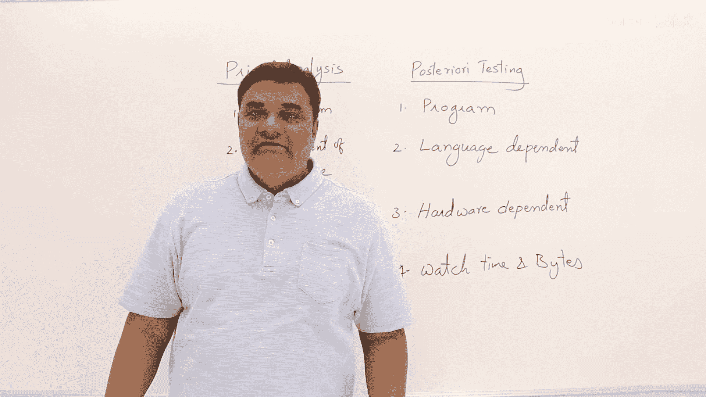

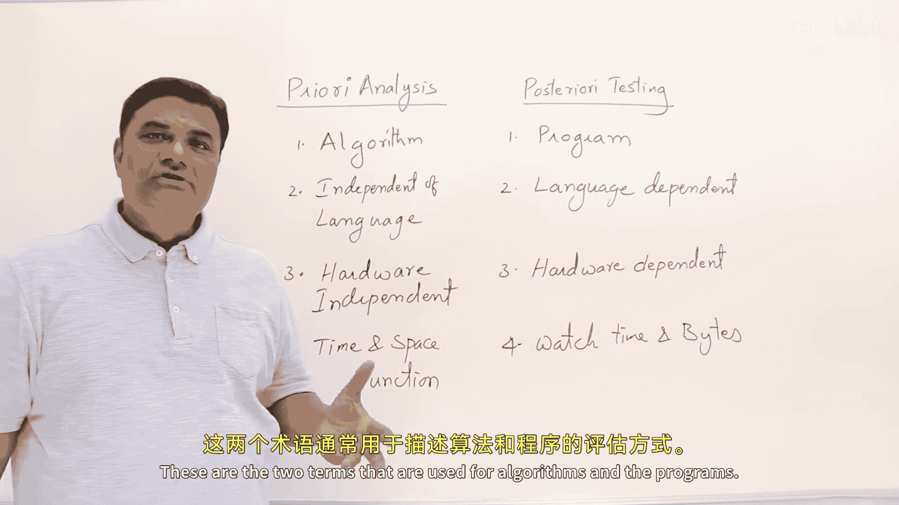

Preer analysis is done over the algorithm， so peer analysis means we will do the analysis of an algorithm by studying it into greater detail。

 knowing how it is working and we get some results。

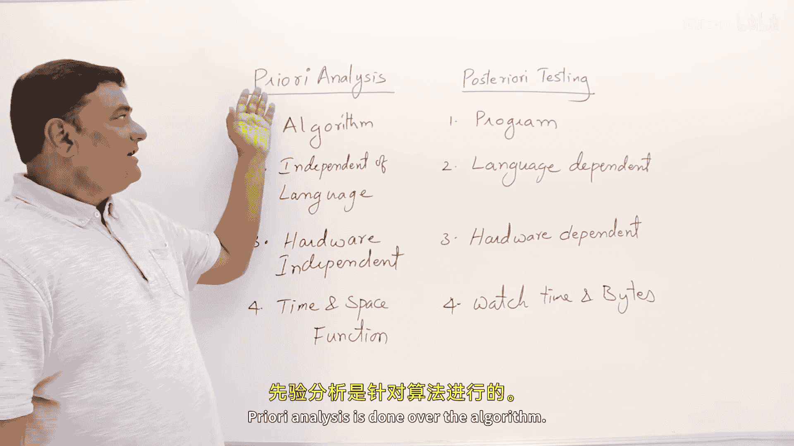

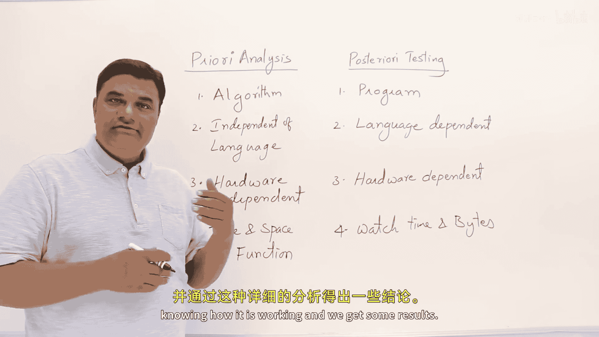

The result of analysis is there， what is that we may find out the time and the space consumed by an airport。

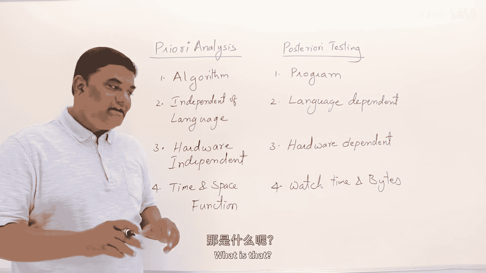

Dver of analysis。

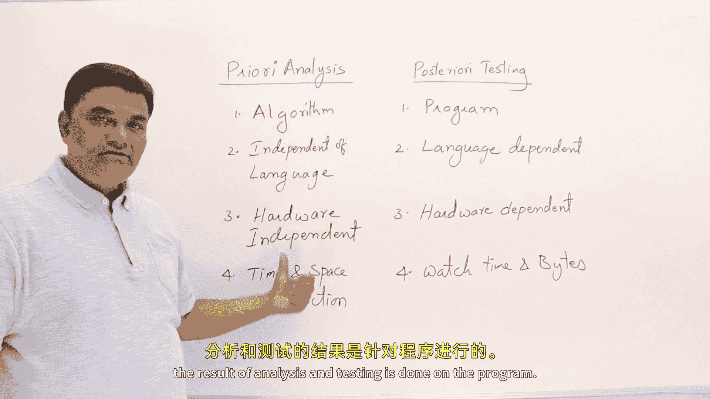

And testing is done on the program， so we run and execute the program and check it so we will know the wash time it is taking。

 how much， how many secondsd， milliseconds it is taking and also the amount of memory disk consuming in terms of bytes。

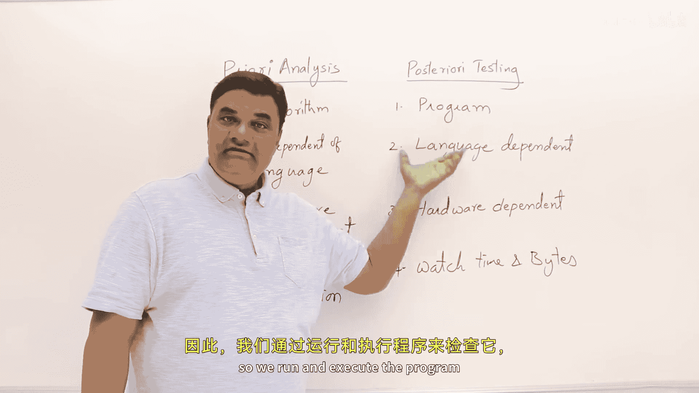

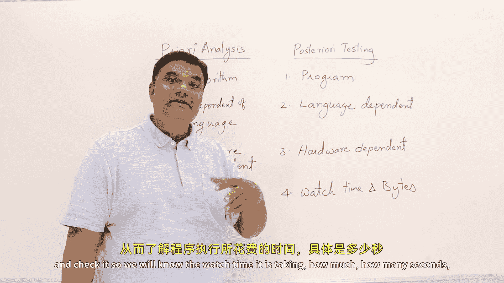

So this is period access is done on algorithm and the OA testing is done on programs。

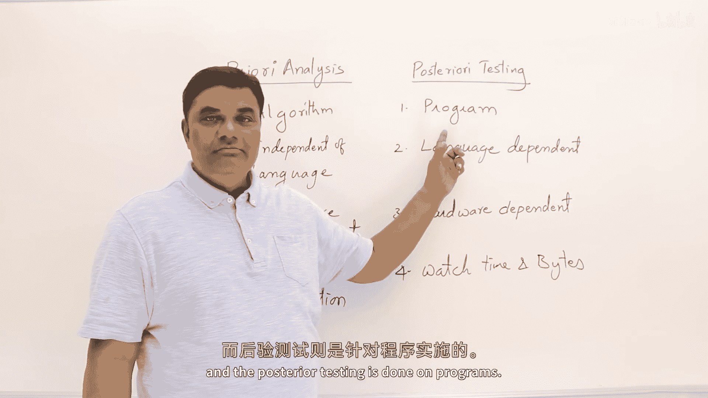

Now when period analysis is just over an algorithm， we know about that algorithms are not。

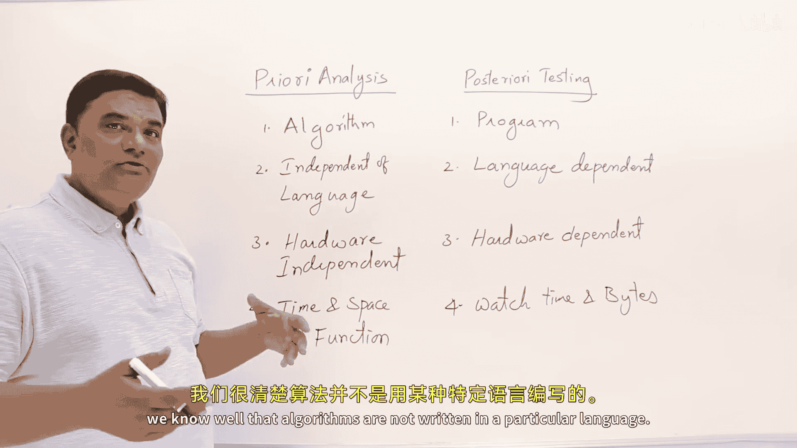

Return in a particular language， so they are language independent and also they are hardware。

They are not meant for a particular highway， but whereas a program。

 we write program that is highly specific as well as language specific。

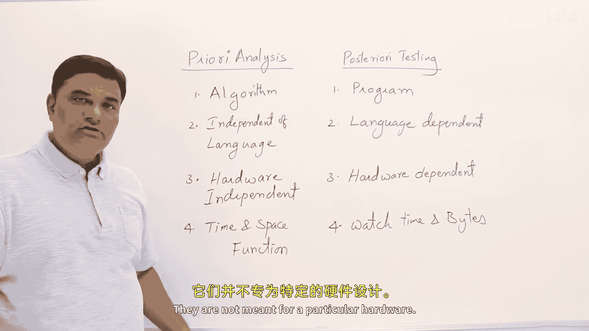

And as well as operating systems specific environment specific also。

 so they are dependent on the hardware as well as the programming language used。

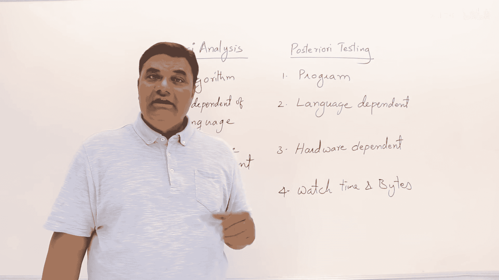

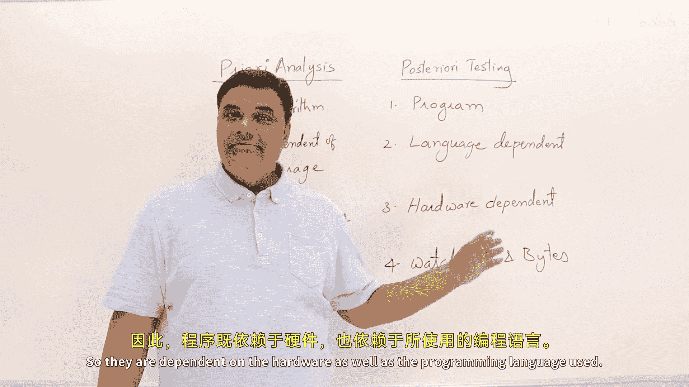

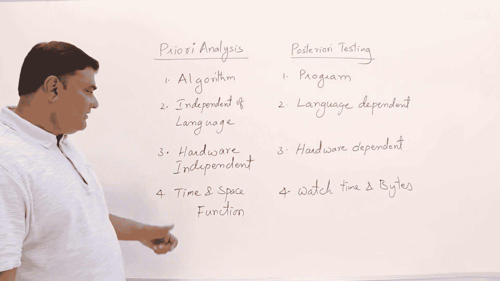

And here， the result of this one is how we get the time and the space。

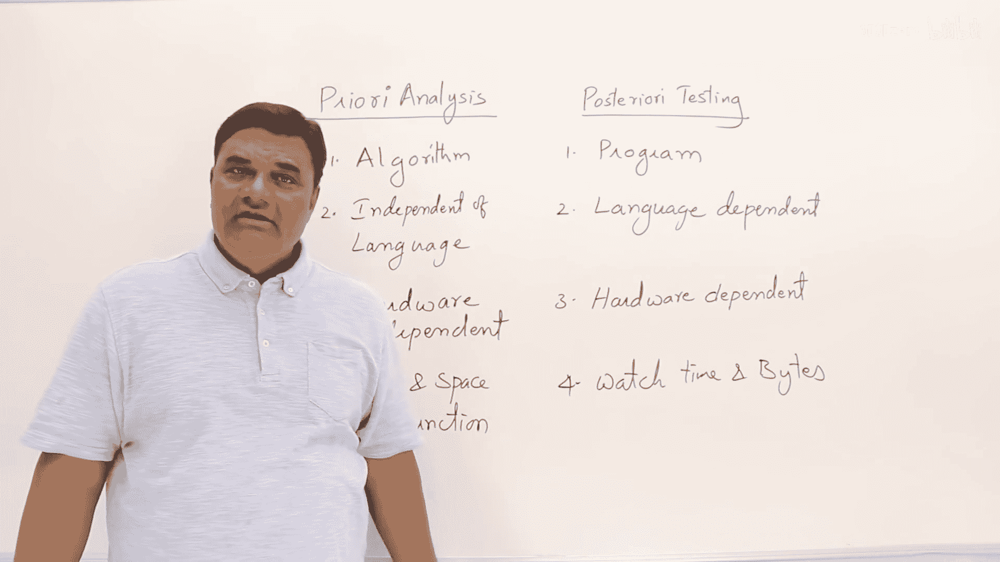

We don't get wash time，3 minutes，10 minutes，5 secondsd or milliseconds。

 No we will get the time function and we get the space function。

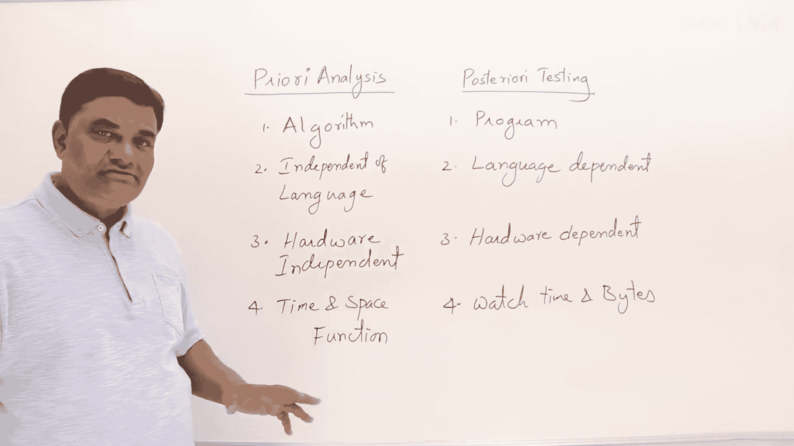

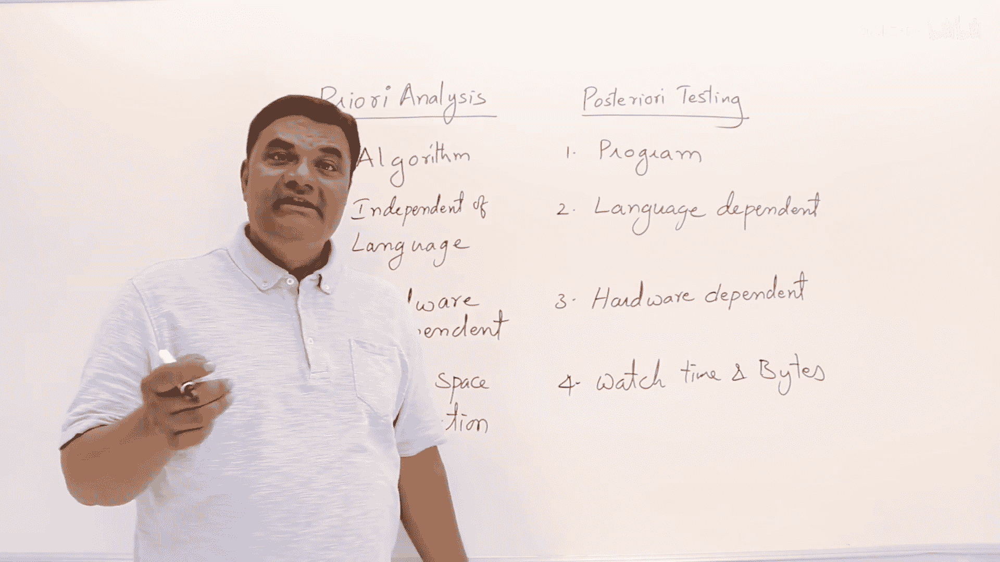