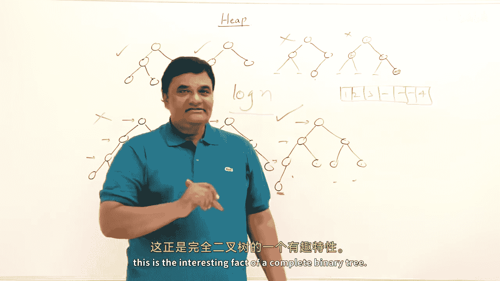
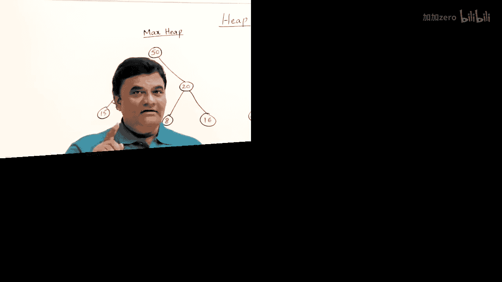
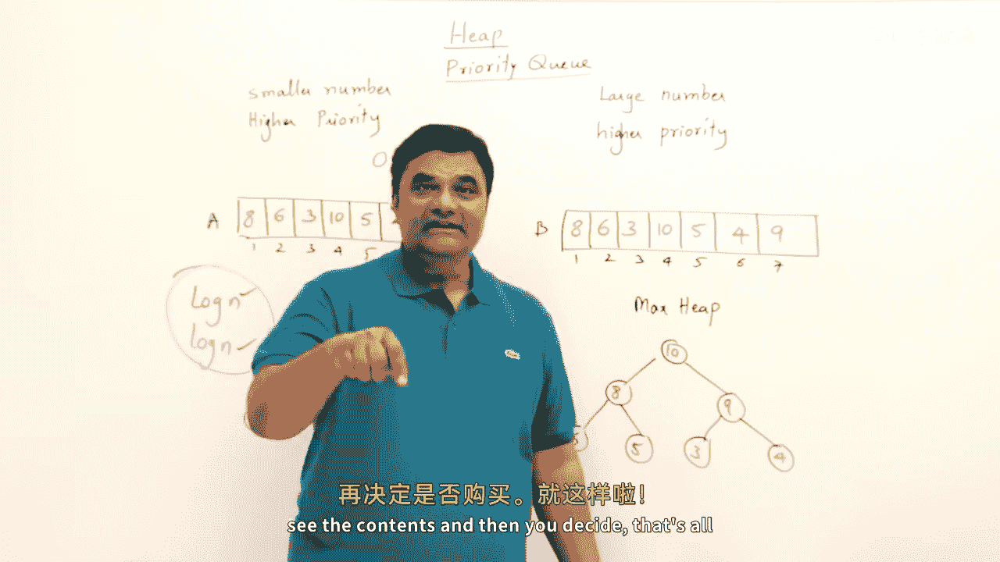

# 【精译⚡算法导论】AbdulBari p32 p31 2.6.3 Heap - Heap Sort - Heapify - Priority Queues -BV1hhPXeTEWM_p32-

The topic for this video is heap。Under this topic， we are going to learn about these thing。

 Ill be explaining these thing。 That is a representation of binary trees complete binary heap。

 how to insert and delete in heap。 then heap sort。 This is one of the important topic。

 and hepify this one of the famous algorithm or a procedure for creating a heap。

 I'll discuss this one。 Then heaps are famous for it being used as a priority cu。

 So well learn about priorics。So these are the subtopics under this heap topic， right。

 And if you know all these things， then you can understand heap sword。

 you can also understand Hfi and Peric Q unless you know these things So directly jumping on this it's difficult to understand that。

 So that's the reason I am covering all these things。

 So if you already know a few things you can skip and go that topic， right any particular topic。Now。

 before I start， I have to say something， see， I have two courses in Uudemi。

 One is for C++ second one is for data structureses。 Both the courses are for beginner level。

 as well as advanced level means if you already know data structure and C++。

 you have lot of things to learn there。 And also if you are a beginner if you have never done any programming。

 then you can take up C++ course and start learning programming。

And both the courses are suitable for academics， as well as。For interviews。

 So C plus plus programming1 courses there。 that is from beginners to advanced level。

 You can learn up to the level of interview。 You can crack any interview。

 Then data structure courses using CNnc C plus plus and some algorithms are。

 it's not complete algorithms。 It just a data structure using CN N C plus plus right。

 and few algorithms are there。 So that subject is for academics as well as for cracking job interviews or coding interviews。

 right， So I have covered all the topics in greater detail。

 So that will definitely improve your skills。 So you can buy those two courses。

 Those are paid courses。 Those are not free。 and please don't ask for free coupons。

The link for those courses is given in the description。 You can check the description。

 and there is a discount code is there。 discount Coal code is there。 That is around $10 or $11。

 so you can click and go to Udemi。 And if more discounts are applicable。

 Uudemi will give you that discount。 don't worry about that if still it can be reduce。

 it will reduce it。 So I suggest you take this course and by clicking on this link， you go there。

So let us start with the topic。First， I will discuss about representation of a binary using array。

 so here I have some examples。This is a binary tree。 I have taken alphabets here。

 so thats easy to read。 This is a binary tree。 And if I have to store it in an array。

 this is an array already have taken。In the CC+ plus programmings array starts from index0。

 but here I have taken from an onwards， so this is just a theoretical on paper when you want to program。

 write a program then you can start from index 0 also。

 but usually this is studied by taking index 1 onwards， so I have taken index 1。

Then these elements are stored here。 So how they are stored。 See for stor a binary tree。

 we have to take care of two things。 One is we have to store all the elements。

 Second is the relationship between them。 Who is parent， who is a child， who is left child。

 who is right child。 So these are the things that we have to take care。

 So elements and the relationship between the elements。 So how they are preserved。 watch here。

 See the elements are stored here。 A， B，C， D， E， F G。 So actually， they are filled levelable level。

 A， B，C， D， E， F， G， Yes， they are fill levelable level。 Then where is the relationship。

 the relationship between them is formed by these formulas。 So what are these let us look at。

 See if any node is at index I， then it's left child is at index2 into I， right child is 2 I plus1。

 and its parent will be I by2 floor value。So let us look into this example and observe really these formulas are used here or not。

 let us check B B is that index2， who is the left child of B D。So where it should be 2 into2 I。

 So 2 into to 4。 Yes， it is at 4， Then E is right child， where it should be 2 into I plus 1。

22 plus 1。 That is 5。 So check on 5， yes。Then C， C is at index 3。 Then it's left child F。 So 2，3，6。

 So it should be 6。 Yes。 Then the G is the right side。 It should be 2 into I plus 1，2 into 3 plus 1。

7。 Yes， it is at 7。 So， yes， these are followed。 Now， one more thing。F， who is a parent of F。

 This is 6，6 by 2 is a 3。 Go to 3。 Yes， see is the parent。 So you check here in the3。 Then for 7。

 this one， G， who is a parent， C，7，7 by 2，7 by 2 is 3。5。 But we have to take flooral， just 3。

 So go to the next 3。 Yes， C is there。 So this gives the parent。😊。

So now we learn that actually these elements are stored by following the formula。Now。

 every time you can't use the formula and put them， right。 So instead of using the formula。

 one thing we do is we fill them level by level， A， B， D， E， F， G。 So that's it。

 So these formulas are automatically followed。 Now， let us look at another example。 here。

 I don't have these notes。 Okay， no problem。 fill them levelable level， A， B， D， E，3 ends here。

 So ABC， D， E。 So if you apply those formulas， you check by yourself， they are followed。 right。

 left child， right， child and parent formulas are followed automatically。 Now。

 let us look at this one。A，B，C， then D， no。When I am filling level by level without using the formula。

 and I want the formulas to be followed automatically， then I should fill level by level。

 And if any element is missing， I should leave a gap there。 Yes， this is the important point Now。

 Actually， B should have its left child， which is not there。 right child， which is not there。

 So put a blank there。 Yes。え。B，C， blank， blank， D， E， A，BC， blank， blank， D， E。 This is how they are。

 Now， if you see D， who is a parent of D。6 by two， this one。6 by 2，3， Yes，3。 Who is there at a 3。

 C is there。 If I don't write D there。 If I right here， then it becomes a left child of B。

 That will be wrong。 So it means left child is not there for B。

 So this place must be blank and D should be filled here。 So without following formulas。

 if you want to fill them， then make sure that if there are missing nose， you leave a blank there。

So that's all about our representation of binary tree。That is done using these formulas。

 These formulas are for maintaining relationship， and the elements are， as it is stored in an array。

Now， next we will understand what is complete binary tree。

Now let us learn what is full binary and what is complete binary。

 So first full binary see this binary this we have already seen it， So this is a full binary。

 What does it mean by full see the height of a binary this is 012 so the height is 2012 height of a binary is2 and in that height it is having maximum number of nodes。

If you want to add any node， then the height will increase。😡，And if you remove any node。

 then this is missing。 It's not having all possible node。 One more node is possible。

 so you can take this。 Now， this is having full in height 2。 Now， this is in height 3。

 This is full binary。 There is no space for any new node。 So that tree is called as a full binary。

 And if the height of a binary is edge。 Then a full binary can have to power h plus11 number of nodes。

 Max of these many nodes。 So a binary with a maximum number of nodes is a full binary。

 Now what is complete binary。 Let us learn this Now， see， look at this one。

 When I have represented this in an array， then from last first element of the last element。

 there is no missing element。 So this is complete。If you look at this。

If you check the first and the last element， there is no missing element。 It's a complete binary。

Here from the first element to the last element。 If you check in an array。

 there are some missing element。 So even if there is a single missing element。

 it is not a complete binary tree。 This is not a complete binary。 right。

 So the definition is my definition is， if you represent a binary tree in an array。

 then there should not be any empty locations or gaps in between the elements。

Bs from first element to last element in between anywhere， right after the last element spaces there。

 then we there is no problem。 Like suppose this array is having only five element。

 If I have one more6 location， that is not a problem， right。But in between the elements。

 that is an important thing。Now， if you look at this。 now you tell me whether it' is complete or not。

Yes， it is full as well as complete。 So every full binary entry is also complete binary。 Now。

 check this。 Is it complete or not。😊，Check level by level。 One node is there。2 nodes are there，1，2，3。

4 nodes are there than this， next， next， next。 Yes， it is complete binary。 If I remove this node。

 then is not a complete binary。 This is missing。 This is missing。 So no node must be missing。

 If I remove this， then this is not a complete binary。So this is missing。

 So if you go level by level， there should not be any missing one then in this level 2 nodes。

 this level 4 node C is all are there。 Last level， All nodes are not there。

 All loans are not no problem。 If all nodes are there， then is a full binary， right？

 So one more definition of complete binary。 this mostly you find in the textbooks see。

Of complete binary a full binary up to height h minus1。 If you hide this n， its a full binary。

 And in the last level， the elements are fulfilled from left to right。

 This is one of the definition you will find in the textbooks。A completelete binary of height h。

 height h is。Already a full binary up to height h minus1 last level the elements are filled from left to right。

That same thing， I am saying that if you represent this in an array， you will not get gaps like this。

If you are getting gaps， it's not a complete binary without gaps， its a complete binary。 Now。

 one more important thing， see the definition of complete binary。

 what I gave you sometimes or some authors， some people call this as almost complete binary also。

 okay， but in most of the textbooks， you will find this as complete binary。

 So I am calling it as complete binary。Now， I will draw a few trees and show you which one is complete。

 which one is not complete so that you get comfortable with complete binaryaries。

 So I'll remove this and I will show you binaryaries。Look at this。Is it a complete binary。

 check level1 level， first level1 node， then two nodes， then four nodes， all four are not there。

 If you start from left side， then one，2。 no node is missing， since is a complete binary。

Get this one root is 1。 The next level 2 nodes。 Next level 4 are there。 All four are not there。

 but left hand side by extreme left side is there。 So yes， it's a complete boundary。

Route is one then to this level 2。 then next level， all nodes are not there。

 but first which node must be there。 Actually it should have this node then this node。

 then this is allowed。 So these two are missing。 so it's not a complete binary。Now， this one。

 first level 1， the next two nodes。 Okay， next level， all loanss are not there。 But first of all。

 we should have this node， then this node， then this node， then we can have this。

 So we should have the nodes from left to right。 But a three nodes are missing there。

 it's not complete binary entry。 So if you represent this in an array， let us say this is 1，2，3。

 and this is 4。Then 1，2，3， gap gap and a gap and then 4。

 So you'll get three blank spaces in between the elements。 So it's not a complete boundary。

 What about this， let us check。 first level 1。 Next level 2 nodes。 Next level 4 node must be there。1。

2，3，4， These are missing。 So it's not a complete boundary。 What about this， this is there right。

2 nodes。 then 4 must be there。1，2， this is missing。 So it's not a complete boundary。 This one，1。

 then here， two nodes。 then here，1，2，3，4 node。 Okay， then last level， all nodes are not there。

 but we have this extreme left。 Yes， this is the end point。 after this nodes are not there。

 That is not a problem。This is a complete binarynet。

 Now you are comfortable with what is complete binaryary。

And one last point of a complete binary is that the height of a complete binary will be minimum only that is log N height of a complete binary will always be log n because unnecessary。

 We are not going to the next level unless one of the level is filled。

 unless this is filled will not go to next level。 See。

 unless this is filled will not go to this level is not a complete binary。

 If you are going to next level。 So always the height of a complete binary will be minimum。

 that is log n。 this is the interesting fact of a complete binary。

Now， next， we will learn about he。

Let us learn hereap， see for that I have example binary trees here。Just by magnitude tree。Is a full。

 as well as it's a complete binary。 Yes， the important thing is complete binary。

 This is also complete。 This also complete。Now first of all， heap is a complete binary tree。

 then next condition， see the condition， let us look at the elements 50。

Then 30 and 20 are smaller than 50 Yes15 and 10 are smaller than 30 and 8 and 16 are smaller than 20。

 So it means every period is having the value greater than all its descendants。

 every node is having the value greater than all its descendants。

 So root will have the largest value， that is maximum value。 So， yes。

 if the elements are arranged like this。 Then it is called as max heap。

 So I repeat max heap is a complete binary entry， satisfying the condition that every node is having the element greater than all its descendants greater than or equal to also all its descendant。

 So duplicates are allowed here。 So if you have duplicates， we can have them in descendants。

Coming to this one here， this is 10，30 and 20 are the children that are greater。

 And this 35 and 40 are greater than 30， and also 10。 So 32 and 25 are greater than 20。 And also。

 in turn， they are greater than 10 Also。 So here， the smallest element is there in the root。

 So every node is having the element。 smaller than all itsants or smaller than or equal to all its descend。

 So this is call as mini heat。😊，So again I repeat mini heap is a complete binary satisfying the condition that every node is having the elements smaller than or equal to all its descendants。

 so there are two types of heap。Max heap and mini heap。 So whatever we have to study。

 we study upon one heap。 and same thing applies on the next hip。 Also。

 So we will take max heap and study this one。 So we will learn how to insert and delete the elements。

 So first， let us look at insert operation in a。Max heap。I'll show you insert operation in max heap。

 Let us understand how insertion is done。 So already I have a max heap here。

 This is a diagrammetric representation of a heap that is complete by 3。

 And that is this is the R representation of same thing。 This is stored in an array。

 If you check root 50。 Then this is 30，20，30，20，151 8，60，151 8，16。

 There are no gaps in between the elements in between these two。 There are no gaps。

 So it's a complete by。 It's perfect。 Let us insert。 I want to insert a element 60。

 So let us insert 60。So I want to insert the 60 in this max he。 So let us see。

 see where the 60 should come。 Ro should have the largest element。 So 60 should come in the root。

 Yes， now what usually people think I will talk about that。

 Then I will show you what is the right method。 People think that 60 should be inserted here。

 then where 50 should go，50 should go。 okay， this is 30， that is 20。 So this is small enough。

50 should go this side。 Okay， then where this 20 should go。20 should come in this side。

 So in this way， it will extend in this direction，16 will come here， and this will become 20。

 and this will become 50， and this will become 60。 Now， if we do it like this。

 is it a complete binary。 No， all these are missing element， then we have the 16 here。 This is wrong。

 So don't insert it in the root。 So I have shown you the wrong procedure or wrong assumption what people will have。

 This is wrong。 It is not inserted in the root。 Then how it is inserted where it is inserted。

 Look at。Is the correct procedure。 See， we actually implement in an array。

 So that 60 should be inserted here at the last free space in an array。 Our heap was ending here。

 right， it was ending here。 Now， I have 60 included there at thus free space。Right， so in diagram。

 where it will be 60 will be on the left child of 15。 Check it。 Where is 15 at 4，2，4s，8。 Yes。

 it is a left child of 15。 So this 60 is inserted here。 inserted here。 Yes， it's not a part of heap。

 I have kept it separately。 Now， is it forming a heap。 No， that condition is violated。

Every node should have the value greater than knowledge descendant。 But you see 60 is there。

 There is a child of 15 wrong。 then what to do。 Add just the element。 Add just the element。

 make it as a heap or insert it in a heb。 How compare with the parent， who is a parent。

60 is greater than 15。 So 60 should go up。 and again， compared with the parent。

60 is greater than 30 Also， So it should go up and 60 is greater than 50 Also。 So it should go up。

 So check here in this di in this other representation，8，8 by 2，4， So check with this one，4 by  two。

2， check with this one，2 by 2，1， check with this one。

 So 60 is compared with this one and its parent and its parent。

 So 60 is compared with all its ancestors， and it will reach its right place。

 So it will swap all these element and 60 will go there。 So I will draw it here。

 see 60 will come here， I will draw it three first。 Then I will fill the elements。 right。

 after inserting how it looks like now。This is a of。So here I kept them empty。 Just watch it。

60 will go up。15 will come down。 And again，60 will go up， and 30 will come down。30 will come here。

 Then 60 will go up and 50 will come down。 So we had the element like this。 So 60 comes here。

 So it has moved up in the hierarchy towards the ancestors。

 and it has reached the route because now it is the largest element。 So in an array， if you see。

60 was here。 So 15 went，60 was here。 So this 15 went there and 60 came here。

 Then again 30 went there and 60 came here， then 50 went to its place and 60 is insert here。

So this is how the heap looks like diagrammatically and also in an array。 So this is insertion。

 We have inserted only one element in a heap that we have taken max heap。Now。

 a little bit analysis how much time it has taken。It has taken the time equal to the number of ss。

 So maximum of how many swas 1，2，3。 So actually， this is depends on the height of a 3。

 So what is the height of a complete binary height of a complete binaryaries login。 Yes。

 so it means the time is big of login or order of login。 So the time taken for insertion is login。

 How many swas are required。1，2，3， So that depends on the height login number of ss are required。

And one more， if suppose this was not 60， if this was 6。Then we don't have to swap anything。0 ss。

 So we can say that the time taken for inserting one element in a heap is minimum big of one。

And maximumum S login。 It can be from one constant to login。 Minim time is no sbbing is required。

 Maximum the sbbbing requires depends on the height。 So that is login。

So this was inserting just one element in existing heap。 Now， before going to delete。

 I have something to show you。 observeer one thing。 See when we are inserting。

 we have to send the element upwards。First， we add the new element as a leaf。

 Then we adjust it by comparing with the ancestors。 So element moves from leaf towards root。

 So the direction of adjustment is upwards。 This is the important thing。 This is the important thing。

 So anyway， next， I will take the same example。 Then in this one。 only。

 I will show you how to delete。😊，So， let us look at。Now let us look at delete operation on max heap。

 Here is a max heap with seven elements that are also there in an array。Now。

 which element you want to delete？See the first very important thing。

 you cannot delete any other element。 You should not delete any other element， but root element。

 So only one element is deleted from the heap without asking or without giving any options or choices。

 only root element is related。 Yes， if you are deleting root element， then only it's a heap。

 See this heap is just like if you have seen in the market。 at a fruit shop， If apples are arranged。

 how they arrange， they arrange like a pyramid， heap like。

 So the apples are arranged one above another， like forming a pyramid like shape。 So on the top。

 which apple is kept。 the best apple， the most shiny one among all fresh one is kept on the top。

 So there is the best one。 So same concept is used in heap。 Also So all these elements are there。

 which is the topmost element， best element。 What is best for us， max element。 So that is max heap。

So 50 is on the top。 So if you want to remove the apple， which apple you remove。

 you cannot remove any other apple from that heap。 you have to remove the topmost apple only。

 And that's what。 So we follow the same method here。 We will remove only the root element， right。

 Similarlyly in mini heap。 Also， if you say no maximum element is not important for us。

 minimum is important。 then that you follow mini heap。Okay， coming to this。

 Let us delete the element。 So only I can delete 50，50 is gone。Now， again。

 sometimes people mistake here。 the thing that 30 should go up because this is bigger。 Okay。

30 will go up。 then who will come in the place of 30，15。 So if 15 goes here，30 goes here。

 then this node is gone。 If this node is gone， I it looking like a complete binary。 No。

 So if you try to adjust as you like， it will not be complete binary。

 So you have to be careful for preserving complete binary property， then what to do。

 So when 50 is gone， who should take its place。 See， the last element in complete binary。

 This element， This element will come in its place。 that is 16 will come here。

 So 16 is removed from here。 So 16 is brought here。16 is removed from here。 This is gone。

So 16 is broad there。50 is go gone outside。 We have deleted that 50，50 has gone out。

 We have deleted it。 Then in its place， the last element in complete binary entry。

 last element in complete binary in an array， the last element will take its place。Now。

 this is how it looks like。 So I'll remove this one。 now。 Okay， I'll remove this。 This is gone。

 So you have already seen it。 It's here now。 Now， this is complete binary， but not a max heap。

 So we have towards adjust the elements。 Okay， we will adjust the element。 That is not a big deal。

 maintaining complete binary property is very important。

 So we preserve that Now adjusting the element。 So we will adjust how from the route towards leaf。

 We will send it。 So let us check how to do this。 Comp children of this 16。 That is new route。

 which child is greater。30 is greater。 So 30 will take its place，16 will come into its place。

 So I will draw it here。 So here，30 goes here，20 and 8 remains 16 comes here and 15 and 10 as it is。

 So I'll fill them in the array。 Also30 is here，10 and 20， and this is 15 and 10 and 8。

 This place is free。 Last place is free。 So how we have done it is see this。😊。

was compared with it a children who are children of 16，2 and three left child and right child。

 left child and right child，1 into2，1 into 2 plus1。

 So2 into1 and2 into1 plus1 So if you remember this formula 2 Y2 I plus1。 So this is2。 and this is 3。

2 and 3。 These are，20 and 30 other children， we compare and 30 is brought here 16。

 So now this is one step we have comparedd， still we have to check with the descendants。

 So let us check with the descendants，16， who are the children of 16，15 and 10 compare them。

 which is greater 15。 Now， is this 15 greater than 16。 No， first of all， compare the children。

 And whichever child is greater。 that you compare with the parent。 Okay， afterwards， you compare it。

 but 16 is greater than both of them。 So leave it。 It's already there in max H。 So this is a max it。

 You don't have to swap them。 So this is a delete procedure。 So I'll just repeat the steps quickly。

 See always in。We remove root and the last element and complete binary will take the place and we push the element downwards towards leave and adjust the elements to form a max he。

 So we have adjusted downwards。Right， so from root towards leaf。If you remember in insert。

 the adjustment was done from leaf towards root， but now the adjustment is done from root towards leaf。

 so in deletion adjustment is done but the direction is different。So in both insert and delete。

 adjustment is done， but the directions are different。Now， little bit of analysiss。

 How much time it has taken for deleting one element， It depends on the height。

 So what is the maximum adjustment you have to do that depends on the height。

 So the maximum time is login。Login， Yes， so deletion takes login time。 Now。

 one important thing we understood here is that from the max heap， whenever you delete。

 you get the largest element from the heap，50 was largest，50 was gone。 But now who is largest。

 next largest element is 30， If you delete， which will be deleted 30。Then from the remaining 20。

 who will come and sit in the roof，20 will come and sit in the roof。

 So if you delete next 20 will be deleted。 Yes， so from max heap， whenever you delete。

 you get the next largest element from Min heap， whenever you delete。

 you get the next minimum element。 So you get the smallest， the next smallest。

 the next smallest and so on。Now， last important thing， this is very important。 Listen carefully。see。

 this is important。Here。The array size was 7。One element is deleted。No， what is the heap size，6。

 Heap is still 6 only from 1 to 6。7th place in an array is free。 That is not a part of heap， yes。

Leave it， no problem。 Our heap is still 6 only That space is vacant after that。

 So it's not a problem for us， but。What element we deleted，50， where it is。 We are using it。

 But if you want to maintain that copy of 50， there is a free space here。 You keep 50 here。

This is interesting。I get 50 there。Is it a part of heat， No， it's outside He。 Yes。

 so it's not a part of hip。 Just space was free。 So I kept it there that saw away from heat， right。

Now。From the six elements， if I delete again， what will delete delete。😡，30 will be deleted。

 and 8 will come here。 Then we are just。 so 20 comes here。And8 goes here。

 then 8 with it's a child that is 10。 so 10 comes here，8 goes there。So now the heap reduces to this。

 so the heap size is5， which element I deleted just now 30。

These two places are free already I kept 50 there， now 30， keep it here next free place。If I do this。

 what happens。What happens？Next element will be 20。 Next element will be 10 and so on。

 See this for 16。 I think yes。 So it will be so on。

 So what happens you we are getting the elements largest， the next largest， the next largest。

 the nextla largest。 So if you read the elements from this side， They are sorted。 They are sorted。

 Yes， this is the idea of heaps sort。😊，If you have a heap that delete the element and fill it in the。

Empty place obtained after durationle。 So if you go on filling the elements there。

 then automatically delegates sort it。 So from the heap。

 go on deleting the elements and start filling them in free spaces。 So this is heap sort。

 So let us take few elements and see the complete heap sort， right。Now， heap sought。

Heap sword have two steps。 First us， for a given set of elements， create a heap。

By inserting all the elements one by one。Then once the heap is formed。

 delete all the elements from the he one by one。 The elements will get sorted。

 So I repeat the procedure of heap sort have two steps for the given set of number。 first of all。

 create a heap。 Then delete all the elements from the heap。 First step， create a heap Second step。

 delete all the elements from a heap。 So I already have some set of elements here in an array。

 These are the elements we have to sort them。 So I will first show you how to create a heap。

 how the heap will be created inside the array。 I'm also going to show you diagrammatically。

 So let us start。 suppose these are the set of elements that we have to sort。 They are not sorted。

 So first of all， create a heap。 So for that initial array。 these elements are initial array。

 So we assume that in this first elements is already in a heap。 So this is 10。

So right now there is only one element and a heap， so when you have only one element you can call it as maxI also mean heap also its a heap。

 definitely its a heap。Now， we will insert second element。 So second element。

 we will insert that is 10 is already in the heap。 now we' will be inserting 20。

 So 10 is already there。 So 20， we will insert。 So 10 here，20 here。

 So rest of the elements I am not writing them。 Okay， I'll be write one， I'll be writing one by one。

 Now， inserting 20。 how to insert already have shown you compared with the ancestor that is parent and it's parent and so on。

 and try to adjust the element。Check 20 with 10， right？ So this is greater。

 So 20 should go up and 10 should come down。20 should go up and 10 should come down。

 So here in an array，2 is the index of 20，2 by 2 is one， compared with the parent 1。 So yes。

20 will come here。10 will go there。 right， Now this is he。 So we have a heap of two elements。

 there's a heap of two elements。 Now， third element we will include。 So right now we have 20 and 10。

 Now the new element is the next three space。 So next three space is this one， yes。

 So the element is 15。 So we are going to insert 15 Now， This one earlier。

 we have inserted the element from here。 right， now，15 we are inserting。

 So right now we have 20 and 10 here。 So 15 is in inserted here。 Now， try to adjust it。

 How compared with the parent。 So who is the parent of 15，3 by2 S 1。 So compared with the parent。

15 is a smaller。 So all the day it is in the。Maxxi form。 we don't have to adjust。

 So till here we got a he。 Now insert the next element 30。 So already we have elements 201015。

 Now this is the next free space， right，201015 next free space we have 30。 So 30。

 we are going to insert 30。This is complete vi entry， but not a max heap。

Adjust the element compared with the parent and its parent。

 So 30 is greater than 10 and also greater than 20。 So 10 will come at the place of 30。😊，Yes， here。

It is compared with this one。 Then again， it is compared with 20。

 So 20 comes here and at this place 30 will be inserted。 So this will modify 10 comes here，20 here。

 and this becomes 30。 Now， this is a heap till here。 So we have four elements in a heap。Now。

 the last element，40， I'm going to insert。 So right now we have 30，20，15 and 10， So 30，20，15 and 10。

 So the new element that we are inserting is 40 here。So 40 is inserted at next free space here。

 So it's a complete binary， but not a max。 compare with the parent。 Yes，40 is greater。

 The next parent，40 is greater than that Also。 So 40 will move up。 So this is the parent，5 by 2 is2。

 The next parent。 So yes。😊，20 will go at this place， and 30 will go at this place and 40 comes here。

 So it means。Sorry， so it means。Pay comes here。30 comes here and 4 is here。So this is a max heap。

 So one by one， we have inserted all the elements and every element was inserted at our next free space。

 and it was moved upwards。 and we got a max heap。Now， before going to the next step。

 let us analyze how much time it has taken。We have inserted n elements。

 total n elements we have inserted how much time it takes for inserting an element in a heap depends on the height。

 What is height of a complete binary or a heap。 It is login。So n element， each element。

 we assume that it is moved up to the root， so it is log n。 So the time taken is n log n。

So this was the heap creation fastest step。Now， from that heap。

 I will be going on deleting the elements。 So this place。

 I will show you how the elements are deleted and they are also sorted。So let us delete the elements。

Now， second step 4 heap sort already we have created a heap。 Now the same heap I have taken。

 this is the heap that we got。 Now let us delete the element。

 So we know very well how to delete the element。 So in this let us delete So which element get deleted 40 gets deleted40 is gone out then who will take its place last 20 this will take its place20 will take its place。

 So in the diagram I will show 40 is removed and 20 will go in its place，20 will go in its place。

 So it means this element is gone。This element is gone。 Now， this is complete by entry。

 but not a max heap。 So we have to adjust。 We have to adjust downward。 So this 20 is gone， right。

20 is removed。 Now，30 and 15，30 is greater。 So 30 will go in the place of 20 and 20 will come here。

 So this becomes 20 and this becomes 30。Then I get compared 20 with 10。

 so it's perfect So these are the changes。So now40 is deleted and we got one free space Now here I will show I will add the elements see we have 30 here and 20 here。

 15 and 10 so the elements in the heap are 30，2015 and 10 heap is 104 elements only 40 which was deleted I will put it here at a free space that is not a part of heap now delete next element so next element which element will be deleted30 will be deleted 30 is gone who will take place last element in complete binary 10 so in this array 30 is gone so the 10 last element will come here This element came here。

So this is not there， so one more element reduced， we have to adjust this one compared with the children。

 20 is greater so 20 moves up and 10 comes down right so this becomes 20 and this becomes 10。

So this is deleted。 I'll remove this arrow。 Now，30 is deleted， and this is in a max he form。

Now next step here I will show we have the elements 2010 and 15 and heap is ending here。

 40 was already there we got one more free space so keep 30 there the newly deleted element and in the diagram this is 2010 and 15。

Still， we have to delete three more elements。Now， next delete one more element。

 which element get deleted， 20 is deleted from the this is gone。

Who will take its place last element in complete boundary will take its place 15。

 so 15 will come here Last element in the array that is in the heap，15 comes here。

 so this place is free， so this is gone。But， I just。Already 15 is greatest， so child is smaller。

 no need to swab the element It's already perfect。 So this is the result then next is space I will write out this is 15 and this is 10。

 so this is 15 and 10 and heap is reduced still here。

 See there were three elements now there are only two elements。

Already I have 40 at the last and 30 at the second last place。

 one more free space I got there I can insert 20。So just a stored 20， I should not say insert。

 just I have stored 20 there， kept it 20 there。 Now these elements are deleted from the heap。

 These are remaining still in the heap， not delete next element， which element is deleted。

15 is deleted。 Who will take its place last element。 So it means this is gone。

 So here also 15 is gone，10 will take its place。Now， do you have to adjust。

 you don't have to adjust anything。 Now what will be the result， This is 10， so this is 10。

 Now heap ends here。 Now we already have 20，30 and 40 here。 we got one free space。

 so theyre used to 15。So that's how the elements are sorted。 So the heap sought first step。

 If the elements are given， then create a heap， then second step。

 go on deleting the element and store the element at a free space we are obtaining after deleting the element。

 So finally the elements are sorted So look at this so you have to observe it because too much board work is there lot of board work is there So you may miss at someplace so I suggest you just pause the video and have a look at it complete example is there on board right and do it by yourself。

 once you do it by yourself， then you can remember it always how it is working just take a snapshot or copy everything from whiteboard If you do the analysis or that creation process we have seen and login。

Creating heap and login。 Now， how much time this deleting of all any n element is taking N elements we are deleting and each element takes how much time for deletion also takes log n time。

 we have already seen it。 So that is n log n。 So N login for creation N log n for deletion。

 So total how much to n log n。 And this is big of N log n。

Right two times of log n is also dependent on n log n。

 So the time is order of n log n or big of n log n。 So heap sought takes n log n time。 So that's it。

 This is heap salt。Now I have to explain you heie P and Hie Phi is a process of creating a heap。

Al we have created a heap， how it is different， it is different。

 how it is different we will see but before that if you remember here we were inserting the element always in the leaf and we were adjusting towards root。

 adjusting towards root， it was sent from leaf towards root， adjustment was upward。Now in Hfi。

 the direction is different， how it is done， I'll show you， I'll remove this and show you。Now。

 next topic is Hify。He P Phi is a procedure for creating a heap。

 So already we saw how to create a heap by inserting elements one by one。

Here also will do the same thing， but。The procedure was inserting an element in the leaf and adjusting upwards now let us see how H P5hi works so for explaining Hp Phi already I have an array right and if you see it diagrammatically it is a binary ands a complete binary but it is not a max heap we want max heap。

Now， if we just repeat the procedure of creation， let us look at it quickly or way we saw。

In creation process what we did we kept  tenacities， inserted 2020 went up， then inserted 15。

 then inserted 12 then 40 then 25， then 18，1 by one we inserted starting from this element so we inserted except this element we inserted 2015 to 124025。

18 so we started from left to right。Is it possible if we change the direction， can we create a he。

 let us start from right to left？So if we start from right to left then shall we still adjust the element upward no let us do it downward downward how in the deletion if you remember we were adjusting the element by sending it down towards leaf from root so the direction was from top towards leave that procedure will follow let us follow the procedure now I am explaining Hpi P watch this。

First， go to element 18。Look down。 There are no children。

 So only a single element don't look at all other nodes， just 18。 and it's descendants。

 There are no descendants。 So 18 is a hit。Yes， then go to next element， 25， 25， look downwards。

 it's a heap， there is nothing， there are no children， it's alone， it's a heap。

40 is a heap next element，40 next element 12 downwards is a heap。

 Now you'll understand what does it mean， what I was saying just next。Next element 15。

 so from here adjust just 15 downwards， Yes， children are there。Gber。Which is greater 25。

 so 25 will go up and 15 will come down。 Yes， this is the procedure。

25 will go up and 15 will come down。 So 25 will go up and 15 will come in its place。 This one， right。

So if you look only these nodes， 25，15 and 18 it is a heap Yes。

 only one element I have adjusted now next after 25 this one，20 is there this is over right。

15 was there， this is over now we are on second element right this one。Look downwards。 I it a max he。

 No， adjust this one。 So compare with the children，40 is greater。 So 20 will come here。

40 will go up right， So 40， this will be changed to 20 and this will become 40。

 So I have just adjusted just two elements。Now， the after secondary element first element here。

Only this element is not in the head so adjust it compared with the children， 40 is greater。

 so 40 goes up 10 comes here compared with the children， 20 is greater， so 20 goes up 10 comes here。

Right so this will be swap with the child so this will become 40 and this is 10 then again swap with the children that is 20 and 1020 sorry 12 and 20 was there so it will be swapped with 20 and this comes here。

This is a heap。So we adjusted the elements downwards and we started from the last element。

 so we have scanned this array from right to left。The procedure we were using in the deletion after deletion we were adjust element。

 same procedure we followed。And we got the heat created。

 so this procedure is called as hep phi right direction is different that's all， right。

And what is the time taken by this one Analy the time taken by this Hie Phi procedure is big of n。

 big theta， omega， whatever you want notation you use anything commonly you use biggo So this is big of n。

 So if you remember the procedure for creating a he creating a heap。

 So creating a heap was analog log n big of n log n right but this is Hp phi Hie P procedure is order of n So this is faster Now what is the minimum time taken for creating a heap big of n using hipie Phi。

So that's all about Hpfi。 Now the last thing is what are priority cues， It's a simple topic。

 So I will finish with that one。 Next we will see priors。Now， priority Q， priority Q。

 So actually Qs P4。But priority cus is not fiOS strictly。

 the elements will have priority and they are inserted and deleted based on the priority。

So always if in a queue， when you want to delete， always we want highest priority element from the queue。

The element having the highest priority that should be deleted for。

 so this is the discipline of priority queue Elments are inserted with their priority when you delete it we want higher priority element so let us see what does it mean by higher priority。

See， these are the numbers。 What is the priority of a number numberumber itself is the priority。😡。

Okay， here in our example， number itself is the priority There are other example of priority cues also like in operating system also there is a concept of priority Q it is not same as that one。

 This priority queue is mostly used in algorithms right so let us see what is the priority8 is the priority of 8。

6 is the priority of 6 so 10 is the priority of 10 So that number itself is the priority then who is higher priority I can say that smaller number higher priority so which is highest priority this one than this one right than this one Yes。

 smaller the number higher the priority So3 is of highest priority here So if I delete I want3 from the array。

对。Otherwise， even I can say that larger the number higher priority， I can say this also。

 So larger number， higher priority。 So who is having higher priority 10 than 9 then 8。 So yes。

 when I want delete， I should get 10 from that one。 So this is about priority Q elements。

 they value itself is priority。 and there are two methods of giving priority。

 smaller number higher priority or larger number higher priority。

 Okay Now let us see how to insert and delete。 See in an array， if I want to insert。

 suppose I have one more element， simply I can insert after this one。

 then when I want to delete from the this type of priority Q， I want the three， then four。

 how much time it takes for deleting an element from an array order of n。

 because if I am deleting three， I should shift the rest of the elements。

 rest of the elements I should shift。 So takes order of n time。 So if you implement priority Q。

 just using normal array than the time for insert or delete maybe order of n。 So I don't want to。

Because in detail you can study it by yourself means you can analyze by yourself if you say no I want to keep them sorted order then for sorting also it takes time again for a deletion or insertion you have to spend out of any time。

Then what is a better method？Heap， which takes how much time。

 login time for insertion and login time for deletion。 So， yes。

 Heap is a best data structure for implementing priority Q。

 So if you have smaller number higher priority， then create a min heap。If you have larger number。

 higher priority than use max heap， same set of numbers I have created already created I mean heap already created max heap。

 So for one element insertion， how much time it takes login right。

 then one element deletion how much time it takes login。 So this is the best data structure。

 which works faster。 Otherwise， if you use normal array like this。

 then insertion may take order of end time。 Maybe deletion is faster。 Otherwise。

 deletion will take order of n time and insertion may be faster。

 Any one of the operation will definitely take order of n time。

But in heap the time taken is login so heap is a faster data structure for implementing priorityD so that's all about Pe Q so PeD you can be implemented using hes or either Minheap or maxhiap if you want always smaller number Min heap if you want always larger number max heap so that's all in this video and if you want to take the course you can check in the description and you can buy the course for C plus plus and data structure subject there are two different courses right so go through the course see the contents and then you decide that's all。

