# 【精译⚡算法导论】AbdulBari p46 p45 4 Principle  of Optimality  - Dynamic Programming introduction -BV1hhPXeTEWM_p46-

Hi the topic is dynamic programming in this video I'll give you introduction to dynamic programming。

 give you differences between dynamic programming and greedy method and also I will show the difference between memorization and tableular method by taking an example in detail let us know the difference between greedy method and dynamic programming which is very very important。

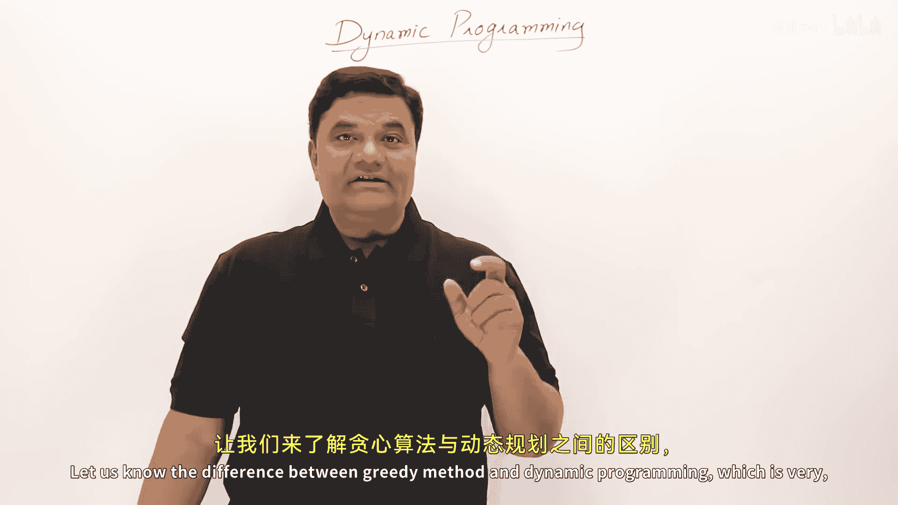

Grady method and dynamic programming both are used for solving optimization problems。

 both are different strategies， but the purpose is same。

Optimization problems are those which requires either minimum result or maximum result。

The methods are different in greedy method。We try to follow predefined procedure to get the optimal result。

 The procedure is known to be optimal。 We follow the procedure to get best result。

 like Cs method for finding minimum cost spanning tree。 Always select a minimum cost edge。

 and that gives us best result。Or the extra shortest part algorithm。

 always select a shortest part vertex and continue relaxing the vertices so you get the shortest path。

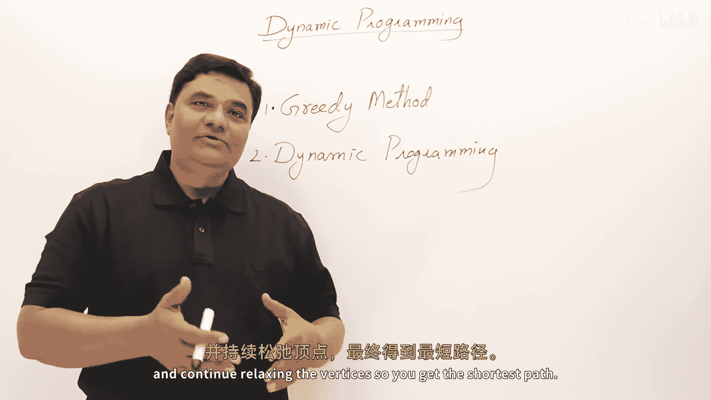

So there is a predefined procedure， but in dynamic programming。

 we'll try to find out all possible solutions and then pick up the best solution。

 the optimal solution， This approach is different and it is little time consuming compared to Gry method for any problem there may be many solutions。

Which are feasible， so we'll try out all those solutions and then pick up the best one。

And mostly dynamic programming problems are solved by using recursive formulas。

Though we will not use recursion of programming， but the formulas are recursive， if we want。

 we can use recursion also， but mostly they are solve using iteration。

And dynamic programming follows principle of optimality principle of optimality says that a problem can be solved by taking sequence of decisions。

To get the optimal solution so now I can highlight one difference here in greedy method decision is taken one time that we will do it like this and we follow that procedure。

In。Gre dynamic programming， every stage we take a decision。

 So this point you can understand only while solving the problem。 So while solving the problem。

 I'll show you perfectly how dynamic programming is working there to solve a problem。

 Let us see how dynamic programming adopts Tulation method or memorization difference between tabulation and memorization。

 I have an example function here。 This is the recursive definition of a Fibonacax C term。

 And this is a function or an algorithm for finding Fibonacxi term。 And it is a recursive function。

 The definition itself is recursive。 So the function is recursive。 So what is Fibonac series。

 It starts from 0 and 1，1， every term is obtained by adding previous two terms。 So 2 plus 1。

 that is 3 and 2 plus 3， that is 5 and 5 plus3， that is 8 and this is 13 and so on。

 So this is 0 of the term， first term， Second， third，4，5，6，7 and。父さん。

Suppose I want to know10th term of Fibonaxxi series， then call this function。

 this function will give us 10th term。

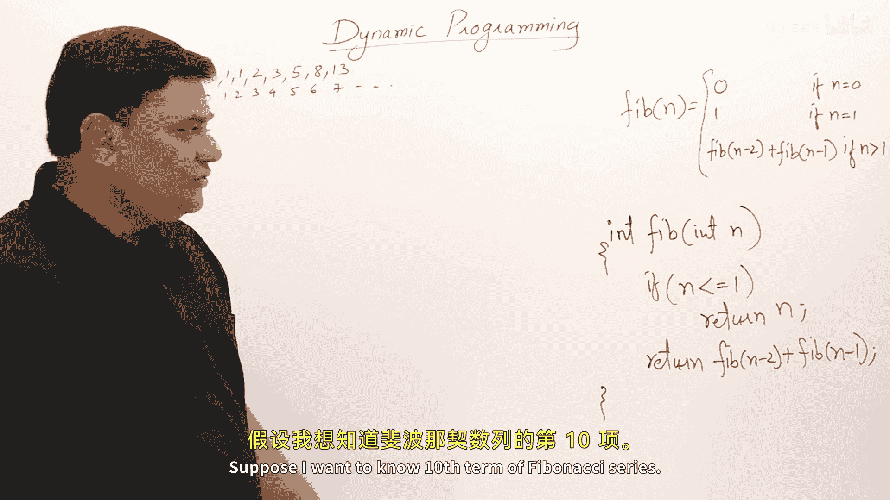

Now I will show you how this function works if I want to find out any term because the function is recursive。

 so let us trace this function when I call this function for Fibonacy of5 a fifth term I want to find out。

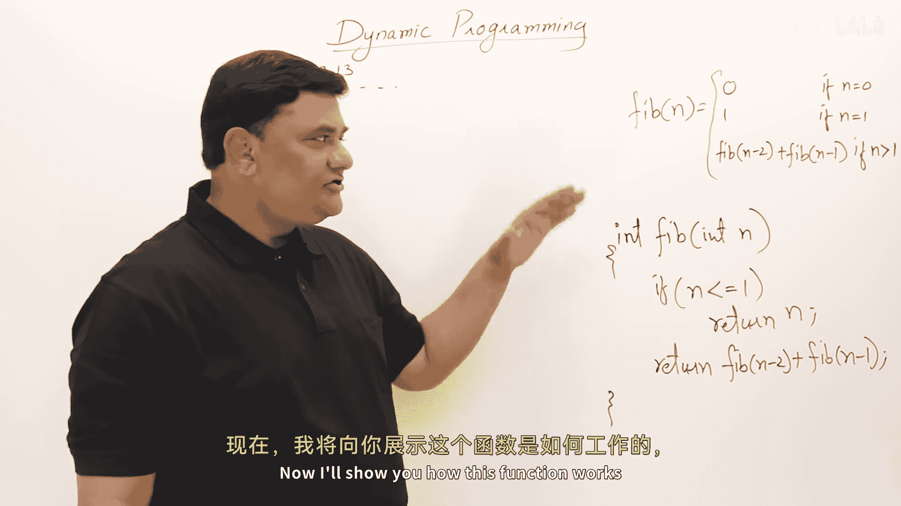

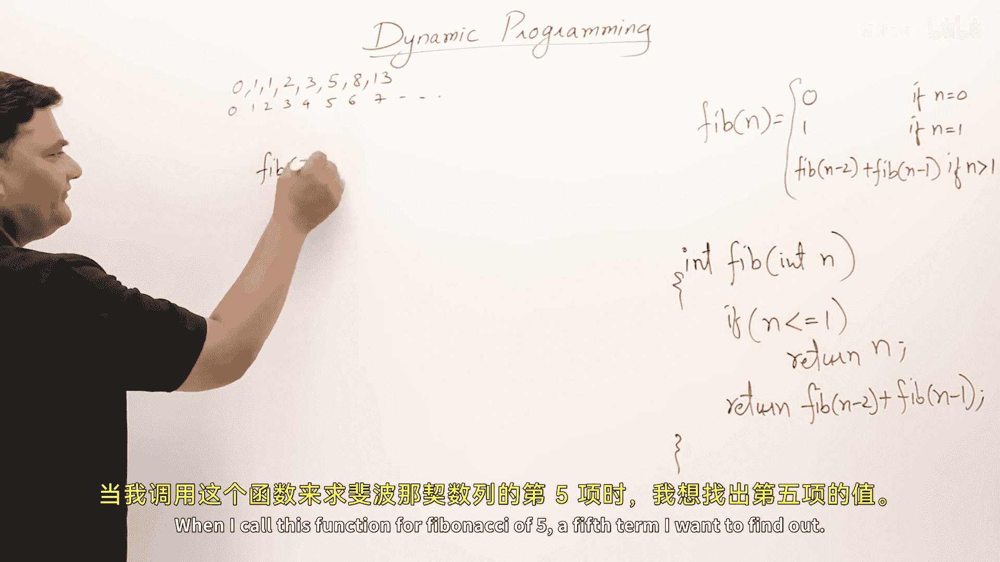

If I trace this n is less than equal to one， no it is not less than equal to one。

 If so then it will return and only otherwise it will call two functions Add the results and return the results。

 So what are those two functions it is calling It is calling itself for Fibonacxi of。

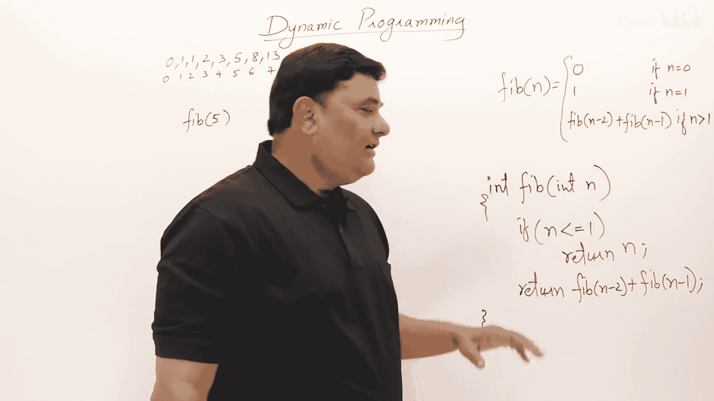

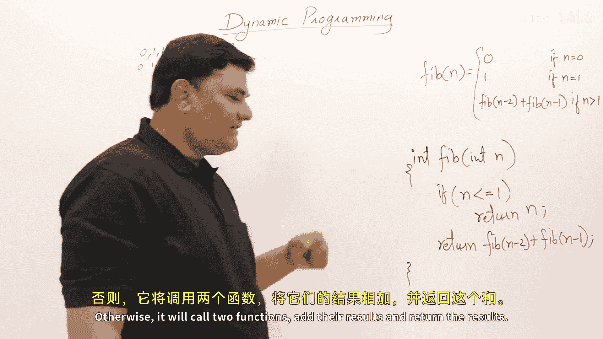

3 and fibonnay of。Food。So， first of all it will call this one right then that one so if we see this again it will enter inside and then it not less than equal to one so it will call itself for two times for 3 minus2 that is fihib of1 and then fihib of2。

Then out of this， it will pick up this call first。 So Phb of one directly we get the answer one。

 so this is one， then it will come this。 So there are two calls here。

 This is Phb of0 and fib of1 for Phb of0 and Phb of1。

 there is no recursive call direct result is return。

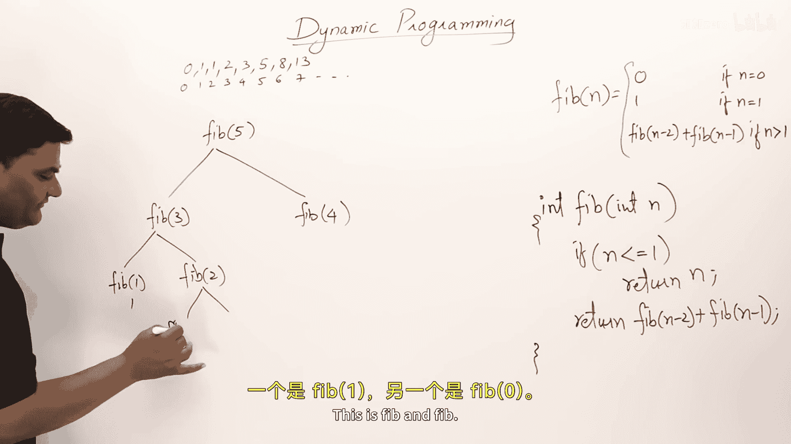

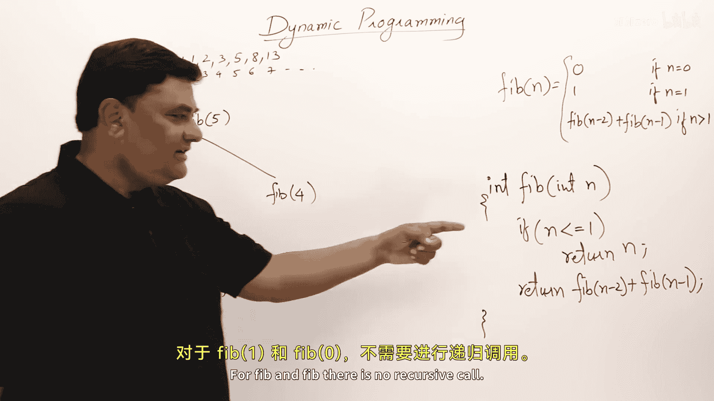

So here the function terminates， then it will add these two terms and give the result。

 it will add these two terms and give the result then this side it has to continue。

 So on this side again for Fibonaxia of4 it will call itself for Fibonaxia of2 and this side for Fibonaxia of3 but first of all this is done So this is fi of。

0 and。Fib of one， the side， Fib of。1 and fihib of2。 Again， this is fihi of for0 and fihib of1。

This will be the tracing tree of that particular function so for finding fi of 5 it is making total 15 calls Now if I consider all the calls and find out the time complexity of this one So from the function if I see this is n minus-2 and that is n -1 if I assume roughly it is n minus-1 only then I can prepare a re installation for this one what it will be Tn is equals2 it is calling itself for two times let us assume n -1 only so2 Tn-1。

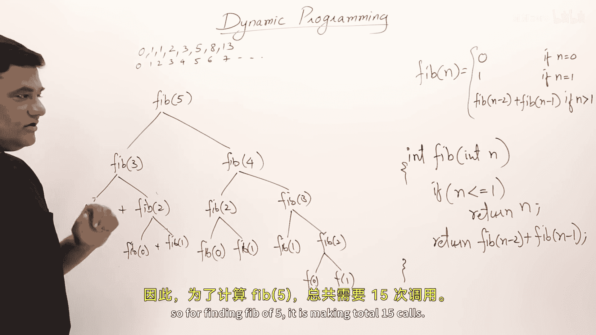

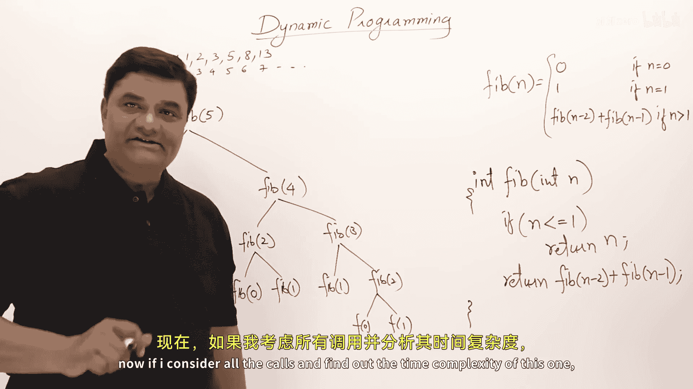

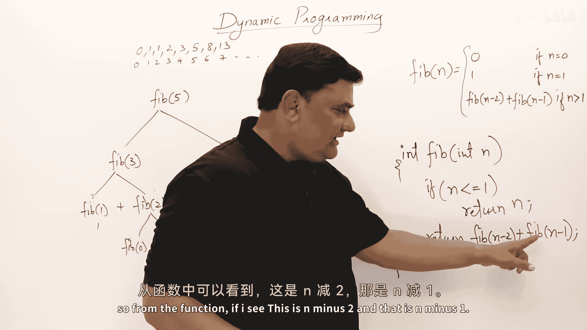

Though this is n -2， but if we take n -2 we cannot come to the conclusion。

 so I am taking it as1 right approximately so this is2 T n minus-1 and what it is doing every time just adding So this is the recurrenceation and by master theorem for decreasing function if you take this is big of2 par m。

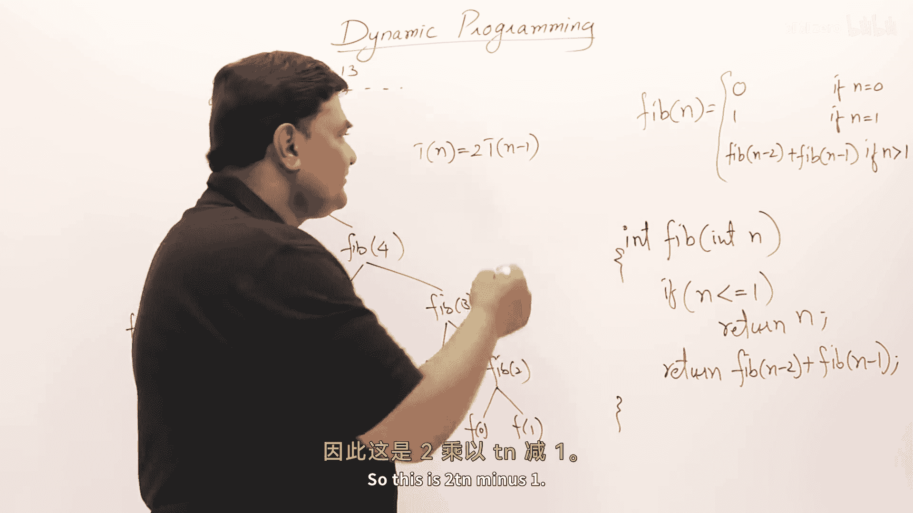

Like this is not exact。 It is n minus-2。 It is less。 I have taken n -1 only。

 so this is upper bound for that function。 So the time taken by this function is big of2 par n。

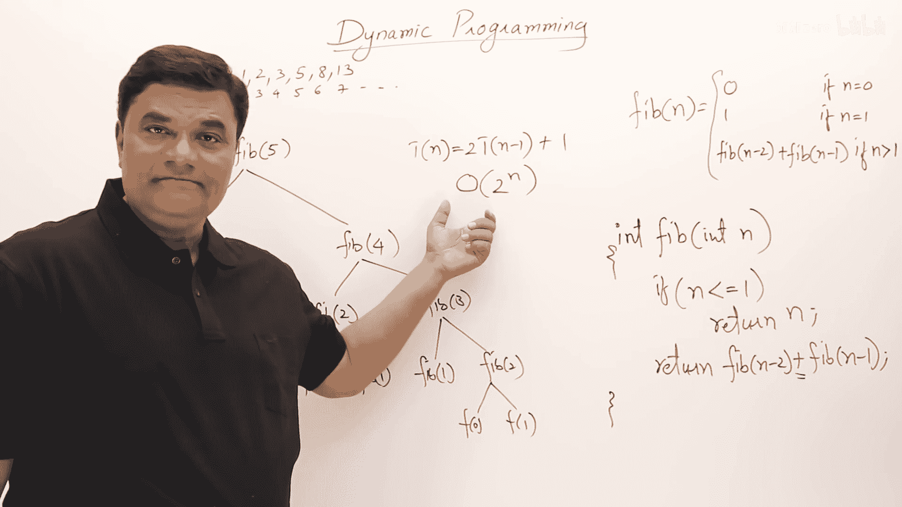

Right recur in， how to prepare there is a video available you can watch that one so how to prepare a recur in。

 so this recur in is big of2 pour n means if I call this Fibonaxxi function it will take so much time to pour in exponential time。

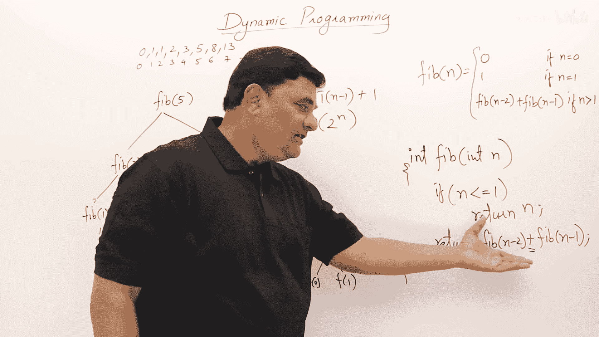

Is there any way to reduce the time let us observe see in this function f of1， fihib of 1，1，1。

 so many times it is being called。So many times so if I take fib of2 it is called here and here and here。

 why to call the same function again and again for the same parameter， why can't we reduce this one。

So yes， with this idea we can reduce the function calls and reduce the time taken by this Fibonaxy function。

 So what Ill do is I'll try to store the result of Fibonaxy function so that once it is called for a fibo of 2 it should not be called again。

So let me show you how it can be done， we will take one global array。

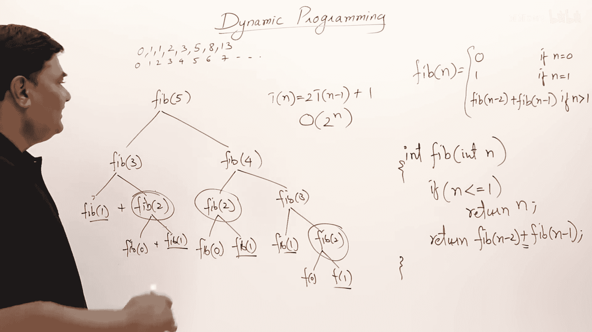

Let us say， I have an Annie。0，1，2，3，4，5。 I have an array。 Initially。

 I will fill this array with -1 because nothing is known。 Now， let me trace this tree once again。

 not function。 I have to modify the function， but I will not modify it just from the tree。

 I will show you。

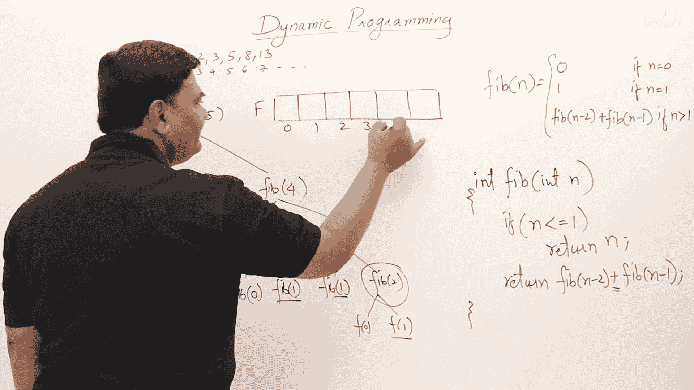

First function is called fihib of 5-1。 We don't know。 So make the calls。 So first call is this one。

 Fib of 3-1， we don't know call the function。 So fib of one， do we know this no。

 So call the function。 So what is the result of the function when value is one， It has one。

 So mark it has one。 So this is completed。Then go back Fihib of2 v。

 Do we know the answer for this one， Fihib of2， No， call this fihib of 0。

 Do we know the answer for this one， No， Fihib of 0 function is called。 So it is less than1。

 So it will return 0 only。 So this becomes 0。Then，5 one。

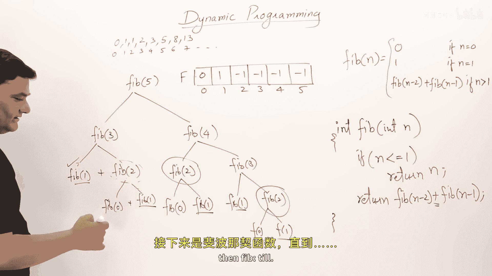

Till here， the calling is done。 Fib of one。 we already know Fihib of one， don't call this function。

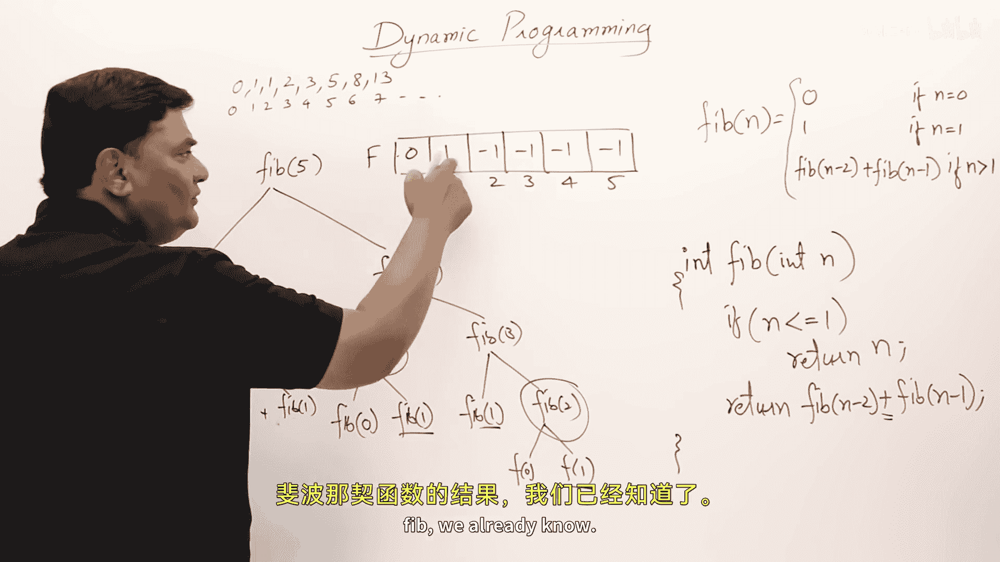

Then this result is how much0。 this value is how much1。 So add this and return the result。

 So this becomes one。 So F of two also becomes one now。This one， then this result， Fib of one is1。

1 plus 1。 We know this result。 So add this and get the result for this two。 Fib of3 is stored。

 That is2。Now， come to this site。 See 1 function was ski。 Fi of4。 Do we know We don't know then。

Let us call the function。 Fib of two。 Shall we call No， we already know the result。

 So don't call this function。 So all these functions will not be called。 This is already one。

Then shi of three， do we know， Yes， we know the answer。 Don't call all these functions。

 don't call these functions。 So first of all， this is not called。 automatically。

 these are also not called。 What is the result of this， This is2。Then these two are added one plus2。

 so this becomes3。This becomes three。 Now， adding of these two is done 2 plus 3， that is 5。5。

 thats all。 if I count the number of calls now， this is one。2，3。F， five， this is not called。😡。

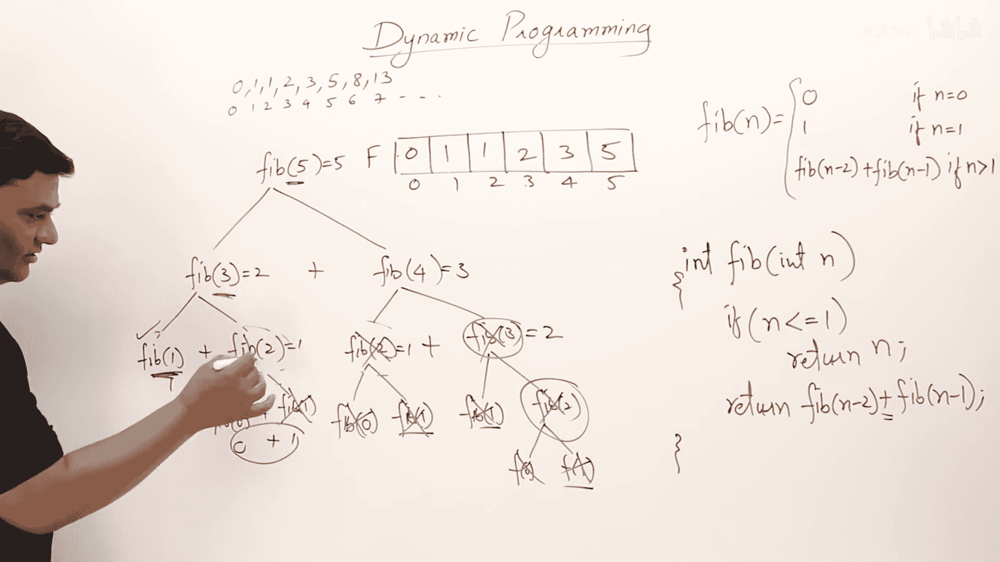

6。

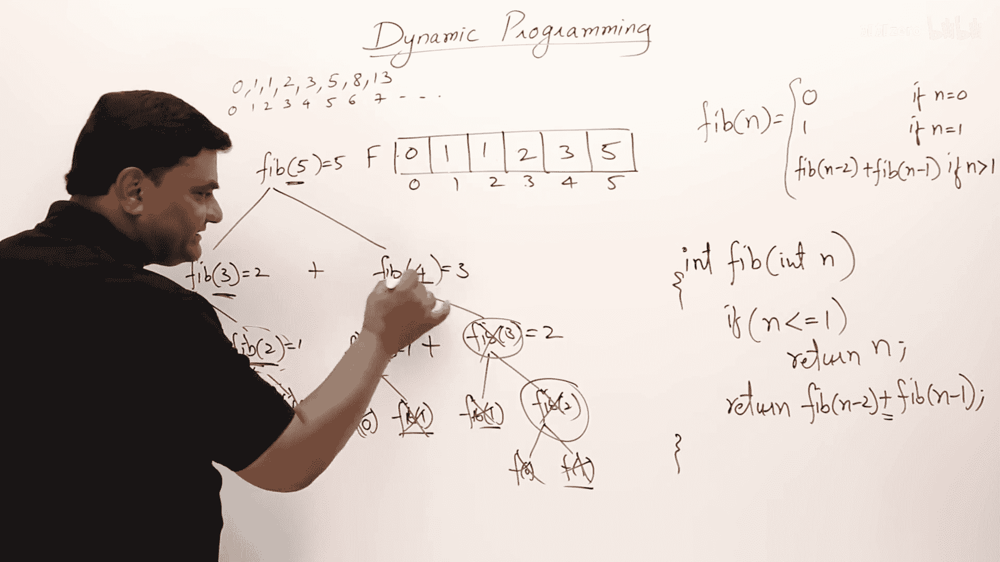

That's all total 6 calls。 So when I have given fihib of n。

 So it is making how many calls n plus one calls。 So n plus one calls is what order of n。

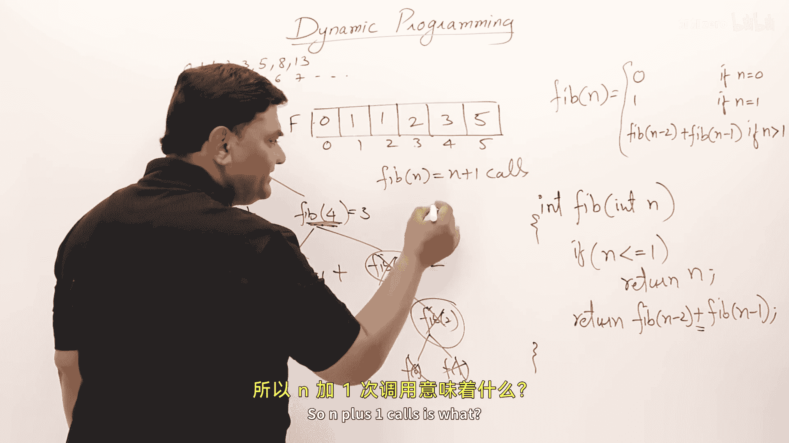

Theta of n or big of n， whatever you say notations。So this is order of n。 See， this is memorization。

 This is the result of memorization by storing the results of the function。

 We are avoiding the same call once again， like fib of two other is stored。 Don't call it again。

 Phb of three other form。 Don't call it again。

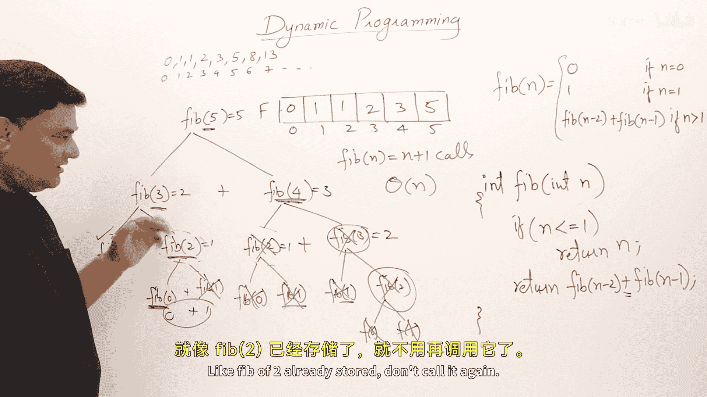

How do you know what is already found。 We can store the result in summary。 So this function。

 we can modify the calls are made here。 I can make them as conditional calls。 So based on condition。

 the calls are made。 and the results are stored in an array。

 So there are number of calls are reduced。 We can see that memorization has reduced the time from two per n to n。

 So from two per N to n。 So exponential to polynomial back to linear。 So in this example。

 there is a big change in other examples， at least there will be some difference。

 memorization will bring some difference。 This is the approach of memorization。

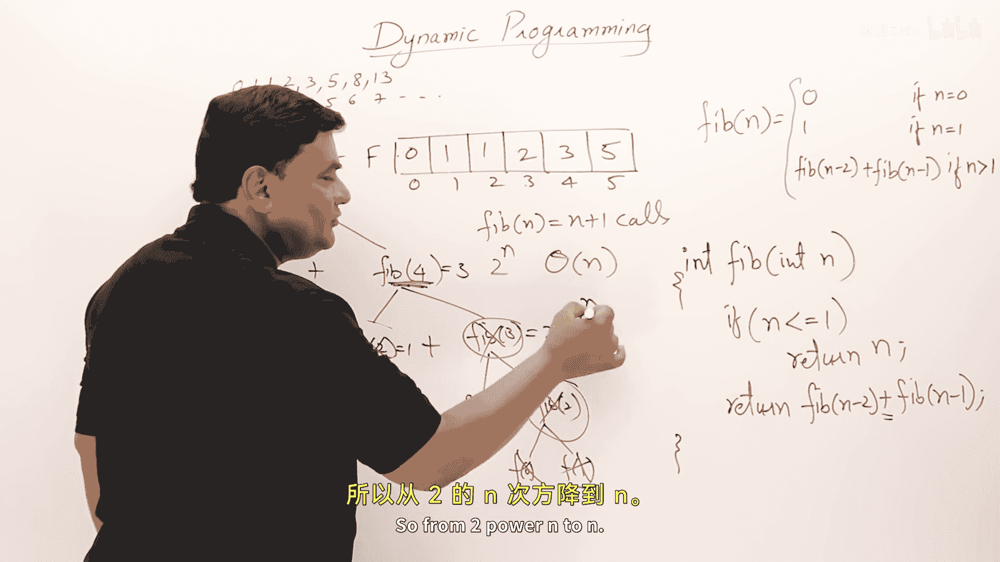

And in this， we can see this， the tree is generated and the function calls are avoided and the result is obtained back。

Right so from here we started so we say this is top down approach so memorization follows top down approach if we want we can follow this in dynamic programming but we don't use this we use iterative method mostly that is tabation method。

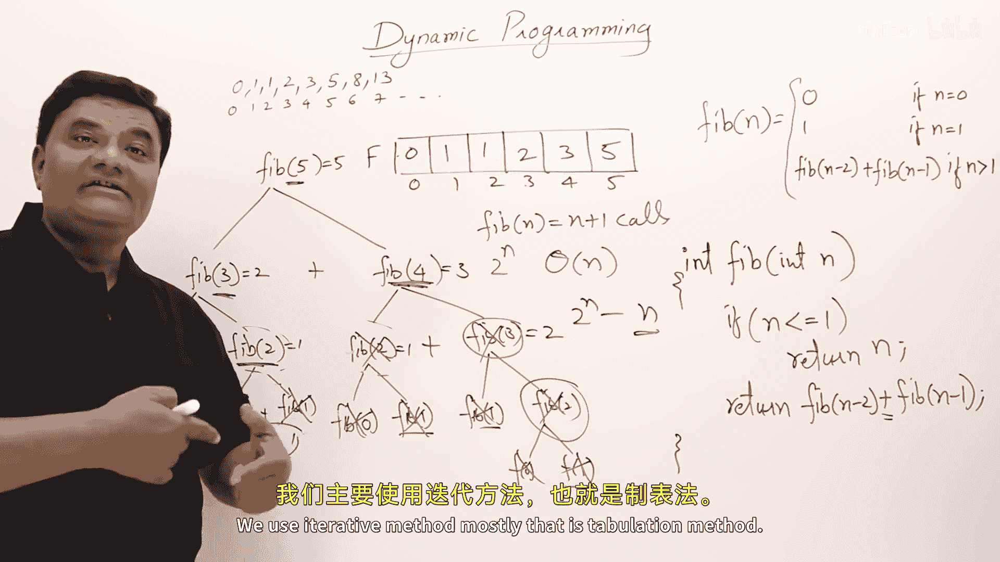

The same problem， how I can solve it using tabulation method， I'll show you now。

Here is a iterative function that is using loop， same function for finding Fibonnay series or at the term of Fibonacxi series。

 See the formula of n -2 n n -1。 the same formula is used， but this is using loop。

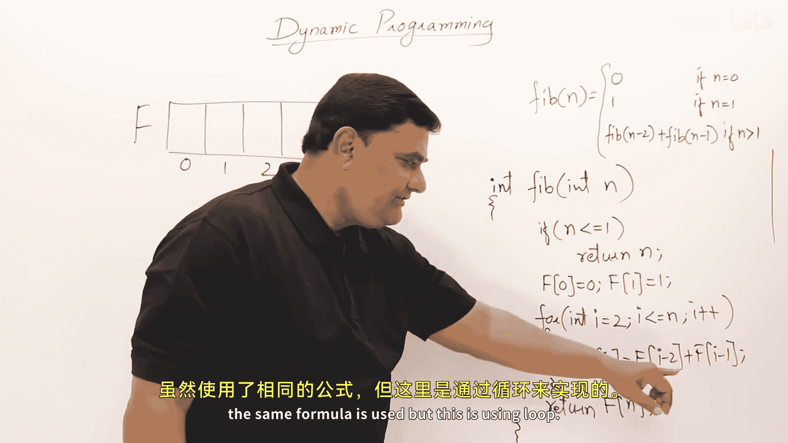

Let us see how this function works if I have to find out fib of5 that is fifth the term I want to find out。

 so it will enter inside here if n is less than equal to 1 it will return that same thing if it is 0 or 1 directly I'm returning otherwise it will fill f of 0 as 0。

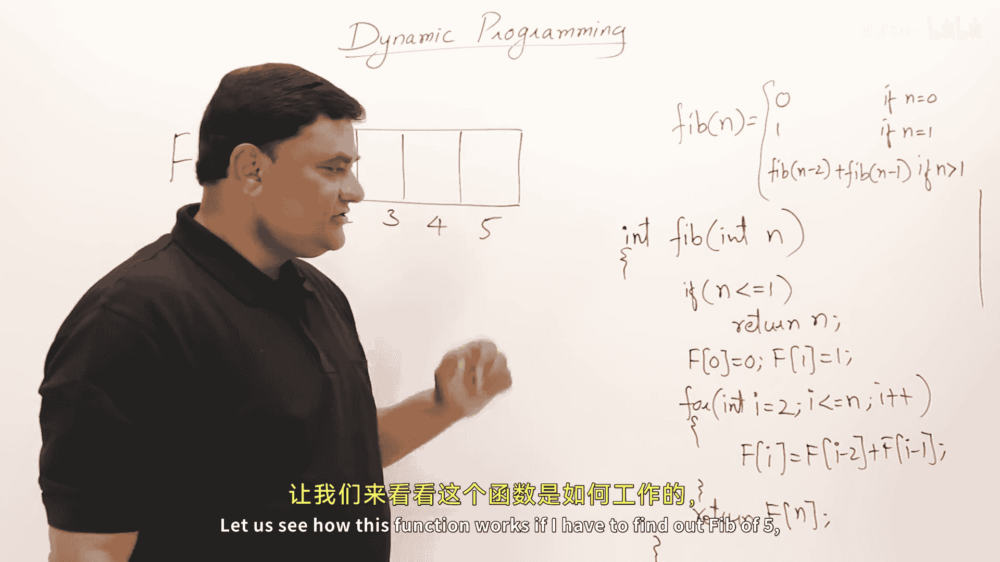

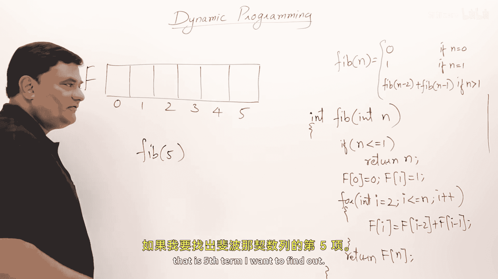

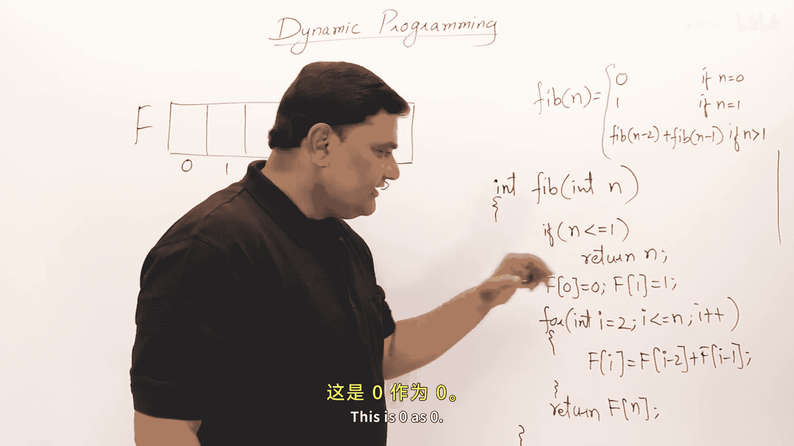

This is 0 as 0。 F of1 S1。 this is one。

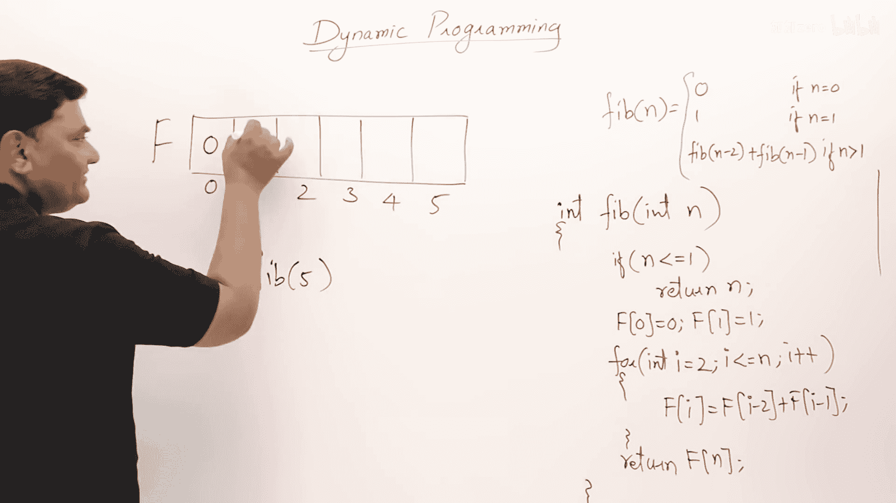

Then the loop starts from I value as2 onward， so I will start from2 onwards。

 So2 to n n is what5 in our example， So2 to n it will go and every time for getting any I the term it will add previous two terms。

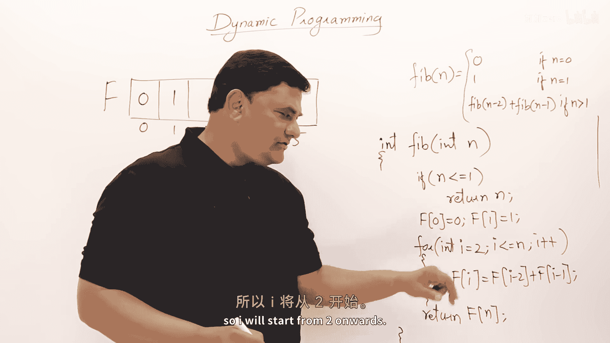

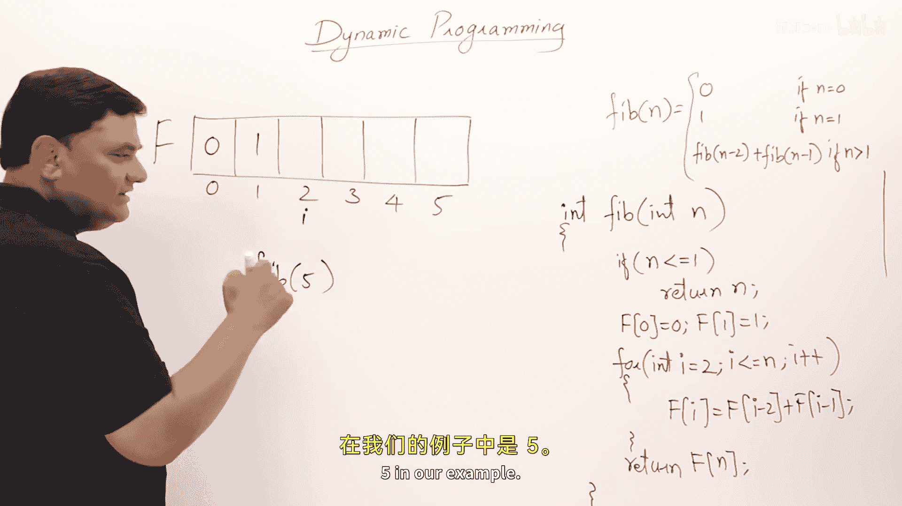

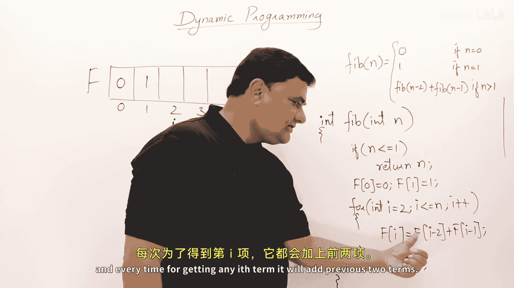

So for getting this term， it will add these two terms。 So this is I -2， and this is I -1。 Add it。

 So this is one Next is I plus plus。 So I moves to next。And add these to the night plus plus。

I these two。Then add these two。 So it returns F of n。 n is what5。 So F of 5， that is answer is 5。

5 the2 is 5 only here。This is how a table is generated by this function。

 so this is how we write the algorithms for dynamic programming we write mostly iterative functions only which will fill up the table to get the value and the filling is done from which onvo which value onwards is from smaller value onwards so we say this is bottom up approach we wanted five so we started from0 onwards and we reach five。

Whereas in recursion， if you recall this was starting from 5。

 then it was calling fihi of 3 and fihi of 4， so from top it was starting。

Then it was going till bottom。 Then it was coming back again。 So it was a top down。

 but this is from 0。 it has started first。 So this is。Bottom up approach。

So the approach are different mostly tabulation is used if you want to frame it as recursion。

 you can frame them as recursion also。Thats all this is the difference between tabulation method and previously I have already shown you memorization。

So any of these methods can be used， but mostly the problems are solved using tabulation method and dynamic programming。

The main important thing in dynamic programming is that we should get the approach for solving the problem。

 so if you get the idea how the strategy is working then you can solve any other problem which is suitable for dynamic programming。

 you can devise your own approach。Right，So I'll be focusing on that one。

 how to get the idea of solving a problem。 So watch next video on problems of dynamic programming。

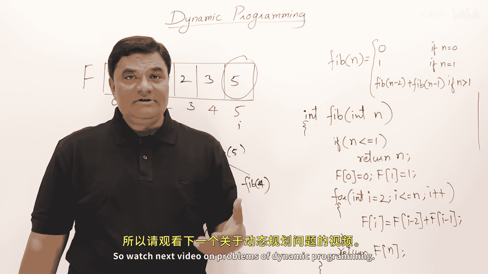