# 【精译⚡算法导论】AbdulBari p48 p47 4.1.1 MultiStage Graph (Program) - Dynamic Programming -BV1hhPXeTEWM_p48-

The problem is multist graph already I have one video on multist graph explaining how the formula is generated。

 how dynamic programming is applied to solve that problem。Now here I have a program。

 I'll explain how the program works and how using the program I can solve this one。

So this is for just explaining the program for multistage graph， so using the program。

 I will trace it and I will solve multitage graph problem。

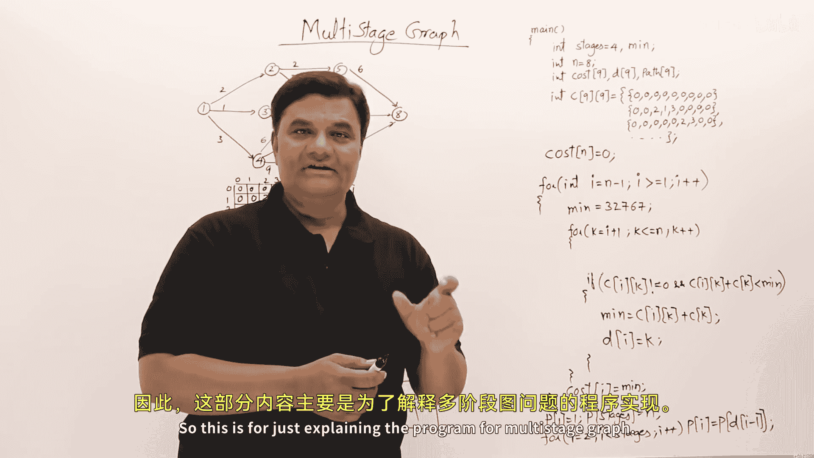

I have written a simple CEC plus plus syntax that is everything is inside main function only。

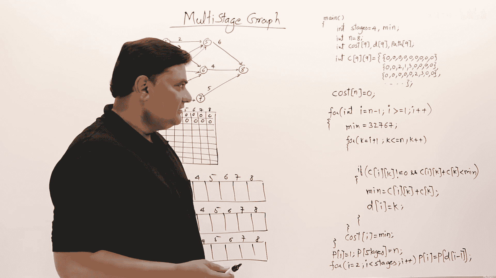

Let us see what other the data structure require see this is the graphical representation of a graph。

 this is having multiple stages there are four stages。And what is the data structure required？

We require a cost ad matrix representing the cost of the edges。There are one to eight vertices。

But the array index starts from0 onward， so I have taken size as 9 that is 0 to 80 to8。

 so first one first column will be all zeros。 I have partially filled this adjaency matrix for representing the cost like from 1 to21 to 3。

1 to 4， so 234。122，123，1 to4， the costs are given here。So here in the program。

 this is the course ofi matrix。That is representing the graph， so directly I have given the input。

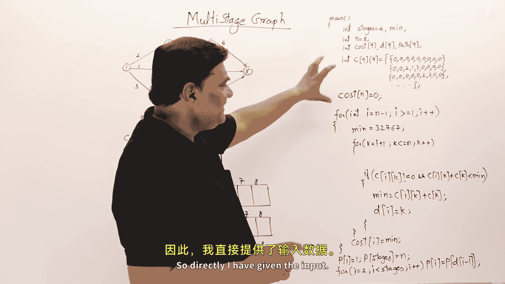

I'm not taking it as an input， so if you want you can change the program to take the input from the keyboard。

 I have directly written the code for this particular instance。Now for finding the course。

 we require a cost array and for knowing why which vertex we are getting the shortest path D arrays there and finally to find out the path one more array is there。

So there are three arrays here cost and the D is for small minimum distance and the path so these are all data structure。

 there are four stages，8 vertices and the cost arrays 9 d all these are 9 and these is also 9 by n the reason of taking nine is we have the vertices starting from1 onwards。

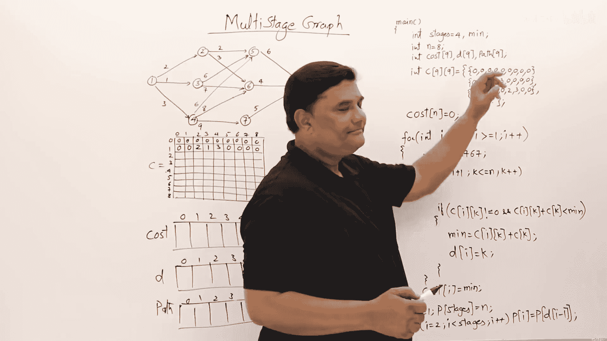

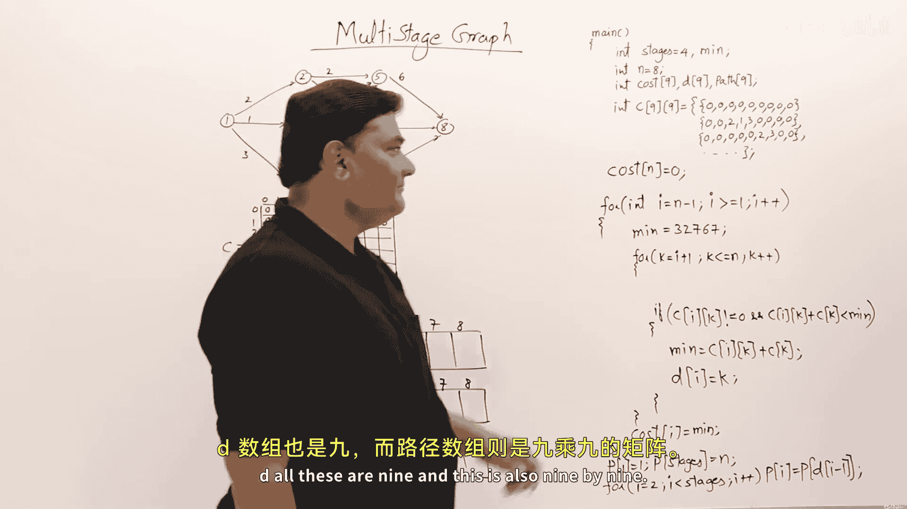

But the indices of an array starts from Z onwards。So we want from1 to 8。

 so I have to take the size as  nine， so I get from0 to 8。Now let us see the working。

Using forward method， if we find out the cost of a multi stage graph that is shortest distance from source to sync。

 we start solving it from the last vertex。 That is 8， then 7，6，5，4，3 like that。

 So we'll start from the last vertex。 Let us see how this is working。 And following that。

 I will fill up these values。

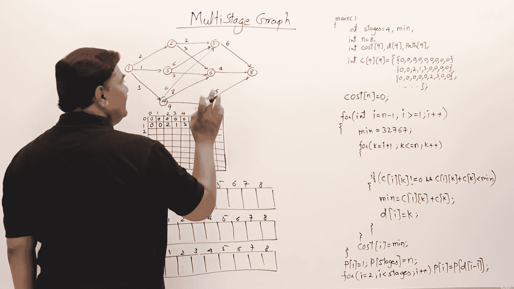

Cost of 8， and is 8 is 0。

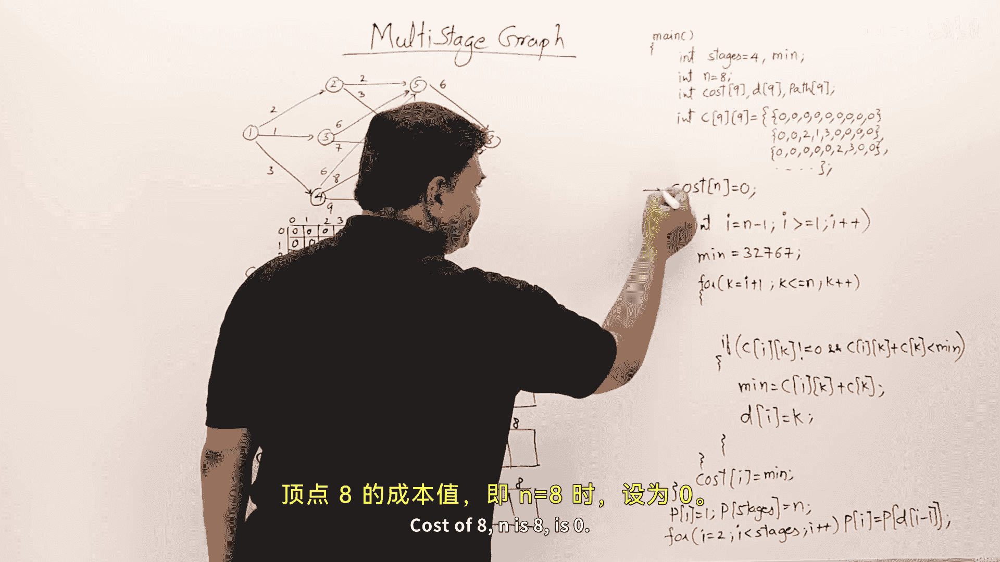

Because this is the sink from here I don't have to go anywhere， so the cost is zero。

Now to find out the cost for the remaining vertices， n is 8 right， So n minus1 to1。

 So this lo is from n minus1 to1。

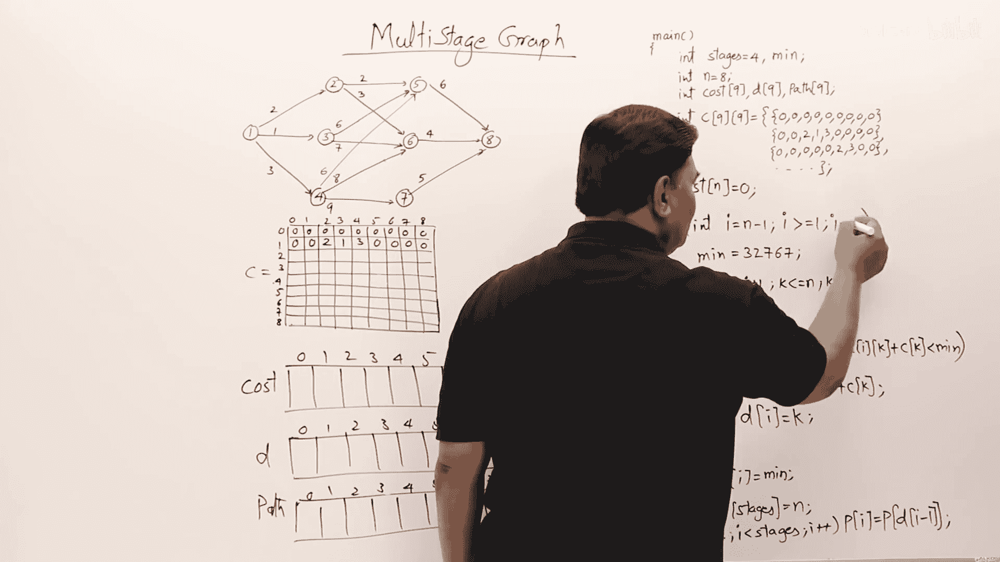

So this loop is from n minus-1 to1。So this is decrementing loop。So in this loop。

 everything is happening。 that is cost is calculated。 How it is done。

 I will show it for one or two vertices。

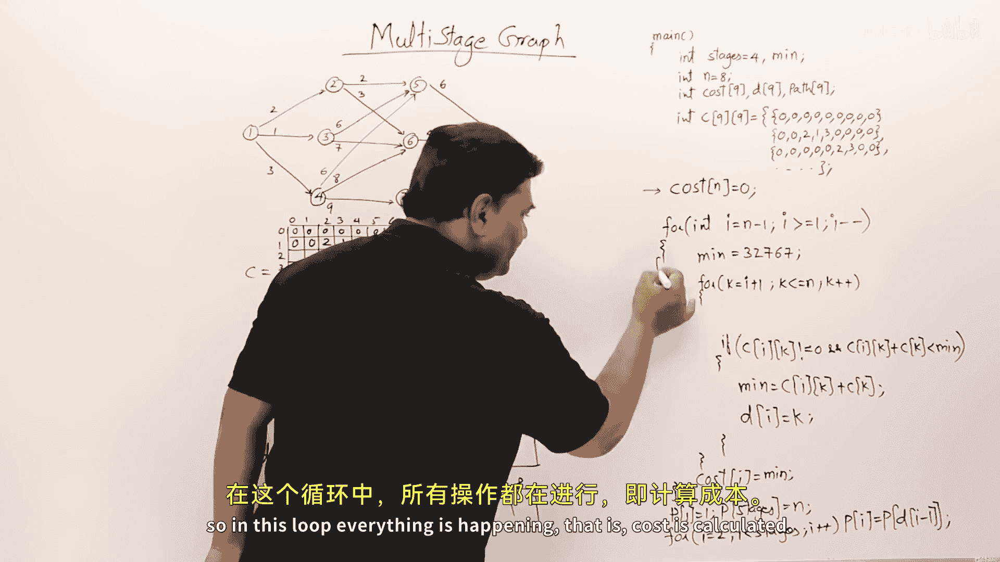

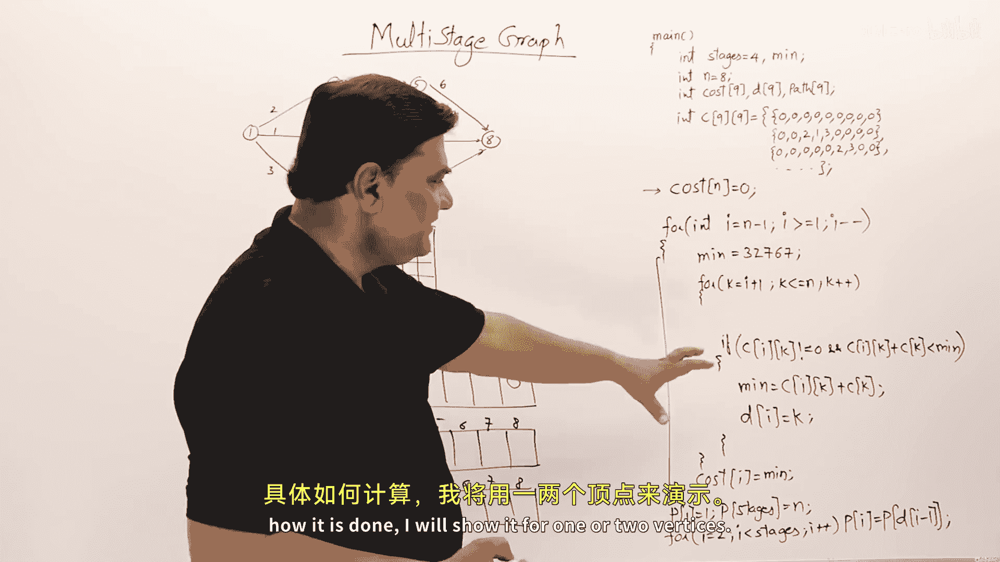

But。From n minus1 to8 minus7 to 1， if I start for7 directly I can know the cost that is5 there is single h46。

 there is a direct edge445， there is a direct edge6。

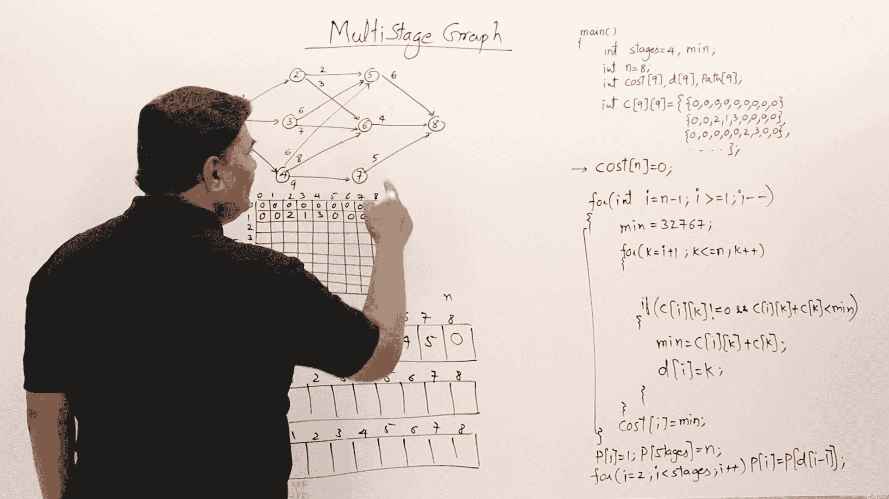

So without tracing， I have simply filled this values。Now I'm on the vertex4。

 so let us trace this one when I is4， I is a4。If you remember the formula for finding the cost of any vertex。

 the formula is cost of any vertex I， that is this cost。As minimum of。Cast of an edge from。I do care。

Plus， cost of gay。This is the formula law。 See the C's Caimatics Caus costter。So this is the formula。

 So now when I is4。 So I want to know the cost of four cost of four。 That is minimum of。What。😡。

I to k cost of K。 K is what K is all other vertices from4。 If there is any edge connecting。

 I should take that。 So which vertices I should take for 4，4 shall I start from all1 to8 vertices。

 No， only take those vertices， which are greater than 4， because we are finding in reverse。

 and in multis stageage graph， the edges will be going in forward direction only So this is 4 to 5。

4 to 6，4 to 7 and 4 to 8， though，4，4 to 8 edge will not be there。

 But all other vertices after4 onward。 So if I is 4， if I is 4， then I plus 1 to N。

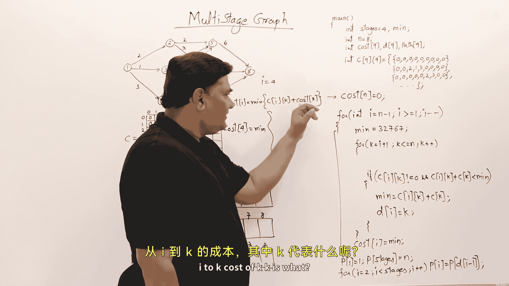

This loop， if you see i plus 1，2 n。

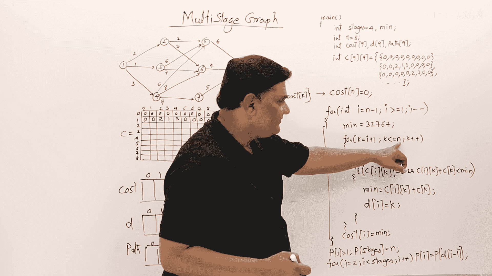

So I should consider all values as k。 So k will become first what5。 So if I take5。

 then cost of4 comma 5， this will be4 comma 5。Right， C of 4 comm 5， C or 4 comma 5。

 It will be this one。 So 4 comma 5 is how much 6。 So actually， this should be 6。

 and this should be 8， and this should be 9。 I have not filled this one。 If it is filled。

 it is like this4 comma 5 is 6。 So when the K is equals to 5 K a is equals to 5。

 it is 6 plus what is the cost of 5 Co of 5 Co of 5 is already known here。 already we have hung out。

 So 6。That's all。 this is one。 So here， if you can see that k is taking the value 5 and here that formula is used。

Now， next， K will be 6。 K will be 6。So4 comma 6， this is 4 comma 6 and cost of 6，4 comm 6。

4 comm 6 is how much 8。8 plus cost of K 6 is how much4。 So 8 plus 4，12。The next time， K will be 7。

 So K plus plus K is 7。 So4com 7。And this is also seven。4 comma 7 is4 comma 7 is 9。 So K is 7。

4 comma 7 is 9 plus cost of 7 is how much 5，5。

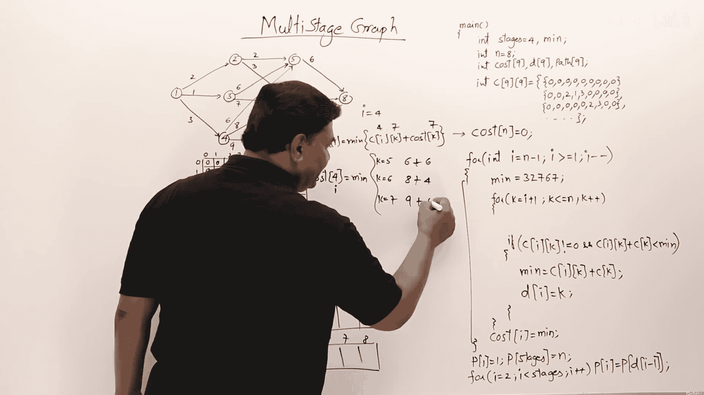

The next K will also be 8。This loop will repeat from K plus 1 to n。 So I is what4。

4 plus 1 to 8 that is 5 to8。 so this loop will repeat。

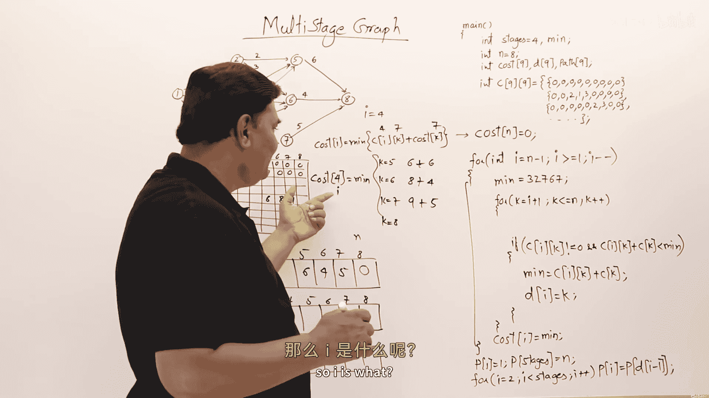

Right in that it will take different k values。 So this loop is taking K as a5 and 6 and 7 and also 8。

 but for eight here there is one condition。If C of Pa K is not equal to 0， then find out the cost。

C of i comma k， so k is what now 8， so 4 comma 8， what it will be there is no edge， so it is0。

 so it is 0， it will not take the cost。So repeatedly it will calculate all and find out if any cost is less than minimum then it will change that minimum sort of this whose minimum this is 2 and this also 12 and this is 14。

 so anyone we can take so will take this 2。

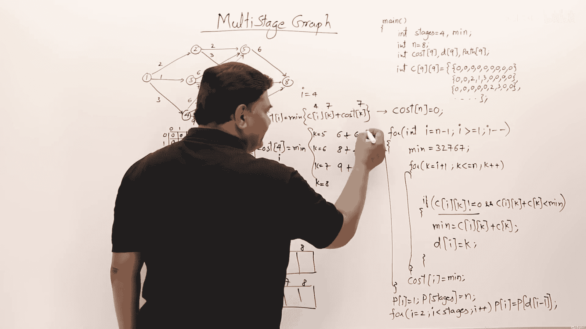

So the answer for this four is to well and who gave minimum k that is5。So for a full， this is five。

K was 5。 So D of I is equals to k， whichever is giving minimum。 So we are stor that also。 So anyway。

 after this follow loop， I am storing that minimum value inside this also， it can be done。

 But after finalizing the minimum value stored here。

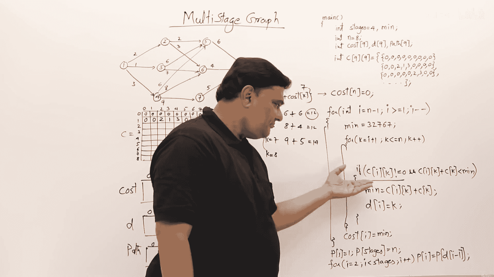

So this is how it was for four now same way it will work for three then two then one。

I missed this one， I did not feel the d values for7。

6 and 8 all are going on8 only right we are going on vertex 8。

 but for45 is giving minimum so5 is the answer here。

Now I'll find out for two three more versses are remaining quickly I will do that also。

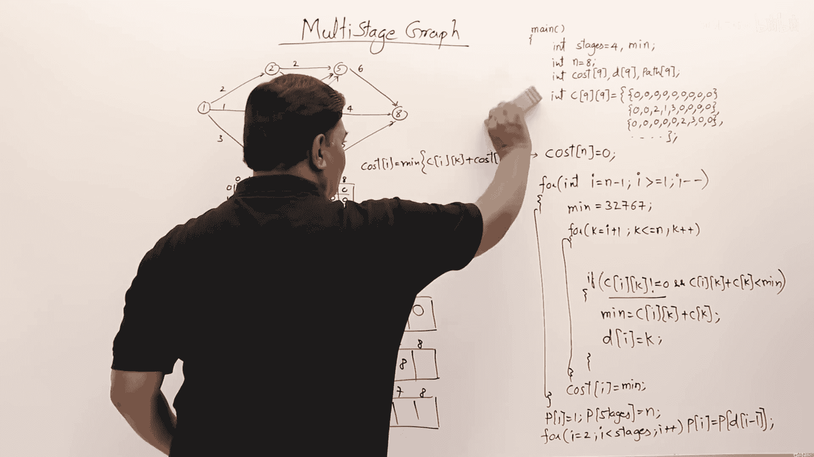

Next is I is decrementing， I will become3， so C of3 comma first。😡，K will take the values from 4 to n。

 That is 4 to 8， I plus 1 to 8。 So first， it will be 4。So this is minimum off。So k will be 4。

 then K will be 5， then K will be 6 and k will be 7 and k will be 8。 But if you see from3。

 if you see that edge just that are going to 5 and 6 only rest of them will all will be 0。

 So if I fill this row，43。 So3 to 0， nothing 3 to 1，3 to2，3 to 3，3 to 4，325 it is 6 and 3 to 6。

 it is 7 and rest of them are all0s。 So only which will be evaluated 45 and 6 will be evaluatedd。

 So 5 and 6 rest of all 0 is only though it will try from 4 to 8，4 to 8。

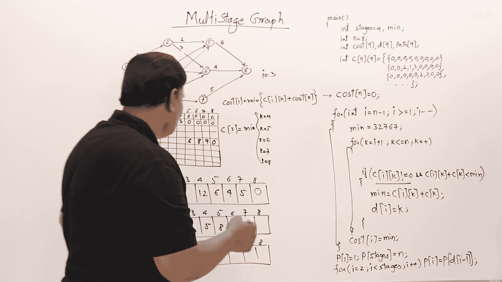

So for this， C of C2 that is 3，2，5。 C of 3 comma 5 is how much6。

 So this will be 6 plus cost of5 is how much。6。And this is。7 and plus cost of 6 how how much4。

 So this is 12， And this is 11。 So this is smaller。 So 6，11 and 6 is the intermediate vertex。

So this is how we will continue。 I will fill up others directly now。Already。

 I have filled this value。 So the minimum cost that is cost of。The graph is 9。

 So the cost of vertex 1， we got it as 9。 So that is the minimum distance from source vertex to since ver。

But。What are the vertices they have to take， What is the path， So as there are four stages。

 we get total 4 vertices。 So here is the code given for finding the path。 So that is。

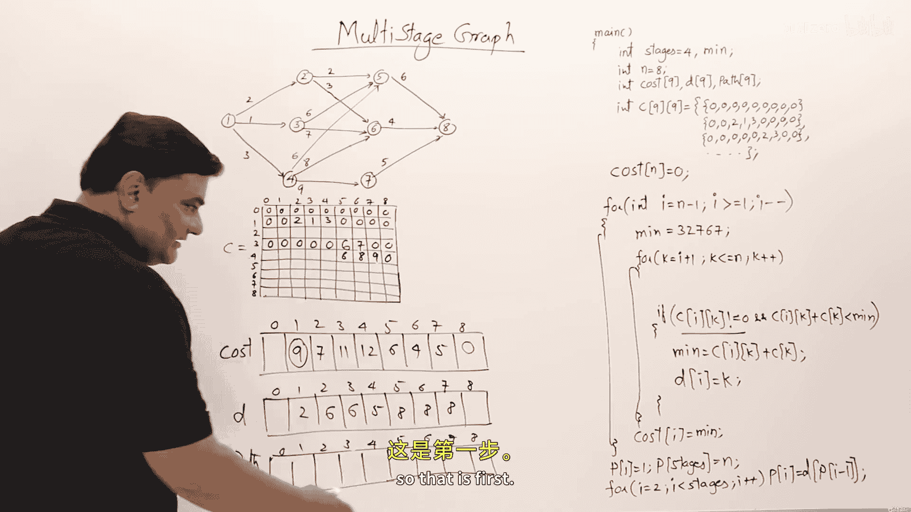

First p1 is 1， so the first vertex is1 because the starting stages vertex is1。

 then p of stages that is stages is4， four stages， so n that is 8。

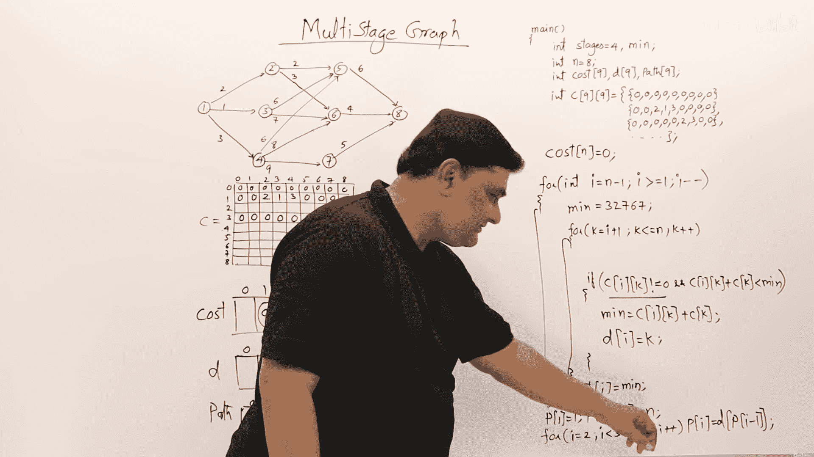

N S 8 here。 So at 4， we will write 8。 So actually， we don't need this。

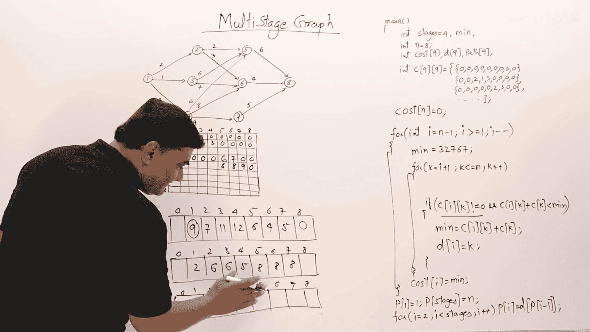

So 0 to 4 is sufficient。 Now， remaining two vertices。

 what should be the intermediate vertices that is found using this formula。 So P of I。

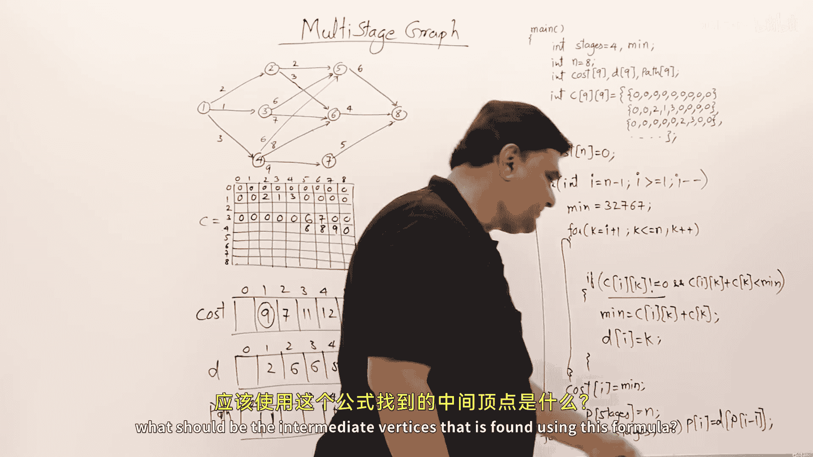

Is D off。B， I -1。See this， we have to find from two onwards，2 to less than stages。 So first。

 I will put here 2。 So two is what D of。P of 2 -1。So this is one， P of1， P of1 is how much1。 So D1。

 what is a D1， D1 is 2。 So P of two is filled with the two。 So this will be2。It means from one。

 we should go to2。 The next is3。 So D of。B of 3-1。So 3-1 is what2。 So this is2。 So D of2 is how much。

 D of2 is how much。6， so this is filled with 6。 So this is filled with 6。

 So is it means the shortest path is from 1 to 2，2 to 6，6 to 8。 So 1 to 2，2，2 6 and 6 to 8。

 This is the shortest path。So shortest distance from source to sync。

 So I have used the program and solved this one， trace this one。If you look at the programme。

 there are two nested loop， the time complexity of this algorithm that there are two nested loops。

 so blindly， we can say in square， but we should not say blindly。 Let us observe。

 This is repeating for n -1 to1 means almost n times。

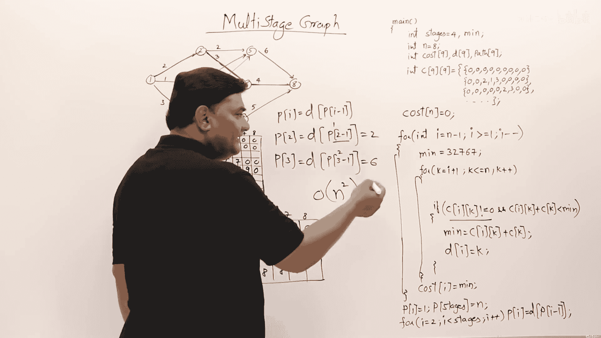

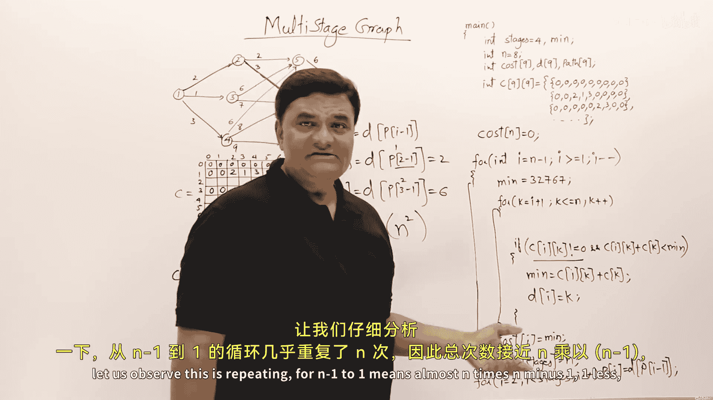

And-11 less。 So almost n times。 But inside that actual working is here。 The formalized computer here。

 This is done how many times。 So when this is n， this is starting from I plus 1 to n。

 So first time for first vertex。 That is we start from last vertex。 right，9 is8 is already completed。

 So for this， there will be only one vertex for this， there will be two vertices。

 So this is increasing one time it first time it will check only for one vertex。

 Next time it will be checking for two vertices， then it will be checking for three vertices。

 And when it is on 4， it will check for 5，6，7，8。 when it is on 3， it will check for 4，5，6，7，8。

 So it is slowly increasing and going up to n。 So this is n into n plus 1 by 2。

 So this is roughly n square only。😊。

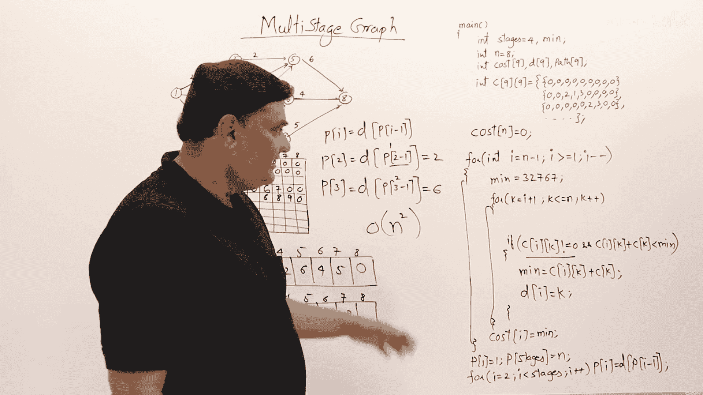

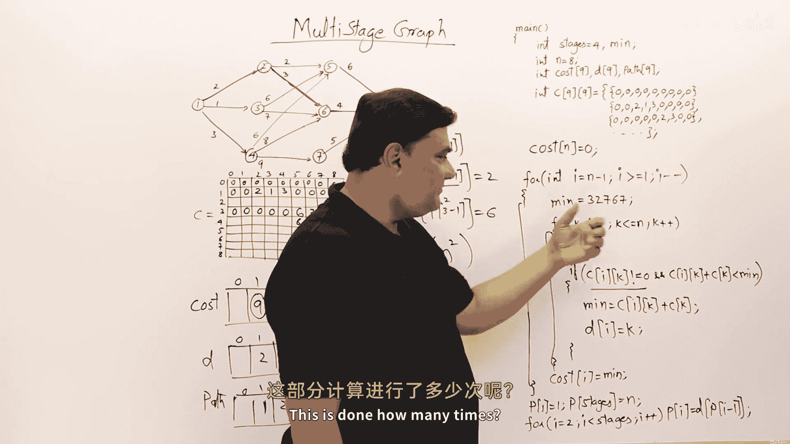

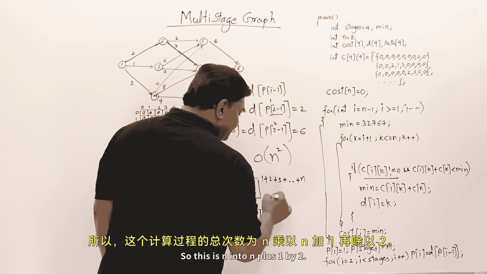

So the time complexity of multi stage graph is n square。

