# 【精译⚡算法导论】AbdulBari p49 p48 4.2 All Pairs Shortest Path (Floyd-Warshall) - Dynamic Programming -BV1hhPXeTEWM_p49-

The problem is all pay shortest part in this video， we will look at a problem。

 and we will solve it using dynamic programming approach。 Then I will show you what is the formula。

 how we get the formula for dynamic programming， And also I will show you a piece of code for solving the problem。

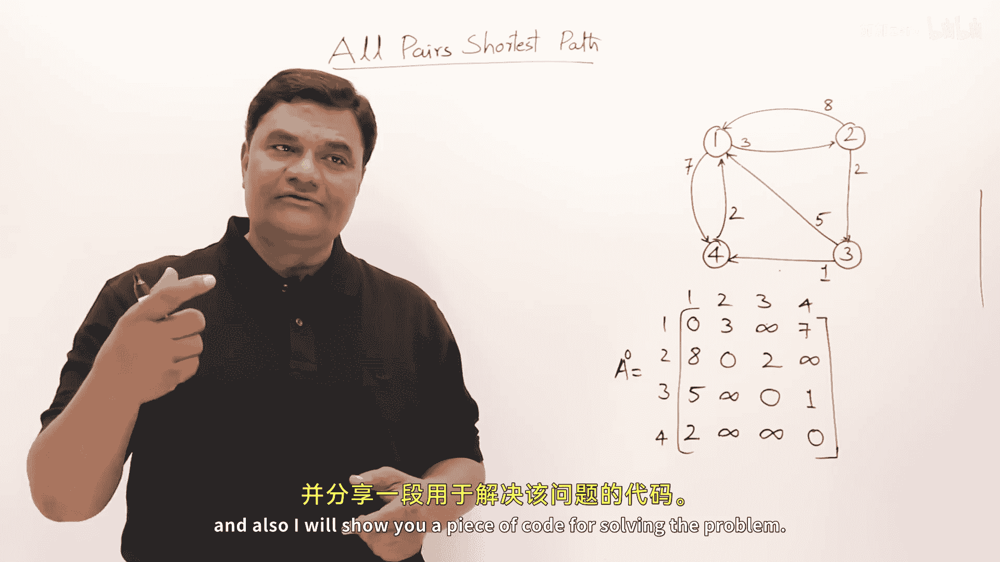

So let us start what the problem is the problem is to find the shortest part between every pair of vertices。

 let us say the starting vertex is1 then I should find out our path。

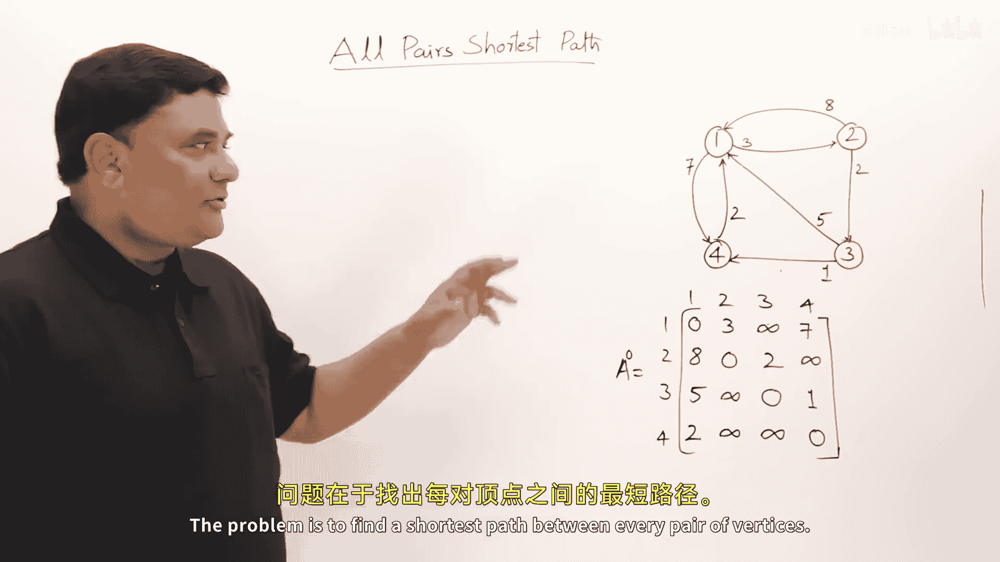

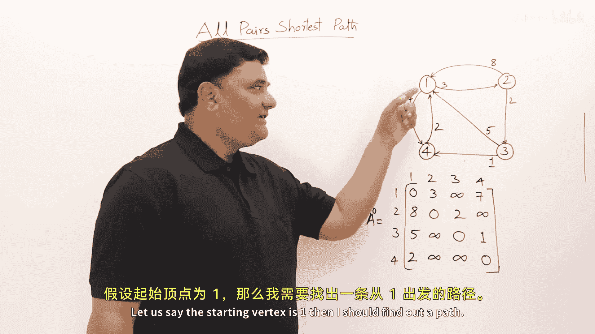

From one to2， one2 three， and one to four。Then again， selecting two as a starting vertex。

 I should find a shortest part to vertex 1 and 3 and 4， Similarlyly from 3。

 I should find a shortest part from one to and4， from 4 to  one and2 and3。

So this looks similar to single source shortest part that is ditrim。

 but ditrim will find out a shortest part from one of the source vertex。

And di star order of n square time。If I run the external algorithm on all the vertices1 by one that is all in vertices。

 then I can get the result， Yes， I can use the external algorithm for solving this problem for all in vertices1 by one and for each vertex it will take n square time and the time will be order of nq。

So this problem can be solved using greedy method also。

 but let uss now see how we can apply dynamic programming for solving this problem how the problem can be solved using dynamic programming。

 dynamic programming says that the problem should be solved by taking sequence of decision in each stage we will take a decision。

So what decision I have to take， Let us see， see if I have to find a shortest path between vertex1 to 2。

So there will be a direct edge part from one to two also like here you can see。

 or maybe there is a shorter path going via vertex 3。Or it may be going via vertex 4。So in this way。

 I have to check or decide whether a shorter path is going via some other vertex。

 so Ill start selecting the middle vertex as vertex 1。

So I will find out first whether there is a shorter part between all the pair of vertices going via vertex 1 then via vertex 2 and so on。

 so this is how we can take decision or sequence of decisions。So how this can be done。

 this can be done by just preparing mattress explaining this edge matrix see here from one to 1 or 2 to 24 to 4。

 there is no edge that's why all these are zerosmith there is no edge possible that loops are not possible。

 then there is an edge going from one to 2 so one to 2 the cost of an hs 3。

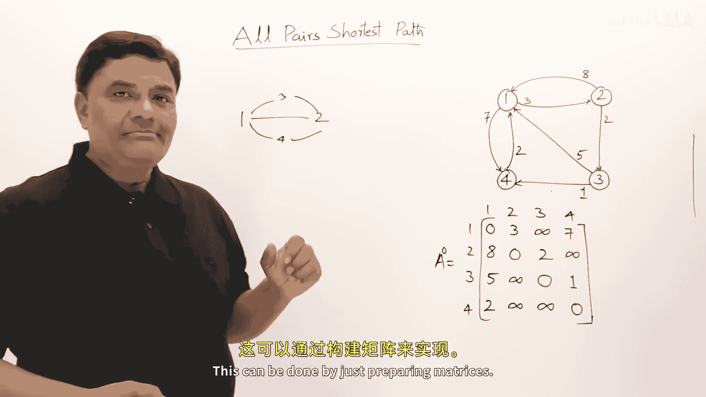

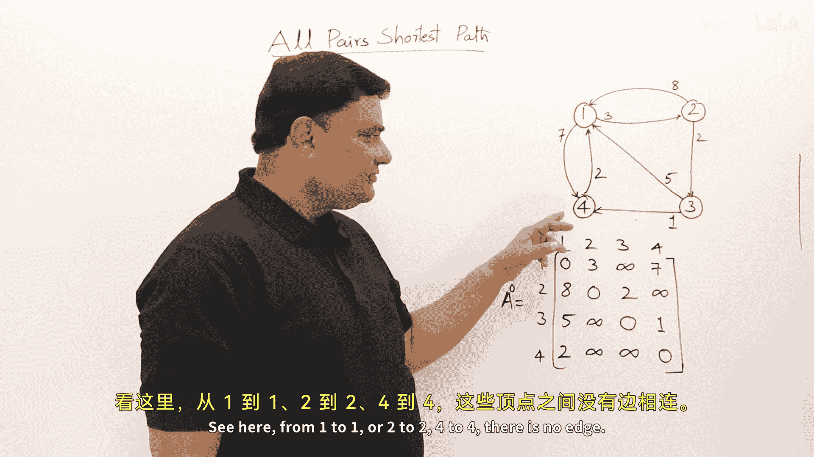

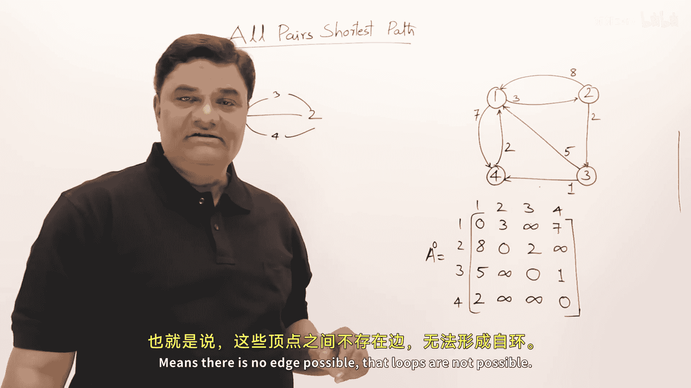

And similarly， there is an edge going from2 to three， so the cost of an edge is2， so 3，2 to 3。

 the cost of an edge is 2。If there is no edge from3 to 2 there is no edge you see so3 to 2 is kept as infinity in case of absence of any edge we will take it as infinity otherwise for self loop we will show them as0 now how we will solve this is we will solve it by preparing mattresses so let us see how mattresses can be prepared。

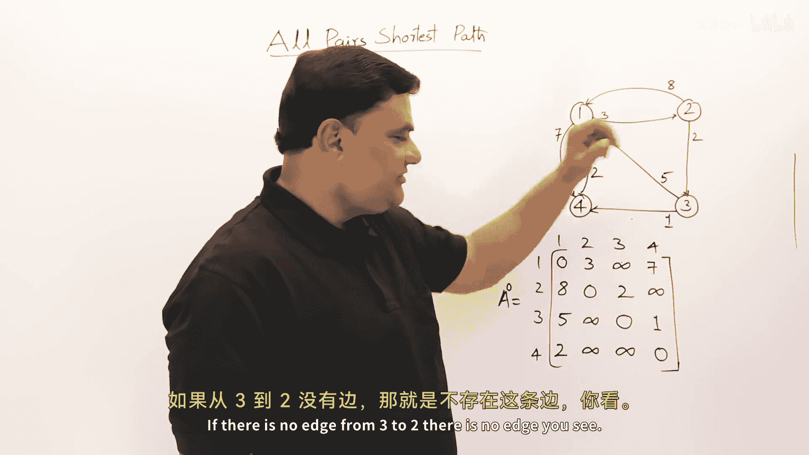

Let us prepare matrix for1， a1。 See this was a0 original matrix。 Now here。

 Im going to consider the intermediate vertex as vertex 1。

 So is there any better shorter path going where vertex 1 So when I say vertex 1 then all the path that belongs to vertex1 will remain unchanged。

 so I should not calculate them directly I can take them here。 So those values are 0。

3 infinity and 7。 And these are 8，5 and 2。 So first row and first column already I have taken as it is。

 Then what about the diagonals there are no cell loops I'll fill those diagonals also。

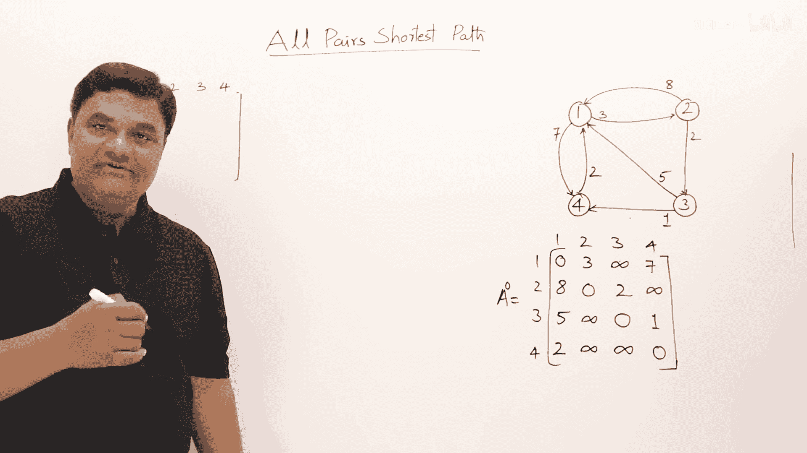

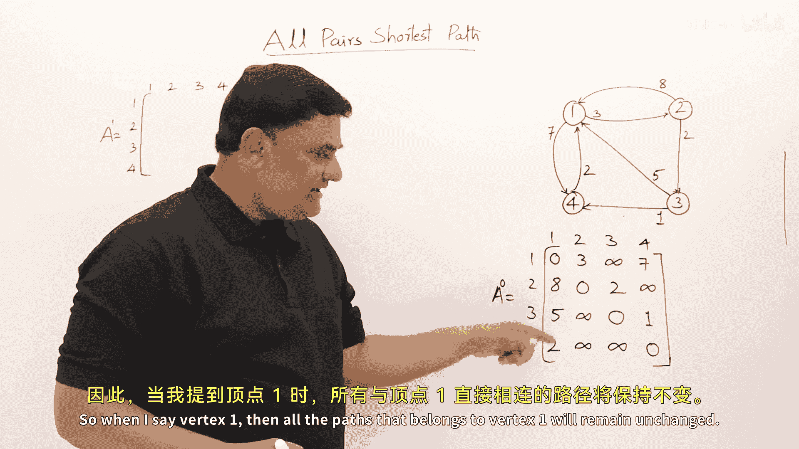

Now remaining values I have to find out。 What are those。 First， let us check this one that is2 to3。

 So how to get this value， how to check whether there is a shorter path via vertex 1 or not。

 So 2 to3 I will take。

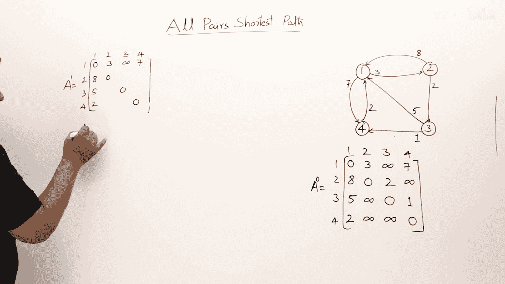

A0 of2 to 3。 So what is there in this matrix2 to 3， So 2 to3 is a 2。

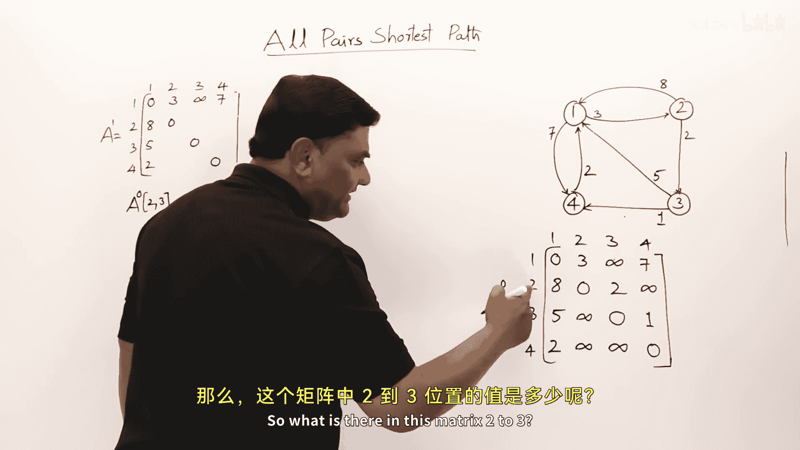

And。A0 of now， in between， I should include vertex 1。 So 2 to1 and。One to three from those matters。

From that matrix，2 to1 and 1 to 3，2 to 1 is how much 8，1 to 3 is infinity。

 so this is 8 plus infinity， this is infinity only this is less。

 so there is no better path where vertex1 so let it be2 only。Now。

 I have to find out next one that is 2 to 4。 So a0 of 2 to 4。What is the value there，2 to 4。

2 to 4 is infinity。 This is infinity。 Now， I should include vertex1 in between as an intermediate vertex。

 So a 0 of 2 to1 plus a 0 of。1 to 4。 So from that matrix， find out 2 to 1 and 1 to 4。

2 to 1 is how much 8， Then 1 to 4 is 7，15。 So this is 8 plus 7。 This is 15。

 So this one is smaller than infinity。 So update this path to 15。 So this means that from 2 to 4。

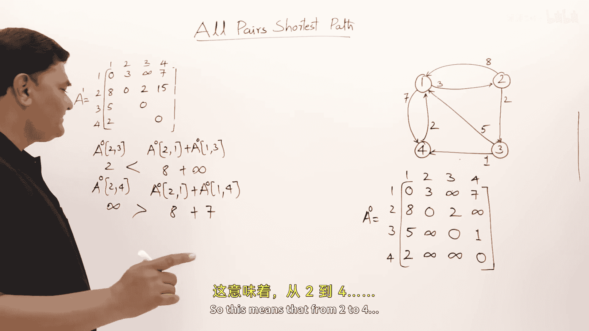

2 to 4。 There is no direct edge path， but 2 to 1 then 124。 That is 8 plus 7，15。

 There is a path going G vertex 1。 That's what we got the answer here。

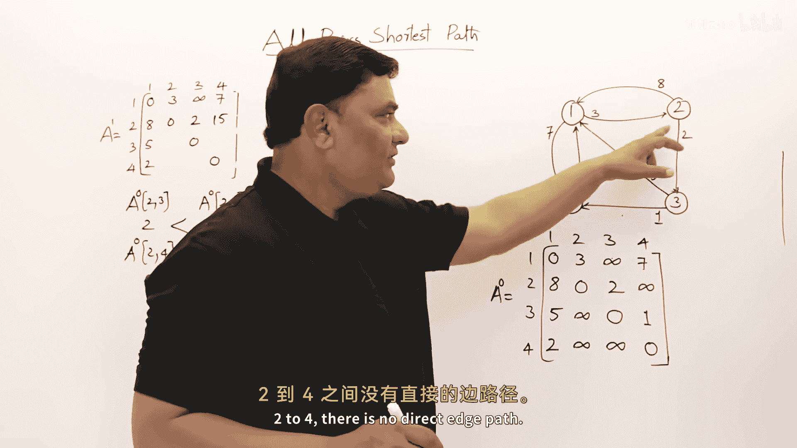

Now， I have to fill up these values， right， So that is 3 to 2。 So I'll find out a 0 of。3，2。

In between， I should add one。3，1。1，2。 So 3 to 2 is how much。

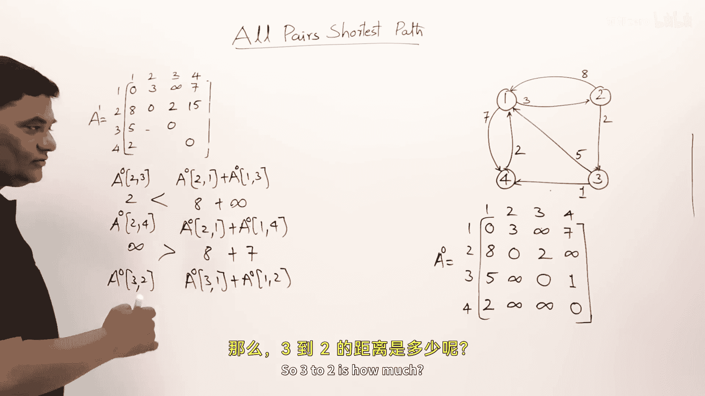

Trade to is infinity。

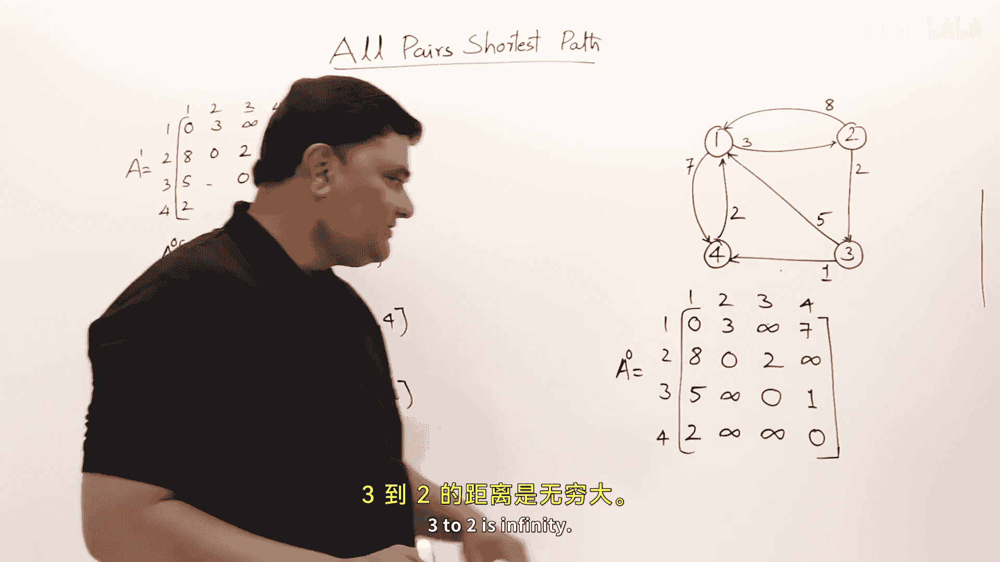

3，1。five。plus。1，2， as a 3。So you can check there here。 Infin is greater。 So this value is smaller。

 That is 8。 So we got a smaller value 8 in the same way， I should fill up all these values。

 So I have prepared this matrix， which is going via vertex 1。 Now I will prepare a matrix。

 which is going via vertex 2。 So I should generate this matrix from this matrix。

 So when I am taking a second matrix2 as a intermediate vertex。

 Then second row and second column remains as it is。 So I will take this second row。

 second column as it is8，0，2 and 15 second column is 3，0，8，8。

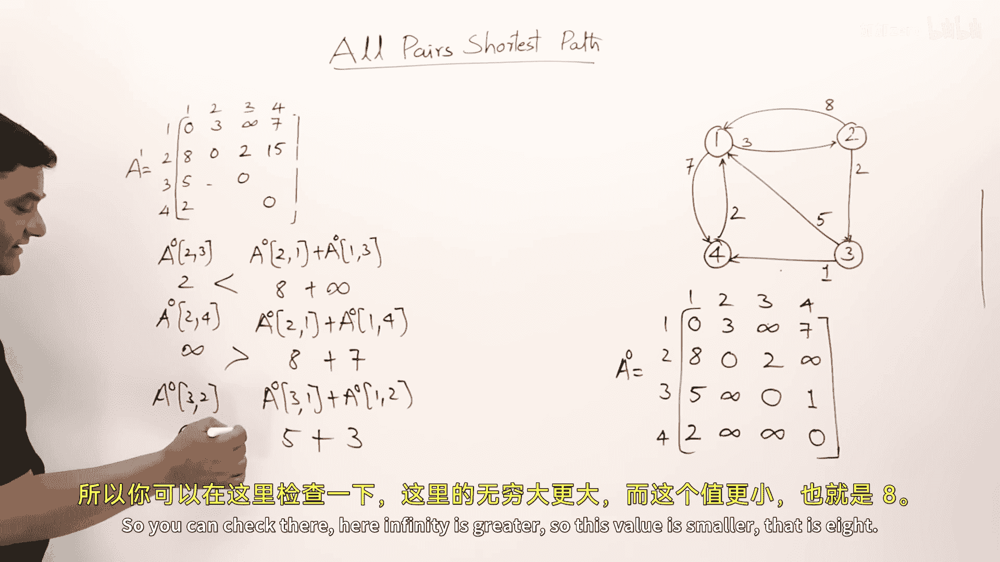

3，0，8，8， and the diagonals remains0 only。Now I have to find out few values here。

What are those first one is 1，2 3。 Let me find out from this matrix。 A 1 of1 comma 3。

 A 1 of1 comma 3 here，1 comma 3 is what infinity。 Then in between， I should include vertex 2。

 So a 1 of in between 1，2，3， So 1，2，2 plus a1 of 2， to 3。Check this one， one to two is2，3。

And 2 to 3 is 2。 So this is 3 plus 2。 That is 5。 And this is smaller。 Upate this。 Now。

 this was infinity。 Now， we got a pathway over text 2 in between 1 and 3，1，2 3。

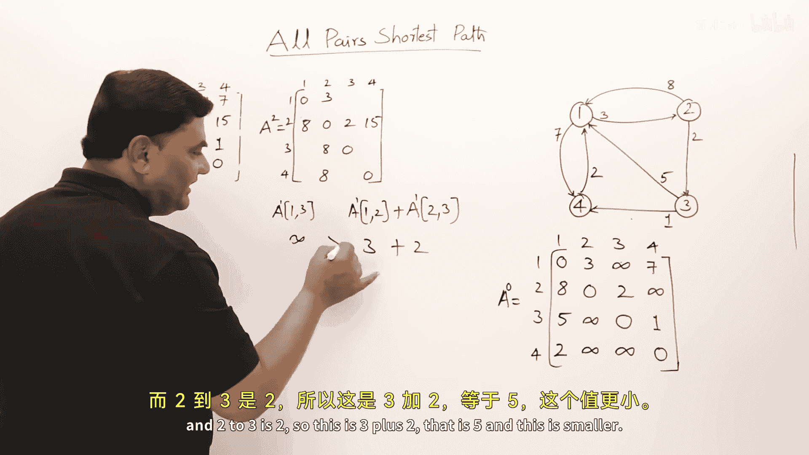

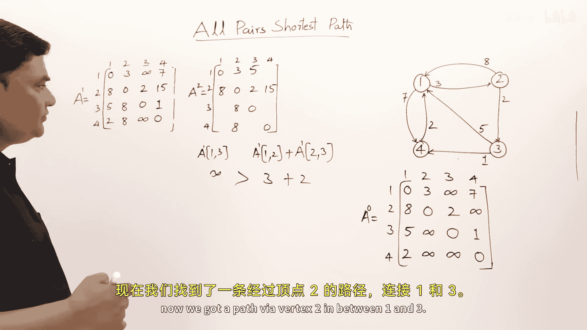

There is a path going to two then three so3 plus2，5， we got a path here。

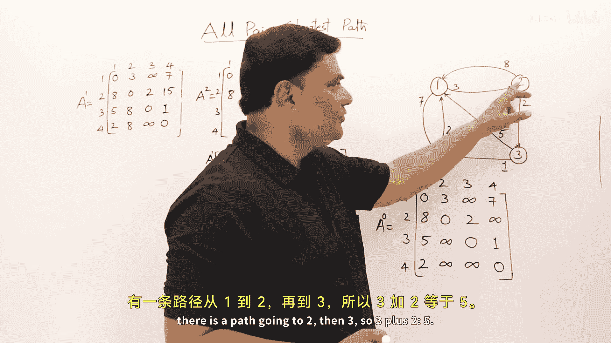

So that's it。 Now I should get this value 124。 So a1 of1 comm of 4 is homo here 7。Then in between。

 I should introduce vertex2， so1 to2 plus a1 of。2 to4。So one to2 is how much 3。

Plus 2 to 4 is how much 15。 So this 18， but this 7， which is already there， which is better。

 So take this 7。Now， in the same way， I should fill up all these values。

 already I have prepared this vertex 2 as intermediate vertex。 Now。

 I have to find out vertex 3 as intermediate vertex and generate the matrix。

 When I say 3 as an intermediate vertex， then the third row， and third column remains sity。

 So this is 5，8，0，1， and this is 5，2，0，7。 and the diagonals are 0。

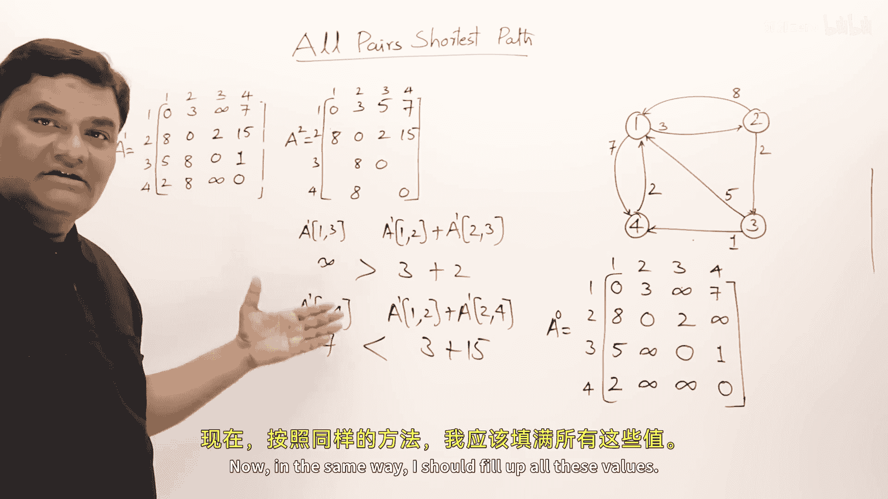

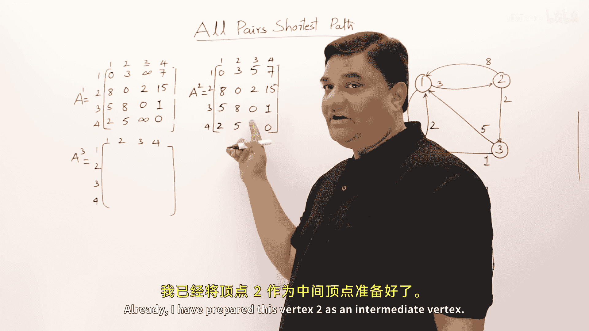

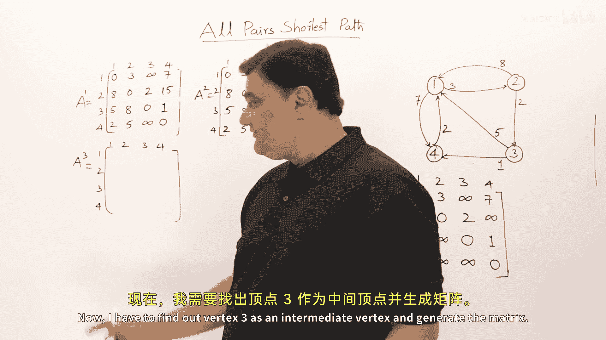

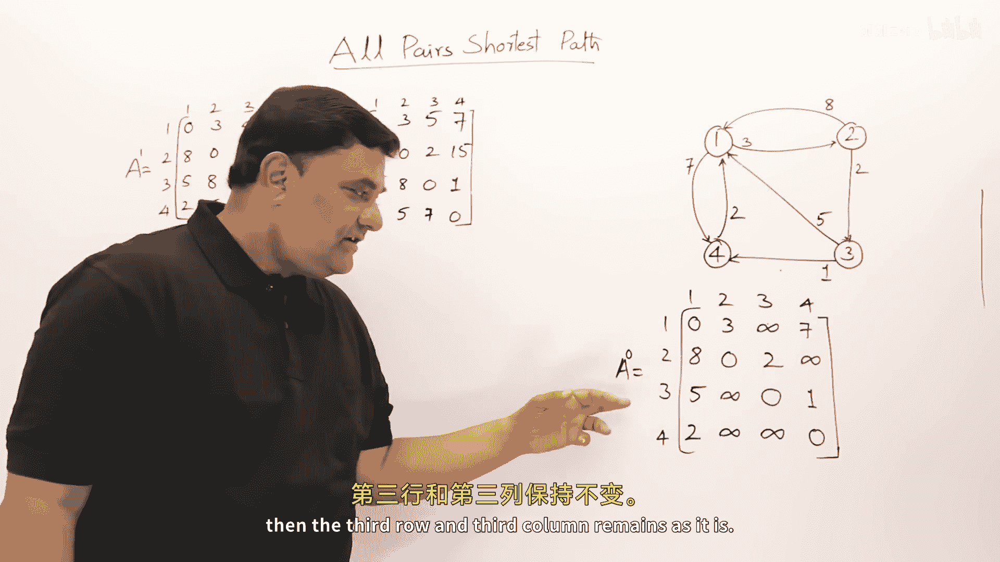

A two of。1， comma 2。And in between， I should take intermediate vertex as 3， then a to of。3 comma2。

 so1 to2 is there。 So in between three is there and3，12 3 and 3 to2。

 So out of this which one is smaller，1 to 2，1 to 2 is how much 3 there and 1 to 3 is how much1 to 3 is 5 plus3 to23 to2 is 8。

5 plus 8，13。 this three itself is smaller。 so take3 only。In the same way。

 I can find out all these values by taking three as intermediate vertex。 Now。

 I hope you have understood how I am getting the values， So I'll prepare all the mattresses。

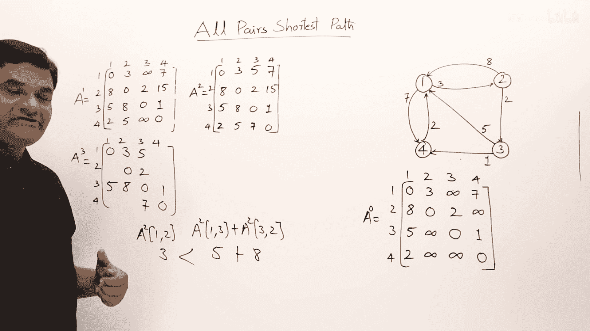

So here are the four mattresses， the finally the fourth vertex when I considered I got a shortest part between all pair of vertices。

 so we have taken sequence of decision in each stage we were getting a matrix here。

 the table is like a matrix here。And finally， these are the shortest parts。

 between every pair of vertex。 What were the formula I was using。 I will prepare the formula。

 getting the value of any matrixex。 Let us say4 is the intermediate vertex or 2 is the intermediate vertex。

 So when I was selecting one of the vertex as an intermediate vertex。

 then how I was getting the values here， I was getting from the previous matrixex for4。

 I was getting from 3 for 3， I got from 2。 So how the formula can be framed。

 So now I will show you the formula for getting a of I comma J of any intermediate vertex。

 any value from any intermediate vertex。 I was taking minimum of。

A of I comma J from which matrix previous matrix that is k minus1。

 if I am generating k at the matrix， then I was taking value from k minus1。

Either this or a of k minus-1 I to k ver x K intermediate ver x S k plus。E of k -1， then K to J。

 So here you can see that K is introduced in between and addition is done。

 So either this one is smaller or this one is smaller out of this， whichever one is smaller。

 I was getting that one。 and I was following the same formula for generating all the mattresses。

 I have shown only few terms that is sufficient for understanding the approach and how the formula I use。

 See， I have first shown you the working。 Then I have generated the formula。

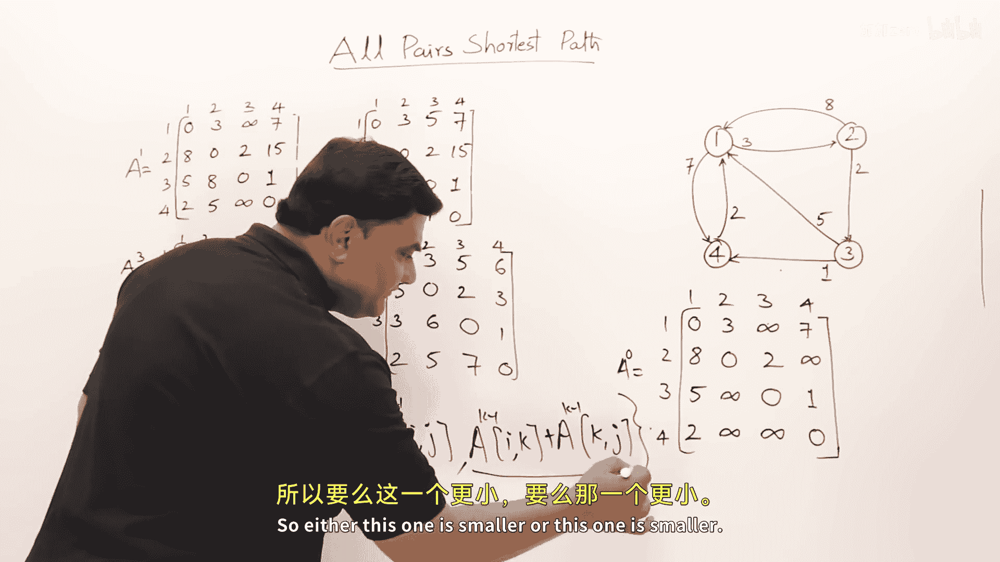

RightInstead of following the formula， I have de use the formula。That's it。

 Now let me show you how the code looks like if I am writing the code。

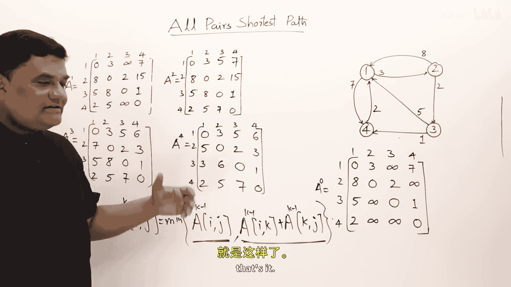

Now， let us look at the code every time I was generating the matrix。

 So how many such mates I have generated four such mates I have generated。

Right now for generating a matrix what I am supposed to do， I should generate each and every term。

 So total how manyy terms are there。 See the number of vertices are4。 So let us say n vertices。

 So the number of elements are n cross n there is a square matrix。 Now。

 forgetting all the elements of a square matrix。 I should have two for loops。

 So I'll take two for loops for I assign1 I less than or equal to n I plus plus。

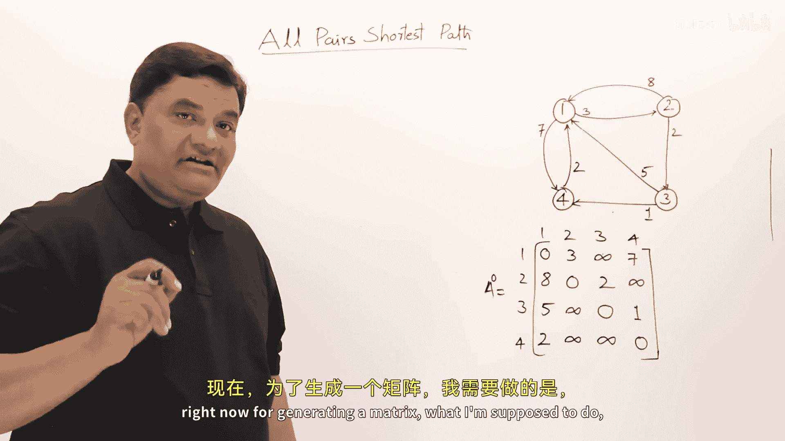

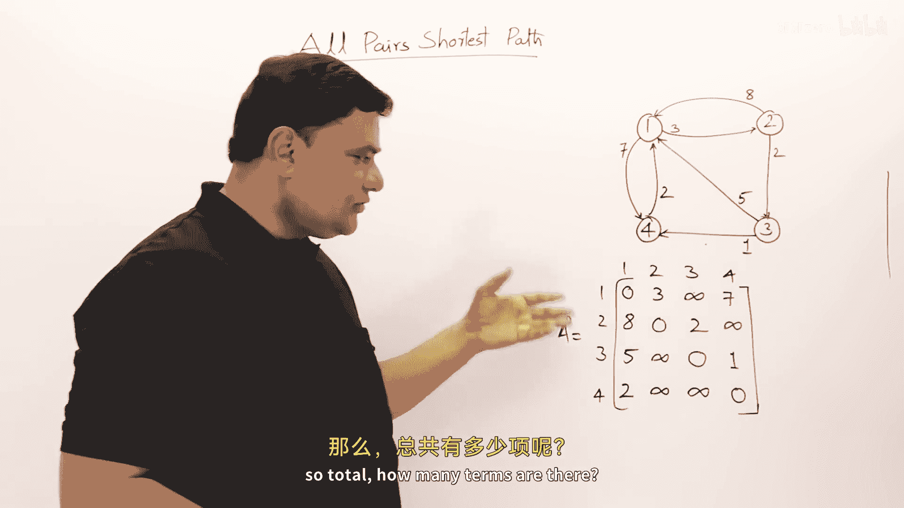

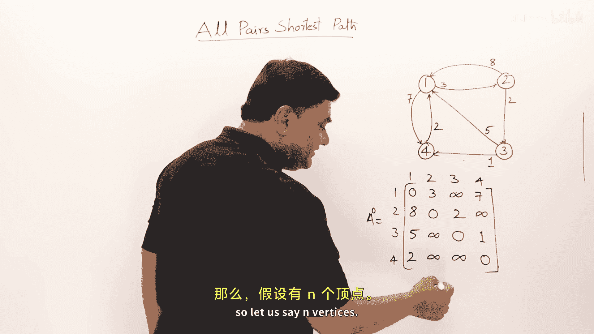

And for J assign1， J is less than equal to n。J plus plus， and I should get the terms of a of Ia J。

As minimum of。A of I comm J。 that is existing matrix， as it is going to be a single。

Instance of 2 D R in the single instance， only I'll be updating the value。

 So that's why this is same thing。 then a of I to K。

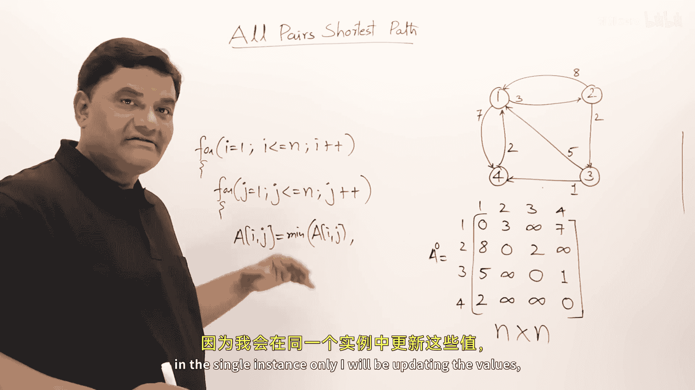

Plus， a of K to J out of this。 I should select any one of them。 whichever is minimum。

 So what is K here， K will be changing the intermediate mattress。

 So this whole thing will generate just one matrix。 And I have to generate all the matters。 So far。

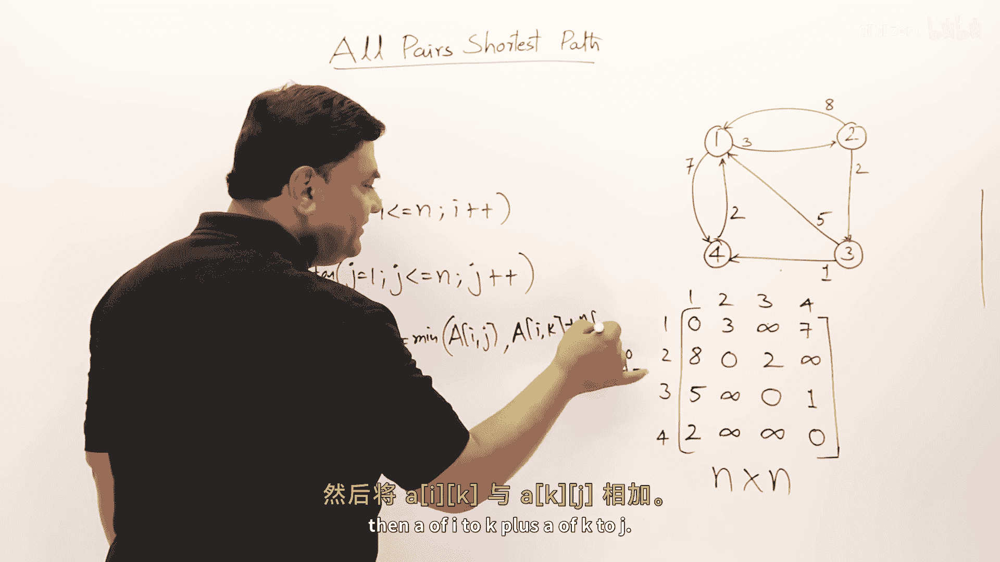

K assign1， K is less than equal to n。K plus plus Now， first time， K will be1。

 So the intermediate vertex will be1 all the time。 Then k is2。

 So the intermediate vertex will be 2 all the time。 So K will take this value。 So when k is one。

 then the matrix is generated， then K is2， then the second matrix is generated。

 So this is for generating a matrix。That's it。 This is the code for。All pair shortest part problem。

 Then if you look at this code， this is having three nested fall loops。

 So the time will be order of and cube。So that's3 off in cube。

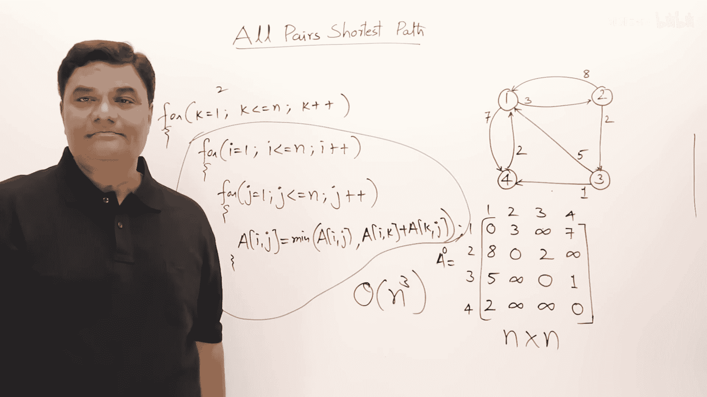

That's all about this problem。