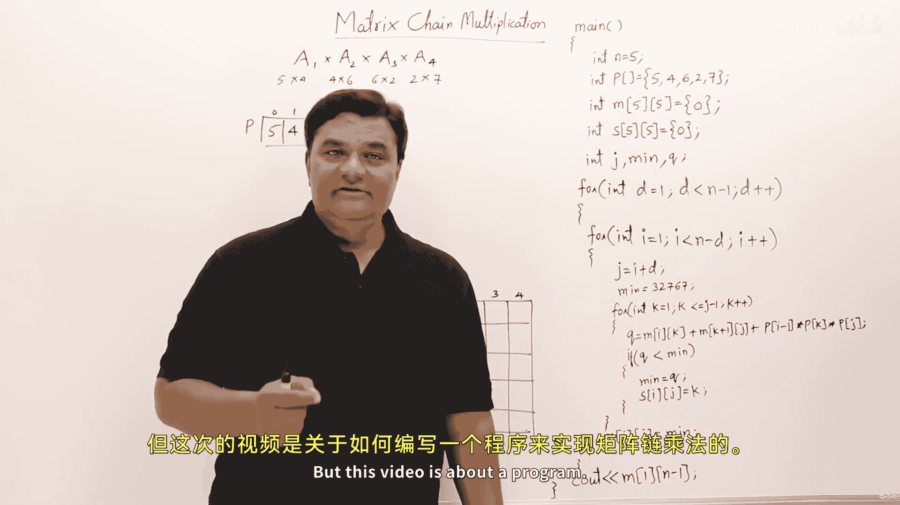
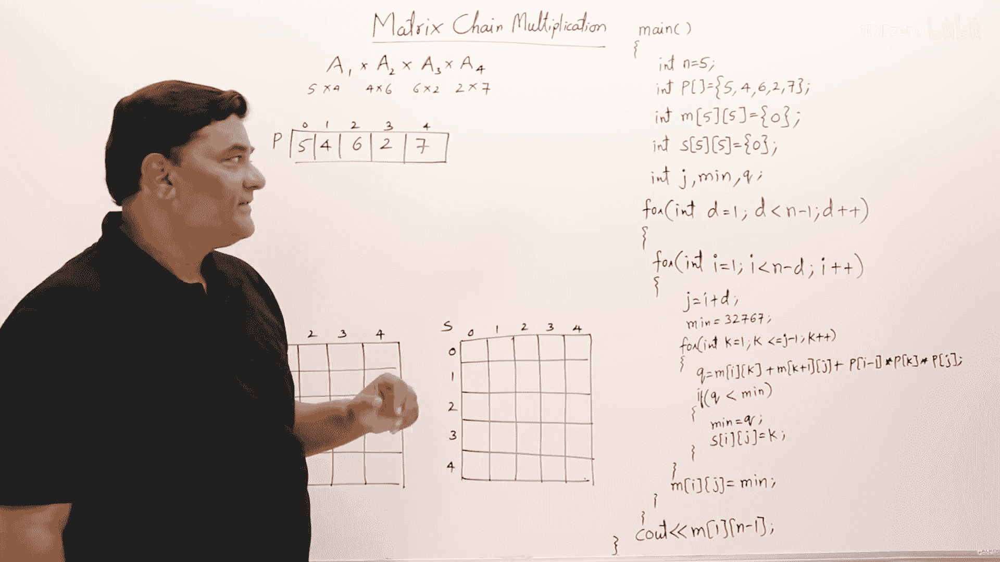
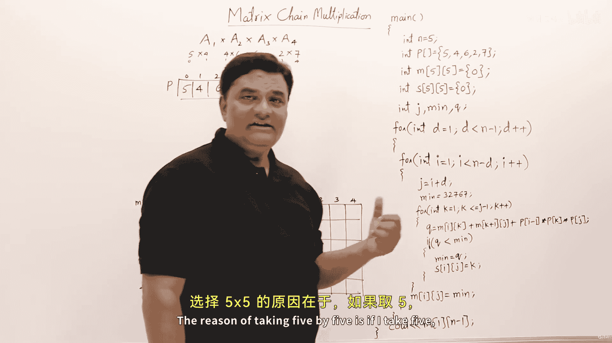
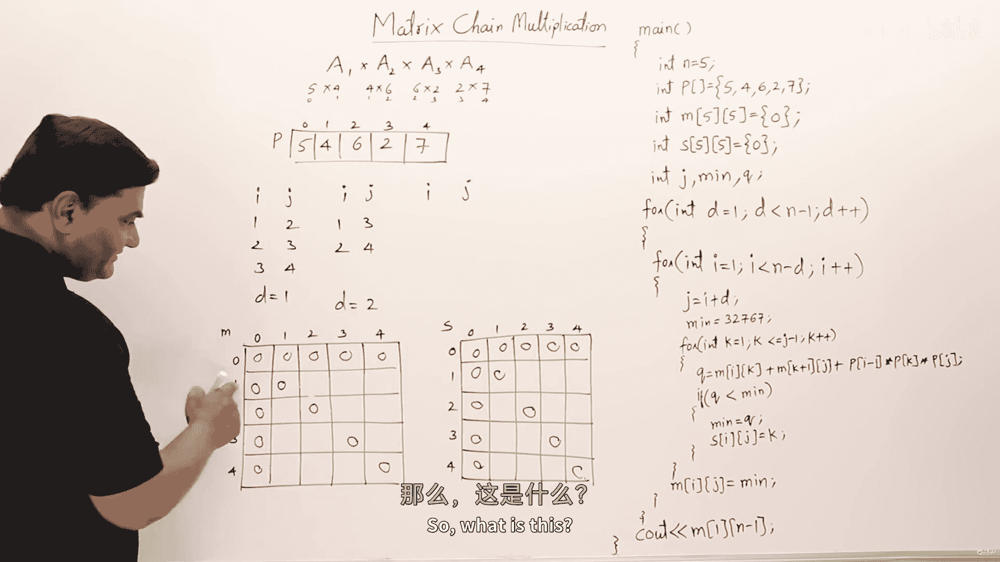
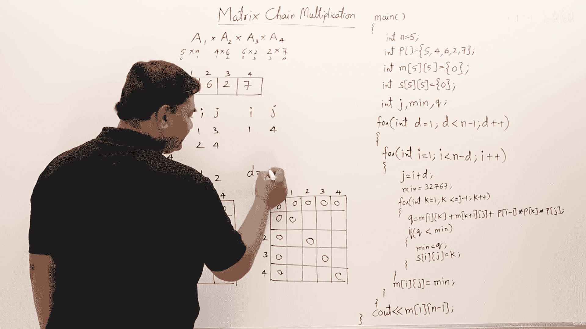
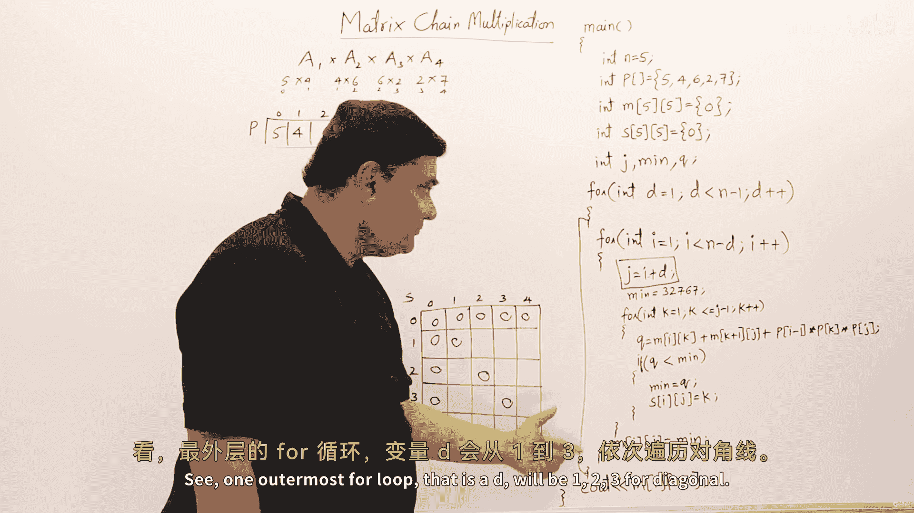
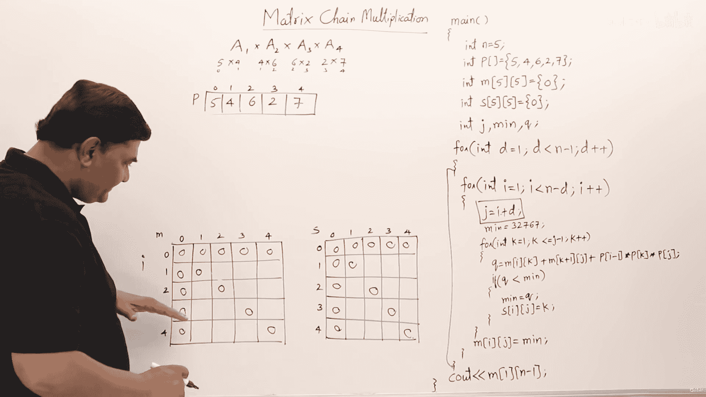
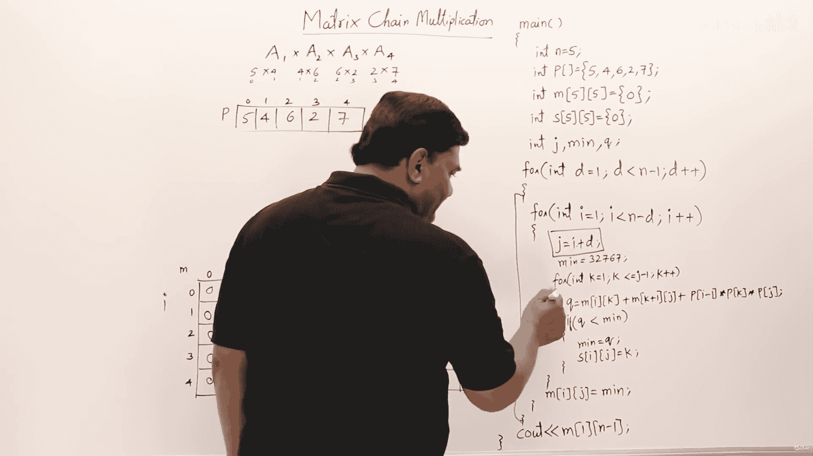
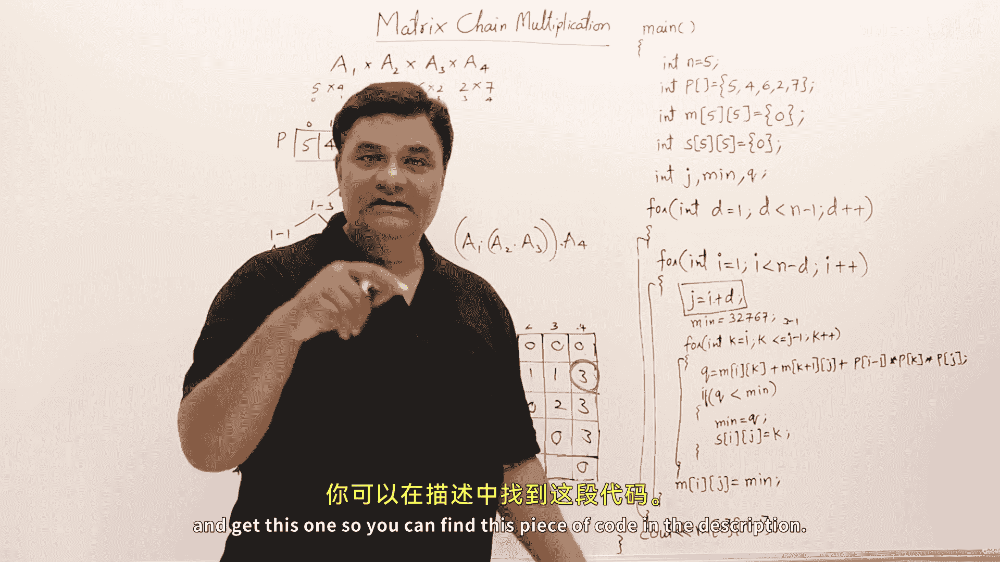

# 【精译⚡算法导论】AbdulBari p52 p51 4.3.1 Matrix Chain Multiplication (Program) - Dynamic Programming -BV1hhPXeTEWM_p52-

Hi， the topic is matrix chain multiplication Al I have one video on matrix chain multiplication there I have explained how the dynamic programming is applied and how the formula law is obtained for solving the problem。

 but this video is about a program。

I have a program， and I will trace the program for solving this problem。Let us look at the program。

 see this program I have written everything inside main function。

 so I did not split it into multiple function， a simple program just inside a main function that's all。

That is sufficient because we are writing an algorithm for algorithm。

 we can convert it into a function， not in a class or object。

So just the main function is sufficient here。First of all。

 let us look at a problem here I have an example of four mattresses。

 I have to multiply all these four mattresses， but before multiplying them。

 I want to know in which order the parentheization should be done such that the cost of multiplication will be minimized So the problem is not for multiplying the mattresses the problem is to know how to multiply the mattresses。

 So if you have many mattresses and you have to multiply them all one by one all cannot be multiplied at once。

 a pair of matters should be multipied but in which order the parentization should be done。

 which should be multiplied first so that the efforts required for multiplication are already used so this is to know in which order they should be multiplied so that is parentheization of this expression。

Now I have taken an instance see here in the program I have directly taken these dimensions and this program is only for this one If you want to change the data for any of the mattress you can change these values and you can recompile and run the program if you say no I want to take the input so you write on the input code for taking input from the keyboard asking how many matters are there what are the dimensions and then you can write on the same code again。

Let us see how this code is working。 So first of all， for dimensions。

 these dimensions I require an array， so I have taken a name as a P。

 P is an array which is having dimensions。 See these dimensions will be common，4，4，6，6，2，2。

 so only one time I have taken p of 0 p of 1 p of 23，4。

 So this is 0 this is1 and this is also one so this is2 so this is also two， This is 3。

 So this also 3 and this is 4。 so dimensions are taken here。

Now the working of this program is it will generate the mates two dimension array。

 so I have taken two dimension array of size5 by5。 The reason of taking5 by 5 is if I take 5 I will get the indices from0 to 4 and the last matrix is 4 right so4 so I want till4 if I take  four then I get from0 to 3。

So this is from 0 to 4 and 0 to 4。 So anyway， row 0 and column 0 will be of no use。And initially。

 I have initially， I set them to0。 Both of them are set to 0。 So everywhere will be0 only。

 but I will not fill all of them as zeros。 Ill fill some of the values as zeros。

These values are zeros here also row and columns。 Everything will be0， right， but。

Diagnonal I filling them as0。Initially， all are zeros only。 Now。

 what values have we have to find out We have to find out the values in this diagonal。

 If a right is diagonals I and J。 this is 1 comma 2，1 comma 2， this is 2 comma 3，2 comma 3。

 This is 3 comma 4，3 comma 4， So what is the difference between them。2-1，3-2，4-3 difference is 1。

 Next， I have to find out this diagonal values。 So I and J， this diagonal 1 comma 3，1 comma 3。

 then2 comma 4，2 comma 4。 is the difference between them。3-1 and 4-2 difference is 2。

 Then I have to find out this diagonal。 This diagonal， there is only1 element。 So what is this 1，4。

 I is 1 J is 4。 So what is the difference 4 minus-1 S3。

 So I have to find out the elements in the diagonal where the difference of I J R 1，2，3。

 So if you see this。

This loop， the outermost loop， is for difference。So R is starting from1 to n -1。 What is n5 and。

D is less than n -1 D is less than 5-1。 That is 4。 So D is less than four min。 D will go from1 to 3。

 So difference is one difference is 2 and difference is 3。

 So that's how this will repeat for three time for this particular example。

 and D is for maintaining the difference between I and J。If you have difference and the I value。

 add these two， we get2，2 plus 1， we get 3，3 plus 1， we get 4。 samely here，1 plus 2， we get 3。

2 plus 2， we get 4。 here，1 plus 3， we get 4。 So you can see that J value is computed by adding I plus D。

 Now， let me explain you a little bit from the code。 C，1 outermost follow。 That is a D will be 1，2。

3 for diagonal first diagonal and this diagonal and this diagonal。

Then i value will be for the rows。 So this is for I。R， right，1，2，3，4。

 I will be taking the values row 1，2， and minus D。 Y and minus D。

 See first time the rows up to 3 only。 then up to 2 only Then the row 1 to1 only。

 So that's why N minus D row will also be reducing them。

 This is the piece of code for finding the minimum using the formula here。

 the formula for math multiplication is used。

By using that dynamic programming formula， we find out minimum。Now， I will solve this one。

 The first1 comma 2 means first matrix and the second matrix。 So 5 into 4 and 4 into 6。

 I will not use that tracing directly。 I will write down the value。

 So how much this is 5 into 4 into 6，1，20。 So this is 1，20。The next is。2 comma 3。

 So second matrix and third matrix。 So this is 4 into 6 and 6 into2， so。This is 48。Directly。

 I will fill up the values without tracing that what I'm doing。 So this is 3， and this is 4。

This one will be 6 into 2 and 2 into 7。 So this will be 84， This is。It4。

 So these values I have filled。 This is the first diagonal where D was1 and this internal working。

 I have not shown the tracing because just two mattices were multiplied。

 so we cannot observe how it is working。But this matrix also should be filled。

 so I will fill the values 1，2，3。 It means first time we have multiplied a1 with a2， so 1， then a22。

 a3， so 2， likewise 3。Now， have to fill this diagonal。 So for this。

 this outer loop D will repeat again will start again。 And that time D value will be 2。

 So this is for the next diagonal， this diagonal。 So only two elements are there here。

 So that time when it enters inside I value will be one I is1。

Then what j will be J assign I plus D that is 1 plus 2。 So J will become 3。

 So this means one comma 3， one comma 3， this value。I is 1， J is 3。 So for this value。

 this inner follow loop， the nested， the third one， innermost follow will execute now。

 So how that will execute it will take the values of k starting from I to J -1。

 What is I right now 1，1 to J -1 J -1 means 2。 So how many values it will take K will take the value first time 1 and second time K value will be 2。

And two times it will execute， and it will compute this formula and whichever value is giving minimum that minimum value is assigned in this matrix of M of Ima J。

So， M of one commma 3。And here also， M of1 comma3， this one。So for this， what is the formula。

 I'll just read out M of IK plus M of K plus1 to j， and these three dimensions are multiplied so。

M of I is1 to k first time K is 1 plus M of k plus 1 that is2 to J J is 3。Plus。

What are dimensions P of I -1， P， K， P， G。I is1， so P of 0。 That is 5。Into K， K is what 1。

 So 4 into J is how much 3。 So 2。This means that here phomatics a and on this side， A2 to A3。

So as it is 123， so we are multiplying three mates。

 so now there are two possibilities of parent salvationvation， one is even the site a2 a3 that site。

And remove this。Now， next for this one， K values is 2。 So I'll directly fill them。 This is one to 2。

And this is。3，2，3， plus。First one is I-1， so that will be 5 only and the last one will be two only。

 Now， in between， K has became  two。 only this is the change。 So2 is how much6。 Now。

 this means what this is a 1 and a2 on this side and3 co a 3 on this side。So when you take three mat。

 there are two methods of parentthesizing， either take this separate and combine this in a bracket or take a3 separate and combine the student bracket so it can be a1。

A22 a3， this in the bracket or a1 and a2 in the bracket then a3。

 so this is the first one k is 1 and this is the second one k is 2， so both of them we have tried。

Now we need to know these values and get the minimum out of these and fill it。

 So that's what it is happening inside this loop。 So I am doing it here。Let us fill the values。

1 comma 1。 So one co 1 is how much 0。 This is 0 plus2 comma 3，2 coa 3 is 48。And this is。40。

Then next one， M of1 co 2，1 co 2 is how much 1，20。Plus，3 coa 3 is 0。 C diagnose。

 We have already fill them 0， then plus 60。Soword of this which is minimum 0 plus 48 plus 40。

 This is 88。And this is 1，20 plus 6，1，80。 So the minimum 1 is 88。 So here， the answer is 88。

 So this inner file loop will finally fill 88 here， the minimum value。And one finding minimum。

 it was also filling K of Ia S of Ia J as a K also。 So here， which value has given this minimum。

 this is first value， K has 1。 So for 1 comma 3，1 is written here。 the K。

 which has given the smallest number。This inner formal for loop that is K has finished and found out the minimum value。

 This value is obtained。 Now， we have to generate this one。 So let us see how the code is working。

 It comes out。 and this follow loop continues。 I was one。 Now， I becomes2。 I becomes 2。

Enterters inside J values is I plus D。 That is J values 4。So this is two come of 4。

 It will find out two come of4 this one。So for that enters inside k values will be what i2 j minus1。

 so k values will be what2 and 3 These are the two values k will take I will quickly write on the formula。

And move to 7。Yeah。So here I have the formula。 I have used the formula and substitute K values。

 I J values。 Now let us find out the values from the table and get done。

 two comm 2 is 0 and3 comma 4 is 84。The0 plus 84 plus。1，68。This is two common 3 is 48。

Plus4 comma 4 will be zero。And this is 56。Now， this in the follow loop will find out the minimum of these two what this what which one is minimum。

 this looks minimum that is 48 and 56。 This is what not4 and that is greater than not four。

 So the smallest values were not four。 this what we got that。So here， which myisees are tried A 2。

 a 3 and a 4。 So this is first parentization and a 2， a 3， a 4。 This is second parentization。

 This is when parentes are done like this。 This is when the parentes are done like this。

 Then whichever will give the minimum cost that is taken here。

 So which has given us the minimum cost 3， So 3 is。都没你们白的。So K S 3 has got the minimum value。

 So K is3 here。 Now， for the top most diagonal， that is third diagonal， D agreementcrements。 Now。

 D becomes 3。I again， enters inside I becomes1， and J becomes what I plus a D that is1 plus 3。

 That is 4。Now it enters inside K takes the values from 1 to J minus-1， so I to J -1 that is 12，3。

 K can take the values1 and 2 and 3。Now， not use the formula directly。

 I will write on whatever the values we get， minimum of。First one。K is 1。

 so it will be M of 1 comma 1，1 comma1 is how much is 0 plus M of 2 comma 42 comma 4 is how much 1。

 not 4，1， not 4。Plus， this is 5 into k is 1。 So it is 4 into fourth，1 is 7。Then when k is 2。

 this will be M of1 comma 2，1 comma 2 is how much1 comma 2 is 1，20。Plus，3 comma 4。

 so that is3 comma 4 is 84。Plus， this one，5 as its， and the last value will be 7 as its。

 K is taking 2。 So two is 6。The next k is3， so this will be M of2 co 1 comma 3，1 comma 3 is 88。

Plus4 comma 4， it will be 0。Plus，5 and 7 as it is last one。 and K is3。 So this will be2。

So instead of using this formula and filling it up， I have directly written the values。

 Let us see which one is a smaller。1 not4 plus。1，40。If I add these two， it is2 not 4 plus。This is 2。

10。And this is 88。Then this is 70。So out of this， this looks small。 That is 1，58。 So answer is 1，58。

 Who has given is this minimum answer 3。Now two tables are filled。

 So the major thing that I was focusing was how this code works。

 So that code is using the same formula。Now how to get the formula。

 What is the idea behind the formula。 if you want to know。

 you can watch the my video on matrix exchange multiplication there I have shown how the formula is obtained by applying dynamic programming。

Now we want to answer how the parent'sization should be done so for finding the answer this table is used and from this table we find out I will show you the answer。

For obtaining the answer， let us use these values。 So one comm of4 is giving three。

 So it means on this side， we will have 1，2 3， and this side will have 4 to 4。

So at3 splitting is done。 So 1，2 3， this side and 4 to 4 on that side。 Then this 1，2 3。 If you see 1。

2 3， it is 1。 So it mean1， to 1， decide side and 2 to3。 this side。 What is 2 to 3 is 2。

 So this side 2 to 2， and decide side 3 to 3。Then how to know the matter。 Now， this is a 1。

 and this is a 2， and this is a 3。 This is a 4。 Now， from this tree， if you see。C。

 first2 is multiplied A2 and a3 are multiplied together A2 and a3 are multiplied。

 then their result is multiplied by a1， so their result is multiplied by a1 and their total result is multiplied by a4。

 so this state is multiplied by a4。So if you look at this in the form of a tree。

 then you can perform in order traversal and get this one so you can find this piece of code in the description okay you can copy that code and you can compile and run it it is working for the same example and it will also show this parenttheization by performing in order traversal on this one。

So you can take your own values also and you can execute the program for your own values also and you study the code。

 the code is very simple， very， very simple。 only the thing extra thing that you will find in the description is the in order traver service there。

