# 【精译⚡算法导论】AbdulBari p53 p52 4.4 Bellman Ford Algorithm - Single Source Shortest Path - Dynamic Programmi -BV1hhPXeTEWM_p53-

The topic is single source shortest part problem。In this video Ill show how Belman Fo algorithm works and also the drawback of Belman Fo algorithm。

The problem is in a directed weighted graph we have to select one of the vertex as source vertex and find out the shortest path to all other vertices。

 let us say if I select vertex 1 as1 starting vertex then I have to find out the shortest path to all of them。

Now for doing this， already we have thex algorithm that will solve the shortest part problem。

 but Dx algorithm will not work if there are negative edges。 It will not work properly。

 It may give correct result。 It may not give correct result。

 so we cannot use the extra algorithm here and confirm that it is giving correct answer。

 So we want a algorithm， which confirms that the answers are correct。 So that algorithm is bemanford。

 and it follows dynamic programming strategy。 So dynamic programming strategy says that you try out all possible solutions and pick up the best solution。

 So here we want to try out all possible solutions and pick up the best solution。

 how we will try all of them。

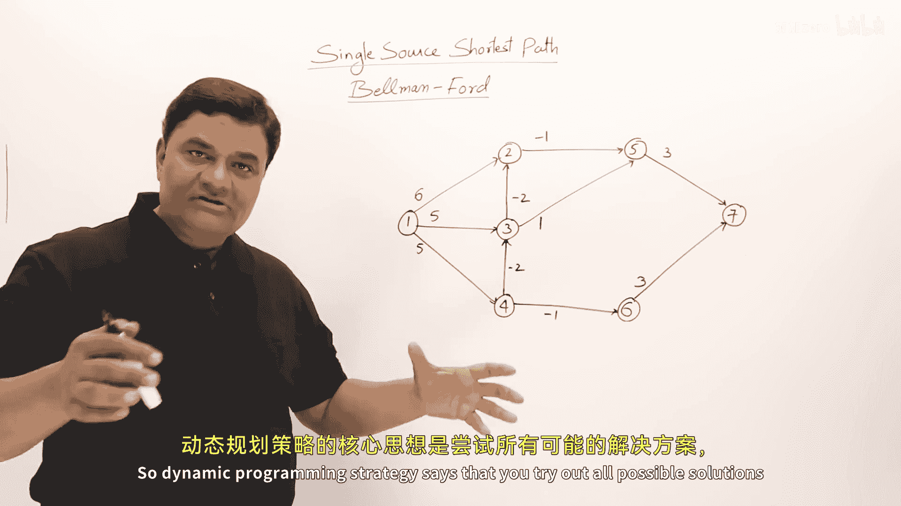

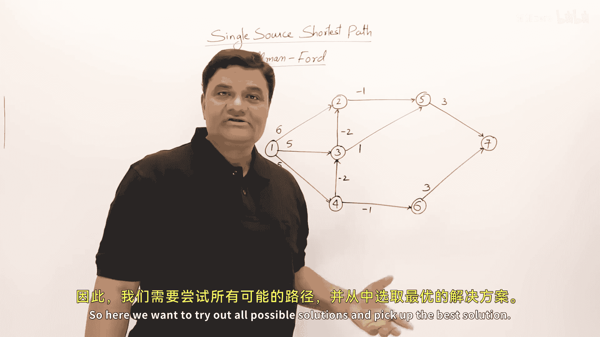

So this algorithm says that you go on relaxing all edges。

How many times all it you repeatedly relax them for n -1 time。

 What is n here and is the number of vertices。 numberumber of vertices are 7。

 So I should relax them for 7-1， what is the idea here， if from the source vertex。

 If the longest distance maybe of。

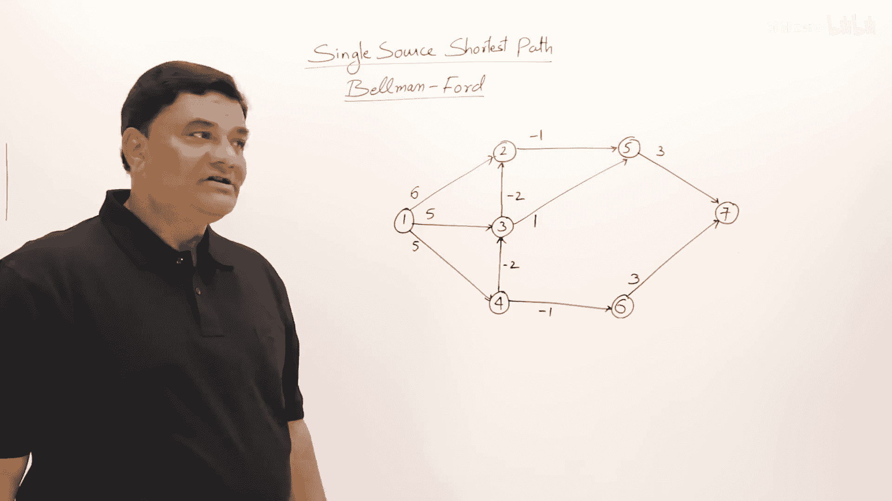

All edges， then total how many edges may be there。 So from 1 to 7， there can be maximum 6 edges。

 So if you are going on relaxing the edges， we may get a longest path also。 that is of 6 edges。😊。

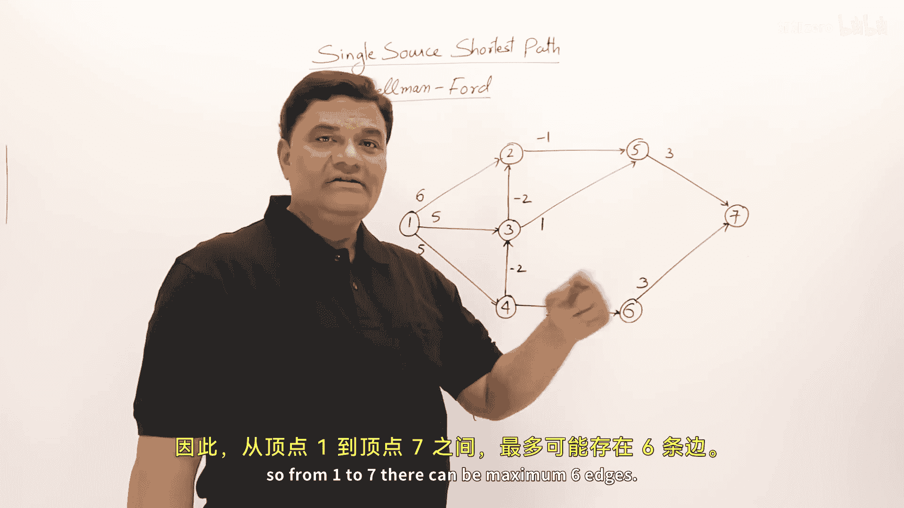

Right， so it will cover all possible parts if you relax all of them for six times。

 So what is relaxation。 If I take any two vertices， let us say 2 and5。

 And I know some distance of this vertex， the path to this vertex and the path to this vertex also。

 then I should see that if the path of this one。😊。

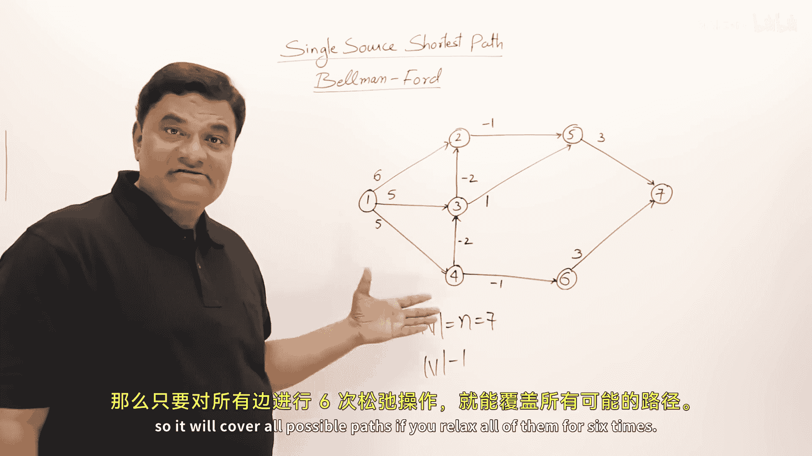

Plus， this。Is less than this one。 If so， I will change this one。 So I will call them as you and we。

 and I will write down。 just I will write down what does relaxation means。 Then when I。

 once I start using it， I can explain you how it works。 So relaxation means what。

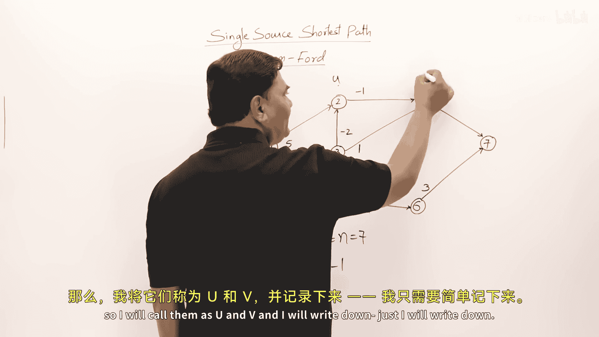

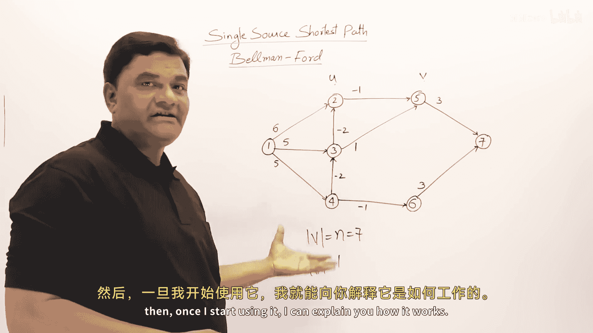

Between a pair of vertices ucoma v， if there is an edge。

 then check if the distance of u plus cost of an edge ucoma v is less than distance of v， If so。

 then change the distance of vertex v to distance of U plus cost of an edge ucoma v。

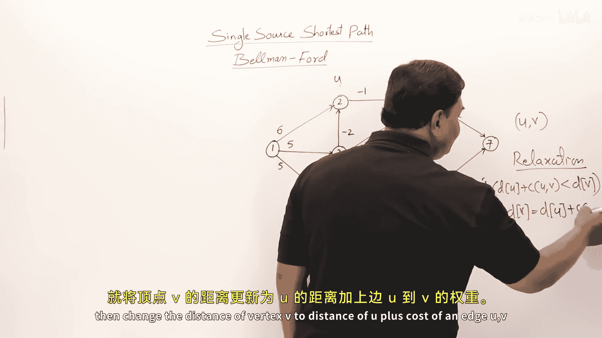

What is that I will explain you while solving this。

Now let us follow the algorithm what the algorithm says you prepare the list of all at just prepare a list。

So which edge I should select first you select any edge first you select this one。

 then this one or this one or this one， you select anything。

 but make sure that all edges are selected。 So I'll select them vertex by vertex。

 So I' write on the list of edges here。There are two dull 10 edges I have taken all 10 edges here list of edges。

 now I have to relax all these edges for six times。Now let us start the procedure for that。

 Initially， I have to mark the distances of all these vertices。

 So this vertex let it be 0 and for all other vertices mark the distance as infinity mark it as infinity。

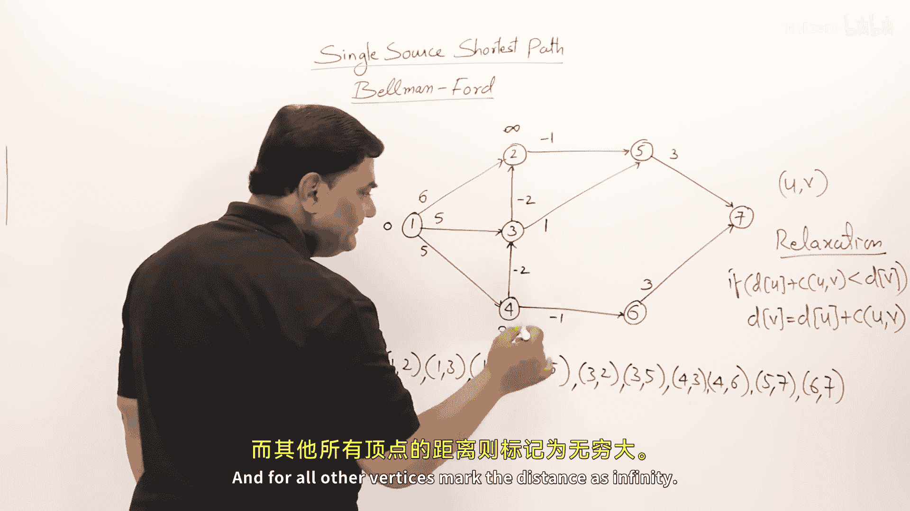

All our infinity。

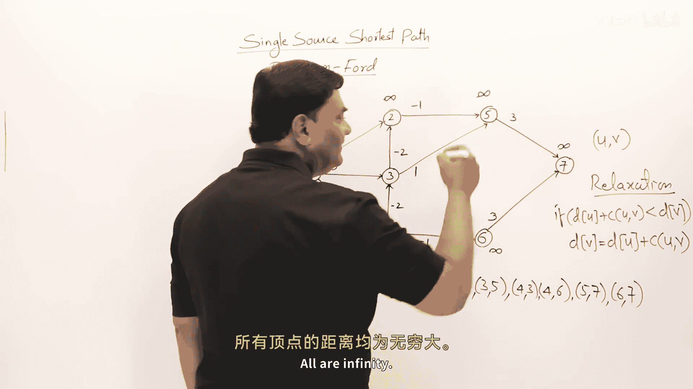

Now， start relaxing the edges。 Now， I will show you how that relaxation procedure works。

 First edge 1 commma 2，1 to2。 What is the distance of this1，0， What is the distance of this infinity。

0 plus 6 is less than infinity，0 plus 6 is less than infinity。 So change this infinity to 0 plus 6。

 So make itta 6。

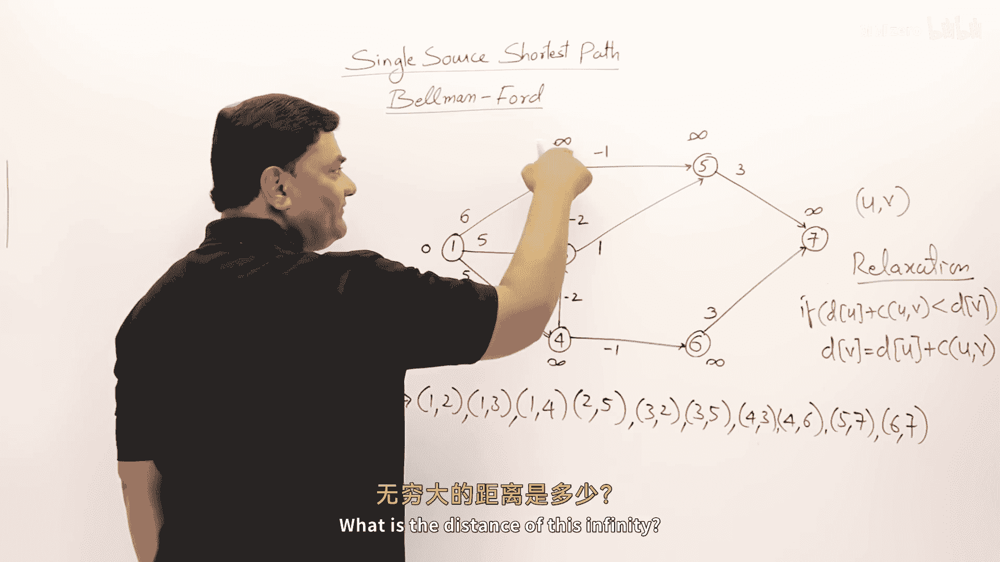

The next one comma 3，0， and this is infinity， so0 plus 5 is less than infinity。 So change this to5。

Z plus5 less than infinity， so change it to5。So first3 had just completed the two comma 5，2 comma 5。

 this is 6 minus-1。 This is infinity。 So this is 5，6-1 is 5。

This is already changed here you see3 comma 2， so3 to 2， so this is 5 minus2 as a3， so change it to3。

Then 3 to 5。 So this is 5 plus 1 is a 6， and it is 5。 so that is smaller。 Don't modify that one。

4 comma 3，5-2 is a 3。 So this becomes 3。Then 4 comm 6，5-1。 This is 4。 This is infinity。

 So change it to 4。Then 5 comm 7。 So 5 plus 3 is 8。 This is infinity。 So change it to 8，6 comm 7。

4 plus 3 is 7。 This is less。 So change。

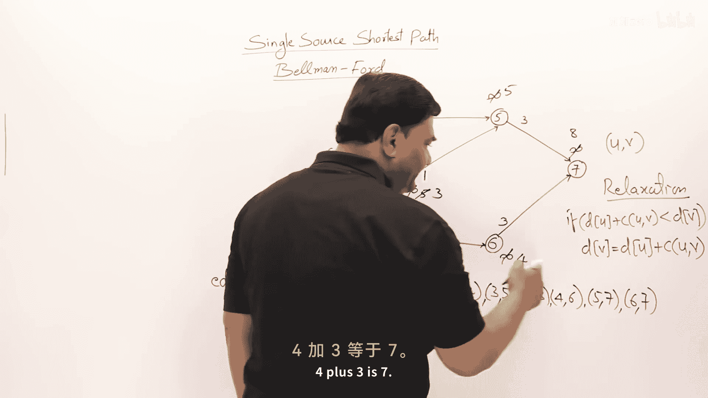

So most of the changes we have seen first time only。Let us continue second time。1 comma 2。

 so 0 plus 6，6 and 3。 So this is greater than that one。 So don't change that one，1 comma 3，0 plus 5。

5。 that is 3。 don't change that one，1 comma 4，0 plus 5， This is 5 only no change then 2 to 5，2 to 5。

 so 3 minus-1，2。 this is2。That is changing again。 So 3 to 2。 So 3 is how much 3，3-2 is 1。

 So this will change1。Then， for command 3。4 comma 3，5 minus-2。 This is3。 This is perfect。4 6。

5-1 is 4， perfect，5 comm 7，5 is how much 2。And 2 plus 35， this is 7。 So change it to 5。Then6 comma 7。

4 plus 3 is 7， and it is5， no change， let it be as it is。I have completed two times， four more times。

 I have to do。1 comma 2， This will not change。1 comma 3。 This will not change。

1 comma 4 also will not change。 Then  two comma 5，1 minus-1， this becomes 0。This becomes 0。 right。

 then 3 comma 2。 So 3 is how much 3，3-2，3-2 S 1， already1。 now， no more changes。 Then 3 to 5。

 So this is 3 plus 1，4。 although it is 0。 That is better。4 to 3，4 to 3 is how much 5-2。 That is 3。

 No change 4 to 6，4， No change 5 to 7，5 is how much 0，0 plus 3，3。 This becomes 3。

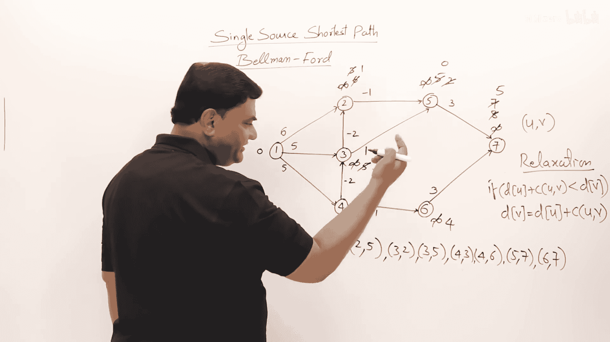

Then  six to7， 4 plus 3，7， that  three is better。

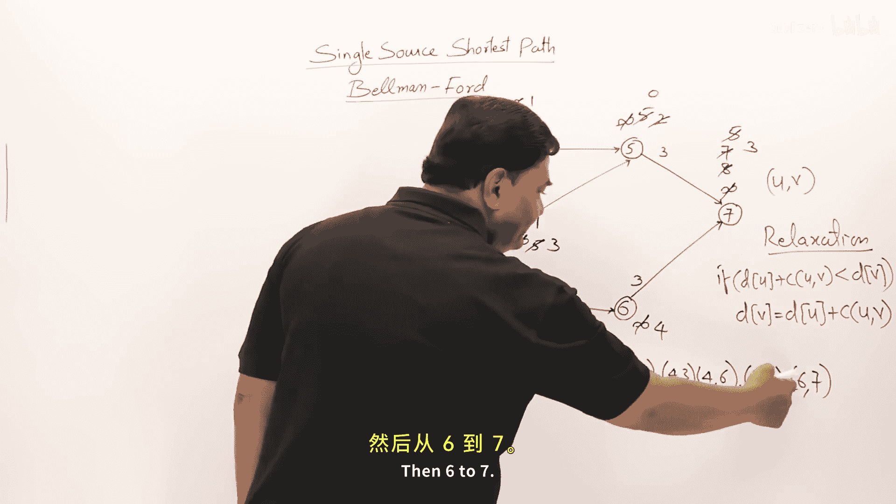

Right so I am updating there only so three times I have completed three more times I have to do one to2 will not change one to three will not change one to 4 will not change2 to 52 is how much 11 minus10 that is not changing then  three to 2 so three to 23 is how much 3 minus 11 is salary1 then 3 to 5 so this3 plus 14 that is better 04 to 3 will not change4 to6 will not change then 5 to 70 plus 33 only6 to 7 no change Now this has stop changing。

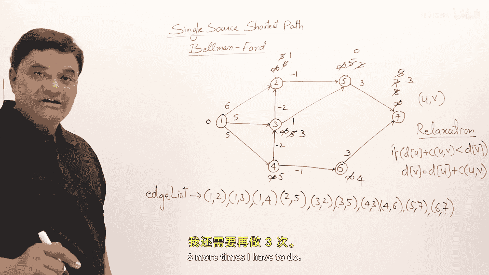

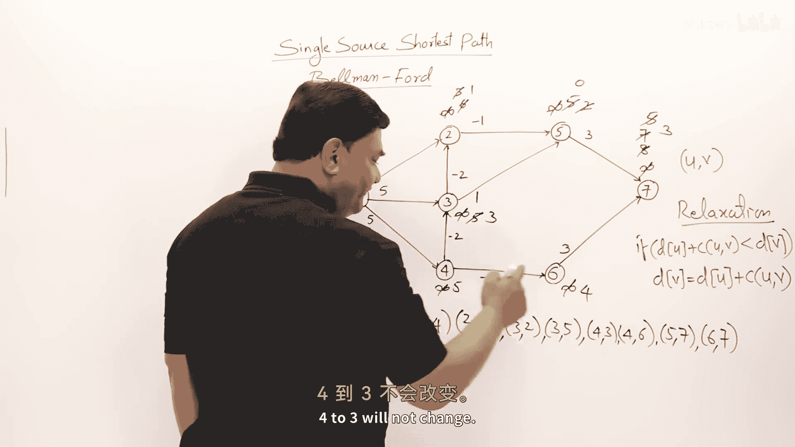

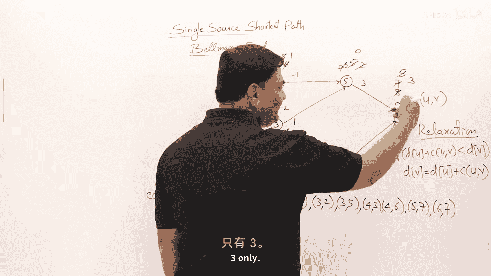

So what are the results I got？What x 1 is 0。 What x 2 is1。 What x 3 is 3。 What x 4 distances 5。

 what x 5 distances0。 What x 6 distance is 4 what x 7 distances 3。 These are the distances I got。

 if I continue for two more times Also， I'll get the same result。 So finally。

 these are the shortest parts， you can observe that。 So as I am doing it manually， I have stopped。

 But when you write an any algorithm for doing the same thing， it will continue4 and minus- one time。

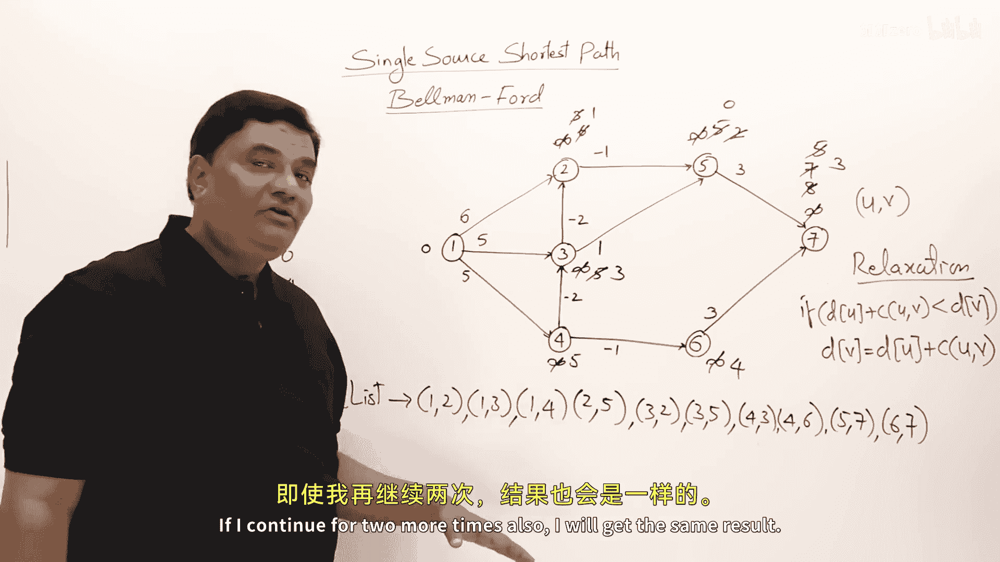

And some graphs may get the shortest path in just one time relaxation only， and some graph may relax。

 completely get the shortest path in the last relaxation。 So in this graph。

 we find that after the third one onwards， there are no change。

 no more changes I have taken the shortest path。 So this is how Belmanford algorithm works。

 Let' us get the time complexity of Belmanford。 What it is doing， relaxing all edges。

 How many edges are there E Hs are there。 How many times it is relaxing。 V minus one time。

 So this is order of。😊，V into E。 So if we say V and E， R， N， N， So this will be N square。

So it depends on the number of edges。If this is a complete graph。

 then how many edges will be there in a complete graph。

 A complete graph means there is an edge between every pair of vertex。

 So total harm many edges will be there and into n-1 by two edges will be there。

 So if these many edges are there， then the time will be n into n-1 by 2 into number of vertticexes-1 n-1。

 So if you simplify this one， this will be order of Nq。😊，So in case of complete graph。

 Belman for algorithm may take even en cube time。RightOtherwise。

 minimum time we say it takes n square and at most it may take n cubed time that is if the graph is complete graph。

Now I will take a small example and solve it and also I will show you drawback of Belman For。

 a small example I will take the list of edges， first of all I will take the edges。

Starting from here， first， I will take。3 comma 2， then I'll take4 comma 3。Then，1，2 4。Then one to2。

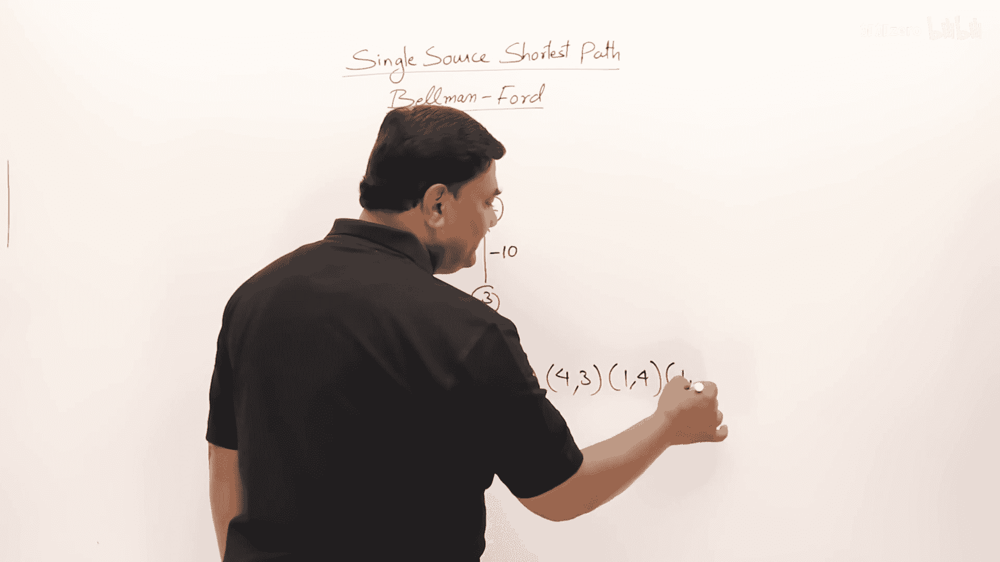

See just to make you feel how the relaxation are done， I have taken the vertices in reverse。

 I should have started from vertex 1。Now， let's solve this。

 My source vertex is 0 and mark all of them as infinity。 Mark all of them as infinity。

 How many times I should relax。 There are four what it says， so I should relax that for 4-1。

 that is three times。 So let us relax all the ats 1 by one fast3 comma 2 Infinity-10 is infinity only。

 So that is no change。 It is already infinity。4 comma 3， infinity plus 3 is infinity only。

 and is already infinity。 Then1 comma of 4，1 comm of 4，0 plus 5，5 is less than infinity。

 So change it to 5。😊，Then 1 comma 2，0 plus 4。4 is less than infinity， change it to 4。

One time a holiday， I have relaxed。Second time，3 commma 2 infinity minus 10 is 4 that is better。

4 command 3，5 plus 3 is 8。 This is better than infinity。 So make get infinity 1 to 4，0 plus 5，5。

 only，12 2，0 plus 4，4 only。Two times I have completed one more time。 I have to complete。

 Let us check 3 to 2，8-10 is-2。-2 is smaller than 4。

 Now we can see that I got the correct answer for whattex2 now。Then 4 to 3，5 plus 3，8， only12 4。

0 plus 5，5， only1 to 2，0 plus 4。And that is not greater， not less than -2。 So -2 is better let it be。

 as it is。 So I have relaxed them for three times， and I got the shortest path。

 So what are the shortest path。 Whatex 1 is 0， vertex 2 is-2， and vertex 3 is。😊。

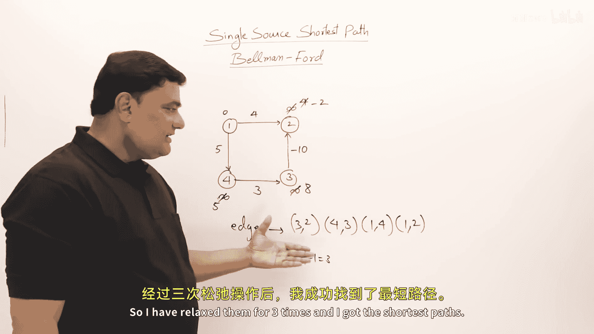

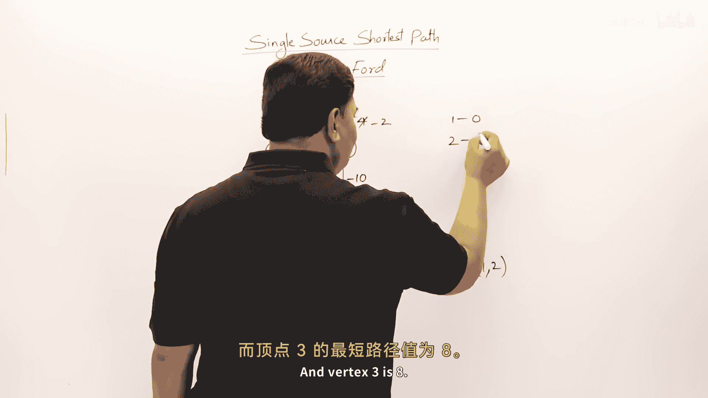

8， what export is 5。This are the shortest path from studying what X2。

 so Belman Ford has got the answer even when there are negative edges。So this is the answer。

 If I relax this for one more time and see let us what happens，3 comm 2。

8 minus10 minus-2 only4 comm 3，5 plus the 8， only 1 to 4 and 1 to 2 all are same。

 So if I relax one more time extra。 So there is no change that means the answers are perfect。😊。

Now let us see the drawback of Belman Ford， I will take the same graph only but a small change the same graph I will add one more edge that is2 to 4 and I'll make it as 5。

 so this is 2 to4。Now， let us relax them。 I have to relax them for three times。 So quickly。

 I will do it because already till here I was doing it。 let us do。 So 0， infinity。

 infinity and infinity。3 to 2 infinity only 4 to 3 infinity only1 to 4，0 plus 5， this is 5。

1 to 2 is0 plus 4。 this is 4 now 2 to4，4 plus 5，9， this5 is better。No need of changing。

One time over now，3 to2 infinity minus10 that is infinities。 So4 is better，4 comma 3，5 plus 3。

 this is 8 then  one to 4 is same thing only1 to2 is same thing only then  two to 4，4 plus 5 is 9。

 and this is 5 that is better。Two times completed。 the third time。32 to 8，-10-2。Then 4 to3。

5 plus 3 is 8，8 is there，1 to 4， is 5 only1 to 2，0 plus 4。

 so minus2 is better than 2 to 4 minus2 and 5 is3 this4 is changing。

RightSo this was the third time I have done and I got this answer。

Let me try for one more time already and minus1 time I have done。

 but let me try one more time and check。3 comm 2，8 minus-10 S minus-2 only。 Yes，4 commma 3，3 plus 3。

6，0。 This is changing。1 to 4 will remain same， one to2 also remain minus only and2 to 4 minus2 to 5 is3 only。

-2 plus 5 is 3 only。 So one more vertex has just now relaxed。

 That should not happen After completing 4 n minus one time。

 I should get dancer if I repeat it for one more time， if I relax all the edges。

 there should not be any change at all。 If I do one more time again， something will change。

 see 3 comma 2，6-10-4。So that's what there is a problem。 So why we got this problem。

 Belman 4 is unable to solve this one After performing  for n -1 time。 Also。

 I am not getting the correct answer。 still， they are getting relaxed。

 So even if I do it without Belman 4 directly。 If I try to do， I cannot solve it。

 reason is there is a cycle of edges， that is 2 and 4 and 3。 So this is。

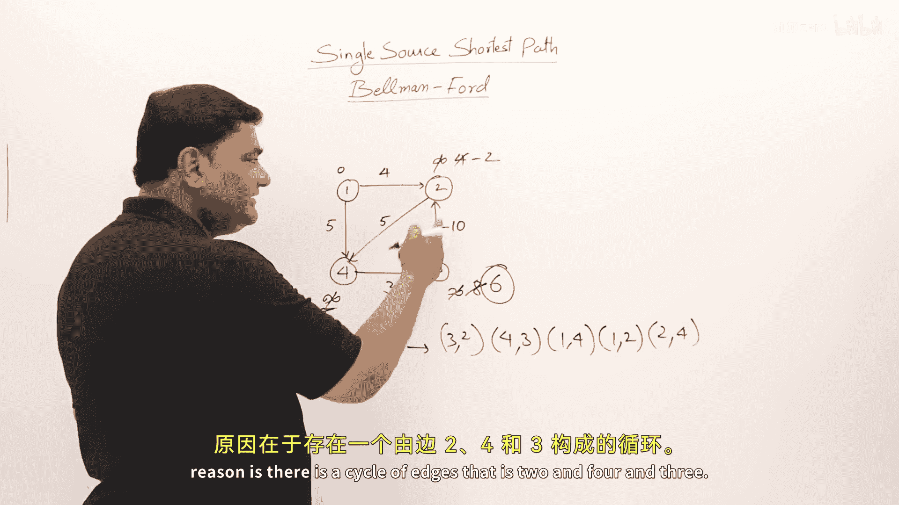

Forming a cycle， this is -10 and 3 and 5。 So if I add this 5 plus 3，8-10 is-2。

 The total weight of a cycle is negative。 So in this way。

 I'll be going on getting the path reduced every time。 So there is no end of this one。

 So I cannot decide or freeze the answer。 So if there is a negative weight， a cycle。

 then graph cannot be solved。

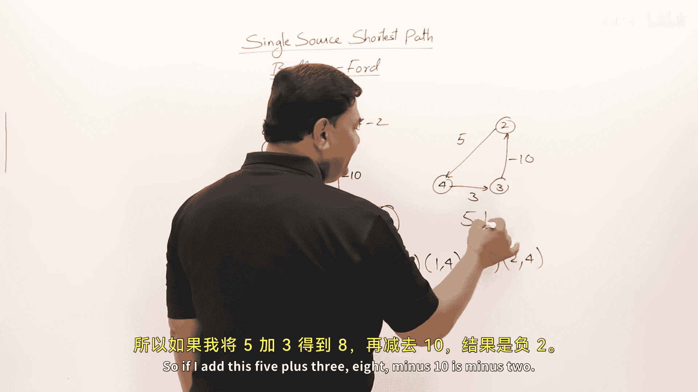

Right， so Belman Ford fails。To find to solve the graph if there is a negative weight cycle。

 total weight of a cycle is negative if it is positive， it will work。So if the weight is negative。

 it will not work。Next' all。Then。But a bellman for algorithm can detect if there is a negative weight cycle or not。

 because after performing for n minus1 times， we can relax one more time and check if the verttices are getting relaxed if any of the vertex is getting changed then it means there is a negative weight cycle。

So that's all about dynamic programming， Belmanford Al Goth。

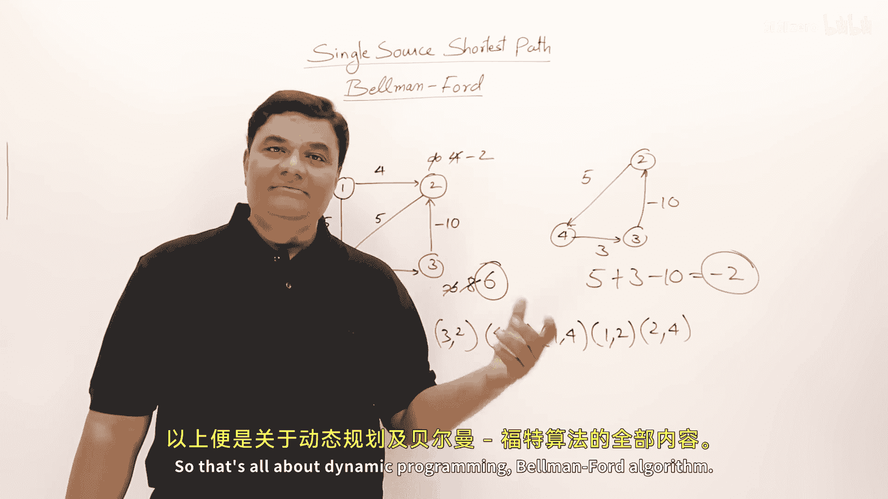