# 【精译⚡算法导论】AbdulBari p55 p54 4.5.1 0⧸1 Knapsack Problem (Program) - Dynamic Programming -BV1hhPXeTEWM_p55-

Hi， the topic is 0 anapsack problem using dynamic programming。 Aly。

 I have one video on this problem where I have explained how the dynamic programming approach is used for solving0 andnapsack problem。

Da I have shown more than one Mehars。But here I am going to discuss the program for that one。

 So I have written a program and I will trace the program and solve the problem so that you get the idea how to write a program for this type of problem。

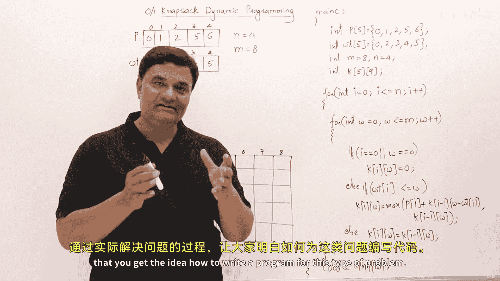

You may be aware of the problem that anapsack problem as a bag is given。

 you have to include the objects in the bag such that the capacity should not increase。

 and when you include the bag， you will get the profit。

 and you should include the complete object or don't include at all。Now， for solving this one。

 I have taken one instance example here。 So inside the program， if you see， look at the program。

 This is the data that I need。 I need a array of profits。

 array of weights and the number of objects and the total capacity of the bag。

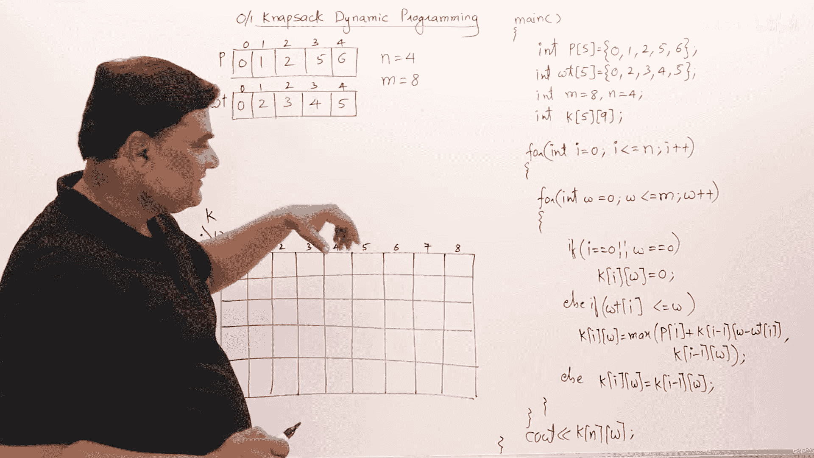

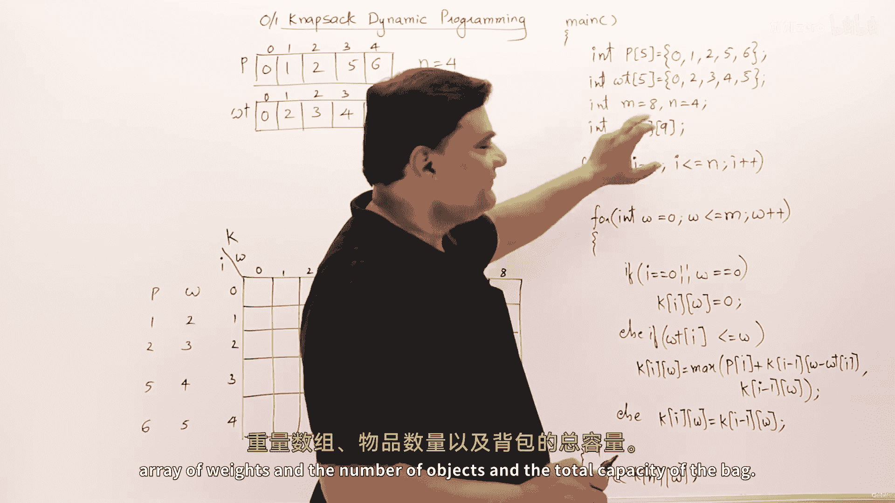

Now one thing to observe here is I have only four objects but the arrays either have taken five because we want to start counting from one first object will not call it as0。

 we will call it as1。 That is the reason I am taking zero to index empty that is 0 is also 0。

Now for solving this problem， we need a table so that table size should be of phi comma 9。

 so 5 is0 to 4 for four objects。

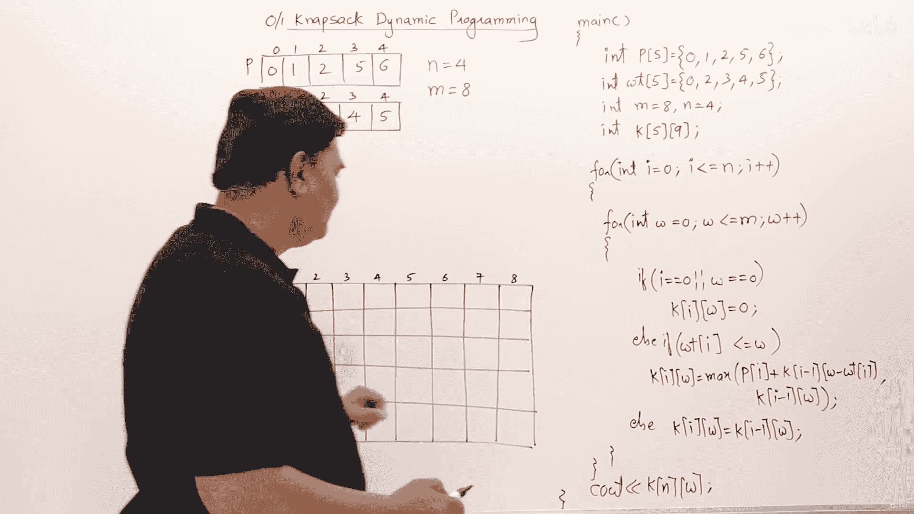

And the9 is 0 to 8 for8 weights。So whatever the capacity is。

 you should take that many columns and how many objects you have that many rows and you should add zero row and0 columns。

So that's okay of 5 to 9，5 minutes，0 to 4，9 minutes，0 to 8。 So I'll get five rows and nine columns。

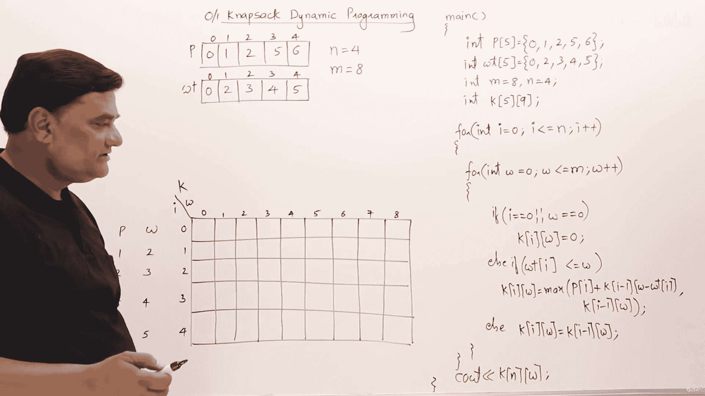

Now this is the working。See one thing I have written just a main function。

 everything inside main function。 I did not write it into multiple functions because I don't need it here。

 If I have to write， I can write the logic in some other function and divide the program into two or three functions。

 but waste。 I have written a simple code here。 and this will work only for this example。

 If you want it to work for a different example， just change the values and compile it and run it。

If we say no it should always run for different type of objects， a different number of objects。

 then take these values as input from the keyote， ask how many objects are there。

 what is the capacity and what are their ratess and profits you can add the code here。

Now remaining part， this is the logic。 So I have focused only on the logic。 Let us follow this one。

How this is working， This is nested follow loop。 I value is takinging from 0 to n min 0 to 4。

 I is for rows of the table。

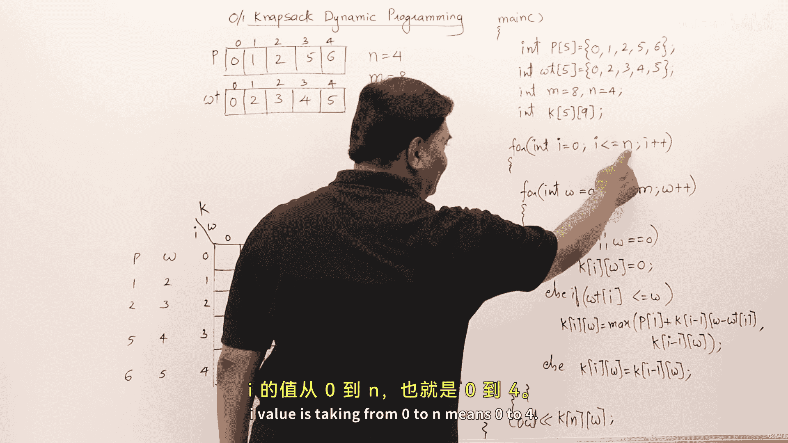

And w value is from 0 to M。 So 0 to 8。 it is for columns。

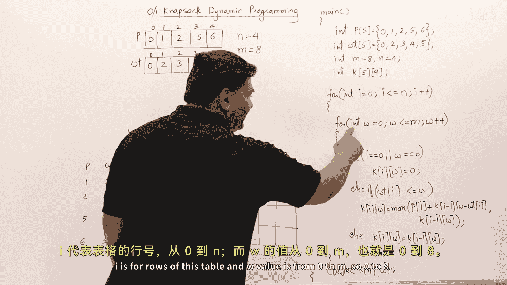

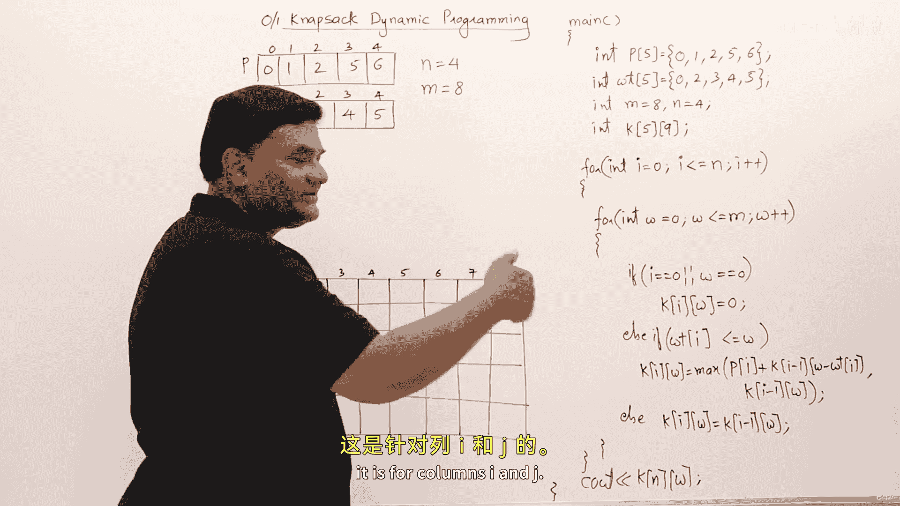

INJ will be changing the values of rows and columns。How they work？Let us trace this。2 follow loops。

 I fill up the table。Initially， I is 0。Iイ0。And I is less than equal to M N。

 So enter inside and w is also 0。 W is 0。

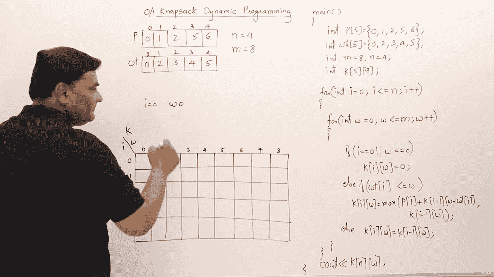

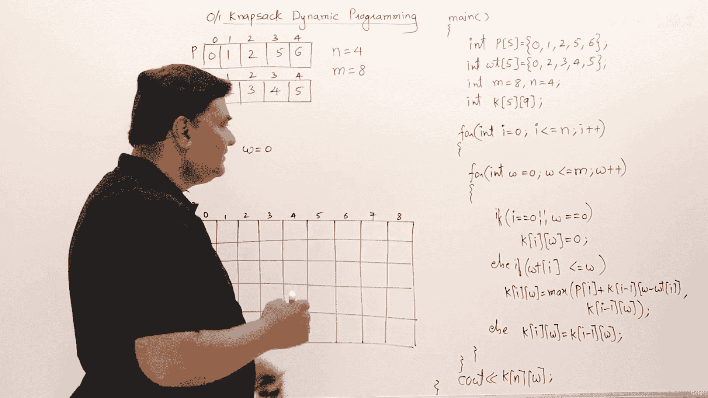

Now， enter insight， if I is 0 or W is 0。 If any one of them is 0， then this condition is true。

 If you observe， there are three cases here。 So this is first and the second and the third。

 So if is it true， So I comma W is made as 0， that is 0 comm 0 is made as 0。 This is 0。So actually。

 right now I is here that is on 0 through and the w was here。 Now W will move to1。

So this is0 comma 1。 So enter in again。I value 0 only。 So this will be 0。

 See now W will be taking the values from 0，1 to till 8。 So W will become 2， then  three， then 4。

 then till 8。 Always I 0 only。 So this will be filled with zeros only。Now， next is。

This in the loop ends now I plus plus I becomes1。 I moves to row 1。

 Now well be considering first object。Now， let us start W。 W will be 0。 The first time when w is 0。

 then also the same first condition is true。 so this will be 0。

So till the only first condition was true。Next， let us see W becomes1。W becomes1。 Now。

 when w becomes1， this is not true。 Now check this one。 weight of I object is less than equal to W。

 What is W1 weight of the object is already I have written it here。 weight is2 here。

2 weight of 1 right I is1 is 2，2 is it less than W no。

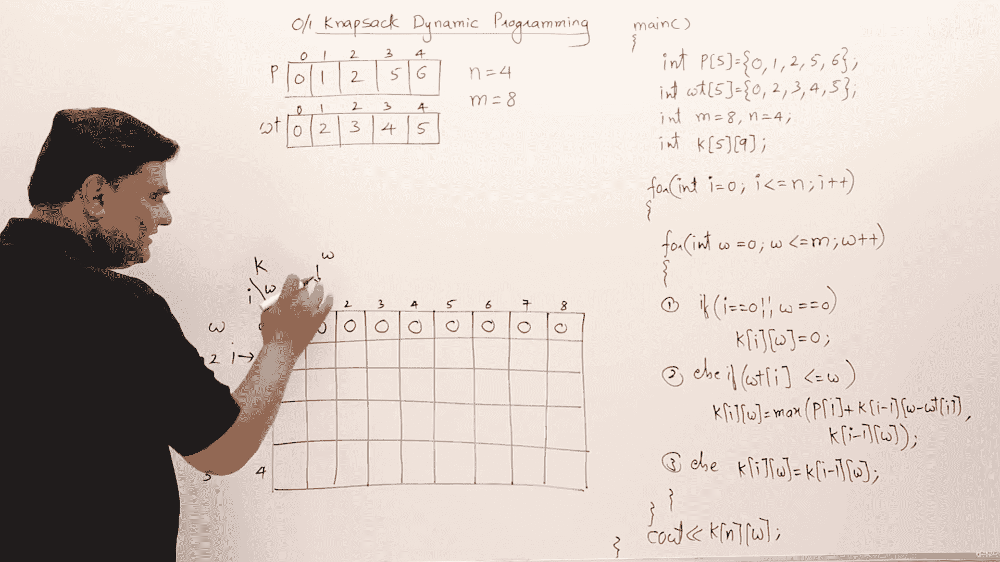

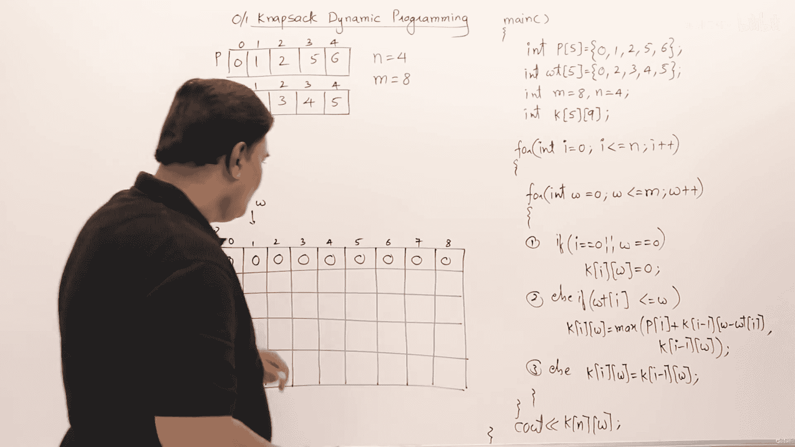

Else， this one what to write here in K of I comma W， right， I-1 comma W。 that is 1 comma 1， right。

0 comma 1。 So that is 0 only that value in the above row in the same column。

 Just fill up the same value。So we have seen this also and this also。Now， next， W becomes2。

When w is21 comm 2 now this time this condition will be true weight of an object is less than equal to w。

 So weight of an object， weight of 1，2 that is equal to 2。 Now this formula is computed。

Let us see how this formal is compute。So I'll follow the formula。 K of 1 comma 2。1 comma2。I comm W。

Is Maxof。P of I， profit of first object。So， P of first object plus。K of I -1。K of I what 1，1，-1。

And W of sorry， W minus weight of the object。 What is W2， So what is the weight of an object。

 weight of an object is2。杜。Come on。 next value。Get off。I -1。 I is 1，1，-1。 and W is 2 only。

I have to take the maximum amount of these， too。Let us fill the values and check。

 Pro of first object is one plus k of 0 comma 0 S 0。Coma， this is 0， comm 2，0， comm 2， this0。

 So which is maximum 1。 Take it as one。That's it。n。Value of W changes。 It becomes 3。

 and I will simply change the values。 W is a3 now。 So this is a3。 W is 3。 So this is。3。

And this is also three。Let us fill up the values。 P1 Profi will be one only plus this is 0 comma 1。

0 comma 1 is also 0 only comma。 This is 0 comma 3，0 comma 3。 This value， Do value is 0 only。6 one。

 So anyway， all these rows will be one only if I use the formula。 And always。

 this second condition will be true。 and it will be entering in and finding the maximum value。

Let us go to next row。

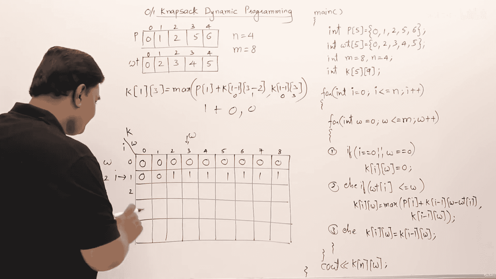

I becomes 2， and W again starts from 0。Now， this time， w is0， one of the value is 0。

 so it will enter here。It will fill zero。And2 comm 1 when w is1。 see this condition。

 weight of an object is less than or equal to W。 weight of an object is 3。 Is it less than this one。

 No， this is greater than that one。 So it will enter into else part。

 and it will write down the value in the previous row in the same column。

 So it will write 0 only for here also one。 And for here， no， it is equal。

 So now it will enter into this second part。 So let me evaluate second part for this particular row。

😊。

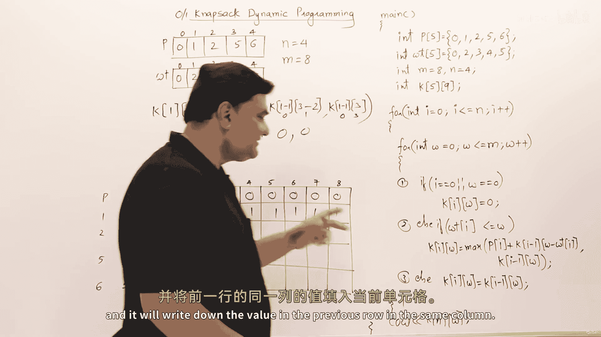

Now， this is2 comma 3，2 comma 3。Profit of second object。This is2 minus-1。Weight is 3。

 and the weight of this object is also 3。2-1。And the weight is  three。

I have filled the values in this formula directly。Maximum of P of2 profit of the second object is 2。

 plus this is1 comma 0，1 comma 0 S0。 comma。 This is1 comma 3，1 comma 3 is 1， which is minimum 2。

2 is written here。Now， in the next value， also you will get two only if you try that。

 but here for this it will change。 Let me show you this。So I is2 only W is 5。

 so I will change the value of w。 This is 5 and this is 5 and this is 5 for the same row。

What are the values， Profit of second object is2 plus。K of1 comma。 This is 2，1 comma 2 is1。1， comma。

 This is1， comma 5，1， comma 5 is one only1 out of this which is minimum maximum 2 plus 1。

3 is maximum。 We got 3。 This means that when the capacity of the bag is 5。

 we can fill up two objects。 Both objects。 This one， both see the ratess are 2 and 3， total is 5。

 so we can include both objects。😊，Rest， I'll get the same thing only 3，3，3。Now。

 when I becomes a three third object。Till grade4 will be getting same thing in the previous row。

Now here this object can be included， we get five and the next also five。If you use the formula next。

 this 1， I will show you。3， comma 6。K of 3 comma 6 is maximum of。B of third object， plus。G off。

Do and。The weight is how much6 W is 6。And the weight of this one is。

Weight is 6 minus weight of the object is 4，6-4 comma K of2， comma 6。Little sick。

Profit of this object 5 plus2 comma。 This is 2，2 2，2a 2 is 1，1， 2 6，2 6 is 3。 Which one is greater。6。

 So answer is 6。 This means that when the capacity of the bag is a 6。

 We can include these two objects， these two objects。4our。

 as well as two means's first object in the second object。 So the profit that we get is 6。

Let us try next， when it is 7。So three comm 7。 So this becomes 7。And this becomes 7。

Profit of this object is 5 plus 2a 7-4。 That is 3。2a 3，2a 3 is 2，2，a 2 7，2 7 is 3，3。

 Which one is greater，7，7。What does this mean when the capacity of the bag is 7。

 we can include these two objects。 You see， their weights are 3 plus 4，7。

 so it will be profit will be 7，5 plus 2，7。 So rest also will get 7。 This way， every time。

 second condition is true and these are getting filled， right。

 first signs last condition will not get filled。 Now for the fourth rule。Fourth row， its weight is 5。

 till 5。 These will be， as it is， and fifth profit will be 6。And when it is6。It will be 6 only。

 And when it is 7， then these two can be included。 So that is 2 and 5。 They can be included。

 So this will be 7，7。 And at 8， these two can be included 5 and 3。 So this will be 8。

Without the formula I'm showing you now， you have understood how this code is working。 Finally。

 C out K of N comm W and is 4 W is 8。 So this is the answer。Thiss dance。So this the。

Optimal cost we got。Now we want to know which object is included。

 which is not included so for that we can start。I from。And。That is n and J from M that is 8。

 So for comma 8， they will start for 4 comma 8。What to do is。K off I comma J。

Is equal to k of I-1 comma J。 This means that if this value is already present in this one also。

 it means if this also8 means fourth object is not included。

 This solution is not because of including fourth object。We got 8 now only。

 So this means fourth object is included。 So if this is equal means it is not included。

 So if it is not included， then what I can do is see out。4， that is fourth object。 That is I。

Is equal to 0。 This will be displayed， right， and L。And also go to the previous object。 So。

 and weight will be same only I minus minus。I have written in the single throw， only， because else。

See， this is not equal。 This is not equal。 then what to do， It means this object is included。

 so see out。I。Is equals to one。 This is included in the bag。And this is And。

And then then what more I should do。 Go to the previous row。 Okay， I minus minus。

 But what about weight， when this object is included， I have to know to the previous object。

 whether it is included or not。 So the weight of this object that is 6 should， sorry。

5 should be subtracted from J。 So as remove this。J assign J minus weight of。That object。

 height object， weight of that object。And that's all， this is an next part。So this。

 I have to continue。 I have to go on doing it while。I is greater than 0 and J is greater than 0。

 So this loop will print what all the values included。 See how we do it。 See fourth object included。

 Now the weight of this object is 5。 subtract 5 with 3。 So go to2 comma 3， sorry，3 comma 3，3 comma 3。

2。 But this was there here also， so third object is not included。 Now two comma 3。 This one。

 This is all was not there here。 So this object is included。 right。

 then the weight of this is subtracted 0 comma 0。 So you'll get 0，1 comma 0，1 comm 0。

 it was here also。 So this is not included。 So this means second and the fourth object is included。

Okay， so quickly， I have shown you， I guess， you know how to do this one。

 So the piece of code I have written。 And if you want to continue writing here。 So using a loop。

 you can go from the last row towards the first zero row and find out which objects are included。

 which are not included。 See it is just playing with the values only just filling the values。

 But the code is important。 So I have shown you the code Tracing of the program。

 So this program you can find it in the link。