# 【精译⚡算法导论】AbdulBari p57 p56 4.6.2 -New- Optimal Binary Search Tree Successful and Unsuccessful Probabili -BV1hhPXeTEWM_p57-

The topic is optimal binary search tree。 Or， I have one video on this。 But in that video。

 I have just considered successful search probabilities。 And in this video。

 I'll be considering successful search， as well as unsuccessful search probability。

 So I' will cover it as a very fresh topic。 So the contents of this video are these。😊。

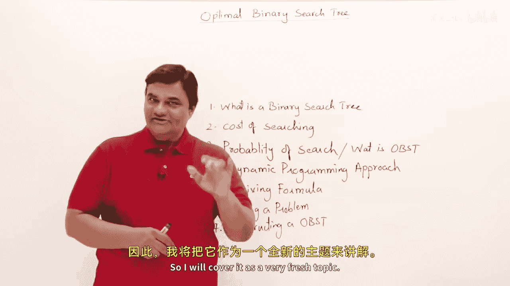

First of all， I'll explain what does it mean by binary search tree and how do we search how it is useful for searching。

 then what does it mean by cost of searching。Then next I will explain the probabilities for search。

 what does it mean and also I'll explain what is optimal binary search tree and how to know its cost。

Then I'll show you the dynamic programming approach for constructing a optimal binary search for a given set of keys or given set of elements。

Then that approach I'll show you how to derive the formula for dynamic programming。

 then I'll take a problem and solve。 then finally we'll see how optimal binary search can be constructed by using dynamic programming approach So in this video I'll be deriving everything。

 So here you have to observe and learn how to devise a solution by using dynamic programming approach See most of the students want to learn dynamic programming So for learning practice is important So by picking a few problems if you study them in detail and understand how the solution is given then you can give a solution to any new problem it's not that somebody is explaining all the problems。

 then you know the solutions It's not like that See if you know the approach for few problems。

 then you take up a new problem and try to solve it by yourself So here I'll give you a complete approach everything I'll show you in。

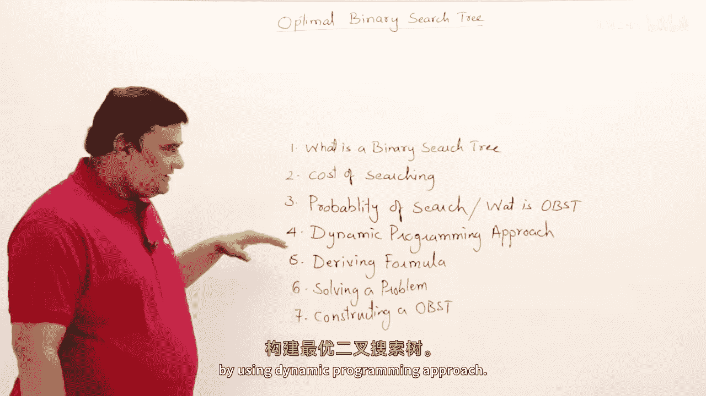

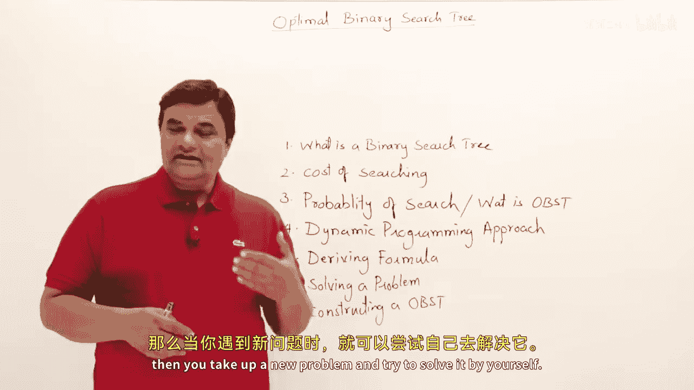

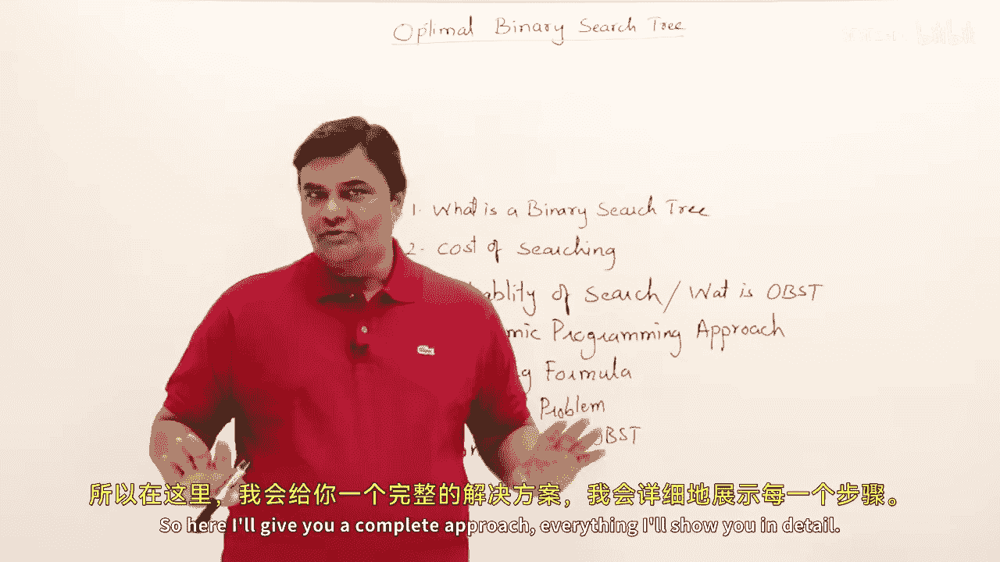

Soll get the clear cut idea how the approach is taken and you can see the observe the minor details also in this problem so this will help you of a lot if you are really interested in learning dynamic programming and solving challenging problems。

Let us start with the topic here I have a example binary search tree。

These are binary tree and these are keys， the nodes are containing keys， right？

And the keys are arranged such that for any node if you take all the smaller keys are on the left hand side。

 all the larger keys are on its right hand side。 So if you look at this 40 all these keys on the left side of 40 that is 102030 are smaller than 40 and after that on the right hand side these keys are greater than 40 and similarly if you take 60 this 50 is smaller on the left hand side。

70 is greater than is on the right hand side why， why we have arranged the keys like this see it gives a advantage for searching。

How let us see。 I want to search for 30。 how to search。 start from root This is the root of a node。

 I it 30。 No， then where I should look for 30 on the left hand side because 30 is smaller than this 40 So definitely it will be on the left hand side go to the left hand side is it 30 No 30 is greater than this one So greater than 20 so definitely it should be on the right hand side because we have arranged the keys like that。

 so go to right side yes 30 is found。 So in this way we can search for any element Now for searching for 30。

 how many comparisons we have done12，3 So the element is found in three comparisons。

 If you check total I have seven elements and in that seven element searching for any early element that is 30 has taken three comparisons。

 let us observe what about others See if I am searching for 10 it will take three comparisons and for 20 it will take two comparisons。

For 40 it will take only one comparison 33 comparison 62 comparison 53 comparison。

 So what is the maximum comparison。 The maximum comparisons are three。

 That is the height of a binary search tree and that also I can call it as levels of binary search tree。

 This is the first level second level and this is the third level So the number of comparisons required for searching any element in a binary search tree depends on number of levels in a binary search tree Now let us learn one more thing See we were searching for the keys that are present here。

 So and they were found。 So this is called as successful search Now let us assume I am searching for a key that is9。

 let us search I it9， no， is it9。 I should go on the left hand side I it 9。

9 is smaller than this go on left side， I it9， No，9 is less than this go on this side。

 There is nothing thing。 This is null。 This is n。

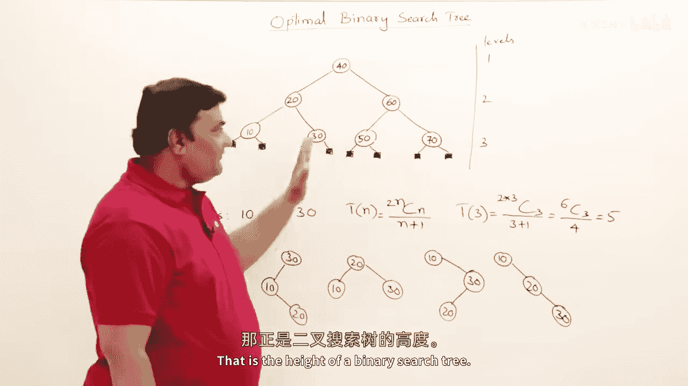

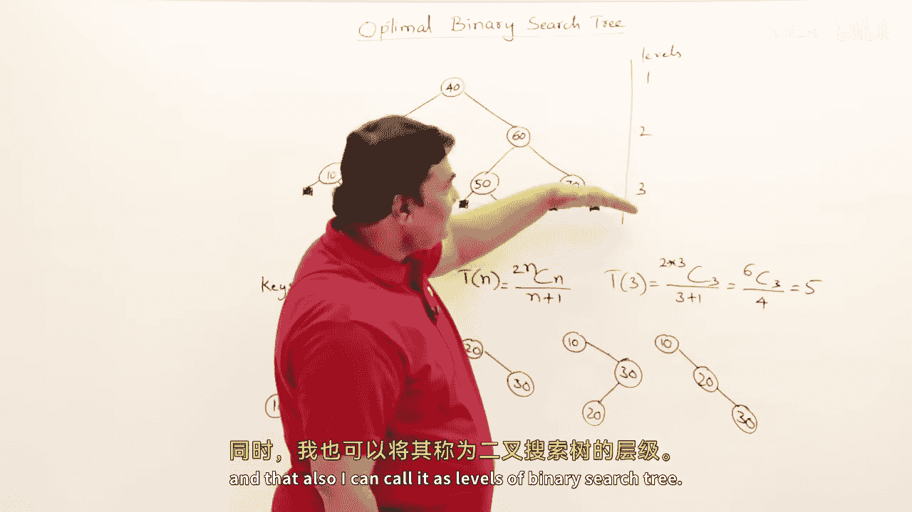

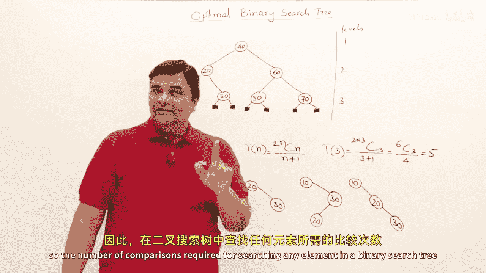

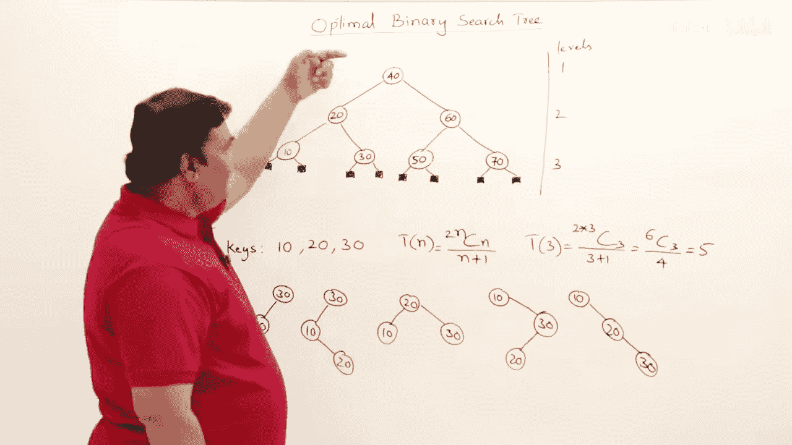

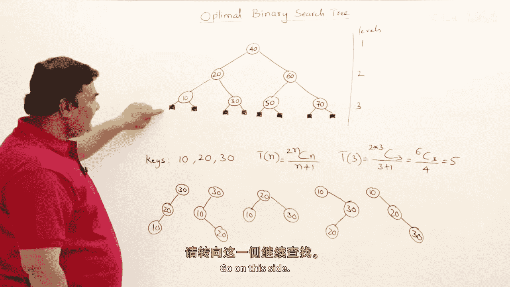

So9 is not found because I have reached till the end of a binary search tree and the key limit is not found。

 so if a key limit is not found， then search is unsuccessful。Alright， then in this also。

 how many comparisons I have done maximum I have done three comparisons I have checked here and here and here。

 So when you are searching in a binary search tree。

 there are two possibilities like the element is found or element is not found。

 Let us strive one more element。 I want to search for key element，47。 let us start is it 47， no。

47 is greater go to right side。 is it 47， no，47 is smaller than this。 go to left side。 I it 47， no。

47 is smaller than this。 go to left side。 there is nothing And so search is unsuccessful。

 So search may be successful Also search maybe be unsuccessful Also right， So in both the cases。

 we need to know the amount of comparisons that we are doing。

 and that amount of comparison is nothing but the cost of searching in a binary search tree。

 Now one more thing。 in the tree。 if you observe。 there are circular nodes。

 and these are square nodes。 I have drawn them in smaller size So those are square nodes。😊。

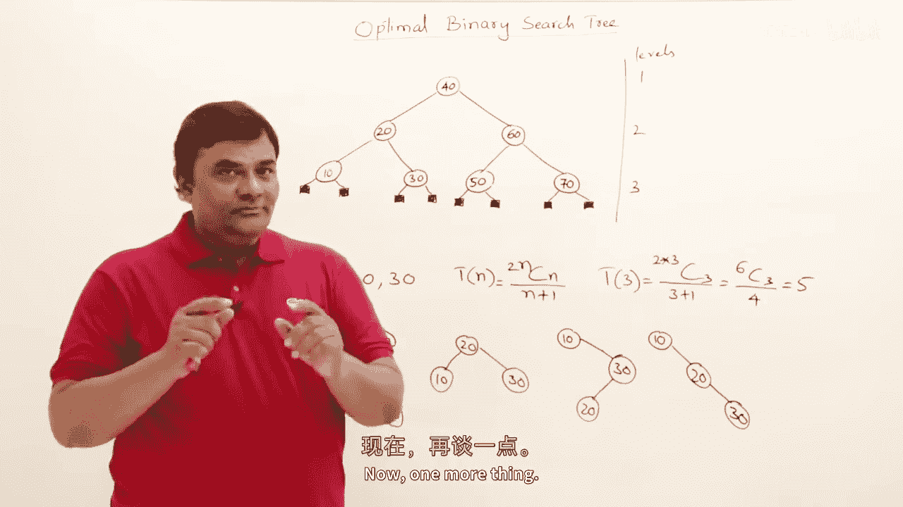

What they are doing here， do they have keys， no， they don't have keys。

 then what they are representing， they are representing all those keys that are for unsuccessful search。

Let us see。 what does it mean。 See if I am searching for a key that is 11。 So 11。

11 is smaller 11 is smaller than this and greater than this。 it will come this side。 So for 11。

 it has terminated here。 then 12。 So2 of this is smaller than this smaller than this。

 but greater than this here。 So it will come on the right hand side。 So it will come here。

 So if I search for the keys from 11 to 19， it will be coming on this side only。

 So I'll just make it as 11 to 19， this is representing this node is representing all the unsuccessful search keys。

 So 11 to 19。 Then what about this， this is representing all the keys from minus infinity to 9。

 So if you search for any number less than 10 search will terminate here。

 So though it will not compare here， well stop over comparisons here， but it will reach here。

 go to left side null and it will stop so that you can call it as null square nodes are nulls。

 Also that null is represent。😊，All those keys for which search will be unsuccessful。

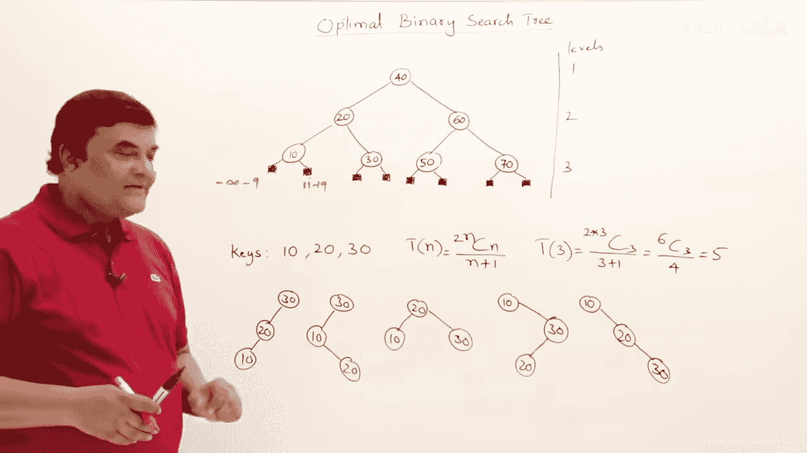

Then similarly all these are representing not one value the set of keys for which search may be unsuccessful if you see this last one this is representing 71 to positive infinity 71 to positive infinity any numbers you search greater than 70 in this binary search tree the search will terminate here。

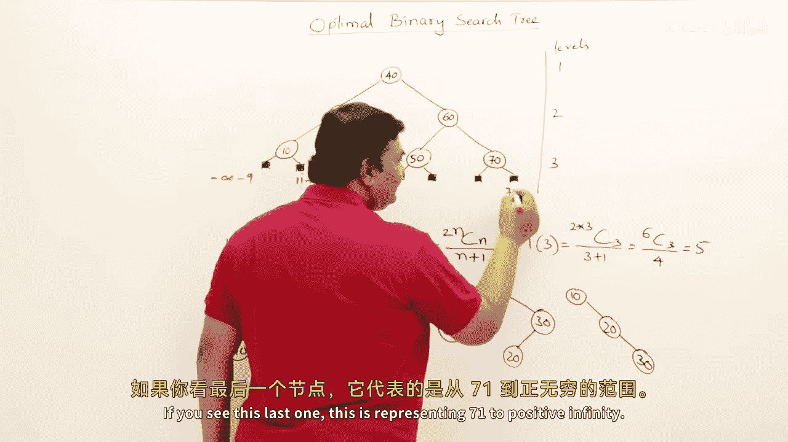

So we have seen unsuccessful search are also represented as dummy nodes just to show that this is having set of unsuccessful search keys。

 so now we learn one thing that in a binary search tree search may be successful or unsuccessful in both the cases we have to perform some comparisons and reach the result that keys found or keys not found。

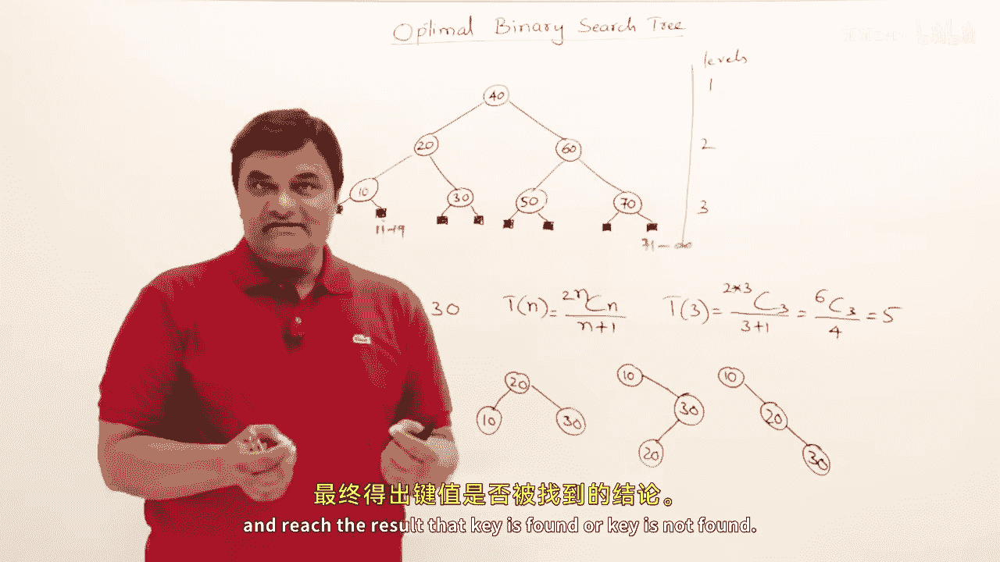

So that's all these are the basic things that I was supposed to give you。 So I have given it。 Now。

 next thing here I have three keys， three keys for three keys。 I have constructed binary search tree。

 So if you check all these are binary search trees。

 Just pause the video and check all these are binary search trees。

 So what I have to say here is that for same set of keys。

 there can be many possible binary search trees。 If you want to know the count how many are possible here I have given the formula for n keys like here we have three keys2 into n C of n then plus divided by n plus1。

 then that three I have kept here。 So this is two into3， this is two n min 2 into3 C 3 by3 plus1。

 So this becomes 6 c3 by4 and answer is 5。 So you can calculate this。 So for three keys。

 five different binary search trees are possible。 and here are those five binary search trees。 So。

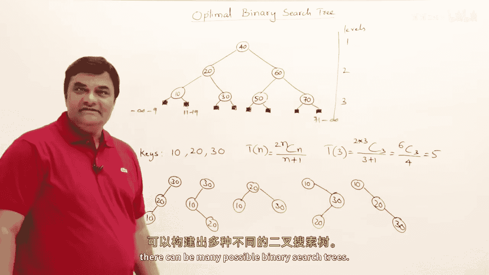

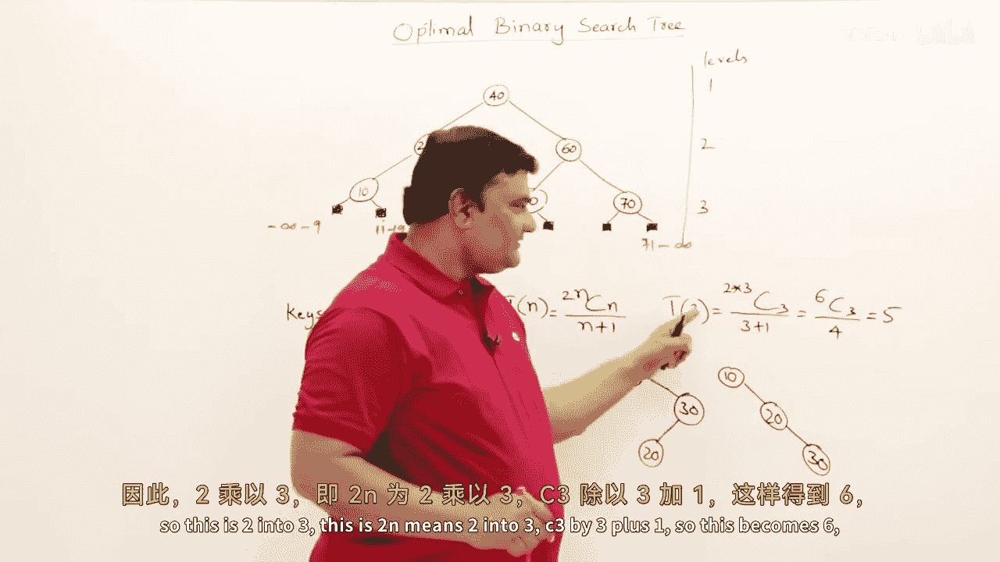

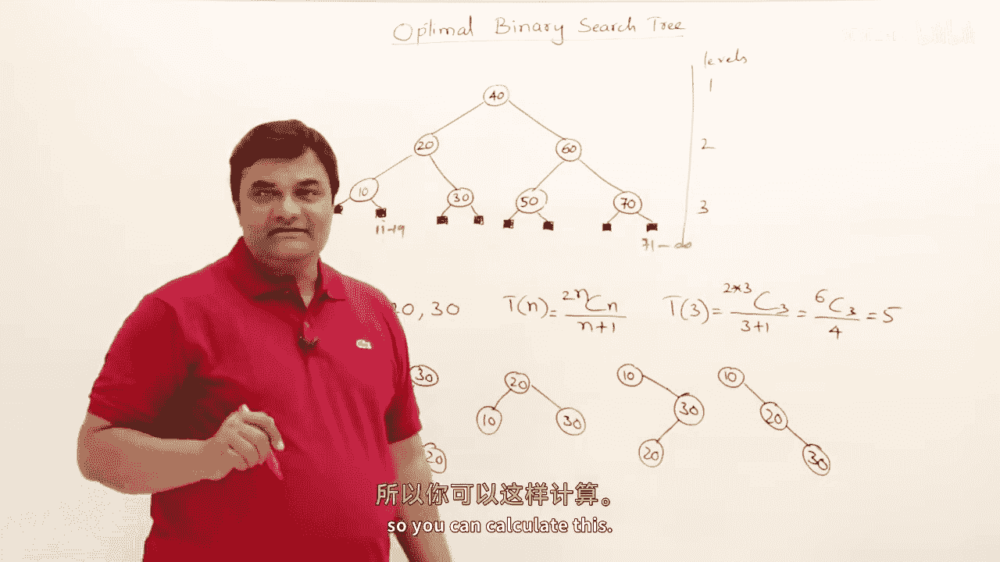

have more keys than more binary search trees are possible Now， if you observe here。

 the cost of searching like there I have shown you the cost of searching the maximum comparisons where three right but here if you observe the maximum comparisons are three maximum are three maximum two Oh this is better。

 this binary search is better。 So if you search for any key you can get the key in less number of time。

 less amount of time， less number of comparison and this is more， this is more。

 So the idea is for the same set of keys when you can have multiple binary search trees。

 One of the binary search tree maybe giving you best results。 that is minimum number of comparisons。

 So that's it we prefer that binary search tree。 So we want a binary search tree which requires less number of comparison for searching any key element。

 So if you look at this example。 I have a seven keys I have arranged them like this。

 Now how many binary。

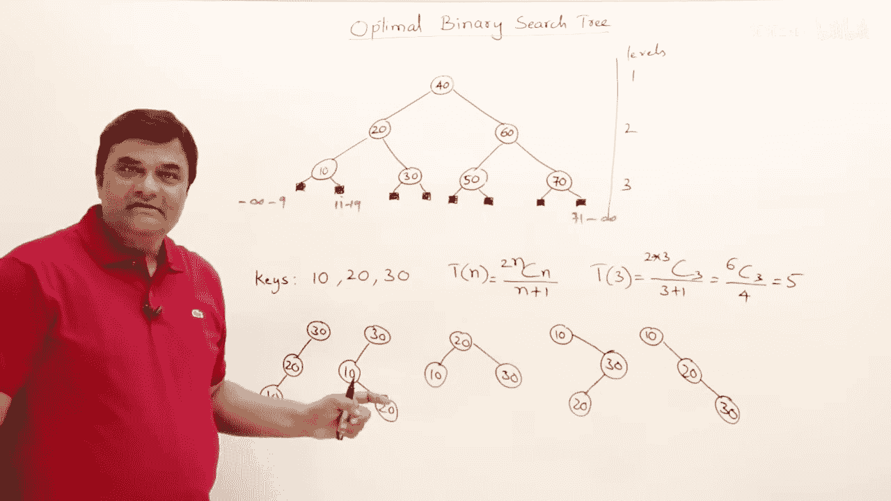

are possible for seven keys。 You put seven here in the formula and calculate。

 So many binary search are possible right and one of the binary search tree。

 I will quickly draw it here。 So if you take 70 as root and6 as left child and then it left child 50。

 then it left child 40 then it's left child 30 then 20 and 1。

 So this is also binary search tree for same set of 7 keys。 Now here。

 if you see how many levels are there1，2，3，4，5，6，7 levels are there。 So maximum。

 how many comparisons required for searching any key，7 comparisons are required。 So the cost is high。

 So it means that if the height of a binary search tree is less then the number of comparisons will be less。

 So height plays an important role for searching right So one thing we learn the height of a binary search should be minimum。

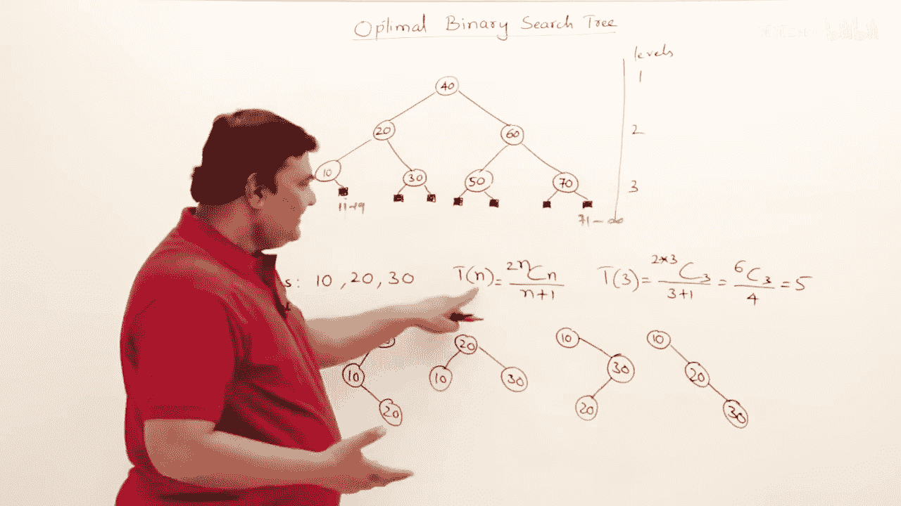

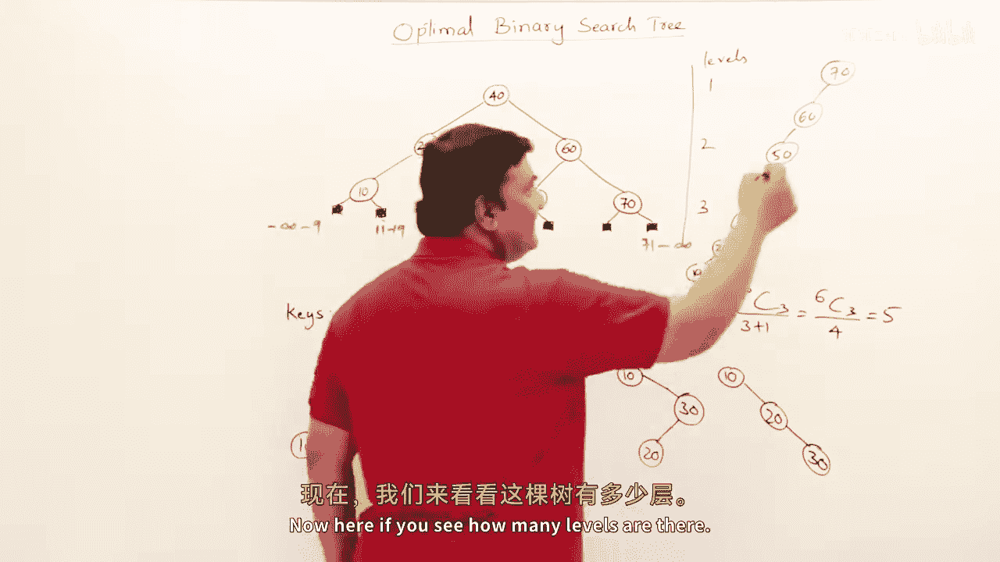

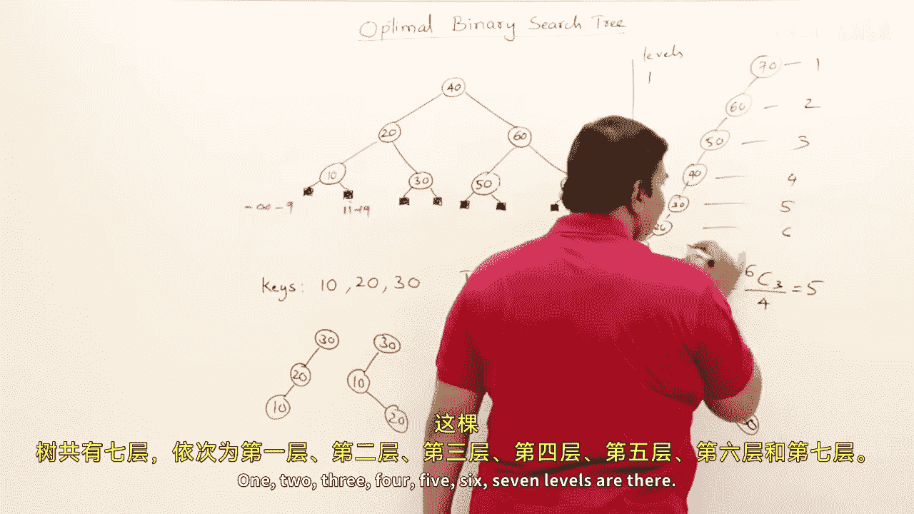

Now， next I will show you what does it mean by probability that is successful search or unsuccessful search probability I'll discuss about this for explaining successful search and unsuccessful search probabilities。

 I have an example。

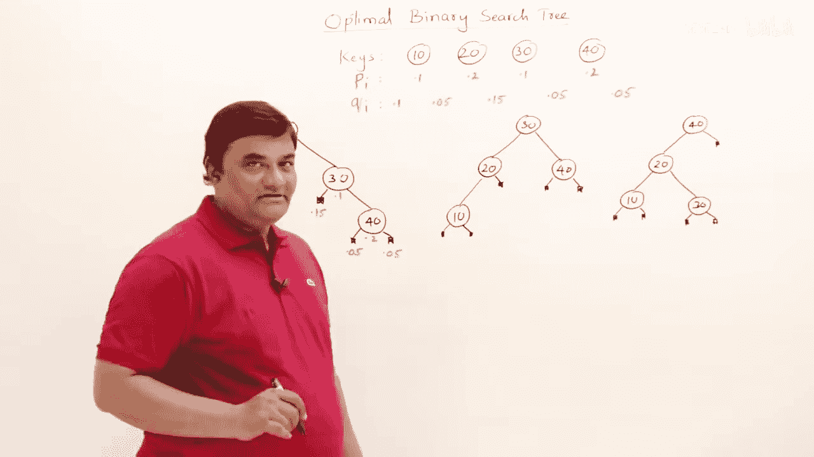

Let us look at this see I have four keys right and using those four keys I have drawn different binary search trees also for four keys。

 14 different binary searches are possible but I did not draw all you can try them all if you want I have taken just three binary search trees。

Now， first important thing。There are four keys and these black nodes are square nodes are representing unsuccessful search How many are there1。

2，34，5 So if there are four keys there are five square nodes。

 so if there are n keys there will be n plus one square nodes yes。

 so there are four keys and4 plus one that is five square nodes。Now let us talk about probability。

 So for talking about probability， I'll take an example。

See if you are assumed that you are running a store， a shop， and you have lot of items to sell。

 right， a small shop。 Then how you have arranged the items in your shop。

 few are on the counter right at the entrance point only。

 and few are inside the shelf and some few are deeper inside your shop and some of some of the items you have kept them in stockroom。

Right， so which items are easily reachable， The one that are there in the front counter at the that is sales counter or billing counter that are easily reachable。

 right， and the one in the stockroom will take time for。Fing those items。

 So how do you keep these items So you keep these items depends on the frequency of their sale。

 So that frequency is nothing but probability of their sale。

 So those items who are having high probability of selling。

 you'll keep them in the on the billing counter， the items which are having least probability they are they inside the stock room。

 right， So that's how we arrange the items。 So same way these keys are nothing but the items。

 and you are searching for them， right， fetching them or looking for them is nothing but searching。

 Like suppose you have a lot of items on your sale billing counter。

 somebody ask for something then you search here is the items。 So that's what you are searching。

 So you want to arrange them such that they can fetch in less amount of time。

 So the cost of searching should be less。

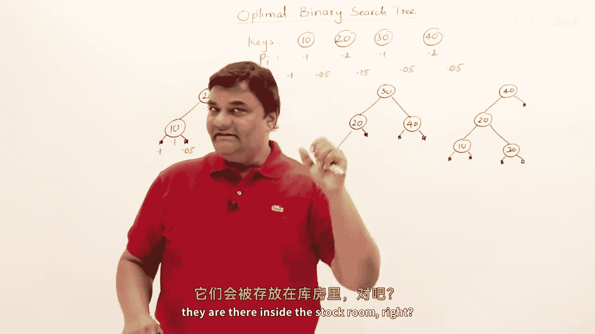

And one more thing you are considering here is that a customer is asking for something which you will search and find that。

 no， it's not available。 It's out of stock。 So that also you want to consider。

 you want to consider what is the frequency that people are asking for a few things which are not present in the shop。

 So successful search probability as well as unsuccessful search probability right。

 So what is the possibility based on that， you will arrange the thing。 See if somebody。

 some customer is asking and you are going into the stockroom and checking and coming back and saying it's not there。

 So it will take more time。Right， so if the unsexist search probability is high。

 then such things you assume they are there in the counter near the counter。 Its not there。

 right quickly you can say check in the stock room。 No， no。

 I know it's not there because we keep it here only if it is there。 So that's what。

So the frequency of successful search and unsuccessful search both are important。

 So I have the keys here。So if you see I have given the probabilities。

 both successful search probability and unsuccessful search probability。 If you some of all of them。

 I have taken in decimals right point because the final probability should be one。

 If you add all these that will be1 So the final probabilities1。

 So that is distributed among successful search than unsuccessful search for various keys。

 This is the successfulful search probability for Q10。 So let us call this as P1 probability 1。

 and this is probability 2 probability 3 probability 4， that is for the fourth key。

 then unsuccessful search we have one extra。 let us call this as Q1 for unsuccessful search Q2 Q3 Q41 is extra So this we call it as Q0 So we have started from 0 to4 right now there are five。

 you can say that why do you start from1， you start from why don't you start from1 If I start from one then I have to give this as 5 So that will be greater than the key。

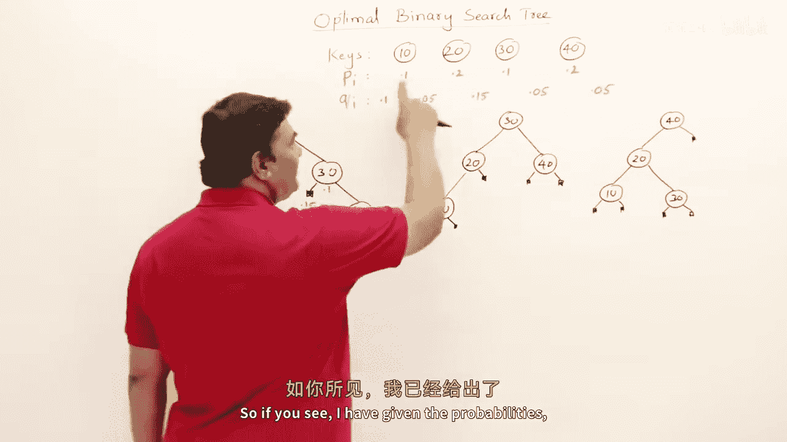

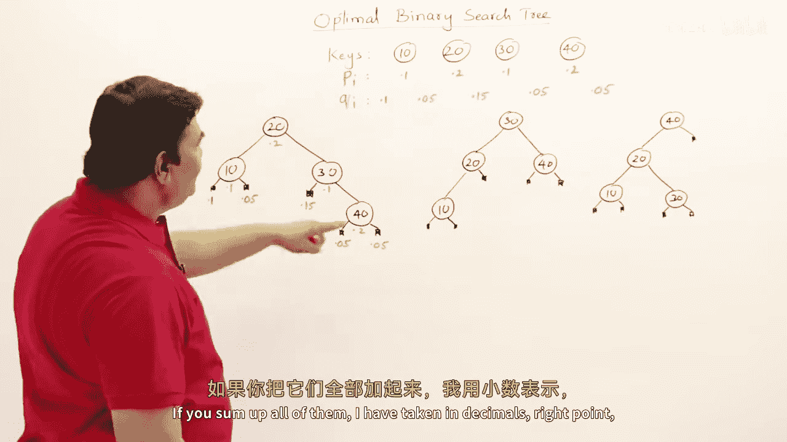

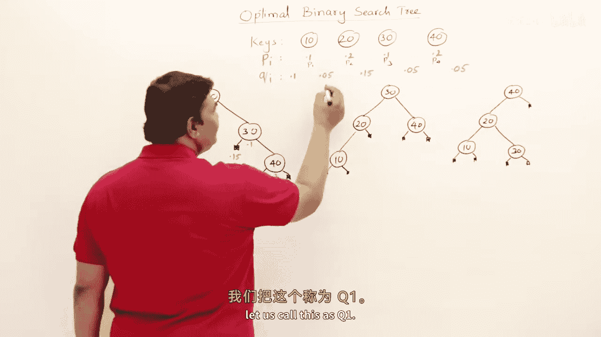

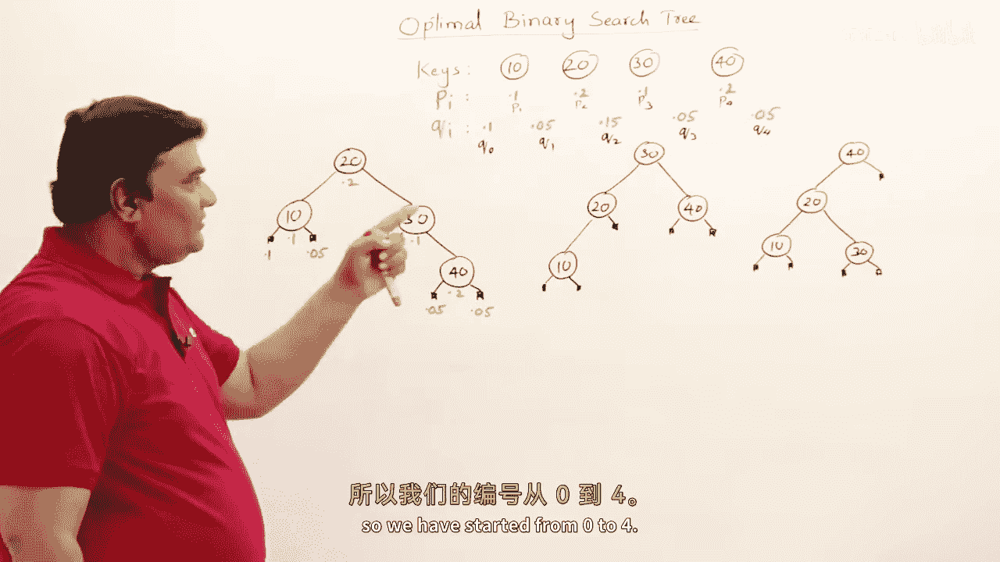

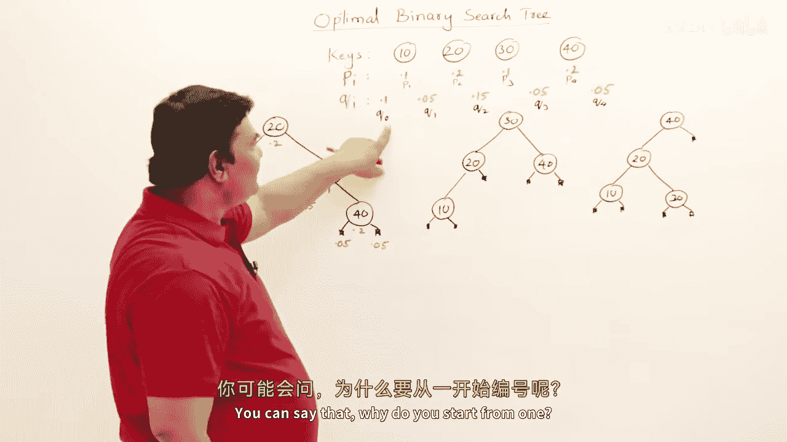

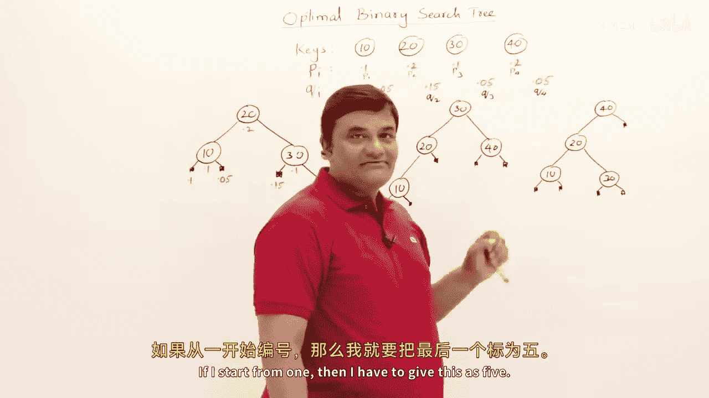

4 right we have fourth key only So that's where I have started from0。

 So0 to4 and that is from one to 4。 So if you look at it once again。

 see this is the probability of searching 10。 then what is this。

 the probability of searching anything that is less than 10 So that is minus infinity to 9 and this is the successful search probability of searching 4 T So that is the chances that a customer is coming for a key4 T assume like this。

 then what are the chances that he is coming for anything above 40 So that is from 41 to infinity this 1。

05 is the probability So this is not representing just one element。

 it is representing set of elements or set of keys that is representing just a particular key。

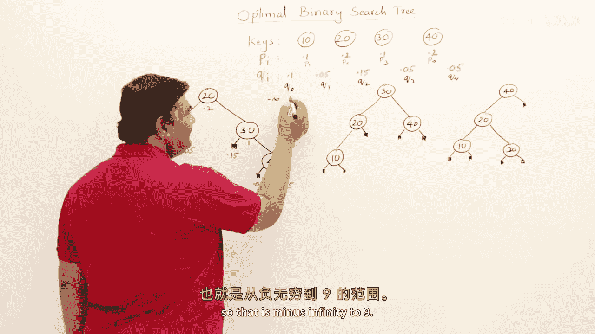

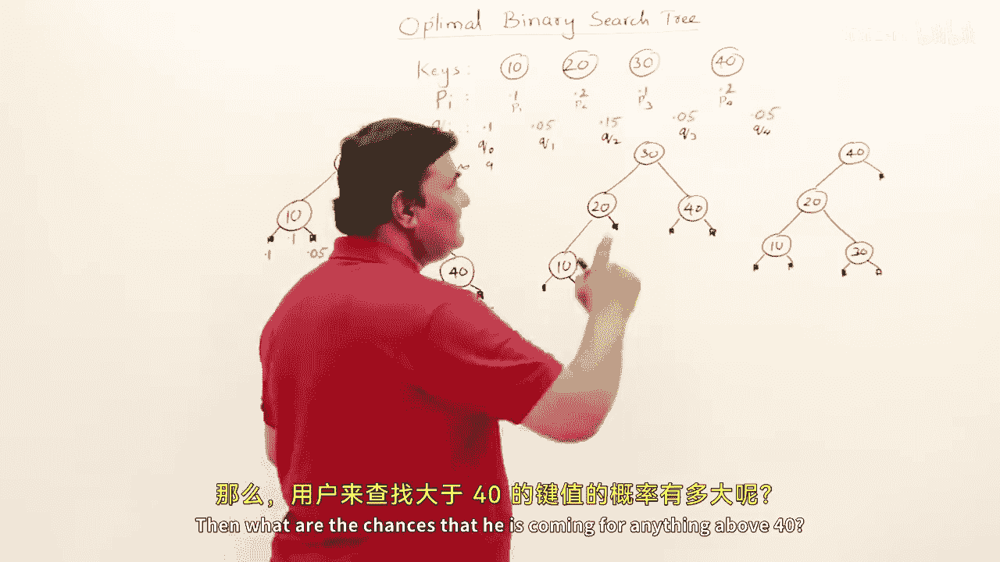

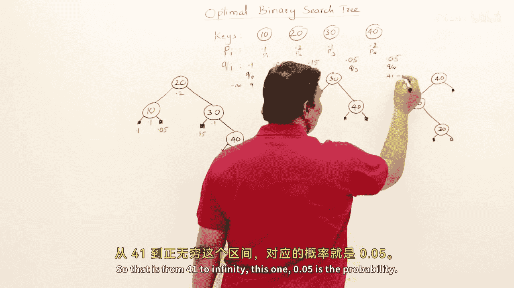

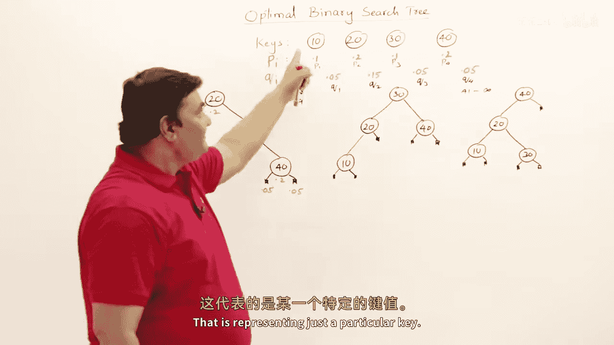

That's it， This is about the successful search and unssful search probability。Now。

 we need to know the cost of searching。 So for cost， I have trees here。 see this are example 3。

 And if you take the levels， this is level 1 level 2， and this is4 is at level 3。

 So I have taken levels also， And for each node。 that is for key。 I have taken its probability。

 I have venture it。 there is 0。1。2。1 in。2。 Then I have for square nodes also。

 I have the probabilities。 Now I want to know the cost of searching based on successful search and unsuccessful search probabilities。

 So let us find out the cost。So what is the cost of searching this one， It is at level 1。

 so just one comparison1 into02 plus what is the cost of searching 10 that is 01 so and it at level 2。

 so it is 2 into 01。Right， then for 30， I will take number of comparisons require by2 because it's at level 2。

 So 2 into01 plus4， this require three comparisons。 So 3 into。2。

 So for successful search keys I have taken this plus I should continue， but I will not do there。

 I will do it here plus right Now for un successful search01。

 but how many comparison see level1 level 2， This is not level 3， right， don't take it as level 3。

 because we don't compare。 we stop here only we stop over comparison here only and try to go all left set and say key is not there。

 that that it is some successful search only two comparison。

 So what is the level if you take I should take its level as 3， right， So this is along with4 T。

 and these are at level 4。 So we don't take its level but level-11 less level -1 So this is2。

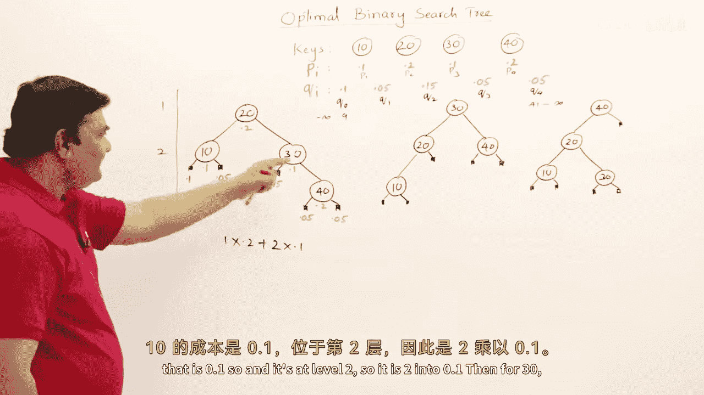

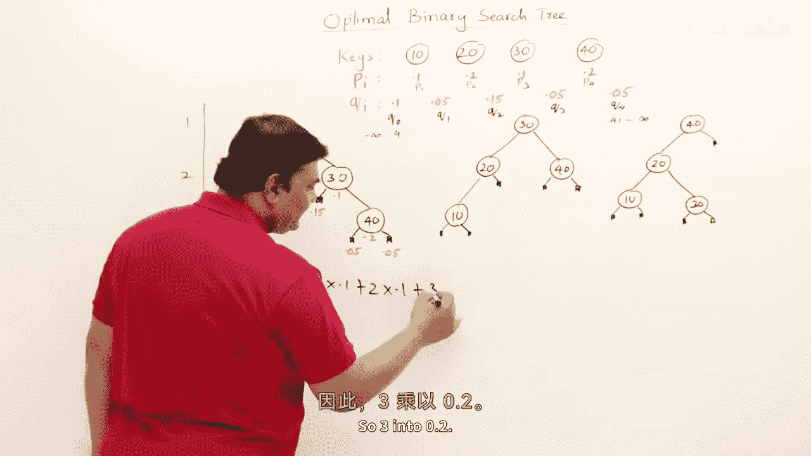

Into and its probability is 01 plus then this is2 into005 plus。2 in 2。15 plus。This is。4 this。

 this is4。 See， actually， I should draw them like this。 I should draw them till here till for t。

 Okay， I should draw them here till for t。 So this is  point1， and this is 05。05。 Okay。

 this at level 3， They are at level 3。 Then what about these nodes。 these are at level 4。

 So this is so 4 into005。 And plus this is also 4 into005。Okay， so this is square norms。

 they are also at some level， but if we don't consider their level。

 we will consider one less than their level。 So this is the total。

 So what will be the total if I multiply and an addd， this will be equal to oh。

 I have written this as4。 This is actually 3， right， So this is 3 in 2。 So these are at four level。

 These are at four level。 But the number of comparison stops here。 We have stop。

 We have to stop here。 That is level 3。 So it should be 3。

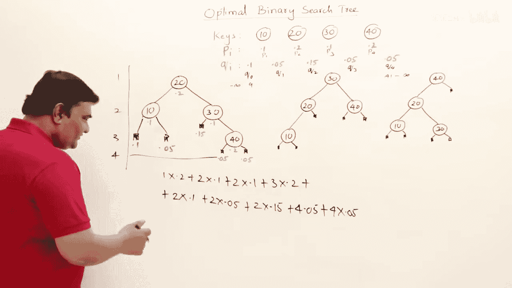

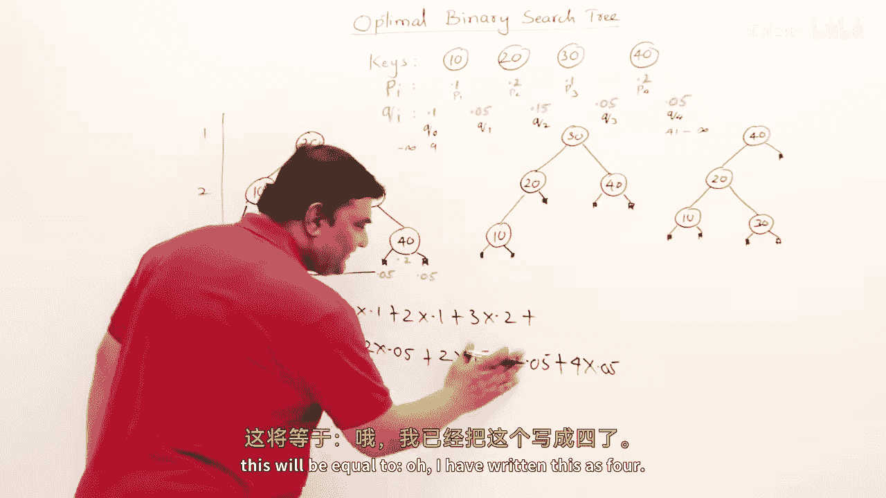

And if I multiply this an ad， the result will be 2。1。

 so this is the cost of searching in this binary search tree by considering successful search probabilities as well as unsuccessful search probabilities。

Right well for every key we have taken its level as the number of comparison for unsuccessful search we have taken its level minus1 okay level minus1 whatever is level minus1 so they should be extended till here I have drawn them in small size okay so level minus1 we take so this is how we got the cost。

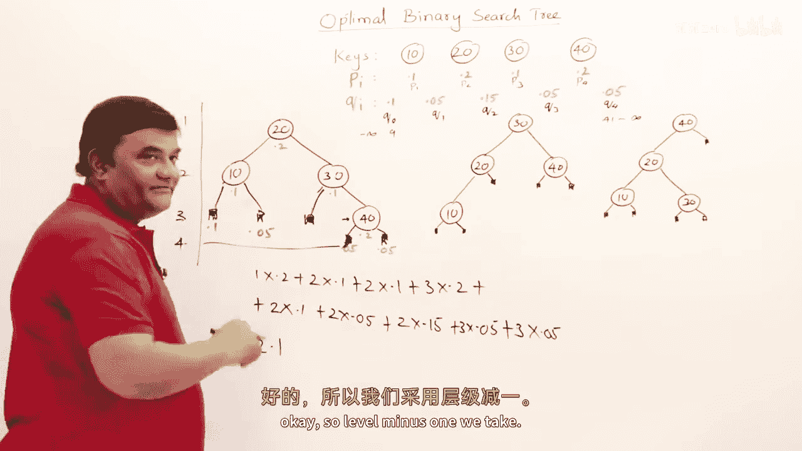

Now I will not calculate this so you can do it by yourself just remember that this is at level 1。

 this is at level 2 and these I have to be at level 3 okay。

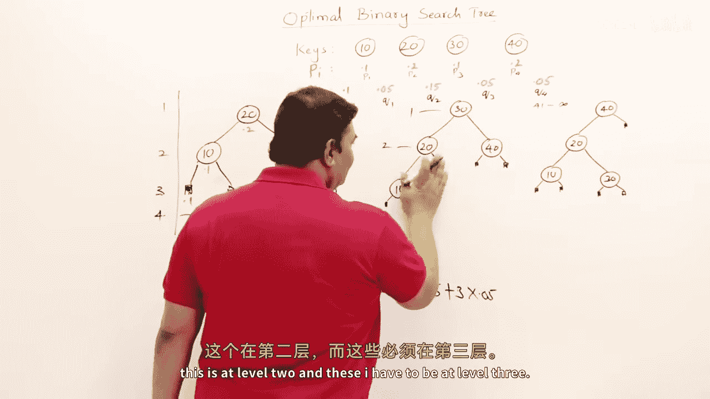

These are at level 3， this is level 3 and these are at level 4 so we don't take it4 for this we take three only for this we don't take it3。

 we take two only because these are not reachable we are not reaching them we are not comparing there so for this also you find out the cost。

Now， let us write on the formula for this cost。 So how I have funneled the cost is。

Cost is for keys1 to4 but here0 is included so let us write0 also0 to4。

 So what for0 is because the unsuccessful search probabilities are starting from0 onwards we write 0 otherwise the keys are starting from one only but we write0 also so this cost is we have multiplied every probability of key with its level probability of any key is multiplied with level of that key value right so for key I will say AI that is identifier or a elements are ABc I'm calling them as keys but let us write it as a of I then plus what about the unsuccessful search probabilities so that also the Qi value is multiplied with level of these are called as a square nodes are called as external nodes so let us call it as EI but we don't take its actual level like this level was a3 but we have taken two for this one。

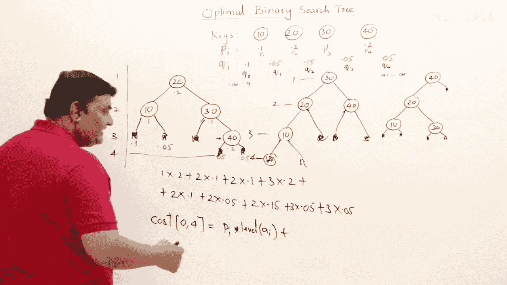

This is minus1。 So this level should be one less。 And this I have to do sum of all this。

 So let us say this is sigma where I takes the values starting from one to n。

 And here the i value will start from0 to n right So here it is not for it is n。

 let us make it as for n。 So this is from one to n that is from0 to n。 this is the formula。

 So what I have done， I have multiplied the probability with level， probability with level。

 So probability with level and unsuccessful search also probability with level。

 probability with level。 So the probability with level。

 this also I have to sum up this also have to sum up。

 So this is the cost formula for finding the cost of existing binary search tree already we have a binary search tree and we know the probabilitybabilities。

 we want to know the cost。 So this is the formula。

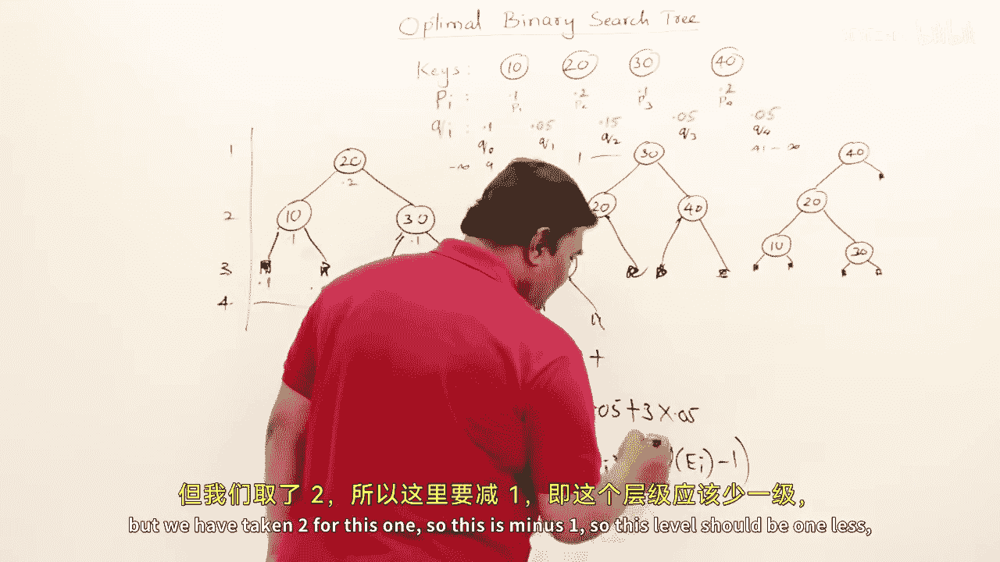

Alright so now next we will move to the next step that is we will learn what does it mean by optimal binary search tree see assume that we have the keys here and for every key there is a successful search probability as well as unsuccessful search probabilities these are given。

Then we have to find a binary search tree such that the cost of searching。

 the cost of searching this one here。 If you remember， we got the cost has 2。1。

 that should be minimized， minimized。 It means this formula should be minimized。 Yes。

 the formula of cost should be minimum。 This should be minimum。 the cost for this one depends on the。

Height of a binary search tree， which key is at which level if you observe root is 20 here root is 30 and here root is 40。

 and here30 is at level 2。 and here30 is at level 1 and 30 is at level 3。

 So I have kept them at different places。 So if you find the cost you will find a differences in the cost you will not get cost as 2。

1 for this one also and this one also， we may get different cost。 So as I said for four keys。

14 binary search trees are possible14 are possible。

 Now we want the best binary search tree for this the cost is minimize for that3。

 the cost is minimize means this cost should be minimize。

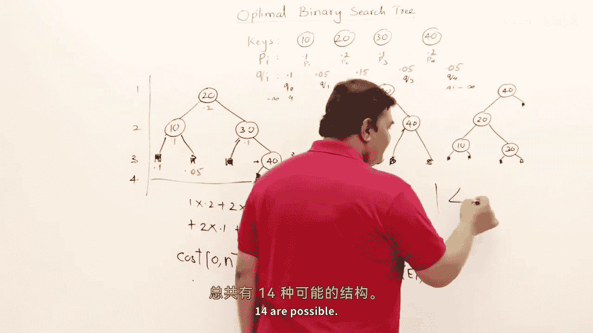

So how a tree should be constructed so now I will reframe the statement now a problem of optimal binary search tree is if the keys and their probabilities are given we have to generate a binary search tree。

 generate a binary search tree such that the cost is minimum， the cost is minimum。

This is the problem。 Now， what should be the solution。See for solution it means for four keys。

 14 different trees are possible， I should draw all 14 trees and find out the cost for each tree。

 then I should select the one which is giving minimum cost they should be the approach。

But this is very time consuming。 You remember for n nodes。

 these many trees are possible to N cn by n plus1。 So for four keys，14 trees are possible。

 So if I have 40 keys， then imagine， is it practical that you try all possible by the research trees and find their cost and select the minimum one nodes not possible。

 But is it possible that we find out the best tree without generating all of them。

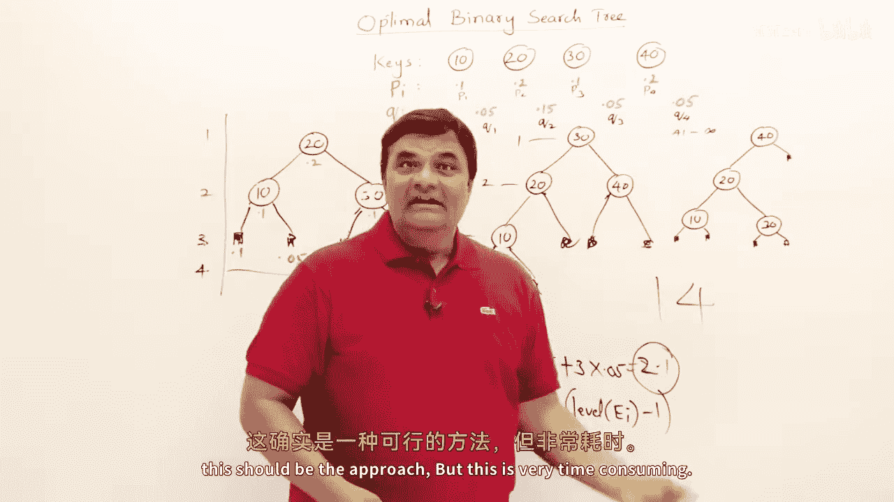

Maybe possible， so that's what dynamic programming approach will try to give you a easier faster method for trying out all possible binary search trees and picking up the best one without trying all of them without trying all of them so imagine if you try all how much time it will take so we will try all of them but not directly indirectly so that is the benefit of dynamic programming approach that is the strength of DP that you will try all of them but not directly indirectly so how it can be done。

In this problem， let us learn。 So I'll remove this and I will start explaining about dynamic programming approach for optimal binary searchtry。

 I have it in the formula here Now for using this formula for three keys。

 just three keys That is from 0 to3。 I' have taken it here。

 Then how we can use this formula for generating optimal binary search tree。

 So we have to substitute the values in this formula。 So let us do this one。 So from this。

 I'll explain you what should be the approach for solving this problem。 Just watch it carefully。

From 0 to 3， k can take the values from greater than 0 to less than equal to 3 means K can take the values 1 and 2 and 3。

 so I will substitute all of them。 And from that I should take the minimum。

 So this should be C of 0 to 0。That is k -1。 So what is k right now，1。

 So K is1 means this is 0 plus C of 1，2，3。 This is the first substitution。

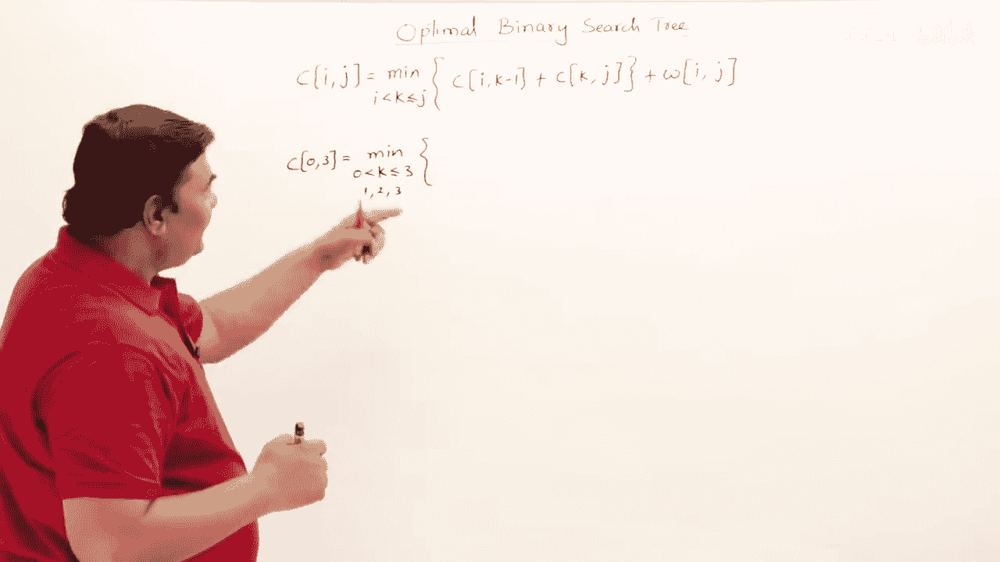

Comma， this is comma。 Now K， I will take it as 2。 So if I take a K as 2， then this is 0。

 and k is 2 minutes 2-1 is1。 then plus C of K is 2，2。 Then J is 3 here。 right？ J is 3。

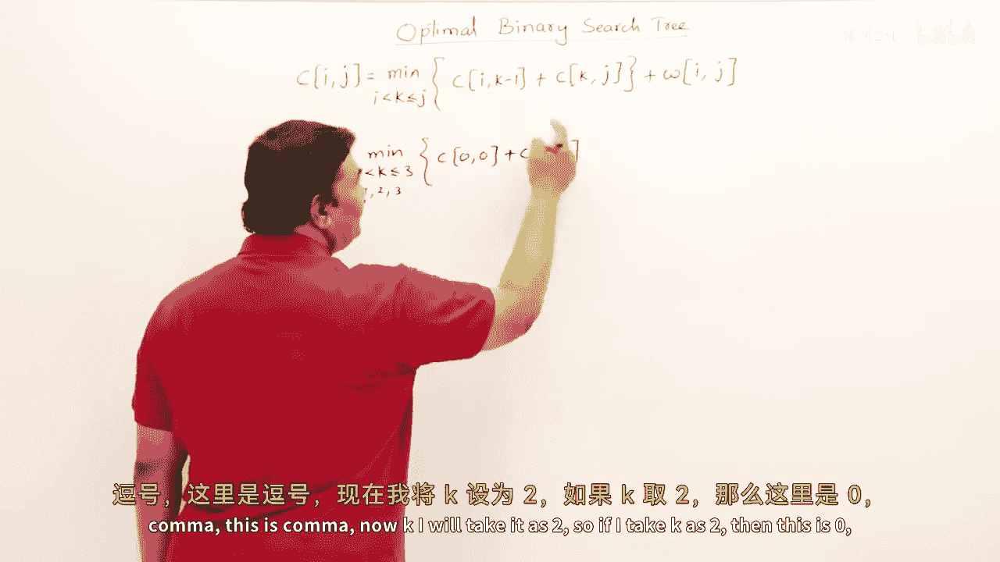

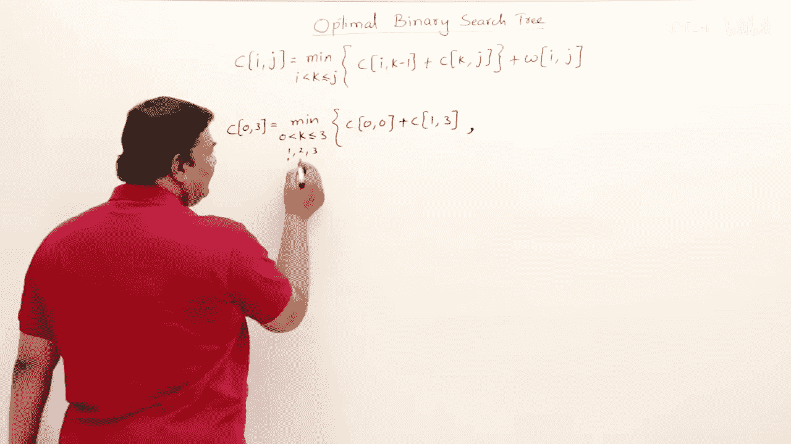

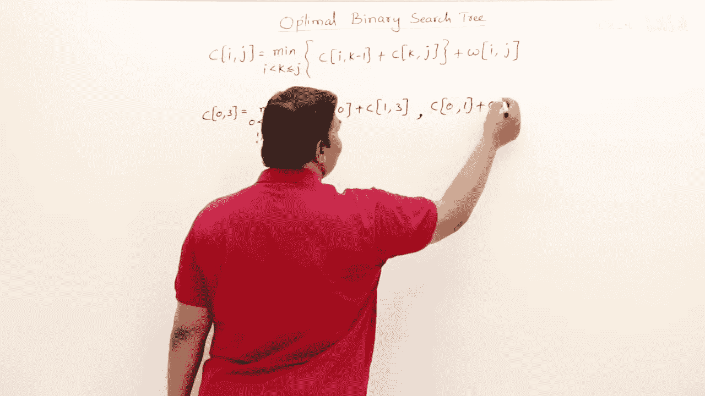

3， this is the second value of k。 I have taken comma。 Now， third value of k I will take。

 That is k should be 3。 So it it will be k -1。 That will be 2。 So this is C of 0，2，2 plus C of。

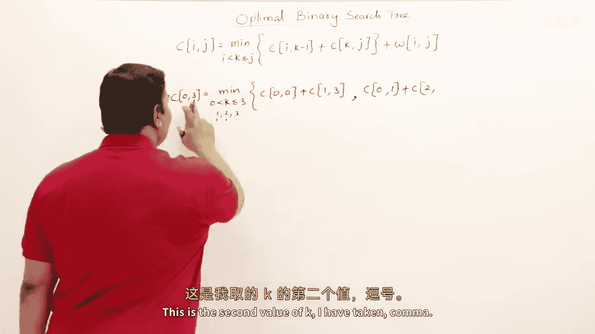

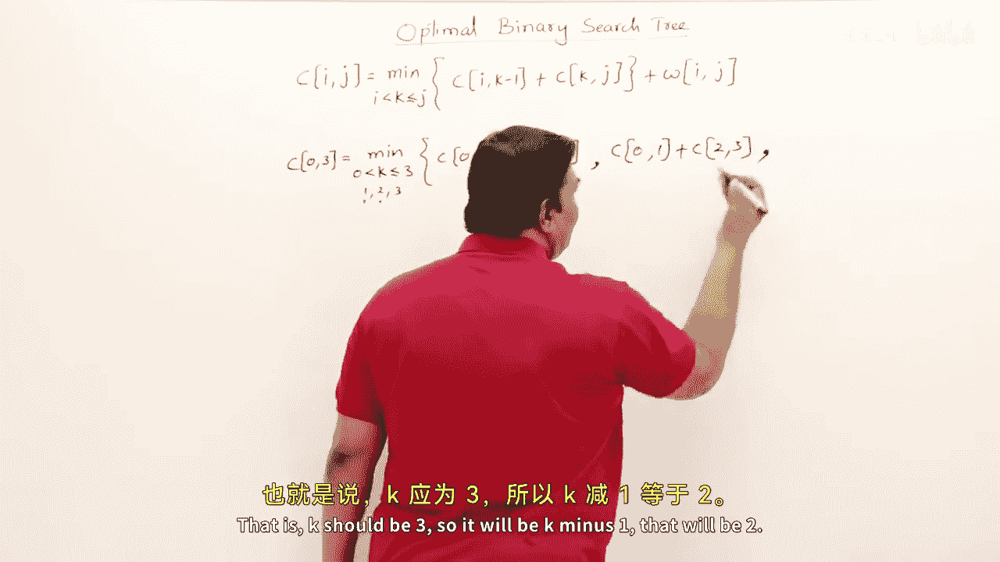

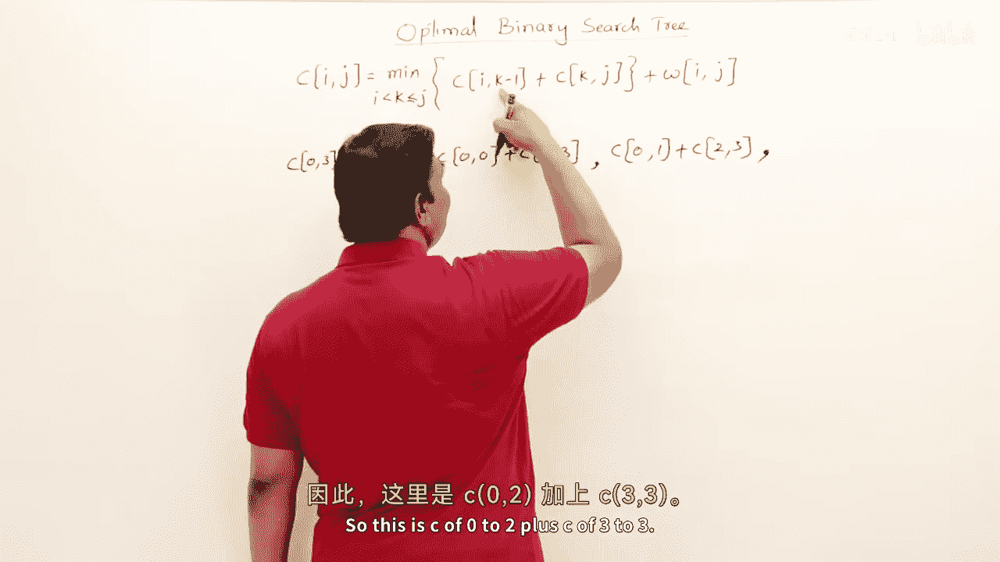

3，2，3。 Then this completes all possible K values。 K values can be 12 3。 So I have taken this。

 This is for 1。 This is for2。 This is for3。 So here you can see the K value， right， this term is k。

 This， this value is k。 So this is k。 This is k。 So this is k -1， actually。 Then at last。

 we have to take a w of 0 to 3。

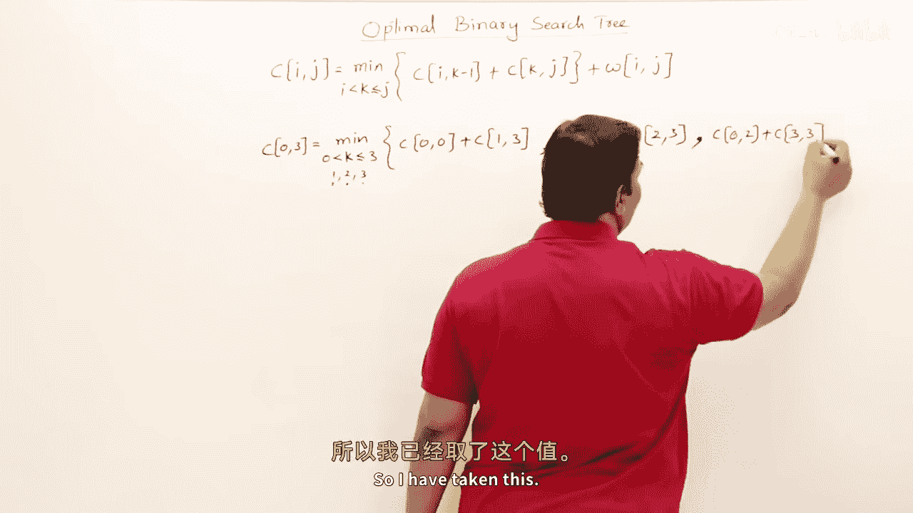

So whatever the minimum that you get in that， we can add that weight of 0 to3 now。

From this when I can know the answer for this one C of0 comm 0 that is cost of 0 comm 0。

 it will be nothing that will be 0 only and similarly c of 3 comma 3 it will be 0 only。

 But what about this I should know this value I should know this one I should know this one So if I know these values I can substitute them and I can get the minimum then it will give us what should be root K K and this W of0 to 3 is nothing but some of all the priorities successful as well as unsuccessful altogether right。

Now， I should know this， right？ So if I have to find out this one， I'll try to expand it here only。

 just watch。 So if I try to expand here， C of 1，2，3。

 theres nothing but a minimum of k takes the values greater than 1 and less than equal to3。

 So what are the possible values of k K can take the value greater than1 minus 2 as well as 3。

 So this has to be C of first of all， K values 2。 So this will be1 comma 1 plus C of2 comma 3。

 and next values。

K value every will take it as 3。 So this will be C of1 comma 2 plus C of 3 comma 3。

Then plus weight of0，1 comma 3，1 comma 3。 So from this。

 you can see that just to know this value again， if I expand， I have to know more values。

 I should know one comma 1 and three comma 3 also then this is only for this one then I should know this value and this value and this value this value that is two to0 to2 So so many values I should know if I expand them then they will expand like anything。

 So for finding the cost of0 to 3， this is the formula in this I don't know these values So I should find out these values and this again can be done using formula again。

 it expands like anything。 and from this again， if I take two comma 3 again。

 it will expand like something。 So if I want these values。 I should first know these values。

So this， that is the point。 That is the point。 So it means for knowing the answer for a larger value。

 I should know the value for answer for smaller values first。 Like these are smaller。

 So you can see that this was from 0 to 3， and it became 1 to 3。 So it is reducing。

 So if I know first smaller values。 Then it can substitute and get the answer。

 Then I can get the larger value。Yes， this is what the approach dynamic programming say takes for solving the problems。

 So if you expand all these formulas and see， then what are the values that we need。

 I will list them here。 So from this basically you need C of 0，0， C of 1，1， C of2，2。

 right and C of 3，3， you should know these values you some of them you can see 0，0，1，1，3，3，2。

2 will also come if you expand anyone。 that after that。

 you also should know that is 0 to 1 with a gap of1， that is C of1 to 2 and C of。

2 to 3。 This is a gap of one。 See the difference between these two was 0。 Now difference is 1。

 Then C of 0 to 2 and C of 1，2，3。 The gap difference 2 here。 Then finally， you can know C of 0 to 3。

So first find out these from that you can know these from that you can know these values then finally you can know so it means to solve this formula。

 you should solve this a smaller formula for this formula you should solve this a smaller formula so if you already have smaller values you can substitute and put them back and get the final answer。

This is what we need the values。 So these values we need。

 So if you observe and say that this is I and this is j difference between I and J is0 here。

 So J minus I is0 here here J minus I is1 and here J minus I is 2 and here J minus I is 3。

 So I should find out the values with a difference of0 difference of1 and difference of2 and difference of3 I do because always I will be less than j right always I will be less than J that's why I'm not getting all possible combinations just I am getting this much So if you know these values。

 then you can get the answer。 we want the answer for this one。

So now we will not be using formula， will be filling table and that table we know very well that it is from the formula only。

So when we solve the problem， we will fill the table。 Now， one more thing in this one。

 apart from finding the cost， we should also know who is giving us minimum costs means which k out of these three k。

 which k gives minimum cost from that， we will select it as root。

 So we should monitor that also observe that one also then also in the formula。

 we have weight values。 So how to know the weight， See， if you observe。

 if you take weight of 0 comma 2 and weight of0 comma 3， then what is the difference。

 See these are the weights。 So if you take0 comma 2 and0 comma 3， What is the difference。

 So what is this Q 0 plus p 1 plus Q1 plus p 2 plus Q2， what about this Q 0 plus。

P 1 plus Q1， P 2 plus Q2 plus P 3 plus Q3， right， So if you observe these two。

 then this is same in this one。 And only P 3， Q3 is。Added。

 so weight of 0 comma 3 can be taken as weight of 0 comma 2 plus。P 3， Q 3， right？

 So it means weight of any I comma J can be taken as weight of I comma。 This is J -1， J-1 plus。Okay。

 J -1 plus。俾者叫车。So this is how we can modify the values of w so it means if you form the one of the w value you can know the next value by this method right so if you already know0 comma 2 you can easily find0 comma 3 so finally I can say that we have to find out cost weight for the formula plus who should be root。

So now I have explained you what should be the approach。

 Now I will take an example problem and I will solve it。

Let us take a problem and solve it using the formula we have already seen。

 and also I have given you the approach now I will solve this problem and also I will construct a binary search tree that is optimal binary search tree。

 So let us look at the problem first of all， see there are four keys given 10203040。

Right and these are successful search probabilities right of first key。

 second third and fourth key and these are unsuccessful search probabilities that are  QYs that are starting from zero onward like one extra unsuccessful search probability will be there so this is 01。

2，34 actually the probabilitybabilities should be in decimal point probability should not be greater than one right these are in decimal point but working with the decimal point will be difficult so。

Actually， if you add all of them， total is 16。 So if you divide them by 16， every value by 16。

 you will get the actual probability。 So they are multiplied by 16 to get the inion number so that you can easily calculate them。

Now for solving as I told you the approach I have taken all the values。

 the weight and the cost and the root who should be a root so all these values are filled here and this is 00。

11223344 difference between INj is 001，12，2，334 difference between INJ is 1 and 2 and 3 and 4 I have to fill up the table Finally I need the cost for0 to4 that is four keys are there so 0 to 4 is here。

So if I can get this answer， then I got the answer。 Im not using the formula directly。

 but indirectly， Im using the formula by filling this tip。 Let us fill up the values。

 So first of all， W value， I will fill up C W of 0 comm 0 is。Q 0 plus nothing is there， right，0。

 Q 0 will be there。 So it means 0 comm 0 is  Q 0。 W of 1 comm 1 is Q 1 plus nothing is there。

1 is the last one。 starting for one and ending at 1。 So this is just  Q1。

 So it means this w of 0 comm 0 is this is 2。 And this is 3，1 comm1 is 1。 And this is1 and1。

 And this is also 1。Okay，2，3，1，1，1。 So w values are just first Q values。 So that is filled。

 And what about the cost， cost of 0 comma 0。 So cost of 0 comma 0。

 if you take k takes the values from。Greater than 0， greater than0 means1。

 but less than equal to this one。 So there is no K value possible。 So these cost are zeros。

 So initial values are all zeros。 these are all zeros。All right， so these are all zeros。

That is failed， first row is failed。Now， Mexico。This one for this， first of all。

 I will find out the W values， then I will show you cost and the root values。Ruse also。

 I made them at0 here。 Now here w of 0 comma 1。 So if you remember。

 I have shown you that w of i comma J is nothing but w of i comma J minus-1 plus Pj and Qj right？

 So w of0 comma 1 will be w of0 and j -1 is 0 plus。P 1 plus Q 1。 So this， I can obtain this。

 I can obtain from this  one，0 comm of 1， I can obtain from 0 comm 0，0 comm 1。

 I can obtain from 0 comm 0。 So this plus。P1， Q1。 These are P 1， Q1，3 plus 3，6， and this 8。

And if I take this for this one。This is21 number 2。 So P 2， Q2， So 3 plus 1， right，3 plus 1，4，5，6，7。

 This is 7。And this value，2 co 3，2 co 2 plus。P3， Q3，1 plus。1 plus one， total 3。Total 3。 that is2。

 And this is1。 Now， this one，3 comma 3，3 comma 4。 So 1 plus 4 coa 4。 So 1 plus 1， right，2。

 and that is1，3。 So this is 3。 W values。 I have fill them like this now even I again fill up all these values。

 W values。 So let us finish them。 Okay， I'll fill up all these values。

 Then I will fill up cost and the root。 So wait we can be already known。 This is 8 is there。

 Then two comm we have to fill up。 That is 3 plus 1，4，8 plus4 is 2 well。7 plus 2 is 9。

 Then3 plus 2 is 5。The next， this one，2 L plus 3，3，3，3 is 2。 So this is 14。And this is。4 comma 4。

 So 9 plus 2 is 11。Then this one，1 comm of 4， then this one S 16，14 plus to 16。

So W values already have filled them by using this formula， this formula。

 you can see this as the formula。Rightい。Now I have to find out cost， so I should start from here。

 I will find all these costs， and I will fill up them also routes。 So let us do it。

Let us find C of0 comma 1。 So for that， first of all， I will write on the formula， right。

 so you should look at the formula from that。 We will do it。

 This is minimum of kx values greater than I less than equal to J。

 And this is C of I comma K minus-1 plus C of。K to J。 And outside the bracket is W of I J。 right。

 this the formula。 Now， keeping this formula， I will be using it for finding all the values。

 Let us start C of0 comma 1。 So here right， C of 0 comma 1 S minimum of K takes the values greater than0 less than equal to1。

 So what are the possible values of k greater than 0 minus1，1 to 1。 So only one value it can take。

 So this will be c of I is 0。 K， I said it is 1。 So 1 minus1 is 0 plus C。K， K is what1。 K is1 and J。

 J is what1。Plus， so outside the bracket we have plus W of。아이까머지 아이꺼 먼지에서 zero로까목은 zero로까목은。

This is what the formula we got。 So as there is only one value。 So that is only the minimum value。

 So let us find out minimum of do I have a C of 0 comma 0。 Yes， it is 0。0， then C of one comma 1。

 Yes， I have 0，0 plus weight of 0 comma 1 weight of0 comma 1 is 8。 Here。 we have 8。8ight。

Then what is the minimum of this0 only， So this is 0 plus 8 is 8。 So cost of0 comma 1 is。eight。

Firstly， we got。If you observe in this one。Only K value，1 value is possible。

 Only one value is possible。 So here this is becoming 0，0。 This is becoming 1，1， right， Now。

 let us try for c of1 comma 2，1 comma 2。 I will find out this one。

 So what I'll do is I'll just modify it。 Okay， one comm 2。 This is one， This is 2。 and this is1。

 This is 2。 K can take the values greater than1 less than equal to 2。 So only two it can take。

Then this is C of I。 I is what one。K -1，2-1。1， C of K， K is a2。2， and C of J， J is 2。

 So this is1 comma 1，2 coa 2 and a weight of1 comma 2， weight of1 comma 2。So， see off one one。0。

 C of 220。Minimum of 0 is 0 only right， weight of 1，2 is 7。 This is not 8。 This is 7。This one。

 right now add this。 what is the result，0 plus 7 is a 7。 So I got the same value here。So。

 this means that if I try for c of 2，3 also I will get weight only because there is only 1 k value possible and that we are getting0 only so this will be same 3。

3 I save the time。I have observed that。 It is coming same thing。

 So I have directly written the value。 So I have saved the time。 Now，1，2，3，4，5，6 values。

 I have to find out next0 to 2。 let us find out 0 to 2。 I'll remove this and I'll find out0 to 2。

 Now what should be the root values C C， the minimum value here， the minimum k value was one here。

 K we have taken as one K here， we have taken as2 and here，3 here 4。 Now here in this one。

 you cannot see the difference。 next level， when I find the values for these that time you can find out how we are getting root value。

 Okay， so just I have written 1，2，3，4。 just leave it。 Okay， now let us find out C of0 comma 2。

 So this will be little than the C of 0 comma 2 Min of k takes the values is greater than 0 less than equal to 2。

 So what are the values K can take1 and2，2 values it can take。

 So in this I should take K as 1 as well as a k as 2，2 times。

I have to try this one， so let us take c of0 comma k is111 minus1 minus10 plus c of k is1，1 comma2。

 this is I， this is J。 remember this and right now k is 1 we are taking one So this I have finished Now K as a two we will take2 in this one you substitute to2 here C of0。

2 minus1 is1 plus c of 2 comma J is22 comma 2。Then outside this， weight of。That is0 comma 2。

 So let us substitute the values and see minimum of。C 0，0 from here I am I got the value。

 C I am finding this one。 and for this， I should know this value that is helping me Al I know the value。

 then I can use it here。 That's what C of0 is0 is 0 C of 1 comm 2 is a 7，7。Plus c of 0 comma 1。

 c of0 comma 1 is 8，8。Plus c of2 coa 2，2 coa 2 is 0。0。Okay， then plus weight of0 comma 2。

 weight of 0 comma 2 is how much 12 this is 12。So this is minimum of right。

 which is minimum7 is minimum。 What was the value of K here。

 If you remember K I have taken as one here， K I have taken as two here。 Yes。

 K has 1 has given me the minimum value。 So this is 7 and plus 2 L。 So this is 19。

 and the K value is 1。 So I'm filling up what here， this is 19。 and who should be root。

 minimum1 should be root， So who was minimum K was1 K is 1。 That's it。

 So that's how whoever is giving minimum value that we will take here and most of the dynamic programming problem。

 we do it like this only whichever value is giving minimum that we will take it there。

Now I will not fill up， find out these。 You can follow this formula and you can do it。

 I'll fill up these values。 then I will find out these three values。 Finally， okay。

 these three values。 so let me remove this and find out c of 03。 if you want to see the value。

 this value is 22。 and this is 83。 So if you follow this method and get the answer。

 we will get those answer。 I'll remove this and find0 comma 3 C of0 comma 3。

 that is minimum of k takes the values greater than 0 less than equal to 3。

 So what are the key values possible First time k value can be 1 or 2 or 33 values are possible。

 So if I put one there， then it will be c of 00 plus C of13。 then next is。Comma。

 next value is C of 0，1 plus C of 2，3。Comma C of0，2 plus C of 3，3 here。 K values is 1。

 K values 2 K values 3。 I have tried all of them。 Then out of all these。

 whatever the result we get in that， I have to add w of 0，3。Let us put the values here。

 so I directly put the value below this one。 This is 0 and one comma 3 is how much 12。 So this is 12。

 This0 comma 1 is 8 and2 comma 3，2 coa 3 is here。 That is 3。Okay， then 0 comm 2，0 comm2 S 19。

And three comma 3 is 0。 So if I put the values， I'll separately put them here。 minimum of。

0 plus 2 L S 2 L comma 8 plus 3。 That is 11， then 19。 Okay， then plus w of 0 comma 3，0 comma 3 is 14。

 So out of this， which is a smaller。 This one for which value of k2。

 So what is the answer 11 plus 14 is 25。 So this is 25。 who gave 25。 which value of k has given 25。

 The value of k， which has given 25 is 2。 So write to here for saving time I'll leave it。

 you find out whatever the value you get， you put it。 then finally I'll do it for this one。

 So directly， I will write on the answer。 this is 19 comma 2。 Okay， just like this。

 you have to start from 2 onwards， not from one onwards。 because this is1 to 4。 So 2，3。

4 K value can be 2，3，4 substitute and you can get it。Now let us try this one C of 04。

 So what are the values k can take k should take the values greater than 0 less than equal to 4 z this is 0 right if it is1 greater than1 okay so whatever the initial value is so k can take the values1。

2，3 and4 so four values are possible So in this formula I should try at all so first will be c of00 plus C of this is 0 now so what is  one4。

Right， C of 0，1。Then there a bit too for。Okay， then this is C of 0，2 and C of 3，4。Then comma， comma。

 C of a 0，3 plus C of 4，4。Right， then plus weight of0，4。

Here I have taken the key value as 1 and 2 and 3 and 4， right。

 So let us put the values and get the answer。 See， C 0，0 is a 0 plus C 1，4。 C 1 comm of4 is 19。

So total is 19。 This one is 19。Then c of 01， C of 01 is 8。C of24， C of 24 is 8， so this will be 16。

C of 0，2， S 19。Plus， C of a 3，4， C of a3 comma 4 is 3。3， so this is 22。Then C of 0，3 S 35。

25 plus C of 4，4 is 0。 the sll 25。 So if I take minimum of right。

 this is how 19 comma 16 comma 22 comma 25 and plus weight of 0，4， how much it is 16。

 And which is minimum this one。 for which value of k， we got this as minimum 2。

 So this k values is 2。 So answer is almost 16 plus 1632。 So answer is 32，32。 and what is a root。

 who has given us minimum value， K value has 2 has given us minimum value。 this is 2。 That's it。

 So we got the table filled by using the formula。 If you observe。

 we have started from the smaller values， then we got the larger value。

 So the efforts that you are putting in here are less if we would have started from here it was difficult to solve we could not have solve it easily。

 So when we are ccrating some higher value， this lower values are useful because already we have。

so this approach we call it as tableular approach， a dynamic programming follows tableular approach。

 So it starts from lower values to higher values。 Now we have the complete data available。

 The cost of a tree we got it as 32。 So as I said that the probabilities are multiplied by 16 and kept there to avoid decimal values So this result should be divided by 16。

 so 32 by 16 cost is2。 So the minimum cost of our optimal binary search tree is true。

 So if you observe this we are always taking minimum。

 So it means we are taking the one which is giving us best result。Are we trying all。

 So if you start from the lower values and reach the higher value。

 if you can see that we tried all possible routes。 Yes， we are trying all possible routes。

 As I said in the beginning that we should try out all possible binary search trees and pick up the best one。

 So yes， we have tried all possible binary search Ro should be fussky or second key or third key or fourth key which one it should be so that we get the minimum so we got 16 plus 1632。

 who gave minimum 2， So based on the cost， we are deciding So indirectly we are trying out all possible binary search trees。

Now， last thing， what should be the tree。 So from this data， we already have the data。

 Now we can take the decisions and form a。Optimal binary search tree。 So I'll remove this anl form。

 Op binary search tree for these keys 102030 and 40。

 Let us generate our optimal binary search tree For what keys 1，2，3，4。

 So we have to find out root for keys from0 to 4。 Y 0， Yes。

 this unsuccessful search probability starts from 0 for everything we have started from 0。

 So root is also 0 to 4， Okay， now， for0 to 4 in the table do you have any value。

 you got the value which gives minimum Yes，2。So root should be2，2 minutes second key that is 20。

 so I will write 20 here。20。So if you remember in the formula when root is the second key here it is second key right root is true。

 So the left hand side values come this side right hand side values goes on that side。

 So what comes on this side So I'll write down this one root of02 k is the2 here right so this should be1 and k is the2 here。

 So this should be2 to4 if you remember whatever the K is left hand side is I2 k minus1 this is k to J right same method same which on the formula。

Now here I have 0 to 1 and this is2 to 4， so as a2 is a root。

 so only one key is left on side on the left hand side。Now， what is a0 comma 1 in the table。

 R of0 comma1 in the table is one。 Yes， first key。 What is the first key 1，10。

 So here key value is what。10， and case 1。So we have taken decision。

How we have decided who should be in the root table give us so we give we got a decision。

 we have taken a decision based on the data that we have。Now two co of4， who should be root。

2 co of4 means we have how many keys now that is 30 and 40， two keys are there。

 which one should be root table will tell you based on the table of data you take the decision2 co of4 so2 co of4 is here root of2 co of 4 is3 this is three third key so which is the third key30。

So who is the K here， K is a 3， As per this value， Then 40 where it will go on this right hand side。

 So right hand side， there is only one key remaining。 I will not write on these values。

 So I will directly fill up this right hand side。 That is 40。Only one key is remaining， right？

So I started from 0 to 4。 So0 to1 this side 2 to 4 on that side，0 to 1 gave me one key。

 So this is finished。 I stopped there。 and 2 to 4 gave me one key。

 So I stopped here because only one key is remaining And for T definitely come on the right hand side。

 So already you have taken it。 If you want to see this further as k is key is a3。 So on this side。

 if you take this is R of2 comma 2。 And this is R of3 comma 4。 So who is R of three comma 4。

 that is 4。 Yes， we got 4。So no need of this this is the null value right that is external load so this is the tree so this is a optimal binary search tree with 20 in the root 10 on the left side。

 30 on the right side， 40 on the right side， but this is the optimal binary search tree based on the successful search and un successfuluc search probabilities this is the optimal binary search tree which takes minimum cost。

Alright， so as if we tried all possible binary searchries and we have taken the best one。

 it is just like that if you see the approach we have taken。

 we have found out all possibilities and took the minimum one。

So this is the approach of dynamic programming and we have solved one of the problems using dynamic programming now if you have similar problems see that if it matches with this one then you can apply the same strategy there that's it so that's all in this video。

