# 【精译⚡算法导论】AbdulBari p60 p59 4.9 Longest Common Subsequence (LCS)  - Recursion and Dynamic Programming -BV1hhPXeTEWM_p60-

Hi， the topic is longest common subsequentence， in short， Elseius。

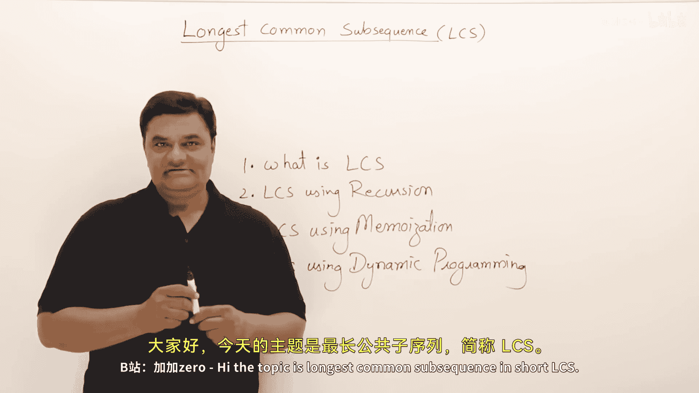

In this video， I'll explain what is the problem L C S problem。 Then I will solve it using recursion。

 I will write an algorithm and show you how it can be solved using recursion。

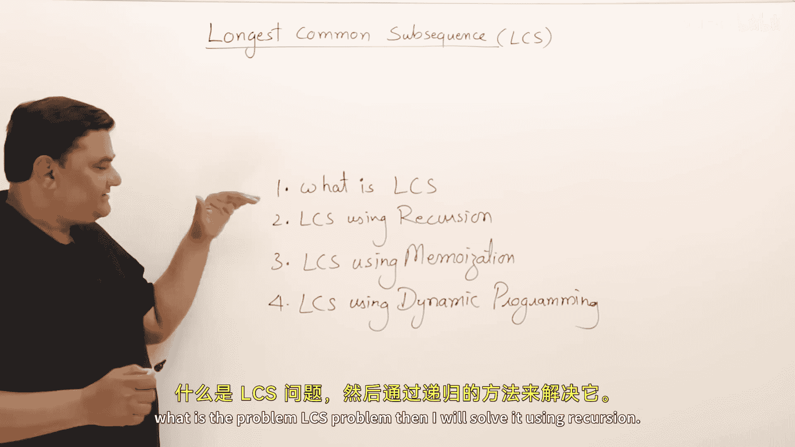

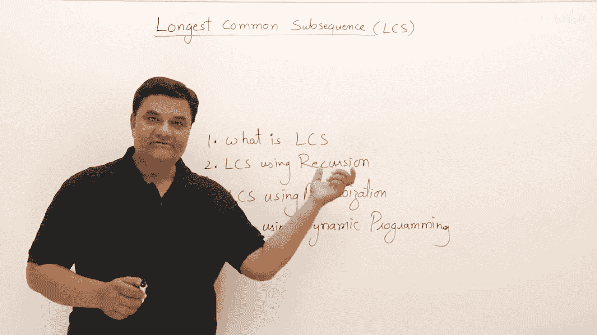

Then as we know that recursion are time consuming， so to save the time and we can use memorization。

 So here I will also show you LCCS using memorization。

 then finally we will solve LCCS using dynamic programming。

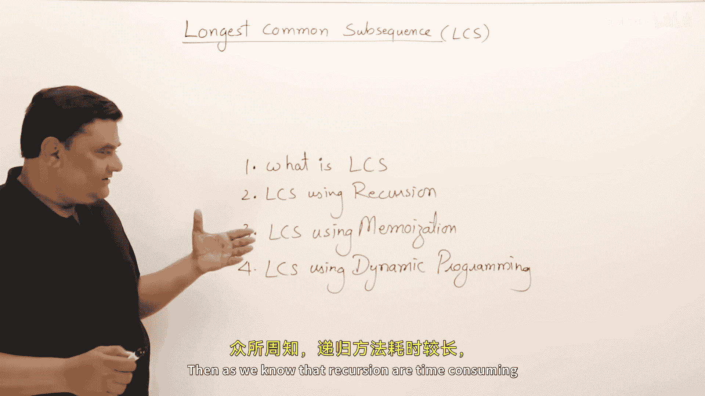

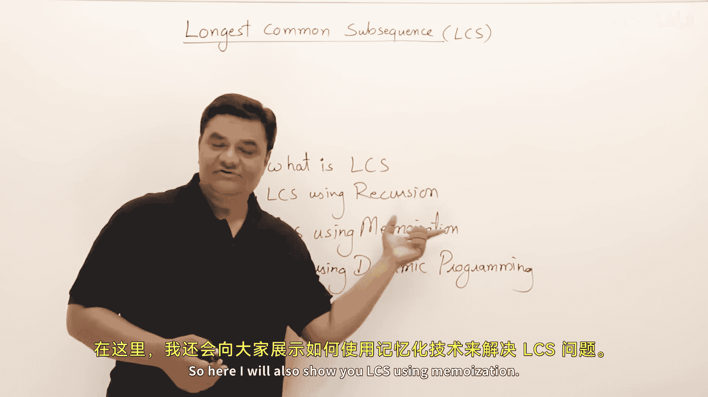

So let us start with the problem。 Let us understand the problem。 See here， there are two strings。

 two strings。 So there is nothing like substrs here。See in KM P algorithm。

 we will have main string and substr and there substr， we will search in the main。 No。

 here we have two different strings。 Here。 you can see that I have taken this as a longer size and this as smaller size。

This is not a sub string at all。 We are not finding exact match。 Now， let us understand what it is。

See here there are some set of characters in the same characters they are appearing here also。

 and we want to find out which set of characters are coming in sequence。 So let us start。

C from this 1， I will check because this is smaller。 C， Yes， C is there。 Yes， D， Yes。

 it is also matching with this one。G is matching with this one。And I is matching with this one。 Yes。

 this is a sequence。 C， D G， I is a sequence that is there in the string 1。

 no doubt the characters are not together， but they are coming in the same order。

 That is same sequence。 They are appearing in another string。

So this is the longest common sequence from this one， even I can say that DGI is appearing there。

 or I can say just GI is appearing there， but what is longest CGI is longest。So this one example。

 I'll make some changes in this one， I'll show you another example in the same example。

 I will add a here。 Now， let us try to find out the sub in this one。 E， this is matching。 Yes。

 it is matching with this one。 C， yeah， it is matching。 No， when you are finding the matches。

 you should take care that these matching should not intersect with each other。

 If you draw lines between them。 they should not inter intersect with each other。

 So it means that C E has appeared here。 Then C should be following that E， not at the backside of E。

Right， so you can take only those characters that are coming after E。 So this is not allowed。 So C。

 I should skip。 Then is there anything matching D， No， this is also intersecting。

 So this is coming before E。 So then next is what G。 Yes， this is matching I。

 So one sub I got is E G I。

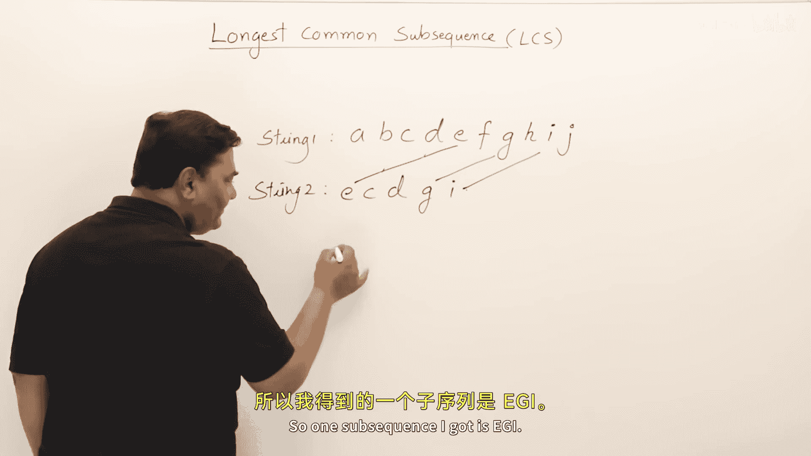

Is there any other subsequentequ， let me try。Instead of starting from E。

 I will start from C Yes matching。 D is matching G and I， Yes， C D G I is also there。

 So E G I is also a sub present there， that is common in both the strengths， right。

 and C D G I is also there， but which is the longest sub。 C， D G I is the longest sub。

I'll take one more example and show you one more example。 two strings。

 Let us find out what is the longest sub sequence。 Let us start with this one from second string and comparing with the first string。

 B is found here。 Yes， A is found。 No， you should not take the characters that are before the match。

 Then this A is also there here。 Also， yes， it's there。Then B， then B is in this direction。 No。

 there is no B followed by a。 So C is there。 Yes E is there。

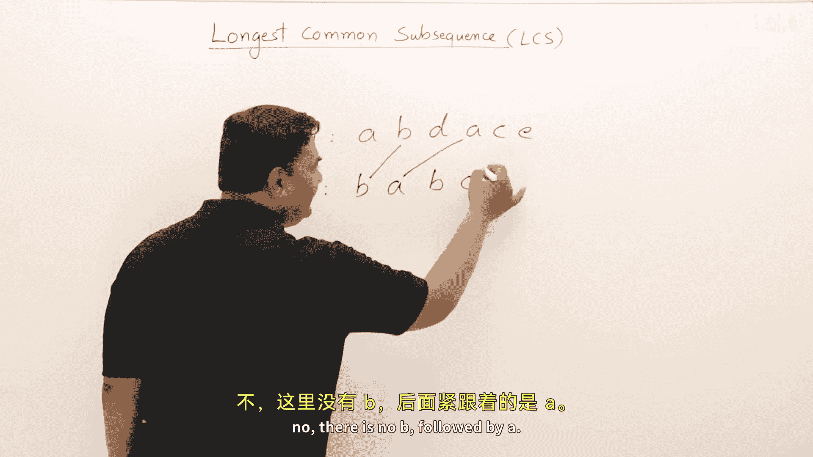

So what are the alphabets I got B， A， C， E， this is one。

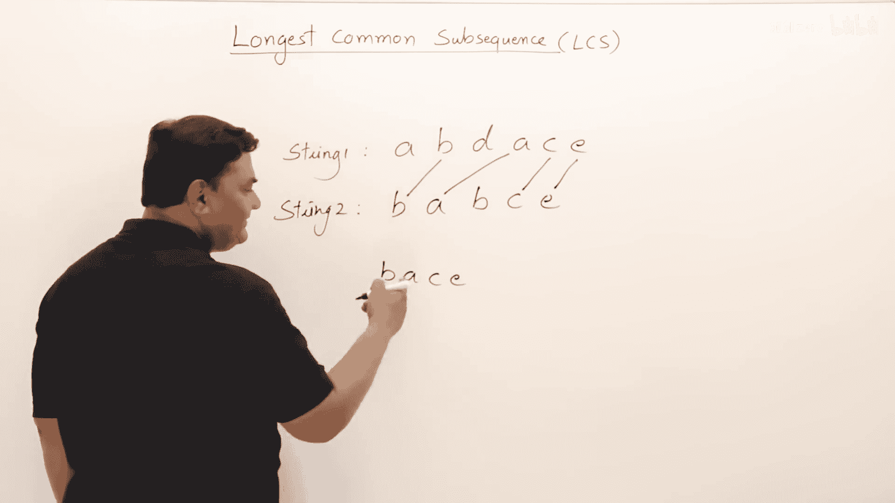

Let us say。 Is there any other one。Instead of B， I will start from A。 So this A is matching here。

 Yes， then B is matching with this one。 C is matching。 It' not intersecting。

 though the direction is different。 is there。 So A B C， E， So we have two subequs。

 which are of same length。 Yes， there can be multiple subequs with same length also。So that's it。

 The problem is finding whether the set of characters in these two strings are matching or not。

 The matching characters need not be continuous。 Now， lets see how we can solve it using recursion。

 So I'll write an algorithm。 and I'll take a very small problem and show you how recursion works on that。

 Then we will see memorization also。 There's an algorithm for finding longest common subsequent。

 And a recursive algorithm。

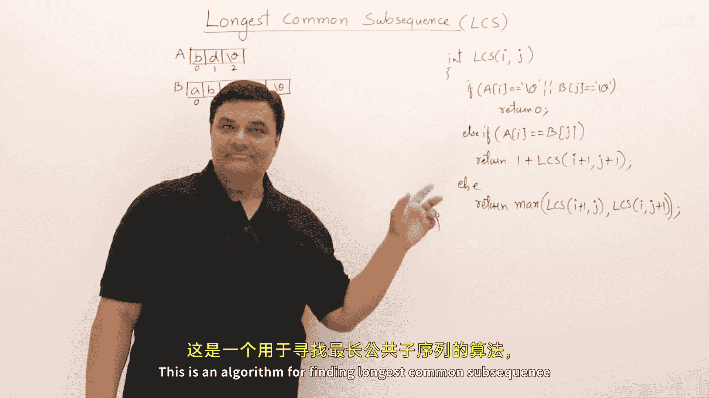

I have taken a small sizes two strings and let us trace this algorithm and see how recursion works。

 I will draw recursion 3。 Then after that， I will also show how memorization can make it faster。😊。

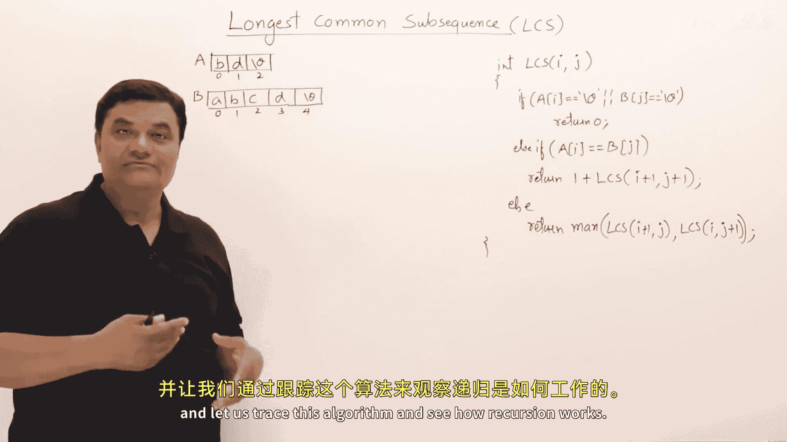

First of all， let us look at the algorithm， see these are the strings so they are terminated by slash0 and the indice are starting from0 onwards。

😊。

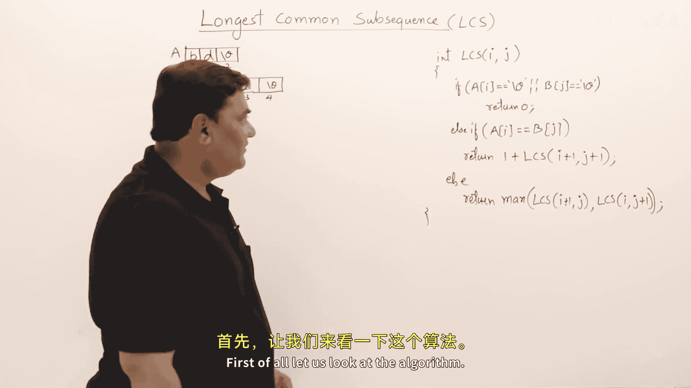

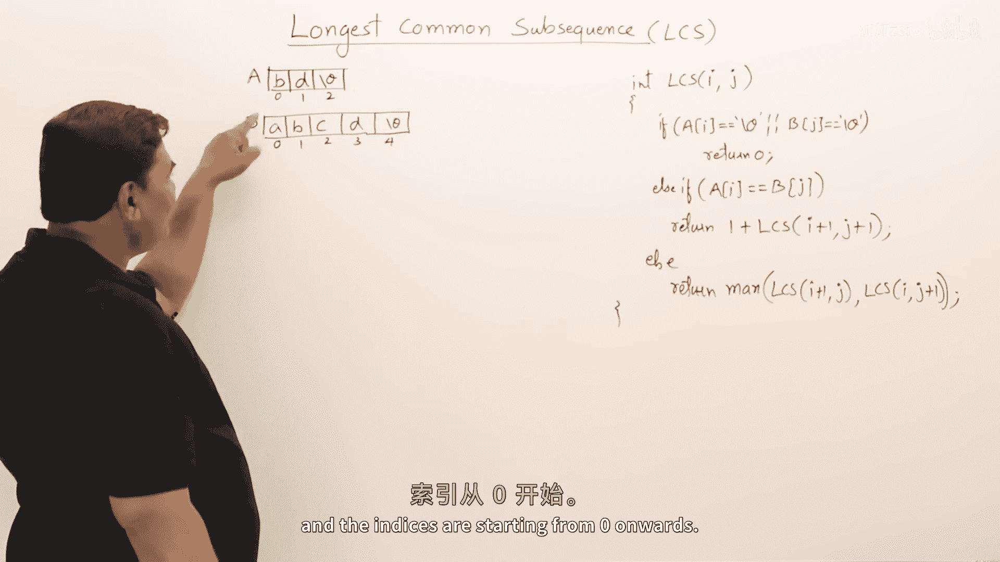

Let us see what are the parameters of algorithm。 See is taking I and J that are the starting indices of A And B that initially they will be 00。

 So I N J will work as indices for two strings， A And B， then。

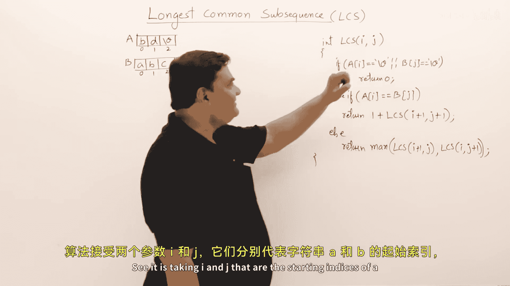

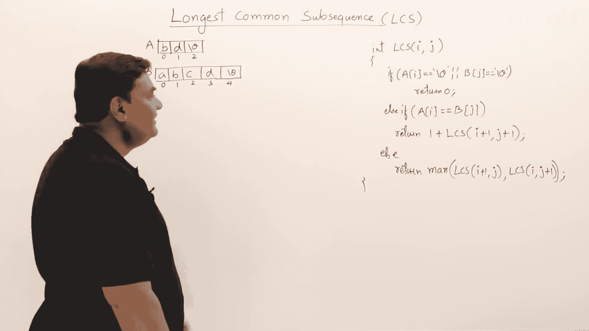

If the alphabet is slash 0， any one of them is 0， then returns 0。 If the mass。

 then add one and move to the next alphabet in both A and B。

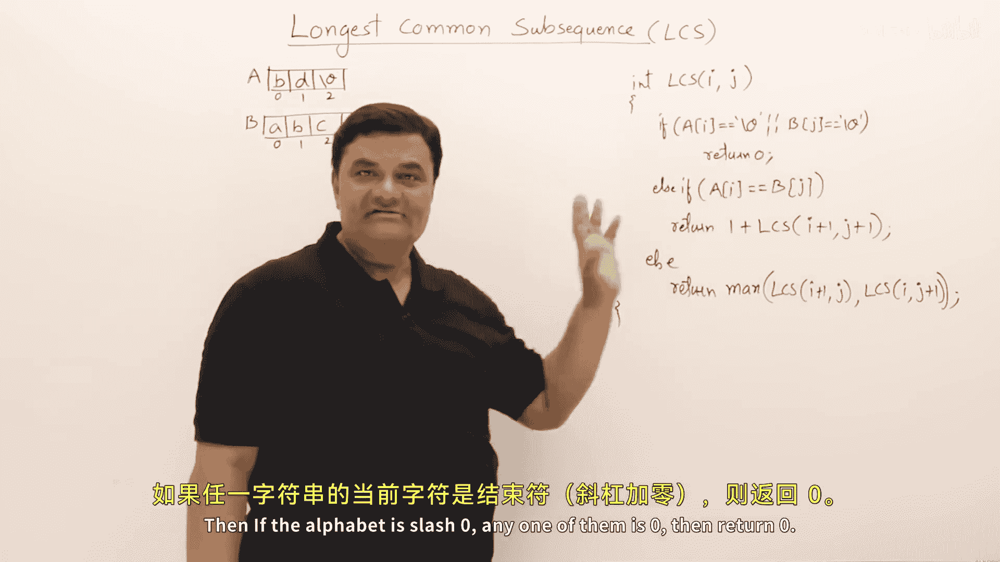

If there is no matchsh， then check either way， move one alphabet in first string A or move alphabet in second string B and check whichever is giving maximum。

 take that。 Most of the time， this condition will be satisfied。

 And let us see the tracing of this algorithm for this particular example。 let us trace this。 C。

 initially， in this is at 0，0。 So for tracing purpose， I will write it like this。 A of 0 and B of0。

 And what are those alphabets， B and A。 So this is B and A， let us check here。

 this condition is not true and are the same they are not saying， enter into this part。

 So for this call， actually， it will make two different calls again。

 this is one call where A will be moved to the next alphabet， that is1 and B remains0 only。

 So what are those alphabets。 D and this is a only。 Otherwise。😊。

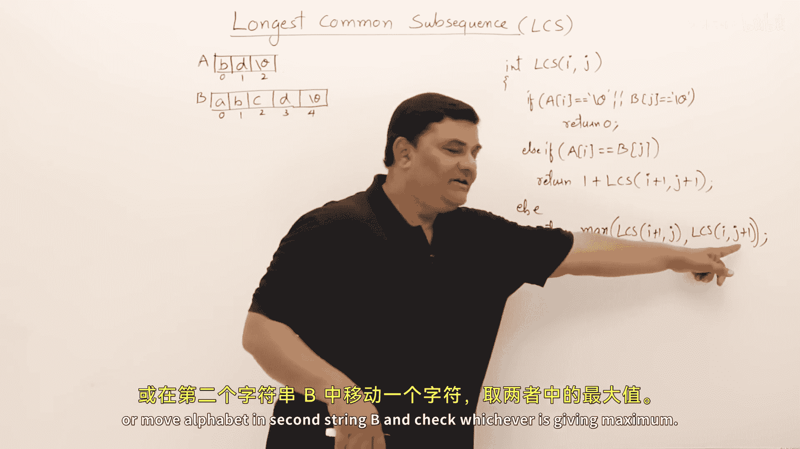

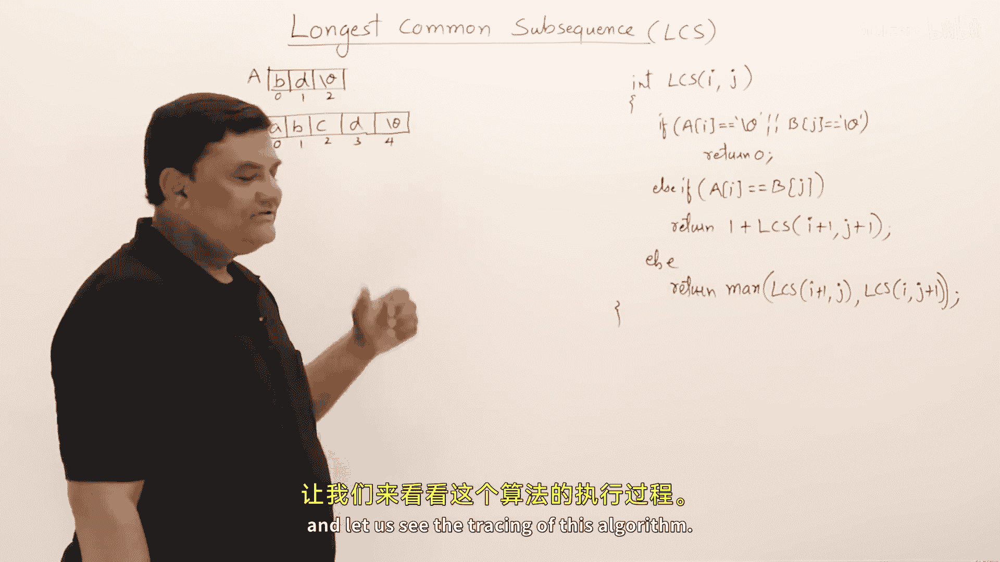

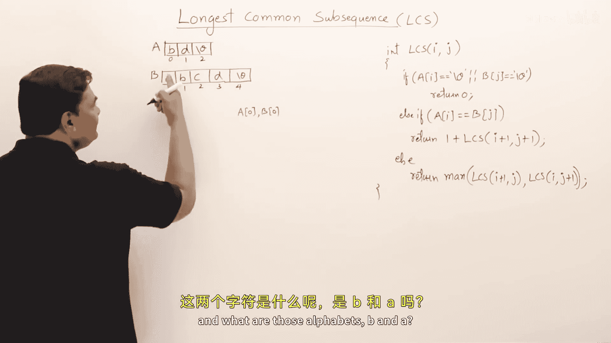

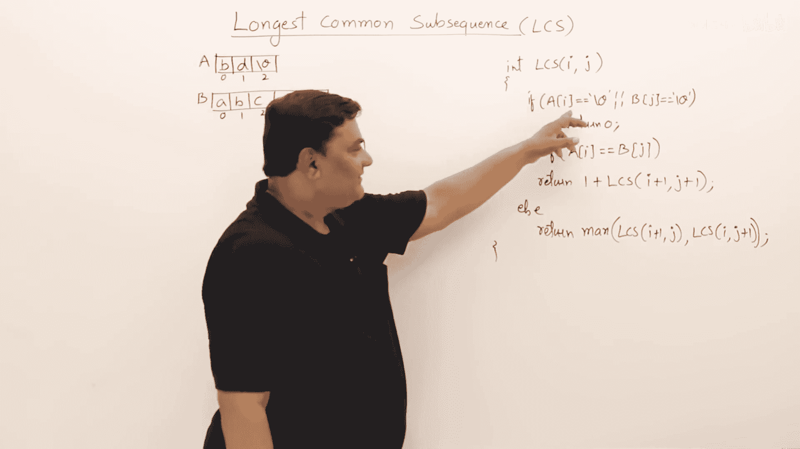

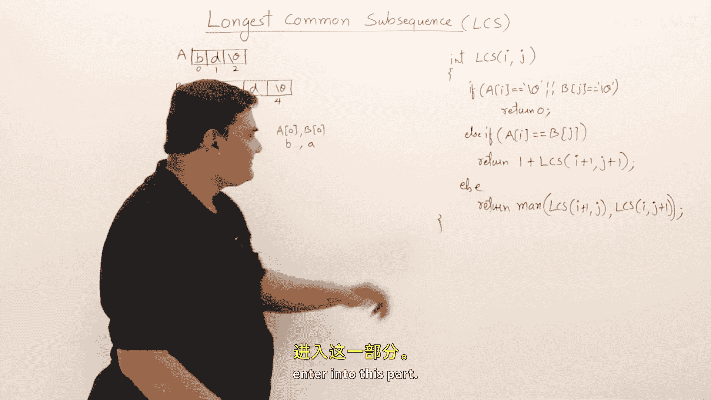

One more is A remains at 0 only comma B moves to the next alphabet。 So A will be B。

 and B of one is what B。Two calls it will make out of these two calls， whichever is giving maximum。

 it will take that result。😡，So for that first this has to be completed。 then afterwards。

 this can be completed。 So let us continue with this one。 So for this， again。

 a call is made with I is 1 and B J is 0。 So this first condition fails。

 they are not sla0 and even they are not matching。 So again it enters it to the third part。

 So two calls。 So the first call is what A will move to the next alphabet from one it will go to2 and the B remains a 0 only。

 So what are these alphabets A2 is what 0。 and the B 0 is a only。 and this site again， one more call。

 So this is a1 But B it will move to the next alphabet。 So a1 is a D only and the B is next B1。

 So this is B。Now， out of these two， the first one should be solved。 C， this is s 0。

 So the first condition will be true and it returns 0。 So the result of this call is 0。 Now。

 this call has to be expanded。 So now hope you have understood how it is working。

 So quickly I will trace the other node Also both are not same。 So it will go into this part。

 So first call， A will move to the next alphabet。 So this will be a 2 and B remains at1 only。

 So this will be s 0， and that remains B only。 And on this side， A will remain there only that is a1。

 but B will move to the next alphabet。 So this a remains a D only。 but B becomes 2， that is C。

 So this call will be finished first。 So but this is s 0。 So the answer is 0。

 Then on this side again， to call。 So this is a will be on to B also on two。 So this is s 0。

 and this is C only。 And on this side， So here it is a 1 only。

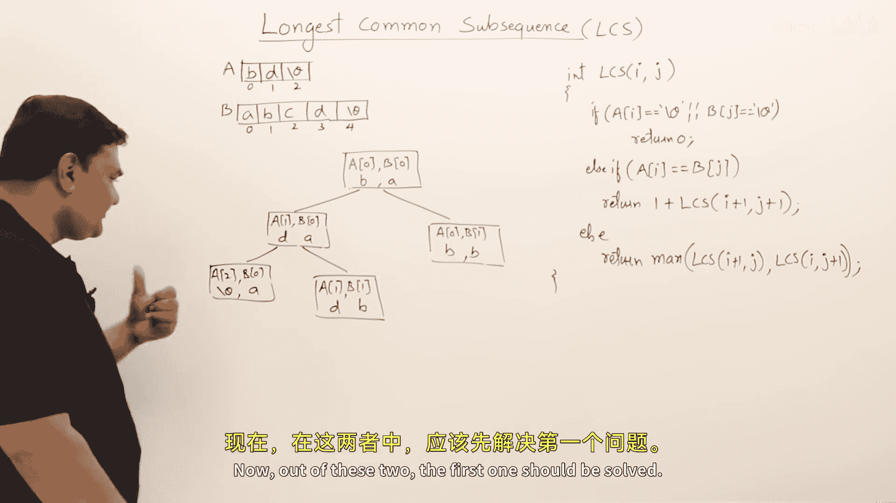

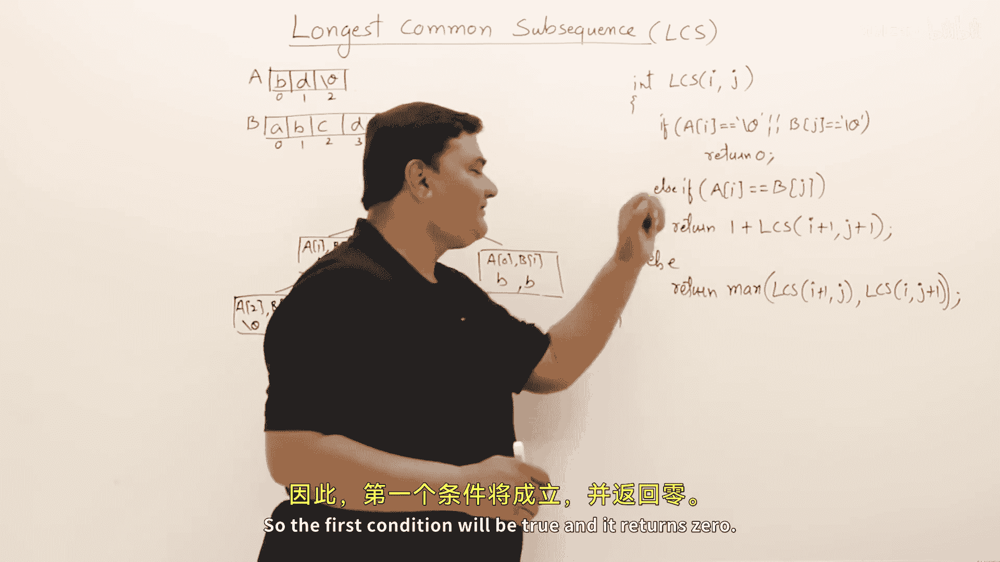

And B becomes a3 and A1 is a D only B3 is what a D。 So here the answer is 0。

 but here they are matching。 So it will enter into the second condition。

 So when the second condition， it says that one plus and the next call will be a will also move to next and a B will also move to4。

 and this both are slash 0 and s 0。 So the result of this is 0。

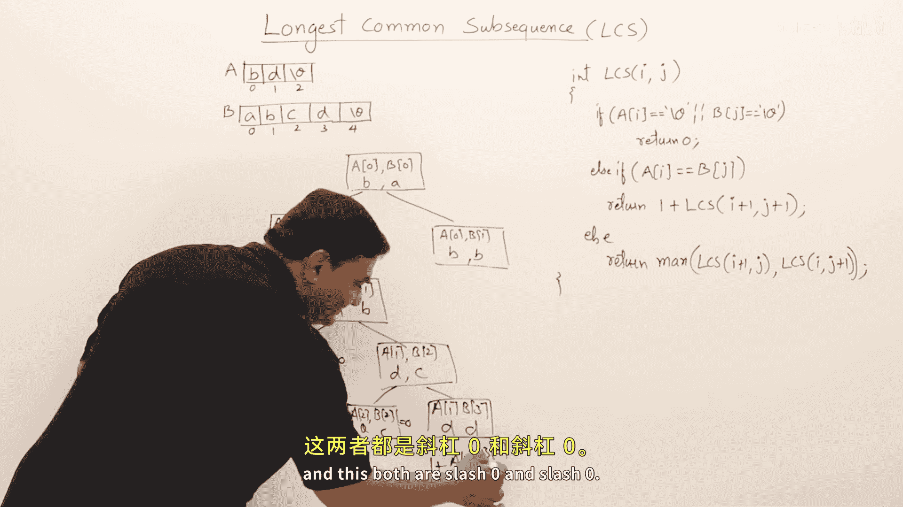

Now， till here we got the answer。 Now， it will come back。 return back。1 plus 0 is 1。

 So the result of this is1。 And what was the result of this0，0 and 1 maximumum is what1。

0 and 1 maximum is 1。 Now， it will start returning0。 This was 0。 If you remember，0 and1 is 1。 Now。

 this one is not yet solved。 So still we have to continue with that one。

 So let us see what will happen。 are they matching。 Yes， both are matching。

 So it will enter into this condition。 One plus。😊。

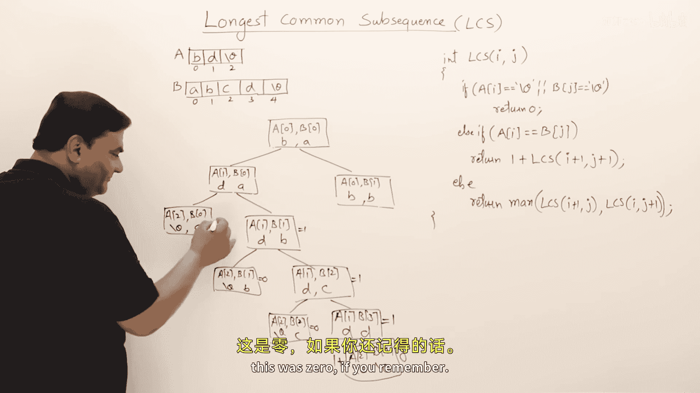

What is the next A will also move to the next alphabet。 B will also do the next alphabet。

 So a 1 is what a D and B2 is what C。 So this is a D。

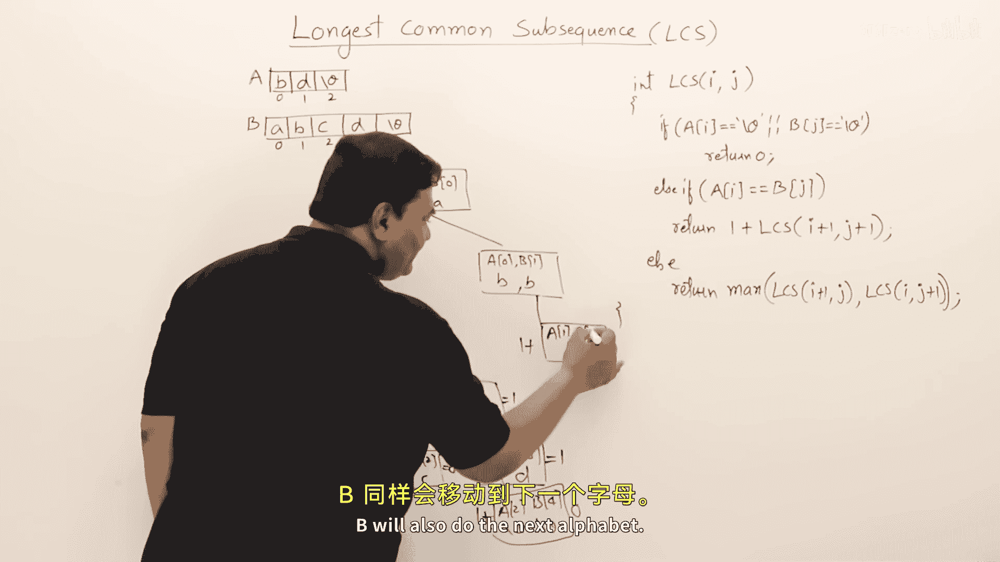

Now， if you see this is matchinging with this one， but this is recursion。 This will continue。

 so I will not explain simply I will write on what other nodes you will get here。

 So just the font size is a little bit reduced now because of the space and this side it is A 1 and B3。

😊，And this is D D。 And here， this one plus。A 2 and B 4。 And these are slash 0， slash 0。 This is 0。

 result is  one。 This is 0。 result is。Maximum is  one。 then one plus 1，2。 So one plus。1 and2 max is2。

 see yes， this's the answer。 So finally， the answer is2。

 and this is a recursive algorithm and there's a tracing tree for this algorithm upon this example。

 See for just two，3 alphabets only tree is such a huge tree So it's exponential time taking algorithm。

 and from where it is starting from top that is for alphabets oneward， it has started from top。

 The answer is it is getting while returning， but it has started from top。

 So this is topdown approach。 Now let us understand what was the purpose of showing you this one。

 See， the purpose。😊，Here， there is an overlapping problem。 Aly， this side， when we solved。

 we got D and C and the answer was one。 So here also the same thing we are getting in this branch also。

 So it means shall we call these function calls or algorithms again。

 there is no need of recursive call， if you can remember this answer。

 So where you can store it somewhere。 So if you are storing the results of recursion。

 then it is called as memorization。 So to improve recursion， you can take the help of memorization。

 and you can reduce its time。 in my example， only a piece of three is。😊。

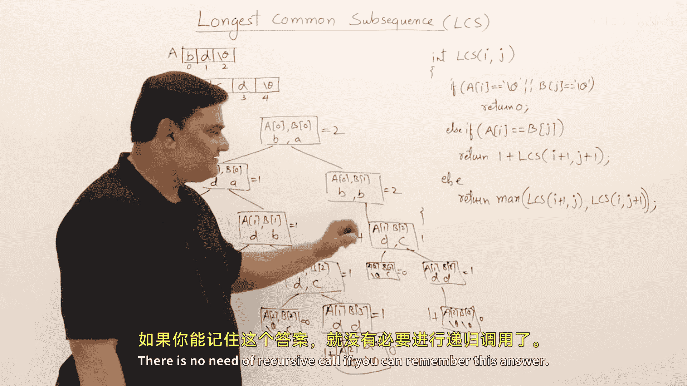

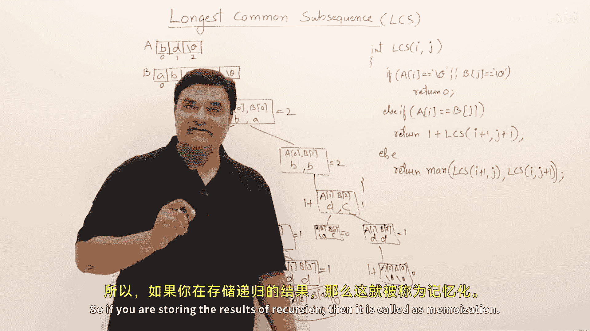

Overwappping。 but if a problem is big， then a lot of branches may be overlapping。

 So let us finally understand how memorization can make this algorithm faster。

 I will not change the code。 just I will prepare a table and show you how memorization can help this one。

 So I have taken a table for these two strings for memorization see the rows are representing the fastest string A and the columns are representing second string B。

 And I have taken the indices from 0 onwards。 Now let us see how this algorithm can utilize this table to work faster。

 So first we will start from 0，0， then 1，0， then2，1。 So first 20。

 So the first value that we get is for 20 and that is 0。

 Then it will move on to this then this one second value we get is 21。 and the answer is 0。

 The next it will make a call to this and call to this。 So we get the answer for this one that is 0。

2 to2 is 0。 Then it will make a call here and this call。

 So for this also we get the first value that is to co4 is 0。

Then it returns back and the result of this one is 1。1 to 3 is 1。 So it is 1 to3 is 1。

 Re back and one comma 2 is1。 So the answer is1 comma 2 is1。 and again， it turns back。

 So1 comm 1 is also1，1 comm 1 is1。 then returns back。 So1 comm 0 is 1。1 comm 0 is1。

 See this is top down。 but the table is getting fill from bottom towards up。

 Now this side it will come And this， this is the value that we get。 see， but this one comma 2。

 already we know the answer。1 comma 2。 Yes， we know the answer。 So no need to make these call。

 So that's how it will save the time。😊。

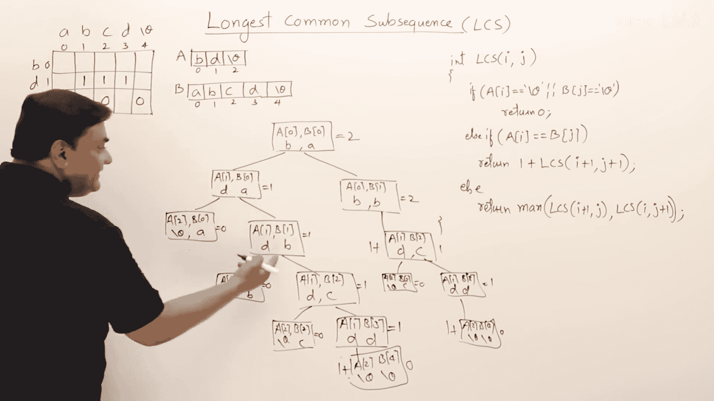

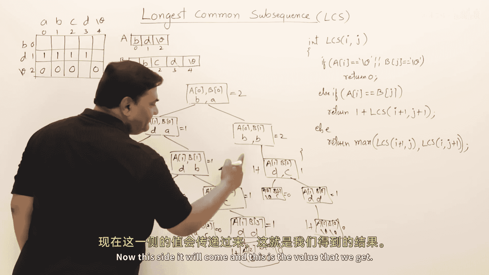

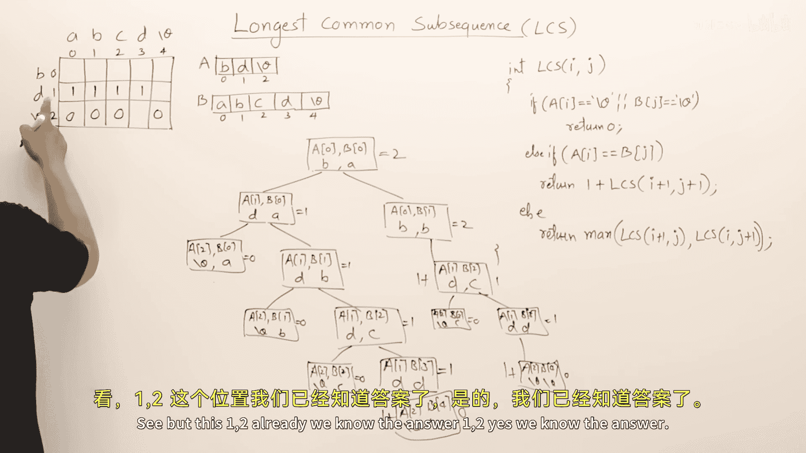

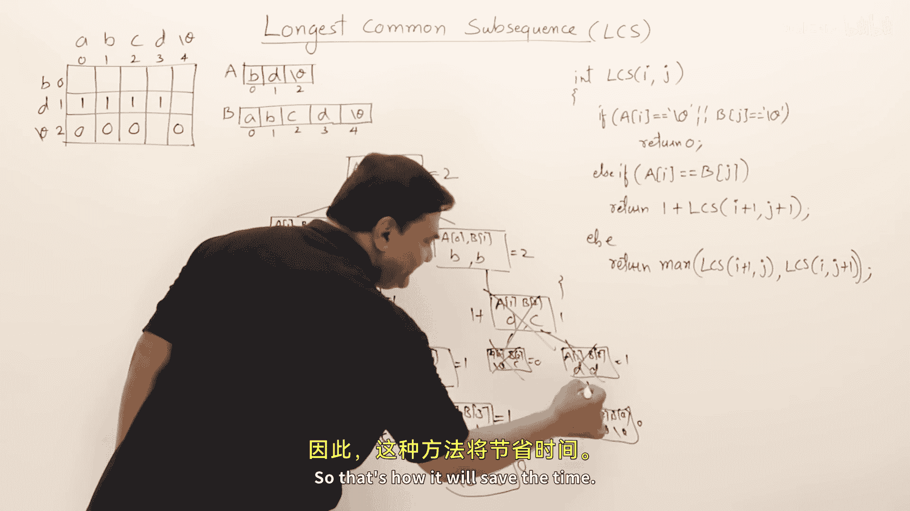

Then directly it can get the answer for0 comma 1， that is2。Then finally，0 comma 0 is a 2。 That's set。

 So we got the answer。 See， the value of this one comm or2 was already there in the table。

 So we did not make these function call So memorization can reduce the number of function call。

 So total how many calls were made that are there， depending on the number of elements in a table So that is depends on this one。

 So what is the size of this one。 So this is M and this is M。 So the time is order of m cross M。

 So the memorization is taking order of m cross n time for solving a recursive algorithm。

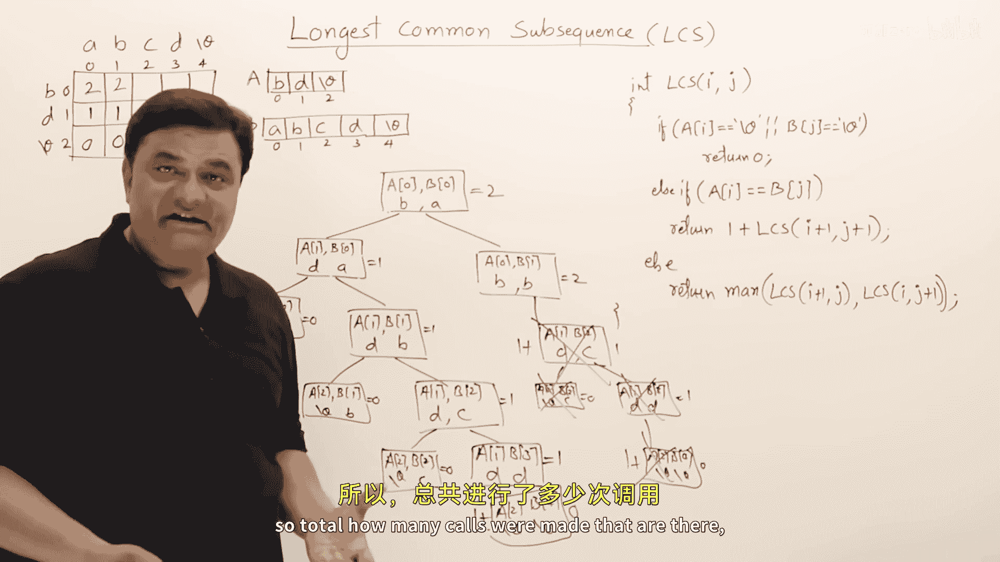

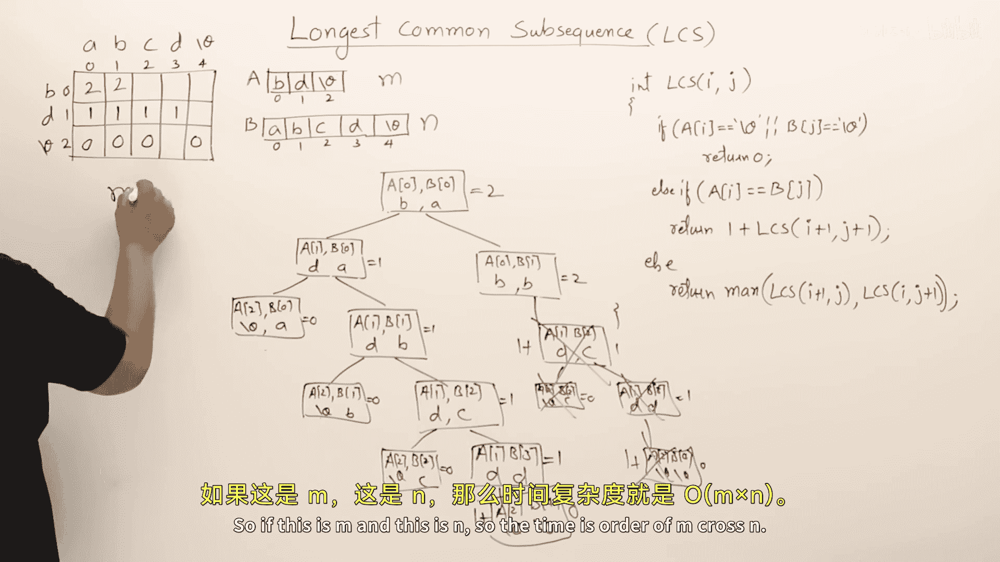

That's all。 So this was top down approach， and we have taken the help of memorization to reduce the time complexity from2 power N to m cross n。

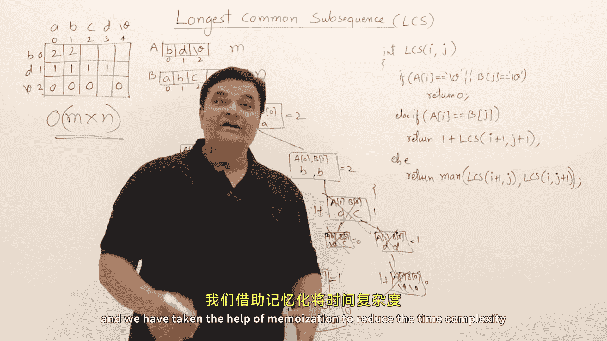

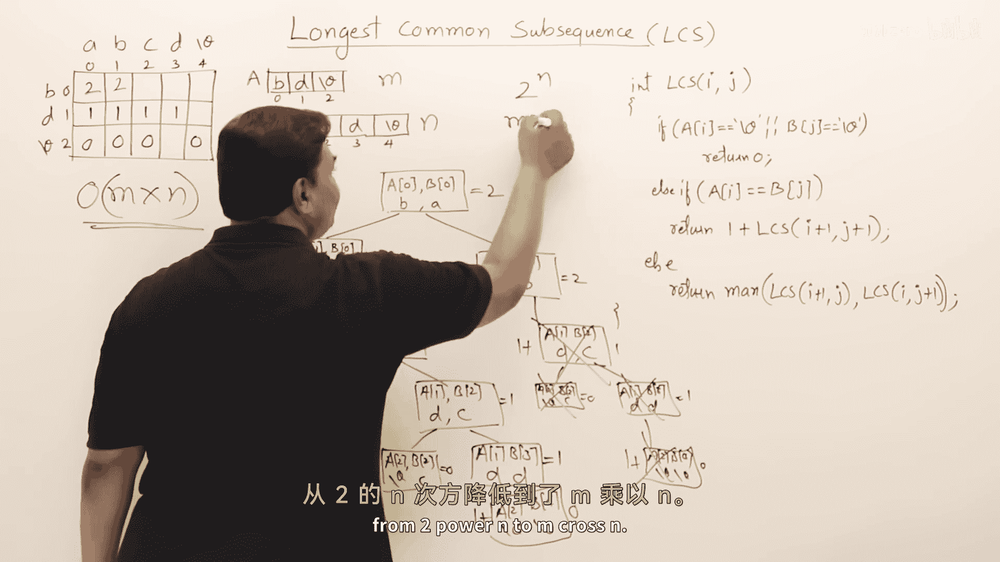

Now finally， we will see an algorithm for dynamic programming For the same example。

 I will solve it using dynamic programming。 So let us solve our problem using dynamic programming。

 So you know that dynamic programming follows bottom up approach。

 So in the previous example when we solve it using recursion the table was getting filled from bottom towards up but the method was top down but now dynamic programming follows bottom of approach。

 but the table will fill from top to down。

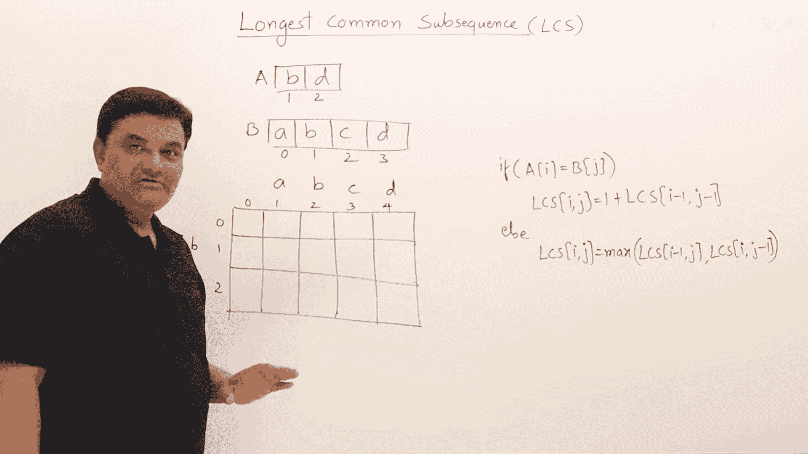

So it's not based on the filling of a table。 It's based on the approach for solving a problem。

 So let us see how it to solve using dynamic programming。

 See this is the algorithm for dynamic programming。 If there is a match。

 then you add one and take the value from the previous diagon element。 if there is no match。

 then take the maximum amount of either previous row element of previous column element for a particular cell。

 So let us see what does it mean by solving the problem。

 I have taken the same example but here you can see the indices for this one I have start index from1 onwards and there is no slash0 because the algorithm the way it is written it is not involving slash0 and starting indices from one onwards。

 If you want to modify it， you can modify it and includes s0 also start index from0 also。

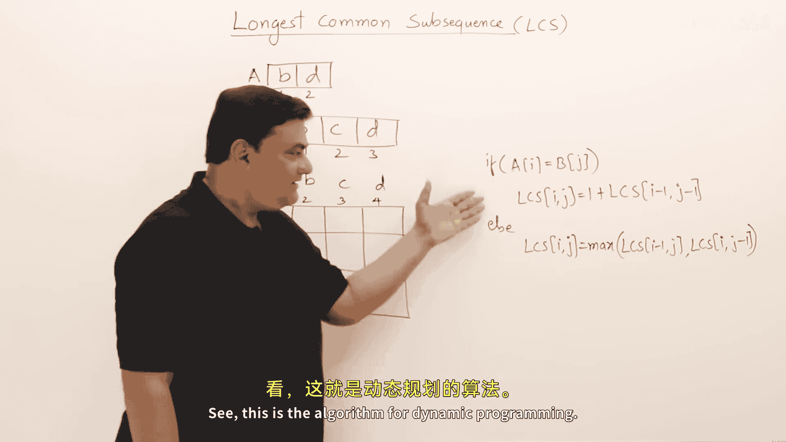

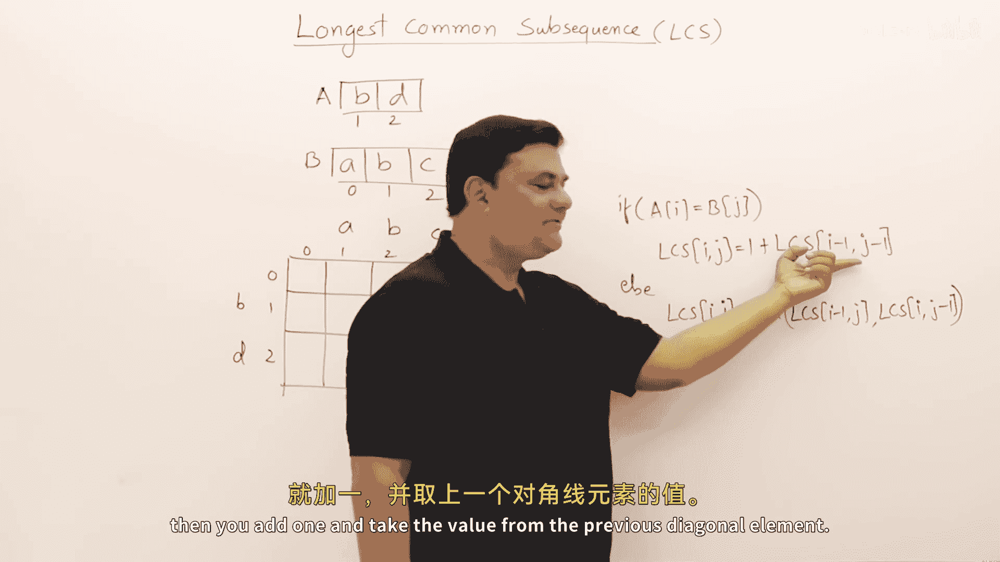

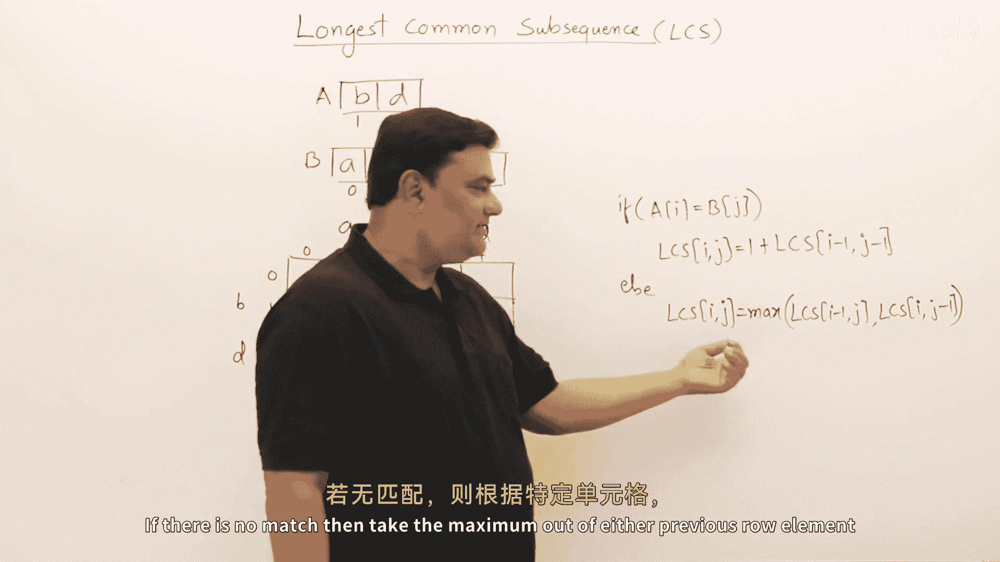

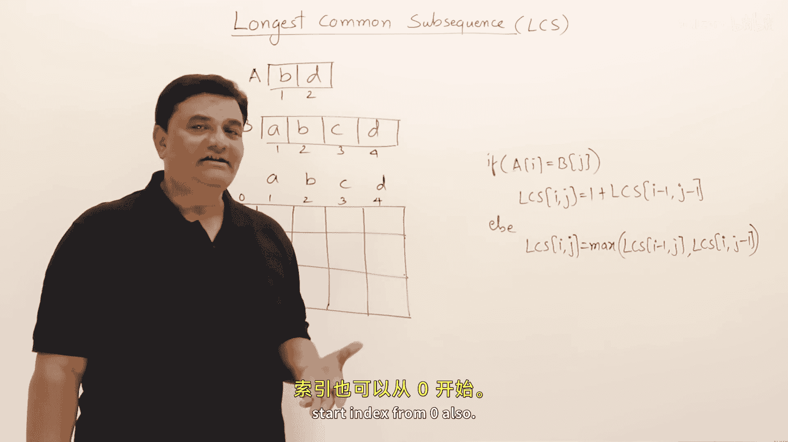

But commonly found algorithm that works from index 1 onward。 So I have taken index from1 and 2。

 This is 1，2，3，4。 Then here we are still using index 0 because we want the initial values here that to be filled with0。

 So that will help the algorithm to start from this point onward。

 table filling from top towards bottom But the algorithm working as bottom up。

 let us see how to fill this。 It's very easy and very simple。 C。

 I have to fill all the elements in this row and this row。 So row by row。

 I have to fill the elements。 So what I have to do is see this is a string representing a。

 this is representing B。 So check if B is found anywhere。 So first is start with this one。

 I it same as B， no， they are not matching。 So take the maximum of these two this condition。

 So that is 00 is 0 only then B is matching with this one。 Yes， matching。 So the first one。

1 plus diagonal element1 plus this diagonal element 0 plus 1，1。😊。

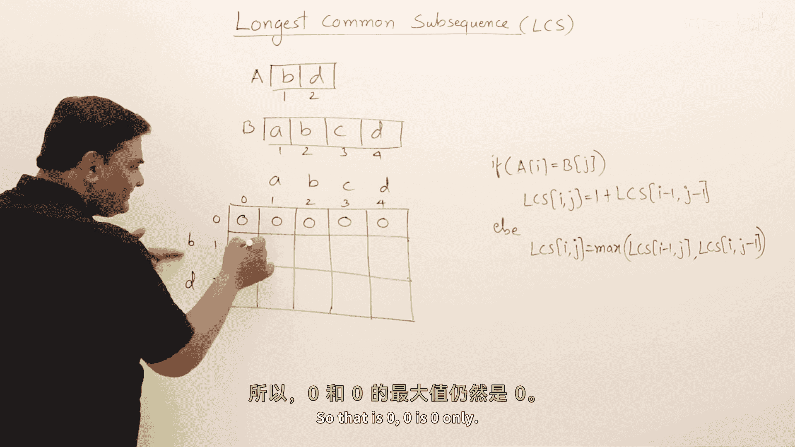

Then is is C and B are matching。 B And C， they are not matching。 So else part， maximum of these two。

 This is one。 This is previous column。 This is previous row for this particular cell。

 So this is one only B And D， they are not matching。 So previous column of previous row here。

 maximum of this。 that is one only。 Now， next row， D， A not matching maximum of these two。 D And D。

 not matching maximum of these two，1， D And C， not matching maximum of these two，1， D And D。

 they are matching。 So diagonal plus 1，1 plus1，2， That's it。

 So the size of the longest common subequences2。 But what is the longest subence。

 So let us trace back。😊。

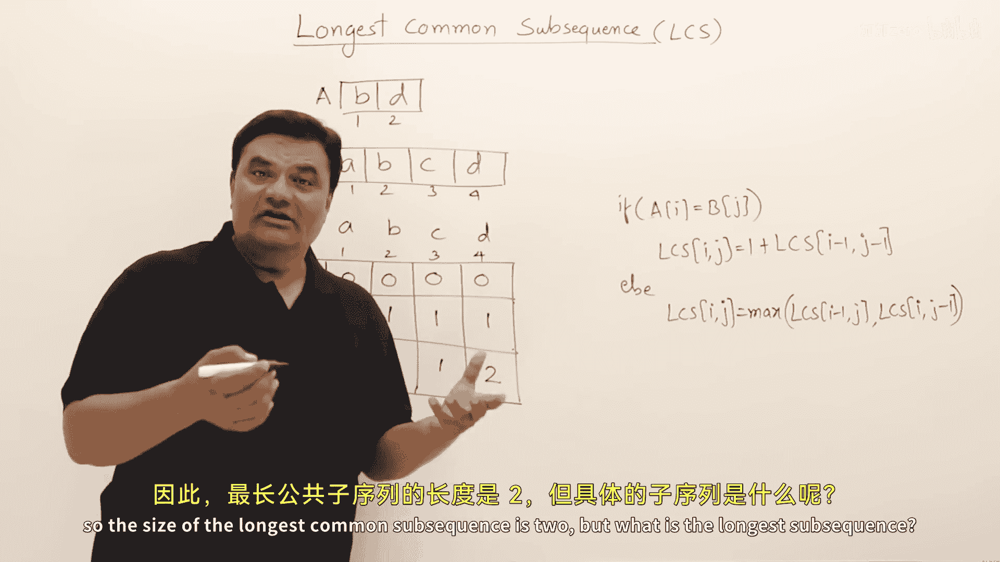

2， we got this two by adding one to this because both of these are 1，1。 so go diagonal。And then。

This one， we got it from here。 Yes， this one， we got it by adding one to this one。

 because none of them is one you see。 So this is coming from here。Right。This one。

 because already this was one。 So we said that we have taken it from here， but for this。

 both of these are 0，0， it means we got it by adding one to this。Now。

 where we have gone in diagonal at this place。 So what was the alphabet D and the other place where we have gone diagonal。

 this was B。 So this is B D。 So B D is the sequence。

See how much is the time taken for filling this table， This is M number of alphabets。

 this is M number of alphabets。 So total number of cells are M into n。 So the time is M cross n。

 Now I will take one more example and show you a simple example and show you how it can be solved using dynamic programming。

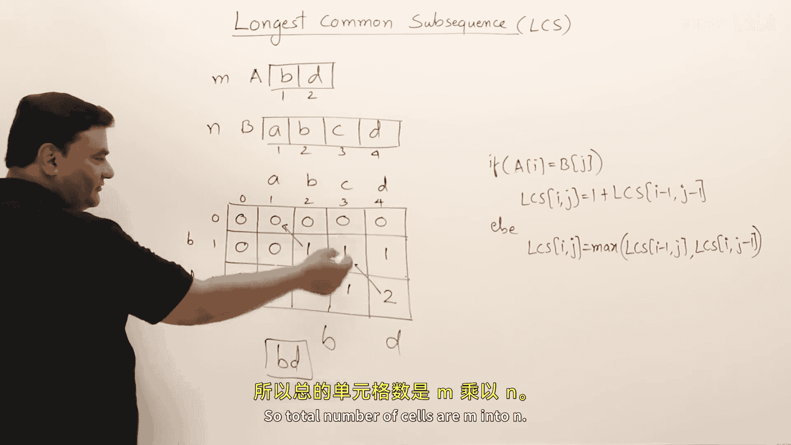

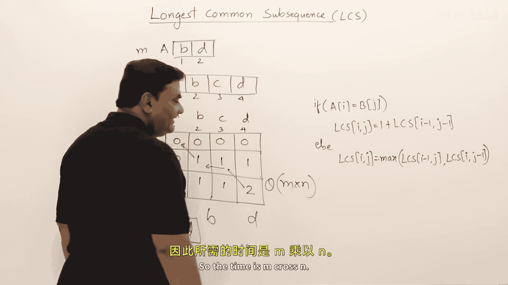

Let us solve this a small problem using dynamic programming。 I have two strengths， one is a stone。

 another one is the longest。And for that I have prepared a table。

 rows are equal to the number of alphabets here and the columns are equal to the number of alphabets in longest。

And index 0 is reserved for initial values of 0。 so I am starting indices from 1 onwards 1，2，3。

 So these are all the alphabets of longest。 These are the alphabets of stone。

 So let us find out what is the longest common subequence and as well as what is that sub sequenceequence。

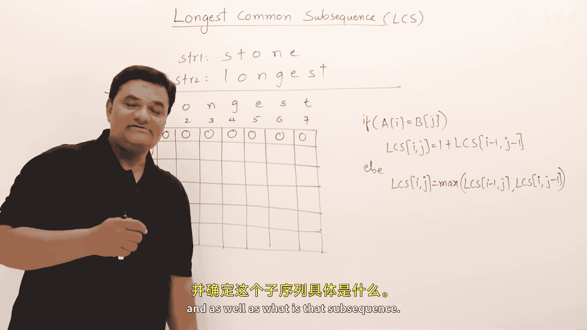

So for that， we will follow this algorithm and just fill up the values well get the answer。

So what the algorithm says whenever there is a match。

 take the value plus 1 and take the diagonal value， if there is no match。

 take the maximum either in the previous row or in previous column for the same cell。

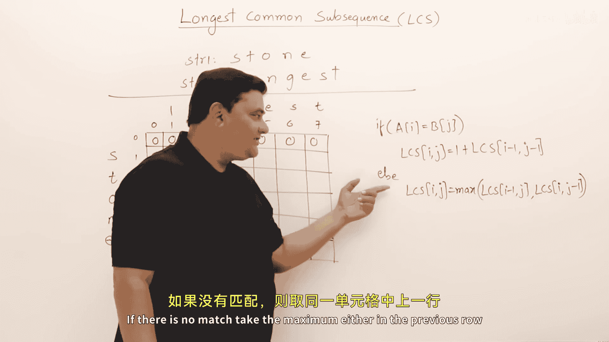

So let us follow that， I will show you quickly how this can be filled。First alphabet。

 let us start all it is is initialized to0， so from here I have to start s there is no match with L。

 so take this value or this value and that is0 only。S not matching。 So 0 or 0。

 take 0 only this not matching0， more， not matching 0，0。 S and S are matching。 So take the diagonal。

 Add one to that 0 plus 1，1。The next S N T are not matching。 So take anything of this。

 That is maximum。 So I have to take maximum of this Now。 till now it was 0，0。 I was writing 0 only。

 Now， this is maximum。

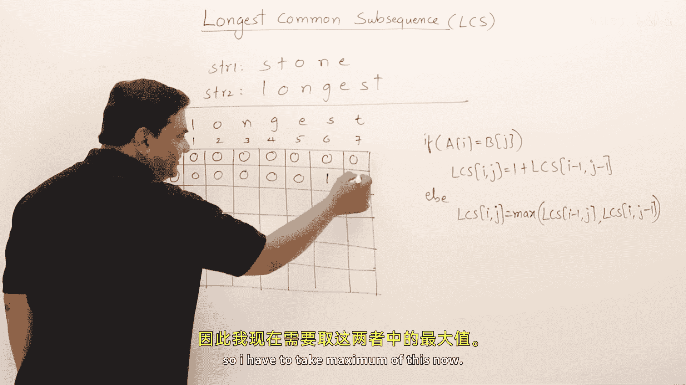

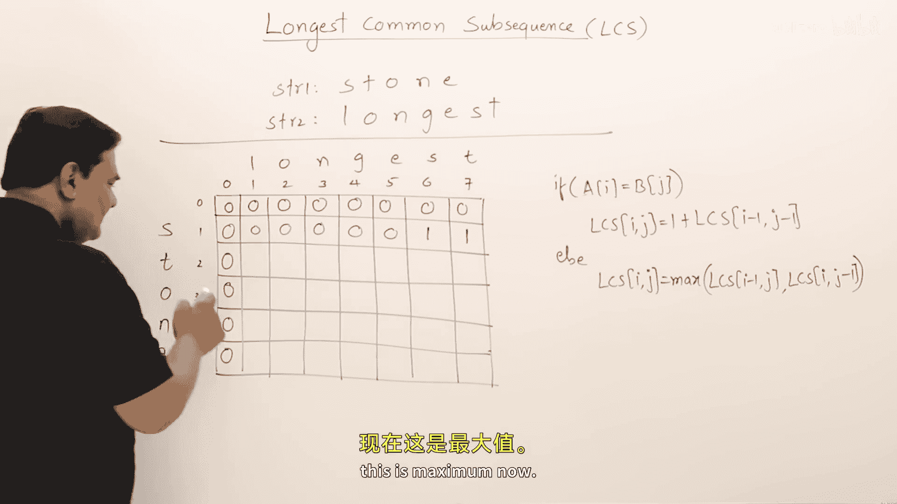

Now similarly we have to do it for t so you can see that t is matching here at the last。

 so till there we will be getting the maximum in the previous row or previous column。

So this one is 0 and 0，0 only。 then 0 and 0，0 only0，0 max is 0 out of these two maximum is 0。

 out of these two maximum is 0。 out of these two maximum is 1。 and t is matching there。

 So from the diagonal， add one and take it。 So 2。

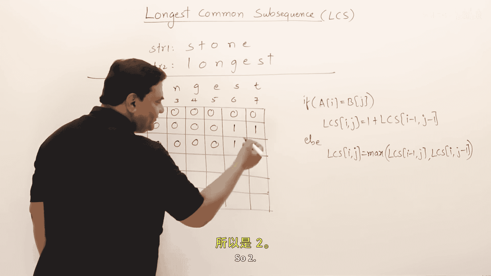

O is matching with this one。 So take the diagonal and add one。 The next is one only one。

 There is no other match。 So simply I will fill up the value 1，1， and the maximum of these two is2。

 So there is no other O and this is string， right。 So now N n is matching here。

 So till there maximum of these two maximum of these two that is one。 But here it is matching。

 So from the diagonal， add 1，2。 See when there is a match， take the diagonal。

 add one and right on the value。😊，Then after this， there is no match。

 so we' will write on the maximum of these two to maximum to maximum of these two to maximum of these two is two only。

Then E， E is matching here till there， I'll be writing just maximum。

 So this is0 only out of these two one。Previous column， previous row 2， previous column。

 previous row 2。 Now here is matchinging with this one。 So take the diagonal， add 1，3。

 Then after this 2，3，3 maximum 2，3，3 maximum。So the longest common subsequent size is 3。

 I want to know， what are those alphabets。 So let us see how to find the alphabets。 This3。

 we got it from here。 That is maximum of these two we。 So go to this one。 And this three。

 we got it from here。 go to this one。 This three before that， there was no3。

 So it means we got it from this diagonal。So what was the alphabet here E？Then this two。

 we got it from this one。 This was maximum。 This two。

 there was no maximum2 in the previous column or previous row。 it means we got it by adding this one。

 So what was the alphabet n。Then。This one， we got it by adding this one to this value。

 because these both are 0，0。 We got it from this one。 So this value。 So diagonal is O。

 So the answer is O and E。 So the longest common sub sequence in this one is O and E。

 And that is of three alphabets。

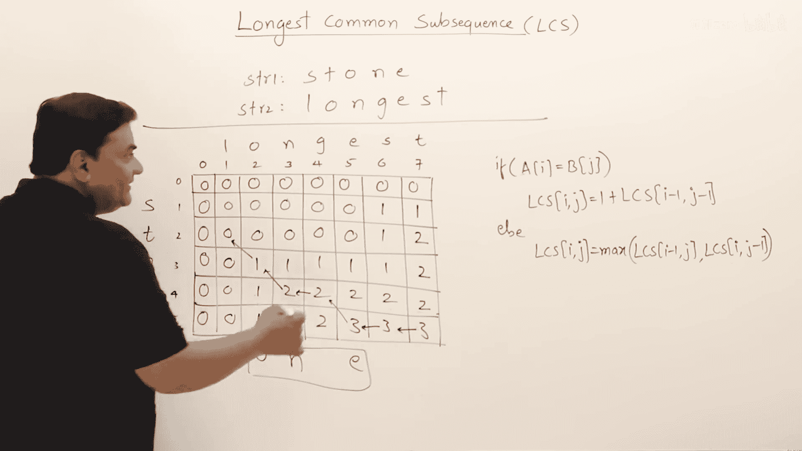

That's it。 this is a simple procedure。 If the number of alphabets are repeating more number of alphabets are there then you have to be a little careful。

 I have taken a simple example so you can understand easily what is happening actually。

 So that's it the dynamic programming takes the amount of time depending on the sizes of two strings。

 supposeupp the size of this one is M and this is n。

 So we are forming a table and the size of the table is m cross n。 So the time of。

L C S algorithm using dynamic programming is M cross N。

That's it。