# 【精译⚡算法导论】AbdulBari p70 p69 7.2 0⧸1 Knapsack using Branch and Bound -BV1hhPXeTEWM_p70-

Page is 0 on abstract problem here some objects are given for each object there is some profit and some weights are also there。

 and there is a bag of capacity 15 m and the objective is the problem is to fill the bags with those objects such that the total weights of the objects included in the bag should be less than or equal to the capacity that is 15。

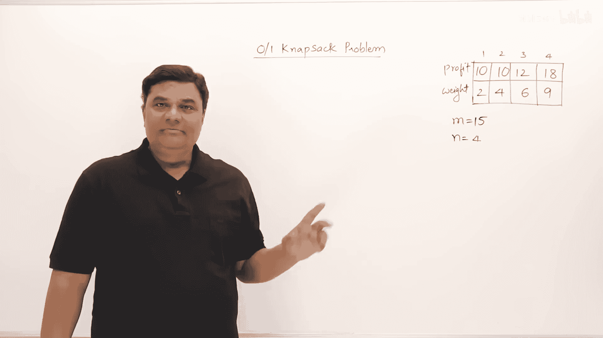

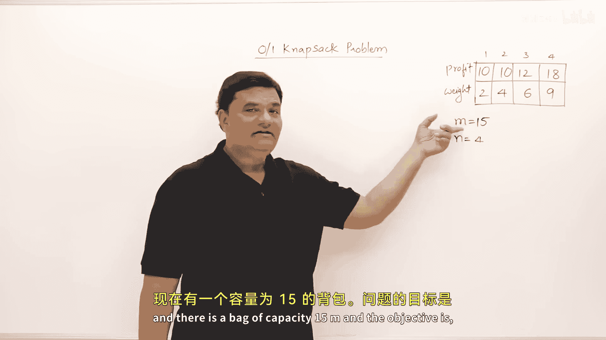

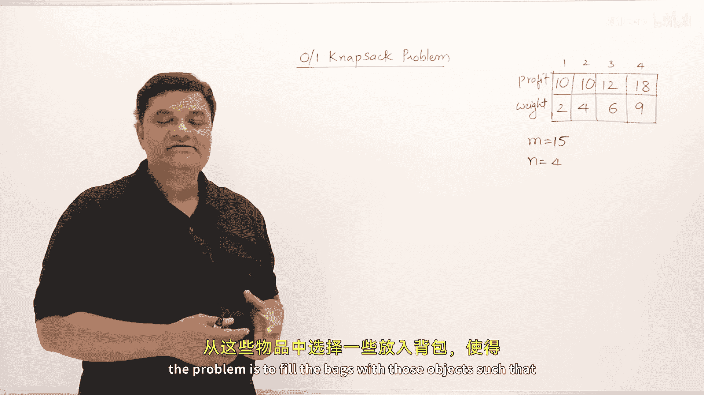

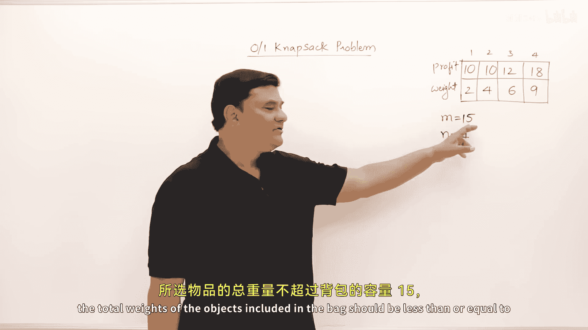

And one more important thing is if you are taking any object then you must take the complete object or don't take it at all。

 See here the weight of this object is 4 kg or 6 kg so I cannot take 2 kg or 1 kg out of it。

 I must take the complete object or don't take the object at all。

 So the problem is the total profit gain should be maximized so it's a maximization problem。

This problem can be solved using greedy method， also dynamic programming and even using backtracking。

But here in Gr and bound we can solve only those problems which are minimization here the answer we want in maximization so we can convert the signs of these profits instead of positive will make it as a negative weight。

 negative profit， and we can solve this one。So maximization problem can be converted into minimization and solve and then again the result can we can convert it back into positive so let us see how to solve this using branch and bound So I'll generate a state pastery and here Ill be using LC branch and bound。

LC branch and bound means always I'll be exploring that node whose cost is minimum。

 for solving it using branch and bound for each node in a state space tree。

 we have to find out upper bound and the cost。 So we define it as sum of all the profits that I takes from1 to n。

 the total rate should be less than or equal to capacity of the back。

 samee way cost also we do the same thing。 we will take the sum of all the profits。

 But the difference in this two is that here we will take it without fraction here we will take with fraction。

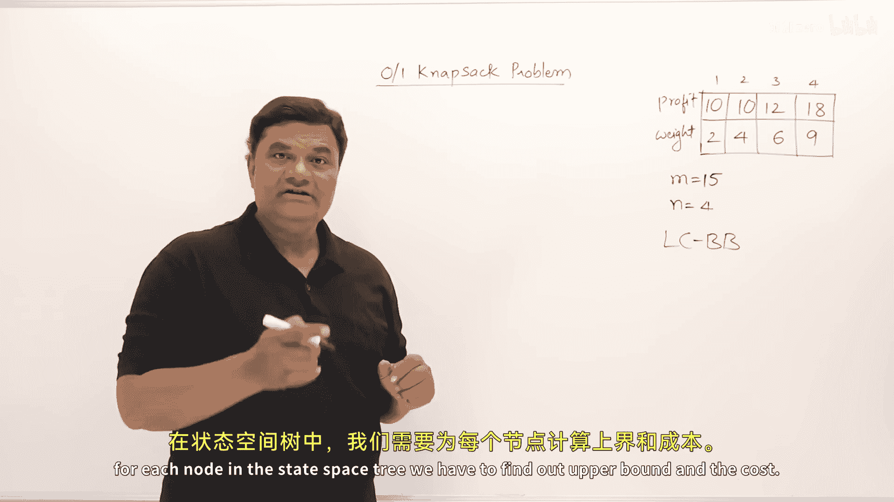

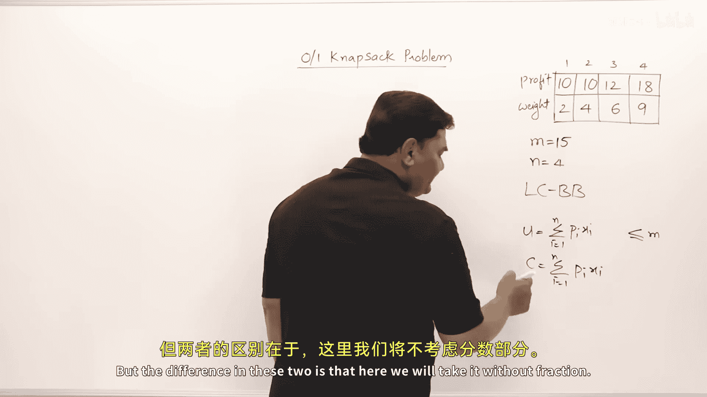

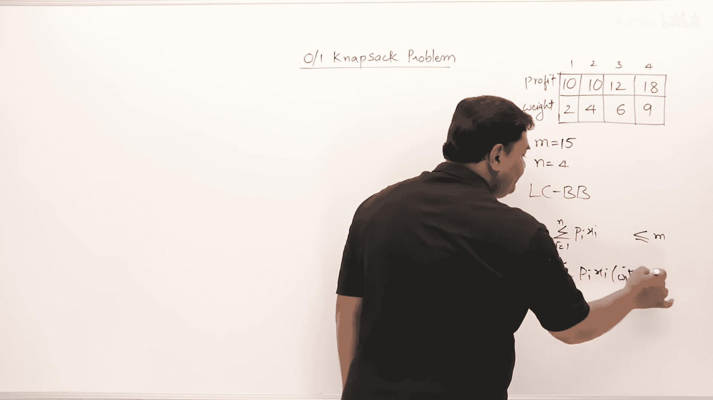

Though the problem doesn't allow us to take fraction。

 but only for the computation for solving the problem we take the fractions fraction will not be included in the solution let us generator state pastry but I should consider one more thing what type of solution I want do I want the subset of these objects。

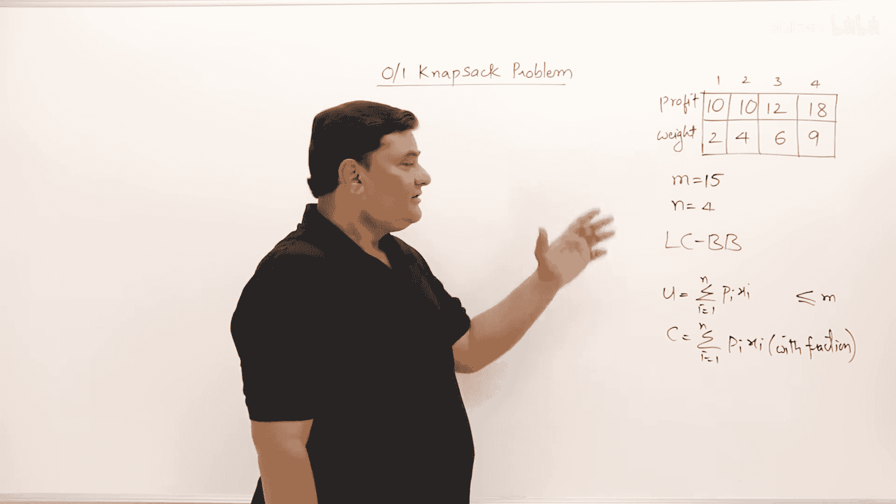

Or I want all those objects and just show included or not included。 For example。

 if the solution do I want like this first object included or third object included like this。

 or do I want the solution like this。 That is first object included second not included third included fourth not included。

 If I represent the solution as a subset of those objects。 That will be like this。

 or else I can show zeros and one for all the objects。

 So this will be a variable size solution as a fixed size solution。 So I'll go with the。

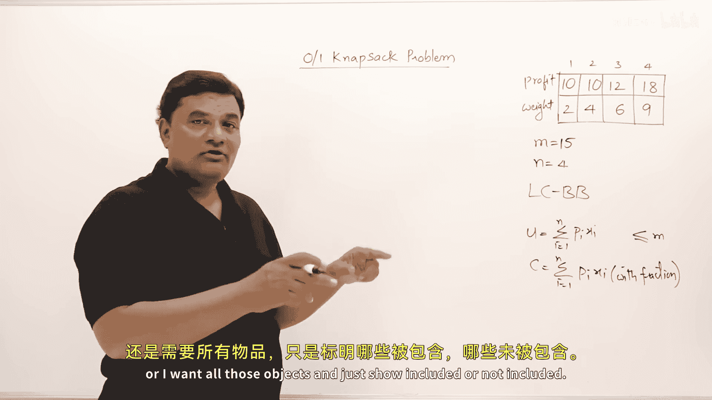

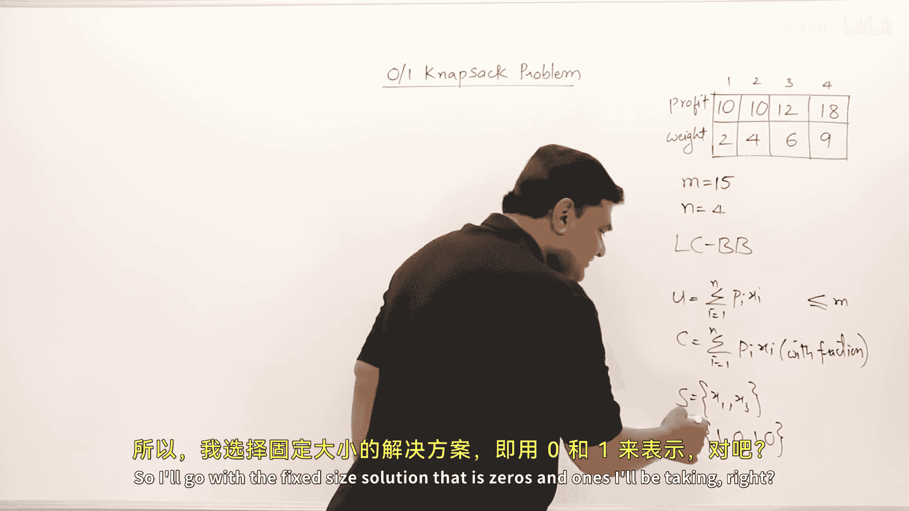

Fixed size solution that is zeros and ones I'll be taking right。

 So I'll be generating the state space3 for this type of solution。First of all。

 I'll take something called upper which is infinity now the first node calculate cost and upper bound for this one let me show you how to calculate the cost for calculating cost。

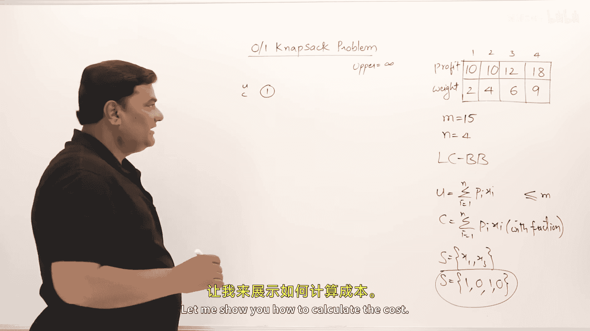

First objects profit and its weight， then the second objects profit and its weight。

 and next objects profit and its weight。 So if I take this weight total it is coming up to 2 well。

 Now can I include the fourth object also， it will exceed the capacity of the back。

 So don't include that one。 Then how much I can include 15 minus capacity is 15 minus-2 is 3。

 So I can include 3 more kgs。 So let us say 18 by 9 into 3。 So this will be 2 and 6。

 So how much it is 10，30，32 and 6，38。 So the cost is。

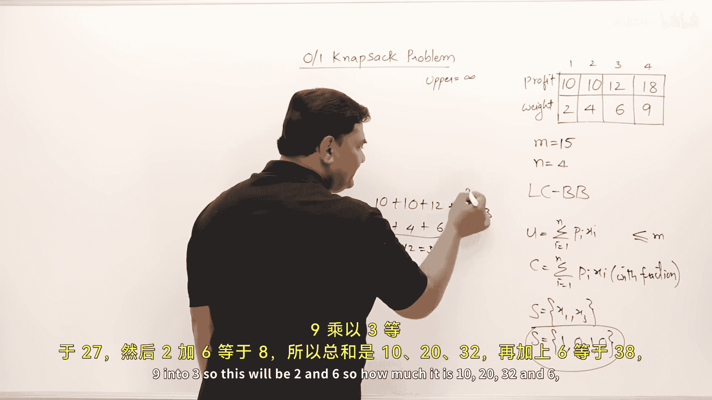

-38 as I said that we have converted this maximization problem to minimization。

 so we'll take the weights and upper bounds and the cost as negative。

 Now what is upper bound So I should take the same way but don't include fraction。

 See the cost was with fraction and the upper bound is without fraction。

 So if I take the same thing 102032。 So this is minus32 And I got one upper bound that is smaller than infinity。

 So let us change this to。

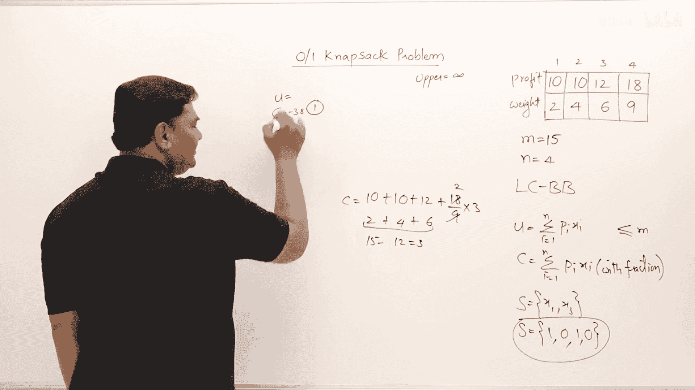

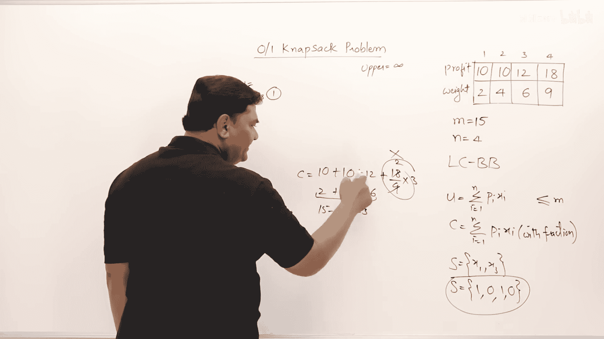

Minus18。This is the first node。Now， let us continue with other notes。Next。

 I will consider that I am including first object in the solution。

If I am including in the first object in the solution， then nothing will change。

 I'll get the same cost and same upper bound。Same cost， and same upper bound。

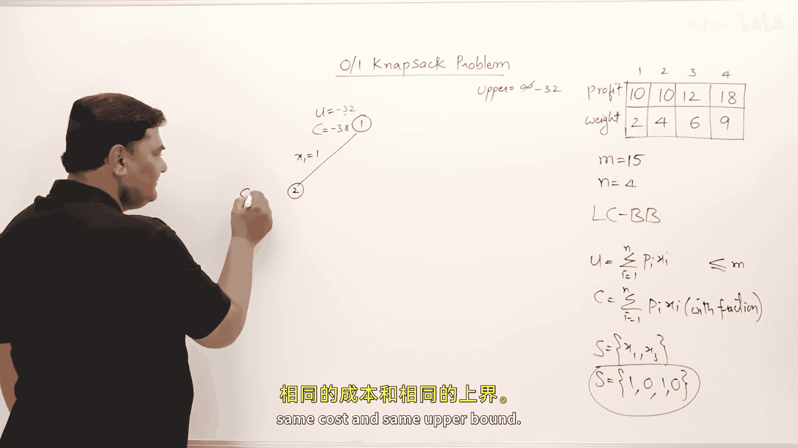

Next thing I will consider that first object is not included in the back。

 if the first object is not included in the back， then what will be the cost？First objects。

 profit and weight， Second objects， profit and weight， third objects， profit and weight。

And fourth object。 see this I am not including。 so I should take only these。

 So this is how much a 10。 still how much is remaining，5 cages are remaining。 So 18 by 9 into 5。

 So this will be 10，20 and 32。 So this will be cost is minus-32。

For every node I should also check one more thing that whether its cost is greater than a。

 no it is not greater it is equal， so leave it otherwise if it is greater kill that node。

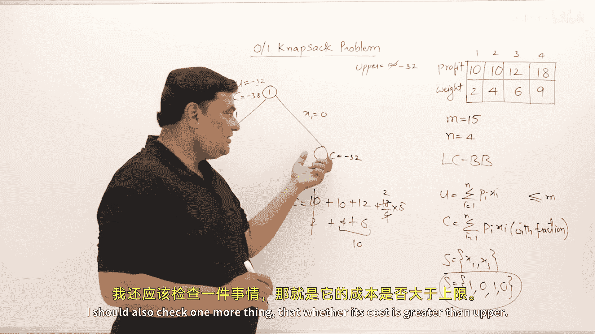

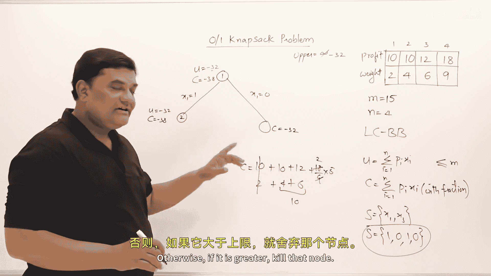

Now， what is upper bound。 So without this fraction。 If I take， this is 102022。 So-22。

 is it less than that。 No， if you are getting any lesser small upper bound。

 then we should update that one。 I have explored first node。

 Now which node I should explore the one with the least course。

 So I'll be following least course branch and brown。 So this is -38。 This is -32。

 I should take this one and continue。 Second object included in the bag。 So what is the cost。

 it remains same， See， both the objects are included。 So upper bound and the cost remain same only。

 Next。

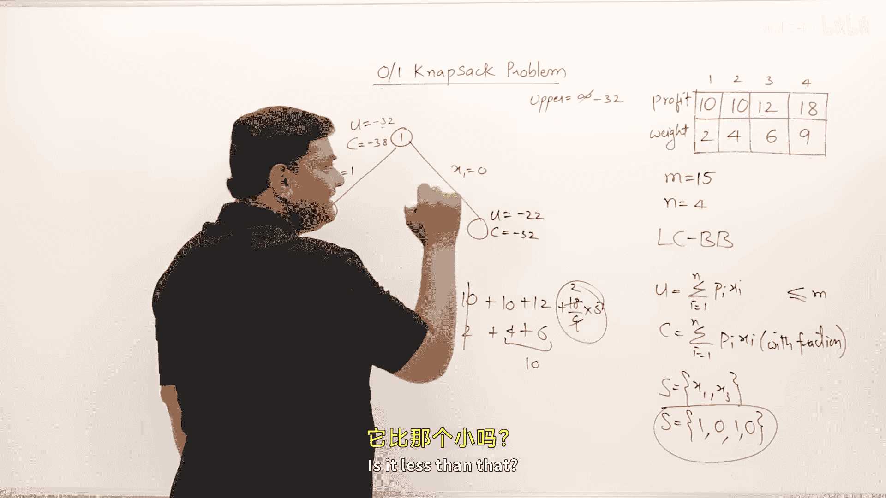

Second object， not included in the back。 So if the second object is not included in the back。

 let me calculate cost and upper bound cost is。

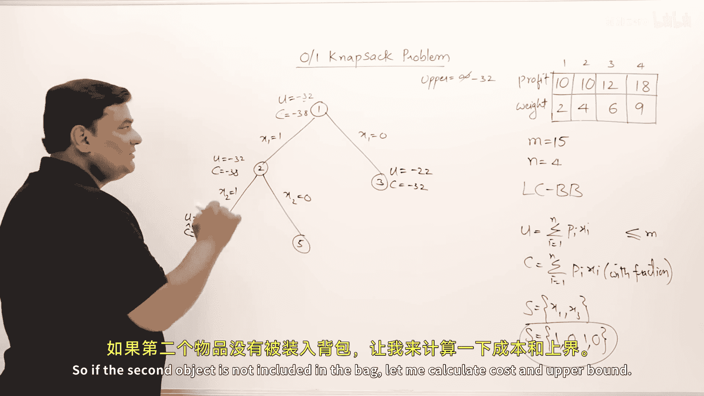

102 plus 10，4 plus。12，6。This object is not included， so this is how much8， still how much remaining。

18 by to7 kgs I will take。 So this is2， this is 14，26 and 36， so the cost is-36。

 but without fractions if I take this is 22 upper bound is-22。

Is it greater than that minus 36 is it greater than that no， so dont kill the node， right。

 it remains alive。

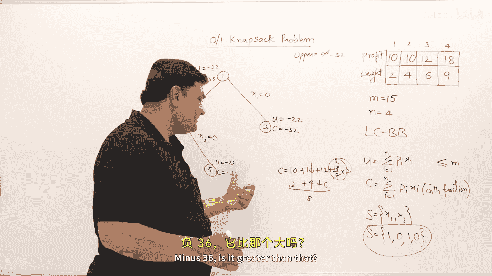

I have explored second vertex。 Now which vertex I should explore next， minus38 minus36 minus32。

 So out of this， I should explore this one。

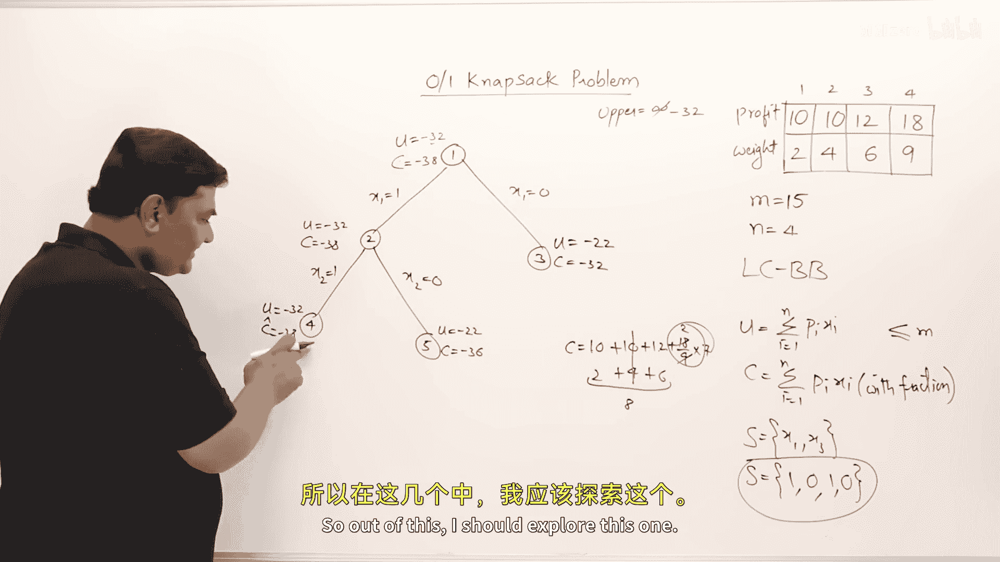

If I am following Fi for branch and bound， and I should explore this one。

 So if you explore that also， the number of node will be more， the work will be little extra。

 least course method give you a faster result。

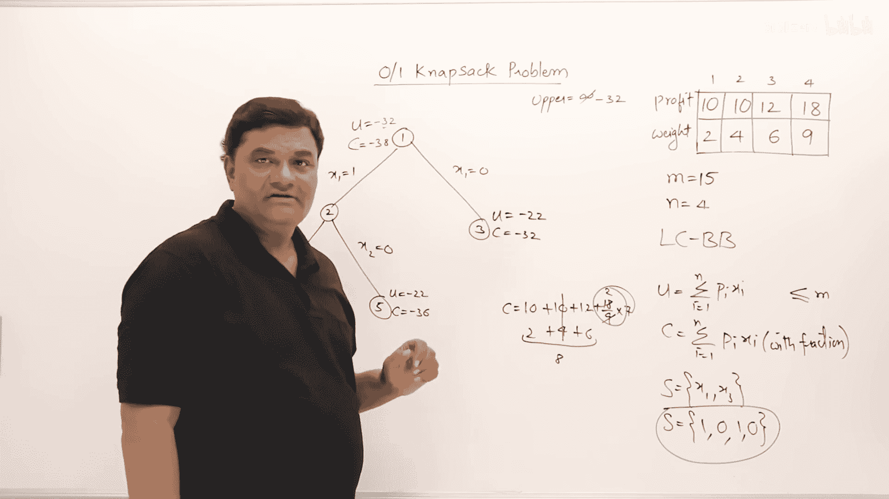

Let us。Explore this node。 So below this， the third object is included。 Third object is included。

 The cost remains same only， right， Nothing is discarded。

 So then if the third object is not included。 The third object is not included。

 then what will be the cost。 Let us assign the cost and upper mo for this one。

 cost is first object and the second object。Third object。 We are not including third object。

 So this is how much total weight is how much 6。 Now， last object is 9。 Can I include that one Also。

 Yes， I can include It's 9。 So completely， it is filled now 9 plus 4 plus 2。 it is 15。

 It is exactly filling in。 So what is the cost cost is 102038。 So it is-38。

 And what is the upper bound，102018。 So that is -38。 So there are no fractions here。

 So we got cost and upper bound。 Same only Now one thing you observe that we got a smaller upper bound。

 So update that one。 So it becomes -38。

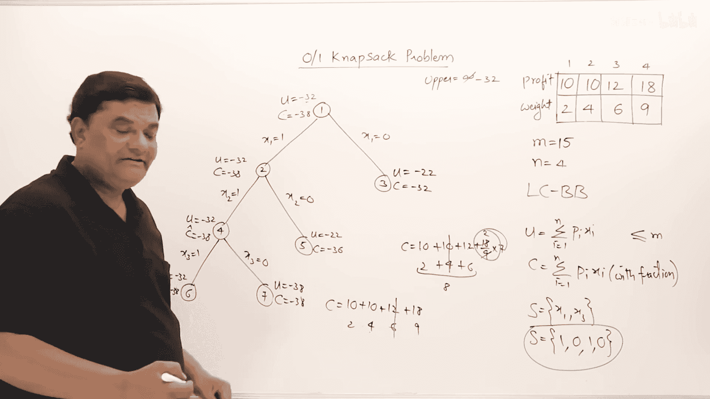

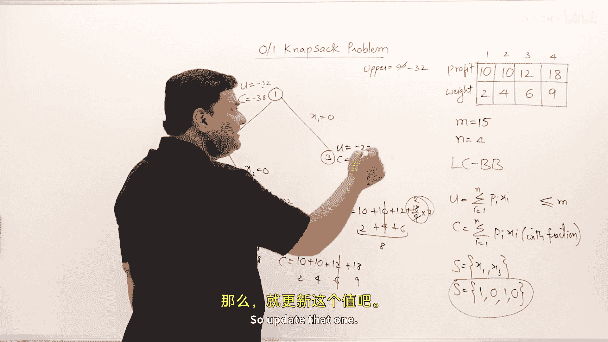

This is a minus-38。 Now once we got a smaller upper bound look at other nodes， so this is at alive。

 this is alive and this is alive， but what is the cost of this one that is minus-38 it is greater than that one so kill this node this is also greater than that one so kill the node no need to explore if you explore also you will be wasting your time you will not get the answer。

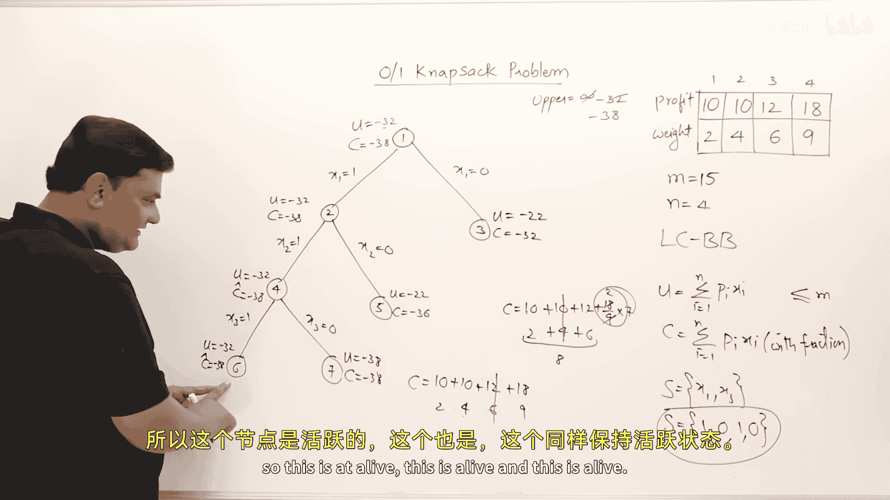

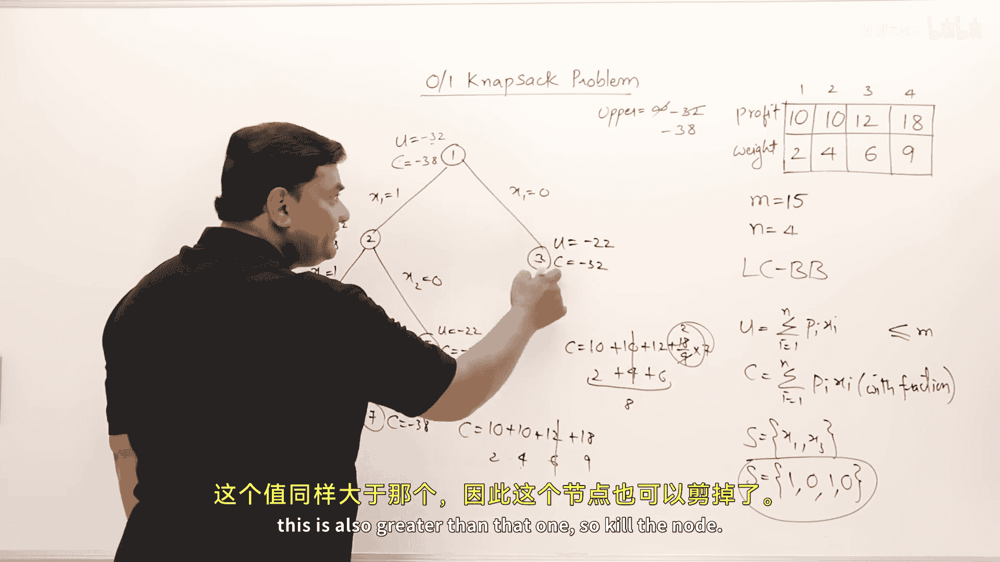

Now， which node I should pick up for exploration， I have both the nodes。

Let us check this first object included。 Second object included。 Third object included。

 Can I include fourth。 Also， No， that will exceed the capacity seat up to here， it is 2 plus 9。

 It will be 21 exceeding the capacity。 So I cannot go further。 so it will be inible。

 Let us expand this one， fourth object included in the bag。

 So if I say fourth object included in the bag。 The cost will be same thing。

 only-38 and the upper bound also-38。 and fourth object not included in the bag。

 So this is fourth object not included in the bag。 and。

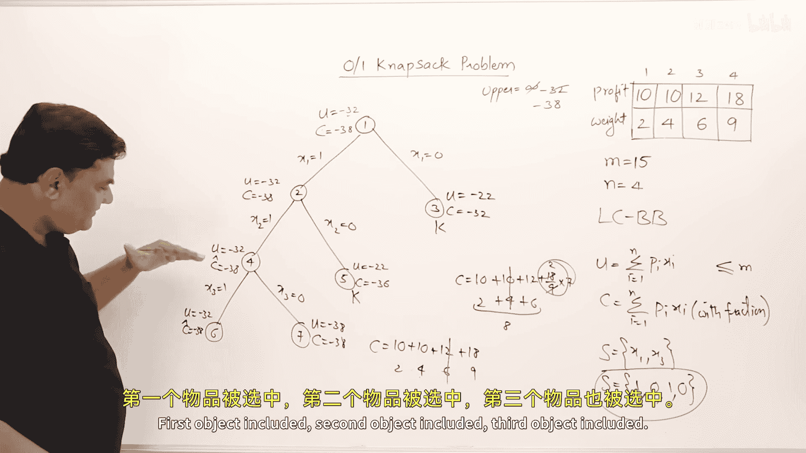

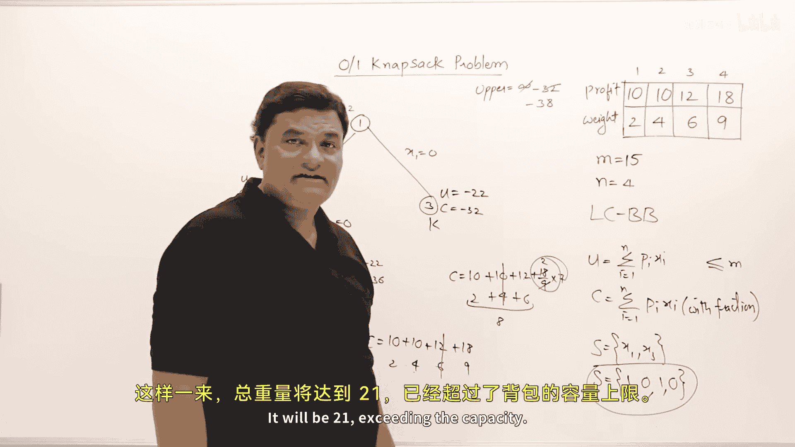

Cost will be how much。Without fourth object， right？ So if you follow this tree。

 first included second included third， not included， fourth not included means only two objects。

 that is 10 and 10。 So 10 plus 10 is 20， minus-20。 So this is greater than that one。

 So kill the node。 See almost all the nodes are killed， which is remaining， this is alive。

 So the last node that we got remaining is the answer node。 So what is the answer。

 first object included second included third not included fourth included。 So let us stick solution。

 first object included。

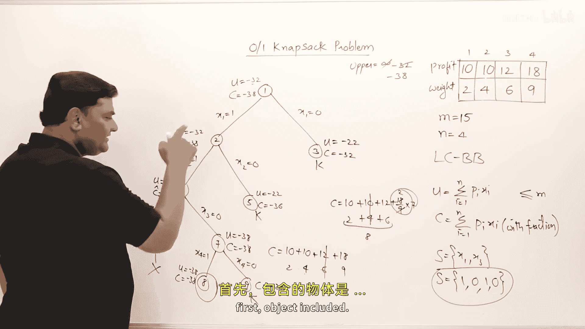

Second included third not included fourth included。

 So what are their profits 10 plus 10 plus 0 plus 18。 So this is 38。

 So this is the maximum profit what we got and their weights are 2 plus 4 plus 0 plus 9。 This is 15。

 So this is a solution。

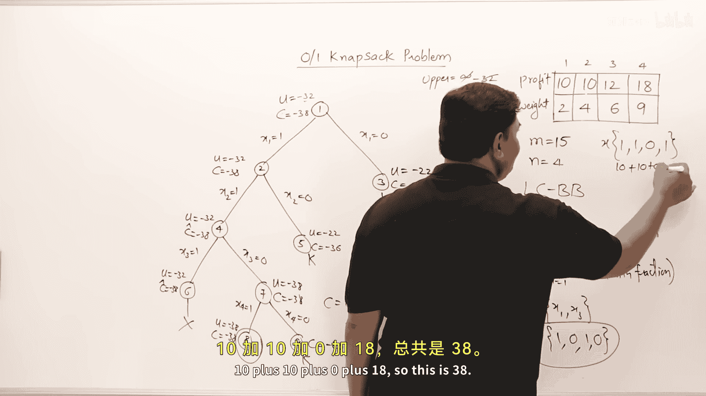

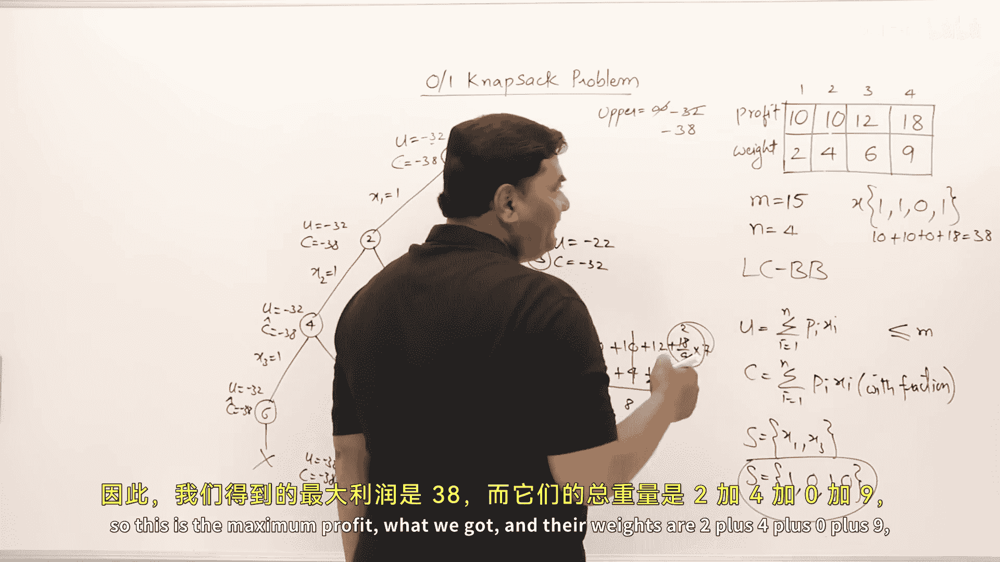

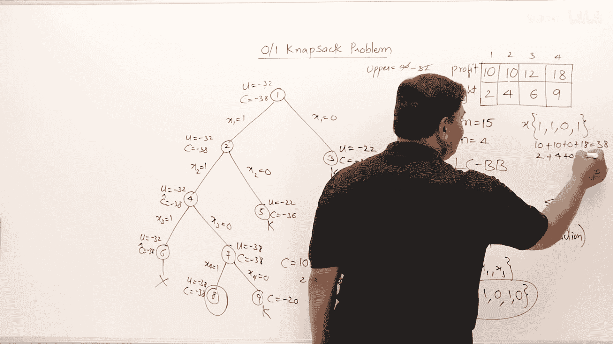

And we have solve this using lease Co branch and Mon herd。

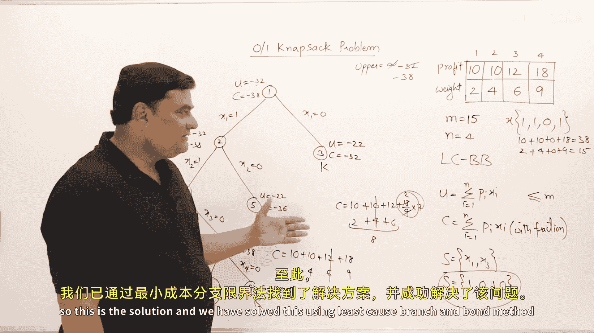