# 【精译⚡算法导论】AbdulBari p72 p71 8. NP-Hard and NP-Complete Problems -BV1hhPXeTEWM_p72-

The topic is NP hard and NP complete。 This is the most important topic and also this the most confusing topic。

But I guarantee that I'll make these concepts very much clear for you。And one more thing。

 don't watch this video if you are in hurry， watch it when you're really prepared to watch this one。

 when you're ready to watch this one。Can it start what this problem is。See。

 actually this topic is a research topic， and this is related to research。

So what is there for doing research here， first let us know about that。See。

 all the algorithms that we know are already we have learned， I have written them here。

These are the algorithms which takes polynomial time。

 and these are the algorithms which takes exponential time。

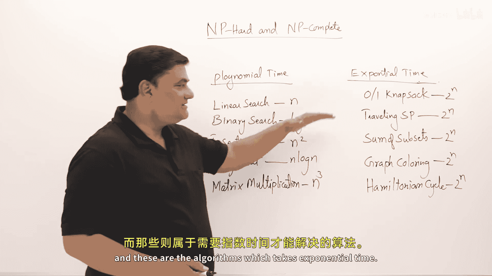

The problems for which we know the algorithms which take polynomial time like searching algorithm。

 the problem is searching and the algorithms are linear search binary search this takes n time and this login time and this n square for sorting and merge sort is faster than that that is n login。

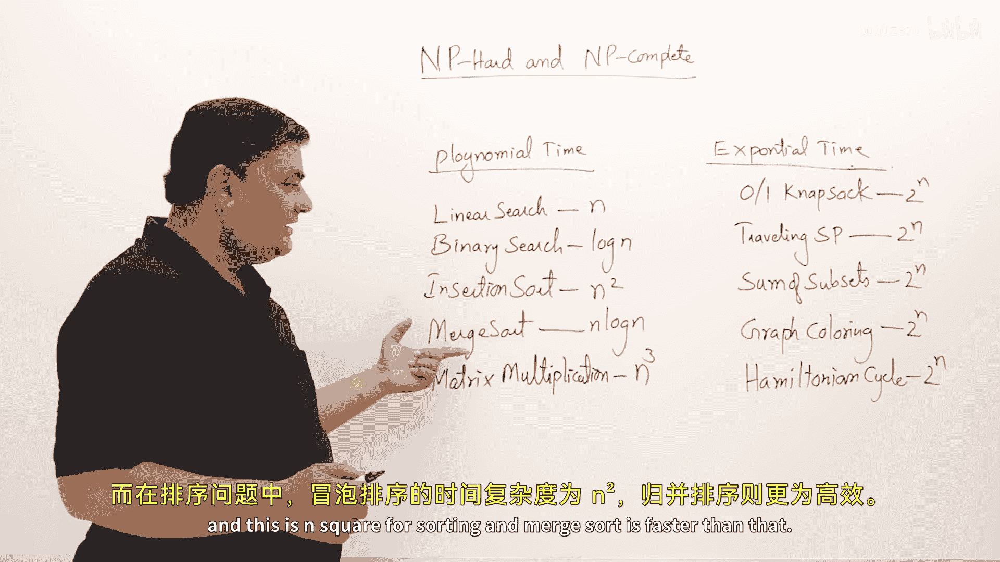

Likewise， zero abstractpsack problem which takes two power end time and traveling salesperson2 power N。

 all these are exponential， they may be taking n into2 power N or some as N power N some are but I just wrote them as2 power n in common to show that those are exponential。

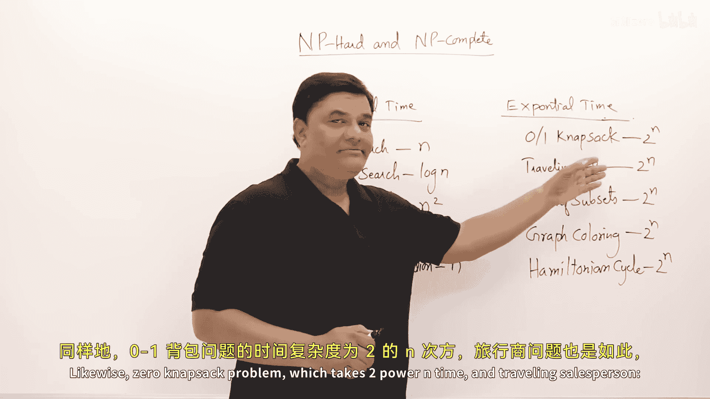

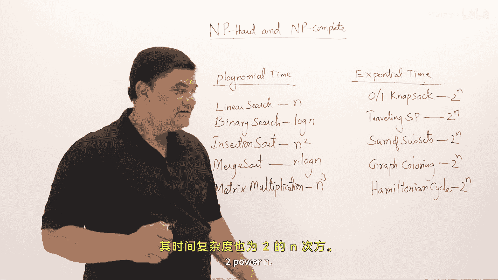

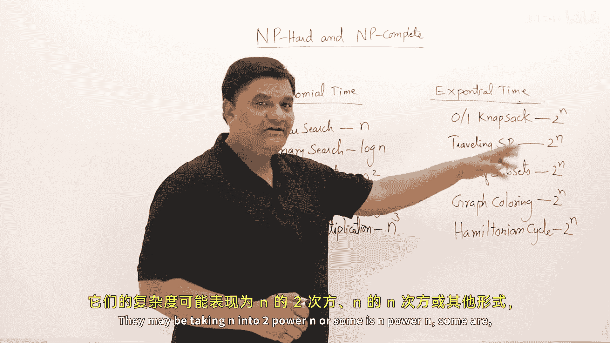

Now， here we have categorize the algorithms into two。

 one is polynomial time taking algorithms and exponential time taking algorithms。

What is the scope for doing research here， Let us see。See for searching。

 we have a linear search algorithm which takes order of end time and faster than that is binary search which takes log n time。

 we are in search of algorithm， which is much faster than this one。That is order of fun time。

 we want some searching algorithm， it takes order of fun time。Similarly。

 the faster sorting algorithm takes order of n log n time and one of the sorting is me sort。

 we want faster sorting algorithm that should take order of n time faster than this one。Similarly。

 for these exponential time algorithms， we want polynomial time algorithms。

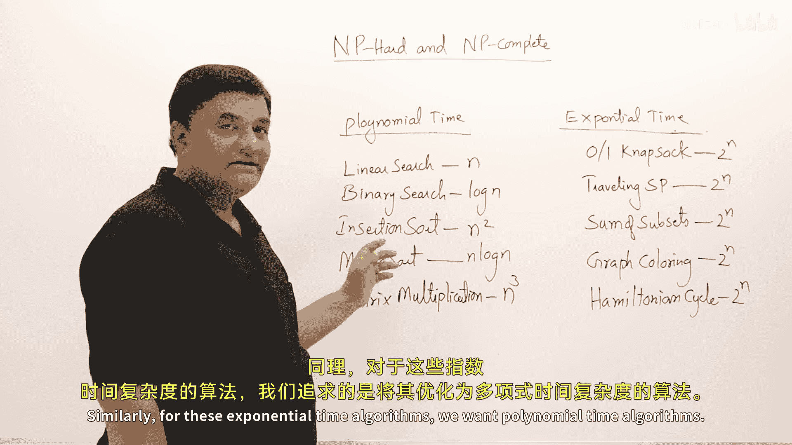

All these problems which are taking exponential time。

 we want faster and easy method to solve them in just polynomial time because2 over n or n power n or phi over n anything is much bigger than polynomial time。

 even n power 10 is a smaller than2 power n for some large values of n。

 even n power 00 is also smaller than2 power n for some very large values of n。

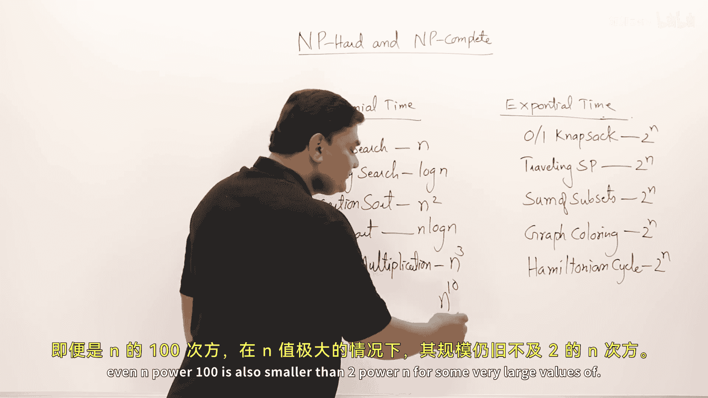

So these are very time consuming algorithms， so we want polynomial time algorithm for them。

This is the requirement， and even for this also we want faster algorithms。

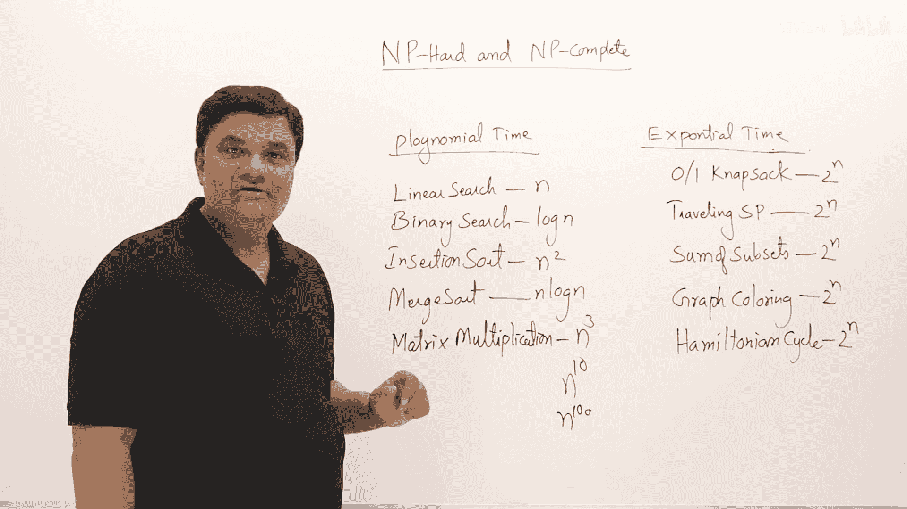

This is the requirement Now this is a research area the person from computer sciences or from mathematics can solve these problems so people have been doing research on this one but。

There is no solutions found so far yet for solving these problems in polynomial time。

Then when the research work is going fruitless right we want something such that whatever the work we done should be useful。

So there are guidelines or see we can say framework made for doing research on these type of problems that is exponential type of problem and that framework is NP hard and NP complete or guidelines that is a part of framework is NP hard and NP complete。

So let us see what is the basic idea behind that so there are two points that I am going to tell you based on this the entire topic based on these two points only。

I'll discuss them in very much detail， but just I am telling you those two points right。

 see first point。When you are unable to solve these problems。

 when you are unable to get a solution that is polynom time algorithm for them。

Then at least you do the work such that you try to show the similarities between them so that if one problem is solved。

 all other problems should also be solved。We will not be doing research work individually on each and every problem like I am trying to solvenapsack problem and you are working on graph coloring。

 we will not do it individually， let us combine them collectively and put some effort such that if one problem is solved all the problem should be solved so for that we have to show the relationship between them。

Association between them to show that the properties they are having are similar so that if one is solved the other can answer solved。

 this is the first objective that try to relate the problem， either solve it or at least related。

 This is the first one。 Second thing is when you are unable to write。

Algorithms for them that is deterministic， why don't you write non deterministic algorithms for them？

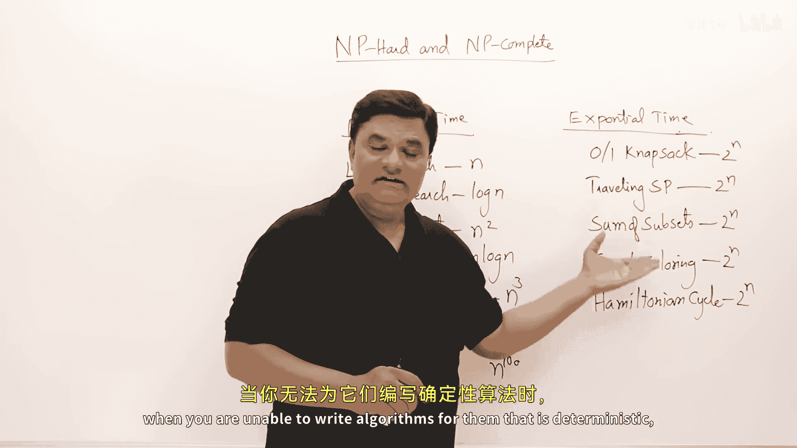

When you are unable to write polynomial time deterministic algorithms why don't you write polynomial time nondeterministic algorithms so what are these let us see so these are the two points I have shown you now I'll start with nondeterministic algorithms then Ill go to the relationship between them once you understand these two things everything is clear。

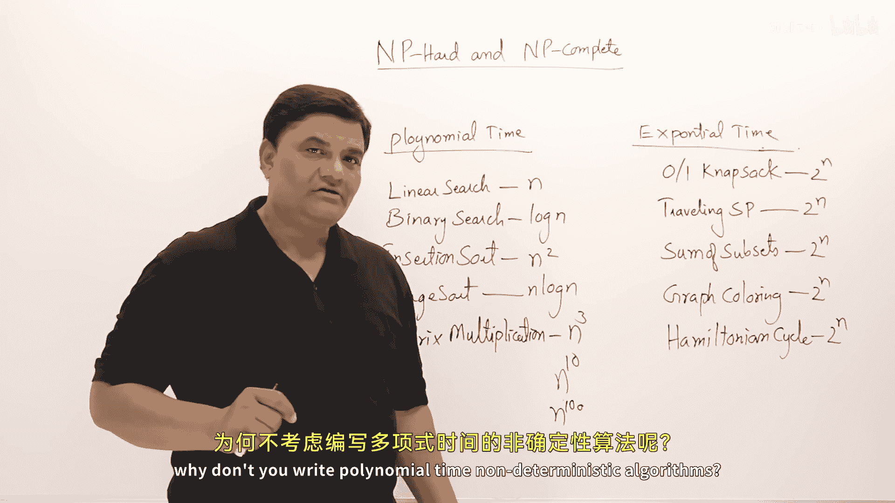

Let us check。Let us talk about non deterministic， see the algorithms that we write usually are deterministic。

 so what does it mean each and every statement how it works， we know it clearly。

We write the statements， we are sure how they work， so we know the working of the algorithm。

 so that is deterministic。So we can write nonatomistic algorithm also yes that means we don't know how they are working so how we can write algorithm which we don't know see if I am trying to write a zeronapsack problem that is polynomial time algorithm if I am trying to write then I may be knowing most of the statements but some of the statements that I may not be figuring out how to make them polynomial。

So leave them blanks， leave them blanks and say this is non deterministic。

So when I come to know that how it has to be filled， I will fill up that statement。

 So in a nondeistic algorithm also most of the statements may be deterministic。

 but some of the statements are not deteristic。 So in this way what we can do is by writing nondeistic algorithm。

 we can preserve our research work so that in future somebody else is working on this same problem he can make that nondeministic part as deterministic。

This is the idea。 So suppose I have spent 10 to years to solve this one of the type of problem。

 but I want unable to solve。 then what all the work that I have done should be preserved in some form。

 So that is the idea behind writing nondeteristic algorithm。

 So how do we write nondeteristic algorithm。 So here is an example for nondeteristic search algorithm。

 Now I'll show you what are nondeterministic statements in this one。

 This choice is nondeteristic success and failure。 These are the known statements that we use for writing nondeterministic algorithm。

 So these statements are nondeterministic And we assume that all these statement takes just one unit of time。

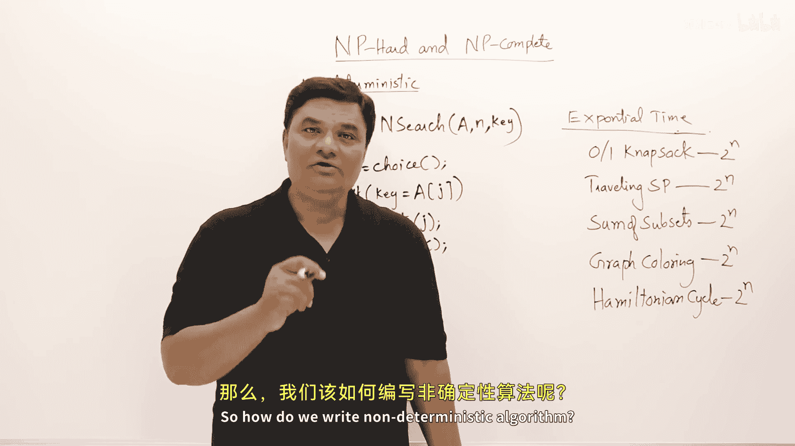

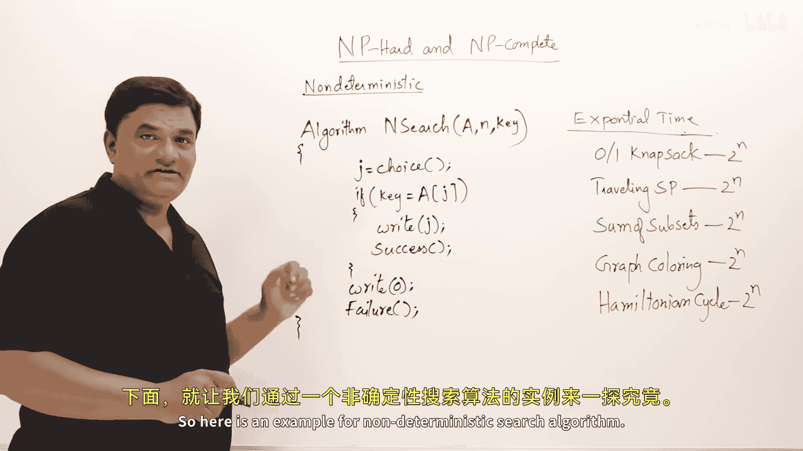

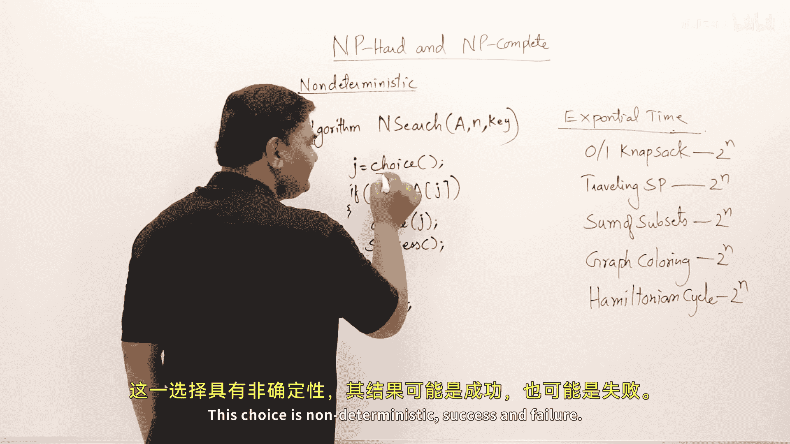

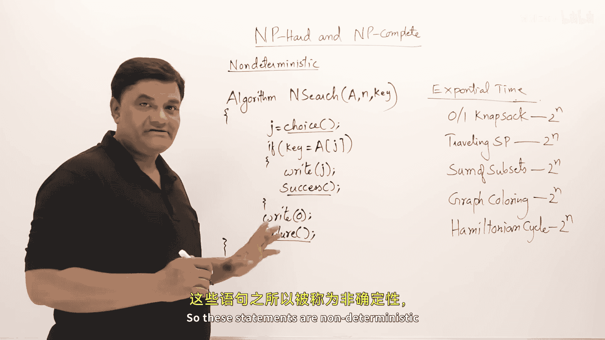

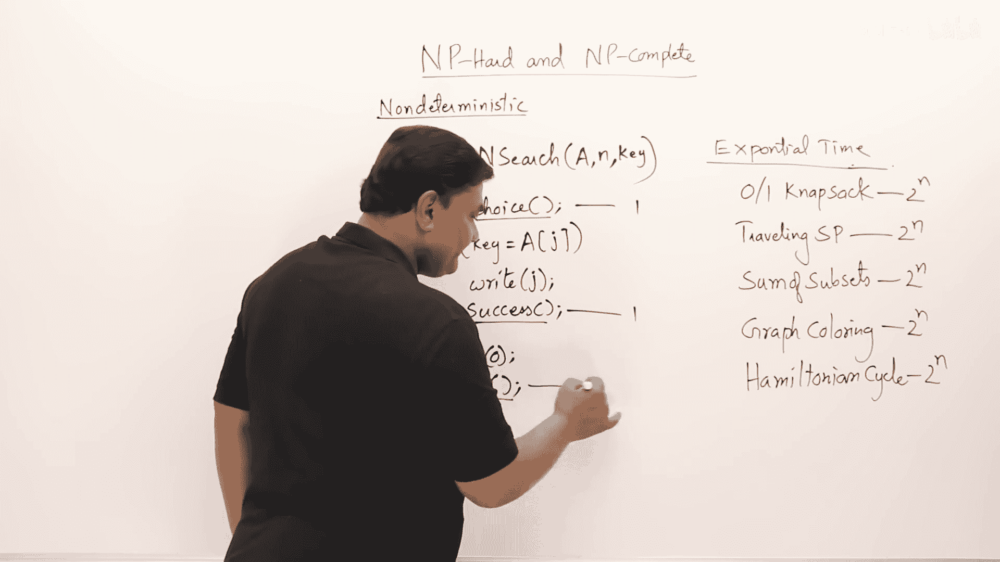

We assume that these are taking order of one time。Now， let me explain you the algorithm。

 This is for searching a key from an array of size and。

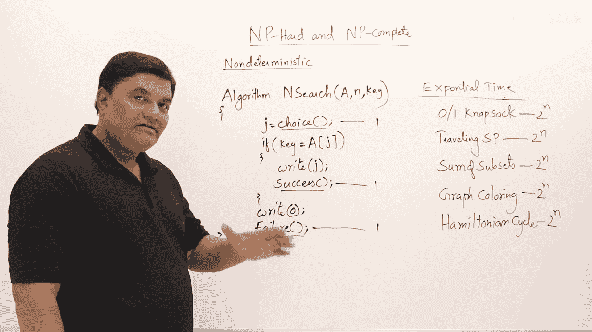

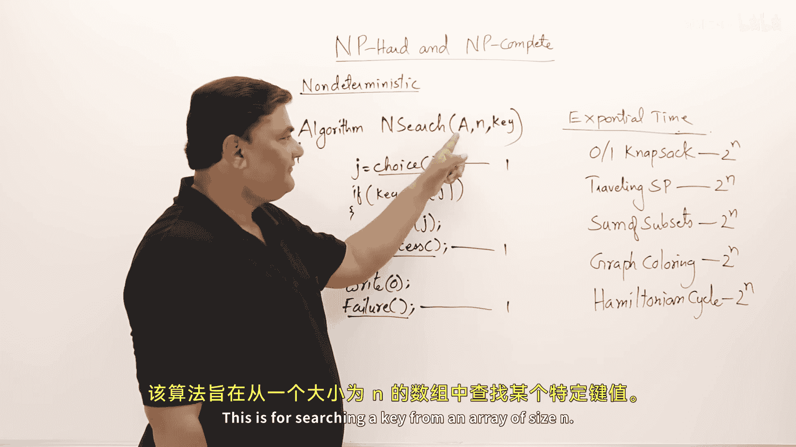

Let us check。See if I just simply look at this algorithm without going into detail。

 simply just see the statements。 It seems that the entire algorithm takes order of one time。 Yes。

 this is the constant time algorithm for searching。

 See the fastest search method we know is binary the research which takes login。

 but this algorithm is taking order of one So really it is faster。 We need this one。

 but this is nondeministic。 Let us see how this is working。 I'll explain。

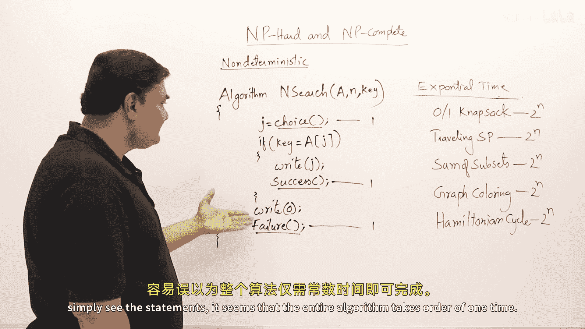

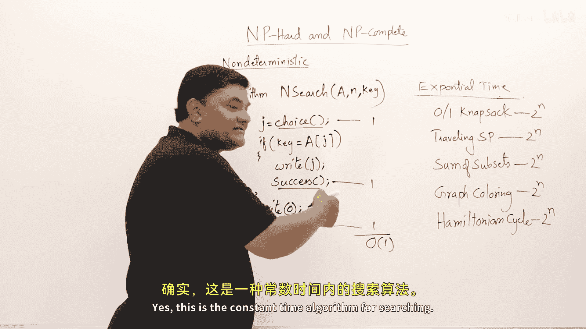

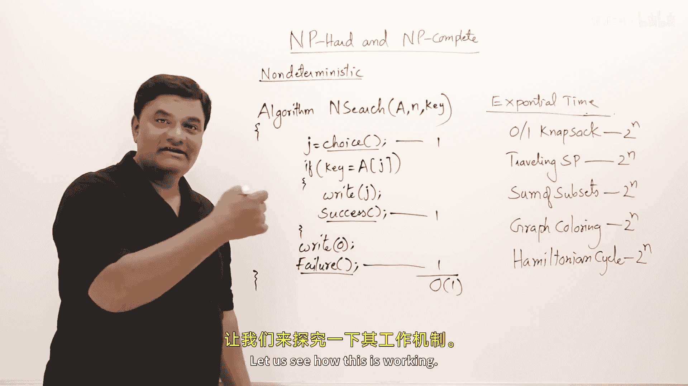

From an array， we have to search for key。 So the first statement is what choice J。

 So choice is called， and it has given index J。

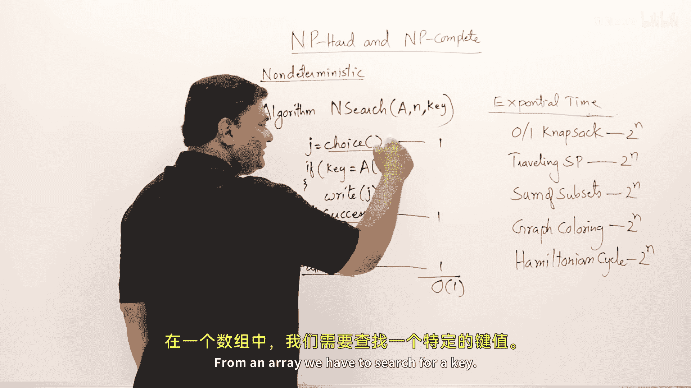

And what we do it is giving us the index of that key element。

 it is saying that that key element limit so in super position J and we are checking is that key element is present at J if so then search is successful。

 we will write the output and search is successful if the key element is not there at that placement the key element is not present in an array search search is unsuccessful so we say fail。

Men's solution is not there。 Men's skin is not found。 It's not that it's unable to form。

It is able to find， but the key is not present in an array。So so simple。 Now。

 the question is how this choice came to know that the key limit is present at Jeth index。

 That's what it is non deterministic。 Once we come to know that we can find out the position of a key element in constant time。

 then we'll fill up this line。This is like a blind statement for us now once we fill up this。

 we have an algorithm which is taking order of one time。

 This is how the algorithm nonridomistic algorithm should look like。

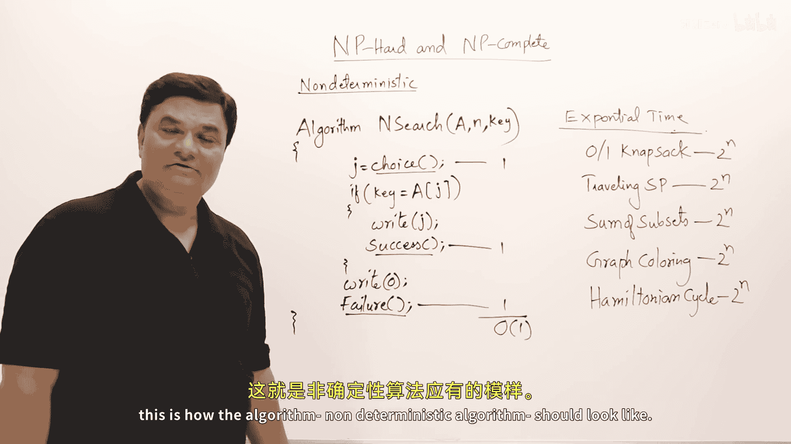

Lets see how this choice is working。 Suppose I have an array of elements。If I say keys 9 and search。

 then choice will give me directly index4， how I don't know without shaking anything without applying any search logic directly。

 it says at index 4 in constant time。And how it can know that in constant time today， we don't know。

 Maybe tomorrow， we can find out a method to directly get that answer。

 That is the idea behind writing non deterministic algorithm today， to Morrow。

 they may become deterministic by some other researcher。 I am unable to do it。

 Maybe other person will be able to do。 My work is preserved。This is the idea behind it。

See one more thing I will say that how this choice is working。

 we don't know when we don't know how the things are working， we call it as magic。

 so this is magical now for us once we know how it is working it becomes a technique。

RightIt becomes a logic。 So same way today is a magic for us。

 So we have written like a magical algorithm tomorrow。

 it will be procedural or it will be having its own logic。

 So once we know that it becomes a deterministic and it will be taking constant time。😊。

So like this we can write down nondeterministic algorithm for these polynomial time exponential time taking algorithms that is we will write on polynomial time algorithms this is polynomial time will not write exponential again it waste we will be writing nondeterministic which is taking polynomial time for these type of problems which are right now taking exponential time so with this we define two classes here let us see。

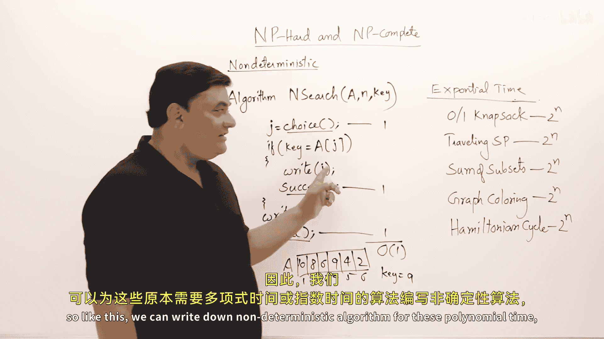

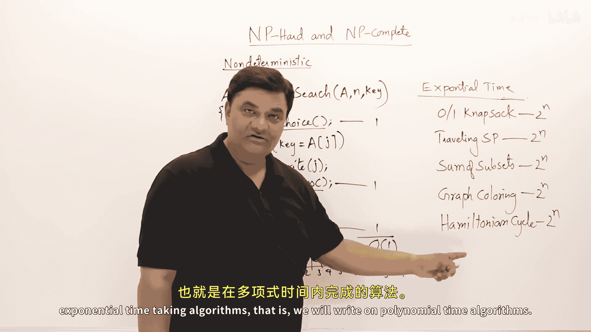

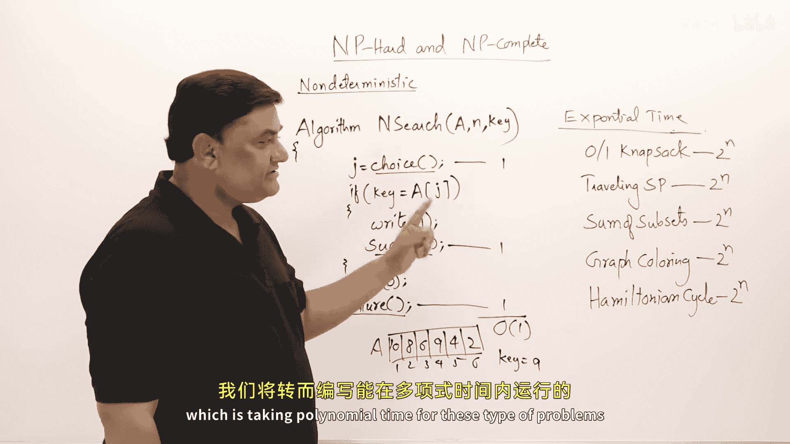

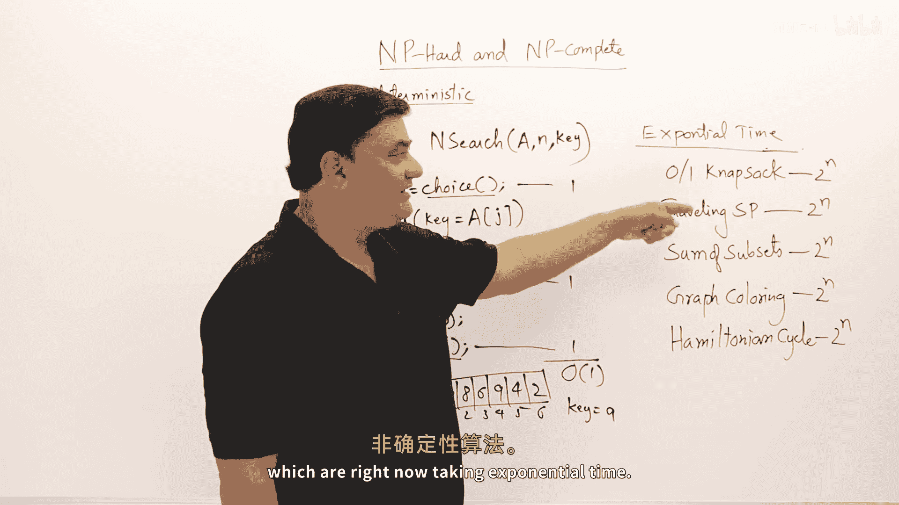

Vifying P。P is a set of those deterministic algorithms which are taking polynomial time。Example。

 linear search， binary search， bubble sort， mergerch sort， single sort shortest path。

 minimum causes span tree。Optimal mech pattern， Huffman coding， all these takes polynomial time。

 So all those algorithms， which takes polynomial time and the algorithms are deterministic。

 We call them as P。

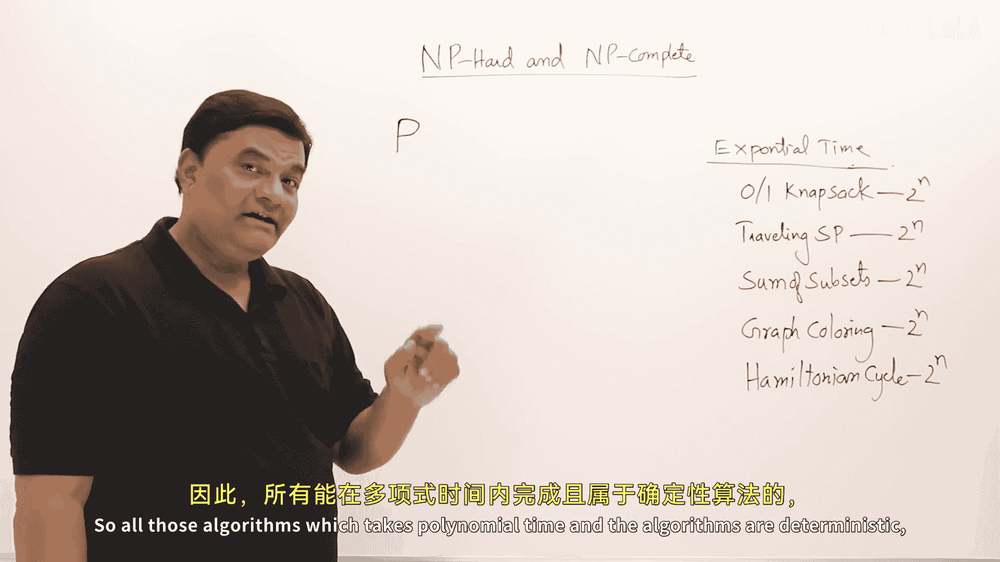

And we have one more class of algorithm， that is N。

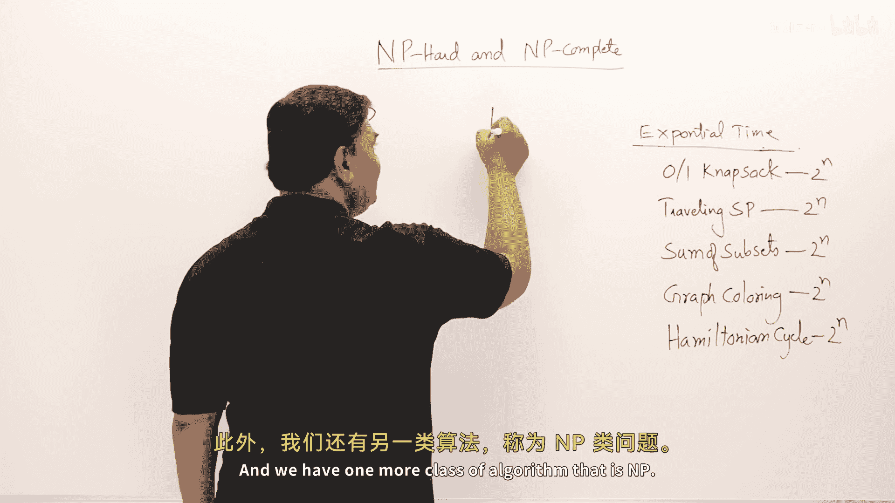

These algorithms are nondeterministic but they take polynomial time for whom we will try to write。

 we actually we try to write for these type of problems， these are exponential。

 we convert them into polynomial but we don't know how it is possible so we leave the statements nondeterministic so algorithm becomes nondeterministic。

So non deterministic polynomial time taking algorithms。

 so deterministic polynomial time taking algorithm and non deterministic polynomial time taking algorithms。

So， PM N P。This is a famous diagram， this is NP， and this is P。P is shown as subset of MP。

What does it mean， The deterministic algorithms that we know today day。

Where the part of nondeterministic algorithm。Let us say MerO， for example。

 we have found it recently in the past we were not knowing it， so it was nondeministic for us。

 we were not knowing that there is a possible algorithm which takes and log in time。

We were working with bubble sort maybe so that was taking n square time but recently we found out that merge sort which is faster it is taking a log n time so that algorithm was nondeministic and became deterministic now。

So this is the idea here。 So whatever the research work we do and we come up with some new algorithm。

 we say that when we came to know the algorithm that became deterministic。

 So it means it was already there and that was non deterministic for us。

This is the idea set behind this one that is P and NP。So。

 today what all we know which are deterministic where yesterday they were non deterministic and today whichever is non deterministic tomorrow that may become deterministic so we say that deterministic is a subset of non deterministic。

And there is one more cooks theorem here that try to prove that P is a subset of NP or P equal to NP that I'll come to it。

 So for the guidelines of research work or the framework for research work。

 I said that there are two things that are important So first thing I have completed that is writing nondeteristic polynomial time algorithms。

 how to write and what is the meaning I have explained that one part I have finished Now the second part I said that if you are unable to solve at least show the relationship between them such that if one problem is solved it should be easy for solving other problems also in polynomial time。

 we will not work on each and every problem individually so how to relate them together that is the next thing we will learn。

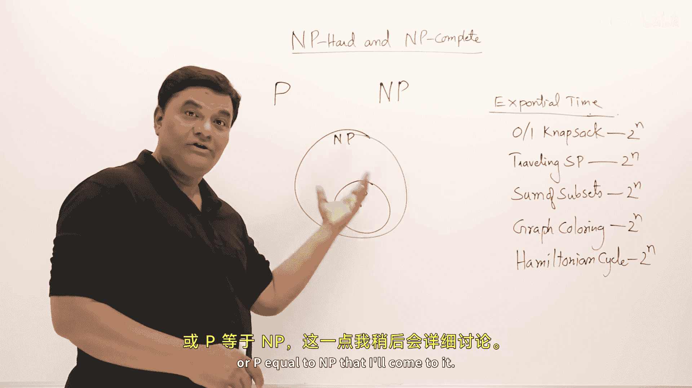

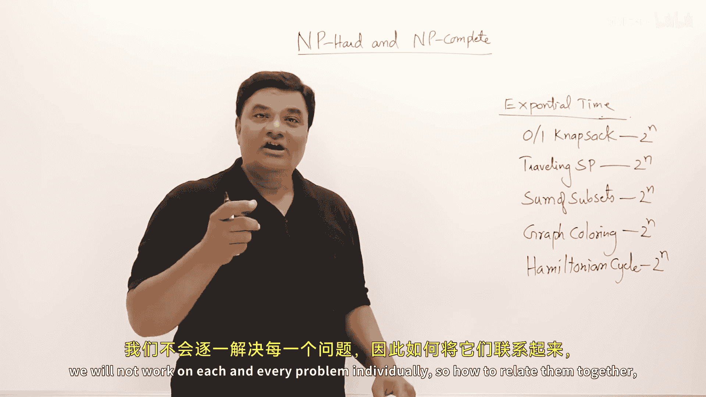

So for relating them together， we need some problem as a base problem。

 so which problem we take it as a base problem。

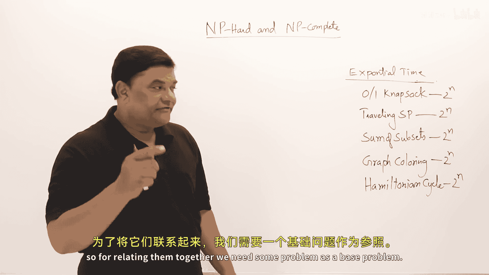

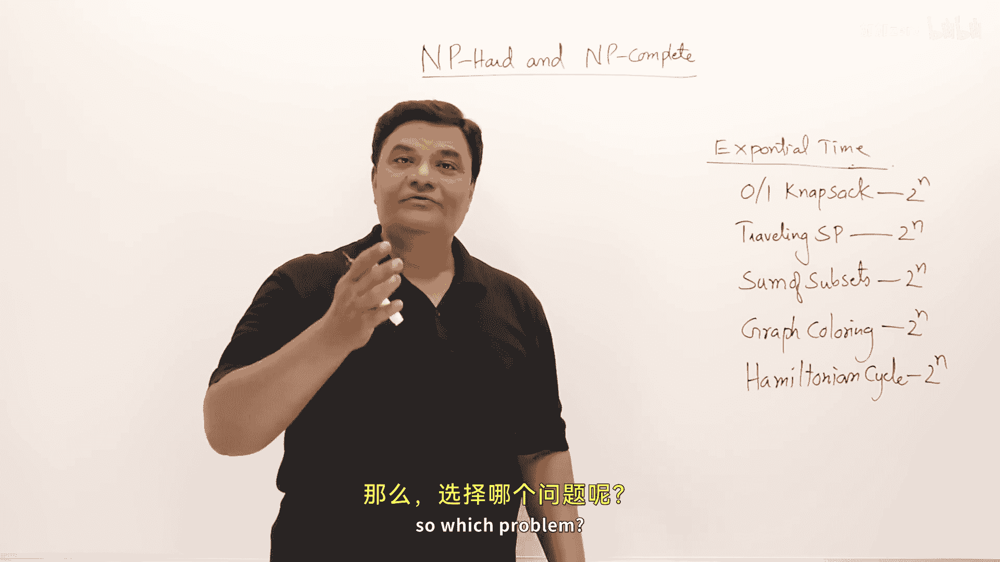

The Bra problem is satisfiability problem。 What is this？This is。CF。Formula。

 that is propositional cculus formula using Boolean variables。 Let us say x 1， x 2， x 3。

 I have three boolean variables like X I R these， then。

There is a formula that is C formula is there example formula I'm taking that is x1 or x2。B R x 3。

 and。Excellent bar， or X 2， or X 3 bar。

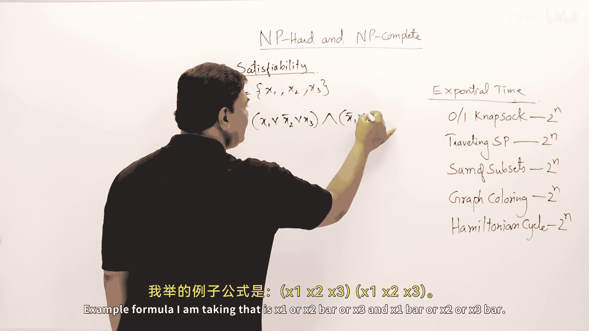

Let us take this as an example formula This is CF Proal calculus formula and it is having clauses。

 let us say C1 and C2， these are the clauses and clauses are formed using disjunction and they are joined with congestion so this is CF formula。

Now what is this satisfiability problem， the satisfiability problem is to find out for what values of X I this formula is true。

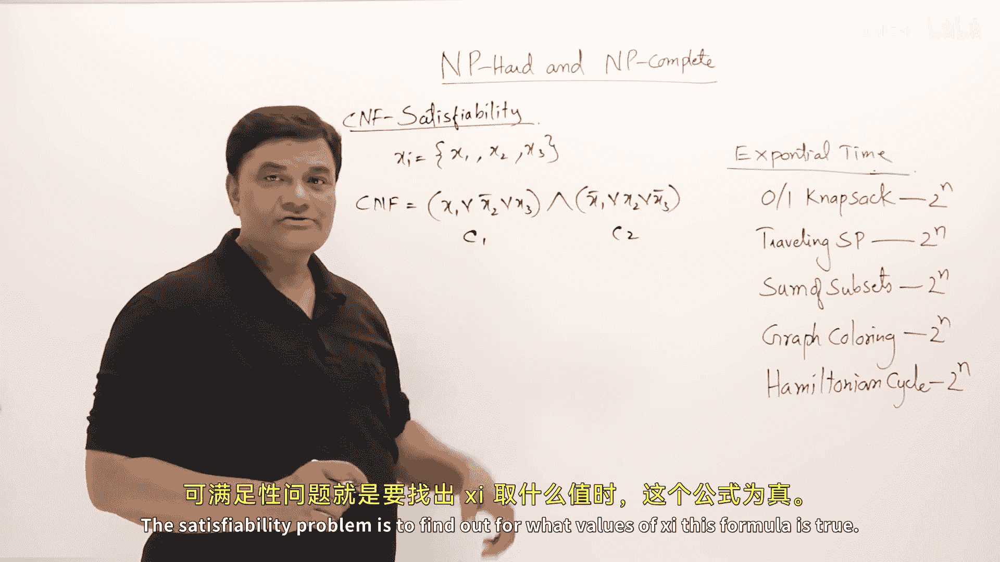

So what are the possible values of X I， See x 1， x 2， x 3， as these are guan， so they can be 0 or1。

 so they can all be 0， or this can be one or this can be one or these two are1。0，0，1，0，1，1，1，0，1，1，1。

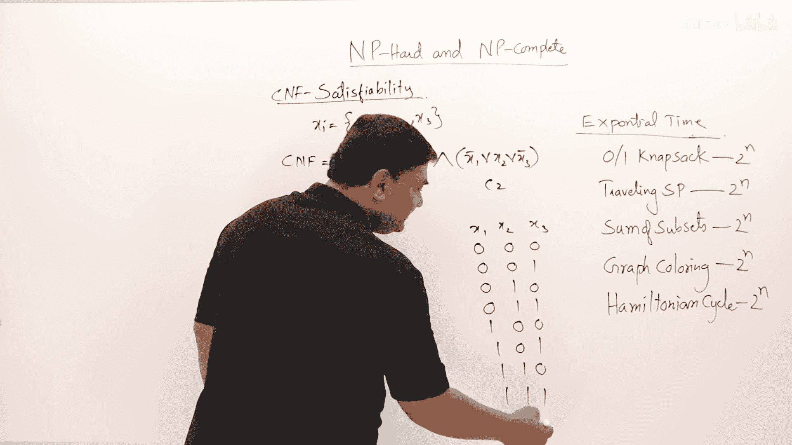

So there are eight possibilities I should try all these eight possibilities and place them here and check for which of these values this is true。

 and I should find out all possible values for which it is true。

So how much time it will take for solving this one。

 so how many values I should try88 is what2 power 3， so for n variables it will be 2 power n。

So this is also exponential time taking problem。This is two power N。 That is exponential time。

 So this is similar to this。

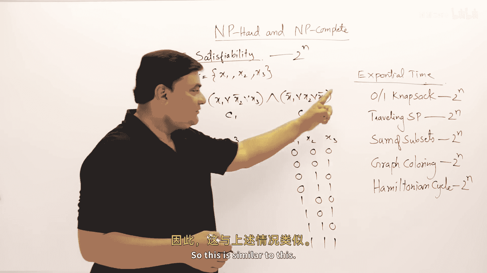

They are also taking to foreign or exponential， so this is also taking exponential time。

 so this belongs to the same category。Now these values。

 even I can show them in the form of a state pastry， I will prepare a state pastry for this。

 a solution for this problem， I can say that x1 is1 or x1 is0 or x 2 is 1 or x 2 is 0 or x 2 is1 or x 2 is 0。

 there are three variables So x 3， it can be1 or01 or0，1 or01 or0。

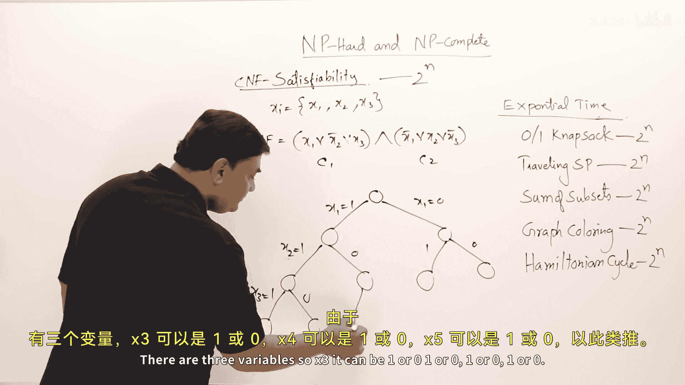

Now the path from root to the leaf of these tree gives a solution like 101， this one。

 if I take this this is 011， so this is showing all eight possible values of x1 X I。

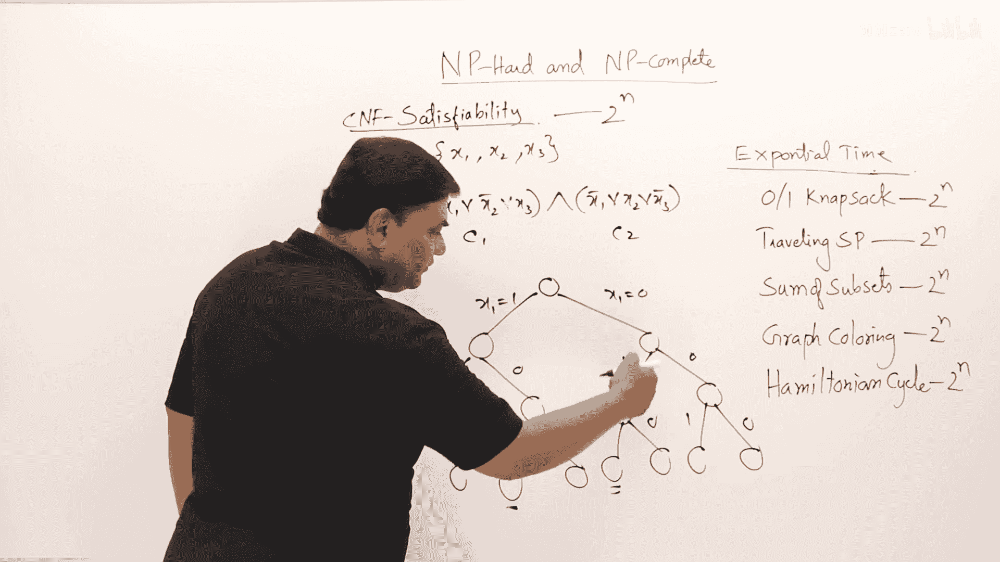

X 1，2， x 3。 So this is represented in the form of a state space string。

So this problem can also be represented in the form of a state space tree。Now what we have to do。

 we have to show that these are similar to this one。

Such that if satisfy satisfiability is solved in polynomial time。

 all can be solved in polynomial time。

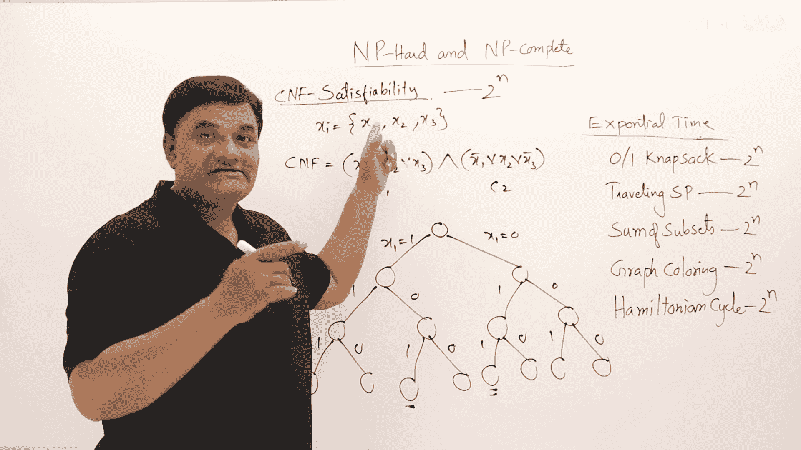

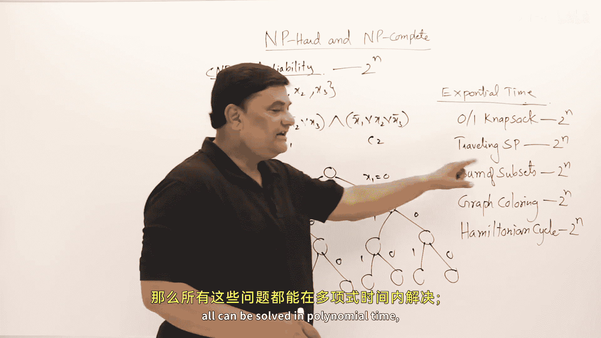

Or any one of them is solved and all of them can be solved in polynomial time。

 so this is the idea we have to relay these problems so that we don't have to solve them individually if one is solved all are solved。

Now how to prove that there are different methods for showing that。

 but to make it simple and understand， I'll show you here only by taking01napsack problem by using this tree。

Let me take an example of 01napsack problem。 Here I have an example of 01 abstractpsack problem。

 There are three objects given for each object。 There is some profit， and there is some weight。

 and the capacity of the bag is 8。 We have to fill up the bag such that the profit is maximized and we should not exceed the capacity of the bag。

 Then to give the solution for the 0，1 abstractpsack problem。

 I can write down solution in the form of X I that is first value or second and third value can be either 0 or 1 or 0 or 1 or 0 or1 means all these values x1 x2 and x 3 can be either 0。

0，0 or 0，0，1 or 0，1，0。 So how many possibilities are there，2 over3。

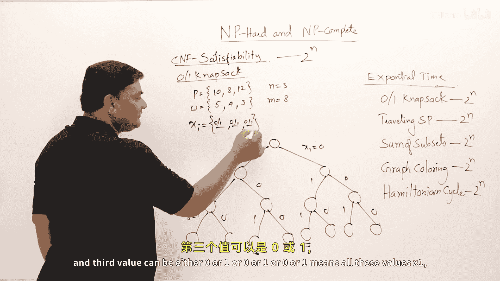

So it means for n objects it will be2 or n， so the solutions that are required for this one are similar to satisfiability problem。

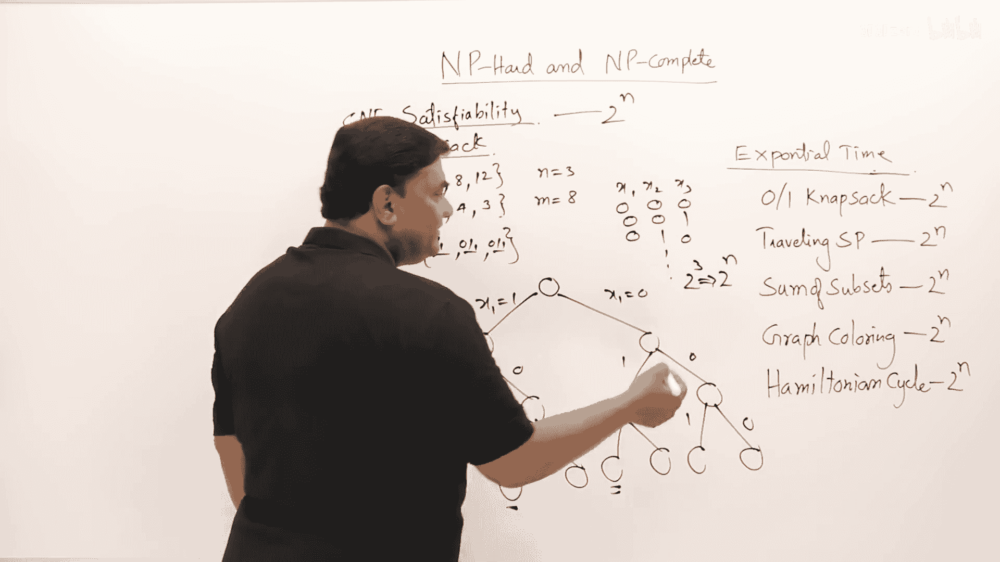

How we solve satisfiability samee way we have to try for01 Napsack there we have to see formulaized true or not here we have to see whether the profit is maximized or not。

 So it means this problem can also be solved using state pasttry or you can check some video for01 Napsack problem。

 I have drawn a state spacetry。So I will show one thing now。 I have removed both the problem。

 There is no satisfiability formula。 There is no 0napsack problem here。 Now。

 can you tell me this tree belongs to whom。This tree is showing the solutions for satisability or 01。

 This is for both。So this is how I am relating them right there are difference there is a different method for relating okay that we will learn in next video you can watch it。

 but here I am relating like this so you can clearly see that if you can solve this one。

 this state space in polynomial time then means you can get the solution for this one also in polynomial and this one also in polynomial so that's how we show the relationship between these problems by taking this as a base problem。

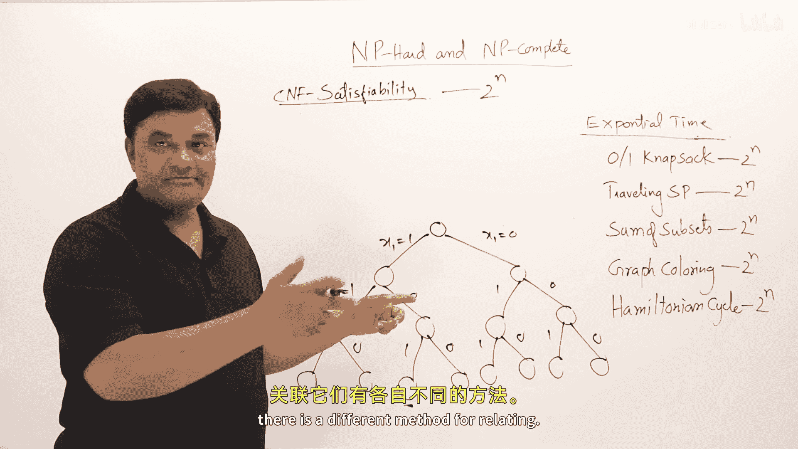

Now I will add this one also there in the list。Satisfiability。

 also I have included in this exponential time algorithms。 Now we coin one term that is NP hard。

What is this， I'll explain。But let us call them simply as hard problem。 All these are hard problems。

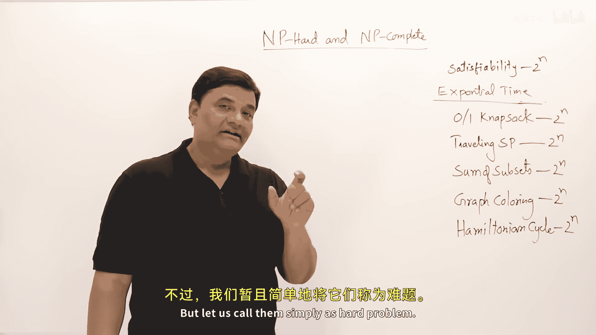

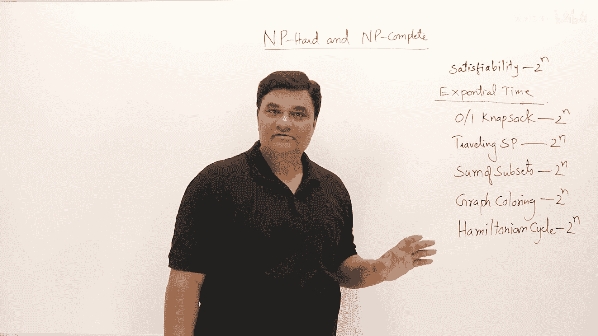

first of all， let me call it as hard。But satisfiability， as we have taken it as a base problem。

 so I'll say that is NP hard。 What does NPL explain afterwards， let us simply call it。

 This is NP hard and this is all I am saying hard problems they are taking exponential time。

 they are not NP hard then I was saying that we have to show that these are related to satisfiability only so that if that is solved all can be solved how to show the relationship as the procedure is reduction。

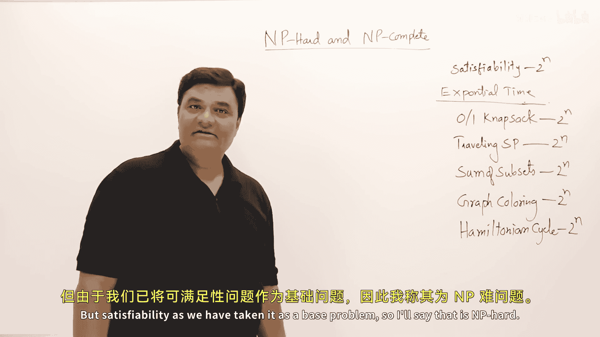

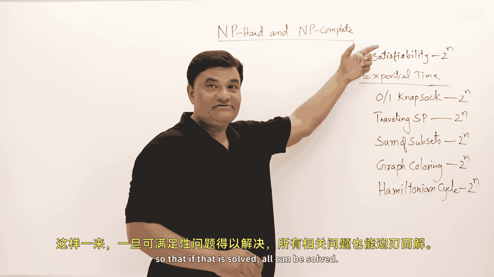

So what this reduction is。We take， let us say example， satisfiably the problem。

 and we take one of the problem， for example，01 Napsack problem。

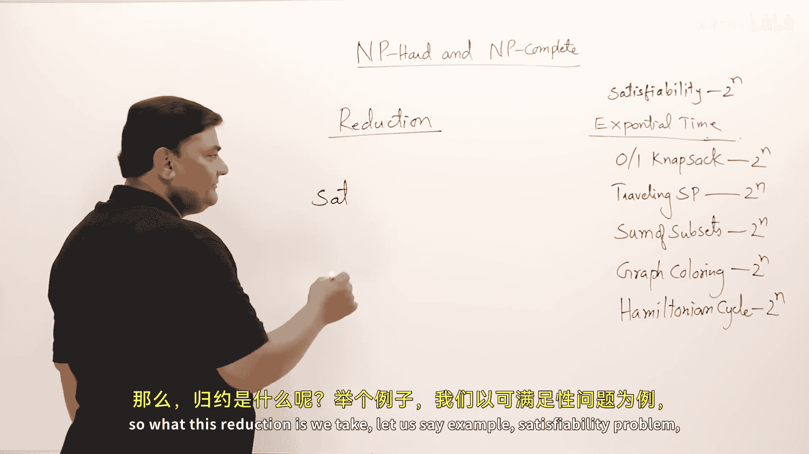

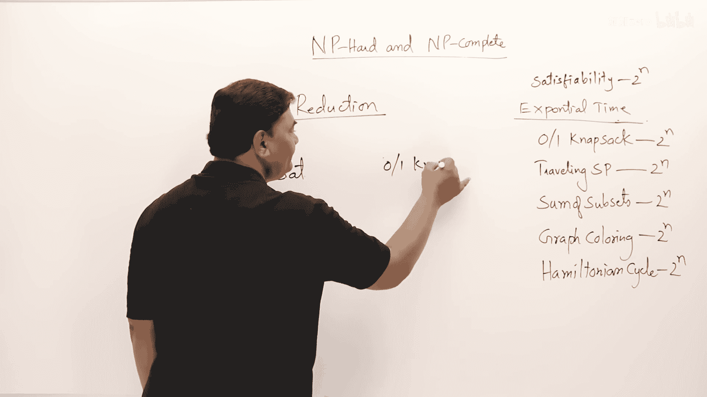

And we say that satisfiably reduces to0 one abstractpsack problem。What does it mean。

 what we saw we show that we take some instance of satisfiability that is one formula we take and that formula from that formula will convert into a01napsackack problem。

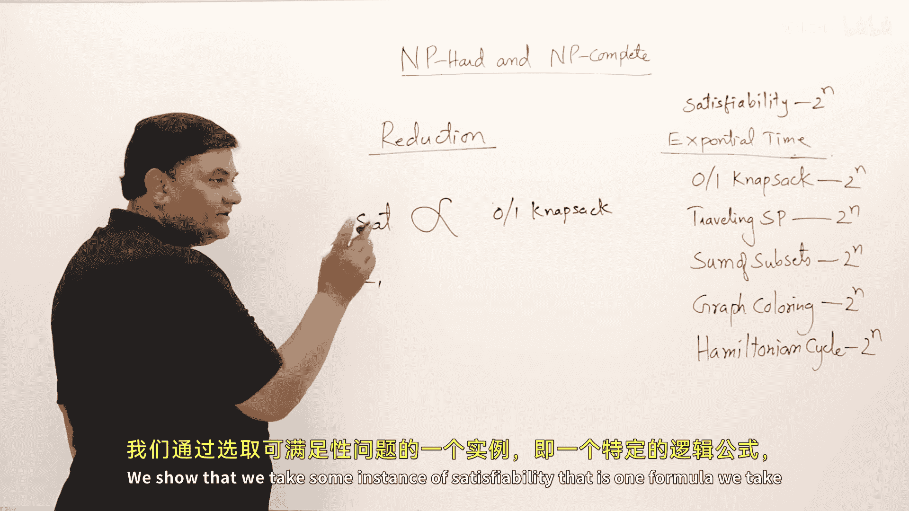

We take an example of satisfiability problem and we convert that problem into0 anapsack problem and we say that if this0 anapsack problem can be solved in polynomial time and that same algorithm can be used for solving this also in polynomial time。

So that's how it means if this is solved that can be solved， if that is solved。

 this can be solved if some algorithm is solving this one in polynom time。

 then same algorithm can solve this one also in polynom time。

Now， who we solve first， that is a different thing。

 But this how we show that they are related to one another。

 Anyone you solve all the other one will also be automatically solved。

 So how we show the relationship， we take an example formula。

 and that formula will convert into 0 and NAa problem。 And this conversion for conversion。

 we will not take much time。 We take polynomial time only。We take polynomial time。

 we don't take exponential conversion itself is taking exponential time， then its of no use。

 so conversion will be done in polynomial time。This is one important thing。Next。

I said that this is NP hard。😡。

Let us call it as NP hard。

Satisfiably is NP hard。 This is NP hard， right？If satisfiability is reducing to 0，1napsack problem。

 then this also becomes N hard。Now this problem comes into the class of NP hard。

 this means that if you solve any one， the other one automatically we get solved。

 so means we have proved the relationship between them。

So if you are showing that satisfiably reduces to some problem L， then if it is proved。

 then this also becomes NP hard。This also becomes n be hard。And one more thing。

 this reduction has a transitive property。 If satisfiability is reducing to L1。

 then L1 is also NP hard and if L1 is reducing to L2。

 then L2 also becomes NP hard means if I have shown01 is。Reduced by satisfiability。

 Then I can show graph coloring， Red by 0，1 or some of the subset Red by graph coloring or Hamiltonian is reduced by graph coloring。

 I can show it like this。😊。

So you don't have to bring all of them onto satisfiability only you can show others one any of the problem related to that。

either satisability or 01。So this is NP hard。If satisfiably reduces to any problem。

 that that problem also becomes NP hard。Now one more important thing。

 satisfiability if it is reducing to some problem， then that problem is also becoming NP hard。

So this is one thing that is showing a relationship and one more thing we were doing that we were writing non deterministic algorithms。

So do we have a nondeministic algorithm for any of these problem。

 yes one of the problem that is we know it is proved it is there。

 that is satisfiability problem for this we have a nondeministic polynomial time algorithm it is existing。

It's existing。So satisfiability is NP hard as well as this is NP complete。

Does't be complete。If an problem is having non deterterministic time algorithm。

 then that problem also becomes NP complete， so satisfiability is a known NP complete problem。

So for any of these problems， if this problem is reduced by satisfiability， so this is NP hard。

This is NP hard and if you write a non deterministic polynom time for algorithm for this one。

 then this also becomes NP complete。

And P complete So for doing research work on any problem of your problem。

 then you have to do two things， one you have to show that this is directly or indirectly related to satisfiability。

And you should write a nondeministic algorithm for your problem。

If you complete the first part that is shown that it is reduced by satisfiability。

 then your problem became a part of NPH class。

And if you have also written a non algorithm， then your problem has reached in a class called NP completete means you have completed the research work。

Basic required research work if you are able to directly solve that problem。

 okay solve its whether good well and good， if not at least you should do this。

 then your research work is completed。Now， I will draw one more wellknow diagram。

This is set off NP hard problems。Who is there in this one， satisfiability。

Then if you prove any of these problem that is reduced by satisfiability， let us say 0，1。

 it also becomes a。NP hard， if you prove graph coloring， then that is also N hard。

 If you are proving that they are directly or indirectly reduced by satisfiability。

 they will become NP hard。 They are coming into NPR。

This is one part we have to do as a part of research。 Then the second part。

 we should also write non deterministic algorithm N。N B。

This is another thing writing nondeistic algorithm。

 Do you have a non deteristic algorithm for satisfiability， Yes， so this is in NP hard only。

 but this is in this intersection area。 So this also NP hard。

 as well as this is having nondeistic polynomial time algorithm。 So what is this area called as。

This is NP complete。

This is MP complete。Intersection of NP hard and nonstral gardens。

That's all the major part we have completed。Then one more thing we have drawn already that is P was also there。

 This was another discussion we did that P is the things that we are deterministic today and N p is that is nondeterministic and tomorrow we may be knowing those nondeterministics also that will be coming inside P and we believe that this P will be keep on expanding right this will be keep on growing the P will become bigger and bigger so that nondeterministic will be becoming deterministic right so believe like this。

Our circle of knowledge will be going on growing。 That's all we believe。

 Now how much it is we don't know， So it will be going on growing。 And we believe that at some stage。

 it will go and become equal to N。Once everything that is not known， we will be knowing it。

That is the idea， one major problem remaining。The thought that we have that today we are writing non deterministic。

 believing that tomorrow that will become deterministic。Is it perfect。

Do you think it's really going to work if it fails。

 we never found out that then all our research work is waste。So for that。

 we need to prove that really tomorrow we may be knowing non deteristic algorithm and they will be converted into polynomial timedeal algorithms。

RightSo we have to at least prove that， yes， what we are doing is right。So， for that。If？

We are able to prove that p is equals to NP。We are able to prove that P is equal to NPp， then。

It is proved that whatever the non deterministic we are writing tomorrow that may become deterministic。

So for that， we say that P is a subset of NP P。 We don't know how much this is。

 So that's why we write equal Also。 Then we have to prove p is equals to N P。

 whether p is equal to N P or not。 See if you are proving p is equal to N means it's existing。

 but you don't know。It is existing， you have to you don't have to do research and find out or invent it。

 its existing。 Disc it。So when you say p is equals to NPp。

 so what is non deterministic for you is existing， just you discover it。That is the meaning。

 So if you are able to prove just then what all the work that we are doing research work that is going to be successful。

 That is the idea in this one。 So Cook has tried to prove that。😊。

So there is a famous theorem on this one。 Cook's theorem。

 he has tried to prove that he proved this one that if satisfiability is lying in P。

 So it means where the P is we don't know even P can be in the intersection part of this one right So he said that。

Satisfiability is in P if and only if p is equals to NP， satisfiability will come into P。

 if and only if p is equals to NP means satisfiability will become deterministic if p is equals to NP。

He said that this per can be proved as correct if you prove that satisfiability is in P。

 He did not prove it。 He said that somebody proves this one， then our work is correct。

 Our work is perfect。So this is all the discussion behind。And be harder and be complete problems。

So that's all about this one。 So Ill Ill may be making one more video for solving some NP hard graph problems right。

 So leave a comment for this video。 Let me know how much you have understood。

