# 【精译⚡算法导论】AbdulBari p74 p73 9.1 Knuth-Morris-Pratt KMP String Matching Algorithm -BV1hhPXeTEWM_p74-

Hi， the topic is KMP L algorithm。KMP algorithm is used for pattern matching If a string is given and a pattern is given。

 then the problem is to find out whether this pattern is existing inside this string or not。

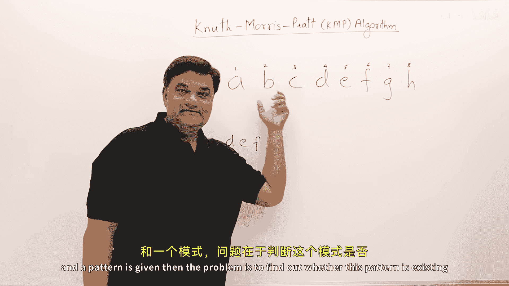

If it is there， then find out its index。

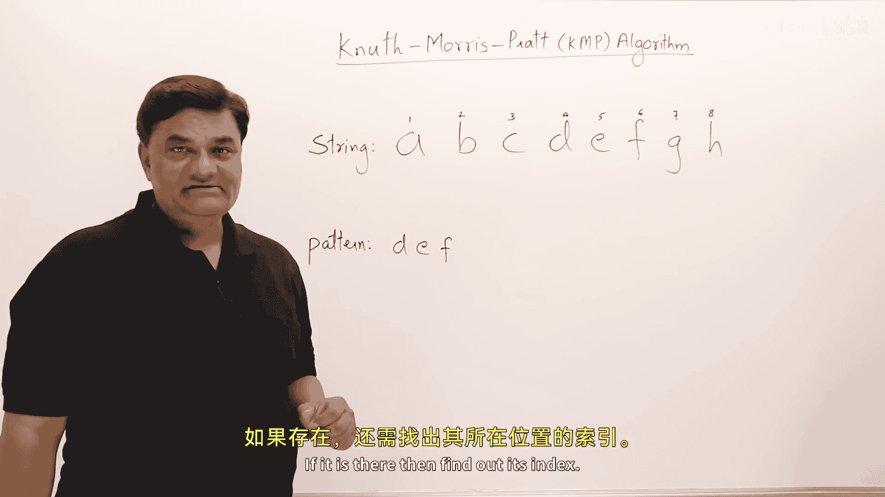

Now， for this problem， there are various algorithms where KMP is also one of the algorithms。

There is also a basic algorithm， naV algorithm， so let us look at how naV algorithm works。

 then we can understand the problems or the drawback of naV algorithm。

 then well see how KmpP is better than basic or na algorithm。

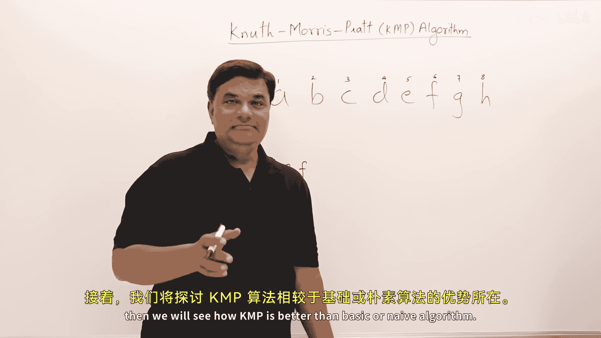

Let us see the basic got。 See if there is a string given and we have to find out this pattern。

 then we will check if it is there or not。 So we'll start from the first letter of a string。

 So I'll write on this pattern here， D， E F。Compare the fllator of a string with the pton。

It's not matching。 If it is not matching， then shift the pattern to the right by one step， D， E， F。

Now， compare this one with this is not matching。 then shift the pattern by one step。

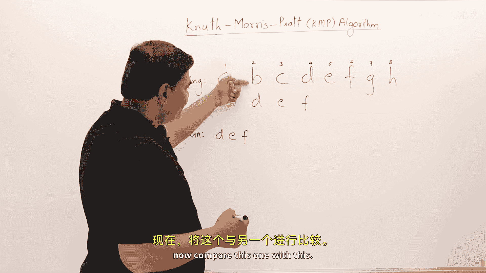

This is not matching， so shift the pattern by one step。This is matching if there is a match。

 no need to shift。Check the next。 That is also matching and check the next。 This is also matching。

 So， yes， a pattern is found inside the string at a display at this index。 That is 4 to 6 index。

 This example was very simple。 I'll take one more example and show you。 Now， one more example。😊。

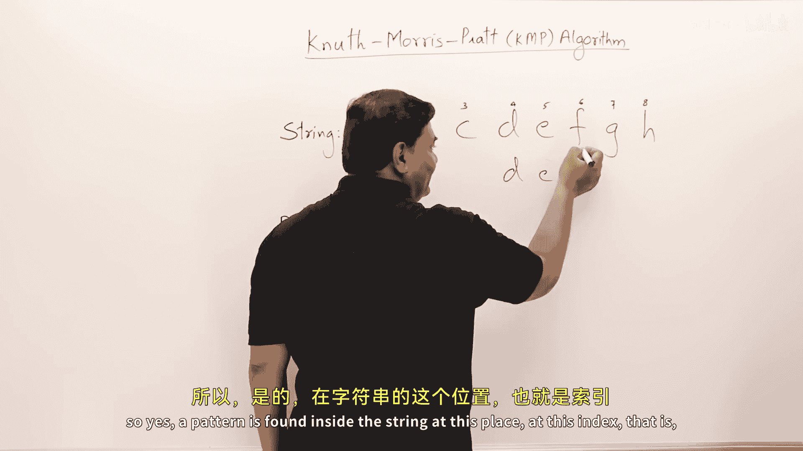

Here this is a string。 and the pattern that I have to search is this one。

 So I have to find out whether there is a match for this pattern in this string or not。

 So I'll not draw a string and shift it。 But instead of that， I will take index I and J here。

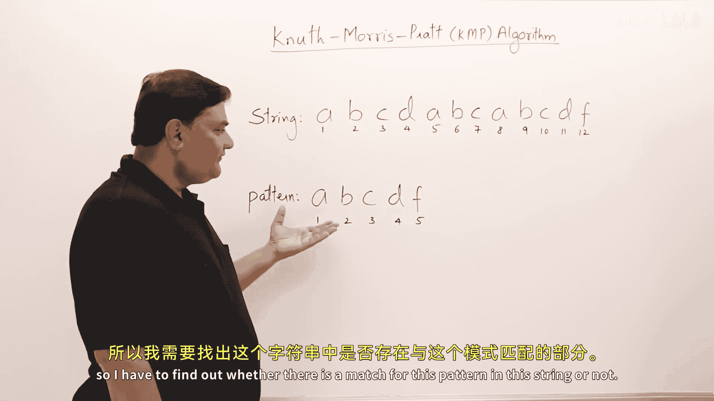

So， first letter。I and J。 this is matching。 There is a match。 So move J， as well as I。

So I'll just write I N G。 They are matching。 So move J， as well as I。They are matching。

 So move J as as I。Again， they are matching。 Now， move J as well as I。This is a mismatch。

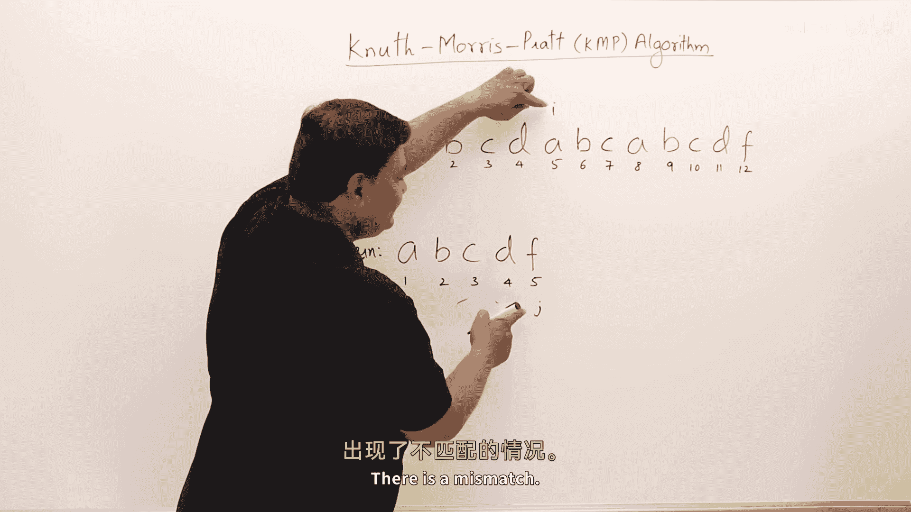

See， we started this pattern comparing from this position onwards。

 As I just now said that in the previous example， I have shown you that if there is a mismatch。

 this pattern will move by one step。 So there is a mismatch。 So again， J will come in the beginning。

 But what about I， I will start from this place now。 already we have started from the beginning。 A。

 Now well start from B。 that is index 2。So this is the problem in basic algorithm Al I have reached till 5 and it is again shifted back。

 So I is shifting in the string。 This is the waste of time。

 This is the extra work in basic algorithm。

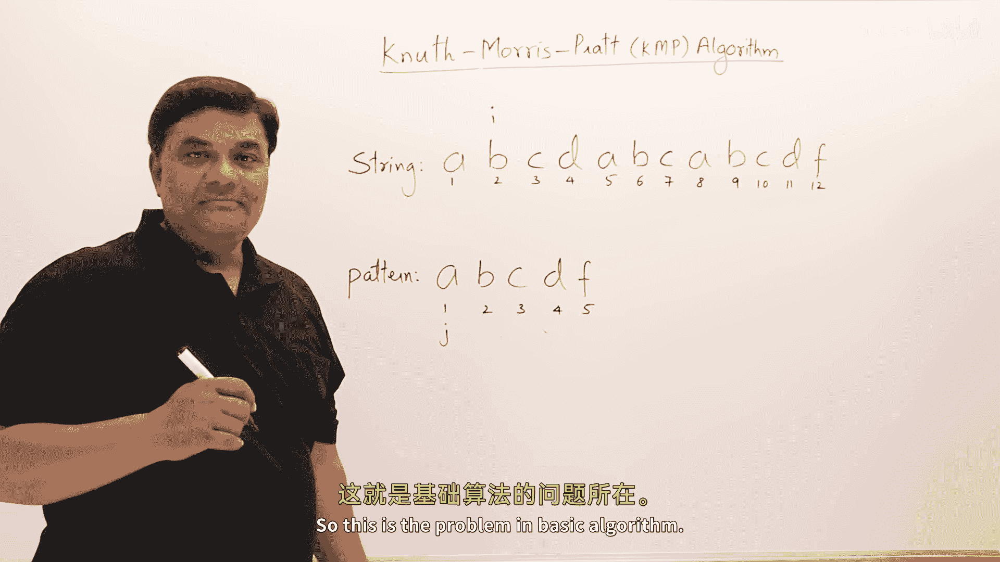

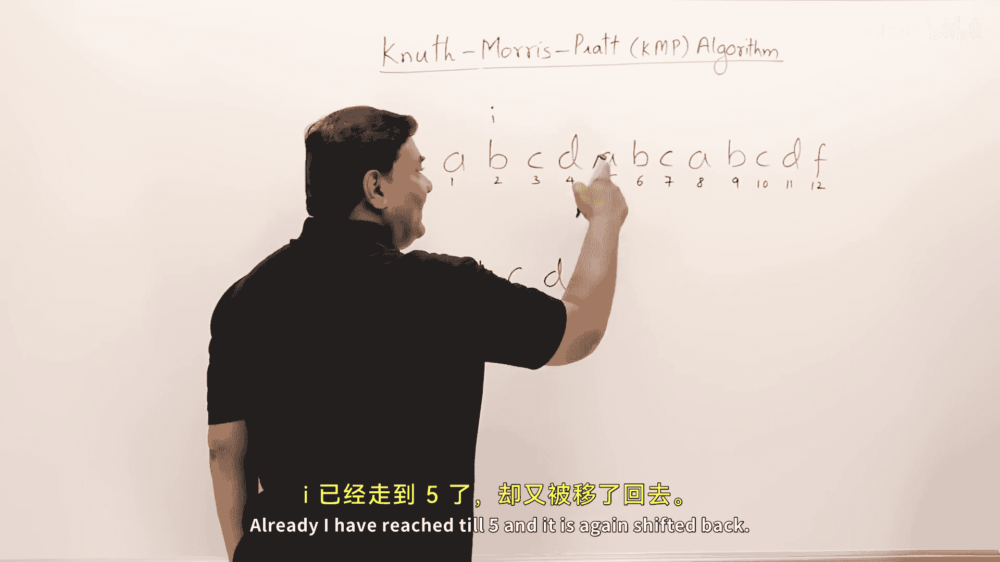

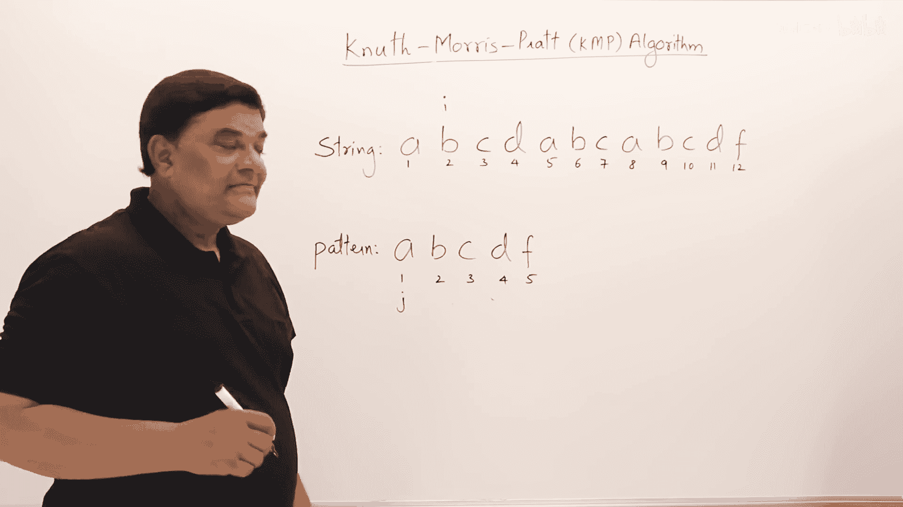

Now again， we will start from here。 So this means that we have started the pattern from here。 now。

 shifted the pattern to the right by one step。 There is the meaning。 So I came here again。

 There is a mismatch。 So go to the next。 So we'll start comparing from here。

 So it means we have moved the pattern from here onwards。 Now， from here we will be checking。

Mismatch。There is a mismatch。Move I。 There is a match。 So move J， as well as I。There is a match。

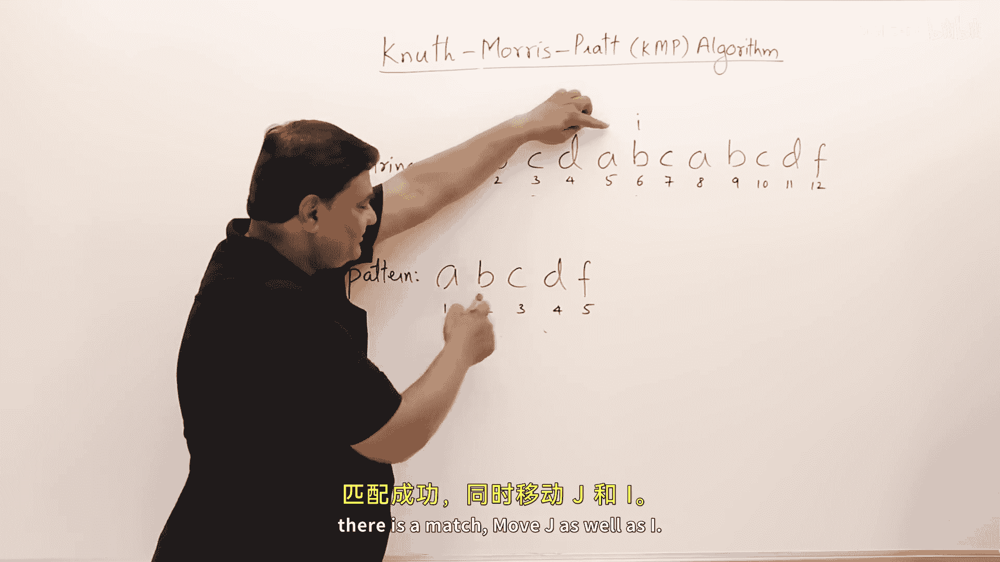

Move J， as well as I。There's a match。 So move J， as well as I。

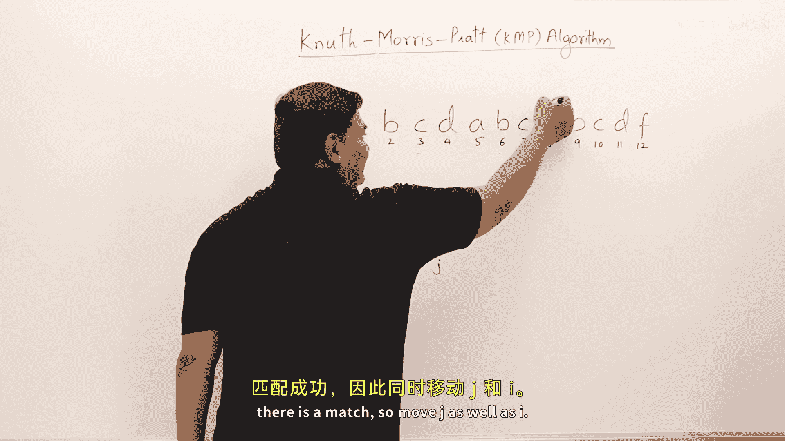

Now， there's a mismatch。 Mimatch means move J again in the beginning and bring I again on this part。

 See， just now we have started from here。 Now， we have to shift this one， So we'll start from here。

 So I will come at displays。 So already it has checked three alphabet。

 So it should come back3 alphabets。 So J should start from here again。 See， just now， already。

 we have checked these alphabets。 We are checking them again。 So this is the drawback of basic。

 We are repeatedly checking the characters in a main。😊。

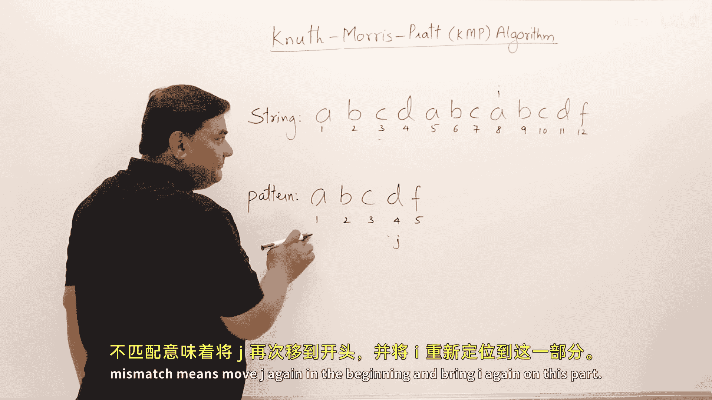

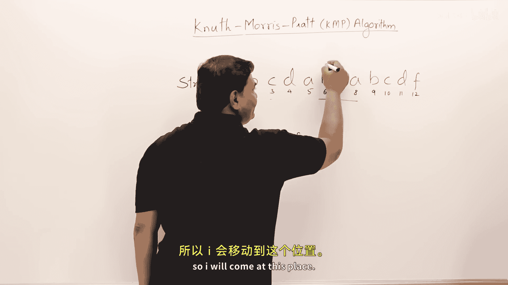

Let me finish it quickly。 There is a mismatch， I moved。 There is a mismatch。Eyes moved。 Now。

 there is a match with A A。 So in the in this way。 Now， if I continue。

 then I can find this pattern here available here。 Every character will be matched till here。😊。

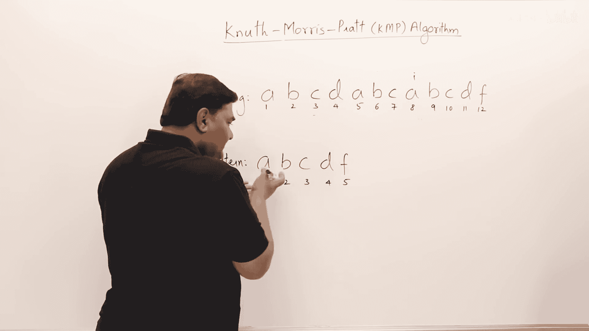

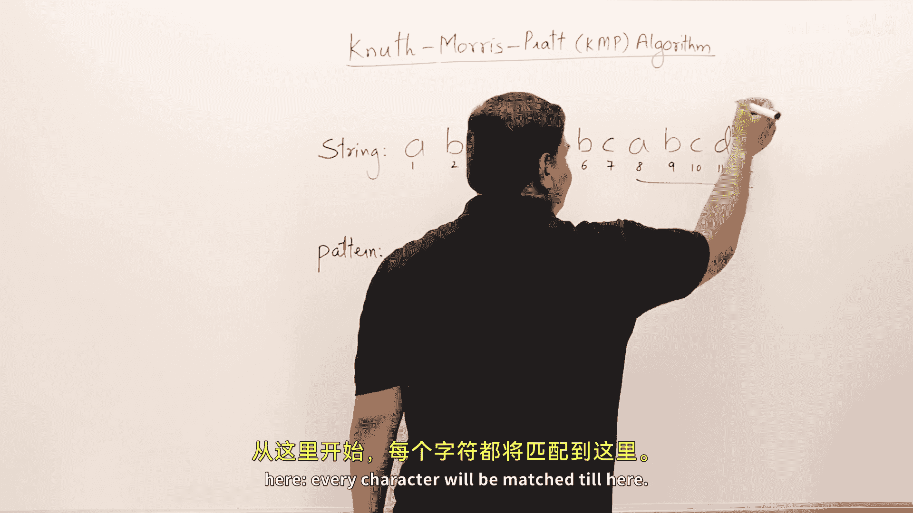

病例。So we learn one thing here that the characters in the string are compared repeatedly whenever there is a mismatch。

 it is shifting eye backtracking eye or moving back I。

 so this backtracking of I we want to avoid let us see a worst case of basic or nave algorithm。

 worst case of basic algorithm。I have a string。And a pattern。Let us run basic algorithm on this one。

I starting from here。 J is starting from here。 There is a match。 If there is a match。

 move I as well as J。See， we started from index one of strength。 Remember this。 There is a match。

 So move I， as well as J。 So first， I will move J， and also I will move I。 There is a match。

 So move J and also I。That is a mismatch。When there is a mismatch。

 move J to the beginning and move I to the second position。 This is the starting point。

 Just now we started from here。 then I should start from here now。Start from here again。 Again。

 Start。 This is matching move J。move by。买tting母亲。move by。Again， A， A matching。

 So move J and move I A B is not matching。 So again。

 move J in the beginning and move I on the third place in this way continue。

 See the problem in this one S。A， A， A is repeating why I should move。

 I should move just J one place and see that this is a。 This is a。 both are same。

 Just check that next alphabet is B or not。You don't have to move back and start again from the beginning。

 because all these are same only。That's it。 That's it。 The basic algorithm doesn't study the pattern。

 doesn't observe what is there in the pattern as blindly is checking every alphabet and just shifting this pattern by one step in case of mismatch。

 as this is backtracking I， What is the maximum time it is taking。

 If the size of the string is N and the size of the pattern is M。

 Then almost this pattern is repeatedly compared in the string。

 And this will be M into an order of M and time。

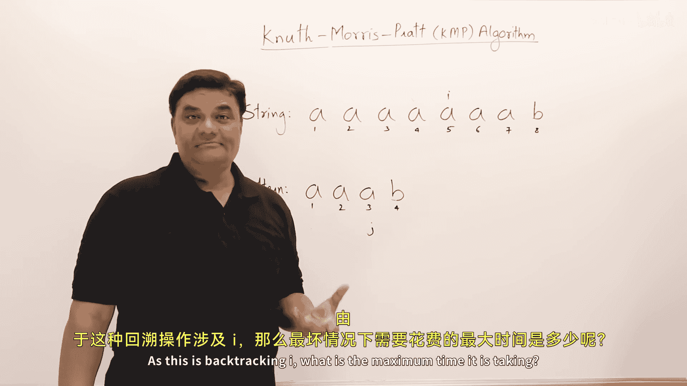

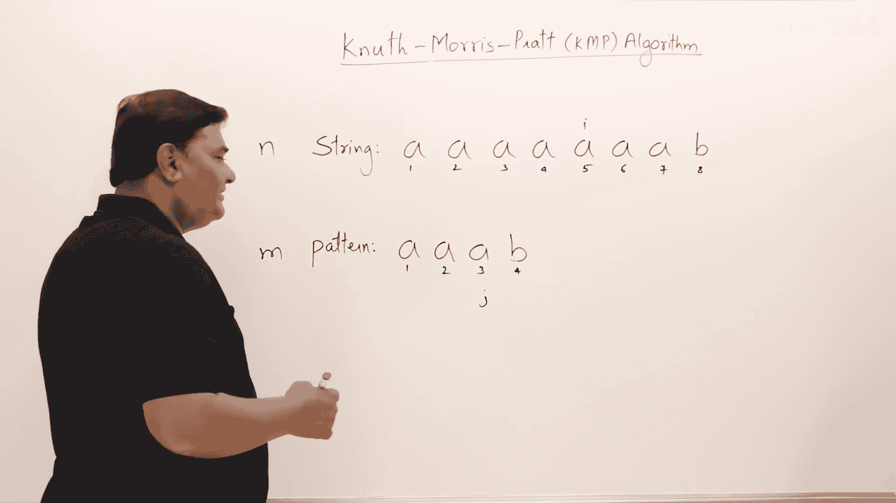

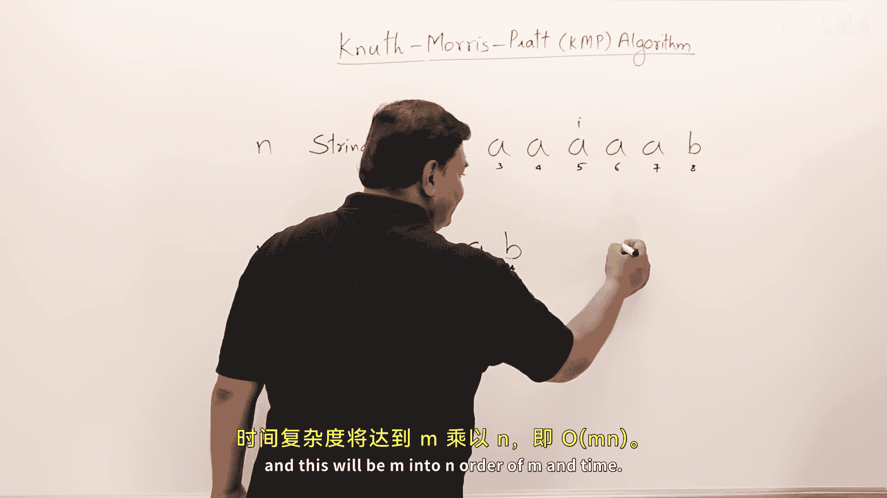

So this is the time taken by basic algorithm。

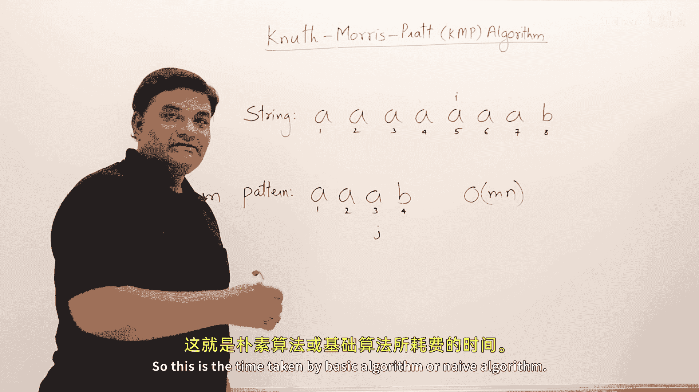

A na algorithm， basic algorithm takes order of a time。

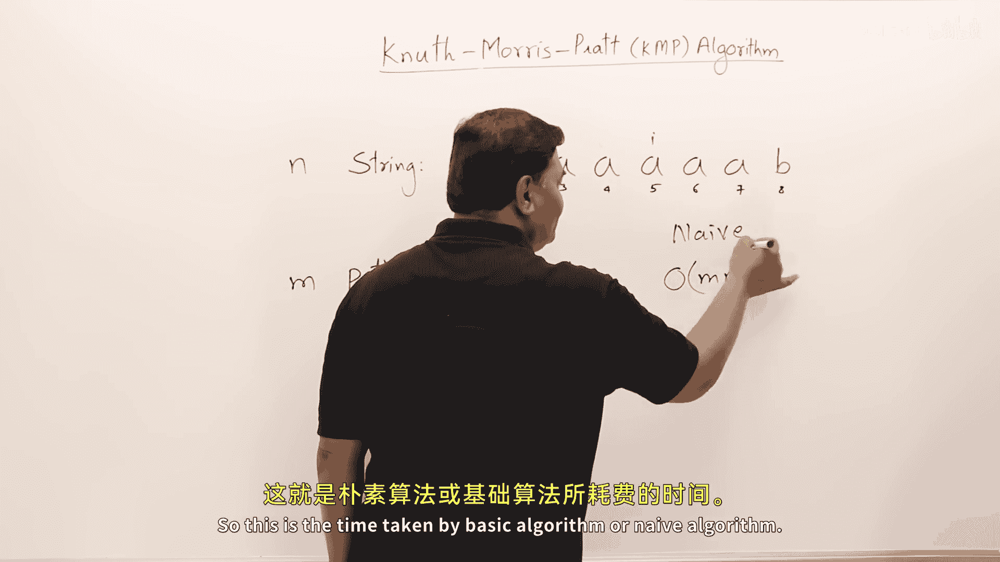

Now， can we study the pattern and reduce some time， Let us see what is the idea of KMB。

 then some terminology used in K algorithm go first let us understand that terminology。

 see if there is a pattern given here， then we will can find prefix or suffix of a pattern。

 So what does it mean by prefix of a pattern。We have to take the subset of this alphabet in a pattern。

 but we must start from the beginning of the pattern only how many subset。

 how many characters I should take in a subset as many as you want。 So I just take a。 Okay， yes。

 it's a prefix。 No， I will take A And B。 Also。 Yes， this is also prefix。 I want to take A D C。 Yes。

 this is also prefix。

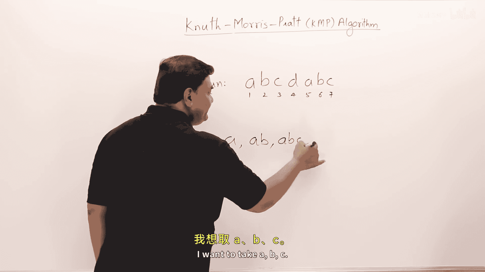

I will take A BC， D。 Yes， this is also prefix。 All these are valid prefix。 Then what about sufffiix。

 I have to take the subset of this string， but I should start from the right hand side only， right。

 And as many I want， I can take。 So let us start， Can I take C， just C， yes， Can I take B and C， Yes。

 B， C， Can I take ABC， Yes， ABC， Can I take D， A，BC， Yes， D， A，BC， and more。 But let us stop here。😊。

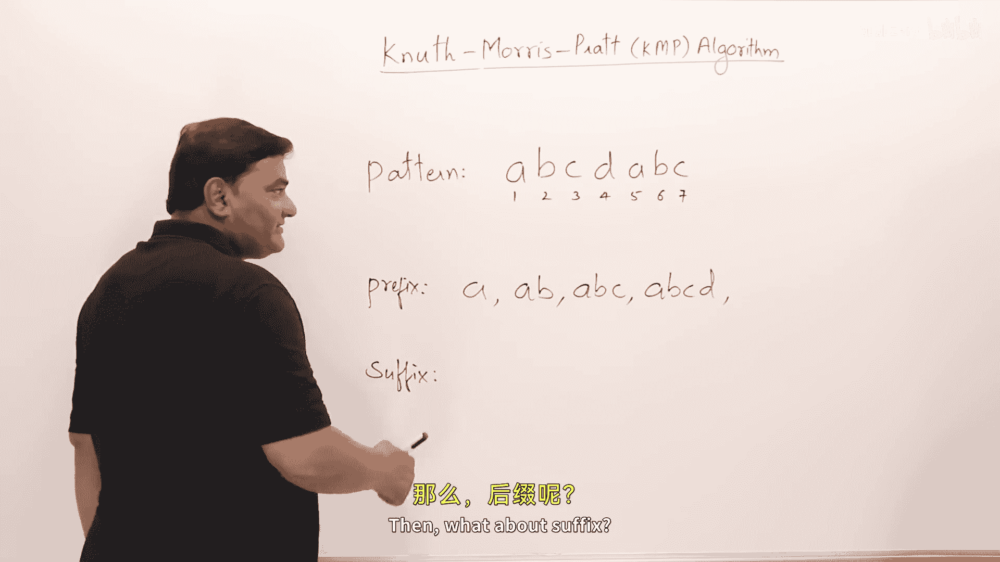

Now， the idea of KM is that inside this is string， is there any prefix same as suffix。Let us see。 A。

 do you find anyone know， A B， A B， A B， No， it's not there。 ABC， Yes， it's there。 See。

 this is matching。 So this is the prefix that is also there in suffix。Also， there in suffix。

 So this is the observation what Kmp algorithm will do on a pattern to avoid the number of comparisons。

 Instead of confusing with the prefix and suffix， I'll make it simple。

Is the beginning part of a pattern is appearing again anywhere else in the pattern or not。

 That's what we have to observe。 I'll take few examples and show you。 Let us look at the pattern。

 And in KP。 for a pattern， we generate a pi table。 That pi is also called as longest prefix。

 which is same as some suffix。 that is Lps。 We name it as pi or Lps， whatever the name you like。

 So how that table is prepared， I will also show you that。 Just observe it carefully。

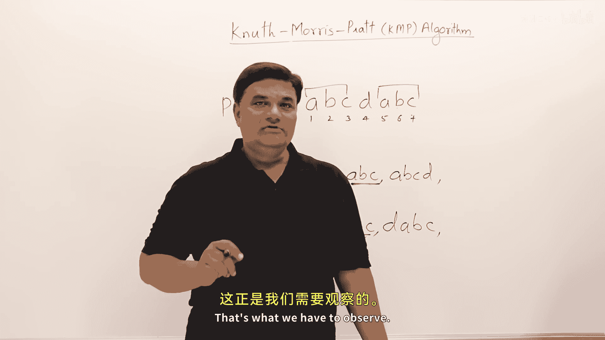

Let us take first pattern。A， is it appearing anywhere else Yes， Oh， B is also appearing。 A B。

 So this A B is appearing here also。 Then again， A B， again， A is appearing here。

 You see A as well as B is also appearing。 Okay， both are appearing again。

So what we do is we'll prepare a table。 Well write 0，0，0，0。

 This A B is matching with first and second。 As I said。

 the indices we will start from one to oneward。 So this is matching with one and2。

 This is not matching。 This is matching with one and2。 This is not matching。

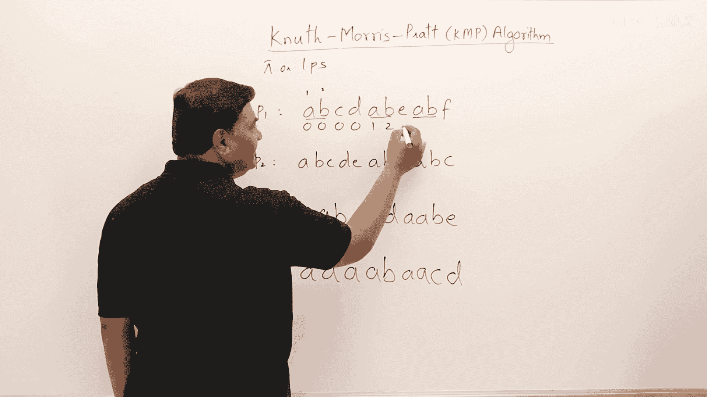

This is the pipe table。Now， there is an algorithm。 I don't want to show you that algorithm and not tra the algorithm。

 Simply， I am showing you how to prepare it。 If you trace the algorithm， you'll get the same results。

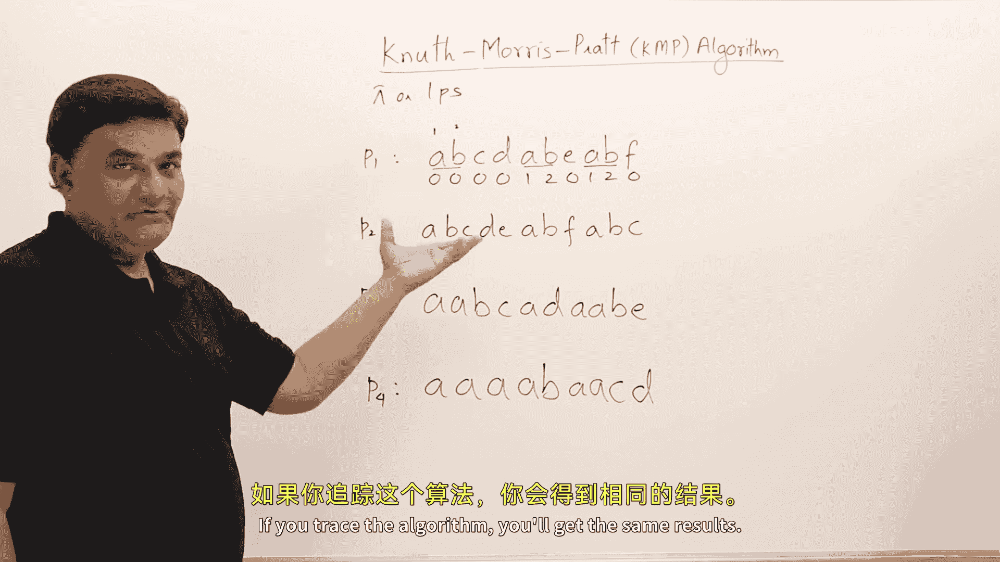

Next， let us look at this pattern。 A， is it appearing anywhere， Yes， it's appearing。 Oh。

 B is also appearing。 So this is matching。 So this is one and 2， then a anywhere， Yes。

 it's appearing here。 So B， C is also appearing。 So these three are matching 1，2，3。

 rest of them are all zeros。😊，Theres a pipe table。Now， let us check。

 A is it appearing in here itself。 So Mark 1， A is it appearing。 Yes， it's appearing。

 The next alphabet node is not same。 A is appearing here。 The next alphabet also matching 2。

 Then rest。 all of them are zeros。What about this？A is appearing here 1。

 and this a is also appearing。 So from here， if you take， this is matching with this two。 So  two。

 and these three are matching with this three。 So take 3。 Then anywhere else yes a is appearing here。

 Then next a is also same。 So  two。 And rest of all the values are zeros。😊。

So this is the base of KMP algorithm to prepare the table。 Once you prepare the table。

 the algorithm is simple。Then I will take one example and show you how algorithm works。

 Let us look at the working of Kmp algorithm。 My explanation will be based on the tracing of an algorithm。

 so。One thing you have to observe that here in the string， we will not backtrack in the main string。

 So let us start the working。 So this is a pattern。 So first of all， prepare a Pi table or L P S。

 So prefix table。

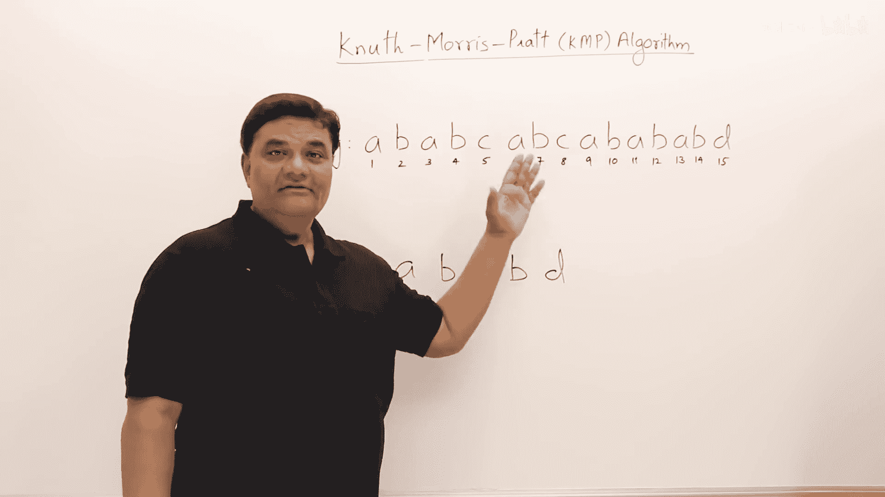

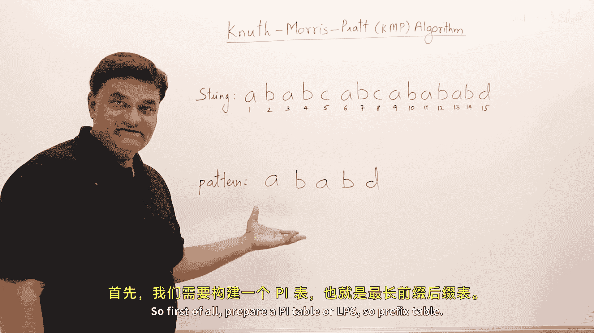

A， this is appearing here。 So this is one。 The D is also there。 So two。

 then the D is not matching here。 So not just， just two alphabets are matching。 So take this as 0。

 this and this all are zeros。 So let me put it in a table like this。And also give indices1，2，3，4，5。

 and also I will take one index0 that will act as a starting point of a pattern。Now， let us start。

First alphabet。 I is there。 Then where is J。 Now， it is， it is not on the first alphabet。

 We will take it on 0。 This is a special thing。 You can start from here also。

 but the working will change a little bit。 I'm starting from 0。 This is easy。 Let us watch。

 J is on 0。 I is on one for alphabet。 Now， compare this is string of I。

 with the pattern of J plus  one being here。 Check the next alphabet。 They are matching。

 If they match， then the move J。😊，As well as I。Now in compare string of I with a pattern of J plus 1。

 this alphabet。 So wherever J is pointing， you try to check the next alphabet。 There's B。

 G Bs matching here。 So take J on the next and I also on the next。Okay。Now， this。J plus 1。 Yes。

 this is matching。 This is matching J plus 1。 So move J as well as I。😊，Now， J plus1 is B， and I is B。

 They are matching。 So move J。As well as I。Now， J plus1 is not matching with I。

 So now there is a mismatch of what to do。 Oberve it carefully。

When there is a mismatch with the J plus 1 and I， then move J to this index 2。Bring you here here。

Move it here。 This means that this A B， A B is repeating。 So A B came two times。 So already。

 we have check one time。 So maybe we have to start from here。 So let us observe。Now。

 J plus one with this one。 Is it matching， No， still there is a mismatch。 So again。

 move J to displays。J here。Now， is it a match with J plus 1， No， still， there is a mismatch。

 but J is on0， so we cannot move J further。 so move I。So in case of mismatch。

 you observe that only J is moving。 I is not backtracking。 I has simply moved to the next alphabet。

 Let us continue。 J plus1 is a match with this I。 So move J， move I。J plus 1， B and I S B match。

 So move J and move I。J plus 1。And I C， A mismatch。

 So move J to displays J and still compare J plus 1， A and I mismatch。 Now， there is a mismatch。

 and even J is at 0。 So we cannot move J further on the left。 So just move I。Now。

 here's this part you observe carefully。J plus 1， A I， this is matching。 move J， move I。

 this I'll mark here。Now， G plus1 is B and I。 They are matching。 So move J and move I。

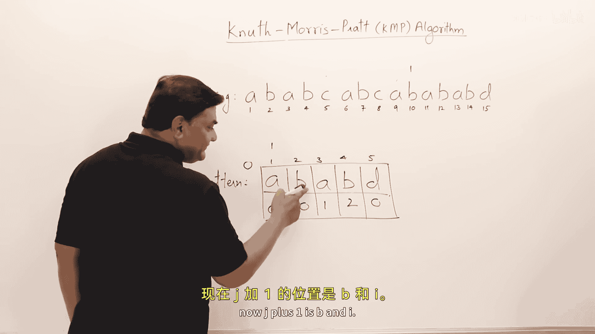

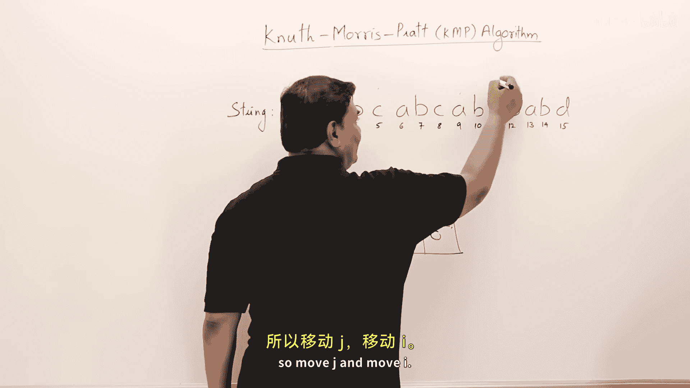

J plus 1 is a， and I is a matching。 So move J and move I。J plus1， that is B and I。 They are matching。

 So move J and move I。

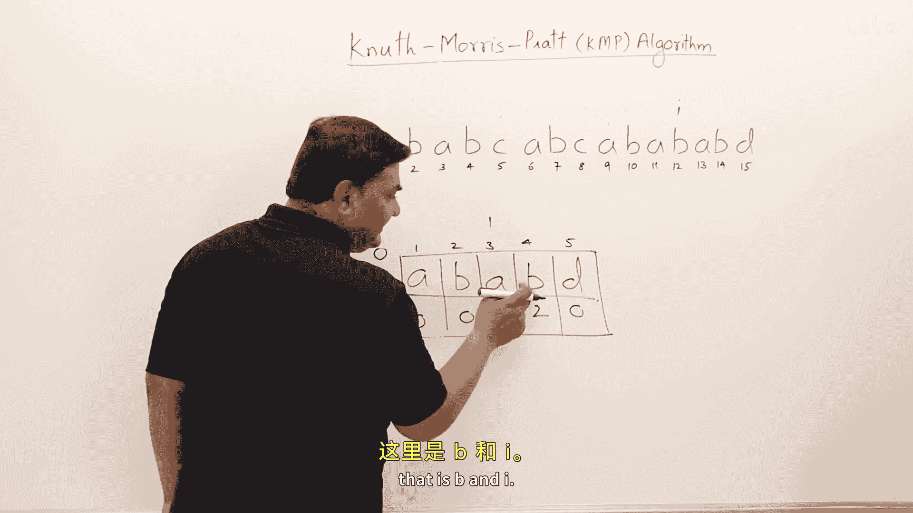

J plus 1 is a D， but this is a。 they are not matching。

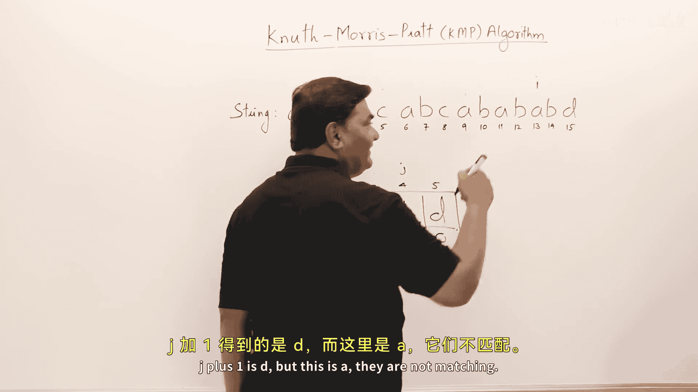

They are not matching。 Then where to move J at 22。

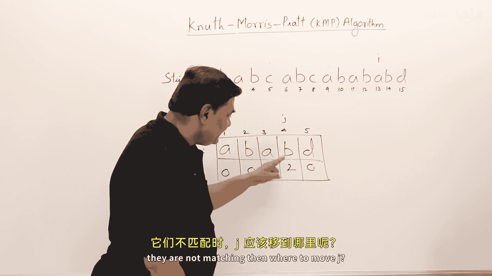

Then again compare J plus1 a。

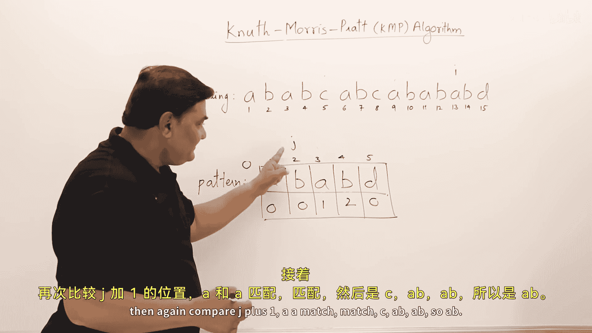

A match。Match。C， A B， A B， So A B， already this portion is A B， and this is also there here。

 So we need not compare that we can continue from this portion here。 This was a mismatch。

 you can again start from the beginning。 Min we reach till here。 Min this A B have came two times。

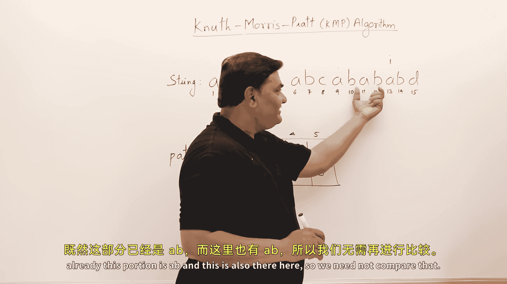

That came two times。 So one time you can skip and the second time onwards， you can continue checking。

So J plus 1 is matched with that one。 So move J。

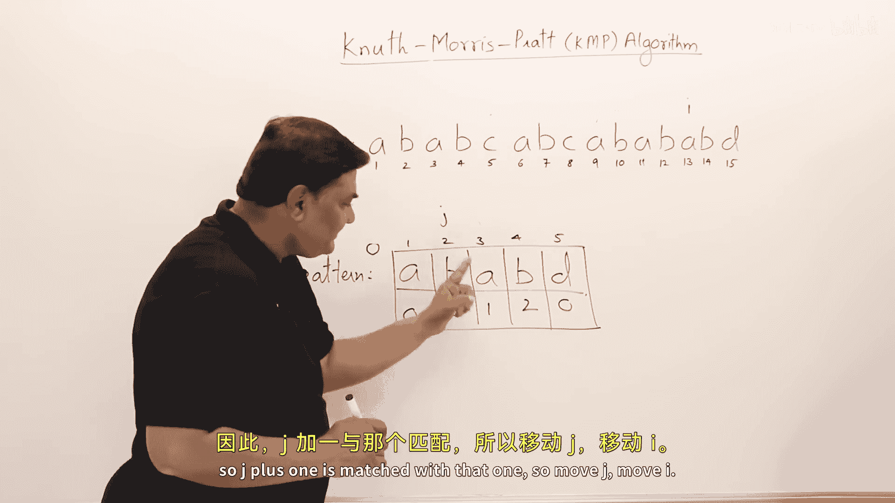

move eye。

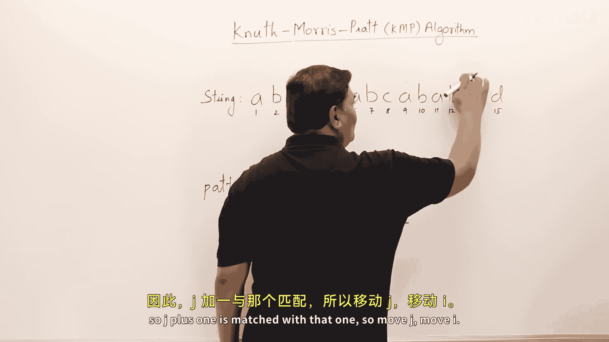

J plus 1 matched with that one。 So move J and move I。 J plus1 is a D， and I is also D。

 So move J and I is incremented。 Now， this is the end of a string。 Actually。

 this we have is the end of a pattern。 So there is a pattern available。

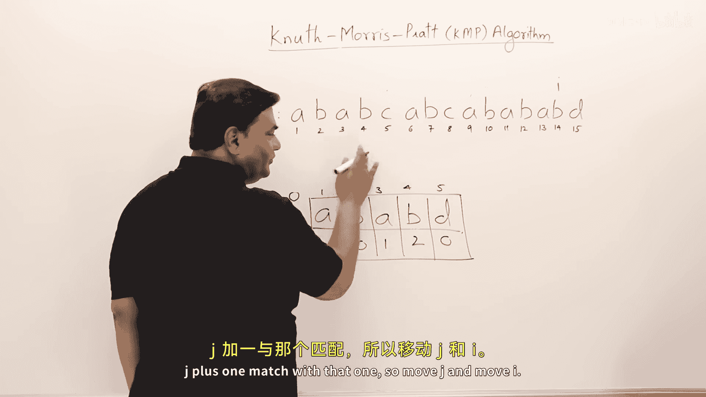

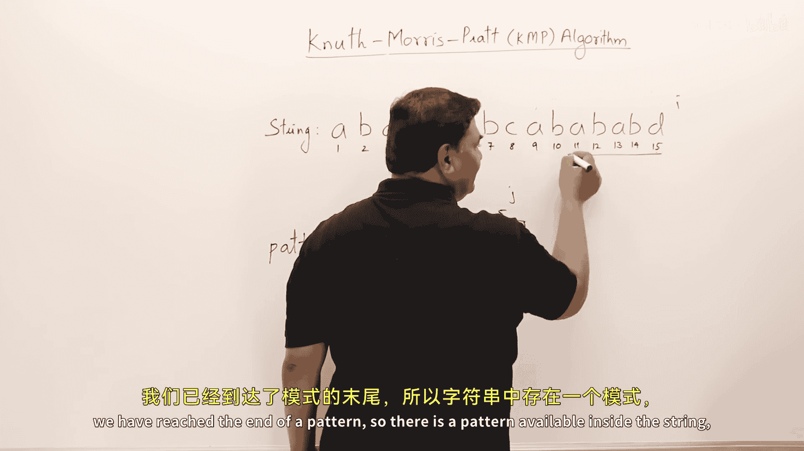

Inside the string。That's all this how came algorithm work or the basic idea behind the KL algorithm is that if the beginning part of a string is appearing again somewhere else in the string。

 then don't again compare the characters， right， avoid the comparison and don't move I back again like it was happening in basic algorithm。

 you might have observed that we were moving I only in forward direction。 We never backtrack I。

Then what is the time complexity of this Kmp， See the size of the string is。

N and the size of the pattern， if I say M。Then how many times you have gone through this only one time。

 How many alphabets n。 So n is the time taken for parsing through this string。

Then for preparing a table， we have parts for this one。 So how many alphabets here M。

 So for preparing table M and for searching a pattern N， this is for a table。

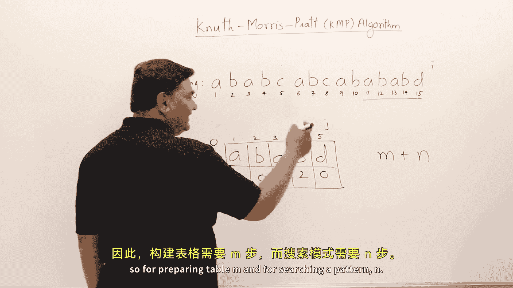

That is ptable。 And this is for search。 So the total time is M plus n。

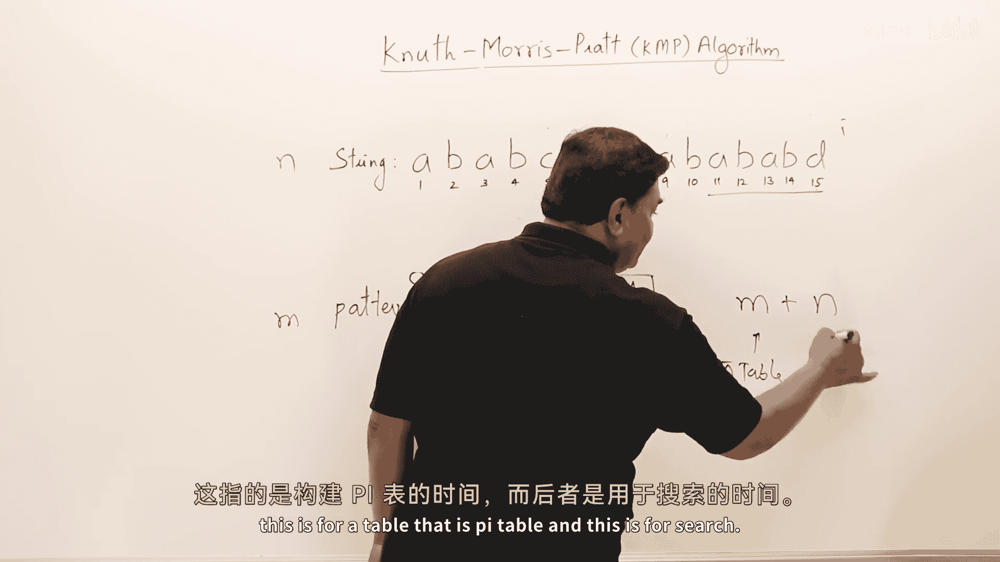

So this is one of the faster algorithms for pattern matching。

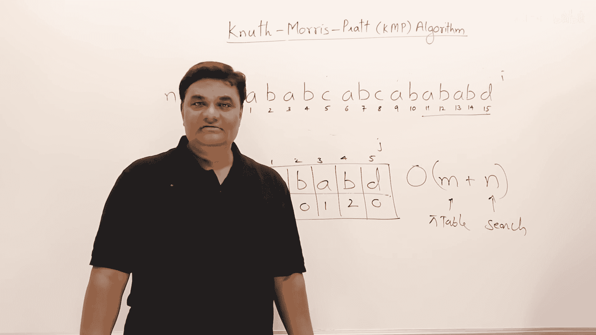