# 【精译⚡算法导论】AbdulBari p75 p74 9.2 Rabin-Karp String Matching Algorithm -BV1hhPXeTEWM_p75-

The topic is Rabin carb algorithm， it's a pattern matching algorithm or string matching algorithm。

The problem is if a text is given。

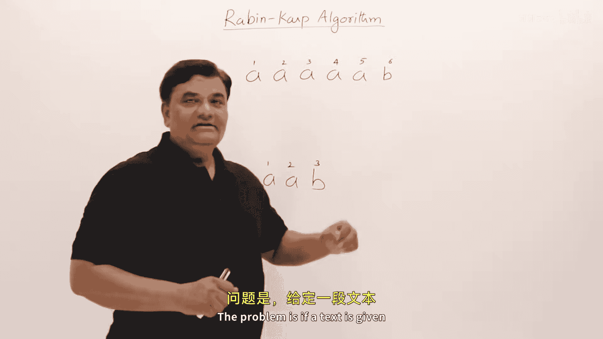

And a pattern is given， then we have to find out whether this pattern is present in this string or not or text or not。

 there are various algorithms for string matching or pattern matching。

This is one of the pattern matching algorithm。 Let us see how it works。 First。

 I will discuss the basic idea of rabinco algorithm and what is the worst case of rabin couple algorithm。

 then how to improve the worst case。 And finally we finally， we'll see the actual algorithm。

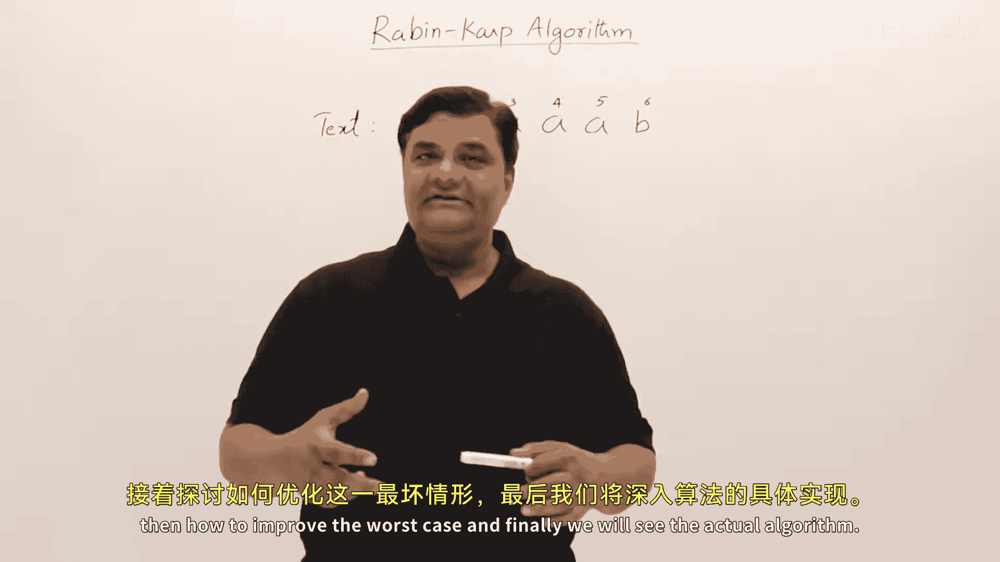

Let us start。 See， this is a text given， and this is the pattern we have to find out。

 So you can see that A A B is here existing here inside the text。

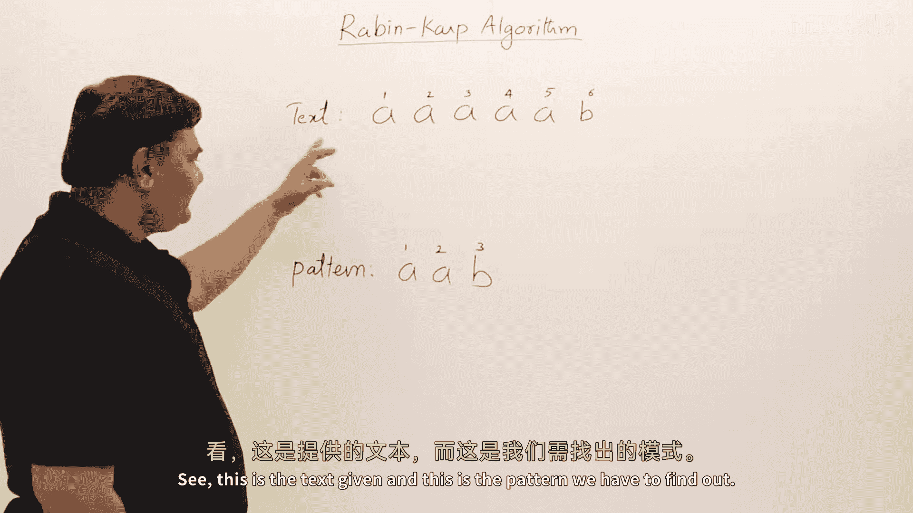

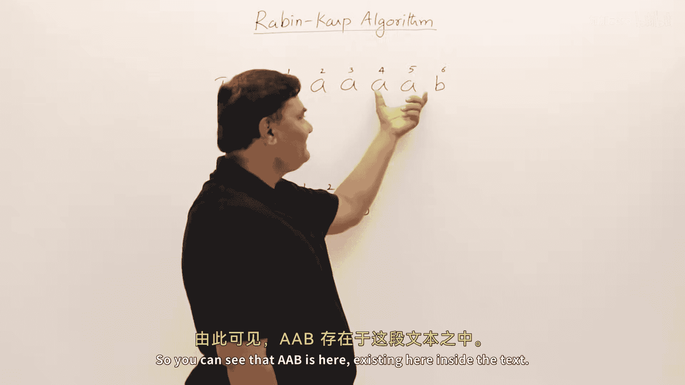

Then how do you check？We know the basic algorithm in which we will start comparing the alphabets here we don't want to compare each and every alphabet。

 So if you take a pattern there are three alphabets。 So instead of checking each and every alphabet。

 can't we make it as a single value， how we can make it as a single value。

So we can convert this into some numeric value。 Let us see how it is possible。 See if the letter is。

 if I take ABC， alphabets， then。

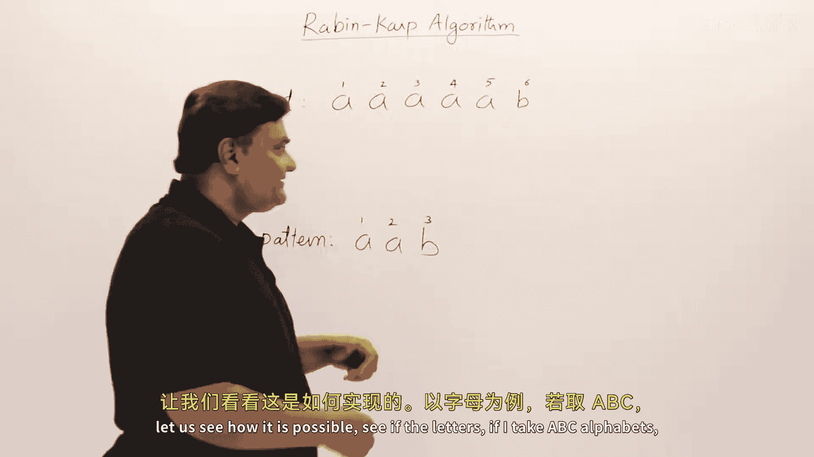

For the alphabets， there are ASII codes like small a lowercase A is 97， so we can use that number。

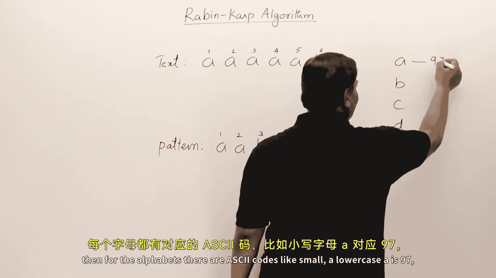

Okay， we will use that number。 but if I use that number and explain you。

 then the numbers will be bigger。 So to take small numbers， just to understand the algorithm。

 instead of 97， I'll give my own course。 A， let it be 1 and B S 2 and C S 3， D S 4 and so on。

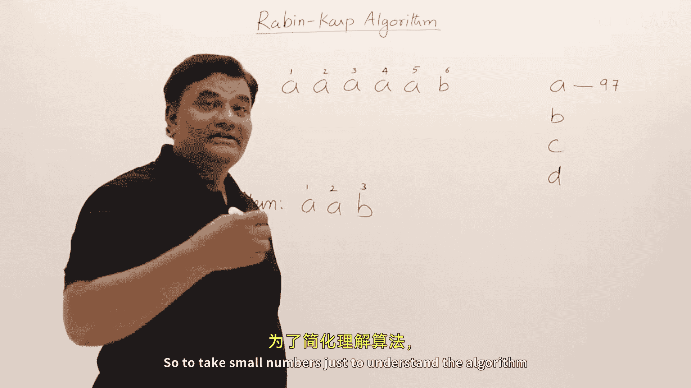

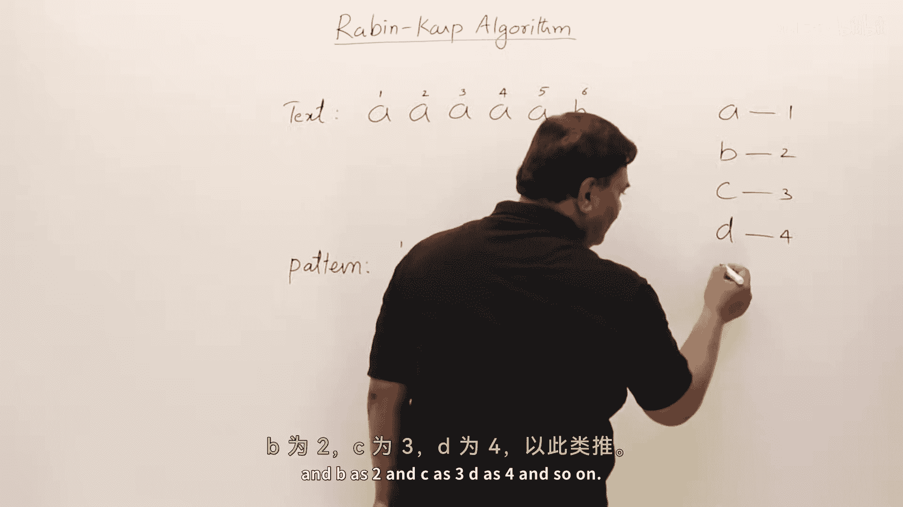

So I have given course for all the alphabets from a to J 10 alphabets I have taken if you want you can take ASI course also。

 but this will be simple for discussing the topic。Now here is a pattern。 Now， using those codes。

 we will try to find out a single value for this pattern， so I will use those values。

 This is one and this is also one， and this is2。I will add these values。 This is four。

Even if you want， you can multily also， that is your wish。

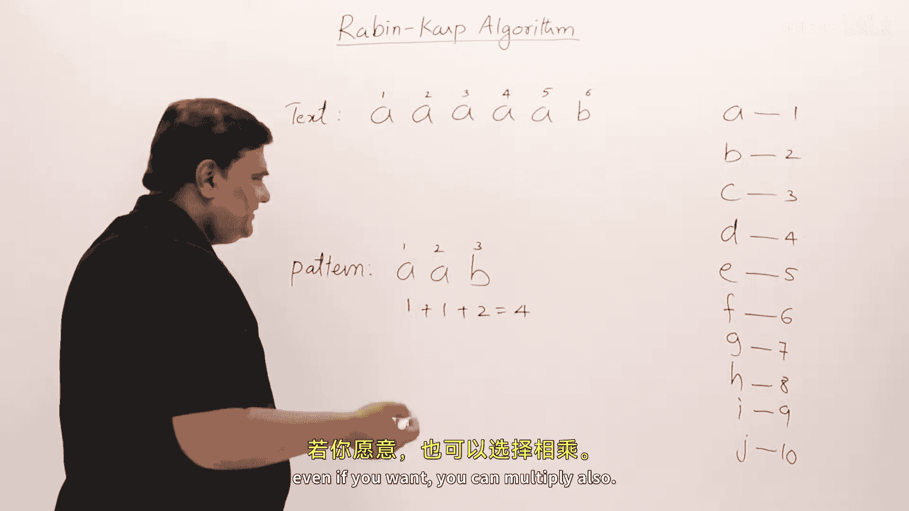

I have added these values。 So now， whatever the value I got， this， I will call it as。Hush， good。

And the procedure of getting that value， that is the function we will call it as hash function of this pattern。

 P， Let us say P is the pattern。So we call this as a hash function。

 we are using hash function and finding。

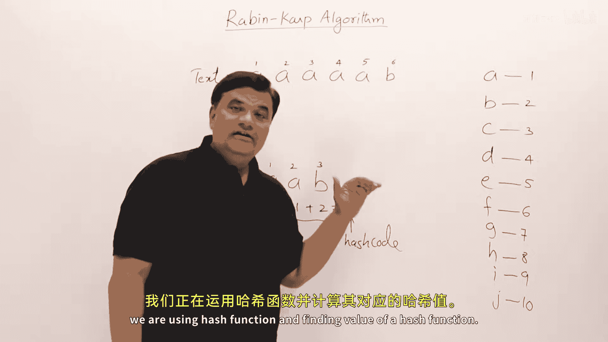

Value of a hash function。Now， this hash function， we use it for finding this pattern inside this text。

So how to do that。C。As the size of this one is a 3。

 so let us say M is sizes 3 and the size of this one is n， and this is6。Now， how to check this。

 I will take three letters。 that is， depending on the size of this pattern，3 letters。

 and what are their codes 1 plus1 plus 1。 and this is 3。But see， this is。Hash function value is 4。

 and there it is 3。 It means they are not matching。 I don't have to check the characters。

 Just I have used a function function means it will take constant time。 So using constant time。

 I found out the value。 and it is 3， and this is 4。 They are not matching。

 So this pattern is not there。 Then slide to the next set of three alphabets。 So I'll remove this。

 and I will extend this one。 plus， this is also one。 So this is 3。 Now， again， this is not matching。

 So take out this slide next。😊。

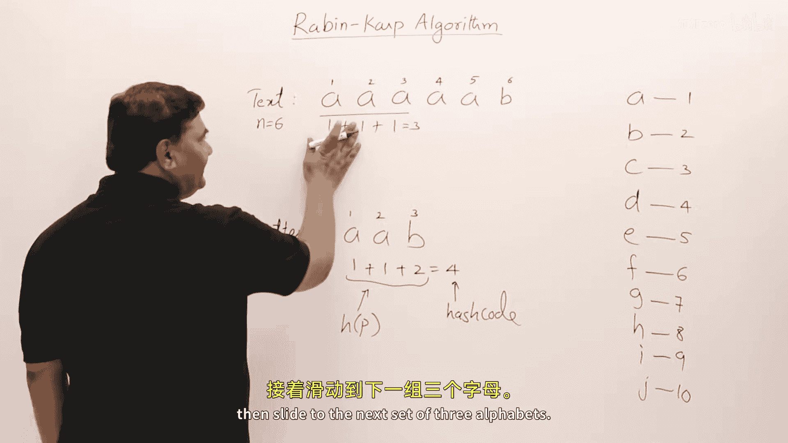

Now， this is again3 and3 is not matching with this one means these three letters are not forming this pattern。

Now slide next， see this sliding is called as rolling hash function。

From the present value I am getting the next value， so that is called as rolling hash function。

 we will see it further。I'll include this one。 So the code for this one this is2。 So this is 4。

 They are matching。 Once you get a match， confirm really this pattern is there or not。

 So now check the alphabets。 These are a A。 and these are also a。 These are B。 Yes， they are same。

 So pattern is found from index 4 to index 6 in the main string that is text。😊。

So this is the basic idea of rabin cap algorithm。 I will take one more example and show you quickly。

 I have taken one more example。 let us quickly look at this example here we will understand what does it mean by rolling hash function There is C there is a text given here and theres a pattern first find out the hash value for this one So the codes are B is2 B is2 and C is 3 So it's 3 plus 3 and E is55。

This is M。See remember， I am showing you just the basic idea。

 I' am not showing you the actual algorithm。 remember this one。Now。

 we have to find out whether this is present here or not。

 So just take first three alpha because this size is a3。 So first three alphabets。

 this is  one plus 2 plus 3。 This is 6。 And this says not matching with this one， then。

Just slide it and get the code hash code for next three letters。 So for that from6， this is 6 right。

 So from 6， subtract this one1。 So we get five。 so subtract this。And plus。

 what is the code for this 4 and 4。 So this is 9。 So in this way， the letter that we are skipping。

 we can subtract its code and the letter that we are adding， we can add this code。 So in this way。

 we can get the hash function or hash code for the next set of characters easily in constant time。😊。

Now，4， so total is how much this is 9 and 9 is not matching with this one。 So okay。

 take out this alphabet and take this alphabet。 So this is one。Now， how much this is 8。

8 is not matching with this one。 So this is not a pattern。Then take out this and add2。

 Now this is 7 and 7 is not matching with a 10。 So take out the C D and includelude C。

 So the code 4 C is 3。 This is again，6，6 is not matching with 10。 So subtract one from this。

 and and this is 5。 So this is 10。 and 10 is matching with this。 So it means there is a pattern。

 there is a possibility of pattern。 So verify it。 B， B， they are matching C， they are matching。

 and E E they are matching。 So， yes， there is a pattern available in a string。😊。

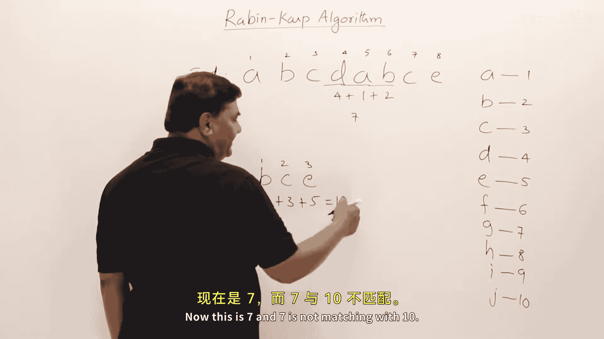

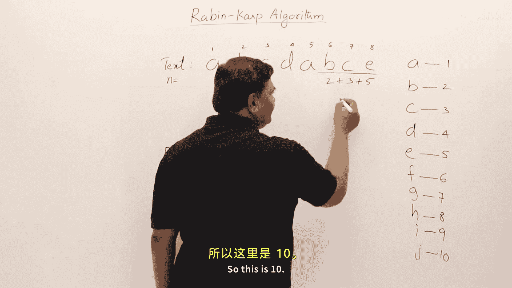

So this is the basic idea I have given you Now I will show you the drawback of this method。

 then afterwards， I will show you actual algorithm。 See in the previous two examples。

 we were going through the main string only once and at only one time we have checked for the pattern。

 So we have gone through entire string only once scanned through the whole string and we have checked for the pattern only once。

 So the time we say it was。

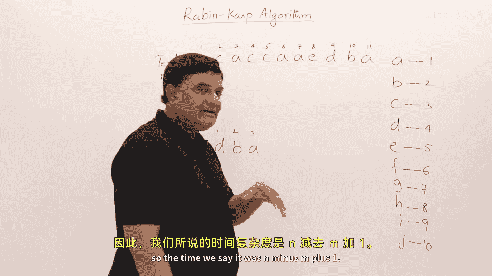

N minus M plus 1。

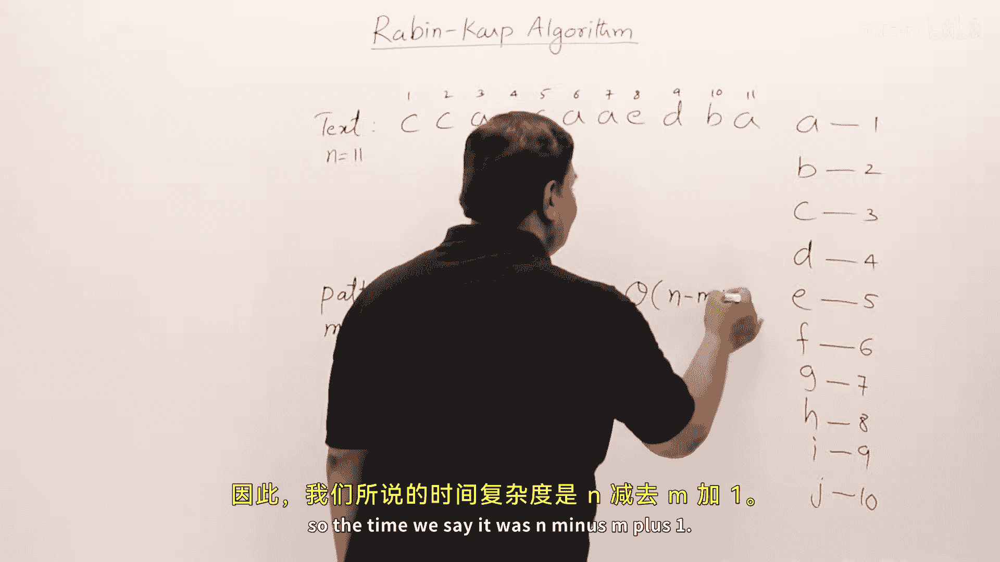

This is the average time of rubbin car algorithm。 Now let us see the worst case for this one。

 So I have taken an example here and let us look at worst case。

 I have taken a string of size length is 11 and the pattern of length is 3。

 Now let us find out the hash code for this one by same method。

 Just take the quotes 4 plus B is 2 plus a is1 from there I'm writing。 So this is 7。

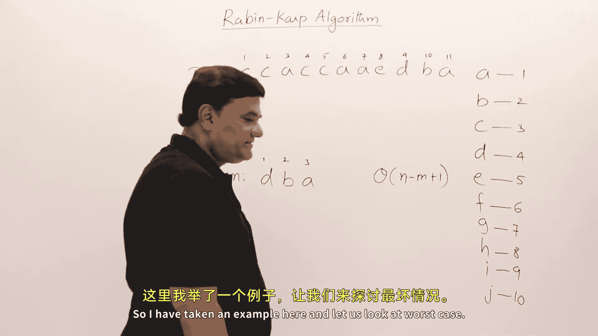

Now the hash code simple thing I have taken that is 7。 Now let us understand the drawback。

Frate three letters from here。 C is 3， and C is 3 plus a is 1。 This is 7，7，7 matching。

 Compare the alphabets D， no， this is not same。 This is not same。 So means。

 though we got a match in hash code values， but the string is not matching。😊，Okay， go to the next。

Take next3。 So this is 3 plus a is 1。 Then this is 3 again 7。There is a match。

 so it means this pattern would be there here， possibility of pattern there， so compare this C and D。

 no， they are not matching， so no its not a pattern。

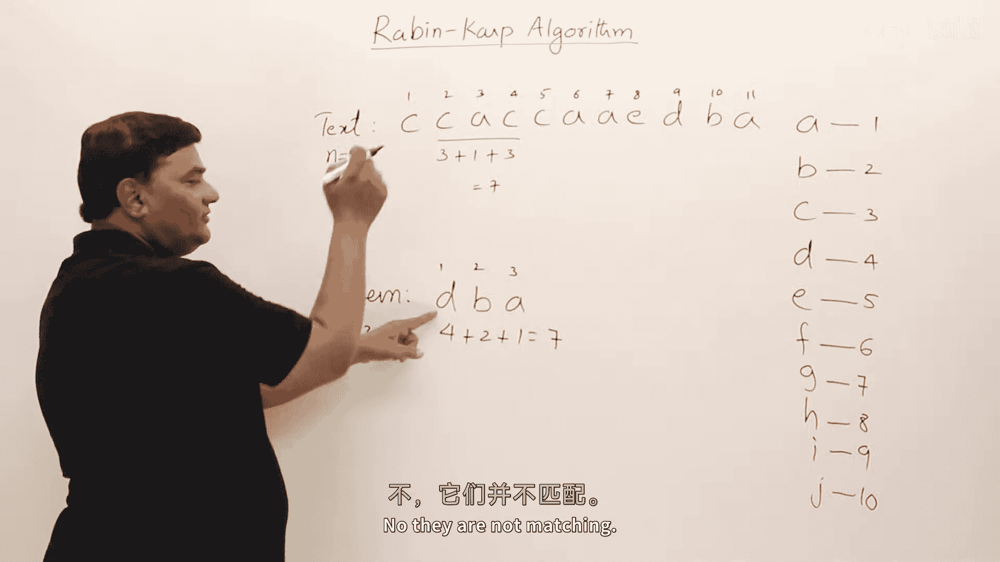

Then take next3。A is 1。 C is 3， and C is 3。 again，7。 again， it is matching。

 but this is not a pattern。 After comparison， we'll know that it's not a pattern C。

 We have got three matching so far。Right，3 matchings。 but those are not patterns。 So in this way。

 we are comparing this pattern every time。In our example， Joe we are checking only one alphabet。

 but in some cases we will be checking most of the alphabets and it is not matching at the end。

So let us continue CAA here I will take this is three and this is one plus one。This is 5。

 and this is 7。 They are not matching。 Okay， next， this is 5。 they are matching again。

 And compare the this， this is 7，7。 This is 7。 But check whether the pattern is there。

 No pattern is not there。 So we are getting every time hash code that is matching with the hash code of this one。

 This the drawback。 So if you take such a simple hash function。

 Then there is a possibility of collusion with the other pattern。

 other sub strings which are having the same code， though they are not the patterns。

 So the drawback here is that there are many hash codes that are matching。

 but those are not the patterns。 So actually， these are called as spurious hits。😊。

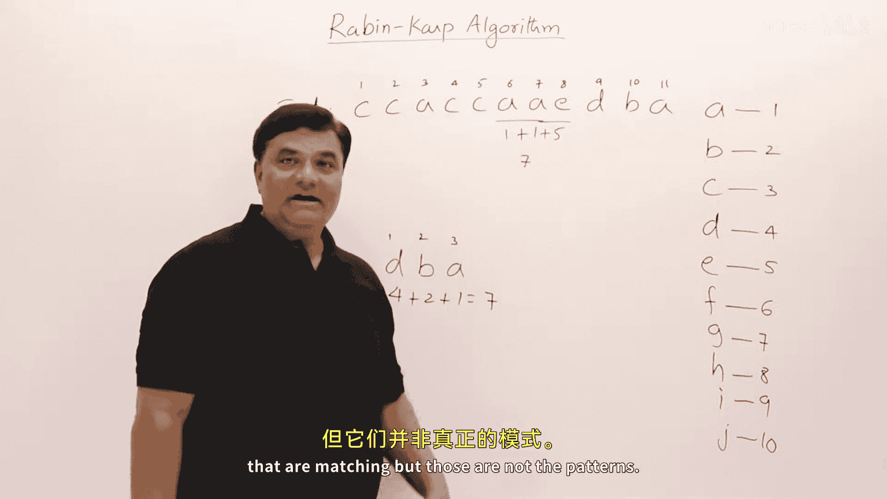

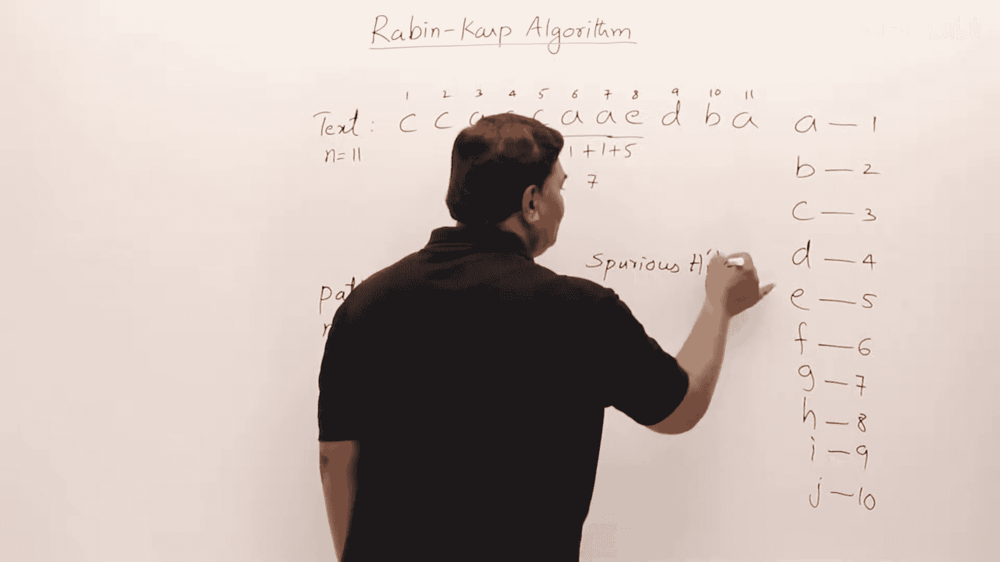

So these are called as spurious hits， means the matching is there with the code。

 but those are not patterns。 So these are waste hits。 This is the drawback。 And in such a situation。

 the maximum time taken by this algorithm may be。M， N， state of M， N， could。

 this could be the maximum time。 But we expect the algorithm to take n minus M plus one time。

 this will happen if there are no spur hits。So how to avoid spurious hits。

 So this is because of the hash function。 We selected as a very simple hash function because of which these hits are happening to avoid this spurious hits。

 We have to take a strong hash function。 So what is the idea of hash function given by rabin car。

 So now this we will be completing the algorithm now。

 So I will show you the actual hash function that is give us suggested by rabin car。 Now。

 throw an example only the same example， I will show you see here， the codes are this is code 4。

 and this is code 2。 and this is1。 So let it let us take it like this。4 into 10 square。😊，Plus。

2 into 10 power 1。 plus this is one into 10 power 0。Why power 2， power 1， power 0。

 because there are three letters only in the pattern， so start from0，12。

So if there are five letters in a pattern， then 0，1，2，3，4。 So highest power we can get 4。

 So if there are M letters in the pattern， then each letter of a pattern P1 into 10 to the power of M-1 plus P2 into 10 to the power of M-2。

Plus， P 3 into。10 to the power of M-3 goes on。

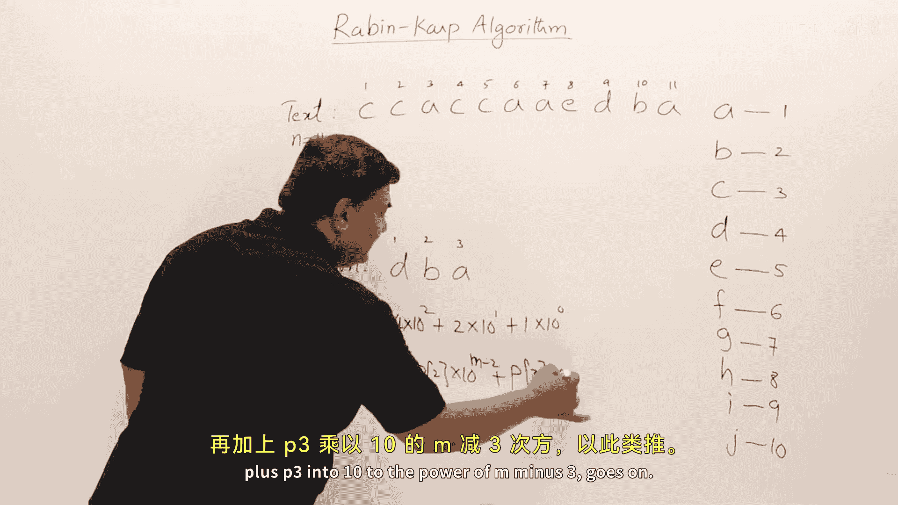

So that same thing we have done three。 So first one is 3-1 then 3-2， then 3 minus-3。 that is 0。

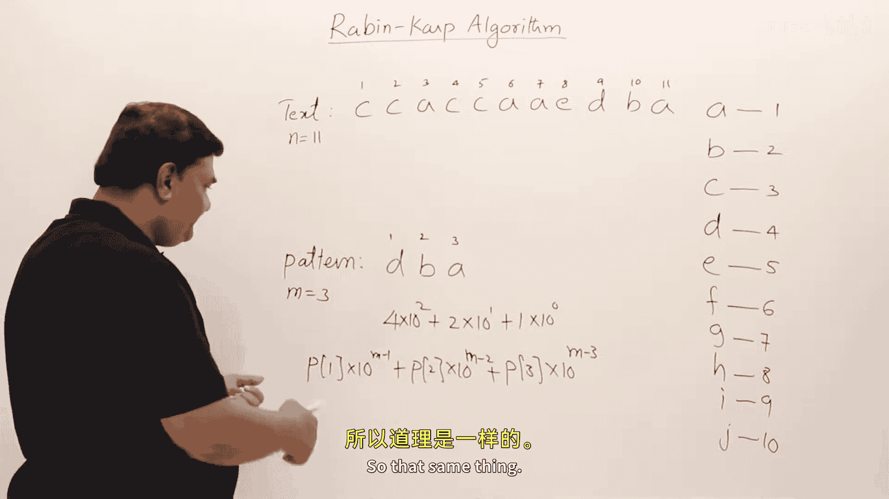

This is how we will multiply these cores with this powers。Then what is the 10。

 This is the base value， How many alphabets I am using，10 alphabets I am using。

 So I have taken that as a base value。 You can use any value you like。

 This is just the idea given by ainov hash function means if you know about hashing。

 you can define your own function， depending on the patterns or the text that you are using。

But for the alphabets， like for a string， they have suggested this method。

 So if I consider all English alphabets， then for 26 alphabets， I should take it as 26 power2。

26 power 1，26 power 0。If I say lowercase， uppercase， all special characters， everything。

 then total ASI codes are 127， so this should be 127 power 2，127 power 1 and0。

So to make our example simple， I have taken only 10 alphabets。

 that is the reason I am writing 10 here。Now， let us find out its value。 this is 400 plus 20 plus1。

 This is 421。 So the hash code for this forest 421。Now。

 using this code will' try to find out a match。 See， just now， for the same example。

 this was a drawback。 I we found out That is the worst case we found out because of the hash function。

 Now， I modified the hash function。 that is I have taken the one suggested by Rabinov。

 And there is one more thing that I have to include it at the end。 I will show you。 Now。

 let us find out。 How much this is This is 3 into 10 to the port of 2 plus this is also3 into 10 to the port of 1 plus this is  one into 10 to the port of 0。

 So this will be 300。😊，Plus 30 plus1。 So 3，31。This is3 31。Is it a match。 No， it is not matching。

 The code that we got is 421。 I right on here。 right， It's not matching。 See。

 this is not a spurious hit because we have changed the hash function。 So now it is not matching。

Now I have told you about the rolling hash function。 See so many powers and everything we are taking。

 I have to calculate the next one。 So what to do So from 331 see， I'll just remove this。

 Now I have to find out the hash code for next three alphabets these three these three means what this should be3 into 10 square it should be。

 then this should be one into 10， not power 0 power 1。

 So it means I should multiply these two into 10 So what I can do is I will take this as it is I'll take this as it is and multiplied by 10 outside。

😊，Then I have to remove this one。 And also， I should include C。 So overall， how to do this。

 let me show you how to do this。 This entire thing was 3 into 10 square plus 3 into 10 per 1 plus 1 into 10 square。

So this actually is 331。 So from this subtract， this3 into 10 square。 So 3。

Into 10 square is subtracted。 So this term will be gone。 If I subtracted， this will be gone。

 So this portion will be remaining。 So this entire thing multiplied by 10。

So these numbers will be raised by 10 right so this becomes1 square and this becomes strength over 1。

 Now I have to include this is C also， so plus C code is what3 into 10 power 0。

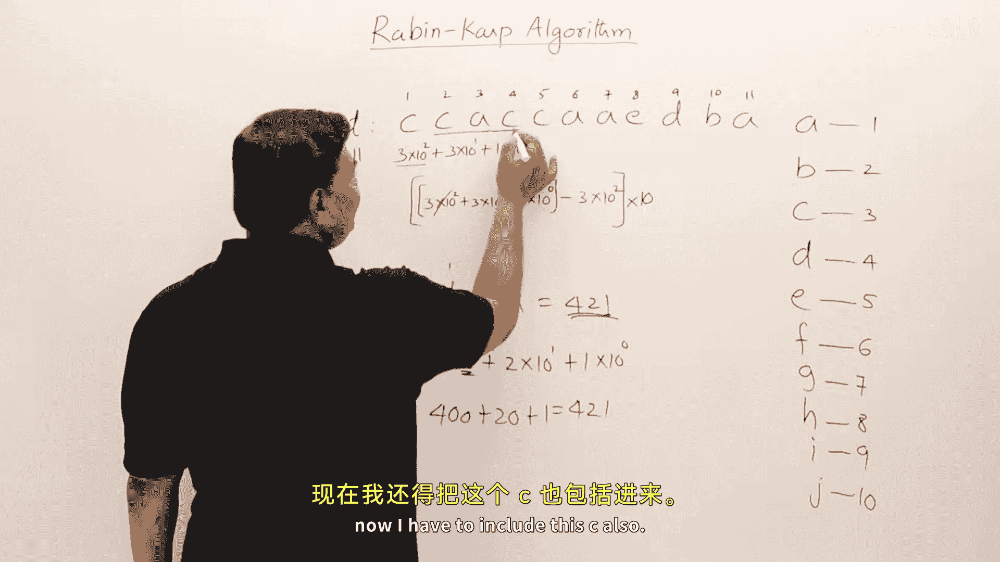

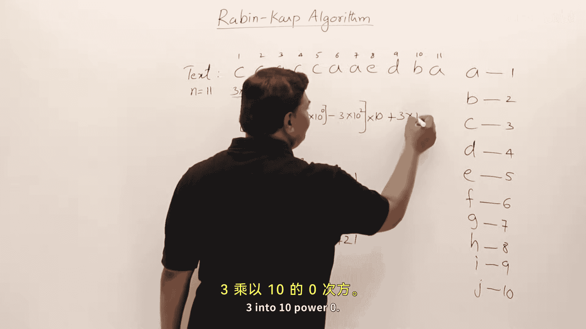

So how we do this， see， actually， this is 3，31。 So what we do is from 3，31。

 we subtract this first term。And multiply the result by 10 and get the。Next term， added， so。

You can just observe this carefully。 How this is happening。 So this is the result as it is。

 this should be subtracted。 Okay， subtracted。 Then these two should be multiplied by 10。

 So the result is multiplied by 10。 And this term should be added。 C should be added。

 So C term is added。 So I directly do that right now I am having the hash code for these three alphabets that is 3。

31。 Now I have to get this for。😊，These three alphabets。 So subtract this one，-3 into2。10 square。

 So this is how much 3，31-300。 So this is 31。Then to that 31， this portion I got that is 31。 that 31。

 I should multiply by 10。 So this 31 multiplied by 10。 So I get 3，10。So this is gone。 Now。

 for this C， I should add this 3 into 10 to the power of 0。 It will just 3。 So in this plus 3。

 So this is 3，1，3。This is the method of getting the hash code for the next set of characters using rolling hash function。

 So once you got one function， then from there， only subtract， multiply， and then add。

 you get the hash code for next set of characters。 So this is 3，13。 Is it matching with 4 to 1。 No。

 this is not a match。 So there is no spurious。😊，There is no spurious heck。

Let me continue for some more time so that if I calculate more you can get the idea this is 313。

 I have to subtract this one I have to remove this so subtract this3 into 10 square so that will be 300 is subtracted Okay。

 this is gone。

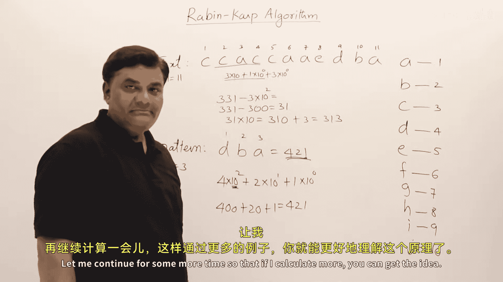

Then these two terms I should multiply by 10。 So result is how much 13，13 should be multiplied by 10。

 So I get the result for this 10 square， and this is 10 per 1。 Now。

 I should include this one more alphabet。 So its value I should add。 So this is 3。

 So 3 into 10 to the poor of 0。 So in this， I should add。3 plus 3。 So how much this is。

How much this is， this is 1，30 plus 3。 It is 1，33。Now this is not matching with 5 to 421。

 so this is the hash code for these three alphabets。

I'll continue the hash code for these three alphabet is 1，3，3。 Now have to remove this one。

 So this first term should be subtracted。 So this is one into 10 square。 So this is hundred。

0 is subtracted。 So this is 33。 So I got this remaining part right， remaining part。

 Now I should raise it to square and raise it to 10 per 1。 So multiplied by 10。 So we get 3，30。

 Now I should include one more alphabet。 That is a。 so this is plus 1 into 10 to per of 0。

 So that is one only So this is 3，31。 I it matching。 no this is not matching。 Now。

 let us calculate for next3。 So for that I should remove this first alphabet。 So3 into 10 square 300。

 I should subtract from here。 So from 3，31。 I should subtract 300。 So this is subtracted。

 So I get 31。 Now 31 should be multiplied by 10。 So this becomes square and this becomes。

I should include one more alphabet。 So this is one into 10 to the poor of 0。 So this is one。

 So this becomes how much 310 plus 1。 So this is 3，11。 This is not matching。

 So in this way you can continue at one point A D BA for these three。

 we get the same answer So that is 4，21。 And that time， when there is a match。

 then compare confirm but is the same thing or not。That's it。 This is the method。

 so you may have to observe this little carefully so that you should be able to do these calculations by yourself。

So I have given you a basic idea。 Then I have shown you the drawback。

 the reason of drawback of was bad function。 So I have introduced a better function that is actually given myabbin cup。

 So this function is a rolling hash function， as well as they have given this that base powers we should take。

 So this is called as。Rabbin fingerprint function。 So now there are no spur hits。

 So the time taken by this algorithm S T of and the minus M plus1 in average case。 But still， though。

 you have defined such a hash function。

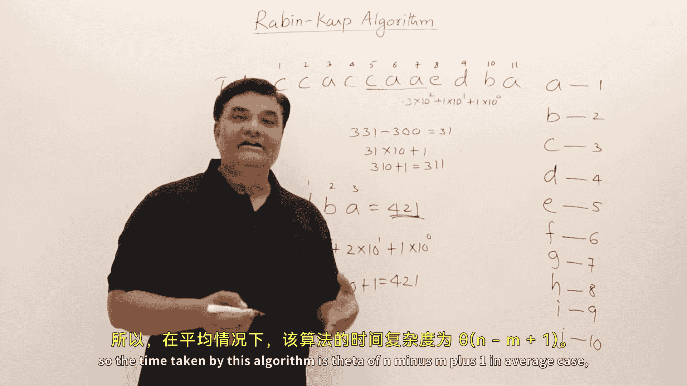

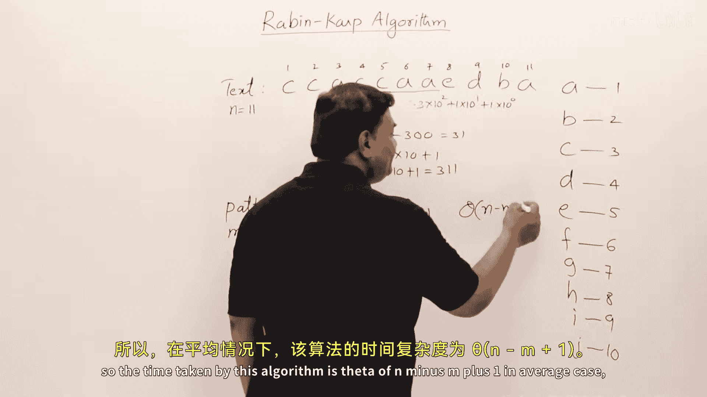

Still， there may be a possibility that there is a spur hit。

 So theres still the worst case time of this algorithm is M N， though， by using this hash function。

 we are reducing the chances of worst case。

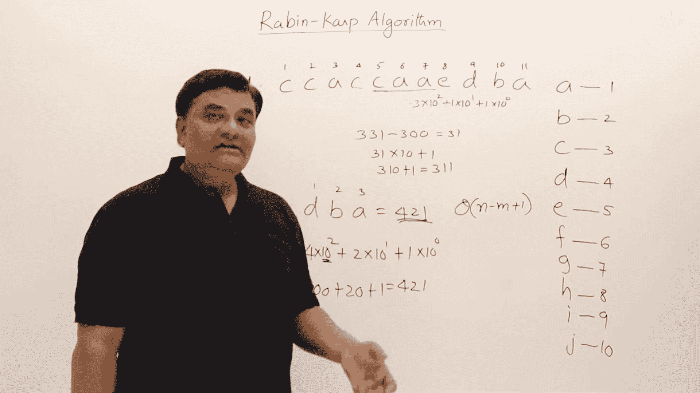

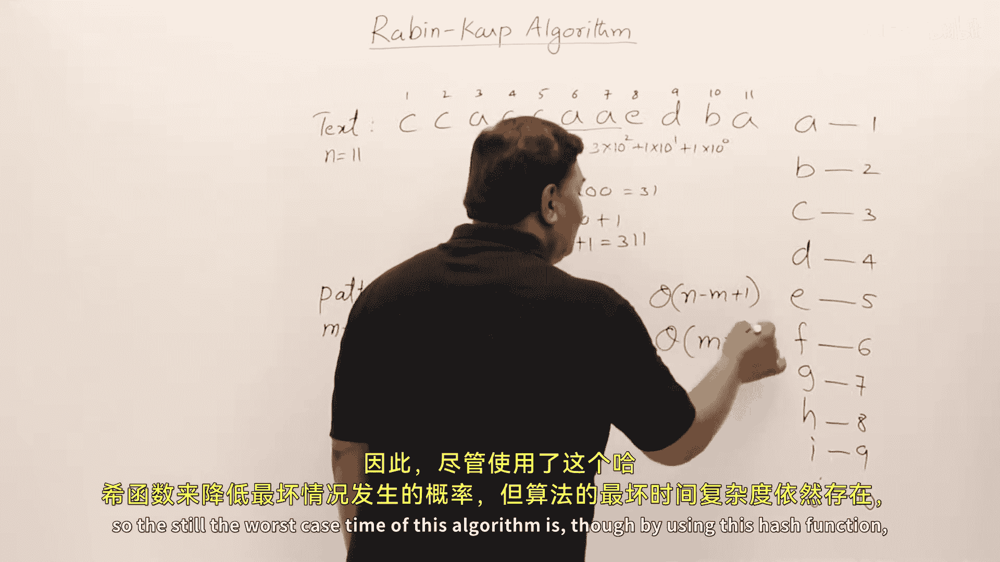

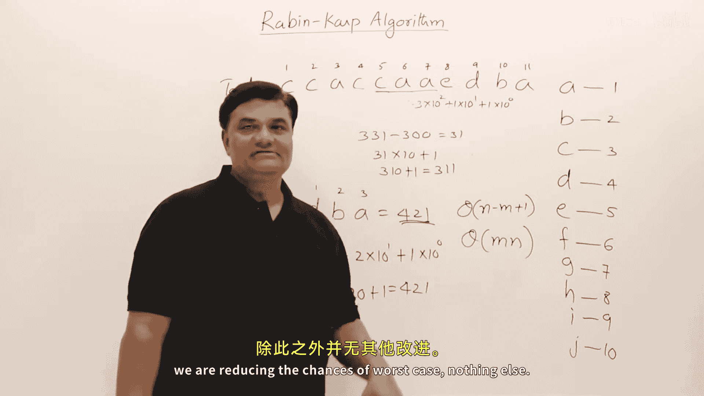

Nothing else。Now， one last thing that I have to tell about this one。 See。

 when we are taking the powers of this， we may getting we may be getting a very large value。

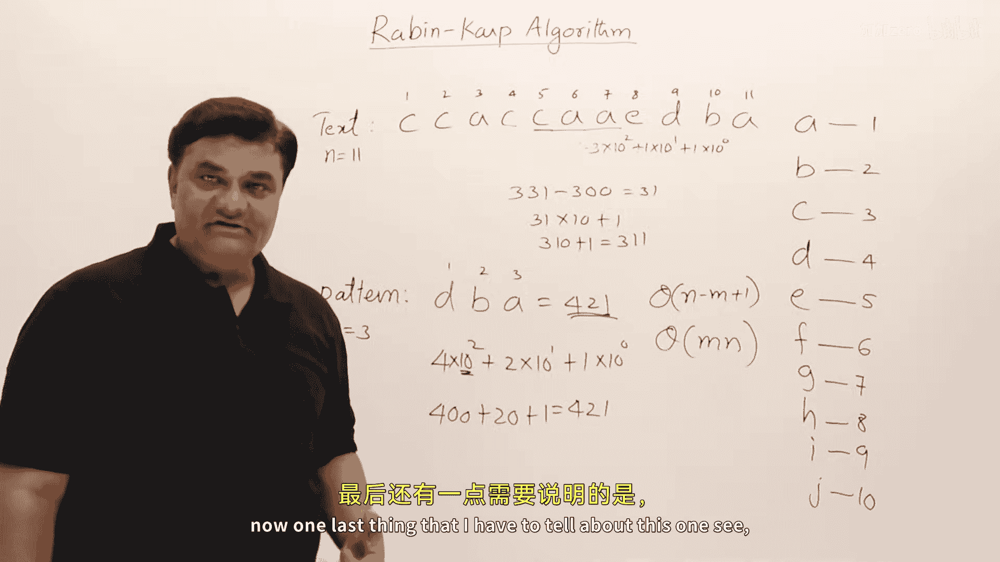

Now， if you are getting a very large value and when you have written a program for this one。

 then it depends on the size of the data type。 Like if you take integer 4 B。

 it may be exceeding the capacity of 4 B。 So if it is exceeding the number will overflow。

 If you want to avoid overflow， then you can mod these large values。

 you can perform mod upon these large values。 So this entire function。

 we can perform mod with what value we should perform。

 it depends what is the maximum size of your data type。 if it is 32 B the data type。

 then you can mod by2 over 31。 like it it is 32 B， then 1 B is s but 31 we take。

 So Im taking that 31。 if you say no， it is only positive， then you take 32。

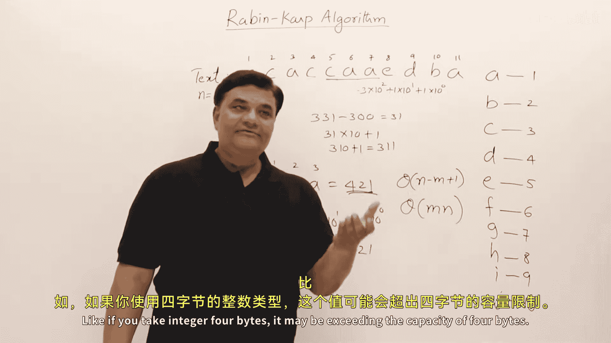

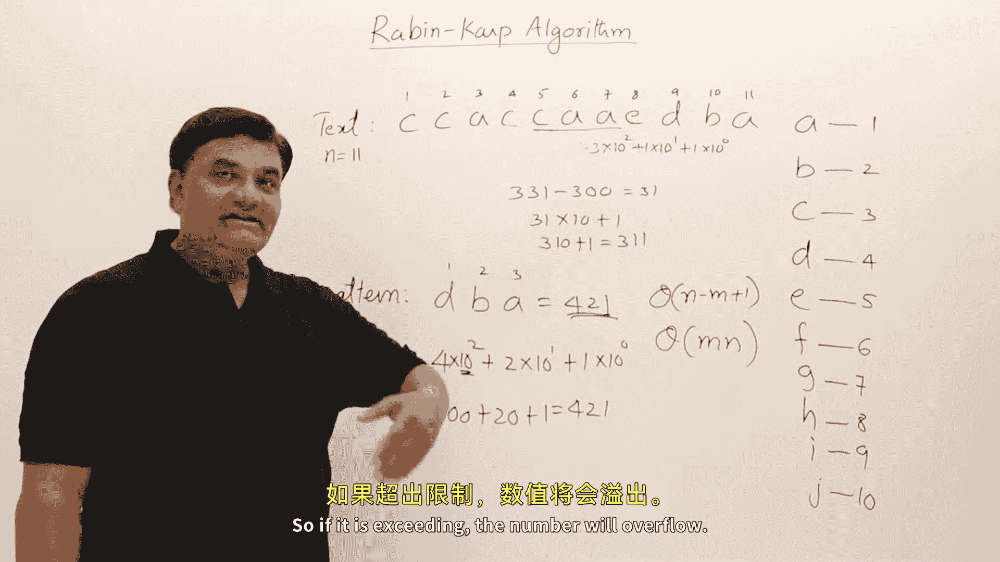

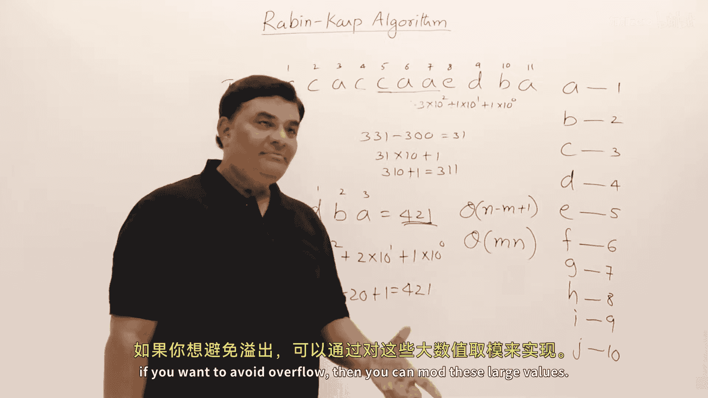

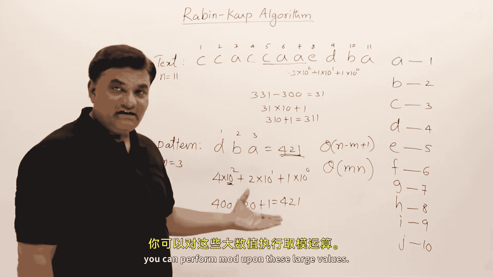

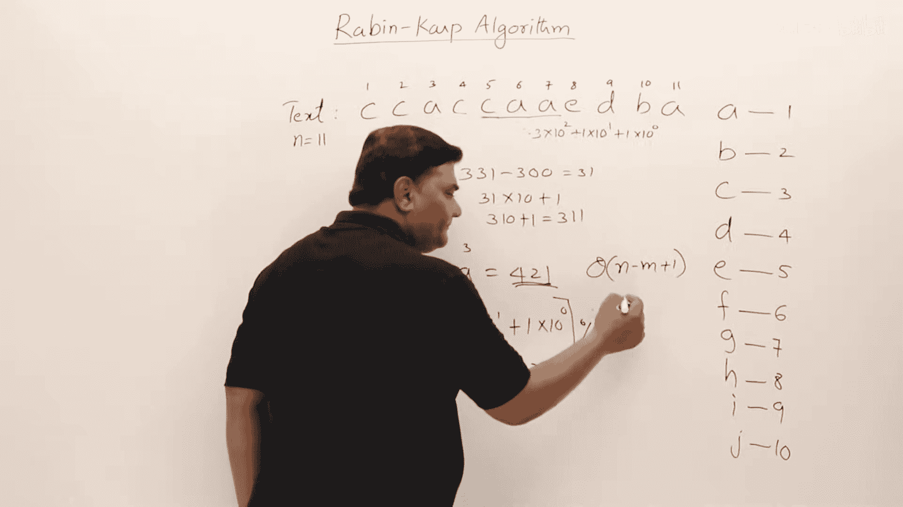

It depends on the language you are selecting， it depends on the data type you are selecting。

 so for getting the result of this hash function if you believe that that may be exceeding the capacity of the variable that is data type。

 then you can mode it with that one。

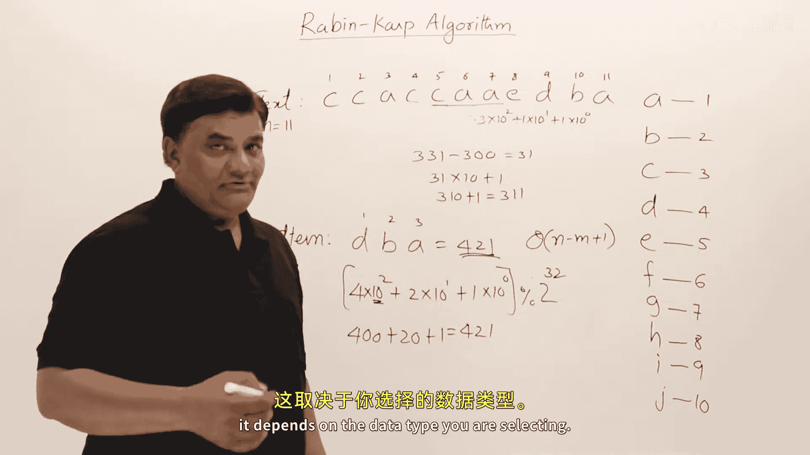

So that you make sure that you get the values in between those two only。

 So in the rolling function also you can use mod so that you get the values within that range only。

 but once you apply mod then there is a chance of spurious hits again then again the algorithm maybe going towards worst case time of MN。

So it depends on you how you want to use it。 See if you know about hashing。

 if you know about hashing， you can define any hash function。

 if you have the study on the data that you are using in hash function or hash table。

 So here also if you have the study about the characters that you are using in the strings。

 then you can define your own hash function also So the basic idea of ribbonbin cap is what user hash code to avoid checking the pattern in the string。

 If the code is matching， then check it。 That is the basic idea。

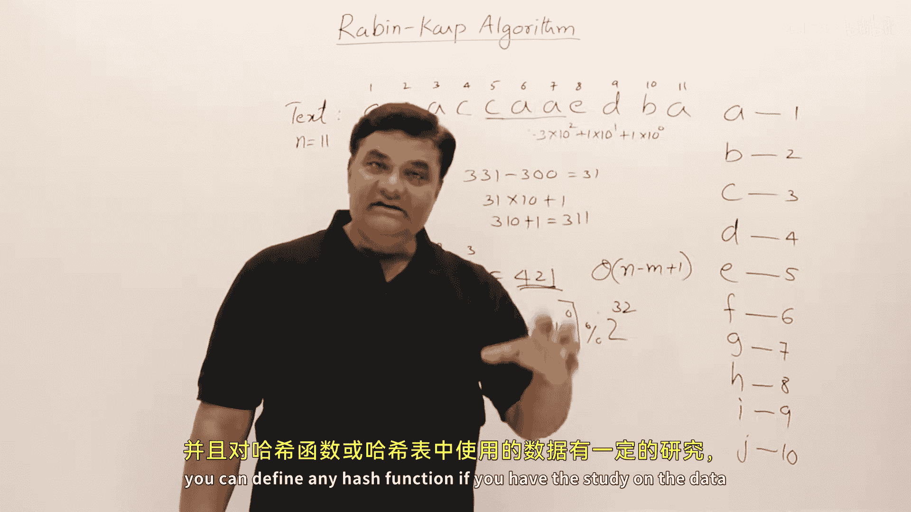

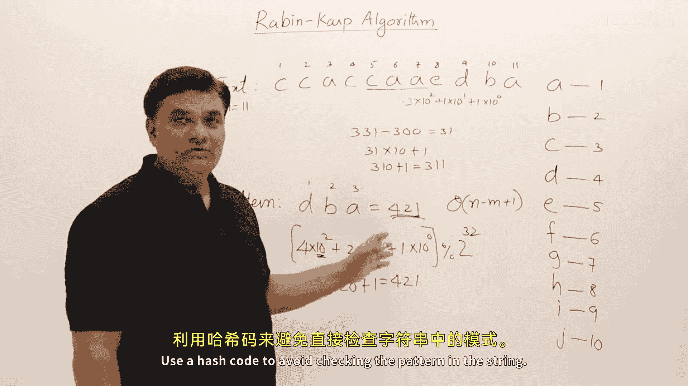

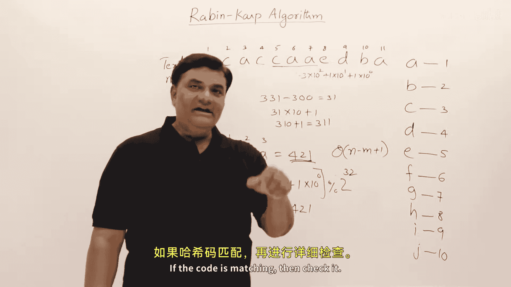

That's all about Rabin。