# 【精译⚡算法导论】AbdulBari p77 p76 10.2  B Trees and B+ Trees. How they are useful in Databases -BV1hhPXeTEWM_p77-

はい。The topic is Bries and B plus trees。This one of the important topic and is a difficult topic for the students to understand。

This is useful in databases。What are the things that are required for understanding Bearies and B plus thoroughly。

 this is the list of topics。If you understand all these things and you know all these things。

 then you can understand what Bearies and V plus trees are。

Mostly try people try to understand how insertession andulation is done just they try to learn the procedure without knowing everything。

 So this video will be a little ny reason I am going to cover all these topics that are related to B and B plus trees and help you understand。

Perfectly what B plusity and B and B plusities are。Let me read out the topics disk structure。

 how our disk looks like and how the data is stored on the disk then next when you are storing data from databases。

 then indexing is used for faster searching then what is indexing what is multilevel indexing then we will also discuss what are M search trees and that M searches are converted to B trees and then B plus trees。

So this is a little bit lengthy， but I suggest you listen everything， go through it。

 then you will never forget this topic。Let us start with a destruction。

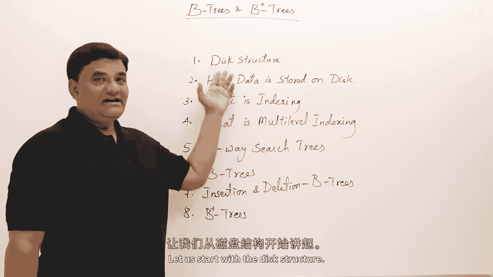

Let us look at disk structure。Dis structure is like a disc is like a platter on which the concentic circles are made deserve logical circles。

This is not physical。

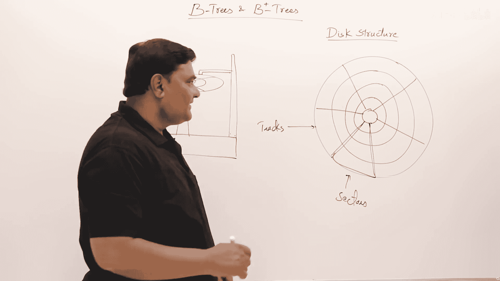

And these are circles are called as a track。 So let us say this is a track，0， track 1。

 track 2 and track 3。Then this pieces are called as sectors。

 So this is sectors and this is also sector like this。 that is this is sector 0， sector 1， sector 2。

 sector 3 and 4 and 5。So this is divided into many tracks and sectors。

 The intersection portion of track and the sector， this one。Or this one。

All these intersecting positions， these are called as blocks。So any location on the disk。

Can be addressed with。Track number。And sector number。

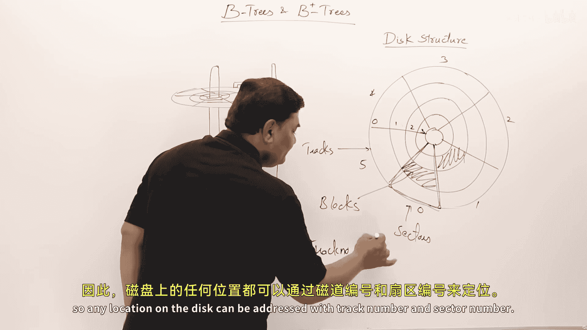

So the address on a disk that is block address。Block address is mentioned in the form of track number and sector number。

 So like this， if I take this particular block， then this is track 1 and sector 0。

 This block track 2 sector 1。 So each block can have its address in the form of track number and sector number。

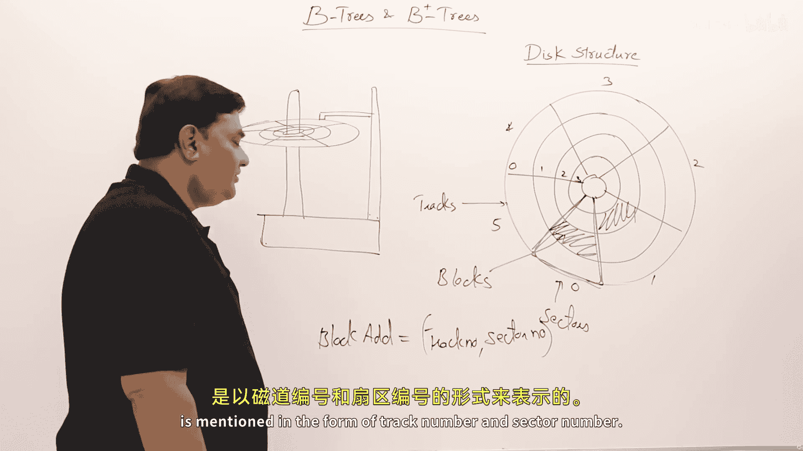

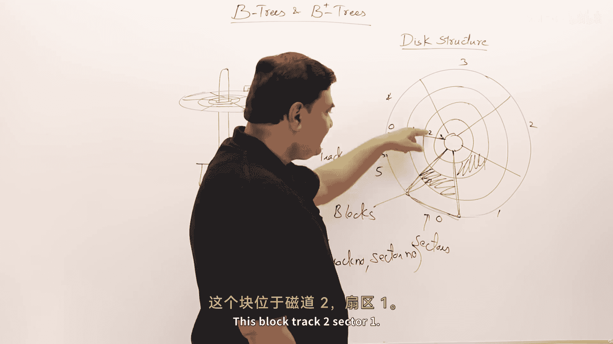

And typically， the block size， we take it as 5 to 12 bytes。For study purpose。

 we take it as52 bys it can be of any size it depends on the manufacturer of a disk。

So we assume that every block is of fight well bytes。When the disc is read。

 when we read or write to and from the disk， we always read and write in terms of blockss。

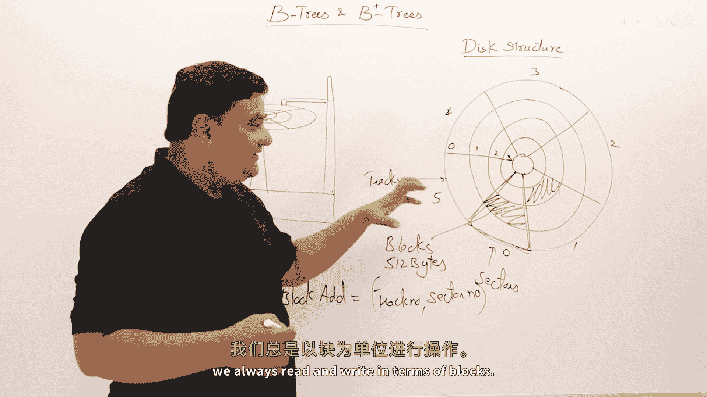

Now， if I take just one block that is of 5 to L bytes。

 the beginning address that is first byte is 0 and the last byte is 5，11。

 then each byte can have its own address that is called as offset。Let us see this is the 10th byte。

 so we can refer any one bite on the disk in terms of first of all block address。

 and inside that block， we will take offset。 That is the address of that particular bite。

Every block we assume that the addresses starts from 0 and last addresses is phi to2。

 phi 11 because total phi20， so any address， any byte we can take it as address and that addresses is call as offset。

To reach a particular bite on a disk， we should know track number， sector number and the offset。

Let us say in this particular block， this particular point I want to read。

 this is suppose this is one bite for reading that bite， I should know these three things。

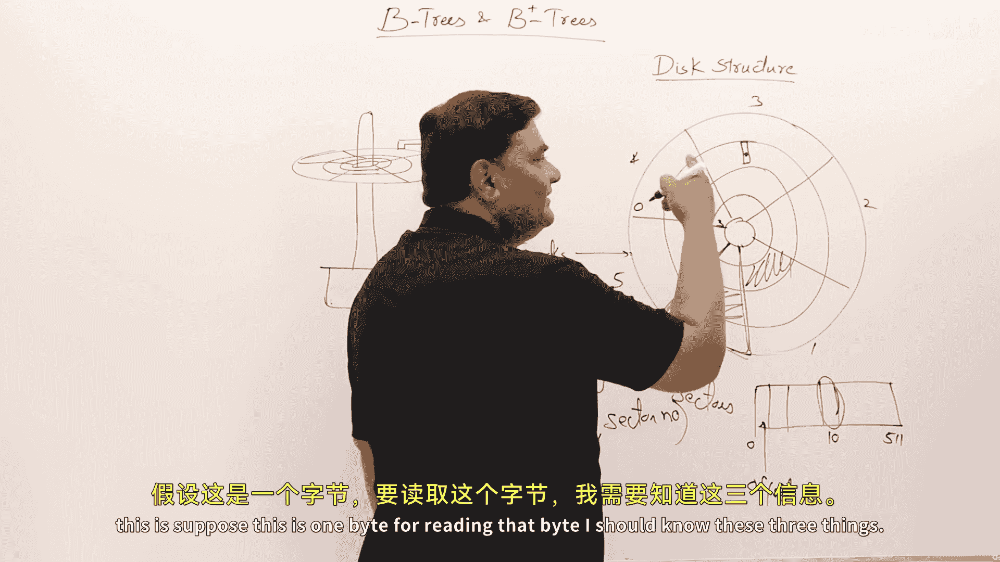

Then， let us understand one more thing。Disk is mounted like this on a spindle and the head post will also be there。

 so by spinning it will change the sectors by this arm movement of a header that is the header that is reading the data from the disk or writing the data on the disk by this movement tracks our change so we can position a head in a particular track and in particular sector by moving this post that is head post or spinning this one。

So by spinning sector side change， by moving head track are change， this is about the disc。

Now the data on the disc is stored in terms of blocks。 Now one more thing。

Let us take this as main memory。Usually we call it as RA Ram is a technology and the type of memory is main memory we run our programs inside main memory and the programs will access data。

 suppose they are accessing the data from the disk then the data from the disk must be brought into the main memory and then only it can be accessed and if any results are obtained then the results are again written back into the disk。

So the data cannot be directly processed upon the disk it has to be brought into the main memory and then access and this is one important point to understand。

And one more time I'll tell you， organizing the data inside the main memory that is directly useful by the program。

 data inside the main memory that is directly used by the program that is data structures。

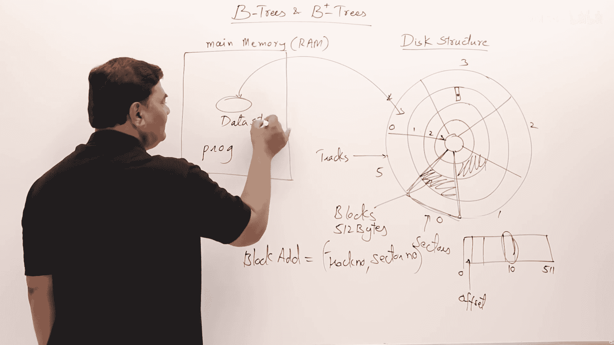

And organizing the data on the disk efficiently so that it can be easily utilized that is DBMSs。

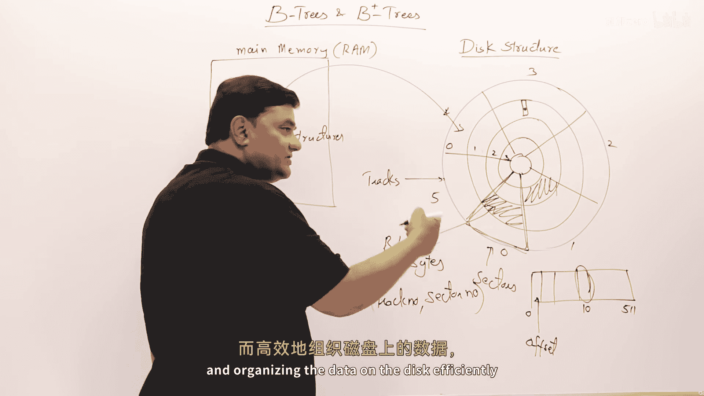

So study or the methods or the approach used for storing the data in a efficient way there on the disk is all about DBms designing。

 organizing everything。 Now here， study on this one is data structures。

 I' let us move on to the next thing。 how data is stored on the disk。

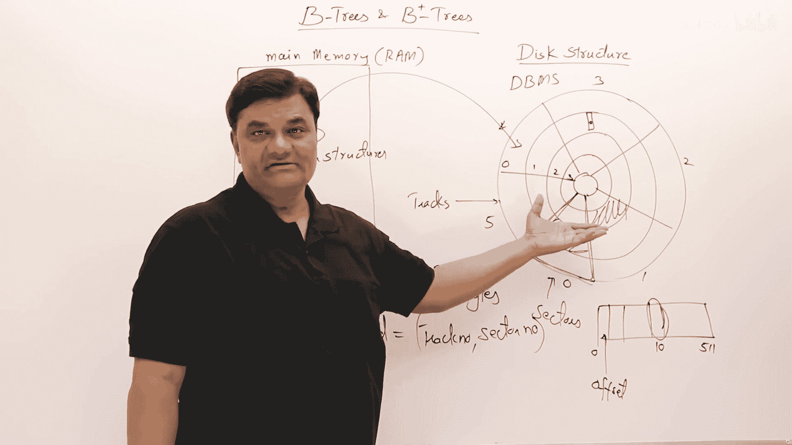

Now， let us know how the data is organized on the disk in the form of database。

 I have an example database table here with some columns and some rows。

 Let us say they are hand rows。

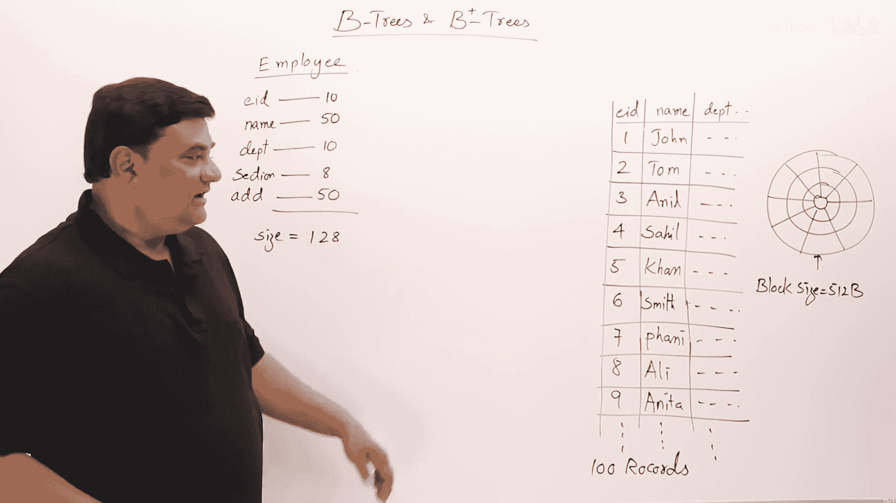

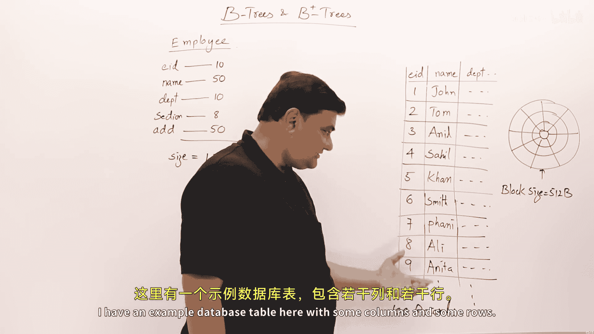

And how the data is stored on the disk in the form of block solid。

 we have studied that and assume that the block sizes5  well bytes。

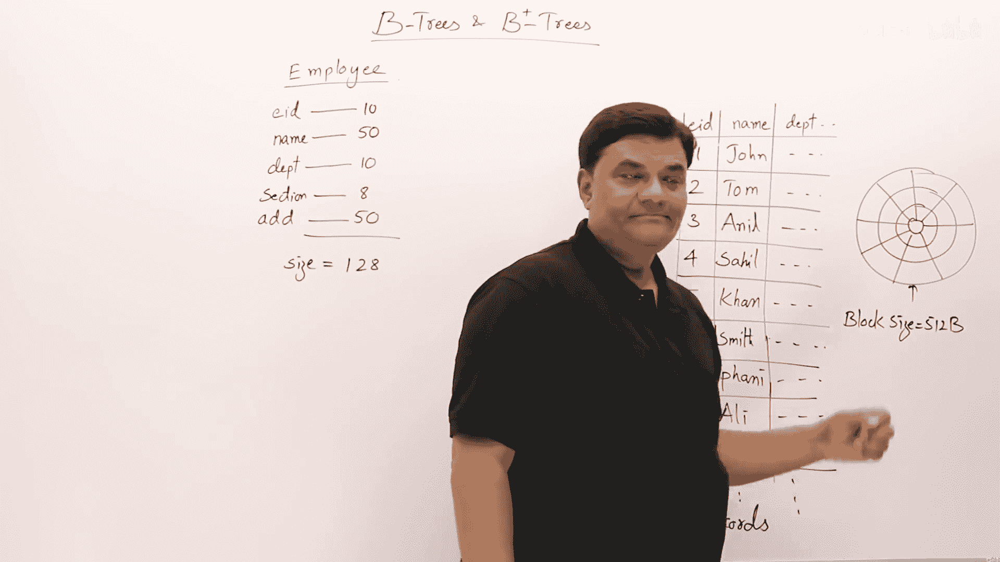

Now this table， the structure of a table is given here。There are more number of fields。

 I am not showing them there， but here I have written all。 So total， there are five fields。

 and these are their sizes。Employ ID is of size 10 bys。

 and this is of 50 Bs and the department is 10 bys so on。 So total， it takes 128 bys。Now。

 it means each row size is 1，28 bys。 This each row is 1，28 bys。

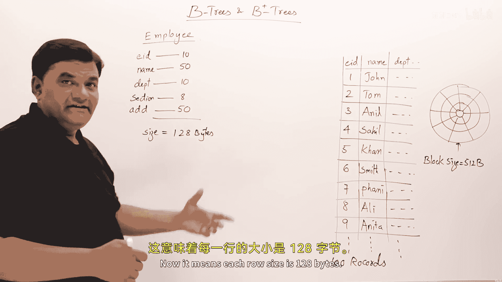

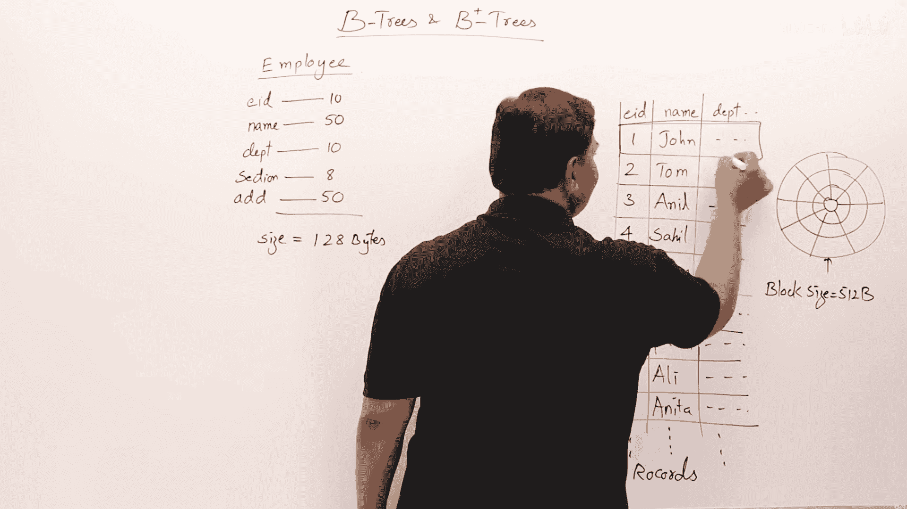

Now， when we want to store that table on the database， then in each block。

How many rows can be stored？ That is how many records can be stored。 So number of。Records。But block。

So the block size is P well and the record size is 128， so this is4。

It means we can store four rows of this table in one block。

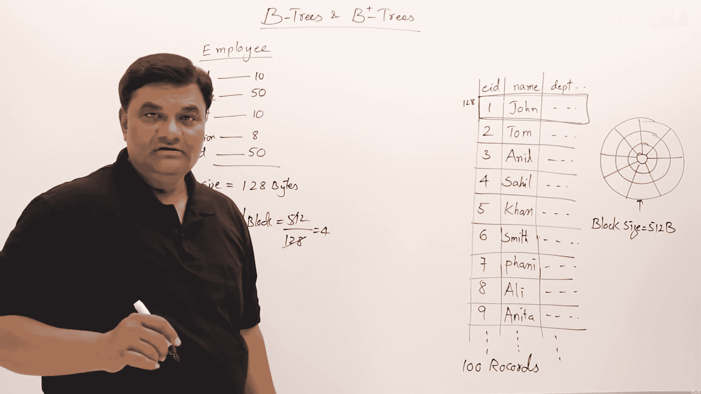

It means that these four rows will go into one block。And these four rows will go into next block。

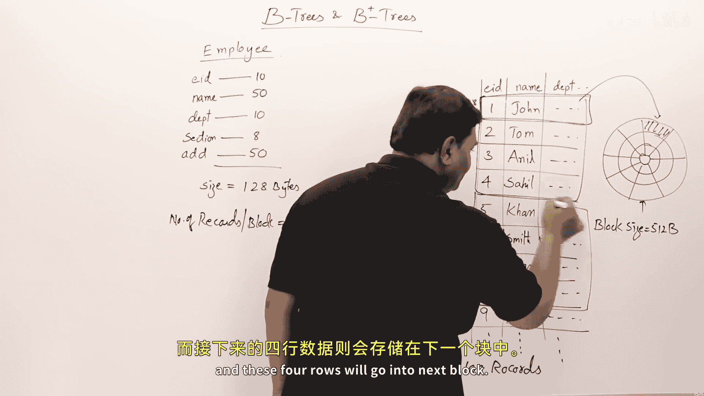

Every four rows are stored in one block。 So one block can contain just four rows。

 as we have 100 rows here。 that is  hundred0 records here。 then how many blocks are required。

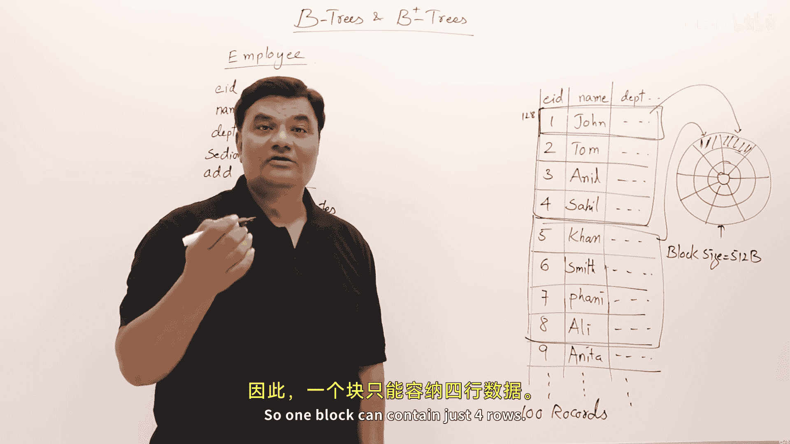

Then，4。Hundred records。How many blocks there are 100 records and each block can contain just four records。

 so this is 25。 So total25 blocks are required for storing this database table。

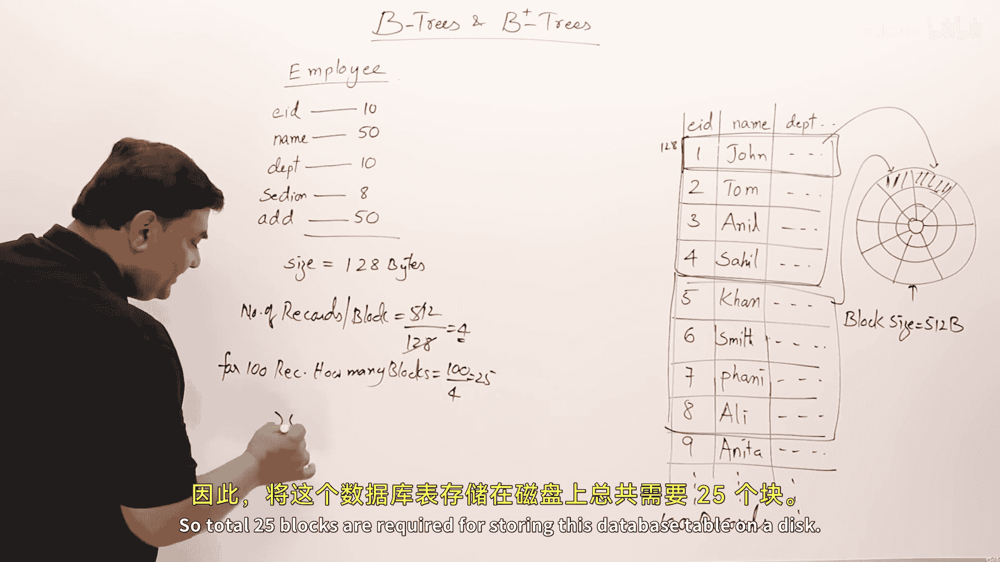

On a disc。Now， when this table is taking 25 blocks。

 imagine if you want to search for any particular record， you have written a query。

 select from employee table， that is employee table and I want so am so record for employee ID5 or employee name Smith if I am searching then how much time it will take so the time depends on number of blocks you are accessing So for accessing this entire table we have to access 25 blocks。

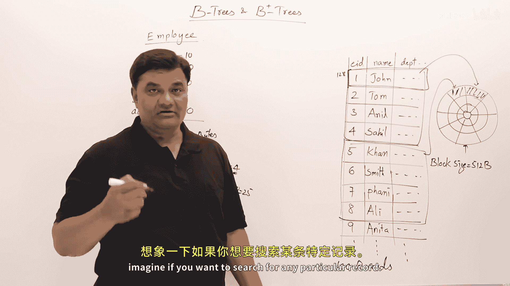

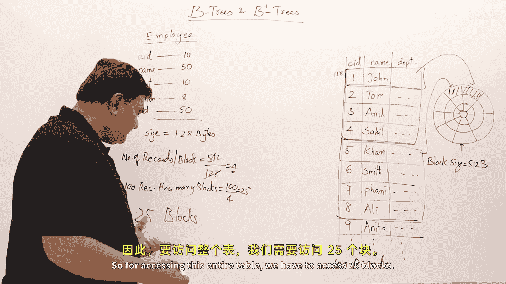

So number of block access is more 25。Because the record may be present anywhere。

 we don't know where the record is present。 So we have to search in the table。

 So for that at most 25 blocks， we have to access。 we can access block by block and check for that particular record。

 which we are looking for。 But at most 25 blocks we have to access。 can we reduce this time。 Yes。

 now we will prepare index for this database table。 So index。In index， what we will store In index。

 we will store a key that is employee I D and。Pooin of。Pointter to a record。

 So let us say employee I D 1。 This is present here。 and employee I D 2。 This is present here。

Employ I 3。 This is present here。 So we will have a pointer actually to the table inside the disc inside the block。

 So well have a pointer to a record。 So this we call it as a record pointer We will have a pointer to a record on the disk in the block for each record。

 we will have an entry inside the index。 So this is called as a dense index。😊，Next。

Where do you store index， We will store index， also on the disk， only。

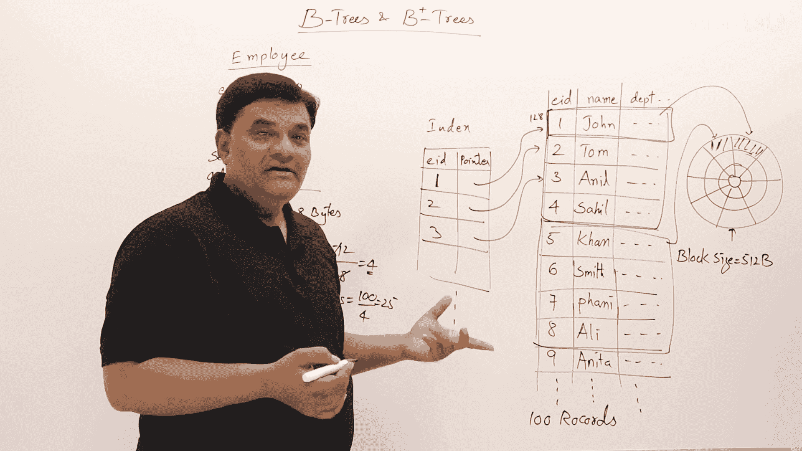

Let us say in this block， we are storing an index。 This is for index。 This is for the database table。

 and more record。 More blocks are there because it is taking 25 blocks。

 The index is also kept on the disk。

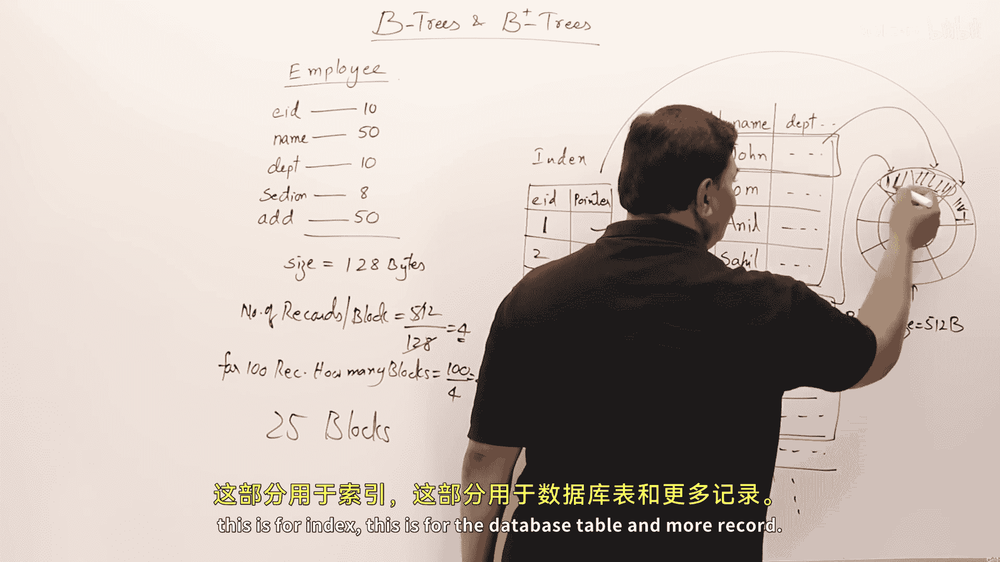

Now， the question is， how much space this index will take on the disk。 Let us analyze， see。

 employee I D is。10 by。 Then what about this record pointer， the pointer that we have taken here。

 The record pointer。 Let us assume it is taking 6 by。 So each entry size is how many by，16 by。

 Each entries is taking 16 by。 So how many entries are there here。 enterer entries are there。 Now。

 the question is， how many blocks required for this one。 So entry size is 16 by， right， now。

Number of entries。B block。So block size is 5 to 12 and each entry size is 16。 so this will be 32。

 So it means we can have 32 entries in one particular block。

 So total how many entries are there here，00 entries。 So for00 entries。Hundred by 32。

 So how much this is3。 something， Let us say，3。2。 Just assume it is more than 3。

So it means that we require three plus blocks for storing this index。

 So let us say four blocks are required for storing this index。Now， whenever we want to search。

 we access index。 So at most how many blocks we require four blocks。

 four blocks of index and once we got a particular key， let us say。

 suppose I am looking for this using that address I can access the record。

 So for accessing the record I have to access one block。1 block。

 So maximum 4 blocks of index and one block of database table。

 So first search in the index at most how much time，4 blocks， then once you got the index entry。

 then go to that particular block of database。 So that is one more block。

 So total 4 plus one blocks are required for accessing any database。Record。For accessing any record。

 we have to access  four plus one。 That is just five blocks。

 not 35 blocks because we don't have to look into the entire table。 This is the benefit of index。

Now next I will talk about multilevel index next。What if the index size is also growing？

How in of handed now I have thousand records， thousand recordsments to 50 blocks。Now。

 here we require four blocks。 Now we require 40 blocks because there will be  thousand entries。

 just I'm adding 0 to it。 When the rows were hundred， we require four blocks。 Now， thousand0。

 let us say，40 blocks are required。Just assume I am not doing all calculations。

Then the searching in the index itself is larger。 So can we have a index above an index。Yes。

 now how youll prepare this index for every entry here。

 shallll we have a entry in this next level index， high level index， No， for each block block。

 So how many entries can be possible in this block 32 entries。

 So we will have one pointer to 32 entries of this particular index。😊。

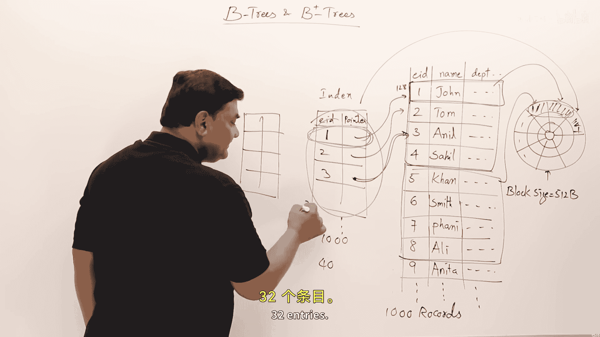

Right， so let us say the starting key is one right Next key will be 33。

 and it will be pointing to the next block。So this is a sparse index。

 It will not have each entry for one entry here。 like it will not have the same number of entries。

 It will have one entry for one block of index。 Now， as I said， there are 40。 Now， again。

 what is the size of this one， just 16 only。 So how many are possible 32 are possible in one block。

 Then for this particular index， how many blocks are required。

 just one plus point something there is say two。 So two blocks are required。

 So this high level index can be stored just in two blocks。 So database stable into 50 blocks。

 first level index，40 blocks， then next high level index， just two blocks。 So search in two blocks。

 once we get an entry Access block here。 then once we get an entry accessible a block here。

 So total how many blocks，2 blocks from this side，1 blocks from here， one block from here。

 So in this way。By adding one more level of index， we are reducing the number of block access。

So this is the basic idea originating for P and beat plus trees。I will just draw multilevel index。

 and then Ill show you how it looks like。 Let us look at multileve index once again。

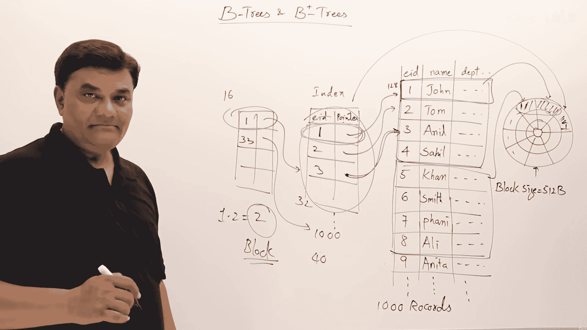

Suppose thiss the main index。

Now about this， we need one more index， suppose this is too large then how this will be having it will be having a pointer to set of entries in an index。

 then a pointer to set of entries in an index Im just taking randomly I am not drawing every counting and drawing So this is having a pointers to these。

 supposeupp this is also large。 This is also large。

 then you can have one more index which will have a pointer to set of entries and a pointer to set of entries。

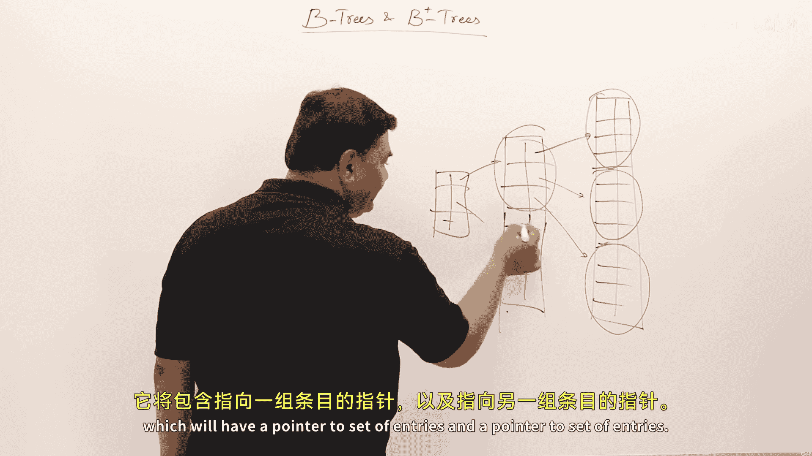

This how we can go on adding multilevel index if the database stable。

 supposeuppose here is a database stable。 and if size is growing。

 this index will grow and we will add one more index， one more index。

 adding multilevel indexes will reduce the number of block access。

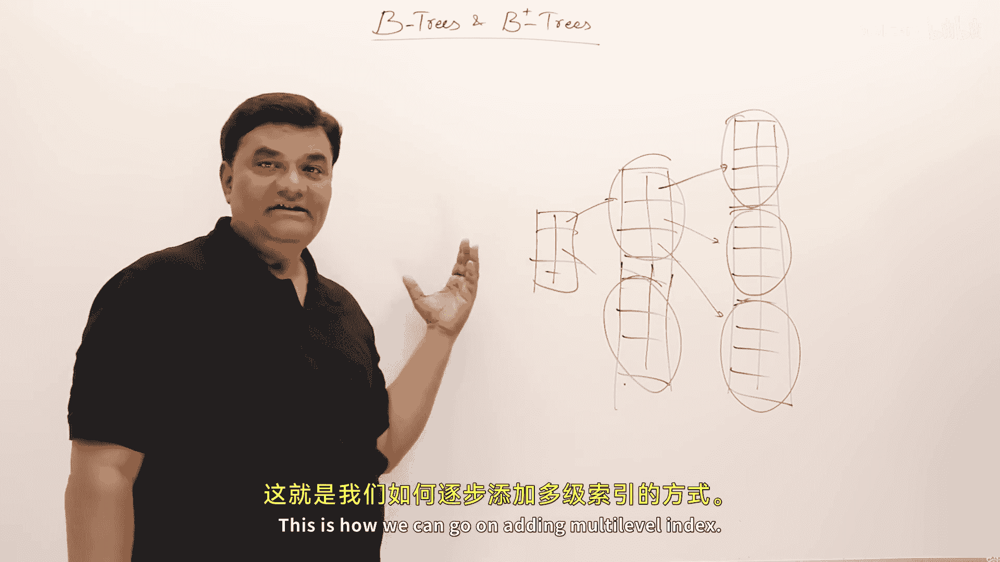

So if I just turn it around and see it like this。😡。

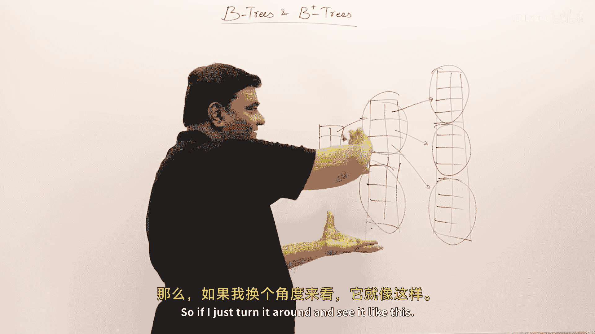

Next level index。Then， next level index。If I turn it around and see this。

 this or the multilevel index looks like Now， what is the requirement of multilevel index。

 Shall we add the index by manually， Shall we check that the database size is growing and then we should add indices one by one。

 that is high level indexdices。 No we want the high level indices to be added automatically and deleted also automatically If this is increasing table size is increasing and this index is increasing。

 then you add one more index If you are deleting the records。

 then the indice size will reduce and then you remove the high level index。

 we want selfmanage high level indices， that is multilevel indexing。😊。

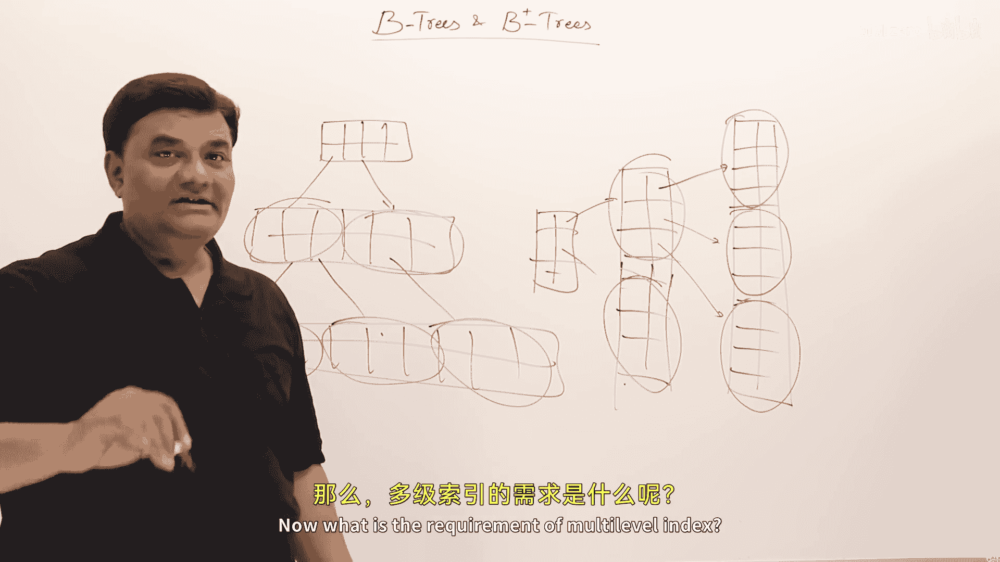

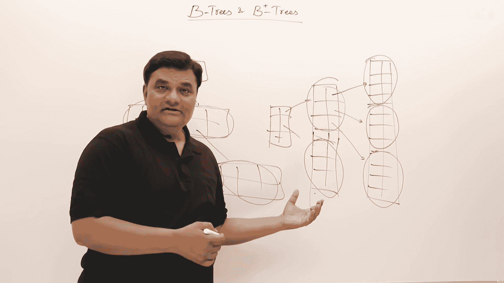

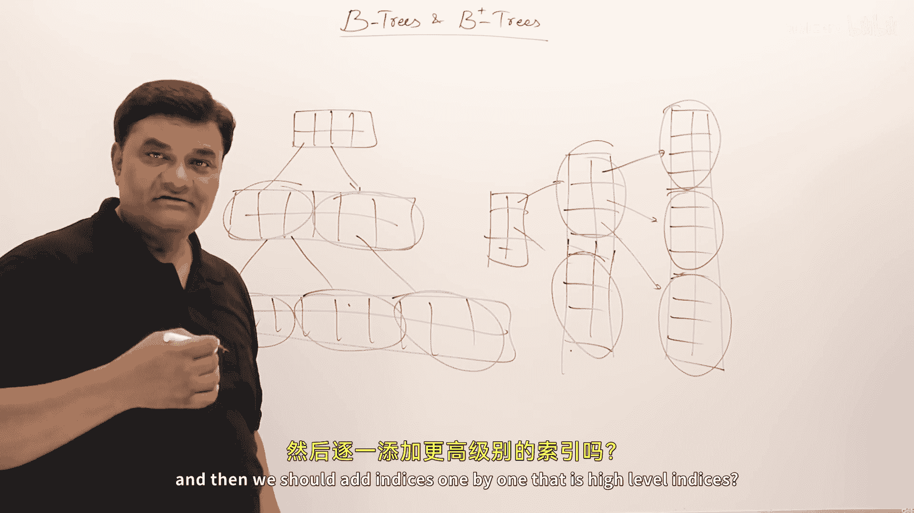

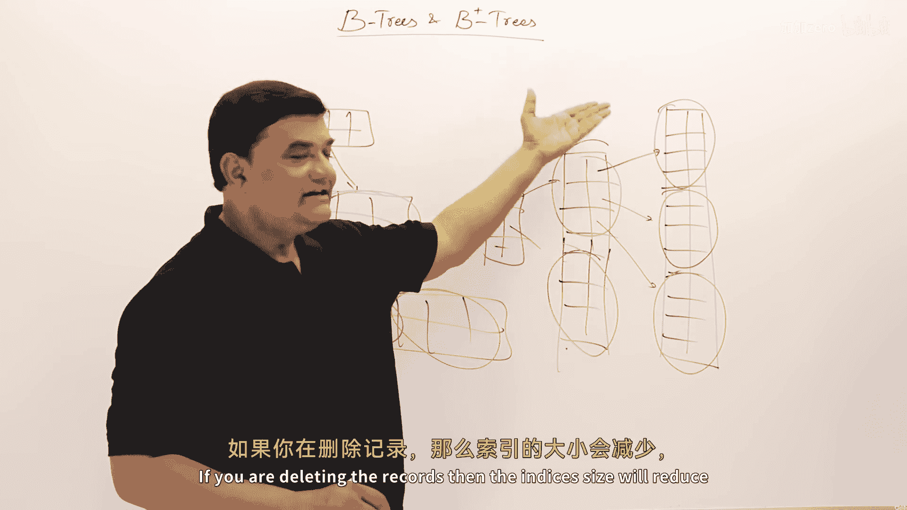

So the final thing is we want self manage multile indexing。

And that's how it gives the idea of B trees and B plus trees。

 So now you can see that this multile indices are looking like a tree。 if I just turn their side ups。

 Then it looks like this。 B trees and B plus trees are actually originating from M search trees。

 So next I will discuss what are M search trees。 Then finally， we'll go to B trees and B plus trees。

 Let us talk about M search tree。😊。

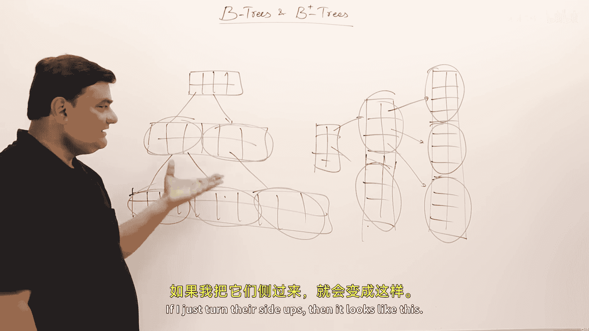

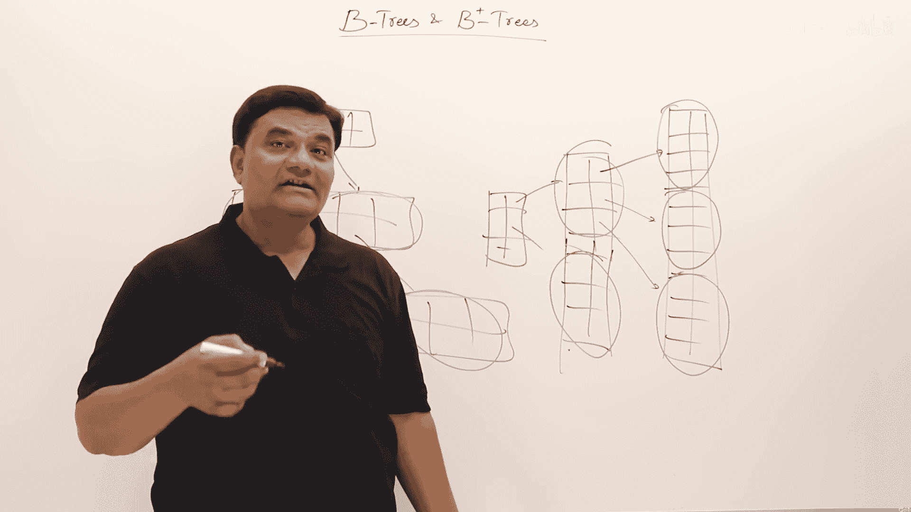

See for knowing about M search tree， let us recall about binary search tree。

Which is useful for searching purpose。 and for searching any key value， we start from the root。

 And if the key value is smaller， we go on the left hand side， if the key value is larger。

 we go on the right hand side。 like this a binary search tree。

 If I'm searching for 15 then 15 is greater than this。 I'll go this side。15 is smaller than this。

 So I'll go this side and it is found。 So we know that the smaller keys are arranged on the left side and the larger keys are arranged on the right side。

 This is what done in binary search tree。In binary search tree， how many keys we can have per node。

 just one key and how many children each node can have， How many children。There can be two children。

 Each node can have maximum two children。 So that's why it is called as binary tray binary bindingments。

 two children。

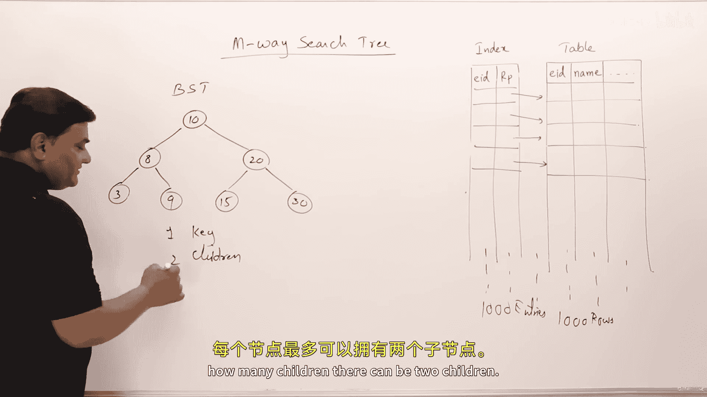

So it means can we have a tree with more than two children or more than one keys。

 Let us check20 and 50。 These are the two keys。 Now this side I will have the keys which are smaller than 20 so that is 10 and 15 and here I will have the keys that are in between these two that is 30。

35 and here I will have the keys that are greater than this So that is 60 and 90。

 So here we can have a search a tree like this also there is a search tree。

 This is the following the idea of same as binary search tree。

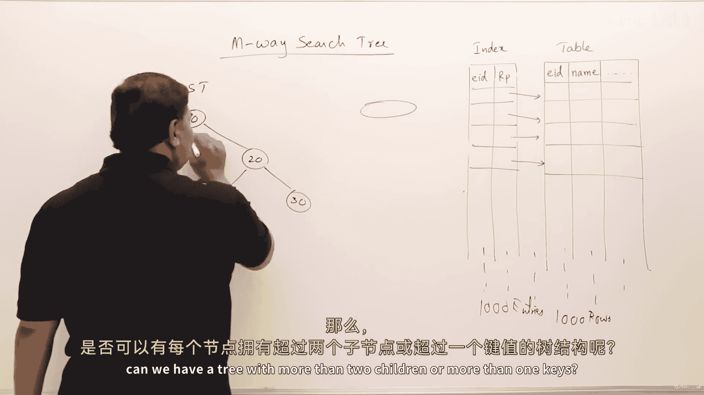

See， the keys are arranged such that they are in the increasing order。 So if you see the keys here。

 see first key is smaller than second key and smaller than third key。 If you have more keys。

 they will be arranged like this。 And if I am searching for 30， then I'll start from here。

30 is greater than 20。30 is less than 50， so it must mean this child come here。30 is found。

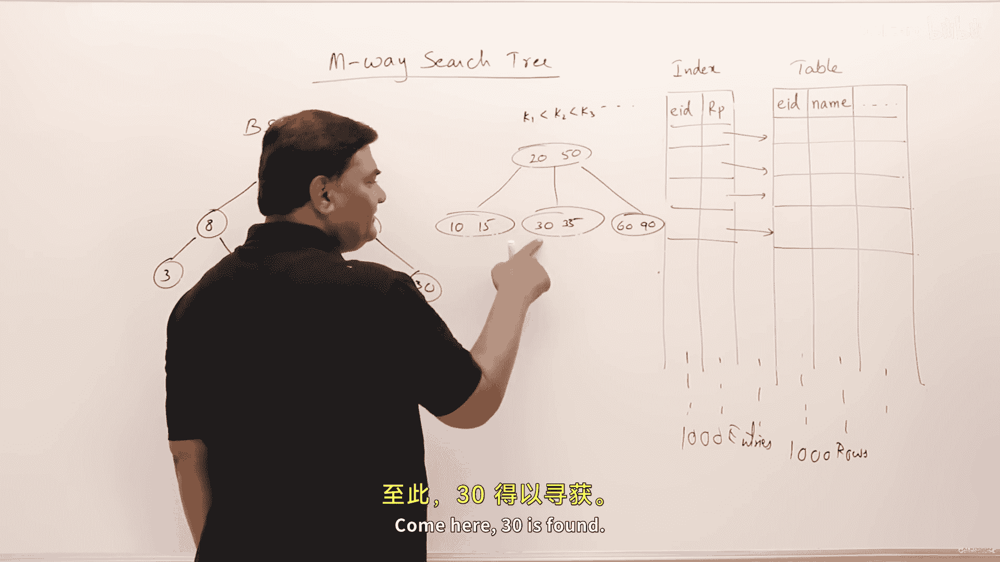

So no doubt the amount of time taken for searching is little more than binary search tree。

 but the approach of searching is same。 So these trees are called as。

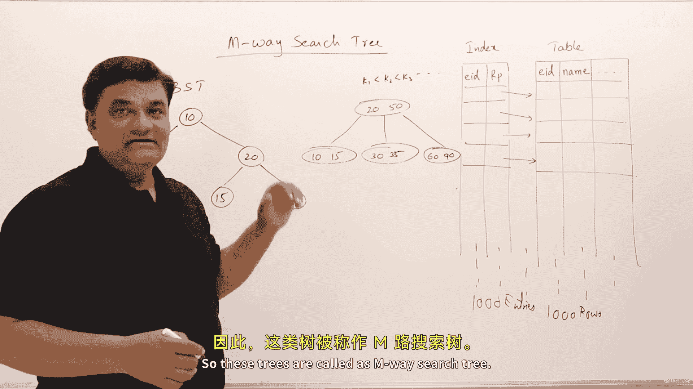

MV search tree。 So what is this M。 See how many keys it is having In this example it is having two keys。

 Then how many children it is having。 So each node can have maximum 3 children。

 So this is three way search tree。 This is a three way search tree。

This is called three way search tree。 So in this way。

 M search tree means what search tree in which each node can have at most M children， M search tree。

 So each node can have at most M children。 So how many keys， M-1 keys。

So M is based on the number of children that is the degree of a node。

MV search trees are the extension of binary search you can say。

 or else you can say binary search is a type of M search tree with a degree2。

So you can have degree 3 also degree 5 also degree 0 also degree thousand00 also。

 So it means you can have hundred keys here and each node can have10 keys and 100 plus one children。

So you can have any degree of search tree。This is about M search tree。

 Let us look at the node of M search tree。 Like for binary search tree。

 how we prepare a node is we will have data here and two children Then here you need more number of children。

 So let me draw the node for this one If the M search tree is search tree STM writing I suppose four way search tree means each node can have four children and three keys。

 Let me draw a node structure。

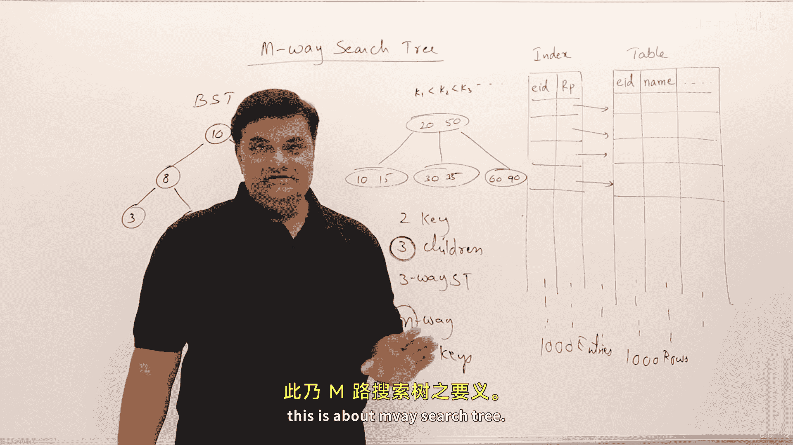

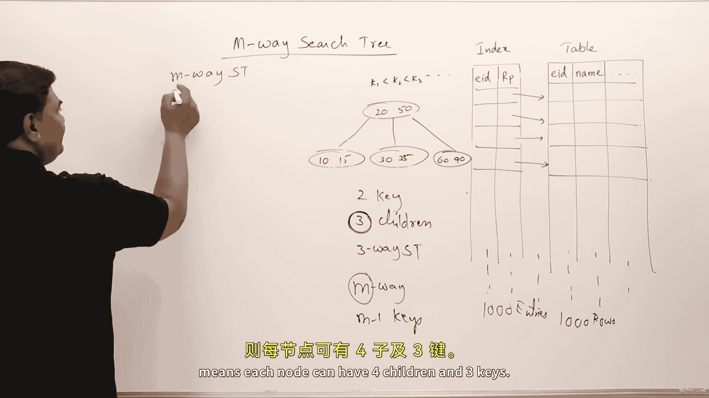

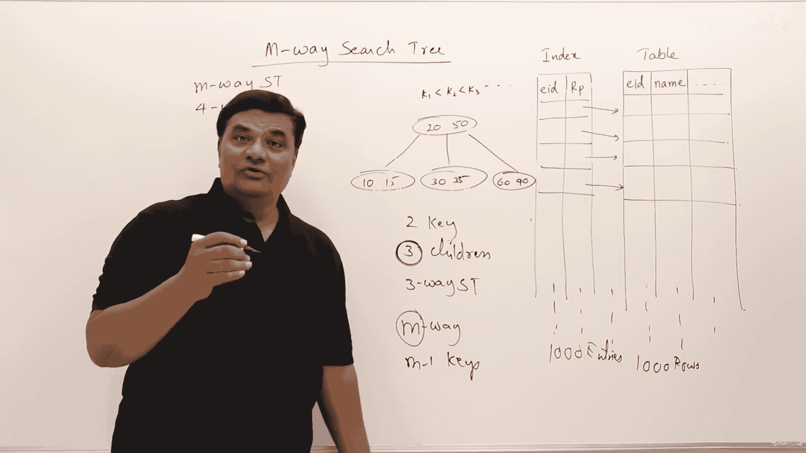

This should be a child pointer。Pointed to the child。 And this is key 1。 And again。

 this is appointed to a child。 And this is the key to。 and this appointed to a child。

 And this is key 3。 And this is appointed to a child。 So four child pointer。 So this is four way。

 And when it is a four way， then there can be three keys。

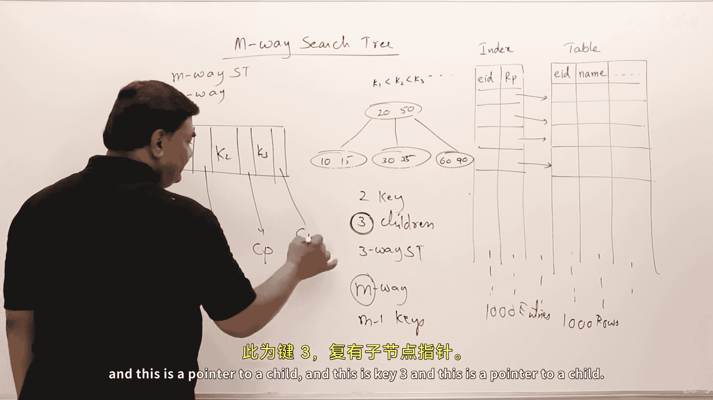

That is Mserv。 a node can have M-1 keys。 So it is just like this。

 This is a diagrammetric representation。 And if you are making a data structure。

 then the node structure looks like this。 So if there are M children。

 then M-1 key space are required。

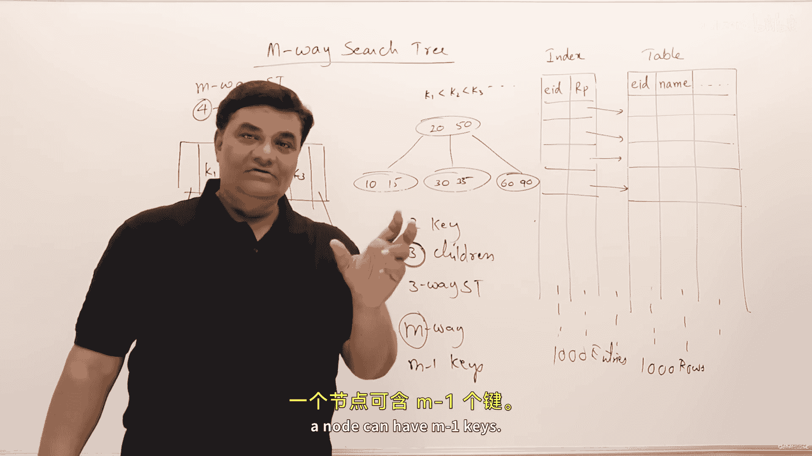

Now next。Can we use this search trees， these nose structure for preparing index。 Let us see。

 So I will try to use this for making index。 So let us check how we can do this for four way search tree where。

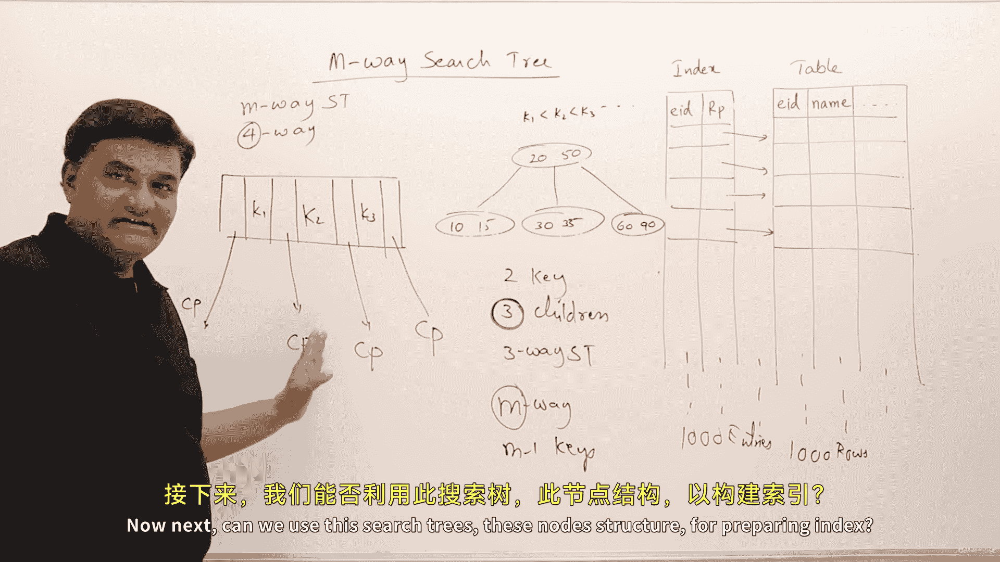

There can be four children， so this is a child pointer。Okay， now this is key1。

And this is next child pointer。Then， this is key to。Then this is a next child pointer。

 Then this is key 3， and4 child pointer， So child pointer 1，2，3，4。

 Then what is this I am adding see this after every key， I have a pointer。

 This is nothing but see if you have keys here。 and you are taking a M searchty benefit of M searchty as an index。

 then apart from the child pointer， you should have also a pointer to a record。

 That is a record pointer。 So， yes， we will also have a record pointer。 So this is a record pointer。

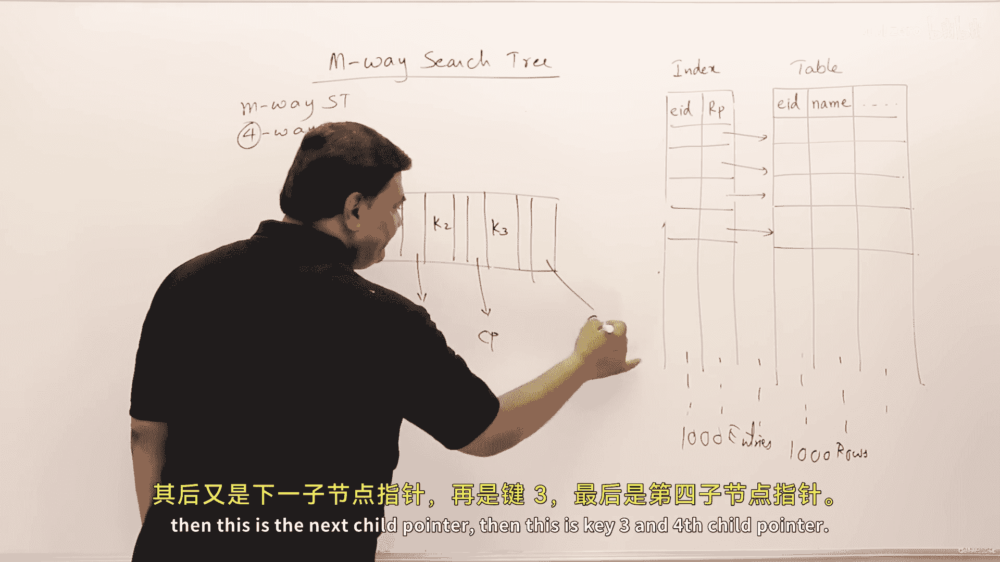

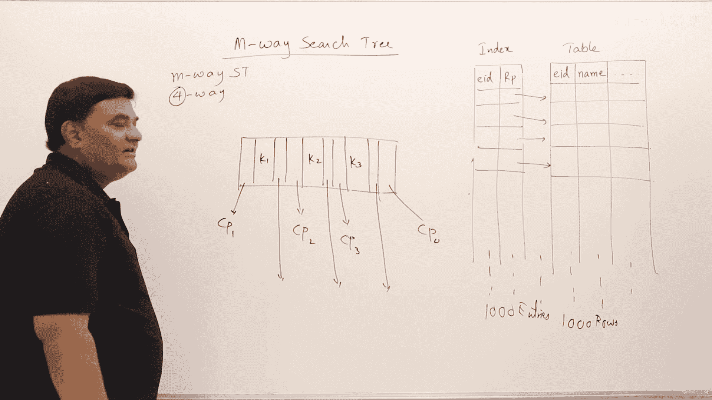

But a got pointed out。So we can utilize M search trees for indices that is multileve indices like three will have multiple level so for making multileve inices we can utilize M search tree but the node structure should be like this so just remember this node structure see keys are there and child pointer so four degree4 so four child pointer three keys so three record pointers for each record for each key there is a pointer to the record to the database record。

Now， if we simply use M search tree， what will be the problem and how we can overcome the problem and we introduce B trees。

 Now we are going towards B trees now。 till here， we have discuss about M search tree。

 Now I am taking you to B3。 And in B3， we will use the same node structure。 Just remember this again。

 I may not be showing you This is the node structure that is followed in B trees。

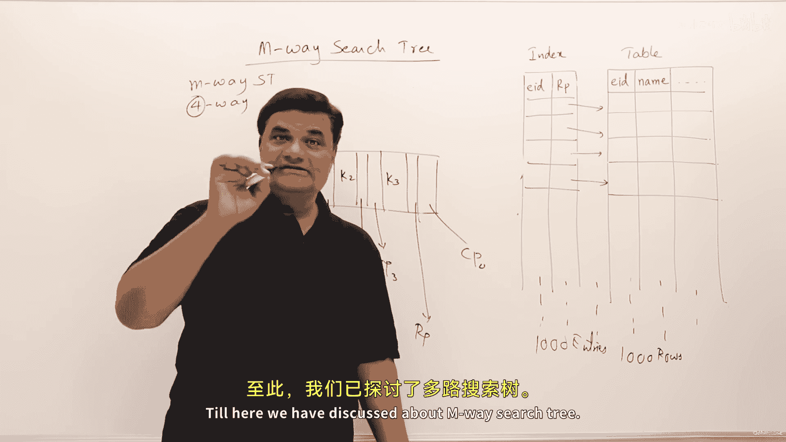

But first of all， let us know what is the problem with Amstry then how Bearies are different from Mhirries。

 Let us see how insertion is done in Amtry and what is its problem Then we'll move on to Bearies。

For that to make you realize the problem I have taken 10 way search3。

 10 way a degree10 means each node can have 10 children and  nine keys and suppose I have to insert these keys let us see how I can insert。

For certain， there is nothing。 So I will create a node， and insert。

How many more keys I can have here，8 more keys I can have here， But for inserting 20。

 I will create a new node as a child and insert 20， then inserting 3010。

That is smaller 30 comes on right side， So I' will not insert here。

 but I'll come to this And 2030 is greater than this。 or I will insert 30 here。

So I can insert like this also， but this is wrong。

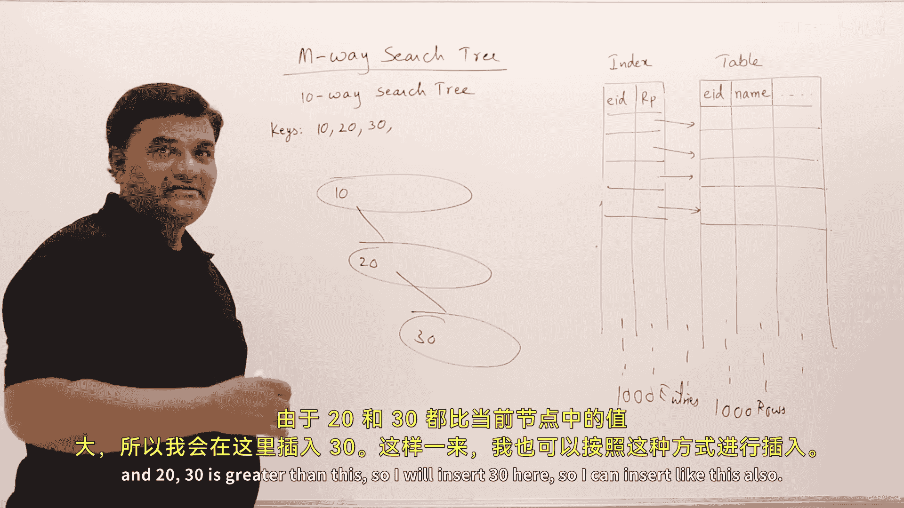

I should first fill up this node， then only I should think of creating next node。

 but there is no control on M search3。 you can insert as you like。

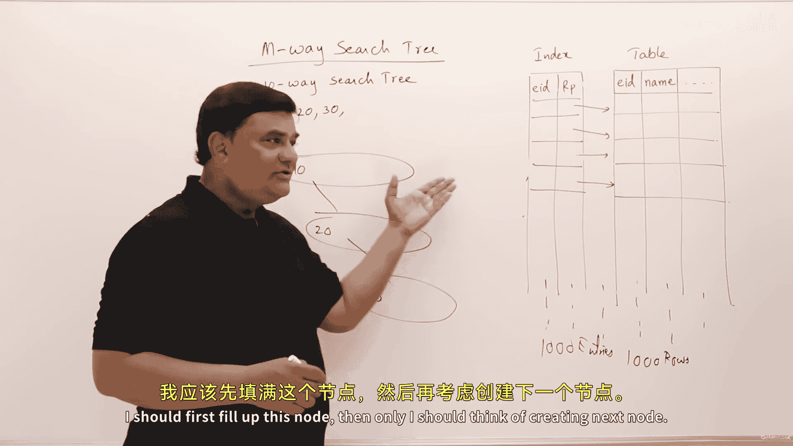

So it means if I have any keys， then what will be the height of m n so this will be too much time consumed I it becomes similar to linear search。

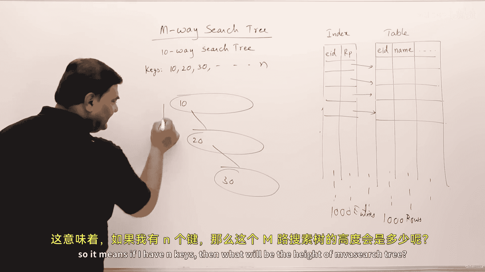

That's the problem with M search tree。 So what is the problem with M search3。

 The creation process is not under any control。 There are no guidelines for creation process you can create as you like。

 if suppose you are creating it like this， then it's a waste of time。

It will take a lot of time for searching。 Then there must be some rules or guidelines for creating M search。

 Yes， those guidelines are called as。

Beries。So beet trees are nothing but emur trees with some rules。

Let us see what are those rules I'll explain， Let us see what are beries。

 beet trees are nothing but embassories with some rules。

 so what are the rules let us see see the first three。

Every node you must fill at least half， half what。If the degree is M。

 M by two children must be there。 So M by 2 C value is taken， not floor。 M by 2。

 means if degree is at 10 means 5 children must be there for a noded。

 Every node must have five children。 then only you think of creating new node。

 That's what to control the height of M search。 This is the rule。

You can create a next node only if the current node as at least half a filled with the children。

This is one。And by two， children， must be there。Then， second thing。

How we can impose this condition on a root。 We cannot impose this condition on a route。 If we impose。

 then we cannot insert even a first value also。 So root can have。Minimum。都7了。

So root means the first one， so first node can have minimum to children， right。

 so it means it can have just one key Also no problem。 but what about all other nodes。

 they must have at least half of the children。This is the conditions， two conditions。

 not third conditions。 Then the third rule is all leaf nodes must be at same level， all leaf at。Same。

11。That's it， These are the three things if you are following for creation of a M search tree。

 so actually we are creating B3。And one more important thing here is that the creation process is。

Fourth point is the creation processes bottom up。Creation processes bottom up。

 So now I will take some keys， and I'll show you how a B tree is generated from bottom up。

 So for that， I'll not take a 10 way Thursday。 I'll take a small degree3 and show you how a beat tree is created in other words。

 how insertist。 We will create a B3 of degree 4 means each note can have four children and three keys。

 So I have taken some of the keys here。 Then I'll be inserting more and more nodes。

 So I will add more keys afterwards。 Lets start first。There is no node at all for P I'm inserting。

 so that is 10。First key， so it can have how many children， two children。

 and as per the multi level index when we said then it can have one record pointer。The next 20。

20 will be inserted here。That is greater and that is inserted here。Mix is 50。

 There is no space for 50。 All three keys are there degrees 4， so we cannot insert 50，50。

 There is no space。 Then what we should do Sp this node and create one more node。 So out of 10，20。

40 and 50。Two keys。 I will keep this side and one key， I will send this side for T。

 I will send it in the root。 Then this is the left child。 This is the right child。That's it。

 So when the node was filled， there was no free space。 then for inserting a key。

 we have splited a node and one of the key we have sent it on the route out of 4。

 including 50 out of 4 to this side， one， that side 40 up。

This is how splitting is done while creating a wheat tree。

 And you can see that the tree is growing upwards。 So that's it。 It's created bottom up。

And I was telling you that this is be trees are useful for implementing multilevel indexing。

 Then if you say this is one first level index， then above that is the second level index created automatically。

 If you add keys here automatically， this is created。

Now let us see I will add more keys here then again you can see that this is growing。So。

 let us continue。I will insert few more keys。 Let us say 60。 So 60 comes here， Then 70，70 comes here。

 Then 80，80， there is no space here。80 should come here。 There is no space， then split again。

Then what I should do， including 80，50，60，70 and 80。

 So 80 should go this site and 70 should be in the route。There's the check。Now。

 the tree looks like this。Then。Next， I will insert 30。30，30 will come here。Then I will insert 35。

 There is no space for 35 here。 then split。 So as there is no space， I will split this side。

 So out of 10，20，30 and 35。35， this is should go in the route and 1020 this side and 35 on this side。

 right side，35 on this side。 Then who will go in the route 30。 So I will redraw it 30。40 and 70。

 I'll remove this。Yeah， watch it。 This is the child， deinate child， this is the child。

 this is the child。This is what that thing looks like now。See， whenever the node is becoming filled。

 we are splitting it， and we are sending one of the key in the parent。

 Now will try to fill few more keys here and let us see。 I want to insert 5。 So where 5 will come。

5 will come in the beginning。 So 5，10 and 20。Now， I want to insert 15，15， there is no space。 So 5，10。

15 and 20， There is no space for 15。 Then arrange them in this order。

 Then there is no space once split it。 So for splitting， I will create one more node on this side。

5 and 10。 this side andm 20 this side。 Now，15 should go up here。 This should go up。Right。

 a chavin mo point。 You will be thinking that why why I am sending third key。

 I want to send second key。 Okay， that is your choice。

 So you can make it either less by asked or right by asked。

 So either way you can do that not is left by as means it is more keys are on the left side。

 So whichever one you want， you can take it。So 15 bos of 20 on the side and 5 and 10 the side。 Now。

 there is no space here also。 So here also， you split it。 So out of Romanmini keys，1530，40 and 70。

 So 15 and 30， this side，70， that side。And。40 in the parent。So this will be on this side。

 This will be on this side。 Now， all these links will also change because we are splitting it。

 So this is on this side。 This is on this side， this one。

 and I will draw it little far from this one，70。Then 70s left and 70s right。

So now you can see there are three levels，1，2，3， so three levels of indices are created。

 and this is how B3 is generated by inserting keys。

And the height of a beat tree is increasing， and this is same as a multi level index。😊。

So this is the creation process。 So it's under control。 and all leaf nodes are at same level。

 So they are looking like more like a index。 and this at same level。 This is forming index。

 and above one is also an index。 So I have shown you how to insert and how to create a battery tree。

😊。

Now， let us see how it is useful for the databases。

 Just minor things are very important and key points， I am showing you。

 as we discussed just now that every node will have a pointer to the child node as well as a record pointer。

 this 20 will have a record pointer 5 will have a record pointer 10 will have a pointer。

15 will have a record pointer 30 will have a record pointer。

 every key will have a record pointer Also that is pointing on the database。

 So this is useful for implementing multilevel index apart from the child pointer is a record pointer。

 So a B3 node can have what key child pointer that is a block pointer。 and this a record pointer。

 That's it。 That's it about B3。

I did not show deletion。

It depends how much you have understood from this one， just you reply me back。

 leave you a comment and if required， I'll prepare deletion also。

Okay， actually， I wanted to show you what is the application of B3 and B plus3。

 so I have started my topic right from indexing and brought you up to this point so that you can understand the relation with the databases and B trees。

 otherwise mostly people study just about Bries and B plus3 without knowing indexing and databases。

 So now you can relate it with the databases。

Now the last thing。 what is B plus 3。Ass a very simple thing， let me show you quickly。 Just。

 I will modify this。 What is B plus 3 in B plus3， we will not have a record pointer from every node。

 We will not have a record pointer from every node。 We will have a record pointers。

 only from leaf nodes， only from leaf nodes we have a record point。Then what about these keys。

 Every key will have its copy in the leaf node。 So means who is missing here，15 is missing here。

 So 15 will be here Also 20。 So 15 will have its copy here also。

 So there will be record pointer for 15 Also 20 Also。

 then 30 here will have a copy of 30 also and 35。 So what what what about 40。

40 will have a copy here。 Also，40 will be having a copy here。 So 40 and 50 and 60。

 So3 record pointers。 So 70 will also be present in this one。

 So every key in the tree will definitely present in the leaf。

 and this leaf nodes are connected like this， like a link list。

So this becomes a dense index。 Now， This is exactly like multile indexing。 So this is Bepless tree。

So what are the differences from B3 to B plus3， let me quickly tell you that all the keys are present in the leaf nodes and in non leaf nodes。

 their duplicates may be present。

Every key must be present in leaf， and there are no record pointer from non leaf nodes。

 The record pointer will be from only leaf nodes， so。

Leeaaf nodes， all leaf nodes as they are at same level。 they'll form a linked list。

 These are the points。 Then this becomes a dense index。 This becomes a dense index。

 Then this is a sparse index Next level， the next level is sparse index。

 So rather than B 3 B plus 3 is more like multile index。

 So what is plus in this one that I have shown you。

 So if you understand B 3 understanding B plus 3 is not difficult。

That's solved with this topic there is a analysis and a lot of things are there。

 so it's a big topic the purpose of coverage of this topic was to relate it with the databases。

Alright so I have covered more from the database side than just B trees and B plus trees。

 so just B plus B trees and B plus trees can also be taken as a topic and discuss leave your comments。

 let me know if required I will prepare a separate video。

