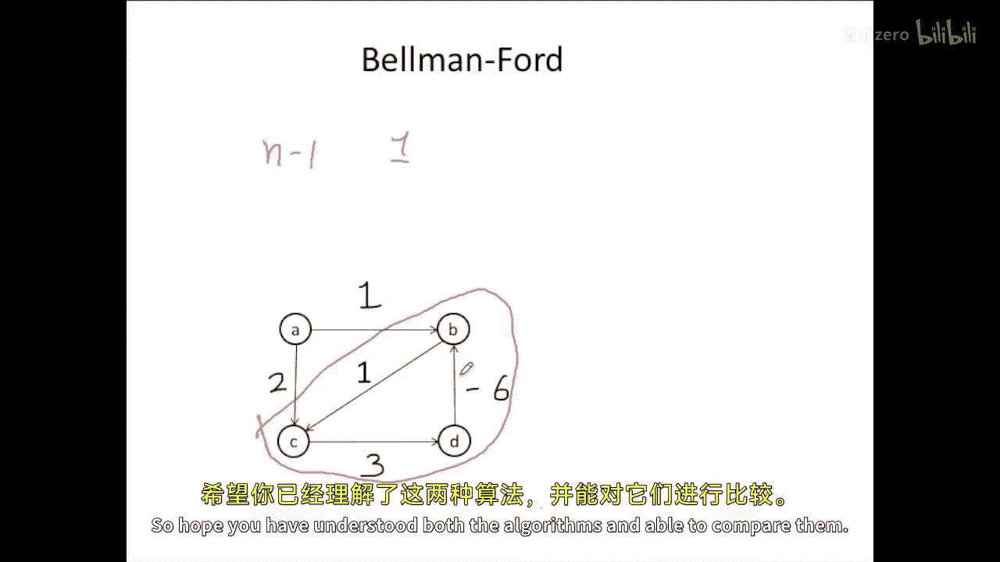
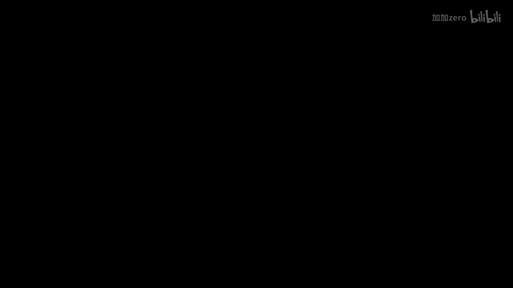

# 【精译⚡算法导论】AbdulBari p80 p79 Shortest Path Algorithms (Dijkstra and Bellman-Ford)  - Simplified -BV1hhPXeTEWM_p80-

In this video I'm going to talk about shortest path algorithms that are dister algorithm and Belman For algorithm。

So the problem is to find a。Shortest path from one of the vertex to all other vertices in a graph。

There is a simple graph I have taken with just three vertices， T U and V。

Suppose I select this as the starting vertex that a city is my starting vertex。

 I have to find the shortest part from T to U and T to v。If I look into this graph。

 there is a direct part single edge part from T2 U that is of。Wight 5。

But there is no direct part from。U to T to v， so as there is no direct path， I say it is infinity。

But。We have to find out a path that may be of single edge or that may be having more than one edges so from this graph we can see once I have reached U。

T to U and the cost is 5 from here I can see that there is a path to v and the cost of the path is 8。

So this is what we do so we have to find out the shortest path from some starting vertex to all the vertices。

 maybe a direct edge path or maybe going via other verortices about a procedure。

 how to find the shortest path for that we look at a condition。That is a relaxation condition。

 so here I'll show you let us find the distance for each vertex as this server starting vertex so distance for this vertex is 0。

And from this starting vertex to U， the distance is 5 and from t to v， there is no direct edge。

 so I say this is infinity。So if I stop here I can say that the shortest part from T to U is 5hi and t2 v is infinity。

I can stop here， but no if I follow the extra algorithm for finding the shortest path containing one edge or more than one edges also。

So here I check this condition and try to update the vertices if I say there is the shortest path from t to U that is of distance 5。

 and if I select this， once I select this I see that from verortex U is then the shortest path to any other vertex。

So I will check this condition。Check this condition the distance of U plus cost of an H U2 v that is 5 plus3。

That makes8。And that is less than distance of v， yes， this is infinity。

 so update this one distance of v make it as8。So this what this vertex is relaxed after checking this condition。

 see how thetri algorithm works if I make this as a starting vertex and the distance of this vertex is0。

And distance from P to Q is 1。And B2， E is 7。P2 S is 6。And P to R。

 there is no direct edge so let us make it infinity。P2。U， there is no direct edge。

 so let us make infinity。Now I have labeled all the vertices and found the distances from the starting vertex to that particular vertex。

Now， I have to find the shortest part to all the vertices。 So here I start the procedure。

 I have to pick up the。Shutest path first means from P。

 which vertex is closest or very much closer to P， so that is cube， so I will select this vertex。

Once I have selected at this vertex， I have to see that are there any vertices that are going to get relaxed？

So you's see this one one。Plus1 that is 2， so this is infinity now change we got a shorter path from Q to r that is 2。

 so the total part from p to Q and Q to r， the cost is 2。And next here it is 1 plus 4。

 but right now it is labeled at 6， so 1 plus4 is 5， so this is shorter than the existing path。

Then from Q， there are only two vers， leave it。Now。

 as we have selected Q now we have to select the next shortest part。

 so the remaining vertices for which we have the parts are7 infinity5 and 2 so this is shortest one。

 so I will select this one this is the second vertex I'm selecting。From here。

 I'll see are there any vertices who are having shortest part via R？Yeah，2 plus one that is 3。

 so this infinity change it to  three。And 2 plus 2 that is 4， so right now it is 5。

 so this 4 is smaller than that， so Ill take 4。So these are two vertices are updated。

Yeah now how many verses are remaining T and U and S3 are remaining two are already selected we found the shortest part now have to pick up the next smallest one the next shortest part is U。

That is the distance is 3。So from here I should check is there any update to other vertices。

 is there any shorter part to other vertices from U so from you there are no edges going out so I'll just leave it。

Now I have to find a shorter part next one that is this is4， so Ill select this one。

 this is the shortest one。Next four。Plus 3 is 7， this is all three7， so there is no change。

So thats all s is also selected now the only vertex that is remaining is t。

 so I select that one also， so the cost of the path is still 7。

Right so now here you can see that all the vertices are labeled with their shortest parts。

 so from p to Q it is 1 from p to R it is 2， so that is coming via  Q。

 then p to U is a 3 that is coming via Q and R and from p to S it is 4。

 it is coming via p Q R and then S。And from P to T， it is 7 and a direct edge path。

That's it one more graph and let us find out the shortest part to all the vertices using the algorithm and this is my starting vertex I' am labeling the starting vertex。

 so this is 0。This is one。都。No direct part。 No direct spot。So it is infinity。

Now I have to tell select the shortest word path vertex that is B。

 I select this one because it is1 to infinity infinity infinity so out of all these vertices this is shortest one which is having distance as1 so I select this from here I see are there any relaxation to any vertices B2 C there is a edge and1 plus one2 solid2 no change。

B2 D。One plus 3 that is 4， so change it to 4。B to E 1 plus 2 that is 3， and it is infinity。

 change it to3。That's it from B， there are three edges going out， so this is done。

 I have relaxed the vertices。Now， select the next shortest one， so the remaining are。C， D E F。

So shortest one is C select this one， so it means I have found the shortest path to c selecting means I have finalized the shortest path from a to C that cost is2 now after finishing this I see that is there any possibility of changing other。

Vertices， the cost of other verrtices， so there is C， so2 plus2，4 and it is 3， there is no change。

2 plus 1 is 3 and this is 4， so change it to  three。

That's all there are only two words going out from here， so this is updated。

Finished now I have to select the shortest parts from remaining that is a D E and F these3 are remaining I have not found the shortest parts to them。

So I'll select the。Minimum one， so D they are of same value， so I select a D first。This is three。

And this is the shortest path to D， so from here I'll see is there any relaxation？3 plus 3 is6。

 so this infinity change it to 6， then 3 plus4 is 7 and this is already three， so there is no change。

That's all。Now， remaining two vertices are there， E and F。E。Is the shortest one， so I select this。

3 plus 3 is 6， it is already6， there is no update， then last vertex remaining is f。

 so I have selected all the vertices selected means I have found the shortest parts to them。

 and the shortest parts starting from a to all of the vertices is label above those vertices that is Bs1。

 Cs2， D3， E3 and Fs6。If you want to analyze the time complexity of the cell algorithm。

For the extra shock is pa go， let us say there are v number of vertices。1，2，3，4，5，6， that is。

Size of v is 6， so number of vertices are v， so we have to find the shortest part to all these vertices for from a to every other vertex。

 So let us say it is v。Then while finding shortest part to each vertex， we check。

Are the other vertices getting relaxed？So how many vertices we have to check at most。

 we have to check v number of vertices every time。 let us assume this。

 so the time complexity will be。V square， so if we say there are n vertices。

 then it will be n squared， so it is order of n squared。Right。😡，By using red black3。

 it is said that the time complexityity of this algorithm will be en n and how it will be using red black tree and how it will get this time you can browse through and find out。

Okay， next we move ahead what will happen if there are negative edges。In a graph。

 what text style algorithm will do。So let me select this as a starting vertex。

So this is zero and this is8。2。This is infinity。Let us start。I'll find the shortest part。

To this vertex because this is minimum2， so Ill select this vertex first I'll select this vertex。

So this is2 now from here I check is there any shorter part to any other vertex， yes，2 to 3。

 so this is5 and it is infinity， Ill modify it to 5。That's all。

Now remaining vertices are four and3 out of this， this is8 and this is 5， so I select5。

 I select this vertex。Now let us see， is there any shortest parts from here？Yeah。5 minus6 is minus1。

 so this is8， change it to minus1。Now the remaining vertex is 4。

 so I select this vertex and its part is minus1。That's it。 So if there is a negative edge。

 it is working perfectly。Let us see what will happen in this graph。

I'll use the external algorithm to find the shortest part to all the vertices。

 this is my starting vertex。So the distance is0， distance is 1， and this is 2。

 and there is no direct from one to 3， so this is infinity。

Now I'll start selecting the vertices to find the shortest part。

 So the shortest one from one to and infinity is one。 So I select this one。

 So this vertex is selected。 So it means I have found the shortest path。From 1 to 4 is  one。

 it is finished。Now I select from here there are no edges going out so I select the next one。

 the next the smallest one is 2， and the shortest part is 2。

 and from here I see that this can be relaxed so Ill change it to5。

And the next one remaining is this one， so Ill select this and once I select this， Ill see that。

Will the other vers get relaxed， so 5 minus6 is minus-1， so this will change to minus1。

So here the extra goes wrong the vertex， which I already selected and said that the shortest path to this vertex is 1 later its distance is getting modified。

 its path is getting modified， so it means in the first stage the extra has given me wrong result。

And as per the extra the vertices which are already selected which you have already found the shortest path。

 you should not relax them， you should not update them as per the extra algorithm。

 so but if I try to relax it it is getting changed so because the extra says that once the vertex is selected and that is the only shortest path to that vertex we don't have to update it further and it will not get updated at all。

But in case of negative edges it is getting updated。

 it is getting modified so the extra algorithm may not work perfectly always in case of negative edges in the previous example where you saw there was a negative edge this was negative edge and here it was working and in the other other one it is not working so it may or may not work when there are negative edges another algorithm。

That is Belman Ford's algorithm。This algorithm is for finding the shortest path just now we saw that the external algorithm was unable to find the path。

Perfectly always if there are negative edgeges so it may work it may not work perfectly so here we have another algorithm which works always when there are negative edgeges but though it is also having its drawback so first let us see it can find out the shortest part in this case so what beman For says that。

In contrast to the extrava the extra was saying that relax the vertices only once。

 but Belman Ford says that go on relaxing the vertices for some number of time so that finally you get the perfect shutest part or correct shortest part to all the vertices。

 so let us see what he says I am going to show you the procedure of Belman Ford。

So he says that from the graph you make the list of。Eches。List off。Edges。

 so here I pick up the list of edges。 so I will pick up。D to B。The last one。

 I am selecting this one first。Then next is C2。B。And next is。A to C The next one is。A to B。Right。

 these are a list of edges I have only four edges I have taken a very simple graph to understand this。

So I have not started from a to B， I have started from D to B， you can realize why I did so。

 so let us follow the procedure what Belmanford says first step is，Take the list of our lectures。And。

Mark the distances for all the vertices， so this is0。And make all these as infinity。

Even there is a direct edge path available， but don't consider it market as infinity only。

So the starting vertex that is the source vertex marked at zero rest of the vertices as infinity。

That's it Now go on relaxing the edges for how many times number of verrtices are four， so do it for。

Number of ver is minus1 times， that is3 times。Go on relaxing them。Let us do it。D，2， B。D is infinity。

 so infinity minus6 is infinity only and this is already infinity， so there is no change。Then C2D。

 infinity plus 3 is infinity only and this is not less than our infinity， so this infinity only。

A to C， a to C，0 plus 2，0 plus 2， this is0 and 2，0 plus 2 is 2， this is infinity， so change it to 2。

Two is are smaller than infinity。Then a to B0 plus 11， so this is infinity。

 one is a smaller than infinity， change it to1， so this I have done it one time。

So I will maintain the count， so I have finished it for one time。Now let me repeat once more。D to B。

 D is infinity。To be。😡，Infinity minus 6 is infinity and that is 1， so it will not change。

C2 D 2 plus 3 is 5， right， so this will change to5。Then A to C。

0 plus 2 is 2 and it is already 2 a to B， 0 plus 1 and1， it is already 1。

 so I have done it for two times， so1 plus 1，2 times。

Now let me repeat one more time D2 B 5 minus 6 s minus 1。

 and this is already one change it to minus1。Then say today。2 plus 35 is solid5， a2 c。

0 plus2 it's solid 2 a2 B0 plus 1 and one， this is minus1 so one is not less than minus1 so no change so that's it I have finished it for。

Third time， so I have completed the relaxation of all the list of edges。

Three times because there are four vertices， I have to do it for three times。

 So the idea behind Belman For is go on repeatedly relaxing the vertices for。

V minus1 times and all the vertices will definitely get relaxed and finally you get the correct shortest path to all the vertices even in case of negative edges。

Fight。How much time Belmanfort Algom takes？As there are in number of edges and we have to go through all of them for how many times v minus1 times v minus1 times so this is。

E into。V vs N。 So this is almost n squared。Right。V is there just just we are relaxing all that just one by one so e number of edges and how many times we are doing it number of what is is minus1 number of vertices let us say n so e into n so if you say both are n n so it is U of n square and sometimestime if there is a complete graph let us say the graph is like this。

If there is a complete graph in a complete graph， we know that the number of edges will be equal to n into n minus1 by 2。

 so this will be n square edges， so then the time complexity will be e into n and E itself is n square so n square into n will be n cube。

 so the time complexity of bemanford in case of complete graph in case of complete graph will be order of n cube。

Now let us see what will happen in this graph。 I have just added one more edge shear with the cost as one。

 so it's just same as previous graph， but just a new edge is added。

 so I'll perform bemanford on this one。I'll take the list of edges D2 B。And see do。B。It will see。

A to B。And be to see。So let me go on relaxing all of them。 So first I label the vertices。

 this is0 and this is infinity。So to all the vertices， we should make it density。

 let us relax D2 B infinity minus6 infinity no change， C2 d。C to d infinity plus 3。

 infinity no change AC 0 plus 2 that is infinity here so it will change this is smaller a to be 0 plus 11。

 so this will change to 1。Then B to C1 plus 1 is 2 ands already2， no change。

 nor relax again D2 B infinity minus6， there is no change。C2 d2 plus 35。

 so this will change to 5 A to C， no change A to B， there is no change， and B2 C B is 1。

1 plus 1 is 2， then it will remain too only， so I have finished two times so far third time。

D2 minus1 minus6 is minus1， so this will change to minus1。Then see today。2 plus 3，5 as it is A to C。

Z plus2 that is2 only。A2 B，0 plus 1。And salary -1 is smaller。 So no change B to C-1 and 1。Its a zero。

And this is two， so this will change too。C路。I have finished for three times。

 but I relax one more time and see what will happen as Belman For saying that if there are three。

 four vertices， you relax all of them for three times。

 every vertex will have a shortest path and it will be a correct shortest path that's what Belman Ford was saying。

 let us try again once more。Let us relax all of them D to B。5 minus6 is minus1 only， right then c2 d。

 C2 d 0 plus 3 is 3， and it is not 5， so change it to 3，3，5 is greater， so 3 is smaller。

 a to c a to c0 plus 22 only a2 B is1， it is minus1 only is better。

Then B2 C its minus1 and 1 that is 0， no change。So you can see that after finishing it for three times I got one of the vertex relaxed。

 that was 5 and it became 3， so there is a change if I repeat once again definitely I'll find some more vertices get relaxed let me do it again B2 d sorry d2 B so 3 minus 6 is minus 3 so this will be minus 3 minus3 is smaller than minus1。

C2 d0 plus 3 is 3 that is as it is a to C that is as it is a to b as it is b2 c minus 3 and 1 is minus2 this is also getting relaxed two vertices are getting so it means if I go on checking the condition all these list of vertices the vertices may be changing their distances I can and again so what is the problem here with Belman Ford so the problem here is if you see this。

B。And D。And see。It is an edge with one。There is an with3， there is an edge with 6。

 and these three are forming a cycle， and the cost of the cycle is 1 plus 3 minus6 is minus3。

 so the total cost of a cycle is negative。So this means that if there is a negative edge。

 no problem with Bmanford， but if the edges in the part of a cycle and the total weight of a cycle is negative。

 that Bmanford also cannot work on that graph。So Belllman Ford fails if there is a negative cycle in the graph。

 so here is a negative cycle。Like， so。This is the negative cycle in the graph。

So Belman 4 doesn't work but。After relaxing the vertices for edges for1 minus one time and minus one time and again if we repeat it for one more time Belman For can show that there are some verrtices getting updated。

 it means there is a negative cycle， so Belman For can detect if there is a negative cycle but it cannot solve if there is a negative cycle。

So hope you understood put the algorithm and able to compare them。

All， thank you for watching， please leave your feedback。

