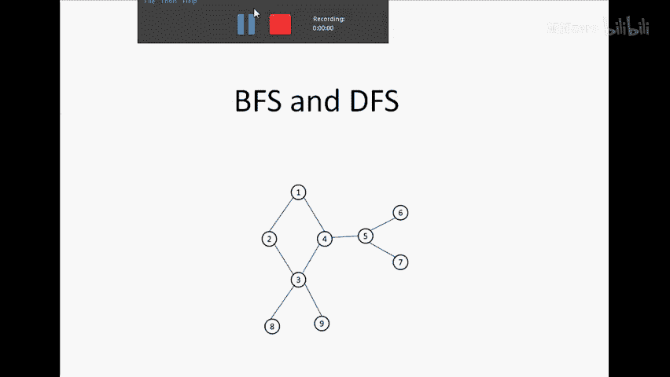
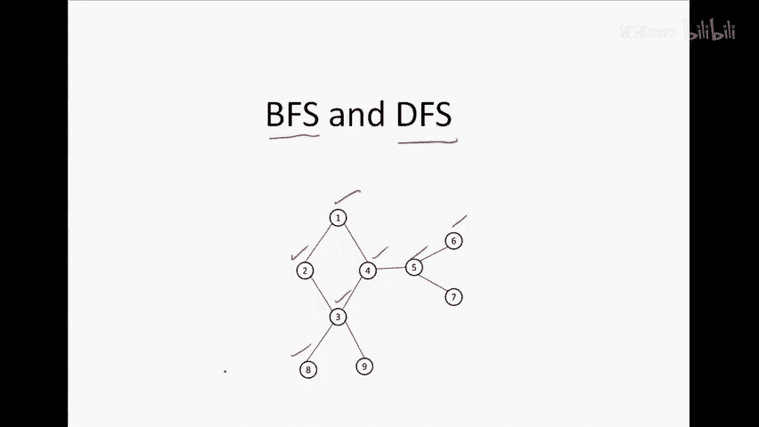
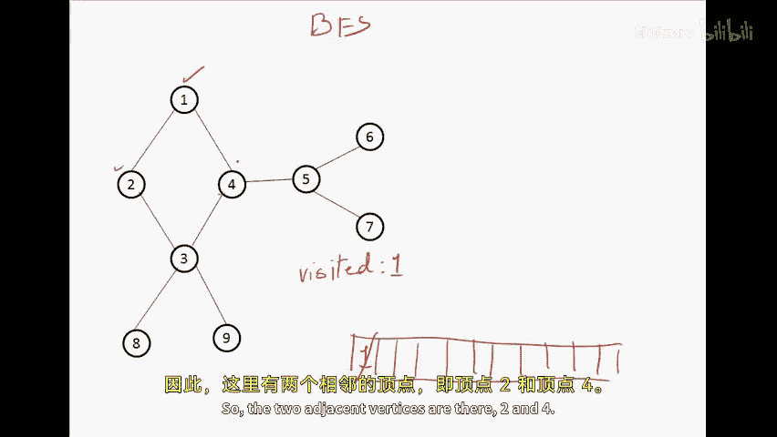
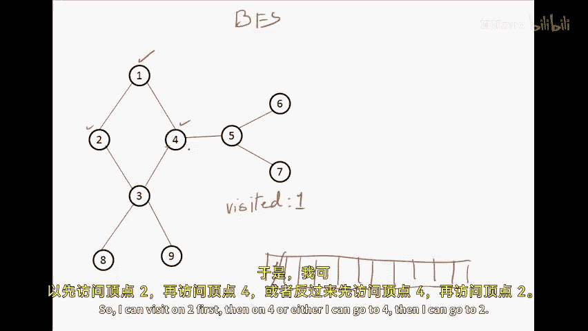
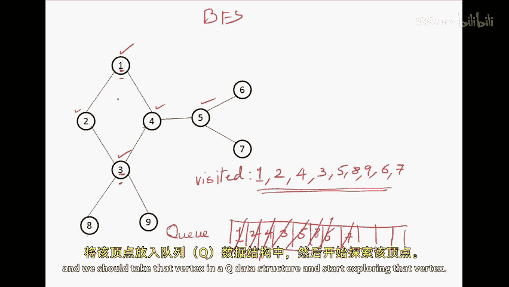
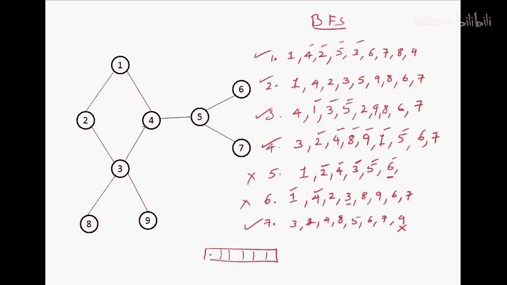
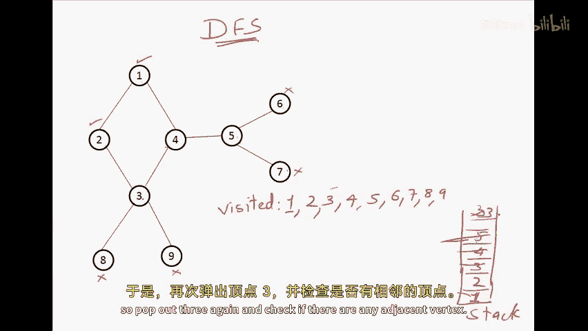
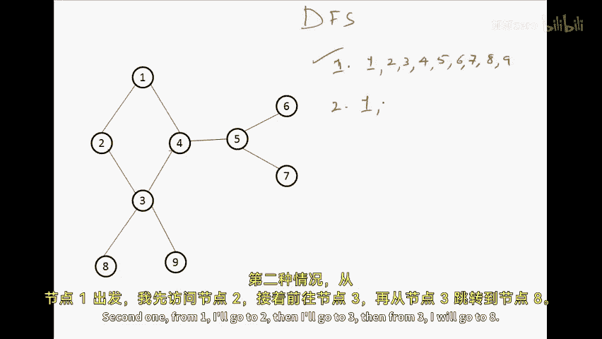
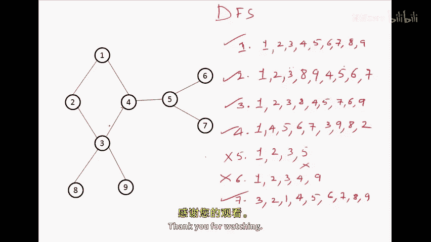

# 【精译⚡算法导论】AbdulBari p81 p80 BFS DFS - Simplified -BV1hhPXeTEWM_p81-

Hi。This video is about graph traveral methods。Brereadth first search or breath first traveral or depth first search。

 These are two graph travers cell methods。 traversing means visiting all the veres of a graph。

Visiting all the vertices funds。

For discussing about reval methods， I have to。Tell you about two terms。

Visiting a vertex means going through some vertex。Next， Thomas。Exploration。

Exploration means visiting all the adjacent vertices of a given vertex suppose for four。

 the adjacent vertices are 1，3 and 5。And for five， adjacent vertices are 6，7， and 4。

So exploration means visiting all the adjacent verticexes of a given vertex。

 so these are the two terms using which we can study breath for search and defer search。

So first let us talk about breakfast search。The order in which。The vertices are visited。

 I am going to write them here。And I need one data structure。So I take that data structure here。

Now lets us start。For traversing， I can pick up any of the vertex as a starting vertex。

 so here I prefer taking vertex1 as a static vertex。I will select one。So， one is visited。

That visited verex I keep it here in this data structure。Now I have to start exploring the vertex 1。

 so I'll pick up this one I'll take out from here and start exploring so the two adjacent vertices are there 2 and 4。

So I can visit on two。First， then on4 or either I can go to4 then I can go to 2。

 so Ill select two here。

So， two is visited。Then，4 is visited。Now one is completely explored， this one is completely explored。

 I should start exploration of next vertex， so I'll pick up the next vertex from here too。So for 2。

 adjacent versus is S of 1。And3。So one is already visited， the new vertex is 3， so 3 is visited。

2 is completely explored。Now I should start exploration of next vertex。

 so from where I should pick the next vertex so that is from data structure， so the next vertex is 4。

So for four， adjacent vertices are5 and three，3 is already visited。So five is taken here。

This is a newly visited vertex。Now4 is completely exploded。So next vertex for exploration is 3。

 so for three adjacent vertices are 8 and 9， I can pick up any one of these， so I'll take8 first。

Then，9。Now， trees is completely exploded。I will pick up next vertex so if you observe this data structure。

 the vertices are added here whenever a new vertex is visited it is added here。

 and we are picking up the vertices on Fi for fashion， so this data structure is a Q data structure。

So the next vertex for exploration is 5，5， the dis vertices are 6 and 7。

 so I have visited6 and then 7。Now next vertex for exploration is 8。For8。

 there is no adjacent vertex 3 was there which is already visited6。5 was there， which was visited7。

And5 was there， which was visited。So， this is what the。Breakfast search， driver shall got。

By picking the first vertex as one， we have got the traveral。

 and this is how breakfast search traveral work。So here the procedure is we can start from any vertex。

And we should take that vertex in a Q data structure。

I'll start exploring that vertex。So every new verortex is added to Q。And。

Next vertex for exploration must be selected from Q。Select vertex for。Exploration。From cube。

That's it。So let us try it again。Breakfast search。First verortex I have visited was one。Then。Do。And4。

Then I have selected two for exploration， so I got the vertex 3。Then from 4， I got the vertex 5。

Then three exploration of 3， I got 8 and 9。And the explanation of5 gave me。6 and 7。

So I got a tree like structure。 This is called as。Breakfast search。😔，Spanningly。

So without taking the cycles or without taking closing edges。

 we have formed a tracing of the breakfast search method and that gives us a spanning tray。

Let us do some exercise here。Breakfast search。Let us write one of the breakfast search I'll start from vertex 1。

 then I'll go to vertex 4 instead of 2， then I will select 2 then I should start exploration of 4。

 So for4 adjacent vertex R。five。And。re。Now I should start exploration of Verex 2， so for2。

3 is already visited。Then I should start exploration of 5， so 6 and 7。

Then I should start exploration of 3， so43。8 and 9 in this way I got another result for a breakfast search where I have picked starting verex 1 and I have selected four then2 I have visited four then two instead of two then4 so I can visit them in any order so this is also a valid breakfast search。

Wan。Fd。Do。ree。five。Then。9ine。eight。6，7。 yes， this is also a valid Pre search。Third。

 I'll start from vertex 4。1。3。I should explore vertex 1。So， do。I should start excluding3。

 so that is 9 and8。I should start exploring 5。 That is 6 and 7。 So， yes。

 this is also valid breakfast search。I'll start from verdex3， so for3， adjacent vertices R。2，4，8，9。

 start exploring2， so I got the vertex as 1。Start exploring4， so for adjacent vertex for 4 is 5。

And start exploring 8， nothing is there，9， nothing is at dis，1， nothing is at，4，5。6 and7。

 So this is also a valid breakfast search method。Wan。Then，2。4。Then， 3。5。6。Yeah， here is wrong。

 I have selected one。 Then adjacent vertics are 2 and 4。 So two is explored。 so I got3，4 is explored。

 so I got 5。 Then I should explore 3。 Then I should explore 5。But6 is a adjacent vertex for 5。

 so this is not possible here it goes wrong。I'll pick up one。 I will write one more breath search。1。

4d。Do。ト。8，9，6，7。 is is also wrong。 How let us see 1。For1，4 and2。I should start exploring 4。

 so for4 adjacent vertices are 3， yes it is okay， 5 is also an adjacent vertex that is missing here。

That is missing here。 I did not take that， so this is not a valid but for search method。

If I start from3。Then I should take all the vertices adjacent to3 that are2。For。8。

 if I don't take 9 and I go to 5。And 6 and 7， then 9。 So again， this goes wrong。

9 should have been visited before visiting 5，6，7。So that's how you can check whether given a breakfast search is true or false。

So we must pick up the next vertex。From Q， So always remember that Q is a data structure used in breath search。

 every newly visited vertex is kept in the queue and the next vertex for exploration is selected from Q。

Now let us go to search next traver cell method that is depth first search。And this method also。

I'll take the list of vertices that are visited。And one data structure。

Yeah here I I start from vertex 1， vertex 1 is visited。Then it is kept in the track。Now。

 take out this one and start exploring one。So once I visit the new vertex， that is 2。

One is kept in the stack again。And I should start exploring too。

I should start exploring2 so from2 the dis verdex is 3。So I should go to three。

 so I should put two into the stack and start exploring three。And from 3。

I should select the next vertex address vertex exploration of 3 gives me。4our， so I will pick a4。So。

Now from 4， I should start exploring4， I should stop exploring3， so I should keep it in the stack。

 so the exploration of three is suspended and it is kept in the stack。

 we should start exploring 4 for 4 adjacent vertex is 5， new vertex we got。

 so 4 is kept in the stack。Now from5， I can go to 6， so go to 6，5 is kept in the stack。

Now start exploring4 sorry exploring6， so there is no adjacent verex of 6。

 so here is a dead I cannot go further。So go back。 So how to go back。

Pick up a vertex from the stack that is 5。And continue the exploration of vertex 5。

 so the next vertex had to 5 is 7。Again， put that vertex 5 into the stack。

And start exploring 7 Again，7 is red， and I cannot go further from 7。 So go back 5。 take out 5。

From five I have visited6 also and7 also there are no more adjacent virustices for 5。

 so 5 is completely explored。Go back to the previous vertex 4 and continued exploration from 4 I could go to 4。

1 and 5 and 3， so 1，5 and 3 are already visited so 4 is completely explored。

 go back to the previous vertex 3。So for 3， adjacent vertex is 88。

 now suspend exploration of 3 again push it into the stack and start exploring 8，8 is a dead end。

 there is no adjacent vertex， so go back to 3。And visit next vertex， That is 9。Again。

 push 3 into the stack and start exploring 9， so 9 is a dead end。I cannot go further。

 so pop out 3 again and check if there is an adjacent vertex so from 3 there is no adjacent vertex。

 then pop out next vertex will get 2， there is no adjacent vertex from 1 also no adjacent vertex。

That's it。 So we got this as。Deeppt for search， drivers off a graph。

So the idea here is once we visit a vertex 1。We should start exploring it means we should visit it two also and4 also。

But once we visit vertex 2， we should hold the exploration of vertex 1 and start exploring 2。

When the two is completely explored， then only well go back to one in continuous exploration。

So let us see this graphically。Deer search。First vertex is 1。Then。Visit 2。 I should visit 4。

 but a2 is the new vertex， so I should start exploring this one。 so I got three。

Now 3 is a new vertex， I should start exploring it so I got4， so I went to 4 yr3。Then from 4。

 I can go to next vertex that is5 from 5 I can go to6 from 6， I cannot go further so go back to 5。

And from5， we can go to 7。And from7， I cannot go anywhere， so go back to5。There is no more vertex。

 so go back to 4 from 4， I can go to 3， so thats all three is already visited， so go back to 3。

 so from 3 I can go to 8。And also， I can go to 9。 So three is completely explored2。

 There is no adjacent vertex 1， there is no adjacent vertex。 So this is。Deer search。Spanning tree。

Of a graph。So let us try。And find different。Deept first search possible。First one。

Start from vertex 1， go to 2， then on 3， then on 4。5，6，7。Then no more whattic says。

 So come back from 3， we have to continue exploration8 and 9。This is one possible。Deept first search。

Second one from1， I'll go to 2， then I'll go to 3， then from3， I will go to 8。

From it， I cannot go further so I will come back to3。And continue。 so I can go to 9 from 9 Also。

 I cannot go further， so I will come back and continue。 I can go on 4。 So from 4。

 I can go to 5 from 5， I will go to 6 from 6， I say cannot go anywhere。 come back to 5。

 So from 5 I can go to 7 also。From 7， I cannot go anywhere else， so come back to 5。

Come back to 5 from 5， come back to 4， the back to 3， back to 2 back to one。

 There are no more vertices。 So this is also a valid result of depth first search。

Let us try one more。1。都。ree。Then eight after eight， I'll pick up four。

 then from there five from there seven。From 7， I cannot go further， but coming back to5。

 I can go to 6。From6 I cannot go anywhere so I can come back here on5， no more vertices。

 come back to 4， no more vertices， come back to3， yes one more verticexes remaining， that is 9。Yes。

 this is also valid。Fourth。1，4，5，6， then back to 5， then 7。And back to4，3。Then9， back to3。

 then eight。Then back to three， then two。Yes， this is also valid。One more。From one。Go to2。Then 3。

Then five， no， this is not valid。From3， I can go to either 8， 9 or 4。But I cannot go to 5。

 This invalid。Wan。Do。3。Fold了。Then9， no， once I am on4， I should go to 5。

I should go to5 and start exploring because from4 I can go to 5 so I should start exploring 4。

 so I will go to5 then I should start exploring 5， I cannot go to9 I cannot I must not go to 9 so this is also invalid。

Let us try from some another starting vertex。3，2，1。4。fi。6，7。8，9。From 3， go to 2， then1， then 4。

 from 4， go to 5， then 6， then 7。Right come back to five， then back to 4， back to1， back to 2。

 back to 3， I can take eight and9。 Yes， this is valid。

So I hope you have understood how to find best first search and a first search of a graph。

 These are some of the example。Traversals， which are correct。 And these are invalid traversals。

Thank you for watching。

