# 【精译⚡算法导论】AbdulBari p83 p82 Row-Major and Column-Major Mapping -BV1hhPXeTEWM_p83-

Hi。In this video， I am going to talk about row major and column major representation or mapping。

Here we will learn how compilers。Mage array race， either a single dimension or two dimensional or three dimension。

How we manage the arrangement， what the machine code they write when we use arrays in our program？

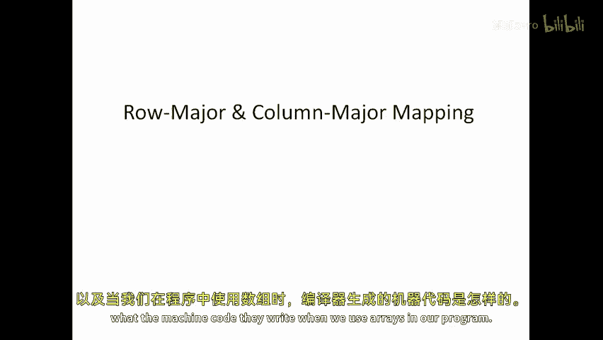

So let us see。Here I have declared an array of size 5。In our program， when we declare any array。

Then at runtime， we get the array space of specified size。Here the indices are starting from 0 to 4。

As a C language example， if we take。This is called as。Base address。Or this is also called as。

Location0 or L not。So L here is handt。In our program。If we write a of two a sign。😔，15。Here's 15。

When we write this statement， compiler will convert this into machine code。

So for storing the Val 15 at this particular location。

 it needs the address of that location and that address of that location is not4 as per example。

 so here it should be replaced with 104。So let us see how compiler will make it as 104。

So when we use any index or any location of an array when we access。

 compiler will convert it into a formula which will get the address of that location at runtime。

So let us see how it will write on the form law。😔，Address of。A of2。This address cannot be absolute。

 It will generate a formula for getting relative address。 so for relative address。

 the base address is taken。E not。Plus， the index what we have written2。Then， into。

The size of the data type here we have taken integer as a data type， So integer is two parts。

 so that is 2。 So this is。Size of。Data type。So， at runtime。

If the program is getting the memory at location0， that0 is becoming the base address of an array。

 then here it will be  hundred plus。😔，2 into2。That is one not4。

That's how it gets that of any location。For any location， A of I。To get the address of any location。

 compiler will replace it with the formula Ln。I into w。And w is worth size。This is index。Andis。

World size。 So world size is the size of。Data type。If it is flowed in C language it will be 4 bytes。

 if it is character， then it will be 1 byte， depending on the data type， the value of W may change。

So this is how the formula is written by the compiler。 we write simply a of I or A of 2 anything。

 but it will be replaced by the formula by using that particular index。

Some languages prior to C language before C language。

 language is used to allow the indices starting from one onward。

So here you can see the index is starting from an onwards and in the declaration also A RA starts from1 and set 5。

Now in this case， what will be the formula？So forget gettinging the address of any location。A of I。

Formula will be。Ln plus。I-1。Into w。As for this example， if you get the address off。If of2。Then。

L not is hundred。Plus， I。As 2-1。Into 2。So this gets。Handed plus 2。That is what not to。So yes。

 this is1 not2， index of 2 is 1 not2。So this is the formula I used。4our。Accessing any location。

If the indices are starting from。1 onwards。This used to happen。In the languages before C language。

 after C language， every language started supporting a raised indices starting from 0 onwards。

 The reason is if you see the formula for indices starting from 0 just now we saw。

The formula was Ln plus i into2 w。If you compare with this formula for inices starting from one。

 then one operation is extra here。Minus is extra。So from C language onwards。

 this extra operation is removed and they force the programmer to declare an array starting from index 0 only。

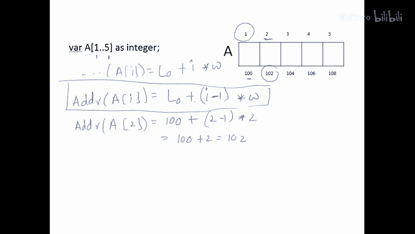

Now before that C language， some languages used to allow the indices starting from any index ending at any index。

 let is say even we can declare an array A of。

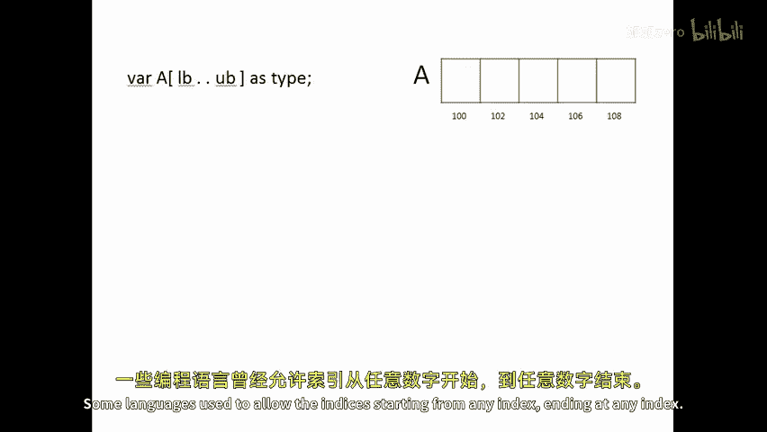

-3。2，5。As some type， let us say teacher。So even this was allowed。

So if the language is allowing the indices like this。It depends on the compiler。

 if the compiler is allowing it like this， then what will be the formula。

So the address of any location a of I。Can be obtained by taking a lot。Plus， i minus。Luang。

Into word size。This will be a formula for any static index。

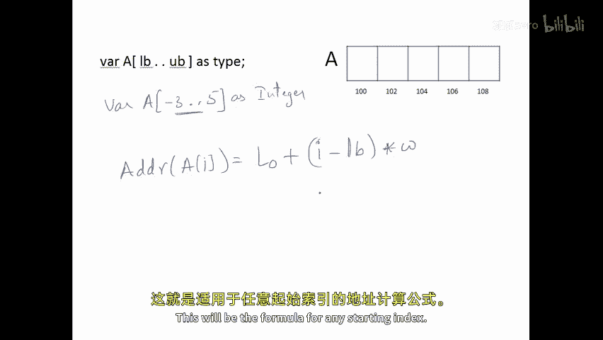

That's solve for one dimensional array。Now let us go to。Two dimensional areas。

In two dimensional array， there are two options。Either a compiler can follow row major method or column measure method。

 So there are two type of mapping。

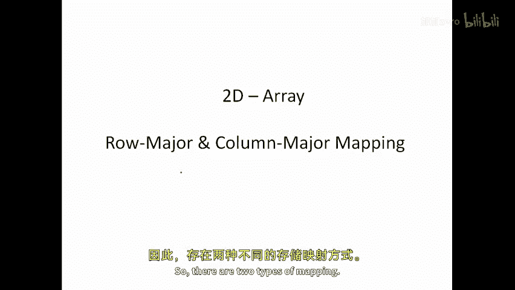

Here I have declared an array of size 3 by 4。And we draw using pen and paper。

 we draw an array like this within indices so and so。But in real。

 the array will be created as a single dimension。Single dimension in real because memory is linear and memory has a single value address that is integer address。

So。Actuary will be created like this。But compiler will allow us to access the array in the two dimensional form。

So I have taken the addresses 500，50 2，4，6， and in x， this is 8， this is this location。

So this how addresses are taken。Now， first we will see a row major mapping for this one。

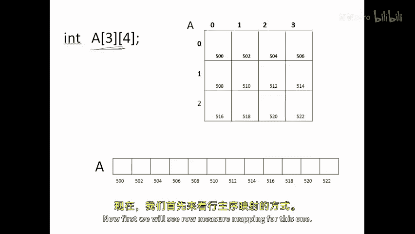

Here I have taken some L。Elements。I have also filled with the elements。

Then let us see how these elements are stored in real in the main memory。A0，0 is stored here。

Then a 01。0，2。And0，3。This is fast true。The next。1，0，1，1，1，2。1，3， this is second row。

 so the elements will be filled row by row in row major mapping。

So compiler maps the two dimension array on the single dimension array。

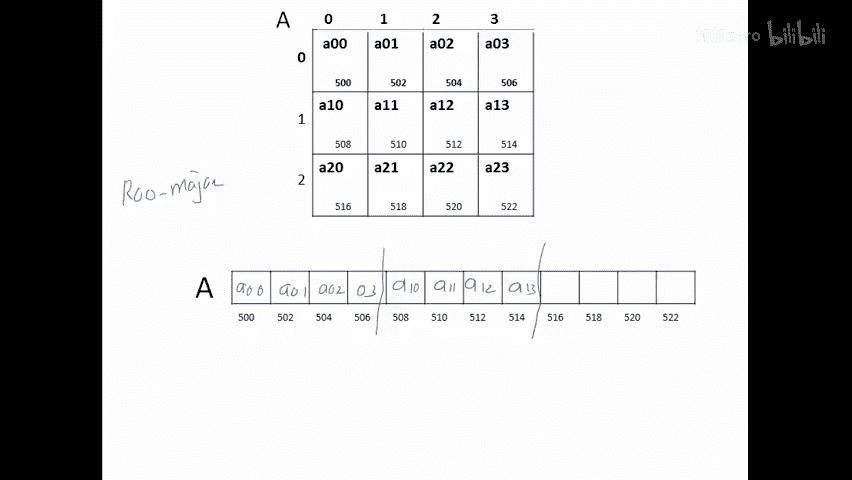

So the elements will look like this。Now this is row major representation， the elements from。

The studio area are mapped on a single dimensionary。A row by row。This is。00。T1。And this is2。

Now let us see how the compiler will make use of base address and generate the formula。

Forgetting the address of an allocation。Aar off。多讲吗？😔，Wan。The two comma 1， if you see， it is 518。

 here it is 518。So， this will be。Location，0 plus。Location 0 is this address。Now。

 it has to go to second row。 So you should skip two rows， fast row and second row。 So it has to。

Skip2 rows。 And in each row， how many elements are there， the dimension of this arrays 3 by 4。

3 cross 4。 So each row is having four elements。So， this is4。Now， when you skip two rows。

 you'll be at the beginning of。车住。That is row2。Now we have to move one element ahead， so that is one。

And this whole thing is multiplied by the size of integer。So， this gives。500。Plus。9 into 2。

So that is 518。So this is how it gets that dress。😔。

So it means forgetting the address address of any location。He of Imaje。

Compilr will write the formula。E not。I into。

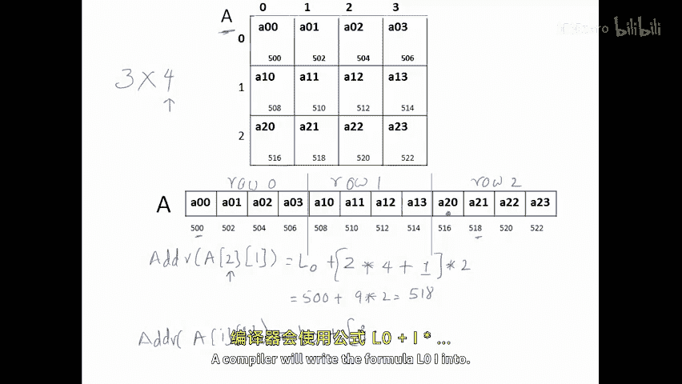

If the dimensions are m cross n。Then this is N。不us。Ze。And this is world size。That's it。

This is the room major formula when the indices are starting from 01ward。

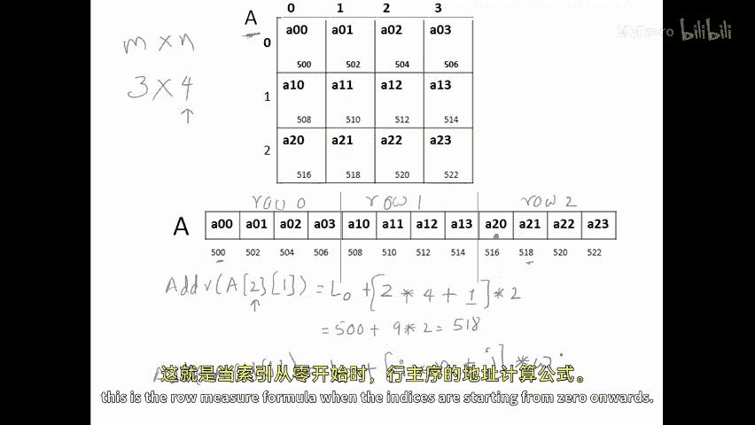

If the indices are starting from on onward。Than the formula for any location。Addres。Of any location。

Is red in as。E not plus。I-1 into n。Plus。J -1。This holding multiplied by the value。

Let us find the address of。3 co2 here。518。So， address of。3，2。L not S 500。Plus。3-1。Into 4。Plus2 -1。

This whole thing is multiplied by。And this is 500 plus。8ight。Plus1，9。En to2。So this is 58。That's it。

It is all about row major representation。

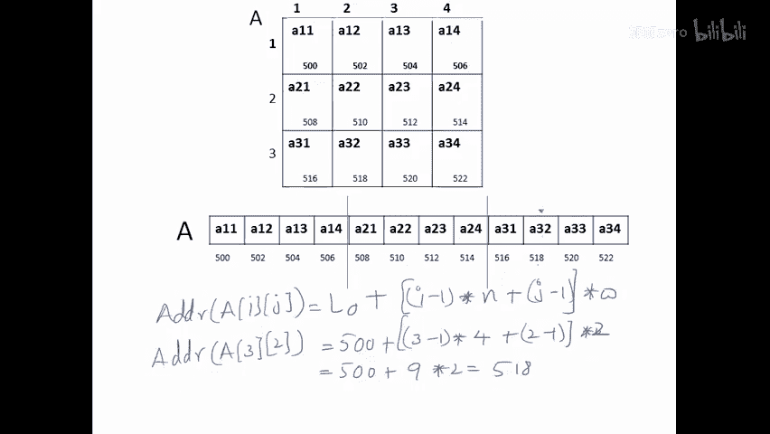

Next we will see column measure mapping or column major representation。

I have taken a two dimensionary。And basically， the array created in main memory will be single dimension。

 and these will be the addresses， As that it just starts from 500 onwards。

And I have taken some elements。Then how the elements are filled are。A0，0。A1，0。A2，0。This is column 0。

Then， column 1。高啷图。

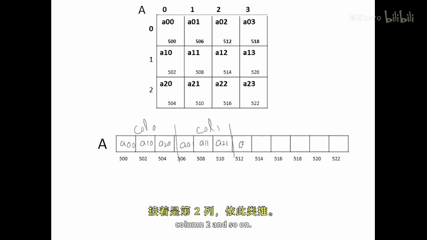

And so on。So the array looks like this。😔，And it looks like this。

Now let us see how the column major formula is written。

If you want to get the address of allocation location。That is a of1 comma 2。1 comma 2 is at 5，14。

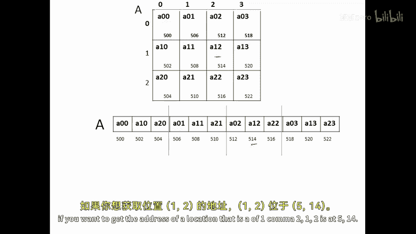

So， address of。A off。1， gama 2。Sticken as。Location 0 plus。Not two， it has to go into second column。

 So location 0 is 500。 It is here， so it has to skip two columns。So， two columns。

So as the dimensions are three cross 4。😔，Let them cross in。Number of elements in each column are 3。

So this is3。Plus。Once we skip two columns。We will be here in the beginning of。Third column。

Then we have to move only one location。 That is what I。So， this is one。

And this whole thing multiplied by2。So， this is 500。Plus，7 into 2。This is。5，14。

If you make it as a formula， formula for finding the address of any location。I and J。S。E not plus。

J into M。Plus， I。Multiped by the。That's it This is the formula for column major mapping。

In some languages， array indices start from a onword， then what will be the formula。

Adds of any location。E of I J。Will be L not plus。G，-1 and 2。M。Plus。I-1。Hhole thing multiplied by。

If you want to get the address of any location。那个谁。A1 co of 4。 That is 5，18。

Let us get the address by putting the values in the formula。Address of 1，4。This is location L is 500。

Plus， Gvalue 4。So 4-1。Indu。This is3 cross 4。That is M crosssson， so M value is 3。😔，So，3。Plus。1-1。

This is integer type。If you assume that this is integer type。Then， this is 2。说的事实。500 plus。9，8，22。

And this is 5，18。That it， we got the address 5，18。

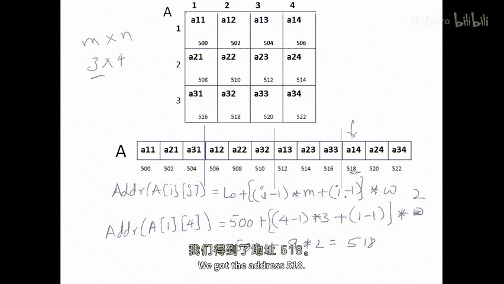

Finally， let us look at the formula。For row major and column major mapping。

 if the arrays are starting from 01 words。P the formulas are given here。

 L not L not plus I into n plus J into W。 and here， J to n plus I into W。 If you see the operations。

 this is having one。To two addition operations and two multiplications。

 So here also two additions and two multiplications。

 So we can see that both the formulas are equally efficient。Both are equally efficient。

 so a compiler can use any one of the form law。 So if we are designing our own compiler。

 we are designing our developing our own language， then we can use any one of these form laws。

 but the C language and all other languages。That belongs to sea family。They use row major mapping。

Next all， thank you for watching the video， please。

Leave comments so that I can improve the videos based on your feedback。Thank you for watching。

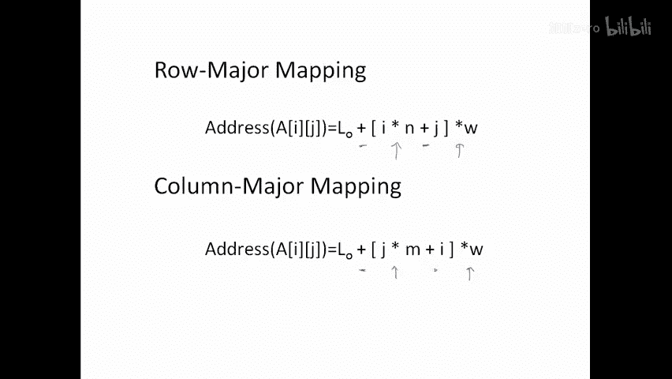