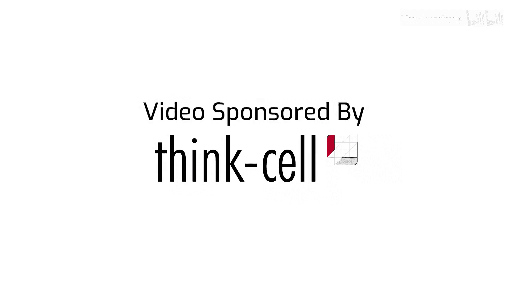
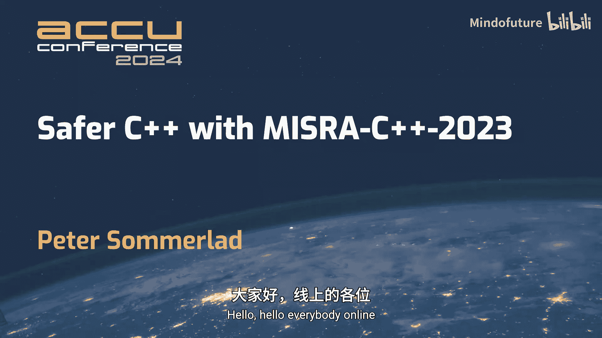
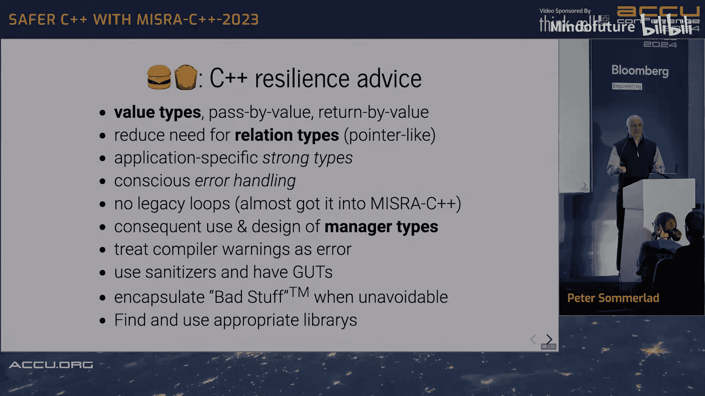

# 中英-•-C++和C语言ACCU大会2024｜人工智能｜架构｜函数编程｜静态分析｜安全｜编译器｜开发者｜垃圾回收｜链接器｜代码生成｜cmake-p23-P25-Safer-C++-with-MISRA-C++-2023---Peter-Sommerlad--BV1pNotYYELk_p23-

Good morning。 hello， hello， everybody online。😊。

I'm Peter。And I。We。For self quality， for a lot of my career。

 I was a university professor for 15 years， but I quit just before the lockdown。

Which was good because I didn't have to put up online lectures on the fly。

 but today I'm doing online lecturing Now I worked in the past couple of years。

With the team of Mira on the CplA guidelines that were just released last November and this talk is a little bit about how what can you learn from the Mira guidelines but in general I take a lot of the guidelines take the approach of slapping your fingers when you do something badly。

 like if you turn on compiler warnings and treat them as errors， yeah you feel ugly。

 especially if you have an old codebase that ever used WO as an option。

 then you will end up with a lot of issues and if you treat them as errors， yeah。

 there's a lot of things to fix that are not actually improving the software as a perceived means。

And therefore， I often not explain what you shouldn't do。

 but actually how to write code that you shouldn't get into problems。That's a little bit my approach。

On the other hand， any kind of guidelines， especially in the safety domain when it's about functional safety of stuff。

 usually comes as an afterthought after something badly had happened。

So a lot of things about safety go back to， okay， something bad happens。

 so we change the procedures or the constructions or give new requirements to actually make it not happen in the future。

 hopefully。Thats's always kind of retrospect。Now， what was my motivation to join the Mira Cpl group。

 I was exposed curily with the old Mira Cpl 2003 rules。

That were 2008 rules that were addressing C plus 2003。 And when I read those rules。

With my then current knowledge of C++ and style of C+ that I would write。

 I would call was heavily influenced by accelerated C++ and some other modern C++ books。

At the time before C+ was 11， I felt that the Mizraq Island felt really miserable。

And I felt sorry for those who actually would need to correspond to those guidelines because I thought they wouldn't actually help anybody to write good C++ code。

They would prevent the worst of the worst， but not actually encourage the good。

I'm not sure we succeeded with the M Ru C+ 2023 guidance who actually， again。

 retrospective the address C+ 17。To actually。Make everybody not miserable。

 but at least we try to allow good coding practices that are modern C++。

According to what the group thought would be reasonable good Cpl code。Now， why is that QR code there。

 those who haven't tried yet， I usually prepare my talks not only with the slides。

 but also with text for people to actually take home and reread what I might have said or additional information what I could give there and it also can provide。

pell out links that might work online in the browser but not in the generated PDF for example codes and stuff like that that I refer to So that's actually for you to take home or if you insist on follow along and correct me if I say something that's not written down there or something like that。

Now。All that said。😮，If there's any intermediate question。

 I might not be able to see you in the room but try to get my attention and I hope someone has a microphone yes in front the lady with the green shirt will be able to help you and。

For me， it's important that you use a microphone because otherwise。

 I might not be able to understand you。Now。You can if you have more questions， reach out to me。

 I'm a happy social media addict on Maedone and you can reach out to me via email and if you need to learn more what you cannot learn from my online resources。

 I'm happy to provide you with commercial training or consulting or coaching and code reviews。

Now what is my philosophy， less code is more software and that's something I stole from Kalyn Heney and I think we share a lot of these values with respect to good software quality and that is also important in the context of Miy+。

 there are a bunch of rules that tell you about oh yeah。

 don't write unnecessary code or don't write unreachable code and the motivation that used to be specify unreachable code。

 then when it was kind of invented to have that rule。No longer that much there， but again。

 you don't want to have needless code that you actually。Have to maintain， understand。

 even though if it's never used。然。Why would you actually want to have safe C plus plus code。

 It's not only about the safety that Herb Sata addressed in his talk about， okay。

 we want don't want our problems to be crash or be vulnerable against security attacks。

 It's mainly in domains where human。Humans are a danger。So either being injured， being killed。

 or at least were very high financial loss might be a result of any kind of inappropriate or unwanted behavior。

So I missed one thing aviation is also in that picture， a lot of traffic。

 medical and things like that deal with the。Basics， if you look at the very。

 very old definition of Mira， it was actually Motor Industry Safety reliability Association。

 which is no longer the official acronym similar to EQ。 So it's there there's some shared behavior。

Now， what is actually addressed by those guidelines that are there for a safety criminal system？

We have undefined behavior， which is a great feature and major undefined behaviors in C are also in C++ and the origin story of undefined behavior is not only compiler optimization。

 but actually vendors。😊，Of sea compilers in the 1980s。

Not being able to agree on semantics for specification when C was first standardized。

And the reason we then different kind of hardware， well twos complement computers have one。

 so PD2P11 is more or less， or whatever successors have one with us。

 but it also was things where oh doing that insisting on a specific semantics would actually make one compiler or one hardware platform be kind of not very good at running C。

And that that is a lot of reasons about undefined behavior。 Another specifics about the different。

Compils and hardwares that may actually seem very popular because you could actually port code with a sea language is the implementation defined behavior。

The most prominent thing is int， who has never used int in C or C++， okay， no hands。 well。

 there's one hand by the camera guy who I guess is not a programmer。Now the。

Inint is a thing that looks great， works great， and if you learn as a fresh programmer learn about programming。

 yeah， in is like integers， so it's kind of numbers and you can do arithmetic with them and some other extra functions。

 but actually int is an implementation specified behavior because it's an approximationization of integers and its range is implementation defined。

😊，So you never know if your numbers might。Get you might be representable。 And in addition。

 in is a sine integer type and for sine integer types， any kind of arithmetic overflow。😊。

Is undefined behavior。So int is bad in two of these categories。

And then there's a tiny little extra thing that's in the C+ standard is so-called unspecified behavior。

 and that is something where the standard is able to actually tell you what to achieve。

 but it's very silent about the exact details on how to get there。

 that is to give threeway to the compiler or library vendors to actually get their own optimized way of getting a feature implemented。

😊，But it's much rarer than undefined behavior。Now that is。

Whats the underlying problematic and the guidelines try to address to get you away from using any of these things and a major rule in the Mi and C++ guidelines is don't have undefined behavior。

Which is reasonable because undefined behavior could make your car crash or your brakes not brake or whatever if you program them in C++。

Now， the second big thing about。But what is let's say programming is hard and programming in a language that has a complexity of C plus+ can be even harder。

 So that leads to a lot of misunderstandings。 and also people might not have the。

Very best education with the background when they actually have to use the tool like C++。

Which is a pity because actually if you look at the underlying safety standards like ISO 26。

 262 for automotive systems， they tell you that the personnel that creates a safety critical component in your car or vehicle。

Actually has to be well trained， well educated for the job。

 plus it requires the organizations to have continuing education。

So those people who actually attend ACCU or maybe even watch the video。

 they have the motivation on their own to actually get some continuing education。

 but I guess everybody in this room or at ACCU， there are at least100 other programmers in their organization or vicinity or worldwide that don't care that much。

And that's one of the big issues I have with any kind of programming happening today that actually continuing education。

 learning how to do better is not ingrained in many of our。Pierce。

So misunderstandings can lead to things。Whenever I talk to someone like in the conference also with programs in C++。

 they might show me some either their favorite back like beyond us people to tell him or they show talk about things when I explain something。

 yeah we do it that way and I tell you have really thought about that way。

Is that really what you intend to do， do you know what that means what you're saying there？

And then sometimes you get some blank faces。Because we have ingrained beliefs how things work。

And if you look really at the specification or even at the compilers。

 they might work slightly differently or even completely the opposite。So they are myths。

And mindsets there where we are wrong， myself included。

 so that's where we actually need some guardrails to help us to improve。

And the next slide is about something。Then I'm even more depressed today。I'm。

A user and proponent of testone development for more than 25 years in C++。And an important thing。

 again， a term I stole from Kalin， have guts， have good unit tests。If you know。

 don't have never heard that term dig out for Kevin's talks on good unit tests and learn about unit testing。

 And it's not unit testing alone。 but that's the at least most important start。 Uni testing is the。

Most significant practice that came out of the agile movement that is relevant and underappated。

It helps， it has much more。To say then just ohma our code is tested。 No。

 it helps you with your design。 It gives you immediate feedback about changes。

 It allows changeability。 It enables refactoring， and it's so underappreated question。

 who is having unit tests at home。😊，Okay， who is not doing unit tests for everything they program？

Okay， that's about 20% of the room that's。Go home， get unit tests and get your colleagues also ride unit tests。

And it's not part of the misra guidelines， but implicitly because。

That is state of the art to have unit tests。And test automation， if you don't。

 you're actually violating the underlying safety guidelines is if you arrive safety crew equipment。

On the other hand， if you're not doing good unit tests。Your software quality suffers。A lot。

And you cannot imagine if you are not consciously using unit tests how much your quality can improve。

They've done right。 So that's a G good unites， not just having any unit tests。

 You can auto generate unit tests。 That's not what you do。Now， if we have unsafe C++。

 there are a few things that have to be looked after。And there what does it mean unsafe。

 undefined behavior。 Yes， I talked about。 But we also have the situation where we have just not implemented what has to be implemented。

 And that's the hard part。 No static analysis tool can tell you that you fulfilled your requirements unless they are very formal。

And who checks that the formalism is actually achieving what you intend to get？

So that's just changing the level of where things can go wrong。There's also an immediate means， okay。

 it's always wrong。Which is with undefined behavior， a lot of situations， actually data dependence。

 So it's kind of a lurking， undefined behavior if have， let's say。

Most prominent one a pointer and you try to dereference it。

 it depends if the pointer has a valid value， if it's not an nu pointer。

 an null pointer are good because then at least the runtime will recognize something went wrong unless you're on a very tiny controller。

But if it has an arbitrary value， you might even。Read or write memory that's。

Not having the data that you intended to get。Now that's data dependent， undefined behavior。

 but it also can be data dependent wrong behavior Now another area where you have potential unsafe situations is the evolution of code。

 an assumption that was true when you wrote that code is no longer true。

Some of you might be old enough to actually have seen the migration from 16 to 32 bits or from 32 bit address spaces to 64 bit address bases or even larger address spaces。

When you assume a pointer is as long as along。Now your host when your pointers are 64 bit and long still。

 32 bit， I've done that。Put back on us。Like with evolution porting is an issue。

 especially when you use implementation defined or unspecified behavior。

 because the unspecified behavior might still get a similar result。

 but some effects might be slightly observably different and that's really a problem。😊。

And being able to actually categorize your things， you see the immediate stuff is very easy with the static analyzer to find and a lot of immediate problems like returning a reference to a local variable are already warned about by the compilers。

 there are data dependent things where sometimes compilers or static analyzers can actually infer that the data flow is actually causing it that it more or less kind of can be treated like immediate behavior。

😊，But then you will have situations where guidelines tell you， don't do that。

 which is not about immediate behavior， but。Hopefully will reduce the risk of having that lurking or evolutionary behavioral change where things can go wrong。

 And that's where you might end up with a rule that is not。

hellping you because you know that your data is the same in a valid range。

 but your set analyzer tells you well this is a problematic place。

 please don't do that and then that is one of the reasons where you might actually want to so-called deviate from a given rule。

So the rules are sometimes intended to be deviated from。And I'm too fast to get there。Now。

 as a general guideline， especially for the immediate manifestation， turn on all warnings。

 treat all warnings as errors， and if you really insist on probability。

 also turn on pedantic warnings as pedantic errors。

 and the corresponding flags on Microsoft compilers， which I have no idea how to spell。Now。

 as I said， MiRA came from the automotive industry at a time when they recognized， okay。

 we are putting more and more software in our systems and our safety guidance more insist that we have let's say good quality。

 somehow， especially when people get in danger， consider antilock brakes or whatever。

 which were a few of the early things where at least electronics were used to actually control safety curriculum component of the car。

Now。If you look at the corresponding safety norms for software control systems like ISO 26-262。

 it asks for static analysis tools。Why does it ask for well。

Maybe because the aesthetic analysis tool vendors insisted that this goes into the standard。

That's something that could have happened， but also because as programmers。

 we make mistake and at least the worst mistake shouldn't cause your car to misbehave or your whatever system you're using。

Now it started out with MiraRC， the first release was rules for C in 1998 and then ongoing and they even had a release last year as well for addressing C17。

 so even though Mi 2023 addresses C17， it doesn't address C23 which only will be is it released or will be released this year。

Similarly with C++ and retrospective， you need to have compilers to actually implement all the features to say something about that。

 that's why Mr。 R C+ was 2023 addresses C+ of 17。And the focus because people working on these guidelines are those who actually implement the corresponding static analysis tools。

 the majority of people， the guidelines are focused on things that can be actually checked there are some guidelines in there that are。

 okay， dear humans please work that way。But we cannot actually check。

That you work that way because how do you know that？And again， if you into computer science theory。

 you know there are undecidable things and a lot of aspects of a program are actually undecidable。

 and therefore you might end up with a situation where you might have a rule that is in principle undecidable。

 even though aesthetic static analysis tool might get a lot of practical cases that can actually be checked。

 but can never guarantee to not have the issue at all。Now。microphone。

Why does it take so long between two standards， 2008。

 2023 is long time can you try to speak bit better？Standard 2008 and 2023。

 there is 15 years in between that's a lot of time。 why is that。呃。Why the question is。

 why was there a long time between 2008 and 23 in getting things up first？We started around 2019。

 2020 or at least there was out of SAR C++ guidelines that started a little bit earlier addressing C++ 14。

 which I also contributed a little bit to。Why it was taking so long。 I wasn't there， so I don't know。

 but also。If you look at sea between 2004 and there one type or I think there was 2012。

 12023 it was 2012， so they had around eight years and then again 1011 years to get the new rulings in。

For the Cpls rules， it was a completely rewrite most of the time， we had some old rules。

 but most of the rules were rewritten and so it took us about four years to actually get something consistent that could be released。

Why was it in general such a long time？I don't know， maybe people didn't care。

or didn't have the capacity， all that work on the rules were voluntary work only let's say I wasn't paid for anything for all my contributions there。

 there were others who do that as part of the day job。But这。Again， others who do it for knowing。

Better things like the ISOC standardization， there are a lot of people there who are not paid to work on standardization。

So think about that when you're complaining about a future。

 not getting in or getting in that you don't like。So I cannot really answer that。

 it's just a lot of work to get rules in a decent shape。Now what are typical misconceptions。

 Well unfortunately my boxes don't sharp well enough， yeah， things like， oh， our project is done。

 but now we have to deal with thousands of mis violations。

It's like turning on W all on your favorite legacy code project， and then you figure out， well。

 there's a lot of things that are not like they should be， maybe。And that is the wrong approach。

Start like with unit testing。 Start from day one with your static analysis tool。

Turn on W all for the first compile of your Hello world program。

That is the important thing because then it's incrementally you get immediate feedback and actually can change behavior or your own personal behavior。

 how you program to improve the quality of your code if you later after months or years get slapped by something。

 you have no idea why that works。If you get immediately said， no， don't do that。

 that's the important feature of getting feedback。And。As a side note， when I moved to Switzerland。

 let'd say， there is some Swiss， I'm a very direct person。

So I cannot anticipate if I say something how other people perceive that。

 so if you feel funded by my talks， it's not personal， it's just because I'm that way。But。

For example， there's a Swiss cultural feature， which is not like Asian。

 but sometimes like that that you。If you have opposed someone's opinion or beliefs or value system。

 they might not give you feedback you're not getting me， that's not okay or so。

 but they might what the Swiss call Foush Is， which is let's say they keep the knife in the back and when you're never。

 ever years later，Think what's going on， you might get stabbed because of that thing that you said。

It's very metaphorical as those Sw wouldn't use weapons。

 but nevertheless you might get problems in your vicinity in your job or whatever to get paid back so don't。

😊，And that's not the way how feedback can ever， ever work。

It might help the grumpiness the other person carries for a long time， which is not healthy。

 but also not helping me to get get better in perceiving what what I'm did wrong。

 So immediate feedback is。Important， start from day one。

 especially the feedback you get from static analysis and unit tests。

 and the first setting analyzer is your compiler。Now， again， 100% mis compliant， 100% safe language。

 no， your software might still do bullshit。That is。Another miscon and people claim， yeah。

 with our tooling you can get your software 100% miscompant， yes。

 so what if it's still doing the wrong thing like accelerating when you press a break？Big problem。

Now。Again， that was my stand when I first was exposed to Mira。

 Mira forbids me to write required hope。No。Actually， that's a misconception。

 misra guidelines are meant to be broken。Most of them。

But deliberately and with reason and the rationale you actually， why you break a code。

 goess into a deviation record。😊，So that a reviewer can actually see that you put in thought that you are like。

 oh， this might be a。Lurrkking， undefined behavior or lurking violation or lurking problem。

 but you know you can guarantee by whatever means that the data is never in the range。

 that this pointer is never now when you defra reference it， for example。

As a bad example or that this in arithmetic never overflows。Another misconception。

 I think that the new Mira guidelines address better all the standard library violates。

 so we need to deal with it ourselves。It's like the gamess programmer。

I don't understand that a thing。 No， the standard library in its implementation has to violate miss。

 otherwise it couldn't be implemented。But the standard library implementation by your compiler vendor should be。

Either qualified or at least。A good enough quality that it doesn't add additional issues If you really do yourself your own standard library or your own standard library similar components。

 it's very hard to get them right and it's very easy to make subtle mistakes that you have no test case is for unless you're very good at good unit tests so the standard library can be assumed to just work and if you really need to have justification that you can use it you can qualify because that's actually an official specification of the standard library called the IOC+ standard where people can write formal checks for to actually certify that standard library implementation conforms to the corresponding specification which is more or less what a certification or qualification of a tooling actually does with your own stuff you might not have corresponding specification so who can qualify that you can sell qualification。

It's okay， but that's very weak。Now， the last thing is also something that I was always often thinking about。

 oh Mira rules are redundant and confusing。Well， the confusing part is sometimes。

Caused by the braveness of the headlines。That are very often the only thing you get spelled out to you by a tool violating a rule。

 but the redundancy is actually by design。And if you want to learn more details about how to get your code MiRA compliant。

 if you have to， there's actually a document behind that link and in the handout you can see the official link to click on that explains how to deal with MiR compliance。

 what to do about the different categories of rules， so there are rules。

That can be checked and directives that。By intention cannot be checked by a tool。And。

Both rules and directives come in in three categories， absolutely mandatory。

 using the term must required。Using the term shell or advisory using the term should。And。

Each rule usually also provides you information if it's decideable or undecidable。

 which means any kind of tooling will use best effort to get there。

 but can never theoretically guarantee freeness of the violation of that rule。And。

Whenever you apply something like Mira or some kind of guideline check。

 there will be deviations and the compliance document tells you how to handle deviation。

 they must be justified so you must have a reason not just， oh。

 I feel like it's good or let's say my。Whatever coach I have a personality coach smoked something and tells me。

 yeah， that might be a good feeling if you do it that way。No。

 you have to have a technical justification。 and the good thing is。It's。

A lot of work to write good justifications， so you better do it only once and encapsulate the violation tightly so that using code never has to violate it again。

 that's also some of the things that you might learn from adhering to good problems。

 static analysis analysis tooling。Whateverever it's。It's like when it hurts。

 don't do it or do it only once and encapsulated it。Now。

 the question is why do we have Mi RRC++ when we have Mi RRC and M RRC is even updated a little bit more frequently than the C++ thing。

 are shared vulnerabilities like we have point arithmetic in both。

 we have the problems of resource management， implicit conversions is something that's shared integer overflow。

 other undefined behaviors。Are there and on and on。But if you look closely， C++ in most cases。

 provides much better or different mitigation strategies or means to actually avoid the problem at all。

 unless you write C+ in a way old C code works， we had examples yesterday in Herb set' talk as well within just the main program。

Which is still valid C plus plus。Now， if you don't care about Mira at all。Again。You can have。

Still benefits from what you use。Big thing is turn on errors。

 the turn on all warnings treat them as errors from day one。

 use dynamic analysis tools like these sanitizers to figure out additional bugs。

Employ the C+ types and the C++ standard library。And the killer feature where especially the difference between C and C plus shines and C plus and many other languages is C plusphas deterministic object lifetime。

And see。As long as memory exists， you can interpret the bits at any type that you like and it's kind of。

Almost always defined behavior in C and C++ to access a piece of memory。

 there must be an object there and the object of the right type， for example with unions。

 you cannot easily type on by using just a different union member to interpret the bit differently that is most cases where C would heavily allow it undefined behavior in C++。

And。即。Curly brace， closing curly brace is the killer feature of C++ where it shines amongst almost all other programming language。

 you know exactly when a lifetime ends because that's when the scope ends or any other thing closes up。

 then it's done。And that is， and having the hook with our instructorors。

 that's actually the killer features of C plus， especially for safety curriculum systems。

 where resource safety is just part of the。平。Now， let's look at some concrete rules。 And you see。

 I highlighted that shell and should to see， okay， these are have different， let's say。

Strength of the underlying rules so function shall not contain unreachable statements and that is corresponding to no useless code this code is more software or variables that cannot be shared across translation units lets me say like that that limited to visibility is defined somewhere so anything that looks italic is actually intentionally italic because it's kind of a term defined in the Mira guidelines so。

Each variable should be at least used once so there's no needless variables。

 and again that's about not only wasting resources， also， especially when you change code。

 you might forget to delete the corresponding variable and that might actually lead to confusion。

 especially if names are spelled similarly， which is something you cannot actually check with the tool。

诶。Then preconditioned。Yeah， we don't have contracts， but even with contracts。

 there will be preconditions in our functionality。In our functions that cannot be expressed by the language。

So we。什么？This is about to find。the question was how does Mi define preconditions， Bell， whatever。

 for example， for the standard library or any kind of library specification。

 assess what is a precondition？😊，And it's this is actually a。A directive。

 so that's something that's not tool checkable。So let's say sword。

C standard lip sword has a precondition about the comparison function that your function point that you provide and whatever means that you can actually sort the values and if that precondition is violated。

Which is almost always completely uncheable automatically， you will and。

End up with having violated the precondition。the humans involved directives means humans need to ensure that that way。

 but it's still spelled out because。That's how you。Go there。That's still a required thing。

 it's shell， so it's required， you mustn not violate that。But again， if you， for example， vectorter。

Front。Requires the vector not to be empty。That is something you could actually check at runtime。

 but not。When you have a gettybacter as a parameter。

 how would you know that it's not empty when front is called？

So you need to do code review or whatever to check that or either have the precondition check explicitly programmed if you said。

 okay， if not empty， then use F， then the compiler or any static analysis tool with a very good flow analysis can actually check that this directive is fulfilled。

Now。No undefined or critical unspecified behavior， sometimes compilers actually define what's officially undefined and people might wiggle their way around and say。

 yeah my compiler doing like that， it's still morally very suspectable but again it's possible to get there。

 therefore it's not a must there。And。If you look ask about what are the numbers。

 there are always three digits and the first number is actually related to the chapter in the C++ standard of C+ 17。

Where this rule relates to the second number is also the subsection in that chapter or the chapter in the section。

 if you start the section and chapter， and the third is kind of a sequence number of the integral rules related to that。

so。I have no idea from the top of my head what chapter four says， but chapter8 is something like。

 oh I think chapter four is the preamble part where things like undefined or cur unspecified behavior is defined what that means chapter8 is something。

About I have no idea。And。Things like， okay。This one is。

Variables should be captured explicitly and nontransrenientient lambda does。

 so if you return a lambda from a function to be used elsewhere。

 you want to name the verbs that are captured and better not capture a local variable that would be lead to undefined behavior when it's ever used and similar thing point arithmetic channel form an invalid pointer that is the best effort rule it's completely undecidable in general to see that the pointer is actually valid。

Now some examples of seemingly redundant rules， if you look at 681。

 it says an object shall not be accessed outside of a lifetime。

 actually you're not supposed object has a defined lifetime and there is no object when it's not in its lifetime if you look but nevertheless we couldn't come up with a better term that wouldn't make the。

😊，The headline fit on two lines also。But that's undefined behavior。 And if you look closer。

 then there's a function must not return a reference or appointed to local variable with automatic storage duration。

 That means that it's immediately dling。And that is actually something a compiler will warn you about anyway or might not even compile。

 I think there are people trying to make it not compiled。

 but nevertheless it might be a little bit more non obvious， but youll see if we have 681。

There is no reason to spellt out 6A2。But 681 might actually be violated deliberately。

And it's not in general checkable， but 682 is something aesthetic analysis tool can check and will check and will tell you about。

 and therefore these two lines of defense to actually get there。And another thing is pointed casting。

 you can point to an integral type， but that is something you shouldn't do。

But if you really insist that you want to do that。You must you shall use the in pointer T or UN point of T because theres a guaranteed roundtri casting so you can get the same pointer back and you cast it to that pointer and that's again the second line of defense。

 if you never do a point to incast， the second rule is completely useless。

 but if you insist on the need to do that， this justification， the second rule will tell you，Well。

 if you really want to do it， do it at least as safe as's possible。

Looking at something very specific for C++， there's back in C++ specification or a deficit in the range for loopbe specifications since C+ 11 that was only fixed in C+ was 23 and we have all to thank Nikku Youts for pointing out and insisting that it's actually get fixed and the main reason for it is that the specification of the range4 loop used to have implicit lifetime extension of temporaries with the RV REF qualified local variable and RV。

No our。Value reference so not our value reference that can have or imposes lifetime extension of a directly bound temporary。

 but if the temporary is actually indirectly bound like we have nico's example is kind of you have a function returning a vector of string and use call that function make in the range four initializer and then apply another function to actually access the first string to be able to iterate over that first string what you get is a reference to a string。

That is immediately dangling because the temporary is not lifetime to extended。

 the temporary is returned by make。And then you apply a member function。

 so the temporary is never visible by the actual range for loop， intrinsic representation。

 so it's not lifetime extended， so the string is deleted。Before you can actually iterate over it。

And that's。Bt。And the behavior。Now， because we we be addressing C+ 17。

 there is an interesting phrasing we came up with a range force in Israelliza shall I contain at most one function call。

So not more than one， if you look there， make and add our two function calls and that would violate that rule and we。

And's say it did a lot of。Brain acrobatics to figure out a way how to specify it briefly that you don't want to get that temporary that is not lifetime extended and the only means to get there is actually having two function calls where。

The construct is also considered a function call。And I hope we got it right。

But we didn't get any more feedback on that in the review。Now。

Another thing area where we have lurking undefined behavior are enumerations who's using enumerations at home。

Okay， it's relevant。And we have the old sea style enumerations。

 so called unscoed enumerations without an underlying type。😊，Those are actually。

Tent2 unscpped enumerations should not be declared。

But you might get sea headers where they are in theirition to your own。And。The reason is。Actually。

 10 to one is an enumeration shall be defined with an explicitsite underlying type and。

Even if you just say enM class， there is an underlying type that is well defined。

 so even though they first might be seen that it's not defined。

 but it's because there's a scope enum， there is the underlying type is int。

For an unscoed inum where you don't use class， you have to specify the corresponding underlying type。

Again， if you have enams might not want to use the corresponding。Nummeric value with unscoed enums。

 you have that implicit conversion to the int or to the underlying type。

 and so you can easily use them in arithmetic expression with the result being an integer。

 and that's something you want to avoid。And because these implicit conversions might not be what you actually intended to spell。

 enumerations are the idea， let's say the mental model is that they actually。

Enumerators inumeration specify things like state machine states or any kind of representation that has a logical meaning and not an numerical meaning。

Okay， that's enumerations。Now， something in general， not only Mira is appreciate the C++ type system。

That is something I myself when I was a young。Still a university student。And we had to learn Pascal。

 And then we got real numbers and integers。 And we couldn't mix them easily。 I was hating them。😊。

Re behaving that。And I said， why is that the case， I a just one in basic。

The basic interpreter would do that for me correctly and then came C and then C I could mix and match again my integers and doubles and it just worked。

 I was very happy， but in retrospect actually Pascal did the right thing。😊。

I just didn't appreciate it yet。诶。😊，What is a type system that is also often？

Baadly taught you have these things called types but nobody really cares as long as you and everything is fine。

 no it's not fine， the type system of a programming language actually prevents you from writing meaningless code。

 it gives meaning to your bits and operations。And that meaning is important because it allows you as a human to understand what this meant。

Meaning semantics。Which is also a very interesting word。But also。

 it helps the compiler to prevent you writing code。That doesn't have a meaning。

Or where the meaning is very dubious or doubtful。And if you look at assembly language in assembly。

 you can do almost everything with the bits you have in register or in memory。Regardless。

 so only the actual operational code will tell you what the mean is。

 And you have to understand what's going on to see what。But this man pipe。In B。

 actually there were words。Which is a precursor of C language and C。

 actually a major contribution of C， which was in a timely way， similar like Pascal。

 was that C had a type system。You have different integral types。

 you have pointers which weren't existing in B， you could use every word as a pointer and vice versa。

 so the implicit conversion to integers was there and。The major thing is in sea with trucks。

 you could actually create your own types。Which weren't very powerful。

 but at least they were distinct from all the rest and wouldn't implicitly convert。

 like almost all the remaining built in types and C convert happily among each other。

 either implicitly or explicitly with just putting a cast on it。😊，See plus。

 Ga took it further by providing a more。The stronger types system， unfortunately。

 we inherited the C type system from C。And those was never strengthened。

And strong means the weak type system allows a lot of implicit convergence。

 and the strong type system will。Not have implicit conversion or minimize the use of implicit conversion and maybe even prohibit a lot of explicit conversions as well。

And then there's languages like Hacallibor where people。Tell you， well， if you're。

If your code compiles， it's correct。Because the type system is so strong and maybe you need to have so big brains to actually be a good hair scale programmer that once the compiler tells you your code is good。

 you know you didn't make a big mistake。Now that's a type system now let's look at one of those interesting types that we inherited from C。

 which first is implementation defined， but it also has a lot of undefined behavior because。

Overflow of signed integer arithmetic is undefined behavior in C plus plus。Now。Bquiz。

 what is the probability of undefined behavior of this expression。

 X being an integer variable and divide it by zero？Should be easy。Shout out。1， 100%。That's good。Now。

 more interesting， x divided by y。And both are integer variables or values。It's。

It's very close to zero， but not zero because y can be zero。

And there's another case that's often forgotten， so you might check that y is zero to prevent undefined behavior。

 Yeah， but you forgot one case。If X is。Int min are standard numeric limits int。Coll on call on mean。

B parent。If that value is there， and y is minus1？because we have tools complement。

 you actually have a situation where。There would be a result would be plus of that intmin。

 but that is a number not representable。And that is the case。

 whenever you have checks integer arithmetic， not divide by zero。

 also make sure that you never divide into min。By minus1， because that's also undefined behavior。Now。

 x plus y。Guess you could to even think and give a concrete number if you。The say it again one。そさ。

35 or 25， 25%， Ex correct。 for sound integers， you have 25% is undefined behavior because if you have plus and minus。

 it just evens out。 if you have unsigned integers， you have 50% overflow chance with are random numbers。

Now， that is the interesting part。X times y。Timor has seen the talk。It's actually 99% is too low。

It's seven nines。For 32 B integers， 99。99999。 so it's almost a sure thing that multiplication of tool arbitrary integers overflows。

😊，If they are really random。Consider that if you have， for example。

 a sensor input that you multiply by a factor and that those are integers。

 usually from sensors without first sanitizing the input。

Because you might end up with undediffer behavior。And sensor input as all kind of input needs to be sanitized。

And the trigger arrive was actually shown apparent when many while we still had Twitter was tweeting on okay。

 multiplying to integers is interesting， it has a high chance while he fixed himself because the first number is for unsign and for sign you have a little bit less chance。

 but consider we have。Just consider， we had to talk about AI。 And I see Amir is here。

 Consider an optimizer based on AI。It's all about statistics。 The statistics that tells you7。

9's probability of being wrong will adjust。Considerate undefined behavior。

 Thr away all multiplications。Andlesss I can prove that by dataflow analysis。

 the data is in a range that doesn't cause undefined behavior。

So that's something to think about first about AI， sorry， Amyir。And second about。😊。

Whenever you try to do integer arithmetic with s integers。And again。

You get the exact numbers in the handout if you download them。Now， building times are evil。Types。

 building types。 sorry。We have examples of undefinunded behavior。

Indiature overflow is undefined behavior。And there's another group saying we all use unsign then are people raving of like。

 no， unsign overflow is not undefined behavior， but to get the wrong results。

Were typically electrical engineers are very happy with the wrong results because that's how they work。

 the bits just wrap around， that's good， but if you really want to compute something and then get a completely off result by because you subtract a larger number from a smaller one and now it's a very。

 very big number the result is also not exactly what people might want to work with。😊。

Now division by zero， that's the well known case， but don't forget the division by man is one of men in men。

Now， another curse we got from， I think that was also C。

 I believe prestandard C compilers sometimes were always treating unsigned values as unsigned even when promoted to a longer type。

 but the standardization process changed that unsigned short might be converted to signed integer if it has a lower conversion rank and in。

And that changed， you might have variables。Using U in 16 T in your 16 bit machine。

Fine because they unsign and are also6 tibit so there's no promotion to sign integers。

 you do arithmic arithmetic with them， everything's fine now you port your code to a 32 bit machine and by the way oh。

 all arithmetic happens。After a first step of integralt promotion。

 so all arithmetic that use UN160 now uses 32 B s integers and if you multiply things you get undefined behavior easily。

Whatatch out for that？After learning all this。I thought， can there be remedy？

That's a little bit of self promotion， but you can DIY at home。It's possible in C++。

To write right grade types for integer replacement that don't have this undefined behavior。

 And first that don't have these silent。Intractular promotion。

 also called usual arithmetic conversions。 Has anybody who had usual arithmetic conversions as the term。

Those who work in the standard。If you look that up in the standard text， its， I believe。

 five or seven pages of standard ease very dense with almost no examples in between。

Then explain what are the different steps and actions that happen with implicit conversions when you do arithmetic。

 there's one part is all the promotions and then you have the usual arithmetic conversions。And it's。

Really hard to remember all the rules。Most makes sense。

 but the implicit conversionence you end up with interesting effects and therefore I tried。

 can I have something， there are safe numeric libraries like Bo Safe numerics who put everything in a class side now we unfortunately have compilers that have an A for class types that passing a class object to a function is really inefficient。

And。It would go in a register， and。My solution was to use inum class types that also go in register because the compiler treats them as ins internally。

And we have operating overloading and we might even have concepts to wiggle around to get around all these implementation。

 but I also have a version that works with C+ 17 with enable if and templates to get there。

Now I started out with one implementation that does always rep。

And never promotes unless explicitly asked to convert。And that's called PSS Safe in。

 so Peter some simpleimple Safe integers， and friend of mine that reads like P in。

 so that safe goes away if you look at the namespace is PSS SSS in and then the nickname Pi stand there。

 maybe it's not what you would use as a name officially。

 I have similar implementations of the same with the same strategy one that does always overflow detection also for on arithmetic。

And another one that is not ready for production yet that does saturation arithmetic。

 that means whenever you reach one of the extreme values you stick there， you never go beyond。

 you might go down there， again， which is I'm not sure how useful that is。

 I've seen uses of saturation arithmetic often with much shorter in and the regular types like having just 10 bits for saturation because that's a range of your sensor input for example。

How would you do that， that's almost one to one copy of the source code。

 you have an inM class type where you specify the underlying type。And have no enums， enumerators。

And because of the standard， it tells you that all values of the corresponding underlying type are representable as numerical values in that corresponding inum type。

 so we have the UI8 UI 16 and so on for the unsigned values and signed values correspondingly now with a lot of operator overloading and to these implementation with templates。

You are able to combine those。 And I think I implement。

Some promotion along the side so you can use combine an UI 8 with the UI 16 and still get a UI 16 results of what you would expect from the usual arithmetic conversiongence。

 but you never go to UI 32 even if your machine would be a UI 3 a 32it machine like you would go to with the。

Regular 8 billion integers。With that， we also can have user defined literals if you haven't seen that in C20。

 we can use conivbal and before you must cheat with a cons Exper。Now you have the UDL。

 you check with the numeric limits and to fit the code in the slide I deliberately used the。

The unsigned version， because otherwise you have to check that it's within the limit of the。

Of the minimum and the maximum or actually not， you would check off the maximum only because you cannot have negative numbers as input here and then I use a trick。

 I was introduced by Sculpture to actually throw from a conceivable function。

 which means it wouldn't compile if the number is too big。

Using that we can actually create our numbers， for example。

 the HxFF00 UI 16 will give us whatever that number is。

 and if we try with one bit too much and then it wouldn't compile。

 also if we try to get a large regular integer and construct a corresponding the underlying the type UI 16 would also fail to compile because the narrowing would be detected。

Even though we don't have constructors。嗯。Just use always calibbras when constructing numbers of values because then the narrowing detection is。

Givenive to you by the compiler。We can interrupt questions。Good。There's more evil and send types。

And there have been talks by me， by beyond father and。Jonathan Miller。We're all here。

 we all have our own strong type libraries， but the motivation is there。

 we have these integral promotion， usually arithmetic conversions。

 that's something you can get rid of， but even then what is 42， the meaning of 42 in your program？

And that is where you。Like actually， the meaning。The building types can do a lot of things。

 but they usually provide a lot of operations that have nothing to do with the actual meaning in your program。

And therefore， you use them as building blocks to build your own types representing that in your program。

 so use。诶。Strong types。Miizra guidelines try to address some of these things。

 I think most important to memorize is don't convert to and from bo。

 I've seen people using bo variables to do in multiplications。

 but they cannot overflow that's a good thing but。It's not really helpful and very confusing to save that if a good compiler will do anyway。

In a way that is optimal， even if you spell out the if there。

For different operations in the computation。Also because of the implementation defined behavior。

 the standard integer type then should not be used。

 but the actual those that tell you the number of bits that they are using for a presentation if possible。

And then there's。诶。Intangleral promotion and implicit conversion shall not change the sign does often opera that is also a helpful thing to actually avoid these issues about multiplying to young sign shorts and then get the problem of undefined behavior due to because the multiplications happening as signed industries and there's another thing where if you look closely that assignments again italics and we figured out now for the next revision we will use better term than assignment I forgot which term but it's about all situations where you have a target type like when you initialize a variable or assign to a variable or pass something as a parameter to function or even return something from a function where you have a given type and want to put a value in there and that is where implicit conversions happen in C++。

And where you want to actually avoid bad implicit conversions that either truncate values or change the actual value because you have a change of sinness in the input。

To be out。Now I skip over well strong typing is given in the missi++。诶。Preamble。

 but it's something you cannot。Tell people to do， I tell you to do that， use strong types。

 either DIY， just make astruct wrapper around your elemental type。

 your string or your integer and then work with that type in the semantic。

 give it a name that corresponds to the semantic of that thing in your program and it's no problem to have 10 differentstructs wrapping a double when you have different or wrapping an in when you have different things to deal with in your system。

Other things。Again， employ the type system any cast that you intend to write in your program。

It's an indication that your design might be wrong。Or can we improve， maybe not wrong。

 It might be pragmatic， whatever that means， but it can improve so。Typically。

 whatever you need a cast means that summer in your。Tyd。

Organization of your application is either a whole。

 something missing or an inaccuracy or you're jumping。Through hoops to get there。

 then something is badly organized or badly designed in the types of your program。And the。

Mssure our rules， give a lot of things about oh， don't don't do conscast。

I just spelled as conscast over the sea style cast。

 but the sea style casts are actually forboden and then there are。

Pointer to a function and other type， there's no actual need to cast。

 pointer to function to something else， but people can attempt to do that and at least avoid star possible。

 if I remember correctly， a reprint cast shall not be used。

 but even if you insist that you need a reter cast in the same way like we had seen before with the pointer type to an inch type。

 that's where you use reter cast and it's valid go there。Now for strong king just。

Little I have talks in that look them on video， you can download that but there are others that have different design trade offs。

 I try to be again as simple as possibles for users which might not be what you actually want。嗯。

And if you look at the building types。We have these my pissant library and I have。

Pom overflow detecting integers and petomalar simple saturating integers。

 and again the overflow detection is quite okay， but the saturating can be improved with respect to cogeneration and implementation strategy。

And if you do bit fields， mapping to anybody doing let's say。

 bit mapping of hardware registers to programs。A few if you do it， do you do it in C+ the unions？

To a bit feels， let's saying a bit feels。Bitfields don't work that way as you think。

 at least not' portable and I've seen also unions don't work like in C。

 so there are possibilities if you ever try have a look there， my Bifield library for that。

Cress on types and some building types。Did anybody learn something new？A few hands， okay。Now。

Class design， there are a lot of rules about classes in the mis drag guidelines。

 one is about Bifields， well I already told you so， so Bifield shall not be declared。

 or if you have Bifield it shall have an appropriate type and you see that is a w word appropriate。

That is what M Dr Highs use whenever spelling out what actually meant by it would be too long。And。

Because then there is a section telling you what appropriate means and maybe some exceptions but is' still appropriate even if you consider it inappropriate by the other definitions。

As an example of appropriateness， it's the next rule actually。

 but there's a specific case of appropriateness where we can actually tell you。

 have a bit field with a sine integer type， it shall not have the length of one bit because。😊。

What does that set bit mean is it one or minus-1， and that's I'm not sure even if thats implementation defined or arbitrary。

 so I think there's in the appropriate type thing is even that one bit bitfield。

It should be considered a be。Nevertheless。Also typical thing to be used。

 especially I've seen it kinds of mine using it for。Representing pitfields。Let's say。

 representing something that does the masking for bits in the register automatically by using a union。

And see that works。Almost okay and it works for them because the compile I have that as extension。

 but in C plus in general， if you have a union with， let's say。

 an in 32 or U in 32 member and thenstructs。That do the bit fiddling for you。

 you might not actually use that if you set the full word the in32 member to some number。

 you are not allowed to access the same bits but just switching over to thestruct that does a bit fiddling for you that's undefined behavior because integers andstruct are not allowed to silently be reindeed using union type planning。

 you can switch between differentstructs in a union if thestructs have the same so-called initial sequence of members。

Whi is easy to achieve， but it's not defined to silently switch between members。

 active members when one is an integer and the other one is something else。And again。

 for the general case， where we might use union， use variant because that's a safe version to do so。

At least if you have a C plus library that has it。That's my Bifield implementation and they instead of having。

 I'm not sure that that's visible on the camera now， instead of having an。Unign。Sure。

 there you in 16。My own type which is a class hub that has exactly the same layout as all these bits。

 16 templates that more or less allow you the template number。

Template arguments to specify the start position and the number of bits。

 so if you want to use that it's freely available as well。And tell me if things don't work。Detour。

 integers， pit fields。And class members。Misra tells you to either make everything public and get something like an aggregate or everything private to get an encapsulated classa。

Protected is overrated。And inheritance also dangerous。

There are few cases where inheritance is not giving you too much danger， but that's it。Take home。

Special member functions。1。Who knows about ref qualification of member functions。

Who has never heard what ref qualification of member function is。Okay， that's a few。

ReF qualification of a member function means where you would put con。

 you can actually choose to also put a reference symbol or even an R value reference symbol。

What does that mean that this object that is an implicit parameter of these member function。

 of regular member functions？Can actually be passed by。It's always passed by reference。😊。

If you don't spell anything， you can call a member function on L value。Or on an R value。

 so even a temporary can be used with an unqualified member function。

If you put that reference symbol there， the L value reference symbol。

 you can only call that member function on an。L value means it cannot be a temporary。Now。

 looking deeper if you have a built in。Assignment operator like the copy assignment that is defined to not be ref qualified。

 so on the left hand side of the assignment operator。

 you can actually use a temporary object and assign something to it。

That is not really a bad thing to do， but the result of that assignment is then returned as an L value reference。

So you can use the built in assignment or compiler provider assignment operators to create an L value reference to a temporary。

Which is a big hole in the type system。Okay nobody will use that code but in principle it's possible in the simplest piece of code。

 the smallest piece of code to show you the issue that's behind that。

 this is a piece of example code you can follow the boing and play around with it yourself I have two class types one is TA for allows temporary assignment and the NTA class is no temporary assignment and excuse the bad names it's just to make the code fit the slide and。

咪。Recl or redefine the assignment operator even as the default for the NTA class。

 but making it RE qualified， and unfortunately we failed to actually change the rules for the build in assignment operators with C+ was 11 when the REF qualification was introduced for member functions。

Because now it might be actually too late to change that， but then it would have been possible。

Now the code that uses the TA type can actually return a reference from the assignment。

To a temporary that's broken and immediate dangling。 And if you try the same with the MTA type。

 it wouldn't comp。That's。正。So whenever you have a member function that returns to guts from your object。

 another example would be。Back to front。Returns a reference to the first element if the vector is not empty。

You can call vector front on a temporary like we've seen in the range， for example， before。

 and that would mean that you end up with a dangling reference。

As long as you're in the same expression that works。

 but once you're outside of the the expression room， as we've seen with the range4， and that is。

Problematic， so if you write your own class that return parts of your object。

 all start this ref qualify， that's what this 684 rule has in there。

Now we can talk a lot more about member functions and appropriately。And to actually get there。

 I refer you to my previous ACCU talk on what classes we designed and how I think it was 2022 when we all were online。

 so watch that video there and we skip over those things what appropriately means and I explain there about all kinds of types like we have values and values should be appreciated。

 make your own types as values， we have relationship types or relation types that can dangle which require perfect attention by programmers and we have。

That strange polymorphic type is virtual， my personal style is to use virtual for type erasure and very rarely when you actually need that unlimited runtime extendability that virtual provides you。

 if you use virtual a lot in modern C+ it might be a mistake to do so。

 we have templates for static variability instead of dynamic variability and I also introduce manager types that do all the cleanup that are used to and if you want to learn more。

 go there， watch that video。Or read slides。Now， summing up。Mr。 RRC Blas 2023 is out there。

 it's not free。But it just costs 15 to get a Pf。That is personalized。 So don't be shy。 Look at it。

 You might learn something from it。 You might hate it。 And please tell us so。

Because the next version is already in work。Addressing。

 hopefully six plus 20 or maybe even 23 and we take a very， very long time to get there。

It's okay to deviate from the rule。And especially when you encapsulate the deviation。

 you only have to document it once， and then the rest of the code can use that。

 but nevertheless regardless if you care about safety group system or not。

 turn on your compiler warnings， treat them as errors。

 and use study analyze that you have at your hand and sanitizers to find your boxs。In general。

 my resilience advice。Use value types， use pass by value， we were trained in our youth or meme。

To use con reference parameters， don't。It's a premature optimization。

 and it could also be a pessimization depending on the size of your object。Only use。

Optimization when you can measure， it makes a difference。Pass by value， return by value。

 both these things are specified to be optimized as good as possible。

 especially if you return a temporary， there is no additional cost returning by values。

Reduce the need for what I call relation type， what the C+ vulnerability standard calls point alike types。

 anything that refers to some other object。References， pointers， views， stream views， span。

Any kind of index that you memorize that refers to a table or whatever that might actually become invalid iterators can become invalid。

 anything that relies on the existence and state of another object to be actually valid Those types should be minimized we cannot get rid of them otherwise we wouldn't be able to have side effects or to other useful things but reduce their need and only use them as parameter types calling down the call chain。

Be very conscious about returning them from functions。Use applications to strong types。

 And even if it's just astruct wrapping a simple value。

 it's distinct from the underlying type of that value and would prevent implicit conversions。

Do something about error handing that is something I taught on Tuesday if you really quick you can might still get a seat next week in Madrid at the usinging Send C Bpa conference where I give the similar tutorial to what I did on Tuesday。

 otherwise you can hire me things like that to learn about that。No legacy loops。

 we almost condemn into Mr Rai Blaspa， it was just killed by the reviewers。

 we might try to sneak it as a directive in the next version。😊，Learn about manager types。

 for my other talk， if you look at the online， treat compiler warnings as errors。

 I said that encapsulate the bad stuff， so you only have to deviate one for something and like if you need。

Arbitrary variability use typesure and encapsulate that that helps a lot like a standard of Em would do that。

 but in a。Domain specific situation and find and use appropriate libraries not always DIY is。

The best thing， and remember， have guts。

