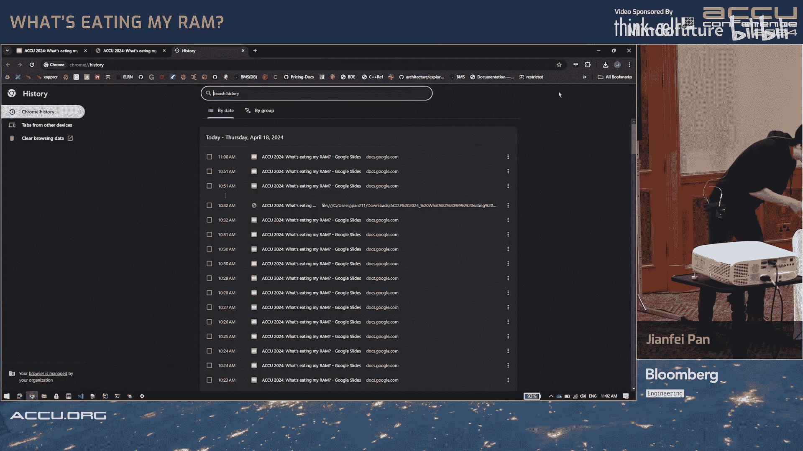

# 中英-•-C++和C语言ACCU大会2024｜人工智能｜架构｜函数编程｜静态分析｜安全｜编译器｜开发者｜垃圾回收｜链接器｜代码生成｜cmake-p24-P26-Whats-Eating-My-RAM---Memory-Utilization-in-C++---Jianfei-Pan--BV1pNotYYELk_p24-

So welcome everyone。 very happy to see you here。 At least you care about memory usage， Sir。😊。

嗯， my name is张飞。Yeah， I'm from Bloomberg， Mars engineering。 So it's not that Mars。

 It's Mars multi eric system。 So my daily work is more like a client feature， pricing， workflow。

 etc cetera。So today I would like to share my story。 what's eating my rum。 So from the title。

 I guess you already have an idea like what I'm going to talk about。

 So basically the problem was my service is using a lot of memory and memory usage keeps going up。

 So I want to figure out why。To be more accurate， my service is a long running。

 stateless C plus application running on a Linux machine。So since there's no state， I'm holding。

 I'm not holding any state in my service。 So I'm wondering why I'm using so many so much memory and why keep going up。

靓上。So firstly， who is facing the same problem， raise your head。系。😊，Who don't care。 Okay， everyone。

 everyone cares it。 Okay， that's nice。 So first of all， I'm not expert。 you know， my。

 my daily work is like more the client feature。 and that was my first experience dealing with memory issues。

 So if you don't have any experience about memory issue， I hope that after listening to my story。

 you could have idea。 Like what kind of a problem might be。 and how to analyze them。

 And if you are an expert。 I'm very happy to hear any otherwise or ideas and what else I can try。

 So let's get started oops， what's this。😊。

Sorry， wrong button。Yeah， so my story started with alarm。 So the alarm telling me。

90% of memory usage on that machine do something。So my first question was。

 was that alarm and why is important。 So after figuring out that。

 I went back to the basics because I know nothing about memory allocation。 So basically。

 I want to find out why how does my code impact on memory usage。So after that。

 I tried some tools and discovered some problems like memory leak and fragmentation。

 So that's basically everything in my story。The alarm。It was a sunny Wednesday， like today。

 Like we were so happy because we just close the sprint with a fancy feature for clients。😊。

It pass green， and we click the button to deploy。And later。You know what happened。

90% memory usage alarm for that machine。 So my first question was。

 was that alarm and why is important， You know， in Blumomberg。

 we have like different levels of alarm And that one is the top one。 So stop and fix。

So I go to JGBT and ask， what's the consequence， if I， what if I do nothing， What will happen。

So the answer makes sense to me， firstly， we will have more swap。

 which means the operating system will do more and more effort to move the inactive data from run to disk to make more spacing run becauseM is expensive。

So that will slow down things。 So we will have a performance degradation。

That's the first consequence。And later。The operating system will not allow one service to take all the memory。

 So there's a threshold。 And in Linux， for example， there's an auto memory killer。

 So we're going to kill your service。 That means service disruption。

 That's definitely something we we don't want because that will cause like client impact。And finally。

 since we are in a multi turnant environment。 So all the resources on that machine are。

Shared by all the all the processes。 So the， the so the。

 the performance impact were not limited to your service。 It could like impact other processes。

 They could be more critical and more sensitive to the， to the performance impact。 So it's terrible。

 We don't want that that happen。So that's why it's important。 We should do something。

 So the first thing I have done is， okay， I need to find out which process cause that problem because the alarm is on machine level。

90% memory usage。 I need to figure out it comes from a which process。

So I log to that machine and you top。 that will give me a like list of a candidates。

 So those are the top users of run。嗯。So， from。So from no alarm to alarm， there's something happening。

 right， So I check the memory usage with those processes in past a few days。 we have that dashboard。

And I found this。So you can see the memory usage from Monday to Friday， from 1 GB to 7 gig。

 That's a lot。 And that's not normal for a C+ plus application。Given that my traffic。

 the requests are。Are stable。 I I don't have like exotic request in the end of a week， pushing。

 pushing the memory usage， so。It comes from my code。 It's come from the last release。

So my next question is， okay， how does my code change that， Why is that happening。

I went back to the basics and tried to find out why。 So basically。

What's happening between that live code and memory usage to 90%。It's a long way。

 but a lot of things are done by a lot of tasks are done by two things。

 So we have operating system and Malo library。 So firstly。

 we don't need to deal with those hardwares。 Opera system will like map all the physical memory and disk or other devices to a virtual space。

 So from point of view of process。We are going to use that。Vual memory。

 And we don't need to care where my data is。 It's on disk or it's on Ramm。

 operating system is smart enough to move data around。So next one is the malloc。

 So Maloc is the library。To make the bridge from C plus plus to the virtual memory。

 So here I'm taking an example of G' Maoc implementation。 So it looks like this。

 Malo will take some range for kernel for data and text。And some region for hey pen stuck。

So basically， the memory usage of my process should be the sum of those regions。And I know that。

 okay， kernel data attacks， they are small and static。 is cannot grow to several gigabytes。And stock。

 we have limit。That's why we have a stock overflow。And the lonely reason could be the he。

 So the hip is growing a lot。 And I want to figure out why it's growing。

So let's go in through the malllo and say。How it happens。 So firstly。

 heap is just a contiguous regional memory subdivided to chunks。And chunk is the basic unit。

 We do a location or free。 So when you call Maoc， You do a location。

 You locate a chunk and well free you free a chunk。That's the basic unit。

Then we have a mount threading。So in multiread， we should allow multi active memory region。

 So to do that， we have arena。 So this arena is not actual regional memory。 just a structure。

 So this structure。Well。Have some pointers point to the he they are going to use。 So it's not clear。

 but there's a pointer point to this hip， so。For example， we have a min thread。

 The min thread will use this main arena。 The main arena tells the thread， Oh。

 this is the hip you're going to use。 That's the main hip。 we' are going to use。As for。

Others threats， there will be other arenas。 So one arena can point to one or more he。In this case。

 those hips。Are different from the main hip。 They are going to be somewhere in the virtual space。

 and Malo will use the system called M map to allocate those regions for those hips。 So Im sorry。

 the pointer is not clear， but you can see different point pointers point to that M map region。Okay。

 so， and we， we also have another system call。 we call it as break。

 So this is the system call for extending the main he。So when those two system call get called。

 the memory usage goes up because we are asking more memory from the operating system。So basically。

 thread goes to arena。Arena point to the heap and the hip is subdividing into chunks。

 So how chunk looks like。So this is a chunk。A chunk。It can be allocated。Inu to a in use chunk。

 So in use chunk， the most important part is the payload。

 So the payload is the address exactly returned by the Malo function。And besides that。

 we have some metada like size， previous size or allocated arena， M maps and previous in use。

So all those meta are for managing those chunks。And the chang can be freed also。

 So when you free a Ch， it doesn't just disappear or destroyed。 It's still there。 You have it。

And the only difference is that we have more metadata in the payload。 We have forward back。

And it looks like a linked list， right？ We will get to that later。

 So a free chunk can be also combined with adjacent free chunks。 So if you have two。

 you can combine them to a larger free chunk。Okay， so what happened when were free。收。So free。

 just marks that chainn can free to be reused。 Nothing destroyed。

 And from the operating operating system point of view。

 this memory still belongs to the malllo and the process。

 So that's why in most of the C plus plus application memory uses dashboard。

 you you don't you can say it's rise。 it keep flat。 And sometimes it goes down， but not。

 not every time you call free。 That's why。And all the free chunks are managed in bins。

 So bining is another structure。 It's not a。Extra memory， we are not moving everything。 It's。

 we are not moving anything。 It's just a structure with midex and several linked list。So， those。

Fred chunks are managed in different bins based on their size。

 So you can see the forward and back are used in the linked list in the bins。Sorry about the。We。

 we don't see clear， but there's an example， like， like a。

We have a lot of small bins and a few larger bins。 You can imagine that in that way。

 you can reuse the fridge chunk efficiently。嗯对。Okay， so now we have all the pieces。

 let's try to put them together。 see what， what's happening when we do a malllo and when we do a f still。

 there's a pointer here。 You may don't see it。 but it's like this。 So， for example， I have this heap。

 I have a two in used chunk in yellow and two free chunk in blue。 and those in green。 sorry。

 and those two free chunks are in the beans are， there's a pointer like this。So。

If I send a request to allocate something and if appropriate bin has that chunk。I just use it。

 I turned that free chunk to a in chunk， and they get out of a bin。

 So this is only free chunk left in bin now。And we are going to free that one。We just put it back。

 change it back to a free chunk。And if I'm going to free this chunk and the adjacent chunk is free。

 also。We can do this Comp by。 It becomes a larger chunk。So what if I cannot fight anything in my bin。

 I need a larger chunk， for example， In that case， I'm going to call that asbreak to extend my hip first。

Then create a new chunk on the top。And when that one get get afraid， it goes back to the bining。So。

 there's an exception。When youre requested too large。Well， Malo is smart。 He ignore at all。

 I couldn't find this size in my bin， So he will directly use M map to allocate a memory somewhere in the virtual space。

For you to use。 And when you free that one。We're going to use MO map。

 So return directly to the operating system。 So that's why sometimes you still say the memory usage goes down。

 So behind， maybe a M O M O map is happening。Right， so this is a very simplified version。

 There's a lot。Other stuff like tea cash， it the thread cash。

 So we are going to tea cash before we go to beans。 Maybe we can find a。

A free chunk over there already。 And the topmost chunk is managed slightly different to。

 to prepare for next location。 And sometimes you can see the hip can be shrink based on some condition。

 So all those manese are done for reus the free chunk efficiently。So back to our map， let's say。

 Maoc is smart， right， doinging a lot of effort to reuse those free chunks and operating system is smart also to move the data from。

Between the room and the disk to make more space。So what could be a problem。So I started to check。

And firstly， my guess was， oh， do I have a memory leak。 So the definition of memory leak is memory。

 which is no longer needed， is not released。And it looks like exactly like this。

 So your memory usage keeps going up with traffic。So the first example is that new it andt forget it。

That's why we prefer modern than+ and we emphasize the RII since no object leaks。

 no resource leaks because every object behind it is a resource， it's a thread or it's a memory。

And the second example is that even were using S T O container， for example。

 if you keep the entries are not no are no longer needed in your container。 Yes。

 eventually it will be destroyed somewhere when the container destroyed。

 but it's still a leak because you， you don't need it anymore， but you keep it。

And third example is missing virtual deal base clouds。 that's。That's the  error we made in the code。

 so。When the object get destroyed。The resource inside what best costs will be leaked。

And the last example is the circular reference。 So imagine in a world where using ShaPo or everywhere。

 he becomes a garbage collector。And that garbage collector is based on reference counting。

 And the basic problem of a reference counting is the circle。 So no one let go。 You getvic。

So those are the， four examples I have in my mind。 If you have any other examples。

 please let me know。So now the question is， do I have that， how to fight it。

So you can check the code if we have those things， but it's too， too， too much work。

 So we need tools。 I tried something。 I started with this test locator。

So for those who are not familiar with allocator， So allocator handles all the request for allocations and de locationss of a memory for a given container。

YeahSo in the very beginning of a。Discussions of standard。

 I think people already think allocator is a good thing because we should make containers and independent of memory model。

 So it's a good thing， but limited to the language we cannot have it。

 That's why all the S TL containers are rewriting to accept those allocators。 So later in 9098。

 we have the stateless allocator， which means stateless means the first location and the thousand all。

We shouldn't make difference。 It's stateless。And later， in 0，3。

People remove that assumption and say actually a locator could have states。 And that allows a lot of。

Uage in custom， custom allocators。 And even better in in in 17。

 we have a PMR that gives the flexibility in the wrong time。So， back to the telesloator。

How to use it。 What's， what's it， so。If you check the。If you check the template of a vector。

 for example。So the first parameter is the type。 The second parameter is allocator， and by default。

It's ST TD allocator。 and you can inject any allocator in presentation if you want。

 And this test locator is just like a wrapper ver the real allocator。

 So before we are doing the real work of a location， he will make a record with a magic number。😊。

And when we free it， we just try to match that record。 And if there's a mismatch。

 that means a leak or some other memory issue。So you can say the good thing is that。

We have this test locator。 It's fast。 It's small overhead。

 You can like inject in a part of your code。 That's why it's it can be also scope。

The best side is that okay， I need to change my code。 I need to compile the link。Well。

 I don't really know which part of code in my service is leaking。 So it's quite hard work and。

Can I have something else， if Greg。And。I found the dress sanitizer。

So it's a memory error detector by Google。嗯。Basically。

 it's a compiler instrumentation module plus a runtime library， which will replace the malloc。

So this time we don't need to change our code， we just combine link with this option。

And address onizer will like replace that Ma implementation and do something。

 I I guess it do something similar。 Try to match the allocation and free。 And if there's a mismatch。

 there's a memory leak， something like that。So the good thing is that I don't need to change my code this time is a fast。

 Well， it's 50% to 1% slower than nothing， but it's still fast comparing to other tools。😊。

The best things I still need to compile and link。And the extra memory cost。Well。

 I would like to find something I can use immediately。 I don't want to compile the link。

So I found the background。 So background is a tool set， including memory check。

 which is a memory error detector and a massive。 It's a hip profileeller and some other tools like diha。

 etc cetera。So this time with， we don't need to change our code or compile link。

 We just to run that program under the background comment。

 So V will run the application as sendbox and in that setbox。

Background has the power to do the debugging and profiling stuff。So the good thing is that， oh。

Nothing changed to my exccutable。 I can run directly， but it's slow。

 It's 10 to 30 times slower than nothing， and it will take a lot of extra memory。O， so。

Back to our map， you can see the。The tools， the tools they they are trying to catch the problem different place。

 So test locator is on code level。 address sizer is more on。Malock library and the background says。

 okay， let's put everything in a sandbox and catch the problem there。Yeah， in terms of a result。

 they could be put into two categories。So the first category for the three first toolss like Tesla Cter。

 address onizer and memory check。What they can offer in the end is one snapshot in the end of a profiling。

So it looks like this。 You have a leak summary。Sorry， you may don't read it， but you have like。

 whats the blocks are leaking and what's the size and what's their cost stack So you can investigate from those cost stack to find out why it's not released。

So that's one snapshot。 I had that。But in real world， there's a problem。

 our server have a lot of external libraries and a lot of legacy code。 So we have。Study kicks。

There are all no issues When I say static means in the beginning of my service at leak 1 MB memory。

 And after running thousands answer request is still 1 MB。 those problem existed already。

 and I'm not interested to that， but。It it， it becomes noise to me because in this report。

 imagine you have 10000 of call ducks and memory leaks。

 You cannot really tell which one is growing with the traffic。 So you don't know which one。You。

You should fix。 So that's how massive can work can help with us。

 So massive basically is a snapshot over time。So with the visualizer。

You can easily tell for the memory uses， how the memory uses change over time for different cost stacks。

 And you can easily tell which one is static and which one is growing。 So for those growing ones。

They are interesting for us。So some tips about this prevailing work so firstly， yes。

 study clicks may hide the real problem， so you need enough traffic to trigger it and make it significant your result to find out them。

Second one is they are all good tools， but for different use cases。

 So if you know which which part of your code may do the leak and you have a good unit test case。

 you just can fix it on local。 You don't need to wait for like。Client environment， for example。

 and we want to catch the problem in earlier stage。

 So a good practice is to integrate address En in your C I。 If you have a good un test set。

 it will catch like most of the problems。And if you cannot have that， your。

 your test coverage is not good， still some client traffic may trigger the problem。

It's better to set up the background in those environments in advance。 So when the problem shows up。

 you don't need to wait， you just start profiling and find the problem。

And the last one think most important。 So as developers。

 we should care about the life cycle and ownership of those things we are allocating。

 When you use a share pointer， you just let it fly。

 We don't know when the who will release that thing。 So don't use it unless you have to。受。

Later work is easy。 You find a cost stack， you figure out which object is leaking， track it。

 try to find out why it's not released， and fix it。The memory usage got much better， butm。

 I wasn't not satisfied because it is still growing。 It's still using a lot。 So what else can I have。

So I guess maybe fragment， so。Framentation is saying you try to allocate a big block and you can't。

 even though you appear to have。Enough memory。 Free memory。So the first case is like you。

 you all play Tes， right， You if those blocks are well placed in the correct position。

 you still have space for new blocks coming。However， if you place them randomly。

 you waste space between those blocks。You could have no more space for new new blocks。

And the second case is like this car。 we hit that， right， It takes four places for one car。

So that's another way to waste space。So the first case goes to， we call it external fragmentation。

 For example， you have a free space， you do some location， you do some free。

 And now I need another location for four。Well， I have four I have， I have enough for four。

 but I cannot put it。So I need to extend my hip and create a new chunk because I'm wasting。

Space between those blocks。And second case is like this， I， I need， I just need two。

 but I'm allocating it。 So I waste space internally。So， it's internal fragmentation。

So next question is， okay， do I have this problem？ How can I tell if I have this problem。

 So you can say。The it estimation fragmentation。 is's not detect。

 So the question is different for memory leak。 you can tell， I have it。 I don't have it。

 But the question for fragmentation is， how bad are we， We cannot avoid it， How bad are we。

 So I need a way to evaluate my service。 How bad are we。And I found this formula。

 So for external fragmentation， the idea is that if most of your locations can be done with your bins。

 you don't need to ask for more memory from operating system。 So that's good。 That's good。 That's。

 that's no fragmented。So this formula is one minus's largest loable block divided by total free space。

 So if imagine you have。2 GB free space。 But your largest allocateocable block has only 1 kB。So。

Any requests larger than 1 kB， you need to ask for more memory。 So that's badly fragmented。

 and that value is close to one。But if you have only one free space， that value is 0。

 you are not fragmented。And for internal， its more straightforward。 You allocate something。

 You use something。 So we use1 minus to access the by divided by total by。

 So you can have an idea okay， what percentage I use， if that value is2。one that means。A huge waste。

 If you allocate something and you never use it， That value is one。

 If you allocate something and use the whole size of the block， that's 0。 No fragmentation。

So next question is， how to fight those values for external fragmentation， I found this。Mocing for。

 It's a save function。 We can call it in our code to get some information from Maoc。 So basically。

 it will give me like， what's the total by allocate。 What's the free space， What's the space in use。

 And there's a way to figure out what's the largest allocable block。 So you can see in this example。

 I'm using 30 around 30 MBby。 And I have 200 MBby free space。That's a waste。

 And the largest one is just 60。Klowbys。 So very， very badly fragmented。

 And you say the value is near， very near to 0 to 1。So when I look at the number， I'm thinking。

 I still don't have an idea how bad are we， I know it's very bad， but how bad are we。

 So I take another service and try to compare them。 So the Sur B is very similar。

 business logic and similar traffic。 What I got is that you can say the the total in use allocation locations。

 It's similar。 It's 30 mebyte each。But the free space for the second service is just 2 MB。

And the largest block is double。 So， so the number， you can say is still close to one。 It's 95。

 something comparing to that 9，9，9，7。But if you zoom out， have a higher level。

 you say if my service a running one day， it takes 400 MB。 And the second one。

 I can let it for seven days。 And in the end。It's just 200 MB。 And in the， in the end of a week。

 is nearly flat。Not growing。 So I would say it's a way to do the estimation。

 but I suggest you to have your own benchmark because that value。

 that number really doesn't mean anything if you change to another context。So for internal。

 we're going to use this v dihad。 I think it's useful。

 It will offer you a report about all the use usage of the allocations。 So， for example。

 the first one I allocated a lot， but never read and never write。 So it's a zero access block。

 We are wasting。The space。 And the second example is。I have this cost dark。 I allocated this size。

And I only used a part。 I write apart， and read a little。So that's how we identify those blocks。

 And you can have further investigation。 Why am I doing that， Why I'm。

Allocating things and never use them。So the question is how to reduce that。 We have it。

 how to reduce that for， So for internal one， as I said， you can check those cost taxs。

 It's your code。 You， you are doing that。 You should understand why are you wasting space。

 But for external， it's more， it's not obvious。嗯。People are doing a lot of effort to reduce the fragmentation。

Msh mesh is idea， I。I heard from another conference。 So the idea is that， okay。

 I will stand between the memory， the， the physical memory and the operating system。

 So I have a two page。 I have two memory page。 They are both very badly fragmented。

 So you can see the。Data points， green and data points yellow。 And I find that's okay。

 I can matchsh them。 So it's meshable。 When I move all the yellow data on the first page。

 there's no cl。So I can free。 I can， I can release this page。 I， I can release this whole page。

 So from operating systems point of view， it's still two page。 But the matchsh is release one。

 So we are saving space。 We are doing compacting。😊，And for operating system。

 people doing this body system， basically is doing a location every time with a size of a factor 2。

 sorry， power 2。So。I saw that， but I think we are shifting problem from external to internal because this way can avoid external。

 but your internal， you you you are wasting more space。At the malllo level。

 Malo allows you how like tuable parameters。 you can try to till the arena number。

 You can try to till the threshold of the train to shrink your， shrink your hip。And also。

 G Maoc is another implementation of a malllo。 So it's like focus on avoiding the fragmentation。

 So you can see a lot of。Ideas to reuse those free chunks more efficiently。

 So you can see we are doing a lot of effort。 But if were going back to say where the fragmentation comes from。

So if you do allocate， allocate， allocate free， free， free， It's different from you do allocate free。

 allocate free， allocate free。So。I think the source comes from the memory usage pattern。

 So I think the most。Effective effort we can do is on the code side and make the memory usage locality better。

 So this idea of local loators come comes from another talk by John Les。In 2017， in his talk。

 he focus on like using local allator to improve the locality or memory usage to speed up the memory access。

 But I do think that idea could also reduce the fragmentation。 So here's my thinking， so。

Take my example。 I have a long rounding service and stateless。 So I process one request。

 I should relieve everything related to that request。 Then I process next one。 So for that system。

 actually， we can。Like try to put them into subsystence。 So I have some code for log， for example。

 I have some code for decode， Decode the request， for example。

 and I have some code for TCP connection， and I have some other code for the business logic to process that request。

And those subyems， they should have different memory usage pattern。

 So for log and TCP client TCP connection。They are going to allocate something， and hold them。

For a buffer or for for dump or something。And decoder and process request。

 Those subsystems are going to allocate memory only they are processing a request。

 So after process the request， there's nothing left for them。

So you can see lifespan of memory allocations are different。

So if you are using the global allocator means we are allocating everything in the same memory region。

 what it becomes is that if you processing the first request。

The different subsystems will allocate something with different colors， you can see。

All in the same memory rangech。And after the first。Requests are processed。

All the short terms are gone。 So the decoder and process request release all the memory。

 What's left are those holding by other subsystems and fragmentation。

So the idea of a local allocator is very similar to the object pool or a memory pool。

 So you know that， okay， my short term。Subsid sum is going to use some memory。

 and I know they are going to release it when when when the request is processed。

So what I can do is that I splitit into two subsystem。 One is short term， one is long term。

 and I create a two local allocator。 So this local allocator， what。

 what it will do with just pre allocatecate a range of memory and all the allocation happens to it will use only that region。

 So we separate them in2。And this time， if I process the first request。

So decoder and the process request， the short term system will allocate something here。

And the long term will be allocated here。And when the first gone。

 everything in theocator  one should be gone。 And we don't have fragmentation in the alator 2。

 So that's a way I think comparing to the global allocator。

 we can reduce the fragmentation in this way。So in the original talk of John Les。

 it's about locality。 So you can see。With local allocators。

 we can improve the memory access locality， both in physical way and temporary。

 So in the two dimensions， we can improve the locality。 And you can see blue is。Fast and red is slow。

 And we can see with those two dimensions。Improved with locality。Our performance is improved。

And also， I think it could reduce the memory fragmentation。

So that's something else if you want to read， mostly comes from the Gpses Malo Wiki and some other tech talks if you are interested。

So I guess that's everything about my story。 again， as I said， if you。

If you don't have idea about what kind of memory problem you are facing， I hope after this story。

 you can have idea。 And if you are an expert， I'm very happy to hear any advice and ideas， so。😊。

Thanks all。 if you have any questions， ideas， comments， advice。Or how time， thanks。

