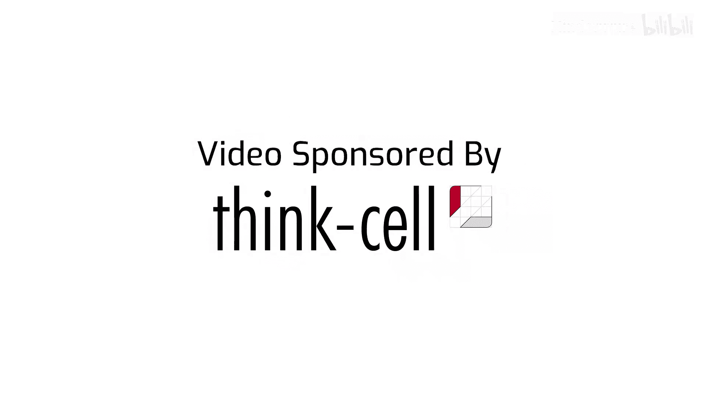
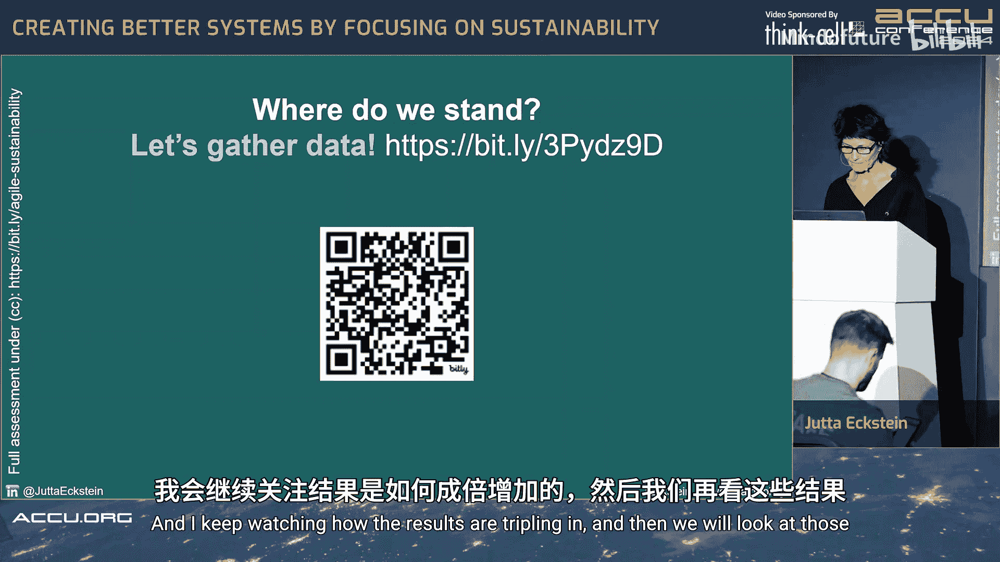
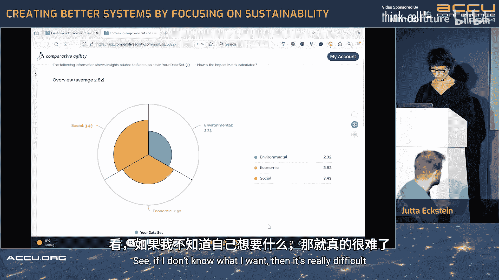
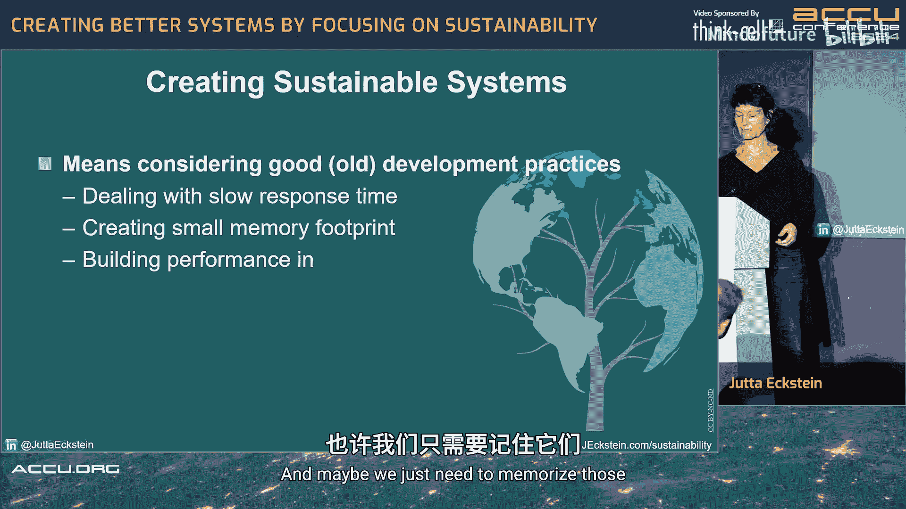
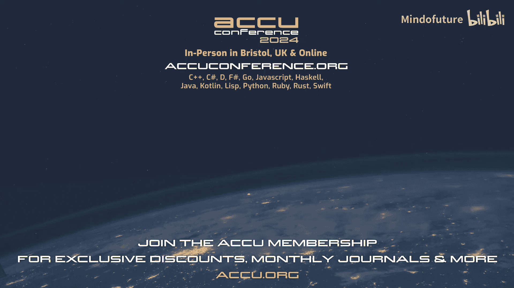

# 中英-•-C++和C语言ACCU大会2024｜人工智能｜架构｜函数编程｜静态分析｜安全｜编译器｜开发者｜垃圾回收｜链接器｜代码生成｜cmake-p25-P27-Creating-Better-Computer-Systems-by-Focusing-on-Sustainability---Jutta-Eckst--BV1pNotYYELk_p25-

So welcome to the session。This is。I believe my third session here at ACCU on the topic of sustainable development。

 And I see you nodding Felix， so。I， I know you keep track of it。 And you're。

 you're probably the one also pushing for it， so。Let I would first like to know who has been in one of my sessions in the past。

 Felix and Fran。Okay， and I can't really see in the back。 So， but it looks like nobody else。

Which means for the two of you， I really wantan to give the definition at the beginning。

 But everything else is， is different because the， the good thing about。

Sustainable development is that so much is going on。 and I keep learning about this。

Like all the time。 So it's definitely different。 But the。

 the definition of what's meant with it is kind of the。

The known stuff for the people who have been here before。 Okay， so my name's Yu Xstein。

 Maybe this is what I should have said first。 my background is， well， it is software development。

 but really more so in the actual world。 So I'm very busy in like actual development。

 and also wrote a couple of books about that the last book that I pair wrote， actually。

 is the the bigger one， the companywide achiility， which I corote with John Buck and why I' am pointing this out is。

😊，We figured once a company really says， well， we are agile overall。

 Then this comes with a responsibility。 And the responsibility is， for example， this one。

 If we look at customer focus， it means that if a company says I'm agile。

 then it's also expected that the company expects or or treats。Like。

But surrounding the ecosystem around the company as a customer as well。 So it's looking at economic。

 ecological， societal and social environment as a customer as well。 And I just want to give you one。

 one the example。 So if a company says it's actual。 Well， it's even if we we can make it smaller。 if。

 if there's a team saying。We are doing actual stuff。 And we are really an actual team。

 And then you figure out that， well， they are not really inclusive。Then you might say。

 perhaps that's at least our， our speculation。 That's what we see is that you might say， well。

 I thought you are actual。Because it kind of comes with that。 And the same is true for companies。

 So this is actually where it started for me to look into sustainability within the context of my profession。

And。Nowadays， I also summarize this one more in the direction of。

 and you probably will see this later on as well。That we should really understand the planet as a stakeholder as well for whatever products we are developing。

 So the planet is one of the stakeholders。 So this is kind of a more difficult， yeah。

 description of it， but。The summary of this is the planet。 before I am going further。

 I would like to hear from you。 What is it。That for you。

 connects sustainability and software development。 So I'm not focusing on actual here。

 but just in software development。 And yeah， I think you can raise your hand and Tim will find you and。

Who would like to share？Yeah， I can start。 So one， I think important topic is energy consumption。

 for instance， especially if you look for the。Current trend of all these so called AI systems which burn so much energy so that it's incredible so it's。

Beyond what we can imagine what they already consumed So this is one thing。

Which gets more and more important as the systems I use more and more。 Right， right， There's front。是。

I was going to mention the energy consumption as well， but the hardware， too， like。

Sure we've all got a box of shame somewhere in the house。 you know。

 white and there's bits of gold in the cable and then。Things like battery technology。

 I must have so many old lithium batteries in the house， and we're digging that out of the earth。 A。

 it's going to run out at some point and B like。What will we doing mad？Right， right。 There's a。

Statement back there。So I do for more development and that means we're usually deploying onto devices。

 I work on consumer electronics， so it's always a constant thing we think about which is what's the lifetime of our electronics and can we support the previous electronics with updates and stuff like that because otherwise people will throw it in the bin and that just adds to waste。

Right， yeah。Anyone else。 And， of course， you don't have to。 or maybe it's all sad。 that yeah。

 there's another。嗯嗯。I also feel like software has some kind of influence and consumption。

 like its just an ability has to do with the consumption frenzy we have in the society and somehow software influence people out of making decision to buy something or not。

Right， yeah。Felix once more， and then maybe。Yeah， I think another important topic is the accessibility to systems at a whole because for instance。

 certain countries don't perhaps they don't have the money to buy the high end products of whatever so and so there are some kind of inclusivity or exclusivity not on purpose。

 just by not able to buy something and this is something。To be to right？So。Very。

 very good of what we heard。I'm not sure if it has been stressed yet， that。

Software development can also help with sustainability。 It can also make the world better。

 And this is also something we have to keep in mind， however。嗯。It can come with a threat。

 And the threat is like the energy emission we've heard， We've heard the。

 the ebaase was the other thing。 We had like two people， at least talking about that。

 And then the third big threat is exactly。 What you're saying， it's called the digital divide。

Which is the accessibility to technology， really。 So that can also make a huge difference。 Yeah。

 exactly。I ain't wanna will。No， I thought I'd want to do this， but I can't。 Why not。 What's wrong。

Okay， let's try this。 Okay， I wna show my， my typical agenda where I first wantna look at the what。

 What are the facts， then some insights， and then finally， what is it that we can all do。

 which is us， right？ And so if we are starting with the facts。

 then I want to first point out the point about the。😊。

Energy consumption that has been also raised by quite some of you， and。

There are various forecasts out there。 So the the person that does's the most in that feel。

 And I have to find it。 So it's under and dry。 So he's really kind of the key figure there and has written quite some report research on that topic and keeps updating his findings as well。

 And this one just shows like various forecast about the energy consumption of I T in the years till 2030。

 But he also learned was when he first started this his first research。

 And I believe that was his PhD。 And that's a few years back。There it was even worse than it is now。

 So this is a good thing。 So it has changed for the better a little bit。 However。

 what it still says in the worst case。It could mean that I T needs about 21% of the overall energy consumption by 2030。

And， well， that's quite a number， I would say。Okay。

 now I promised already that I want to give a definition what we are talking about when we talk about sustainability and there are various definitions out there。

 which might make it a bit harder。 But this is why I think it's important。

 So you know what definition is it I'm working with。 So， first of all。

 there's the very first definition that has been provided by the United N United Nations from the Fland report。

 And which was headed by M。 Priland。 And so this is why it had that name。 And basically， it says。

Whatever we do， we shouldn't do it at the cost of future generations。Right。So。😊。

We can live our lives and do whatever。 And the question is， of course， are we doing this or not。

And so this is one definition which I think is super helpful。

 And it's like a general theme maybe that can go with us or accompany us。

And then there is another definition， which is way more fine trained。

 also given by the United Nations。 And these are the 17 sustainable development goals。

 I can't imagine that some of you have seen that， especially。In our part of the world。

 they are often shown in various locations or there are like posters placed and at different places and so on。

 So what they do is they look at various areas and say， like， okay。

 sustainability means in this area， this and that。 So it， for example， oh， this is nice。

 I I' have never pointed this out。 But now this jumps into my eye。

 number 7 says affordable and clean energy， I like the affordable as well。

 Then it also goes into more social aspects。 like if I see number 4， it says quality education。

 which also speaks about or addresses the digital divide that you brought up， for example。

 that that could be something then。The first two go for me a little bit together。

 like no poverty and zero hunger。Then maybe a last 1 I'm pointing out here， because I'm。

A passionate scuba divver life below water is one of the things that I like。So。These are。

Very specific definitions of different areas。 And I think this。

 this is really important because also， companies are asked to report what they are doing in terms of these different sustainable development goalss。

However， I also find them hard for me to work with in my profession。 And this is what I want to do。

 I want to， yeah， we talk about sustainable software development， basically here。 And so I。

 I'm not sure if the product I'm working with。 I can pay into。0ero hunger， for example， or whatever。

 And so there is another definition which basically takes all those 17 sustainable development goals and puts them into various buckets。

Exactly three。And then it has more。 Well， let's say it's kind of a Goldillo approach because this is very broad。

 This is very detailed。 And the one with the three packets， it's kind of in the middle。

 And this is the one I prefer and go with。 It comes also with various names。

 but it's one of the names is three pillar model。 And it has， as I said， like three buckets。

 And the one bucket or pillar is the social one or the one focusing on people。

 And it says like it's about aiming equity， health and liability。

 And I want to do a translation right away here to what it might mean in our world like software development。

 So it talks about diversity， safety， security， privacy， accessibility as well。

 So these are all things that are important for us when we develop software， right。😊。

The second pillar is the one that often comes to mind first。 It is the environment。

 So it's about that we need to protect the planet。 And so we look at carbon reduction。

 So reducing the carbon footprint。 We also talk about green software， green I T and。

 and all of these things， They typically focus。Only on energy efficiency。

And then the third one is about economics or prosperity is the other way how it's related to。

 and I really would like you that it sinks in what it stands for。

 It stands for improving the lives and prospects of everyone everywhere。Which is a huge aim。

 And I will come back to this later。 And， and here we are speaking about sustainable economies。

 but also responsible products。So this is。The definition that works for me。

And it's called three pillar model。 It also is called triple bottom line。

 That's another thing because it's also used， not because， but it's also used for accounting。

 For example， they use the same thing here when they do their sustainability reports。

 And the third name is people Planet prosperity。So just in case you。

 you find something somewhere else and they're saying， what。

 what kind of stupid stuff did you tell tell me And well， now， you know。

 it really comes with various names。 and it's not something I came up with， right？

 So it's just out there。Maybe let me check quickly。 Is there are there any questions So are you。

Fine with this that we go with that definition。 I see some people nodding， okay。Thank you。😊。

So this is about。The facts and all kind of the setting here。 I want to go to the insights。

 And with the insights， I just want to use the same definition。 And as you can see。

 I also brought an example here。 So what I want to do now is bringing or sharing some examples that I see or found in I T。

 And there are really many。😊，That show how we do not address these topics。 I sorry to say we。

 because you might not be part of any of those。 So the first example that I'm having is about social。

 and it， it's something I only discovered， I think Yeah， by the end of last year。

 that this is the case that the bodies cannot actually ask that first is a button push that says here comes somebody who is male or somebody who is females。

 and it has the classic blue and red thing。And。This might sound not so difficult， but if you， well。

 I kind of recommend。 And on the other hand， I don't recommend。 But yeah， let me recommend this。

 Do a search at one point for the body scanners asking for binary。

Decision who is coming because you really read about horror stories for transgender people or non binaryary people。

 And it's really terrible how they are treated。 And just by， well。🤢，A software decision。

So from a soft point of view， we don't need that。 So we could still have that scanner， right？ And。

 and of course， I'm， I'm also 100% sure that whoever developed that whichever teams。

 And I guess there are many because it seems all the bodies scanners are asking for that。

 And I guess there are more companies than one providing those。

 But probably someone said it's a requirement that we need to know。And， but。

 and it's not that the software team came up with the idea。 Let's do that。 I。

 I don't really think so， but。We could bring this to the attention of people。 And definitely。

 it makes the life of people harder of some people。Let me go on with the environment。 Oh。

 I have a more generic example here， which is， well， last year。

 we broke the record in I T and we overtook the aviation industry。

 So we have a higher carbon footprint now than aviation。In I。And。Well。That's kind of weird。

 Sometimes， I think people ask a lot about， oh， are you still flying。

 I've never heard somebody asking me， are you still using a computer， actually。

Or a phone or whatever。 Yeah， so。There's something going on and。

 and think of this research that I showed by And Andre， who says， like， how the。

 the curve is going up。 And this is just like one of the things where we see。

 It's really going up right now。 And it might not end up at the worst case with the 21%， but。Yeah。

 making progress。 That's not so good。Okay， the third one was， was economics。 And you remember。

 it was about improving the lives and prospects of everyone everywhere。 And here is an example。

I like to read this， maybe。And again， this is software。 So Francis Hol。

 I guess you all kind of heard about that when she with group as well， whistle p。Can you say that。

 I just made that up。 Maybe about what's going on in metatown。 So Facebook， Instagram and so on。

 And that it really。Does not improve the lives and prospects。Of people everywhere。Right。And。

It's algorithms。 It's software that's doing it。 It's not anything else。 And， yes。

 I can imagine a hope that you are not working in this environment。 And so for you， it。

 it looks different， but。There are examples almost everywhere where we find that we are not as good as we could be。

And that's also why I want to talk about this。So。Let me quickly ask you。 So now。

 based on how you saw the connection between sustainability and software development and now also what you heard。

 so。Why do you think is sustainable software development important。And yeah， okay。

 you can easily say， well， we should consume less energy， but maybe there are。More。

 more difficultic answers。 There's Tim and Tvani would like to， yeah。

Yeah I think the social aspects are actually quite important because the world runs on software。

 Yeah， so we need to use it for everyday lives。 So for example。

 something I see is accessibility is really a big issue。

 so I notice this with my parents they are8 something。

 they need to do things with a bank with a paying bills。And it's utterly confusing， right。

This is a problem。 Yeah， or accessibility also for people in general。

 not everybody has a computer at home。 Yeah， or not everybody is able to actually use it properly。

 And they have difficulties。 you know， even when we talk about。

Removing cash and making it electronic， yes。That will cause all sorts of problems。 Yeah。

 how can I give， I don't know， charity money to someone that is sleeping on the street because there will still be those people。

 for example， Yeah our paying。 So there are lots of these aspects that to me are quite important that we are not addressing。

Actually， for the last point you made， I saw this resolved。

 I believe it was even before the pandemic when I've been in China， even the very old。

Woman in the street selling her three apples that she's having。 She's taking the money via her phone。

 not taking cash。So it seems in some countries， this is definitely not in my country。

 Germany is always way behind with stuff like that。And maybe it be just like cash， we like that。

I don't know。 But yeah， I， I， I'm， I'm really happy that you are pointing this out because all too often。

 I feel sustainability turns into a discussion about energy efficiency only and the social aspect。

 accessibility， Well you pointed out before as well is， is really important， yeah。😊，Yes。😊。

s do you think maybe an issue within software development。

Because it's a virtual activity and not a physical activity。

We don't really think of cost very much in you know， iterations and using things。

 And one of the great strengths is it's almost costless or it feels costless to iterate where you don't iterate if you're making steel drums。

 Well， because yeah it's very expensive So maybe there's sort of。Subconscious。View that。we， we， we。

 we don't have to sort of be precious about things。 I don't know if that's the right term。 Right。

 right， Well， actually， sometimes I think it's also the vocabulary we are using like the cloud。

And it's， it's nowhere。 It feels like it's， it's very soft and light。 It doesn't do any harm。 And。

 of course， it also comes with。Carbon footprint， and so on。七年。Anyone else。

Why do you think it's important。Sustainable software development。 There is Felix in front。Yeah。

 one thing was that。Or already said I want to extend it a bit。

 so more and more parts of our life is driven or is driven by the mobile phones and so on and we come with higher risk。

 for instance， safety so compromising of。PPriv data in these things and I think nearly every week or every second week some breakage is there and I don't know how many million users privacy data is exposed and people are threatened potentially threatened by this and I think this ist。

Problem that is getting worse and worse。 at moment， I don't see that it's going better。

All right true。Anyone else。I think， no。嗯。What did I find。嗯。I thought。O。Well。

 the easy one was protecting the environment， of course。

 Then what we haven't talked about is also about finding new markets， maybe new clients。

 And this is perhaps my hope。哦咪。Maybe it's even my belief that I think more and more people will think it's important that the products that they are buying。

Take sustainability into account。 and not only by lip service， but really， so。

Same thing about getting and keeping talent。So if we look at the younger generations for them。

 this is way more important。 And if you have an argument for well。

 what we are doing is really taking sustainability seriously。

 you might have an easier way of really getting good talent。And then。

 what we haven't discussed yet is also saving cost。So because it's more energy efficient。

The bill will be。Smaller。Okay， so we have quite some stuff that we could do at why。

 why we think it's important。 So what is it， what we are doing。And I want to start with something。

 And I believe it's really the only thing that's maybe leaning too much into the actual world。

 But I hope you， you bear with me。And it is what we can do in terms of stories and actually I don't even care if you call them stories。

 if you write them this way， if you call them requirements or needs or wishescious from the client。

 it doesn't matter and you can write them up in a completely different form， I just use this format。

 which is often used in the actual world， and I'm not the one who actually likes it。

Which comes on top of it。 and it， it's completely unimportant that that form。 However。

 what it says basically for any requirement， who needs it， what is needed and why。

 So this is kind of the summary of it。 And if you just。Stay with that。 That's like one thing。

 However， what we should start discussing about now， when we talk about requirements， vicious needs。

 stories， that we should also talk about what's the impact。On sustainability of that requirement。

Story， need wish。And once we start discussing that， maybe we learned something that could mean。

Like we， when we talk about costs， you know， if there's a requirement， but we figure out， oh。

 this is really expensive。 And we go back to our client and say， this will be expensive。

 Are you aware of that。 And then they might say， oh， then maybe I don't want it。

 or maybe they still need it because it's super important。 And the same thing is here。

 Maybe we come back and say。Poh， this will really change the carbon footprint for much worse than the system is right now。

And we don't see any other way。So maybe this is also a different way of coming to a conversation with our clients about。

Making our systems more sustainable。 I have an example， which is not necessarily good， but still。

 it's an example。 So it could say， as a designer， I want to reduce the amount of font types。

 So the page performance will increase for users and pages will be more digestible。

 but the impact of reduced carbon emissions because of less data transfer。And just， you know。

 it's really not about the form。 I don't care about the form。

 You can write this up completely differently or not writing it up。 The， the thing for me。

 what's important is that we should start having a discussion on sustainability。

 on the impact on sustainability whenever we look at requirements。 So this is for me， the thing。

 And now just because I， I mentioned fun types here。

 I want to do a little excursion to fun types because you might think， oh， that's really nothing。

 So there is this professor in Poland。 look， I believe I'm not sure。My Polish is not existent。

And he built a little website where he just tried to experiment with different fun types。

 And what you can see here， there's quite a difference between Google fundss on the one extreme and system funds on the other extreme。

 and in the middle kind of self hosted funds。 And so。

It's probably still not a lot while he added it up like carbon emissions over a year。

 So then it's getting a little bit bigger。 But is it still important。 We don't know， however。

There are over a billion websites out there， and they keep growing。

 And then maybe it does make a difference。 What kind of fun types are used。

So that's just my little excursion here。 Now， looking at other stuff。

 So that was the first thing that I think we can do。 We can start。Having a discussion。

 whenever requirements are stated。Another thing that we can start looking at is at the whole infrastructure。

 So what is it that we need， but do we really need， And we should。

That will be refrain from the thing that we。I believe we。

 we got used to over the last years that we always wan to have the maximum。

We always want to have a really big thing。 So for sure。

 it will run and it will run fine and whatever。 And it doesn't really matter if it's。Death。

 tro or test。 So for all infrastructure， we often ask for the biggest possibility。

 Maybe this is a good thing that we now start asking for something smaller and really consider。

 what is it that we really need。What's the availability of it。

 Maybe we can we share the infrastructure with with some other projects， maybe other companies， even。

I'm sorry。And。And this way， start to cutting down。And as you can see with cutting down here。

 it's already cost saving if we do that。So that's also helpful。

 And you have even a good argument to get the support from your company。

What else do we want to look at。That is one of my， my favorites。😊，Psonas。

 I'm not sure who is using personas。 This is an known concept here。I see a few， not too many。

So personas， or， the idea of personas is that we， when we develop a product that we first think。

 who is our target。User， and then we ensure that whatever we are doing is really aim for a target user。

And the thing is。Often， if we are not doing this， then we try to fulfill the needs of everyone by not fulfilling any needs in the end。

 So because we try too much。 And so it's not helping anyone。 And that's， that's the whole idea。

 And and， of course， also to。诶。Well， to， to limit our resources， if you will。

 that could be also thing。Now， one of the things， speaking of accessibility also。

 So who can access the system。What I do nowadays is that I often say， okay。

 personas is still good because we don't want to really make it so proud that it's not useful anymore。

 It's kind of actually， but I just get reminded， if you are not thinking about your target users。

 then often it's kind of like these frameworks。Which are not helping anyone， because they are too。

 too generic。right。So what I， what I nowadays always do is say from time to time， let's take a look。

 But how would the system behave if the absolute opposite of the target audience we have in mind would try to use the system。

In order to find out。Are we completely excluding people here， or is it still possible to be used。

 Maybe not as good as for the one group that we really have in mind， But still。

 we kind of should think about others。 So this is the one thing that I wanted to point out about personas。

 The other thing that I want to point out is what what says here about persona spectrum。

 And this has at least。this came to my attention by a colleague of mine of friend David Dame。

 who works for Microsoft， and they came up with that persona spectrum car that helps them。

 And hopefully now you to make the system more accessible。

And what they came up with is the idea that very often， when we talk about accessibility。

 we only have。The permanent。Let's say in capabilitiesities in mind。 However。

 they are also temporary ones or situational ones。 And I just want to go through that。

Like with one example， in order to bring that point， hopefully across。

 So when we talk about making a system accessible， then often， as I said。

 we have the permanent in mind， which means for hearing。It's people who are deaf。

 So if we have them in mind， then probably we we think differently about our system that might need voice control or something。

 right， because that's hard to do but they can't operate it if they are deaf。But now， they are also。

Temporary people。Who have a problem operating a system with voice。

Because they might have an ear infection。So because of that， their hearing isn't good right now。

 And then we have this situational one where there is this funny bartender。

 So you are in a noisy environment， and therefore， it will be hard for you to operate a system。

With voice control。And so。But it actually says that persona spectrum or what it does。

 at least for me， is understanding that。If we make the system more accessible。

 then it helps everyone。It's not。Only not that this is kind of first， but sometimes you think， oh。

 this is only a small group。 and this is whatever important so on。 I don't know。

 I hope we don't have that discussion。 but who knows what's going on in the back of our minds。诶。😊。

So if we only think about the permanent one， the deafbl， whatever people。

 then that group might be small。 But if we consider that also temporary unsital。

Things can be different。Then really， we， we have way more inclusivity here。 And therefore。

 the system will be much better accessible for everyone。 It will be helpful really for everyone。

 So keeping that in mind。 So I， I kind of like that。😊，Okay。They are coming to one of my favorites。

 Oh， maybe they're all favorites。 Did I say that for that as well， I think so。嗯。😊。

Supporting all the hardwarem。I think， yeah， the two of you， we were， you were talking about， well。

 all the gold and whatever is in the systems。 and， and we keep buying new hardware in all of that。

 So I want to talk about this a little bit， so。Ha， no， before I talk about this。

 I wna bring some data。 I know we have talked about facts already， but still。

Let me take a look at that。 Who has seen the we。Heurard of fat。That's a sculpture Well it。

 as it says created by Poe Bo Nomini in the UK。And what it does is it shows， well。

 it's a sketch built off all the ebas created by one British person。Over the lifetime。 and。

 of course， also all the Germans， right， it's the same， whatever。

 And so here you get some statistics about that。 So like， we have whenever a UK citizen， for example。

 uses 160 mobile phones。 And if I read that， that sounds even not so much right now， right。

 And you can calculate this all up for example， the ebaase created if you scale it up and we look at the E U population。

 Then the ebaase would be 590 times a towerp。This is what we are creating。And I'm saying this。

Because。It's very often software that's pushing us to buy a new hardware。

And if I just think of of phones very often buying a new phone because the O S doesn't run anymore or the apps don't run properly anymore。

 or we can't install them all。 And similarly， it's true for our clients so that we often expect our clients to have the latest hardware。

 a good connectivity， whatever big monitor and whatever else。

 So we are often with the software also pushing them。To new Har or pushing them to create ebased。

 if you will。And that's my。I first started with my other favorite topic， supporting。Older heartram。

So for supporting older hardware， there are actually two things that are kind of known。

 that are concepts that are。I， I bet known by you， which is on the one hand。 Well。

 here I call them sustainability talkoffs。 But if you have feature talks in mind。

 you know what I'm talking about， I guess， And I want to detail this as well。

 also responsive design where we look at what kind of client is there。And now， how can this look。

Some of you might have seen this graph。 If also， this is not by me。

 So it has been published on Martin Foow's website。 And it looks at tacos from two different angles。

 on the one hand。How long。For how much time do we need the toggle and how dynamic does it need to be。

And just to give you some examples like release toggs。

 That's typical a thing But that be used if a feature didn't make it to the new release。

 And therefore， we put a toggle in and say， well。We don't want our users to run into that feature because it's not ready implemented it。

 It's not finalized yet。 So， and this means most often those really， so that feature is deactivated。

 That's， that's the result of it， making a release tole here。

 Most often it's not around for long because with our next deployment。

 that features should be finished， That's at least the hope。 And then it's also not super dynamic。

 it's really more。 well， when we deploy， then it's the time where we say， okay。

 these features stay don't work。Looking at a bit more dynamic aspect aspect。

 the experiment toggles they are looking at stuff like A B tests。

So very dynamic because we actually want to know， do people prefer。Feature A or feature B。

 What is it where we want to go。 So it， it really switches there。

 It's often a bit longer sitting around than release toggles， but not super long。

 but more like weeks， perhaps months in order till we learn enough So we know which features we will implement。

Then I， I don't want to go through all of them。 but let me go to the one at the upper right corner。

 Permission toggles。 Permission toggles super well known。 It's I log into the system。

 And based on my credential， I'm。Allowed to use feature X， but not Y， right。

 So this is a classic that we are using all over the place。

 And in this area is where the sustainability toggles fall into。 Why， Because also。

 they are around more or less forever， like permission toggles。

 It's not that we have them only for a few weeks， months or whatever。 So we always want to know。Well。

 if my credentials are like that， then Utah shouldn't do this。 She can't。

 And it's kind of dynamic because it always looks at the features that are there。

 And am I allowed to use it or not。 And it the same way is。

 is it with sustainability toggles where it's very dynamic because it looks into what kind of client。

I'm using。 And that's this client。 Remember， we are speaking of supporting older hardware。

 Does this client support that feature or not。 If it's not supported， it's not available for me。

 And if it is that can use it， of course， And it's hopefully those to codeats are hopefully around for a long time。

 because。For the time， we are supporting that old hardware， that old client， for example。

So this is another thing that we can do。What else？ Oh， yeah， I wna。Give you some information about。

But you can nowadays find out。 So there， there's also stuff that that's happening here where we。Well。

 we keep learning。For where we can find more information。 For example， there is the electricity map。

 And I will， you can， of course， use the Q R code， but it's more like for you to。

 to know this is how you can go there。 But I put also the， yeah， Bily and。

If you look for electricity map， you will find that。

 So this shows what kind of energy is available where， when。

 So you can look at different countries at different。Day times or weekdays and or night times。

 And there you can find out what kind of energy is。Consumed。

 but you can also look at what is produced。 And then， of course， the green or the better。

 the dark or the worse。 And this is knowledge that can help you。

For creating more energy a operations。 And what I mean with this is， for example， yeah。

 the following。 So when we understand when， when low carbon electricity is available。

 and the energy mix is renewable， then what we can do is actually。😊。

Decide that the operations that can run asynchronly。

 that they are run exactly at those times and not at the times where the fo fuel is used。

So if the more we know about stuff like the energy mix， the better we can。Do stuff like that。 And。

 and let me give you an example。 And perhaps some of you are old enough that you have seen that， too。

 So when I was raised， my mom told me。Well for the energy intense。

Machines like laundry machines or whatever。 We run them， for example， on the weekend or by night。

 because then energy is much cheaper than during the day when the industry wants all the energy。

I see some of you notdding。 So some of you have been raised like that。

 I know that's it's kind of some time ago， but still。Now， the things are different。 On the one hand。

 when the energy is renewable， it's typically also cheaper。

 Not all the countries are passing that on to the clients。 I see in the UK。 not。 I see that。

 but hopefully it will。 Let's， let's be optimistic。 This。But still， it's good for the environment。

 And so nowadays， it's better to look at， when is the energy mix renewable and run these heavy or intense energy。

 intense machines during the day， because there it's more likely that the energy mix is renewable and you're not relying on fossil energy。

 And so this is the same now with these asynchronous tasks。😊，Especially if they are， of course。

 if they are don't， if they don't need a lot of energy， then it doesn't really matter。

 But some of them do， because they are heavy algorithms。

And so you can then schedule them at these times。 what you have learned from the energy mix。

Another thing which is related to the topic about what kind of energy is available is that we now can also look at the cloud we are using from。

Energy perspective。 So Google， for example， has now that reach and picker。

And the thing what we typically have used for deciding on a cloud。Pro con is the price。

 price and the latency。But now we can also look at the carbon footprint。

 And the region picker says how important is that for me。 And then it spits out， well。

 then go with their cloud here or there， Pick this or that。

 So this is stuff that's already available。 And， of course， it's not only Google who does that。

 And there's the link for the region picker， but you can also just search for the region picker than you find it。

 Also AWS and Azure offering stuff like that so far。 Unfortunately。

 I haven't seen that they do it like this user friendly that I just have like a visual thing。

 They have more like guidance that they are offering what you can do into。

 for making your cloud more sustainable。 But still everyone is kind of offering something here。

 So this is， this is good。 I think there's stuff going on。 And we are we are making progress。😊。

I believe I have maybe two more things about from my side， what you can do。

And we are now going even more into coding for the two last things。 So the one is buildless。

Because everything that we build。Mes energy。And all too often， we have stuff sitting around。

 We don't even know anymore about。 And it's still， it's maintained and it's tested and all of that。

 so。Well， focusing on value or basic， how it's called no feature creep。 So we should。

 really look into what are the features that are really needed already and question that。

 if they are really needed or if it maybe can be resolved in a different way。 And the second thing。

 and that's maybe a new way of thinking。Monitor if the features are really used。 and if they。

 they are not used， be courageous enough。嗯。Eliminate them。 delete them。And yeah， it， it is really。

 it's requiring a different， Yeah， different kind of monitoring system or different kind of tests。

 even where we learn about this。 if， if features are used or not and then getting rid of them。

And the other thing I wanted to share is， well， if we talk about quality。

 technical depths and all of that， then， of course。The more technical depths we are having。The。

 the more we are also taking with us。 And again， it this costs energy and actually。

 it also makes it hard for us to build new features， which is also a bit annoying。

 So we are also slowed down by that and。Well。Maybe。Maybe this really speaks to that。

So if we have future generations in mind with what we are building and if we are really reing our stuff。

 then the future generation and to be honest at the time， I was a software developer very often。

 I felt I'm my future generation because I wasn't able to build in a new feature based on what I've done two months before。

 because I didn't understand it anymore。 And it was I don't know。 I didn't clean up。

 And this is happening， I think， well， sometimes just because we overlook stuff。

 And so future generations can mean it it's helpful for ourselves。

 but it's definitely helpful for the whole system that it's more maintainable。I want。

 so this is kind of the， the stuff that I wanted to offer as concrete things to do。

 I want to share one more thing， which is what I've co developeded with two colleagues。

 which is a survey。 the people who have been in my sessions last year。

 I have used the survey as well。 But now I have picked different statements。

 So it might be new to you。 And I would like to ask you to take that survey。

 And we will look at the results together。 So it's a few statements that will。😊。

Tell kind of where are we right now。 What is our discussion。Or state。

Around software development in terms of sustainability。 And， of course。

 you would need a little bit of time to。Answer these， and then we look at the results together。

And I keep watching。How the results are troubling in。 and then。

We will look at those。Yes， good， okay。So。嗯。First of all， in terms of understanding it， if you look。

 for example， at the social thing， it says here，3。43。 and it is the best of that because that， well。

 the outer circle。 So the one around here， that would be a5 and the5 would be the thing。

 when you would have answered true。Right， there was the true faults and the things in between kind of。

 right。 So if it really expands out， this is like， okay， we are doing this。

 And we are there very sustainable。 What we are doing。

 So what we see just from the outside already is that， again， the social part。 That's。

 that's kind of good。 It's， it's over three way over three actually。😊，Economic is barely 3，2。9。

 and we have the environmental as the lowest with 2。3。Let's first look。

 I would suggest as the thing that's good。Right。Okay， and then we also look here at what's good。

 What's really good is。Preventing pet actors from accessing or using any installed user data。

 I guess we all have learned enough about that。 And it had been in the news all too often， so that。

Hopefully， we all learned our lessons to really watch out for that。 We don't want to be in the news。

 right。 So this is。Not completely a surprise。 I think that this is really high up here。

 Let's look at the thing that's really here。 also shown at the opposite。 The one that's just a two。

 that's the accessibility part。 Okay， so the one that some of you had been pointing out throughout the session。

 Yeah， maybe we can do better there。 And I believe it has just started the discussion around that。

 So and if you， if you think about data security， safety， privacy。

 that whole discussion has started probably 10 years ago。 And this is why we are where we are。 Now。

 with accessibility。 I think we are only talking more seriously about that for perhaps three years or so。

So probably it takes a bit more time till we really don it。 Or we still think it's not worth it。

 not to enough people。 And then think about the。Pa spectrum， I would like to dig it that。 Oh。

 this is interesting as well。 Oh and you're doing great，3。4。 That's already kind of great。

 I think users have the option to choose what data they share with us。 So it's 3。4。

 This is already kind really， I think strong。 I don't see this is always that strong。

 So congratulations。😊，Any questions around the social part right now before I move on to the next one there in the back。

 yes。I was curious about the accessibility， I think if you have a team that's quite diverse。

 you have different different perspectives so you can account for all of that。

If you don't have a team that has all those， those thoughts or those perspectives included。

 do you have any strategies you can recommend to help us know how to include word thought。

I completely agree。 So I think the easiest for all of us is to have a really diverse team that will help us to make the products we are making as inclusive as possible。

 so。Okay， so this is on you because you have seen this last year。 And， of course， you remember that。

 I'm sure。 So often I use an example which shows that a person wasn't able to create an account because her last name had two characters in the system expected at least three。

And if we would have on that team more people who are from all parts of the world。

That wouldn't have happened。 And， and for a lot of these things， actually， I， well， it's also my。

 my optimistic thinking。 I don't think that any software team says， well。

 we want to exclude those people。It's just， it doesn't occur to us。 And therefore。

 diversity and bringing various perspectives together helps really a lot and。

It's also obvious that we probably cannot bring all the diversity in the team as that we need。

 And this is， again， where for me， personas can come in。

Where we can start looking at the personas from a。Different diverse background than we are。

And this is a really great point， actually。I once said related to conway's law。That I see that。

Organizations built products that resemble the organization's bias。Because with the bias。

 we are hiring people from a kind of a homochous group。

 And then we also shouldn't wonder that maybe the products also thrown out like that。

 And we haven't thinking about others。So， yeah， very good point。 You have another comment today。

I just have a follow up question。 I guess I'm curious if you think there are any caveats to consider if we're trying to create personas for people that we don't identify with or we can't fully understand their experience and we're trying to create persona for them。

 could that also lead us to pitfalls， right， Yeah，'s that's exactly the way we should go。 Yes。

 thank you。嗯哼。😊，Any other questions around the social part and maybe also your experience by entering these or stuff that was triggered there。

Yeah， so this is actually I was just going to give some comments about the fact that the social score are so high I think a lot of us are targeting people specifically so we're thinking a lot about them and specifically for the accessibility I was thinking about my own prior experiences for the products that I've worked to build like watches and smart watches and headphones and I was thinking like well we don't design in headphones for deaf people we're not really building a hearing aid we're just building something for people listen to music and other things like that So when I saw that part I was like。

Yeah， I know we explicitly only target specific people。 we can be more inclusive。

 and I think we do more try to build more inclusive products。

 but sometimes you just can't always hit everyone。Yeah， yeah。Very much so。Okay。

Let's look at another pillar， Which one。I guess we definitely need to look at environmental。2。32。

 This is where we are sitting here。 And we have one that's kind of， well， at least over  three。

 So kind of in the middle。The team monitors the hardware utilization of the product。

 both in use as well as while idle。 that's already also strong that if you are doing this。

 I don't see this too much that this is done。 but that's it's a good start because it tells us also can tell us quite some stuff around。

Energy efficiency。嗯。Maybe we need to look at more。 I didn't remember that I put so many stuff around environmental in here。

 See the product works also for people using older the devices are very good。

So I was talking to you and you did all that。 Okay， there's a statement around that。Yeah。

 so this is a problem that we actually have to cope with。 So were doing music devices and。

There's problem that older hardware or older heart is for us older than 10 years。And。Yes。

 but they are still out there and at a certain point。

We have or there's the decision that we want to get。Let's say rid of the old code。

 So some kind of maintaining and to reduce the。The cost of maintaining order code。

 which is just used by very small group that remaining。 So this is。

 this iss the difficult balance to find is it worth maintaining this this code。

 It must be compiled for every build step and so on and watched by us So it。

Cost us time to see for this and。Do you know if there is some kind of。

Guidance or measurement how that could could us help to support this kind of decisions because at the moment these are decisions more or less by the stomach so I think after 10 years or yes we know we can start cutting off the support for this kind of。

Old generation。 And we just support the new one so that we can get rid of this old code。

 So a measurement or guidance for， for that balance， actually。I don't have an answer for that。

 I have。A different story。 And you might have even heard about that。 So with my phone。

 my phone story。So I do have a fair phone， and a fair phone tries to really support their phones as long as possible next to what。

 whatever else they are doing。 So they try to write some stuff。 My phone。I had to really。

Put it into ebas。 Well， not really。 it。 I could send it back。 and they said they will recycle it。

 not sure if this is true， but I just try to believe it。

After relief for short one month from seven years。And。

 and I really hope to have seven years with my phone。 but I， we didn't last that last month。When。

 when I had it five years， the company， or far phones said。Well， we really， really cant。

 So that's the balance。Cant support Android anymore because it's， well。

 the chips have changed so much。 and we can't put the latest system with all the。Security in mind。

 This is typically the biggest problem， right。We can't maintain it anymore。There， I thought。

 oh my God， this is it。 But then in this case。The community took over。

 So the community took over and said， well， we will do that。

 And so they maintained it for another two years and provided new O S systems， so。

Not sure if you can rely on something like that。 But this is at least one thing thats that I have seen happening。

 Another thing that also Fair phone does is that they have built their hardware very much component based。

 And so if something isn't broken anymore， you can exchange the one component for another。 And。

I I'm really not like an hardware expert or anything。 but for my phone， the micro。

 and I just ordered a new microphone。 and it's really black and b。 So I pluckged it in and it worked。

 So that's another thing。 So maybe you could also exchange parts of the hardware。

 if you have control over it， which is true for Fphone because it's their product。

 So that's another question I don't know， right， So the thing is， well， and I have a third one。

 right， that was the thing where I said， well， after this almost seven years。

 I could send it back and and they said， well， they think of circular development。

 they are not that far yet， circular would mean they're taking it completely。

Apart and putting creating a new phone out of the old one。So with the parts that they are having。

 like， well， you mentioned all the the whatever gold and cobalt and whatever else sits in there and so on。

嗯。They are not that far yet， but this is another thing that can be thought of like。

Taking the hardware back and trying to recycle it and providing a new one。

 So these are the three things that I think of， which doesn't answer your question about。

 I there a measurement for the balance， I don't know。

It's more that I can think you can do other stuff。If you can， it again。

 it depends on what's in your control。Okay。So we only looked at the one thing here。

 And that was that discussion。 Very good。Yeah， yes， sure。So so back to my main thing。

 which is consumer products I think I probably voted like or like you know put a pretty low score for this particular area mostly because I think I've had conversations with my coworkerworks we have to can just do our work but when we think about making all our products and the fact that we have these you cycles of every two to three years producing a new product and we understand and the top arrow of that software that's that's in the hardware level but we also and I know this is not a talk mostly software aspect but。

I guess the thing that I'm kind of coming to is usually after we have， you know。

 because of that hardware flow， the cycle that we have。

 it also means that we don't dedicate any additional resources for programming or like building up new software and features for the old stuff so it really does push people。

 I know we' said this before， but really does push people to want to or need to upgrade。

Which is not good for the environment。 Yeah， yeah， Well， when you say upgrade， there。

 there comes a whole different point with it as well。 So it could。

 I'm not sure if this question was there， Like， can I define as a client as a user When comes to next upgrade。

 Can I define the frequency， Is it decoupled from the hardware。

though this opens up another whole thing， but yeah。Okay。

 trying to take a look at one of the others here。And which one we use the older devices。

 We look for the smallest 1。5。 Oh， I like that。 The product informs users before automatically launching a running task in a background。

That may not be used。Okay， it's 1。5。 And I'm not sure if some of you will。

 like we could also look into that， but I'm not doing this right now。 if some of you just said， well。

 I don't know or anything。 So you could also look at the story from this point of view how many really agreed with the same value。

 And is it really an average or so。Yeah， I I， I think it's a typical thing。 We， we just do stuff。

 and we don't have， in mind， for example， what kind of system connectivity bandwidth。

 whatever our client has right now。 and perhaps。There is， there is a problem。

 And this is quite right now not a， not a good time and。Actually。

 there's a lot of software that does stuff。 I don't know。 I just like one example for me。 Well， my。

 my laptop is really， I think it's old。 So it's more than five years。

 which I think is kind of old for a laptop。嗯。When I stopped narrowro。

I don't know what that machine is doing。 Well， I don't know what mirror does。

 but it's kind of there's hardly anything else possible， and。没有。

Maybe we could do better and maybe it doesn't need to do all that。Let's。Oh， that's also。 Yeah。

 isnn't that an idea that we can provide information how to use the product in a more resource efficient manner。

I， and I。I guess that value is so low because it's something it doesn't occur to us， but。

Maybe now you think about it。Yes。😊，It's good。 The mic is there， and。

This is one that I personally voted really high on because since we work on electronics。

 they won't last very long during the day if you don't consider telling the user， hey， you know。

 you may want to， know either do always on display or you may want to just like the option to disable the display after certain amount of time or use gestures and that kind of thing。

 which every one of these things accounts for this。

 I would say that the energy consumption concern I voted like relatively high because it's such a critical aspect of older products that we build and I could totally imagine that for everywhere else like why do I care。

 Like I'm just writing some software。 It's not gonna make that much of an effect。 right right。

 thank you for sharing that。 Yeah， I think we can build on a lot from the。

Should we look into one more， maybe one higher up， What is that。We had that。 Of course。 What else。

 What about this。Yeah， I'm only using these hardware capacities for the features that are actually used right now。

Which is a little bit similar to like starting stuff in the background。

 And then it might not be used at all。 Let's take a。Quick look at the economic。And here we have。

 What do we have。Oh yeah。That's。I would hope that this is really true for almost all of us。

 that the team responds promptly when security gaps become known。 again。

 this goes together with security， something we have learned our lessons here。

 Let's go for the lowest one， which is 2，1，3。That was the feature creep thing， right。

 Which features are really used。 Do we know that。Often we don't， We don't look。Yes。😊。

So I think this is comes in a conflict with something else from the other group。

 So how much information do we track from the user so。We have， for instance， for our products。

 we have a system in place when the user opts in right So then we really track which feature and everything is used and everybody in the company can look。

 So these are the features of the that are heavily used or thats just you can make huge kind of queries on the。

 but on the other side， you have the conflict。 So this is some kind of data tracking。

 This is not nothing personal。 but it's still data tracking that youre using you see when the user use it during the day during the night or whatever。

 So this is some kind of compromise that one has to do there Yeah。

 actually what what you found out here is that quite some of them they are contradicting。

 Well also actually， the thing that you said before about the balance because if you。

Suppa the old hardware。 Then you might have software in many different versions in place。

 which also sit around and use time， energy energy and everything。 You know。

 it it could be also contradicting to the feature creep and to keep like a small footprint。

 memory footprint and all of that。 And the same is true with that。 So。Well。

 it probably depends very much on the system。 So for quite some systems， I。

 I believe you can just track are features used or not。

And it doesn't have to be any privacy related thing。 But for other systems。

 thats you cannot separate it out。 And then it， it always has that conflict。 So very true。 And yeah。

 so really， some of these are really contradicting each other。 However， maybe。

 maybe I really need to say this now。For me， what that survey does。On the one hand， it。

 it gives us a foundation to start a discussion around that topic。Then， it。

Also makes that topic approachable， because very often， if we think about， let's make it really big。

 protecting the planet or making the world a better place。This is big， next is World peace。

 of course， with software， right？So it， it's hard to know where do we start。

 And the survey is kind of something where I realized for the teams。

 it helps them to get started because they see， oh， this is really we scoring low there。

 And maybe theres something in here that we can make a difference with。 Oh， maybe we find out。

That's not fitting to our context。 Maybe next time we are not even answering that statement or we are ignoring it altogether or something like that。

 But it， it， for me， it feels like it gives us a。A lever to， to get started。I'm right。

 And the other thing is， it's not necessarily giving us answer。 Well， it does not。

 It does not give us any answer。Fad。I really hope it helps us to start asking better questions。

That's。My big hope with， with this survey。 And I see they are applauding。

 We would have 10 more minutes， and maybe we can。Look at at least one more， also。

I don't know which one。That's again， security。 That was the frequency of updates。 The。

 the thing we yeah， have talked about。 So maybe that is really kind of it right now。 And we have。Now。

 gone over all of those， okay。Let me。Oops， no。This is not what I wanted。

See if I don't know what I want， then it's really difficult。So this is where we had been， and。诶。

I think。If we want to create， so this is kind of my， my summary here。

 If we want to create sustainable systems or if we want to develop software in a sustainable way。

 but。I really。Think what we need is we should remember all those principles and practices that we have known once。

And some of us are old enough that they still have that back there， because in the past。

Connectivity was slow。Memory was small。 And so there。

 there was all that we were able to create systems。

 But now we are so used to always ask for the biggest system， the biggest memory。

 the highest bandwidths and all of that。 And， and maybe we should stop not。😊。

Pushing always the limits， but really making stuff smaller。

 So this is remembering how we were able to deal with all that。 And these are all principles。

 heuristics and， and so on that are still around。 And maybe we just need to memorize those。 And then。

 well。

I think it also provides a market advantage。 Remember the we might find a different market。

 We might find， have it easier time to find and keep talent。 So this is another thing。

 And perhaps it's more cost effective。That's another point。And with that， I want to close with。

 oh I have tons of links here and let me see what I really want to point out。 So well at the top。

 you find so we have well in the actual world。 we love manifestos as it seems。

 So we have created another manifesto that looks at sustainability。 However。

 the thing that I really want to point out is that bit the link here with actual sustainability。

 because this is where the survey is。 And you only saw excerpt of the survey。

 So you had 12 statements。 So about correct， something like that in total there are 44。

 you two have seen other 12 or most of them were other 12 last year。

 and this has been published under creative comments。 So feel free to make use of it。

 and maybe you can start a discussion on sustainable software development through using that。😊。

Survey。Then you find some ways， how to。Find me。And。Well， maybe a last thing。

 which I often forget is the。I have also covid a chapter in this book。

 which I also recommend software sustainability。 However， it is。Academic book。

 And they used to be really expensive。 I don't know why is that the case， but it is the case。 So。

 for， so if you have an institution where you can access that， then I would recommend this。 Okay。

 so thank you very much。

