# 中英-•-C++和C语言ACCU大会2024｜人工智能｜架构｜函数编程｜静态分析｜安全｜编译器｜开发者｜垃圾回收｜链接器｜代码生成｜cmake-p26-P28-C++-Exceptions-Reduce-Firmware-Code-Size---Khalil-Estell--BV1pNotYYELk_p26-

Hello， everyone。 My name is Coil Stll and welcome to my talk。

 We'll be talking about how to reduce your binary sizes。😊。

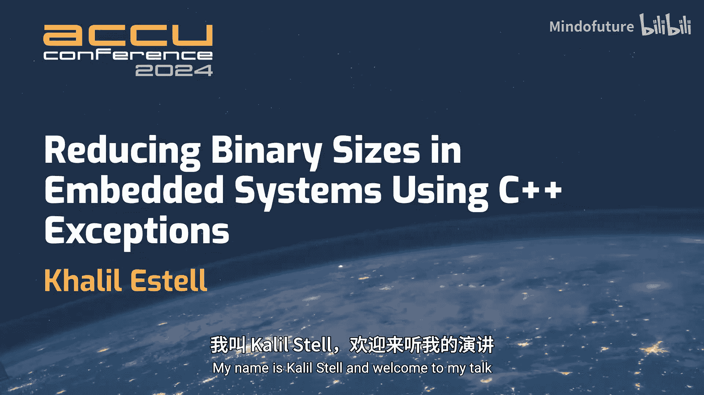

For embedded systems using C plus plus exceptions。 Let's get started。 So before we get started。

 I kind of want to talk about a little about myself。 give you a bit about background。

I graduated from San Jose State University in 2017。And I'm an ex Googler。

 I worked there for about six years before I quit back in January， if you want to talk about that。

 we can go to the pub and have a big old long conversation。Some of the products that I worked on。

 I need to confirm that my cursor works。 Let me do that。Duch al come on there we go。

 Nice laser pointer。 All right， so I worked on the first Google Pel watch。

 I was the DI or the directly responsible individual for the bootloader， the speaker。

 the microphone and the haptics， not exactly by choice。

 And then also when it comes to the pixel buds， which is kind of hard to see with this back white background。

 I was one of the。Low level system developers for it。

 And one of my main areas of expertise or area that I worked on was trying to get the code size as small as possible so we could fit more features and also fit in bug fixes and whatever else we might need。

I'm also a volunteer at San Jose State University I've been doing that for about seven to eight years。

 I've been teaching courses and I'm also the sponsor and mentor for the San Jose State Robics team。

Before we go any further I wanted。Tell you guys about the motivation。

 about why this talk exists and why I'm here。

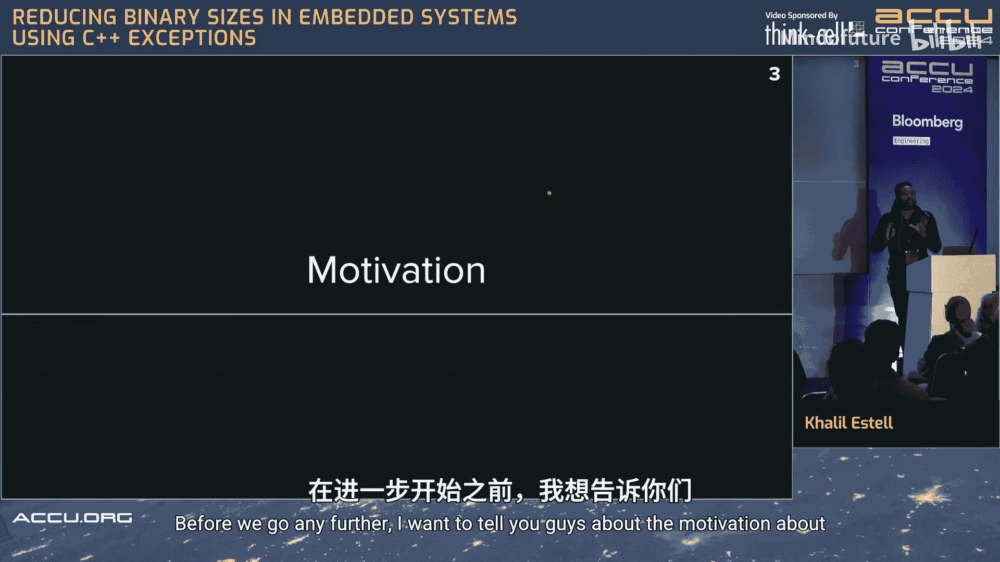

So like I said， I was a teacher， I taught a class called Computer Engineering 146。

 it is the intro to embedded systems in real time operating systems。And in this class。

 I had my students， I gave my students a software development kit called SSU dev2。

 it was written in C++， and I tried my best to stick with the C++ core guidelines as strongly as possible and here's just a picture of the development board that I made for my students so that they could do the class。

Now one of the things that I teach my students is about the constraints of embedded systems。

 it's not like working with software that's on a operating system or on your laptop。

 we are limited in storage and memory typically our devices have small amounts of read only memory and small amounts of RA。

 so's about 8K to 32， but that's not exhaustive， you could have devices with way more RA and way more flash。

And then 8K to maybe 5 kilobytes for the SRAM size。A couple of examples。

 a very common device is called the STM 32 F103， which has about 64 kilobytes of flash containing all your strings。

 re memory， text， code， and about 20 kilobytes of SRAM。The LPC 4078。

 which is actually featured on that board that I made。 one of my favorite chips as well。

 has 512 kiloBs of flash and about 96 kiloBs of SRAM。

We don't have such things as OS level constructs， you can't open a file。

 there's no idea of a file on your embedded system， there's no time， there's no network。

 none of that， you can create these using hardware that you have available to yourself。

 but these aren't available by default， you either to write these yourself or find a library that supports this for your particular target architecture。

😡，So with so little memory， how do you prevent running out of memory or memory fragmentation and the answer to that is that you just don't dynamically allocate。

 you just omit that from your entire code base， so theres new there's no delete。

 there's also no free mallic， reality cac， none of those things exist。😡。

Well because those things don't exist， we also don't have string， vector， unique pointer。

 unorder map， Sha pointer， none of those things， and then it allocates， we omit from our code。

But if you did want some of these things， you could use the ETL， the embedded template library。

 This provides you a lot of the containers that you would normally need。

 except you statically bound their size。So this all kind of comes together to explain why embedded developers stay away from SLL exceptions。

 number one， and these are things that I've heard around the grapevinine。

 people say that it requires dynamic memory allocation， this is a requirement。

 can't get away from that。It also requires additional rom。You， it brings in the entire Santa library。

 I've had some students and some other people tell me this。 like， yeah。

 you have to bring in the entire Santa library to even throw something。

You need runtime type information for the system to be able to identify the type thrown to the type co。

The exception tables take a lot of memory。 The exception algorithms take up a lot of memory。

 And on top of all of this。It's nondeterministic and propagation time and the propagation is slow。

 So even if， so here's the thing， even though you don't know what the time is when you get the answer。

 it's going to be awful。So。

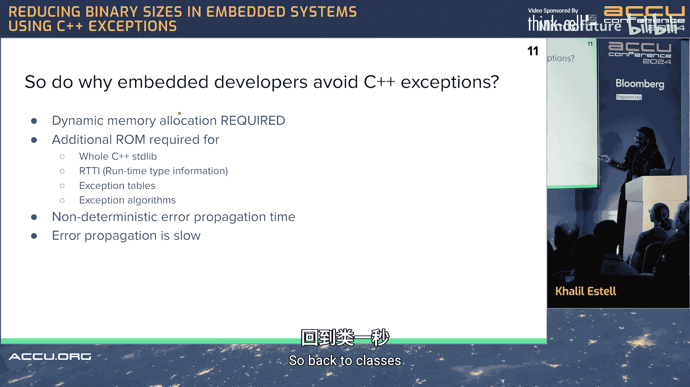

Back to classes， go back to class for a sec。So in this SDK that I developed for my students。

 I built a set of interfaces for my students to build upon， I gave them the interface and said， hey。

 implement these interfaces， one of such interfaces was output pin。

Output pin this is a very basic you slideware type version of it only it has a couple of functions and one of the things that I was considering and actually before I go any further。

 let's explain what an output pin is when you have a micro controller you have little pins that come out of the device you can set the voltage of those pins from low to high。

To a low voltage to a high voltage。And you can use that low function driver level P high to set one of those states。

 One of the things that I was considering was， is returning void acceptable？And I was like， well。

 what would I， I don't need return anything。 I'm not getting any information。

 So maybe I want to return a status or an int or a bull。

And I wasn't sure until I started thinking about other cases where this thing could be used。

We're going to make a slight detour over to i squared C。

So I'm going to go over a very simplified talk about I squared C。

 It is a hardware communication protocol。 It is how we can talk to multiple devices， usually sensors。

With only two wires。There are two signals here， we have SCL， serial clock and SDA， our data line。

 our serial data line。The zero clock is used to qualify signals on the deadline line and sync basically sync up with those signals and acquire them into the device。

You have a controller here and you have multiple I2C devices。Now。

 because we were only using two wires， we have to address the different devices。

So the way that the communication protocol works is that you start with a start signal to alert all the devices。

 hey， something a transaction is about to happen。Then you send out an address， a seven bit address。

 when the devices see that their address has been emitmted onto the bus， they will go and go。

 all right， I'm going to get prepared to acknowledge this message。Next up， you have Read andW write。

 this is also transmitted by the controller， and this tells the device。

 hey I want to either read from you or I want to write from you。And at that point。

 if the device is present on the bus， it will acknowledge the signal。And later on。

 depending on if you are reading or you're writing， if you're writing。

 the controller will write a bike to the bus。And the device will acknowledge it。Or。

If you're reading the device will write to the bus and then the controller will acknowledge the right operation and if you find this interesting stuff kind of stuff interesting。

 there is the I2Cbus。org that you can go to has all the information you need to know about how this protocol works。

 but the more important thing is that there are a couple of errors that are associated with icece grade C。

There's thenack on a address， meaning that there's no device that's currently there。

 it would not too standard Erco no such device。And then there's also IO air。

 sometimes hardware can mess up， or maybe a device is talking on the bus that shouldn't be at their appropriate time。

 and this would be some sort of IO air。😡，Now here's where things get a little tricky。

 that abstraction that I had was built so that not only could you use it for the pins on a micro controllerroller。

 but for anything that could represent an output pin so that my students could write their drivers' agnostic to whatever the implementation is。

 pass it along， and it just do the thing。So here we have some controller talking over Iquad C and using that to control a couple of output pins that could be used for a variety of different things。

 LEDs buttons， so on and so forth。And this is when I started to realize that all those other errors couldn't be passed out unless I use exceptions。

 which I'm not allowed to， or I change the return type。And I also considered， well。

 will my students ever need to return anything from an output pin， I don't really know。

Where they're going to use that code， for example， it may use it for an LED that might not be very severe。

Heating element that could be severe emergency cutoff relay， that sounds very severe， given the name。

And。You may recommend， well， maybe you should use something that's infallible that cannot fail totally get you。

 but I don't know what my student's code is going to do。

 I don't know what any of my users' code is going to do。

 so I need to provide them information about if something went wrong。So I changed it。

I use TL expected back in the day， I'm going to be using the term standard expected everywhere else。

 but for the most part。I made these little result in status variables。

 they basically just for status， it just changes the T to be void and then I have my error type there。

 and then whenever I wanted to return an actual value。

 I added another API here calledD level that can read it back out。

 I can add in the type here that I want。😡，And this pretty much did the work。

 but I also considered what would my code look like from the user's perspective when they start to use it。

 let's consider exceptions， the simplest example in my opinion。When LED， we turn on the LED。

 we wait a certain amount of time， we turn off the LED， wait a certain amount of time。

 It makes sense。If we use standard expected， we have to check all of our return values。

 so get a status， check if it's error erroneous， if so， return backs did unexpected， you good to go。

I will say。This is if we had the error propagator P2561， if we had this in the language。

 this entire talk would not exist because this is a little too easy and I would have loved having this if you haven't seen the syntax before it's very similar and reminiscent to Ru's error propagator operator。

Except there's two question marks because we already have Ternary for one question mark。

But because I didn't have that， I had to go with the error propagator macro， cool thing。

 GCC supports statement expressions， oh and the propagator the propagator macro here just does all that extra work of creating the if statements and then returning a value。

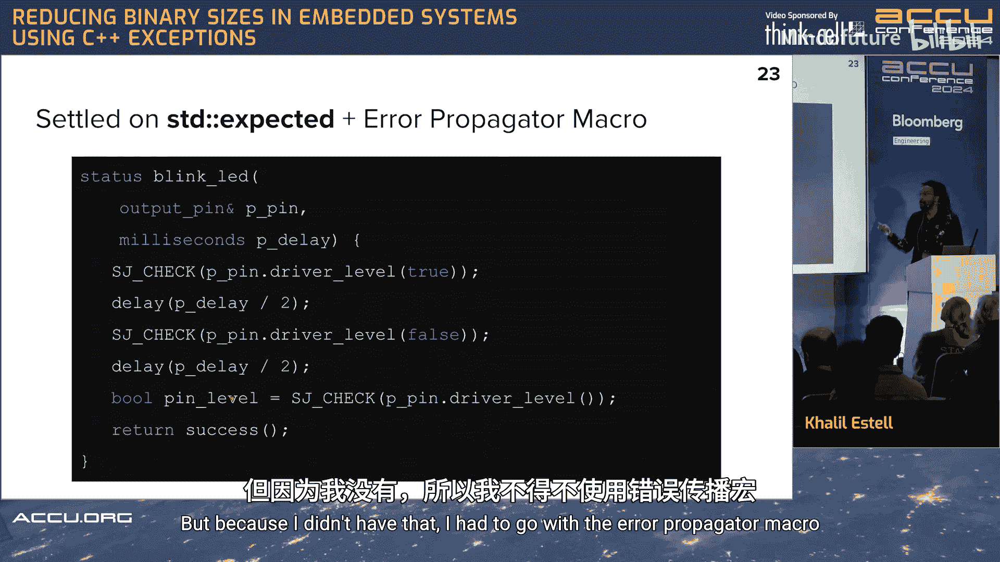

But GCC allows you to return values for macros， which is really cool， not supported MSVC。

 but that's the thing you can do。So now I have to consider which APIs need to actually return errors and the problem is that almost all of them do。

 I couldn't there's only a few ones like interrupt based ones that can never。

 should never actually return back errors， but all the other ones are basically fallible。

 for example。😡，I had an interface for a generic motor。

 well here's a motor control that's controlled over i squared C。

Here's a display that's controlled over I2C， I can't escape it， almost everything can be used。

 can have ice squared C underneath it， and I don't need to explain all the other interfaces that could potentially emit errors because the foundation is that almost all of them could just be implemented with I squared C and have those two errors be propagated。

So I moved everything over to standard expected。And here's what I learned from my students。

So for about 2。5 years of doing this， I asked my students， hey， how do you feel about this。

 I started off with the if L statement， not giving them the macro at first。

 It was very alleric to macros at the time that I still am。They hated it， despised it。

 They didn't use it。 They just used the voidcast trick to get over it to just not have to check their errors。

 They knew what they wrote， like， I'm not doing any error handle。 I'm not remote。

 My implementation never sends an error。 I don't care。😡，Once I gave them the macro。

 they did prefer to use it， they would use it， but they found it noisy and complicated。

The students were also annoyed with the API based air handling as it was viral。

 meaning that it continued to propagate through all the code。

 almost everything had a return type of result or。Or status。

Because sound like asynct with JS functions， you cannot call a erroneous API without also having the ability to return it unless you handle all cases。

And if they're building a utility， well， obviously。

 they may not know what to do to handle that error， so they need to propagate it up the stack。

 and it might be quite a far away before they actually get to code that they feel has the context necessary in order to actually handle it。

And one of the thing that students told me was that when they looked at the code for something complex because they're building hardware code。

 there's going to be a lot of checks everywhere， they would have to mentally delete out all the macros in order to understand what the normal path of the code looks like。

So every single semester， a student will ask me or students will ask me。

 why not just use C++ exceptions， they're built into the language， why can't we use it。

 and here's the thing I would go and say well， here's the reason why you shouldn't use C++ exceptions。

you know， blos up your code， requires dynamic memory。

 we already talked about that in class and why that's a problem。

 and then I would show them articles and I send them links and I' say  I have all these resources that tell you exactly why you should not use them。

😡，And because they trusted me and they thought I was rather smart I knew what I was talking about。

 they would go， cool， all right， well， that's all I needed。

 Some students would push me a little harder and then I would give them more information and then they'd be satisfied。

 but over time， something's started to happen。I started to notice。That number one。

I started to hate my own code。 I hated having to look at my complicated code and trying to see through the macros。

 Even when I make the macros like a single letter， it still was annoying to see。And on top of this。

 too。I had this realization。I don't know what I'm talking about。 Yeah， I read articles。

 I hope that they know what they're talking about， but I don't know what I'm talking about。

 I haven't tested out myself。 I know nothing about that black magic。

So this got me on a journey to figuring out to at the very least see how to make exceptions work on my chip。

 just to at least have a demo to show them， hey， here's why it's wrong and why you shouldn't use it。

 I tried my best， I couldn't figure it out maybe you can do better。

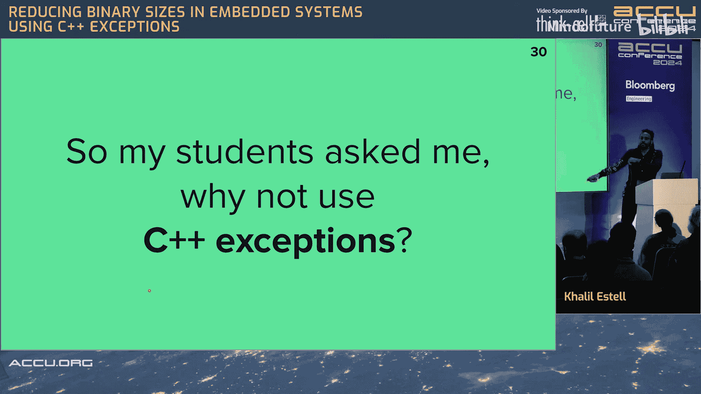

So I'm going to go on a little journey to show you guys what I had to do to get exceptions to work on an armed bare metal ship。

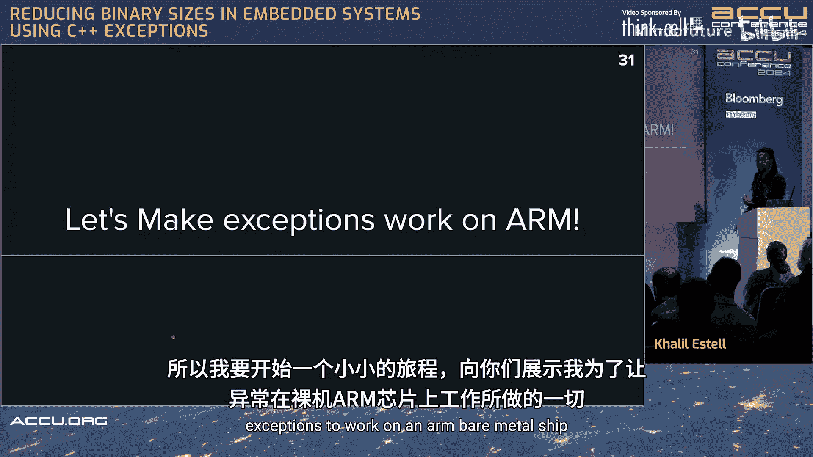

Here's some of the code we just throw no in line because your compiler is so smart。

 it'll just realize， oh， you're going to throw it's going to terminate or like it's going to do this。

 it's going to remove all the code。Here are a couple of the parts of the command。

 the only parts that are really of interest are exceptions， RTTI being enabled。

 this is just me setting the ABI and the instruction set that I'm using。

 and these are like 16 bit and 32 bit instructions。

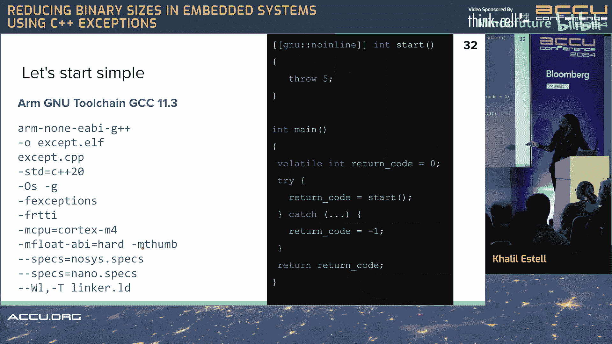

Here's the first barrier you're going to encounter when you attempt to do this。

 Excepts are disabled by default for almost our， I think all embedded systems designed or created。

Compils and tool chains。So how do you fix that？ Well， you got to read， Ohm sorry。

I forgot to include one another bit anytime you actually try to throw something your code terminates。

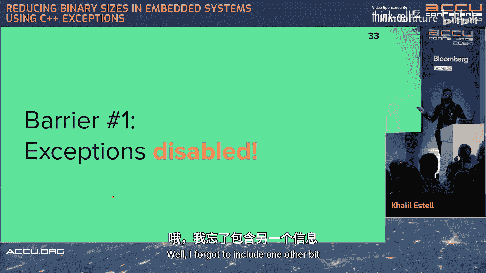

Anytime， no matter what。And it took me like I think。

 three weeks to figure out that it wasn't me doing something wrong。

 it was something with the actual compiler itself。

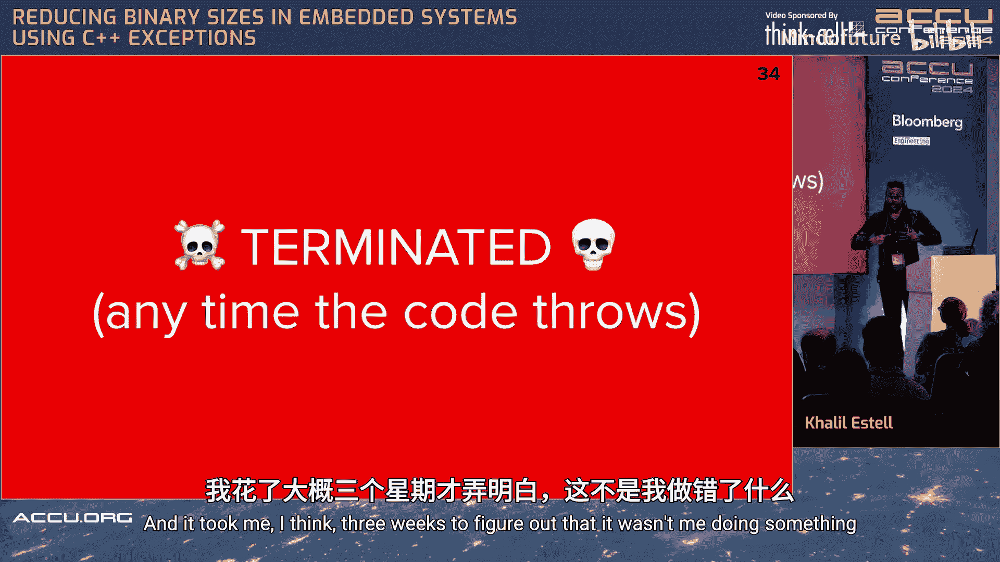

So the only reasonable thing to do is to recompile the toolcha， so you search for it。

 you download it， you extract it， you follow the PDF， and if armed， if you ever watched this talk。

 please have the PDF back it was so straightforward and so nice to use and your online web tutorials is very confusing。

😡，You install your prerequisites and you do one big step。

 you change their build script to Fno exceptions to exceptions。Figre it， make it， build it。

 and then you need to implement one other function。 I know it uses dynamic memory。

 so I need to provide memory to it。 There's a function called S break or set break orR SBR okayK。

You give it some memory that it can use to allocate。And when you tried it out， it worked。

 So after a couple of hours of tinkering with this， you can get it to work。

But there's another barrier。Large binary sizes。 Oh boy， look at this。 All right。

 so here's our baseline2 k and above we have 150 k。I just wanted to turn on。

 I just wanted to throw something and catch it somewhere。 Why is it so much memory， It takes up。

 It's 56 times bigger than using said expected and uses up 3030% of my flash size。

 All to throw something。I don't know。 That's a lot of features I could provide。

 not sure if I want to do that。So what did I do？I try to find out where the blood's coming in from。

 I need to report back to my students what's happening。

So the only logical thing is to disassemble the binary。Search through it to see what's happening。

 And eventually I started seeing some things。 I'm like， what's standard string doing in here。

 I didn't use no strings， What's Io string doing in here， What's locale doing in here。

 I don't need to know my location in order to like convert currencies when I print them out。 Like。

 that's not necessary here。And then start back tracing all the code until eventually it all points to terminate。

That's weird。And then you look up the answer to this and you find the answer。哦。Drum roll。

This is all you have to do。 What you do is you omit the terminate handler。In this case。

 I just overwrite it。 It's a weak symbol， meaning that I can， if I implement my own version of it。

 it'll overtake the one the compiler provides you。And this changes our code size down by 91%。

13 k I I can deal with。 I don't actually， at this point， I'm like， yeah， this is fine。

11 more kilobytes than I had before。 That's acceptable。The question becomes， why？Well。

 do you guys know what happens when you terminate on your computer。

 if you just do something and you terminate on your computer。

 what do you usually get when you throw an in and doesn't get caught？Cor dump， yes。

 a core dump as well as a message saying uncut exception， name of exception， blah， bh blah blah。

 terminate is printing and IO streamams it's a weird thing that only let people know if you include it。

 not even use if you include it， you automatically incur at 120 kilobyte space cost because of how it does static initialization and all of that。

😡，If you eliminate that， you eliminate most of the bloat you get from exceptions。Great， all right。

 there's still some other issues。Andna memory allocation has off to deal with that。Well。

 I take a look at the throw in assembly and I see， well。

 there's this thing called CXA allocate exception。I wonder if it's also a weak reference it is cool。

 so I just implement my own and the great thing is that since it doesn't use Malik。

 I don't interfere with any of my students who want to use dynamic memory allocation。

 I can provide my own allocation here don't worry about what's happening here。

 I'm gonna to explain what's happening in here much later。And there's one more。The specter of RTTI。

 my coats small now because I don't have many types， almost none of them。

But as I begin to grow my program and create more user defined types and create bigger abstractions thatll become an issue and start to grow。

 I wanted to eliminate that， I wanted my code size to be small。So。😊。

We're going to talk about how you disable RTTI in。For exceptions， or at least attempt to。

 so I replaced FRTTI with no RRTTI。And remember， we need RTTI in order to operate correctly。

So I ask you guys， and I'm going to have you guys raise your hands。There is the if you do this。

The compiler either tells you you cannot throw， you cannot use C+ exceptions with RTTI disabled。

 that's one option。The other thing the compiler can do is strip out all the RTTI information that's not involved in exception handling。

 or number three， the compiler is silent and removes RTTI information and using C++ throwing anything becomes UB。

Now。Who thinks is number one， raise your hand。No one， oh， we got one person， okay。

 who thinks this is number two？A few people， all right， I've got about four people。

 and who thinks is' number three？Okay， question， are all of you guys rustss enthusiasts？

Becauseuse answer number two， because the assumption I' just going to do B U B is a bit interesting。

 But no， Gcc just cleans it all out for you。 It's like， well， we don't need all this stuff。

 So we're just going only keep the things that you actually throw in the code。

 Everything else can be stripped out。So to me， and I'm going to skip over talking about the size of type info。

 I decided not to include that in this talk because it would take too much time or not take too much time。

 but take extra time。I realized that I can control the memory allocation specifically for exceptions。

So at that point I was like， well， if I can control this and have some designs around this。

 I can get away， I can statically allocate the number of exception objects that I need to use in my code。

When it comes to the whole standard lip， that terminates fault。

 It had nothing to do with with exceptions。 And then R TTI， well。

 I'm okay with paying the price for the few types that I throw。

 but anything else I don't to worry about。There's still the issue of exception tables and algorithms。

But before I go into that， we're going to just talk about what I did next。

 and went into my codeb and I migrated everything over to exception handling。

 I wanted to see how my students would feel about it， and I don't actually have a slide for this。

 but basically my students loved it。 They loved the experience not having to worry about all the macros and other things。

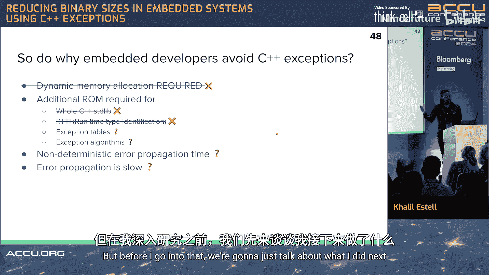

At the same time in parallel， I was also making another change to move everything over to result types or result type here。

 because I wasn't sure which one was going to win out。Until something happened。Is a little。Area here。

Saying I decided to transition to exception handling rather than return types for large enough projects。

 Excepts are smaller in code size and faster when exceptions are not running or not being thrown。

 Here's what happened。 I obviously had to refactor everything and test on my code。

 So I built a whole bunch of old projects。The small demos like Ber LED and controlling a servo。

 those all grew in size as expected， as it should。Then I went to my empathute project that had like an SD D card driver。

 a display driver， and a lot of other more complicated things。

And I saw my code size get smaller compared to what it was before。And the thing is。

Maybe my code was not very efficient before with the result types。

 but the thing that hit me is that I never expected my code to ever be smaller with exceptions。

 and at that point I needed to know why。Fast forward three years。

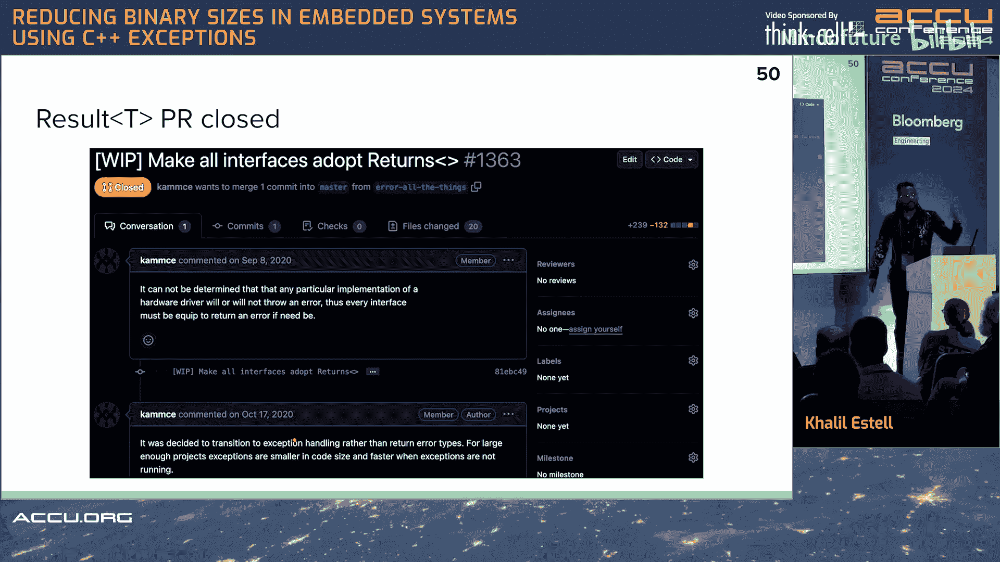

I'm at CPBCon， and I'm excited to attend the C++ ISO meeting。

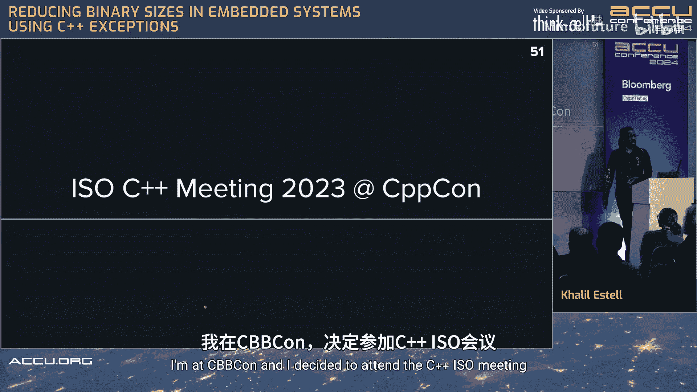

Btrice Roy was doing a talk on the things happening in S G14。 S G 14 is a low latency group in the。

C C+ committee。And he was talking about external buffers for vector， specifically PMR vector。

 I have used this for my embedded project but there's one key issue。

 pushback doesn't report anything if you have any issues， and if you run out of memory。

 your allocator just kind of sit in there， you could either terminate or you could throw。

 but I found that just having a terminate might be too harsh of a reaction。So I told him， yeah。

 when I spoke to him afterwards， it's like， hey， you know， it's interesting。

 I would love to use this， but it can't because there's no way to get the information out。

 It's like yeah， know a lot of embedded people don't want to do that because there's no exceptions like yeah。

 it's a shame that embedded people don't use exceptions because then their code size would be smaller And I explained them everything I kind of explained before。

 And he's like。I'm sorry， what？Do you have data I was like， yeah， I have data。

 unfortunately I don't actually have the code that I wrote that I could show the difference of that was in an old laptop and that laptop's gone。

But I said， I can get you data and I can present a small presentation。

So here is a modified version of my hypothesis。 Before I even started this。 The thing is， in my head。

 I was like， all right， at some point， exceptions are heavier than result types。

 And after some point， sorry， it crosses。So my idea is that， well。

There must be some cost for normal result types that looks like this S of n is equal to a times n。

 A is your average cost function per function call that needs to be checked。

 and n is the number of function calls that are checked。And then for exceptions， it is BM plus E。

 where B is the average cost of your exception metadata， M is your number of nonlea functions。

 and E is the cost of the machinery， like live Unwind and such。

And I asserted that A of N is greater than M， and there's one interesting little thing that you can think about which is you obviously call more functions in your code than you have functions in your code。

 right I think that makes sense if almost all your functions are going to report an error and you have 100 functions you're not going to call exactly you're not going to have exactly 100 function calls you're probably going to have more than that。

Or at least equal to that。So here's my experiment， generate a whole bunch of C++ code。

And basically have such code that defines classes trivial， nontrial。

 creates a sequence of function calls that call each other and call each other in a certain way。

 and then also with these functions， we create the objects and then we call functions on those objects。

I can't go into too much detail here， but I can't at least tell you that the goal was to you stood expected an exception handling to have two separate function of two separate files that are effectively exactly the same。

 the only difference is the error handling mechanism。

And I wanted to focus on propagation because what I noticed is that a lot of the code that I write。

 especially for embeddedbed systems。The context on how to catch an error is usually higher up the stack。

 usually not at the lower level where the utilities are。

 so I focus more on the propagation for the handling。Here's some experimental parameters。

 We're not going to spend too much time on this because we have other things we need to get into。

And here's what some of the code kind of look like， here is an example function。

 might be a little hard to see， but there's function 118， function 11，8 up here too。

We have this internal static variable。 and that's very this volatile static variable。

 that's here to create a side effect so that the compiler doesn't just get rid of our functions。

Compellerer is very clever。And then we create an object， we call some functions on it。

 create another object， call some functions blahlah， blah， blah。

 and then we take the results of this next function in the sequence。

 and add it to another side effect global variable to ensure that the compile doesn't try to get rid of those functions either。

Same thing as over here， except now I'm just using expected。Here's what I got as my results。

I was very excited when I saw this because it pretty much confirmed my hypothesis。

 at least to some extent。So we have two lines here。 The blue line is exceptions。

 the red line is using result types， and the yellow line is a delta between these。

 yellow line is the most important part。And one of the things that was really exciting was this number right up here。

8067。That number is the size of the unwind lib unwind， basically in your implementation， I took。

 I did a simple dump， calculated and summed up all the functions， boom， it was around 8。

000 maybe a little higher。And then this little number here kind of told me， oh。

 and I should probably explain， the Y axis is binary size and the x axis is a number of checks。

And negative 16 just tells you the cost of every single check you have inside your code， about 16。

5 bytes per。Getting a little closer， you can see that the zero crossing is around about 580 checks。

 but this obviously changes depending on what you're doing in your code。

 There's a lot of things that can make this vary。I'm going to be frank。

 I didn't show you this to you to convince you that wasn't meant to convince you。

That was just simply to show you that something's there。In order to attempt to convince you。

 I'm going to go over how exceptions work from throw to catch。

 so you guys have a mental model for how all this stuff works。

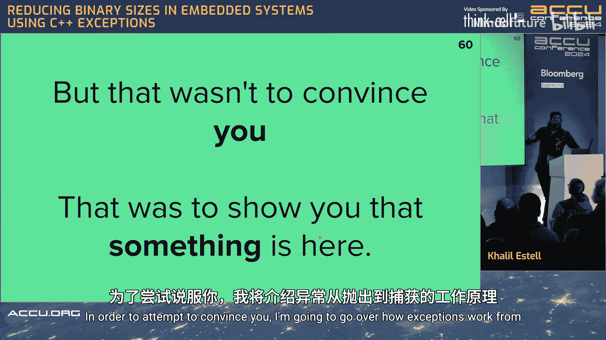

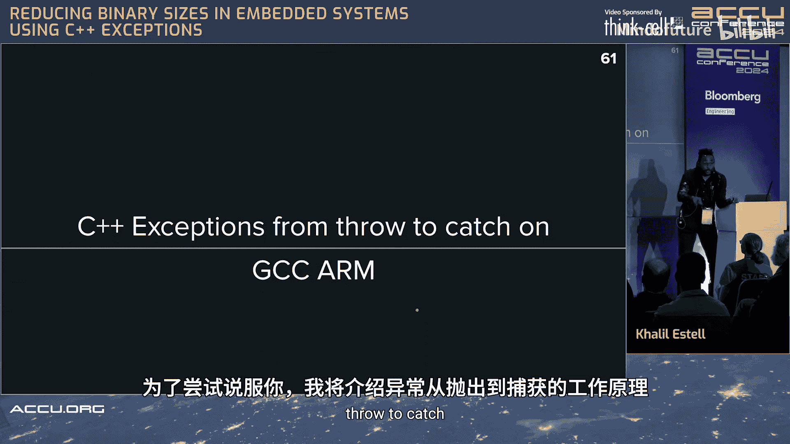

Things I'm not going to cover。Sset exceptions， nah， anything other than table based exceptions。

 I personally believe that table based exceptions are the best form of exceptions。

I will not talk about supporting Java because you can support other languages with lib unwind and CL+ exceptions if you didn't know that your compiler will actually check to see if the exception being thrown is a Java object or not。

 and it'll use that to figure out how to propagate it。I just so you guys know。

 I made my own implementation of。The exception on winding， and I stripped that code out。

 I make sure I didn't include that feature because I don't care。 I'm on a bare metal system。

 I'm only running C++。 I don't need to worry about supporting Java。

I'm also going to go over Debbra Kiith Teau because theres no reason too。

I'm going to talk about the three function categories。 I understand that these are my terms。

 I don't think anyone else has talked about this before， but I see when it comes to exceptions。

 three types of functions。There are leaf functions。

 These are functions that don't call anything else。

 These functions have no exception metadata because no exception can ever go through them。

 They didn't call anything。 They don't themselves throw either。And if you think， oh， well。

 what if I have a leaf function that throws， well， as you guys saw。

 throw functions turn into a sequence of other function calls， so they're not leaf functions。Next up。

 we have trivial functions。Trivia functions are functions that call other functions。

 but don't need any cleanup nor do they need any sort they don't have like a tri catch block inside of them。

The unwindder knows， oh， when I hit one of these， all I need to do is unwind。So。

It just simply unwinds it unconditionally。And my personal observation this might not be your guys's code。

 but at least for embedded systems since we don't have string and other things like that。

 we tend to we use our AI， we use it a lot， we use distractors， but they're not as common。

 we'll use them for like locks for things， but in a lot of the cases doesn't happen as often so most of our code is trivial functions。

And then lastly， we have dynamic functions， which are things that contain something that needs to be cleaned up。

 has a destructor， nice to be cleaned up as you unwind it， and also has a tricatch。To go further。

You have to talk about the Ar calling convention and what the registers look like for arm。So for arm。

 we have。R 0 to r3， these are how you pass your variables。

 it's also how you return variables as well， or return data back from a function。

If we cannot fit the inputs into R0 to R3， it'll fill up those first registers and it'll push the rest onto the stack。

When it comes to returning， we either return it in those registers or if it's too big to fit in those registers。

 we tell the colee allocate the memory for me and pass through R zero in a way。

 arms AI already required copy all in a way， so that's the thing。

R 4 to R 11 are the preserved registers， meaning that when a function is entered。

 it must save onto the stack， the registers it's going to use and when it exit it's going to pop off those registers。

Back on to their respective locations。R 12 is supposed to be our scratch register。

 I have no idea what it's used for， so I'm not going to talk about it。R 13 is the stack pointer。

 R 11 is the link register， and the link register is an optimization that arm decided after seeing X 86。

 they're like， wait for leaf functions， you don't need to waste time pushing things onto the stack。

 You could just simply。Put it into the register， which is a little bit faster。

And then the leaf function， you can just call branch from that register from LR to get back。

And then the other program counter， which shows you where you are on your program。Here's an example。

Here we have a function called F， we're going to push R4 and LR onto the stack。

 we're going to do a whole bunch of stuff we're going to call some functions our return values in R4 so we're going to move that to R0 now we're going to pop R4 back into its location and we're going to pop the link register back into PC。

And that's how we return。So that's how that works Next up we're going to go over how throw works。

Remember how we saw what the code turns into when you have a throw。

 we have some sort of allocation we're passing the number one into R0。

 which is the variable that we pass into allocate， we want to allocate one byte。

And we have a couple of things that are happening here。

 and specifically I'm actually going to just describe it here， you can tell that R0 is going to have。

 well R0 should basically include and have a pointer to whatever'sd on allocate exception。

 it returns a pointer， so use R zero it has that。R3 will basically have the type info for the thing that I'm throwing。

 and then R two， the second the。Hold on a sec， sir。It's moved into R 3。 R 3 is moving to L1 or R 1。

 This is the second parameter。 The third parameter is the de call， which is why it's passing 0。

 a null pointer。That's explained here， so when it comes to a throw， you allocate the thing。

 you construct it in place with that allocated pointer。And then you throw。

And then you pass in the throne object。The type info and the deor。

But now that we know how the throw works， we can ask， what is All doing？

Remember that weird code that I showed before， and I agree maybe if someone's reading this。

 they're kind of looking at this right here that terminate， it probably should be throw bad aec。

 but I just decided to terminate in this case。What's happening here is when you allocate your exception。

 you don't just allocate your exception。 If you actually looked at Malik。

 you would see that the size is greater than the amount that you threw。

The reason why is because we have this thing called the exception header。

 So it's attached to the back of the exception。 And we throw the start of the throne object。

And then we just give a delta so we return back the storage。

 well this case I have some static storage， I'm not returning back multiple exceptions it's just one example。

 otherwise it'd be a little longer， and then I just add the exception header to it。

Now why do we do this is' for A compatibility and flexibility Now GCC can continue to update their CA allocate。

 keep the API exactly the same and not having the issues。

 so one of the things that we need this exception headed for is for all of the state we need to hold for example。

 you need to hold a virtual version of your CPU。You need to probably keep some sort of state to know what state you're in when you're unwinding。

And you also can hold other cache information。The runtime can access all the fields in the exception header by just going in reverse of the backwards from the point that that was passed。

And now the exception header can grow and shrink as you discover things or as you add more features。

And if you only called Malic directly at the call site where the throw was。

 and the exception error was， let's say 100 bytes， and then later on Gcc makes it 104 bytes， well。

 now you have an API break。What's in that header， Well， you got your arm cortex MC CPUU registers。

 you got your type info， you have your instructor and you got your cash。

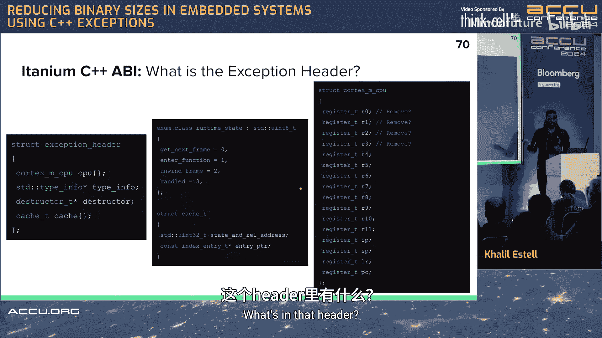

The cache just includes like some state and some other information。

 Just note that this is not from Lib Unwind， This is my own implementation。

 This is all you really need， but you can add other things if you want to do other fancier stuff。

And then I have a record of all of the registers here， I put remove。

Just because there's a chance that。I can just remove this and optimize that away。

 reducing the overall amount of memory I need to allocate each one of my exceptions。

Let's go over throw， here's an implementation of throw。First things first， you're going to。

Take your throne exception， pass it into your active exception。

 this is a thread local stored variable and this is used for standard current exception。

 otherwise you couldn't get current exception to work。

 although I do have a way to get beyond TlS with exceptions talk about that over beer。嗯。😊。

We take the thr object， we extract out a point or to or reference to the exception header。

We set the type info， we set the de， we capture the CPU state as it is there。

 and add it write it to our CPU。We raise our exception。

 and if for any reason the exception on wine flow has a problem。

 it'll return and it' will terminate immediately。Next up， we got the index。

 I know there's a lot of information。 Well， don' worry it's not actually it's going to get worse actually。

 So we have the index。 We've all heard about the tables that exceptions make。

 Here's how they're defined for the arm A。 This has nothing to do with X 86 or the other architectures。

Each entry in this table represents a particular function in your code。

 each function that a non-le function will get one of these entries。

 they are positioned relative to the appearance of the functions in your text section。

 meaning if the first function that address  zero is foo and the next one after a bit of an offset is bar and after that is BS。

 then entry0，1 and2 will be fo bar and BaS。And then you can just binary search to find what you need。

Oh and you use your program counter in order too。Go into the table in order to figure this out Now the actual entries contain a 32 bit address it's actually being called a position relative 32 bit offset I omitted talking about that because it's just that's a bit weird but basically it's an offset from that location in the table out to where your code is somewhere else and it's only 32 bits even if you're using a 64 bit processor like the arm 64 bit processors。

And here we have one of those offsets to where your data is。

 and likely it'll be in your exception table， there's a difference between the exception table and the exception index。

mNo except kinda does this， but don't assume it does this actually actually。

 it almost never does this and we're not going to spend too much time。

 but if there is a function that must be just canceled out， just say nope， stop and termminate here。

This entry can become the number one， if it's ever the number one。

 then it just tells the run time ya cancel at this point。All right。

Here's another one of the items we have to go over。 The unwind instructions。

 This is another area that people， you know may not have as much knowledge on。

 So the unwind instructions simulate the epilogue of the function。

 except for the part where you return a variable。 Remember， in your try block。

 If something through that entire scope is no longer valid。 Therefore。

 you don't need to waste time returning variables up the stack。 It's not a thing with exceptions。So。

All unwind instructions have to do is do basically three things， subtract your stack。

 decate your variables。Pppy registers back into their CPU。And then finally。

 there's any other special， weird like coprocessor stuff， do the weird co processoror stuff。

Fun little things。 I think I have a little extra time。

 Did you know that arm supports in their runtime， the Intel M M X registers， because at some point。

 they use that。In some of their original implementations for a floating point。

 And then yielded that out when they realized that it wasn't very good for them。

The unwind instructions are eight bits。 I want you to bring up one extra thing。Arm instructions。

 arm thumb instructions are 16 bit to 32 bit， unwind instructions are only 8 bits so they're compressed version。

 because when you need more than 8 bits to unwind your frame， you're not a general purpose processor。

 you're just doing a single thing。And most functionses only need three bytes of information to unwind them because。

Subtract， something represents， subtract， and then pop。And then finally。

 at the bottom of the RABI document， it tells you that they did some calculations and realized the maximum amount of instructions is 7 bys。

Per function。Here are all the instructions， it's not too bad so if you see an op code that has 00 and then 6 bits afterwards。

 you take 00， you take those extra bits and you apply this equation to it， shift it over by two。

 add four add that to your stack pointer the other one here is meant for if you if your're stack in the opposite direction。

Then you have pop so if you see10100 the next three bits will tell you the range that you have to pop remember the collie reserved registers are R4 to r plus n in this case。

 so you just pop from there to there that's pretty much it now pretty much do the entire scope of all preserved variables and if your stack is relatively large we have this encoding that we use in order to variable length encoding to gather the data and then subtract away your stack。

The last one I'll go over is finish， which is hex B0。

 and then we have refused to unwind if you do something as no except。

 but you still need to run deors rather than actually putting the can unwind。

 it'll just throw this into your unwind instructions。

Now we're going to talk about where these particular bytes are located relative to the exception table information before we get there we have to talk about personality data。

 why is called personality， no clue， but the most significant bit tells you if the thing you're looking at is the personality information。

Or if it's one of these， remember I said it was a 31 bit offset。 Well。

 it's because that 32nd bit is used to tell you if it's actually an offset or not。

The other bits are 38 to 28， our reserved personality index tells you what type of data structure you're dealing with。

And then instructions are in 23 to 16， 15 to  eight， 7 to zero。

And this would be called the short personality with 16 bit scope。

 we'll talk about the scope set R and a sec。Here we have the long personality with 160 bit scopes。

 another one with 32 bit scopes。You can see that the personality values change to one。

 and this one's over to two。 This one has a length to tell you how many words are remaining for your unwind。

And then you have your instructions， if you have up to seven， then the last ones here become B0。

 you get padded， everything is four byte aligned in the RA。Also， this is a bit silly。

 I think they expected that there was going to be more words， but in reality it's only one to two。

 so if they just removed that， it would have fit in one less word。

 just saying that could have been done， but we didn't save the space there， unfortunately。

Fortunately， these are really rare to have seven full instructions。All right。

 again a little further now we have the descriptors。

 these specify when you are in a certain scope and your prop counters within a certain range do this。

So。We have an offset， and we have a length， and we have these little bits here，0 and 0。 mo。

 everything is 4 byte aligned。Or actually two by a line when it comes to instructions in arm so that the least significantmic bits are not useful。

 decided to use these as flags to tell you what type of descriptor it is。

 you see as zero and a zero at those bit positions， it's a clamp descriptor。

The offset tells you from the start of the function down where the program counter range starts。

 then from there at a certain length， that is your range， if your program counter is inside of that。

😡，Jump to this location located at this thing called a landing pad。

 this will jump you to the spot in the function or in somewhere else in the code that knows how to destruct those objects。

And the difference between 16 and 32 is 16 and 32 bits for the offset in length。

So that's how you clean up your stuff with the arm。Here we have the catch descriptors。

 the catch descriptors use a one and a0 at the 16 and 0 bit positions。

 They include the catch landing pad， and on top of that they also include the type info pointer。

Now fun thing， I think people think that trying to compare type info is really complicated， no。

 they actually in GCC， you just compare the planners if they're it's the same type。

If it has some inheritance， usually there's another field called like parent。

 it's only two fields name and usually just name after that， if you have a parent。

 the other field is your parent， so you just go are you it， no， is your parent it no。

 then you're not it？And then this the catch page just tells you where chain it moves the pointer to the location of where the catch starts。

 that's what that offset does。Um oh， and then the bit here on the left hand side tells you if you're cacheed by reference and the bit here tells you if you are catch by anything else is what they state。

And then there's some other weirder ones， such as catch All。

 which are all ones for the type info address。Or。All like negative one for the catch all address。

 but this one's called catch all terminate， I have never observed this scenario code。

 I don't even know what this means， but it's in the A， so I have wanted to show you this。

And here's what a full descriptor would look like in the exception table。

 so we have3 an LU 16 personality at the top， length of one because there's one extra word。

We have the instructions here。We have our we have one cleanup pad area， we have a catchpa。

 has a catch all， and at the very end there's this little dot dot dot's like maybe more descriptors here。

At the very end， we have the end of descriptors， all zeros for four bytes to tell you you hit the end。

Now here's something that's really cool if you write normal code and you're also not using RA AII or having destructible objects everywhere。

And your stack isn't too large。You can get your code to be inline into the index。So。

When you go when you're。Yeah， so。This is the personality， the short personality information。

 remember most functions only need three bytes， therefore the exception table usually doesn't have a lot of your functions exception information that's embedded directly into the exception index to save space。

And now on the exception table， now this particular area is unordered。

And usually it will only contain two things， really。

 it'll contain the LU 16 or 32 descriptors because if it was 16， if it was a short 16 bit。

 a four byte descriptor， it would have been inline。 So if it's here， it's either a long descriptor。

 a long personality personality data， or it's this thing called the GCC LSDA。

I have a lot of stories to talk about how I figured this one out。 This one was。诶。Let's get into it。

 So here's the last data structure we have to talk about。

 And it is probably the most one that has an absolute doozy。

 So what Gcc realized is that that previousscript I told you about is not very space efficient。

 It takes way too much memory that doesn't need to。

 Maybe we could apply a compression algorithm on this data in order to make it smaller。

 So that's what they did。 Remember how I talked about how we're not going consider other languages。

 Well， they realized， well， if I'm going to support C+ plus。

 I could just have my own language specific data area for that specifically。That's what they did。

 For all language specific data areas。 you start off with a thing called the personality function address。

After that， you have， I'm sorry， actually， before I start getting into it。

 let's move on to the next one。The next thing here is so we have the personality function address on the top。

 the next item is the personality data， the SU 16 where all the instructions are that's placed here。

No different than what I've described before。And now I'm finally going to talk about what lab 128 is。

 I showed it in one in one of the unwind instructions。 now we're going to discuss it a bit。

 what it is is a variable length encoding for integers， So if your integer is small。

 then it takes a small amount of memory and if it's big， it takes up more memory。We realized that。

Most of those offsets and stuff for small functions aren't going to take up that much memory。

 they don't need whole 16 bits of resolution， so we can just reduce it down。The MSB。

For each byte in the sequence is a continuation bit。 It tells you， hey。

 are there more bytes in the sequence， If it's a zero， that's the end of a sequence。

I ask pretty much it， you take all the seven bit parts， you or them all together。

 and now you have your length value or your value for whatever。When if I ever use the term ULB。

 I'm just describing specifically unsigned Le 128。And if I say lab 128， I just been signed。

 there is people sometimes use S lab， but I whatever， I don't use it。All right， next part。

 the header all right， so there are a couple of things in here。

 the first byte in the header is a flag telling you the format of the dwarf information and because we're using embedded and we never keep that inside of our binaries it's always just hexFF so if you ever see Hex FF it means we have omittedbit information continue on。

Next up we have the encoding for the type table， so here we have all these other sections here。

 the call site table， the action table and the type table。

 and they have encodings when I get to this part pretty much there's only one encoding that ever gets used so we don't have to worry about all the other ones。

Next up， we have a ULB 128 encoded offset。This will tell us where once we get past the header。

 where the end of our LSDA data is so we can do all of our operations on it。Next up。

 we have the call site encoding， which tells us how the information in this area is encoded。

And here we have the length of the call site， this will tell us from here where the end is and how long this entry is。

 so if we ever hit that end， we know we're done。And what I found is that's really common for this to only be 5 bys in length。

 It could technically be bigger because these are Ule encoded values， but。When we go further along。

 I'll describe why it's probably mostly just fight bytes。Next up， we have the call site。

The coal site is very much like the descriptors from before。 you have a start， a length。

 a landing pad， a location of where you need to jump to to。嗯。

Location where you have to jump to relative to the start of the function。诶。When you've seen that。

 okay， this particular area is where we need to go。 So same thing， are you within this range， If so。

 jump this location。And the last bit here is the action record。

 the action record is a UE 128 encoded value that jumps you from the end of the call site into some portion。

 some spot within the action table。That's for Mr。 Coli。

 and there's a whole sequence of them until eventually you hit the end。

The code for decoding this would look like something like this。

 you'd have some sort of cursor as you go through and you would take the call site information。

 you'd use it to decode it， put into start length， even check if they're in between， and if they are。

 you check if your landing pad is zero， if it's zero。

 it's the run that's the compiler telling you just simply unwind the function， don't go any further。

Otherwise， we break out of this area and continue on to evaluating the next sections。

I'm going to skip action table because you need to know the information about the type table before you can look at the action table。

😡，The type table has a list of all unique types caught in your function。

And it's all unique so there's no duplicates， meaning if you have two try catchcopes and they both catch standard exception。

 then you only have one entry in this table。Oh， and everything is indexed negatively because we had the end of the site here。

 so they decided"， just go negative。There is some reasons for that， but not important here。Oh。

 and if it's ever no pointer it tells you just to jump directly into the code。

 this will make more sense once we go to the action table。Here we have the action table。

The action table represents。The order of all of your catch statements and cleanup regions in your code。

 specifically when you have like catch A， catch B， catch C。

 this will represent where like if you're at A， if you're at B， if you're at C。

 and if you're D or basically need to clean up， it will then have another entry for those cleanup scopes。

In here， when we took that action record index， it'll shoot us some part in the middle of this。

From here， we have this value called the type info or the type filter number。Which is a lab 1。

28 value。 It's signed because if it's negative， it's for。Throw specifier。 And if it's unsigned。

 it's for normal catch。And then we have another value here called the next record。

 which just tells you how far to move your pointer up before you reach your next value you should evaluate。

And then you can see here that you can use your type info with a negative operator to get your current type info pointer。

If the filter value is zero， it means that we're doing a catch all or it's a cleanup。

When the next record value of zero has been reached， you know you're at the end。

 and if you ever get to the end and see that nothing works。

 like nothing has fit the type that you threw， you just unwind that function to continue propgating up。

And if the runtime ever reaches a next value of 0， Oh yeah， actually， sorry。

 re explaining what I just said。So once you find that， now that we're at this point。

 let's say you have looked at your type filter value。

 you've checked the type in the type info and it all works oh。

 this is the exact type we match the pointers， they work。

What you do is you set R0 to your exception address。

 You set R1 to the filter number that we got before。

You set the exception header address to that landing pad。

 plus the functions address that you had before。 plus one。

 because that's the way that the AI requires it。 The M the LSB needs be set to a one。

And then you install the rest of the registers into the CPU in which will jump you to the location in the code。

And at this point， we have now reached the catch block。So here's the fun thing and I think yeah。

 I don't have a slide for this， catch blocks turn into switch case statements in your code in Gcc。

 at least and claim。That number we had for the filter number is associated with which catch we're supposed to jump into。

So here， when we jump in， our landing pad is here， compare R one with one。 And if it's one。

 you have this little branch if equals。 So we then jump over to this location。 This is our catch。

 My catch just prints out a message， So we just go R0， fill it with the address of my pointer。

Prince F， that about it。Before we get into the actual code， though。

 we have to call this particular function。It is called begin catch。

 And because R0 was set with the input parameter of a function。

This function automatically has the imppa parametermeter set for itself。From here。

 it takes the pointer， it looks at the exception data。 it says hey， change the state to handled。

 this is how we know if we have。We need to know if we're handled if we ever throw again at some point and we realize the previous exception wasn't handled。

 that way we can terminate。And then what it does is it takes the point that you gave it and offsets it back to the throne type so that the catch can use it now in this case I never use the throne type。

 but if I did it'll just be using R0 to have all that information。Then you go to CA end。

 this will then use active exception or standard current exception in order to take the exception information。

 destruct it if the instructor is not an old pointer， and then delocate it。

And now you're on the happy path， you're back。Let's say that for some reason。

You had a value of zero and I don't know why GCC does this。

 but for some reason and like add an end cleanup here。

 I think it might be like a pedantic or some sort of pedantic or not pedantic paranoid thought of like if you accidentally get here with some other value。

 cleanup what cleanup does is after whenever you do cleanup for any particular function。

 you will call the destructors， and after that you'll call the cleanup function。

 the cleanup function just simply jumps you right back into the exception and winding flow。

 it just calls raise exception。And that is pretty much what a catch does。

Now to go into the flow for raise exception， I hope you guys have kind of been feeling the idea of this。

 but here's it kind of written out Once you call raise exception。

 you'll locate the entry relative to your program counter so you do a binary search， you find it。

You check to see， hey， should we refuse to unwind， if so， call set the exception to handled。

 call Terinate。If false， check if we have any language specific data。If so。Evaluate the personality。

 see if the program counters in that range。If not。And then we decide， hey， if we're in ranges。

 that means should we enter the function， if we should enter the function， we enter it。

Into the sad path， and if we see a cleanup， that means we've called some instructors get right back into the flow。

If we see CxA and catch， then we go back into the happy path。That's pretty much it。

 Now let's say we don't have any data like we have a trivial unwindable function， we see， oh。

 just has personality that said， cool， unwind it。And unwinding flow is basically just you decode all of those different instructions and you apply them to your virtual CPU。

And keep doing this over and over again until eventually you get to the end。

 which Maine should have a refuse unwind， but that's also like implementation specific。

 but it should have a refuse unwind， and then you to call Ter at that point。Um。

 and that's pretty much it really， extra notes would be GCC chooses between LSDA and the arm A if one of them is smaller。

And I've also known noticed bugs in how it does unwind information。

 I need to submit a bug report at some point or like a ticket。

 but I just haven't gotten to that point。See yeah， that's exceptions。

So now that we've gone over exceptions。Hopefully everyone's feeling okay after that。

barment of information。You guys can always watch the video again on YouTube if you want to。

 or email me if you have any questions， if you have any questions beyond this talk in this conference。

😡。

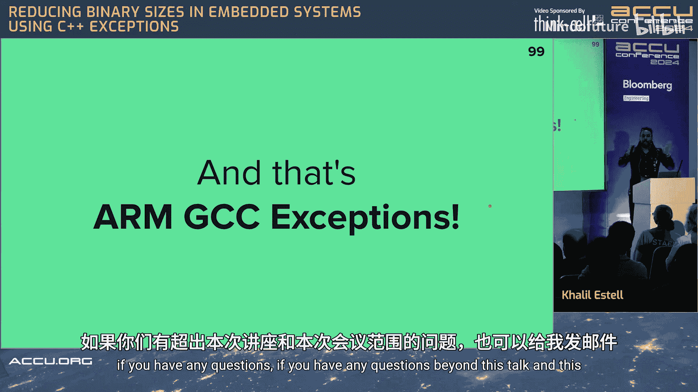

But now I want to talk about the space size for all of these different data structures and the limits of their space。

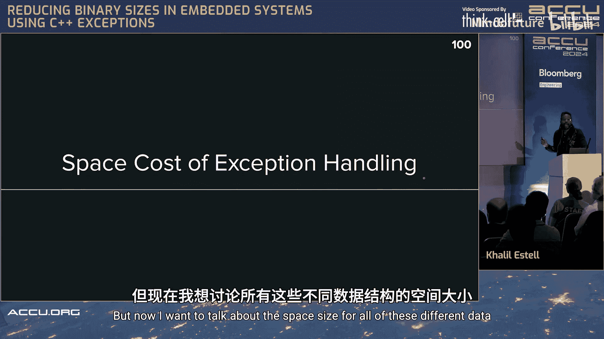

We're going to fill in all these entries here。Some assumptions。one。

I assume your code is being compiled for the smallest size。

 just so that we kind of focus on small size， not like performance because you can obviously make things a little bit different that way。

We're also going to make an assumption that all your functions are below 16 kiloB in length。

And I don't think I can press that link， but if you want me to show you the data later。

 I definitely can or even after the talk。But I went to Firefox。

 I took their release builds with debug symbols in it， I downloaded it， and I dumped all the symbols。

 threw them into a spreadsheet， and I asked a lot of different questions about how the actual code is and from that I asked。

 hey， how many functions or bigger than 16 kilobytes， 243？How many functions are in Firefox。

 at least like the main binary？354000 functions。 So not a lot of functions reach this。

 So I think that's a decent assumption， but maybe guys have different use cases。And also。

 I'm going to assume that none of our functions have more than 63 catch blocks plus disruptor paths。

 A destructor path is where。Let's say you've created one object and you've created another object making both like you know need to be sure at different times。

 let's say the constructor for the second object throws， either will clean up the first object。

 so that is two unique deor paths。There's also every single time you have a catch block is another path you can jump into 63 seems like a decent number and actually I'm using it for other extent。

 but I think people can agree that if you have 63 de paths and or catch blocks。

 that seems like a lot。And I'm also going to assume that all encodings are UL 128 because it makes things a lot easier。

 or a lot of other encodings， but they're not super important。The exception index entry8 bytes。

 as defined by the A， nothing too crazy here。SU 16 personality data，4 bytes， as defined by the API。

Worst case for LU 16 and 32， 12 bytes， as defined by the A。Clean up Descriptors。

 which are the only ones I'm going to reference because the other catchscriptor never gets used。

 So8 bytes for cleanup， as defined by the API。Catch blocks， this one's interesting。

 remember the switch case blocks or the switch case statements。So。

I actually disassembled this so that we can actually look at the assembly and look at how many bytes it uses up and we can do with some comparisons So here。

We have two bytes for the compare 2901， we have two bytes for the branch of equals。

And then we have four bys for the end catch and four bytes for the sorry。

 for the begin catch and four bytes for the branch link to the end catch。The cleanup。

 I'm not going to include because it's not exactly。

 it doesn't need to be there and could be optimized away， just saying or not optimized way。

 the compiler could change that to not include it ever again。So for all of these。

 about 10 bytes because we need four and four bytes， eight plus。To， oh my goodness。

 this's supposed to be 12。 That is my bad。 So that might mess up a couple of things further along。

 but for the most part， it should we shoot the point across。

Then we also have the size of the action table the next three items are going go over are going to be a little more complicated because you have to do a little bit of math here This one is simply all your cleanup scopepes and catch blocks have their own entry in the action table and each action table is only going to be two bytes why remember that restriction I put up for a maximum of 63 cleanup scopes and destructor paths is for this if you only have that many you can use a lab 128 value which can be from negative 64 to 63。

You can have that entire full range， therefore， it can be represented as a single byte of web 128。

And the next record， all the records are placed locally， close to each other。

 so they're almost never not negative3 or negative 5 or something like that。

 so they're never going to exceed 63 as a value。So yeah。

 my assertion is that they're just two times a。For the type table， it's just。

F times the number of types that are unique because we have pointers and there are four bys on our on our system。

 So four bys here。UmFor the coul site， it is four times。Or seven times for the worst case。

 your number of scopes。Plus， one， something that Gcc does。 I don't think they need to do this。

 so they could probably omit this。 but that's the thing。

Remember how we said that the limit is 16 kilobytes， well， let's consider how well。

I chose that number on purpose， start in length。And landing pad。

 because they're all relative to the start of your function。

 because my function cannot exceed 16 kilobyte， can never exceed two to the 14 bytes。

 which is the maximum a2 UL 128 values can represent。Therefore。

 I only need two bytes for that memory。And the action table can't exceed。Two times a。

 which is in this case， 63。So it's 126， which is just a little bit shy from the maximum that UEB can support。

 therefore， single byte。And then the extra scope is because GCC keeps a scope for when you it starts the scopes at the first location where you call and has an additional scope afterwards。

 I'm not sure why， but it does that。And yeah， that's from a chip from here。

Now we have the LSD header。It is five bytes to seven bytes。5 bytes is the minimum show that before。

 but what makes it grow， it can only really grow because it has these offset values here。 remember。

 the offsets are for the location at the end of the type table in the location the size of the call site。

If my type table cannot exceed 63， then it's four times 63， 2552 bytes。

If the action table cannot exceed 63 cache statements and cleanup scopes。

 the size of it is going to be 126 bytes。Meaning that we've onlyt used up 372 bys worth our of our entire 16 kilobyte。

 sorry， sorry。For us to have any one of these offsets exceed two bytes to get to three bytes of UL 128 value information。

 our actual data structure needs to somehow exceed。16 k in total。

 So we have 160004 B left for the call site。 That's the only error we haven't defined。

 We already know how big the table the table is。 And we we also also know how big the We don't know how big the call site is。

Assume in the worst case of seven。Times S or S plus1。This would allow us to have 2，286 call sites。

 which won't happen because I also limited the number of call site deor paths and catch em blocks so in general no your headers is only going to be five to seven bytes。

Yeah， it's all well defined here， and that's pretty much it。

 The only thing that's wrong here is actually the catch block I apologize。

 I don't think it'll change much though。Here' are some examples。 Let's look at it。

 So we have the trivial unwindable function in this place， in this time。 I'm sorry， at this location。

Our only components we need for our metadata is eight bytes because it's true to be unwindable。

 it's a trivial function and it doesn't need anything it doesn't even a lot of stack size。

 so it's pretty much fine if we added an object that could be destructed or tricatch。

 it would increase the size of this。Or if your stack exceeds 512， that's an AI specific thing。

 If you exceed that， then you will almost always go。We need at least four instructions。

Here's a muttex， my little muttex， I call some， I write something to the bus。And from here。

 because we need an index entry。Short unwind because there's probably not much happening here。

I'mSorry， the short unwind personality 16。We're going to need to clean up scope。

 which is another eight bytes， and I'm going to need to end of a descriptor。

 which another four bytes。Total， 24 bytes。And the size will not increase unless we increase our stack size。

 like I said before， which will add an additional eight bytes。

 and the object de will add each object you add that add another deor will add another eight bytes。

 if you ever add a tricatch， you'll start using the language specific data area for GCC。

If you have a tri catch gets a little more complicated。

 not going spend too much time going over the map， but basically you can add all these bits up and eventually get 45。

And the next slide here will tell you about what things will change and how it'll grow depending on what you do so if you add another catch。

 it'll cost about 16 bys why well actually should be 18 because we just realized that the cost of every catch is actually 12。

 but humor me for now， we have 10 bys。Or in this case， 10 bytes for each catch。

Then we have a new type， let's say it's a unique type that we added。

 and then we need another action entry， so that's 10 plus 4 and plus 2， 16， well， 12 plus 4 plus 2。

 18 really。If you add another TriRcach somewhere else， you'll need another call site。

 so that adds another four bytes to your data。And then finally。

 we have if you had any other tricatches with duplicate types， just 16， because remember。

 we can reuse the entries inside the type table。

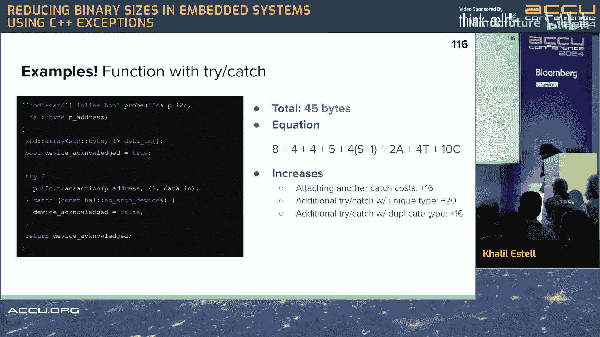

Now， let's compare it to using。Return types as your're air handling。

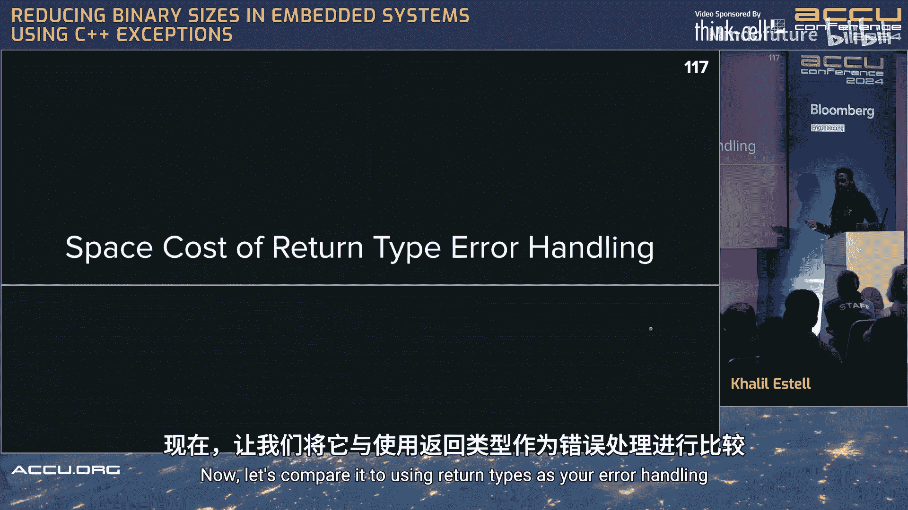

So here's an example of calling three functions with either no error handling or exceptions。

 This is how much assembly that we get from this。All the other functions are going to do the same thing。

 They're just going to call three functions and add them together。So in this case。

 I'm using St expected， U went 32， and my error type， it's just an enumeration here。

And we're doing the normal thing， get the thing， check it， if it's not， don't use it。

 add it to the sum song， so forth， bh bh，h， blah， blah。嗯。The amount assembly for exceptions。

None of assembly when you said expected。So I'm not going to be concerned with all the return paths because return paths can get really weird and how they get format depending on which optimization level you're using。

 So we're just going to look at the。The cost of checking。

Here it's four bytes to do the load and readbyte and another check to do the compare branch of zero。

And then that'll jump you to B4B4， which is over here， which if you look at the end here。

 we have an addition to the stack pointer， Decate your memory， and then you pop R4 and PC。

 pop registers back， this is a return path。There are actually three of them in here for some reason。

 I don't know why every compile did that， but yeah。Cost is around six bytes per function call。Well。

 okay， that's first it expected， what about for bullo must be much smaller， right？

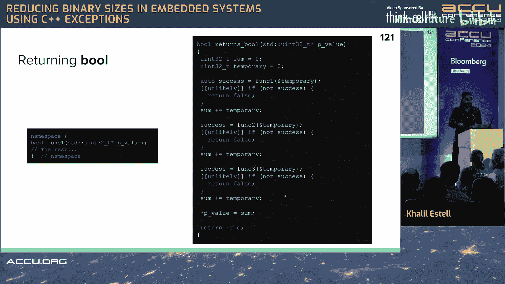

Yeah kinda it is less code usually so this one's a really cool optimization that it did。

 it realized that it could use CBNZ， which can only go forward a certain amount of length down into the code so it's kind of limited。

 so it's not the most likely that it'll always be used and everywhere else for all the other function calls。

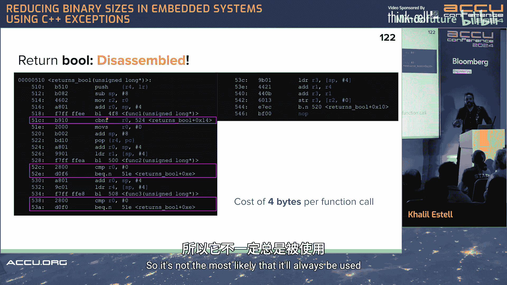

It just compares R 0 with 0。 And if so， branch F 51 E and 51 E is up here。Move false into our zero。

 add to your stack， pop。Four bytes。Rust because they use result types for everything。

 so they must have some way to get around this right， not really same thing as they expected。

 six bytes。Ah，But if you use US64 or a very large return value， gets a little weird。

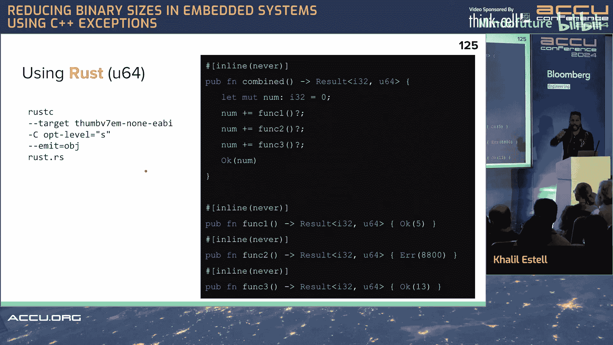

4 bytes。 so it changes depending on how large your your error object is， but in general。

 Rus knows that the four results that are0 will have the information for the tag information。

 So just uses that in order to figure out， hey are you the。m basically。

 are you zero and if you are zero branch to our return path， so four bys。

 I'm just going to use four bytes for rust and everything else。

And now we get towards the end of all of this， which is talking about distributed versus centralized air handling。

 these are my own terms that I cram up with。

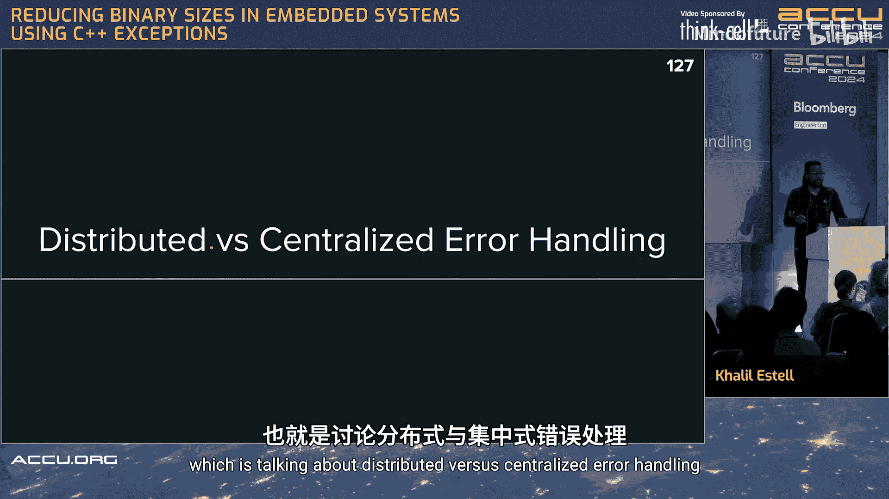

Distributed air handling is effectively just using or forcing your code to do air handling throughout the entire code base。

You distribute the error handling throughout every single function。

 Every function needs to help and be be in charge of taking an error and delivering to the thing above them。

And whenever you call some function like this that can emit an error。

 it'll either handle the error or propagcate it up。 there's ignore， but we don't talk about ignore。嗯。

And yeah， this can be done and also all the other stuff I didn't show like using like an out parameter。

 but it's the same thing， it's no different really， it sometimes it iss worse。

 but that's not super super important。Astributed error handling。

Centralized air handling like having a mail system rather than having every human being in your city know how to deliver stuff to every other person。

 you have a specific mechanism with the specific amount of resources allocated to deliver information from one location to another location so you have one mechanism to do this for all your code you pay for that mechanism only once where do I say that don' I say that this I don't say that here。

But effectively， exception handling is a form of centralized air handling。

 one central system handles propag errors everywhere else with a little bit of additional metadata to make it happen。

So here is my claim。I claim that centralized air handling schemes have an advantage in terms of code size compared to distributed handling。

 here's why。Point one number one。Branches are not free。

 I don't know why we ever thought they were free， but they're not free。 They never have been free。

 So if I wanted to add up these five functions and each one of them could emit an error。

 I know adding is a very simple thing， but I want to simplify it here。Well。

 the more checks I need to do this all just simply scales if your check， if your cost per check is 6。

 it scales a little faster。 if it's 4， scales a little faster。 But for trivial functions。

 which I I I hypothesize or I claim are very common in most people's code。 Yeah。

 you just have the fixed size for the whole thing。 You can call thousands。

All the functions in your code。It it'll still be。Eight bytes in total。For your trivial function。

 they don't use up that much stack space。Here's a bit of a comparison if I wanted to call six of these functions。

 I would have a compare branch， compare branch， compare branch for all of these while using exceptions。

 just the function address and the personality to unwind it， that's it。

If I had something I I needed to own。Destruct， well， I got this here。And I add more entries。

 but it kind of compares the two between calls and。And this data structure here。

 this data structure will be fixed， if you try to call more functions， this will continue to grow。

And yes， if you use a tri catch， it's 45 bytes， actually 47 because I've forgot about the two bytes for each catch。

But that lots you about 11 to 12 functions。 So if you're only calling a small number of functions in your code。

 Sure， but I feel like there's something weird about having a strict limit on the number of functions you can call in your code in order to。

 in order to be smaller than exceptions。And here's my second point。

 this goes back to what I've been saying before， most functions are trivially unwindable。

Think about the types of functions that you write and this helps more if you're an embedded。

 but if you are not an embedded， think about how many times you do need to use stitch string and need to put things together。

 Think about how often you're not just passing it in as a reference。

 which wouldn't cause you to need to destroy anything。

Think about the types of functions that you normally read and normally normally see and read。

How many of your functions in your code base actually handle errors versus just propating them up？

And how much of your code actually has nontri deors。

Let's consider audacity Jason Turner was hitting him up and saying hey。

 you know this things make sense， blah bh bh blah and he's like ohh yeah。

 you should look at audacity to get an idea of what they do so look at them 1054 C+ files that they have for audacity out of those files 39 actually have catch blocks there are 60 triscopes there are 69 catch blocks。

And out of all their functions， only about 50 of them， actually00 the 177000 functions。

 only 50 of them actually handle errors。Maybe because they think they're too scary to use。

 but the way that I see them using it with some control flow and incorporated。

 I feel like they're pretty liberal with their usage。And yeah。

 their exception tables only added around 08% to their overall code size relative to just their text section。

 I'm not including strings and like that， just their code。And it was like 15K， total memory。

So let's consider some code where 5% of the code actually catches up。

 this is way bigger than how much Odyacsey does， but let's just go overboard。

25% allocate objects and are nontri more than half of your functions are trivial unwindable。

 and about 10% of them are leaf functions。OhAnd all C code is always leaf functions， or'm sorry。

 all C code or either trivial or leaf functions， so they just get trivial mind。So for a try catch。

 remember we need 25 technically 27 bytes for all the exception info。

 let's just use a larger average 64。Let's say that our average cost for all of our cleanup functions。

 Remember， we need a minimum of 24 Bs。 Let's use 32。And then we need we have 550 trivial functions。

 which require 8 to 24 by。 I'm just gonna to use 8 just because it's actually rather not as common to have evidence。

 I could made it 10， but I just go with 8。If you don't like it， you can do through calculation again。

 it won't make much of a difference。We have 100 functions that our leafs， they cost zero bytes。

We add them all up， we get 15 kilobytes of data。Now。

 let's compare that to how many checks we have in our code that were allotted。We have 3。

900 checks in our code that， if we called more than that。

 we would run out for our thousand0 functions that we're considering。

That means that each one of those 1000 functions has a limit of about four checked functions。

 so so long as your code doesn't check more than four functions。

 then your're AO with this particular scheme。If you call any more。

 then you're paying extra cost for no reason。I didn't include the un mechanism。

 GCCs is around 8 kilobytes， so that would have included 200 additional checks， fantastic。

 Now we can have six function calls for six check function calls per function。

Or if you use my implementation， which is around 2。5 kilobys， I'm still trying to get it smaller。

 don't worry， I'll get there。嗯。You'll have 4。5 function calls per function that you're allowed before you've gone too far。

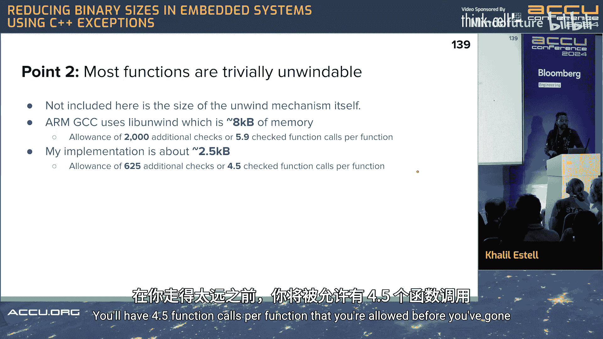

Here's kind of my conclusion。Why can C plus plus exceptions produce smaller binary sizes。Number one。

Reduces codegen when calling Fible functions， you guys saw how big the code got once we moved over to using any type of return type for status。

The und information scales with the number of functions you have。

 not the number of functions you call in your code。It eliminates the additional return paths。

 I didn't size them up， but a lot of them tend to be either a single instruction at the very least。

 or actually most return paths at least have you know。

The additional code for additional code return paths could either be a single instruction or could be up to。

Three instructions at a minimum or two instructions at a minimum。

But all that extra code gets added in as well。The cool thing is that because our unwind instructions don't need to do that much。

 They only have three purposes。 subtract the stack and pop registers。

They're a compressed representation of what would be a normal code。

And you only pay for the propagation code once the live unwind and all of that。

 it does not scale with your application。

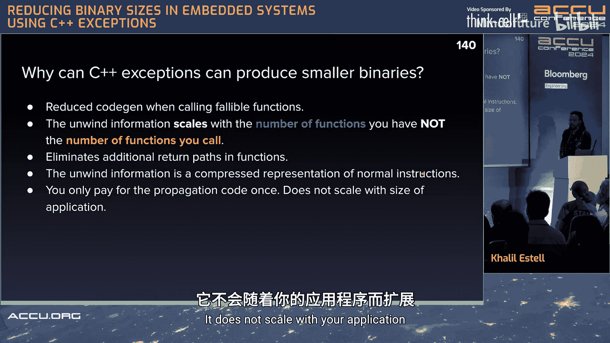

And here's the crazy thing。I've already been saying it throughout the entire talk。

It could be so much better。 We haven't optimized exceptions。

 we haven't spent any time working on exceptions。 I looked at the number of people who've worked on exceptions on GCC。

 who has a number for that， who has an idea， you don't say anything I know I told you。Someone。

 anyone， just yell it out， go for it。It's not three for all exceptions， I believe it's 32。

 and I think GCC has like 100，00 whove worked on it。

I think it's like somewhere like oh maybe 100 Maybe I got my digits wrong。For arm is about eight。

 I hope to be number nine at some point to fix up some things。

Here's the first thing we can optimize CA and catch， why do we need a catch for every single。

 why do we need a call a function call for every single catch block at the end。

 just put one at the end and branch to it， there you go。Calls are four bytes。

Branchches are two bytes。We can do better with Lib Unwind。

 I've already made my version smaller because I don't want to include Java or other things that aren't necessary for my use case。

So yeah， we can do better for size。We could add a fourth personality。 Remember I said that length。

 we could get rid of that if we did that， we can remove an entire possibility of having four words or 12 bytes of information for unwinding。

And there's all this other encoding stuff， that's backwards compatibility stuff that they added into GCC so they can support all the different other ways that GCC used to encode the information in the call site。

But it's version zero and they never made a version one and actually making more versions is actually pretty simple。

 I'm not saying about the compile sign， but like the actual implementation of the code for them is pretty simple。

 so we can make one that uses web 128 for everything so we no longer need the encoding bytes we also。

If we had a version of VCC that didn't need any of that old stuff。

 you could potentially get rid of the entire version zero in your code， if you rebuilt it all。

And not need the other encoding bytes or the decoding functions， you don't need the encoding bytes。

 and potentially I've been thinking about it， the action table seems too long。

 why do I need to know the next record， what if I just had a length after the action record in the call site table？

Let's say it's one byte now I can just go。Jump into a location。 check， check， check。

 hit the length cool where it's we have nothing to do here。 rather than having a next record。

 next record， next record that costs you additional bitetes for each one of them。

So there's a lot of things that we can do， exceptions can be so much more than what we have given them now。

So to be honest， I don't agree with any of these reasons to not use exceptions。But here's the thing。

I haven't gone over time， I haven't gone over the performance side of this。

I don't have time right now。 I got like， what，8 minutes left。

So I think a lot of you guys have probably been thinking， but Kahalil。

 what about the sadpath performance， okay， it's smaller sure。

 but is it going to take a week for my exception to get thrown？Well， look out for my next talk。

 cutting peoplescon time by plus 76%。

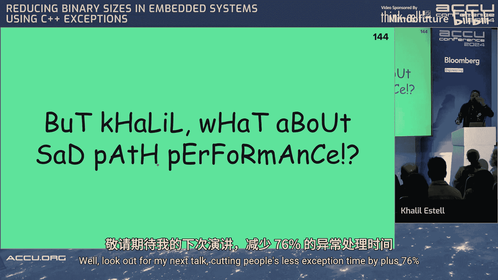

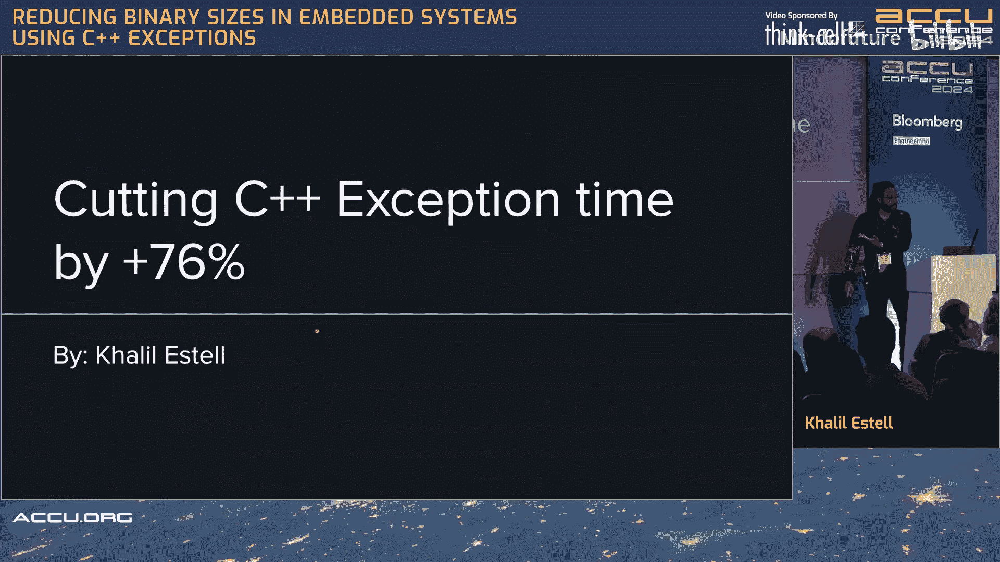

I'm planning on， okay， so here's the thing。I know I need it to like at least 85。

 I haven't optimized my code fully， I haven't actually optimized it。

 I just kind of implemented it if you implement exceptions。

 you'll get a faster time to let them mind， if you read the code。

 I swear you will immediately see what is this and why can't we just do better。😡。

Here's that expected， how much it takes to go up six frames。

 I'm not giving all the data because I'll show you later。Here's Le Bwin，15000 cycles。 Oh。

 and I'm using this on an arm chip who doesn't have an operating system or anything special like that。

 So I have a deterministic number of cycles。 It'll always get the same number each time you run these algorithms。

Or run these tests。And then my implementation， 3660， so I am 6。 times6。

5 times slower than just propagating up。But I'm at least not 27 times aslo。

I'm trying to get this guy down to around two， so it feels like， oh， just pop up the stack twice。

And also on top of this too， I realized I have full control over the code， I can add features。

 I can do more things， and actually now that I've kind of started to see all the parts of exceptions。

 there are other things that we could potentially do， for example。

 everyone like a stack trace from your exception。I could extend the exception header to have a little block of memory where I can record all the functions that I saw as I unwound。

 Now we have a stack trace。hiever like better control of your exceptions。

 I wrote mine as single phase， I've also done a version for I'm working on a version for two phase。

 but I realized I didn't care about the benefit you get from two phase so I eliminated the other phase and got to speed up。

Also， have you ever considered like wow， when I use exceptions。

 I have no idea what could terminate my code， I have no idea there's if I add or change one of my libraries so let's say B2 or one point whatever。

 and it upgrades and changes the implementation， there's a new thing being thrown and my code doesn't catch it anywhere I would love to at least know hey。

 these things will term your code。😡，Unconditionally， if ever happens。

If your answer was yes to any of these， I have another talk that I plan to do later on after that talk。

 which is extensible C++ exceptions and exception tooling。

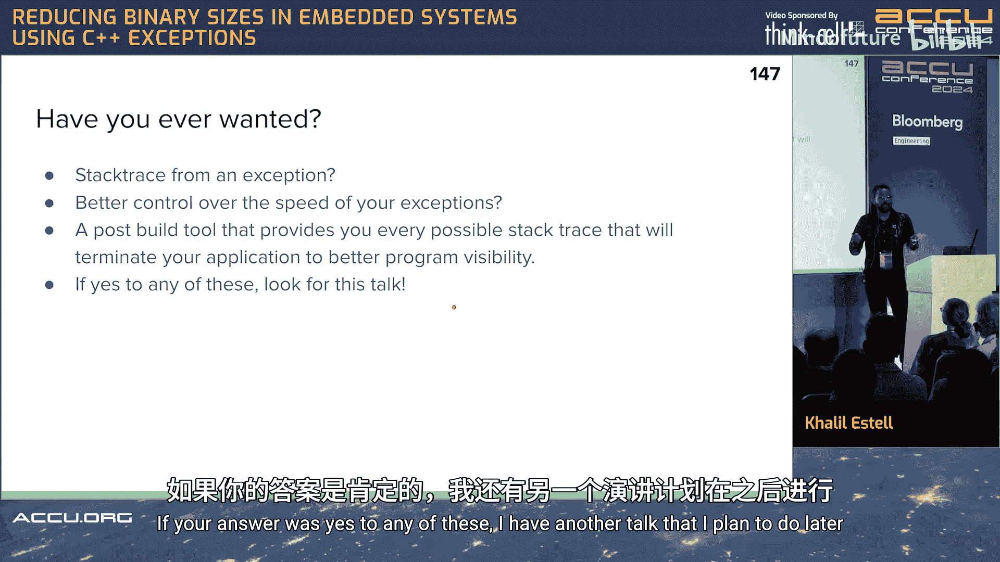

Any questions？

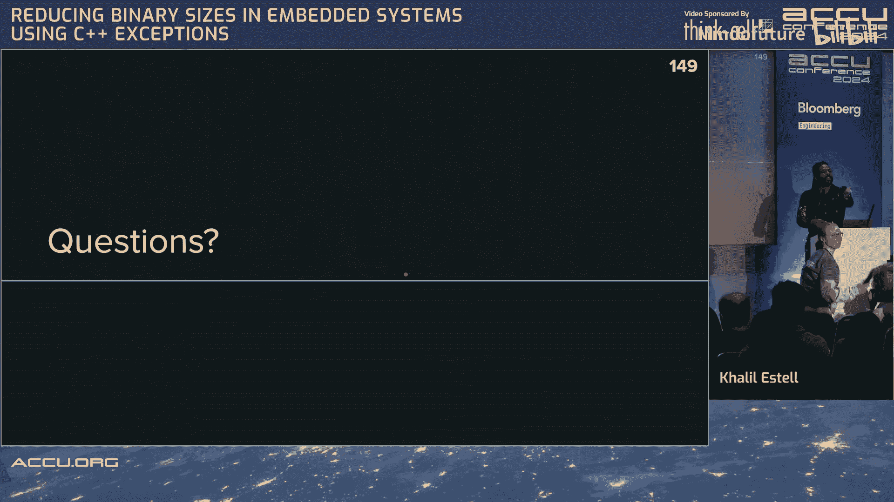

Yes。

