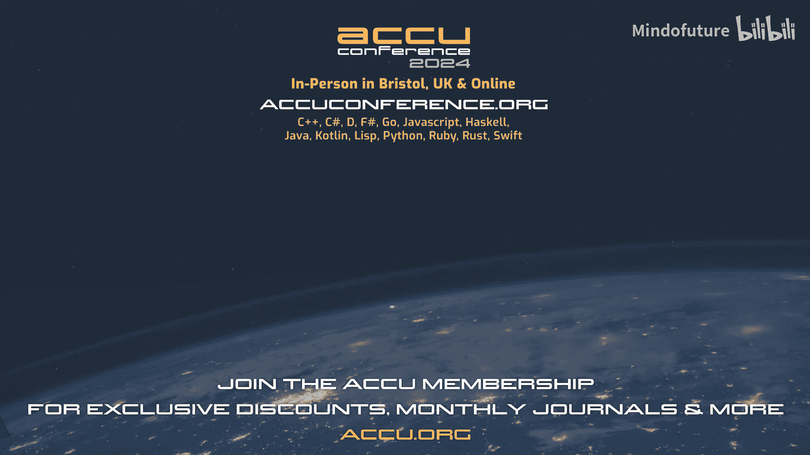

# 中英-•-C++和C语言ACCU大会2024｜人工智能｜架构｜函数编程｜静态分析｜安全｜编译器｜开发者｜垃圾回收｜链接器｜代码生成｜cmake-p27-P29-Scripting-and-Automation---This--Manual-Task-Could-Have-Been-a-Script---Fred--BV1pNotYYELk_p27-

は。My name is Fred Tangro。Nowadays， I work in study colonizes， originally， I majored in bioinforms。

I was in a class of 15。14 people were passionate about biology。

 and they had heard that programming might be an interesting tool。I was passionate about programming。

 and I had enjoyed that。In biology might be an interesting domain to apply for Ibin to。And some days。

 this difference between me and my colleagues was obvious。For example。

 I remember this time where the teacher gave us like we had spread it and the teacher was guided through some experiment。

At some point， the teacher said， okay， you have。1100 entries。In this spreadsheet。

 count how many of them have a value higher than 80 on drone age。哎。

And 14 people around me pointing at that screen。And started count lines one by one。And I was like。

 that's not how you're supposed to do it。 You're supposed to write down the formula。

And result automatically。At the time， I felt like I knew how it was supposed to be done and they were wrong。

But in retrospect， I don't think they way wrong。Sincein I would always write down the formula to count。

100 lines in a spreadsheet。But if you do not know how to write a formula and a teacher is waiting for you to answer the question。

And you have just 100 entries， which is not that much。Chunting by hands really makes sense。

So it was是。Probably one of my first encounter with。

Vue of autoating or not depending on what you know and the context。Nowadays， I work in Sais at Soar。

 Who knows Soar tubes on a cloud Soar。Okay， for the others， we do staticize this in the C I。

 and in the I D， we try to detect bad pattern and warn you about them。And we。So we。

 I try to come up with this rule in C plus plus of stuff you shouldn't do and try to detect them with matches。

And B C plus plus is quite complex when we have a metro。We try to test it。

Against a to of C plus plus road。That might be different ways to do the same error。

And B C plus plus is very complicated， and we have tons of C plus plus to test reddenom match。

 and we want to we end up with this test where you have a ton of C plus plus plus what we expect to find in it。

It's pretty hard to read。So I wanted to create some kind of plug in my I that would show me where。

A change is going to happen when where one is going to happen。嗯。That I called to Detroit。

 I worked on that with a truege。And it worked very well so well as that we started addingin features。

 and because we had many features， we started need test。For the decorator。And because we had tests。

We added did a C I on top of that。 And because we had a C I on test， we I did a Gi action。

I had many ideas to improve the data action。But I stopped， because。

We were working on the Gi action that automates the C I， that automatically runs the test。

 that automatically test a decorator that I would put in my idea to decorate a test that is gonna test plugging that I'm gonna give you so that you put it on your C I for your test。

For your own crude。It's automation all the way down。And no matter where you look。

 you have automations below you and you have ideas of new automation to put on top of that。

And some we are creating real value。 You are improving the life of everybody by doing an automation。

But sometimes。I'm just getting insidewa。Sometime it's very interesting to automate something。

 but it doesn't bring any value。For what value name meaning of value you have。

And so that's my question today。 When is it worth the time automating something sense。

And when are we just getting insidetracked and doing something else on what we should be doing。

The good thing with a technical presentation is that there is always an HTC that answers a question or supports your point。

So present。H TD 1，2，0，5。 Its O you cannot read。 I'm gonna describe it quickly on one H is。

 How many times do you do the same task。On the other axis is how much time could you s from this task by automating it？

And so in each cell is how much time you can spend automating。

Before you spend more time automating than youre gonna shave off in the in the next five years。

Which is a reasonable range， I think to take into consideration。

 So this whole chart is actually just saying that。It is worth automating if and only if we save more time than we spend writing down the automation。

Which is a nice， easy way to word it。Which is also a formula that I completely disagree with。

It would be okay for me to disagree with one HTCD commit， but it。

Many people in our industry seems to think like that。 Like。

 if you are not achieving rough more times and you spend automating， it's not worth it。

I think the real formula is that。It's worth to maintain if your benefits are higher than your costs。

Thank you for coming to my toch。 Have it easier。Okay， yes。

 the problem is that we didn't answer anything by answering this specific question。

I would be interested in hearing if some of you have ideas of benefits and trust that are not just。

The time spent and the time saved， which are definitely。Important benefits and trust to terms。

 But do you have other ideas。Not forget to do something。 Yes， La one。Complexity。

 you mean it's easier to automate than write than do manually or opposite。

 It's a crust because it's too complex。Complex。So you would raise us this jail in， perhaps。No。

If you have many different things you okay， so if you， yeah， okay。 so it's。

 if it's too complex to tomatoess and you start to tomatoesating everything， it's。L1，2。嗯。

Mentinal stress， yes。はい、かうさ。迪性。Yes， so the manual errors have to be counted。

 I love it because my whole talk is gonna get laid out， yes。Automation is extend。け政た。Okay， yeah。

 so you can reuse the same automation for other stuff if it。Yes， is it a one shot scene？

Sorry for the camera。 It's probably not ideal。 Do you want me to give youmic next time And okay。

I did repeat them。真的。Anyway， now I'm going to show you mine which。

I think all those you you mentioned are in the slide。 So I'm glad for that。

So I'm starting with the benefits because I'm an optimistic person。And yes。

 I think it's one of the elephant in the room is by automating， you avoid manual。

My classmates in my story at the beginning counted on the screen 100 lines。

I'm sure some of them missed the line or jumped into same line twice。This does not happen。

 if you to mate。I work in city other Is。I know that cookie best or。你。It's enough for us to。

 to to jetto job， just copypy pasts。 and typos will happen if you， if you write enough code。

By the way， if you disagree with one of the slides or if you want to add something。

 don't hesitate to raise your hand。 I cannot of South this talk as something quite interactive。

 And I know that some of them are a bit。T be dis。So， no manually homes。Also。

 the fact that you can rerun for free。 And we mentioned earlier whether it's run once or if the test needs to be done multiple times。

Even if the test is。One shot with the air quote。It happened to me so many times in the past that I think Im doing the one shot change where I change A into B。

I do it。And so next day， I realized that actually， I wasn't supposed to change all A into B because some of the A was supposed to be changed into C。

If I did that manually， that means I will need to revert everything and redo the task manually because I was slightly wrong on what I was trying to do with automation。

 I just revert。We run the script slightly change to change some of the usage of A into C。

It's almost free on the Su try of this one shot change。So even one shot I think。

 we still gain some sense of being able to rerun them once。

It will also happen that you change every scene in your into master branch。

And some user was working on their side and didn't have the change yet。

 And they were using everywhere。 We can also give them the street， and they are able to。

Have the change on their site， too manually we need to do same work as you。Which。

To about branches brings us to the next one for me。Reach change a moving target。

So I have this big repository。 I want to change all usage of a into usages of B。So I branched it。

 I worked all week long。Chhaning usage of A twin to usage of B。

 at the end of the week I tried to rebase on the main branch of the project。

 and everybody has been introducing new usage of A because they were the the world continued turning while I was working。

So now I have conflicts to solve。And if I'm lurky。Is really converge。 at some time。

 I'm changing more usage of a into usage of Bs than people are introducing。

 So I will converge hopefully if I go on vacation。 if the team is very big。

And is introducing a lot of changes。 We can be in one of those scenarios where we actually diverge and they introduce more problems than I solve at once。

With automation， this does not exist exist at all。You take as long as you want to write down the automation。

 Once you're done， you press a button。 It's almost instantaneous and you change for the whole world。

 So you don't have this feeling of being trying to empty a sinking boat with with a small trap like yourni。

Understand user process。 if my task is complex。And takes multiple days of doing multiple stuff。

By automating， I am forced to get this high level vision of everything that's happening。

I am forced to get the big pictures， the big picture。

 and I am also forced to explicit to make every exception explicit。嗯。And this is that。

Process will give you on top of the automation。 It gives you some knowledge。

 which is extremely valuable。And this knowledge that is extremely valuable。 On top of that。

 you can share it with your colleagues。The HTC committee at the beginning was only to about was based on the idea that you are the only one doing the test。

 which might not be the truth。If you have new commerce in your team。

 then need to learn how to do the test。 manually， it may be very long and complex for them。

With an automation， you give them the automations that can run the script immediately。 It works。

Perfect， if they need to understand what's something behind。

This automation is probably some seems that they channel' look into into and。

Understand what's happening。Which。I'm not seeing that。Cd is a good documentation by itself。

 and you should not document。 just seen in that giant of chase。

It's an interesting job base to learn about something。I seems this one was mentioned before。

 with modity。You were thinking about doing very clean code， which is very nice。

 I do it slightly differently。 I have this big project where we put a ton of files and text files。😊。

And we tried to have something quite emotional news， but by， I didn't shed some stuff on top。嗯。

At some point， we wanted to change the format。 So I wrote a very dirty E strip that would do it automatically。

And perhaps it took me more time to write this space on trips and do it manually。But I wanted to。

 I'm very bad with Python。 So it was an occasion to learn， etctera。It worked。Two weeks later。

 I needed to change the format again。I to this Python strip that was supposed to be one shot。

 I changed five lines。Werun it and it did the new change to the format that I needed to do。So。

By having an automation around that I had written for one shot， I actually had not a library。

 but something that I could reuse and。Reduce the time I had to spend on this test a lot。

I also perhaps became slightly less bad at Tythson， but。Not that much。

I think this one is most important benefit， In my opinion， if you are trying to。

 if you have this task that is not super important， not super urgent。

It is probably the best sandboxs you could have to learn a new technology。You are trying to。

Do a tiny s that will be used only once。The s is very small。

So it's a good chase for to learn a new technology。The risk is very limited。 If it doesn't work out。

 you can still do the test manually。 You can still fall back on something things you know to automate it again。

And I see limited commitment。 I mean， like。Even if you don't follow the best practices。

 because you are learning this new technology， you still， you don't know yet the best practices。

 it's O。At was， just scenario scenario， you're trying drop the crude and rewrite it again another other time。

 Best case scenario scenario， it works and you good。So it's really a very good sandbox to learn。

This kind of small， chain of one shot changes。Another way to learn about a new technology is toy project。

 but I think。Automations are best sunbergs because we studyy projects。 First。

 it's very hard to do it and any time。 telling your boss， yeah。

 I'm not doing anything useful this afternoon， but it's because I'm learning the new technology。

 It might not grow well。I often when I do a toy project and it doesn't work。

 like so technology doesn't really do what I want。I'm always left with this of。

 is it because the technology is bad or is it because my。

What I'm trying to do is not a real life change， and nobody' is trying to do that anyway， so。

I don't know， so。And。With the toy project， you end up， as I said， with China of No India in the end。

 with the automation， you end up with something useful。

 and you've solved the natural problem in the meantime。

So I really love automations as a way to learn new technologies。

Another one that I love is changing behaviors， which is。Kind of on the other hand of the spectrum。

 it's not when it's something that is completely useless。But。

When Grtenbergge invented into the printed press， he did not shove off one year out of a monk。

Work time。It completely changed society。And yes， probably my automation is not going to change society。

 but I have seen， for example， teams。I have seen a team。 They had very， very complex release process。

T them two days every quarter to release their product。 And it was super painful。

 So every time they would change who was doing it because they all hated doing it。At some point。

 so David got fed up with this problem and said， okay。

 we're gonna to automate and the whole team worked on automating。

For probably quite a long time until they ended up with a one liner。

This didn't this didn't shahove off two days of work every quarter for them because with the one liner。

 they put it in the C and they started doing continuous delivery。

And now theyre started having feedback from their users。Almost immediately on any scene they were me。

So by automating something that was not。Very often done。

 They completely change the behavior of the whole team。And the way they word fall a better。

So this doesn't happen every day when you to stuff。

 But I think this is a winning lottery T that we'll have once in a while。

Which is really worth bittting。On automations。And all of these were very interesting for your team and your company。

 But sometimes you have to be a bit selfish too， doing something manually with a lot of repetition。

 it can be extremely boring。And if you always press the same keys over and over and over again you can even end up with repeateditive strain injuries。

Personally， even if it takes a little bit more time to automate and to do that giant of surf and end up with an injury。

 I will automate。我都没听你份呢。It's it's an interesting problem to solve。

 you have this new technology you're about to learn about。

And sometime you are doing something pretty hard in your everyday job。

And you need a change of pace and switch to something like that。It's fun。 You do it for two hours。

 You go back on your test， and you are， you feel a bit refreshed。😊，So it can be useful for that， too。

I am a C plus developer。 When I do a small feature， it takes me three days。With an automation。

 I can have the idea in the morning。 And by lunchtime， I'm done doing the automation。

 I can share it with my colleague， and they are happy because I just solve the problem for them。

 So they are grateful。😊，So my colleagueslea aren't right。

 I'm happy because I finish something in a very short time。😊，Everybody is happy。

 and we all love automations。Do you see any other benefits I didn't mention。So now on the bad part。

 the crust。嗯。Obviously， you are not doing any manually anymore with automation。 Congratation。

 Now you can do birds。And you can do birds at jail。 That's a red scene， with an automation。

And you can do birds at scale in two ways。 You can create 1 million files with 1 million errors。

 which is bad。And you can create 1 million filess with one error in one of them。Which is way worst。

Which is a real pillar of automation。Having in one error in 1 million file， because。

Your reviewers will have to do sampling to review the 1 million file。 And if you're not。

 Im not going to choose so one where there is this error。By the way。

 I'm listing all the costs of automating。 I'm not offering any solution to any of this。

That one is on you。higherigher uncertainty。A manual task repeated very often is very。

 very predictable on how much time is gonna to take you。And writing down an automation。

 especially if you don't know the technology。Not too much。

We all know that we should multiply what we think is gonna happen by two。 and that that way。

 we are just gonna be wrong by half。But yes。This is a presentation not with one etity commit。

 but two。So the H TCD 1，3，1，9 is showing the process of automation as you think it's gonna to happen and as it actually happens。

You expect to change。Your task， you spend a bit of energy to automate it。

 And then you have all these free time because you no longer have to do it manually。And in real time。

 you start writing some code when you start running get you realize there is a bird， so you divbu it。

Then you realize the bird is there because you didn't think it through well enough。

 So you start thinking again and implementing this new solution and divbu a new solution， etc。

 and you end up with no time to actually do the manual task at all。Of course， this is a ch。

 Of course， we are not doing that。Who knows about the central Cross fallacy。It's。She seems that。

This problem in the wide range of our own brains， which makes it that you're not going to say that if you don't say that something failed。

 it didn't really fail。If you do not add to failure。There is no failure。 So for companies。

 it will be like， yes， we invested billions in this project and is still not done。

 We are not going to give up now。 that would be， that would mean that the billions were are lost。

 We are going to put more money in it。 And this time， probably it's gonna to work。And for you。

 it means saying， oh， I already invested one week to shove two hours out of my time。 If I stop now。

 everything has been lost。 If I continue， perhaps it's gonna work。And no， it doesn't。

So you have at some point to just let go on say， O J。 I spent too much time on this automation。

 It was super exciting。 I didn't get the result， but I'm stopping now。Also， why we preserve HTC。

Automation are very good to do exactly the same thing over and over again。

Which means you are introducing rigidity into what you are automating。

You are introducing rigidity into the task itself。 You are also adding some rigidity on the whole stage。

For example， if you want to move from Linuxage to microwaves。

Perhaps you will have to rewrite all your scripts that we are doing stuff automatically。

What we are doing manually is children work perfectly。

And you also add rigidity on exceptions of stuff that happens only once in a while。

If you spend a lot of time automating how your A process works。And you sort about like， okay。

 every two weeks， we have a retrospective of the sprints that we spent， etc。Might be very nice。

 but perhaps in December， when three quarters of your team are off。

 you want to do a three which print。And now your automation is making it super hard to have a three wprint when everybody's invitations。

So because you automated， you made everything。Else， a little bit more painful。Toing strategy。嗯。

Which was mentioned with the complexity and everything I think。 or at least that's how I interpreted。

If you start having multiple automations and you give everybody around you all these automations that do this and that and that。

At some point， it's just too much。People have too many tools。 They forget get half of them。

They don't know how very well how to use the one they know about。

And you're just wasting time for everybody。And I say multiple tools。

 but I've also been in companies where you have one tool。With 20 tabs。 and each tab has four buttons。

 which do completely different stuff。 It say exactly the same。

 People do not know about all the features。 They are not using them， and。

So when you want to automate， you have to automate what you。Thinkk is really useful for everybody。

 The rest you can automate for yourself， but probably not change it。Opportunity trust。

It's very nice to spend some time now， to shave off some。😊，Time in five years。

 like H T CD was put in it。 since is perhaps in two weeks you have something very important happening。

 A very big demo for your startup。 A product is getting out of the door。In that case。

 investing some energy to shave time in five years。

 if you don't even know if the startup will still be there is not a good usage of your time。

So you should always consider whether you could be doing something more useful at the time。

And in my opinion， we should always consider whether we could do something more useful。

 That does that mean we should always do something more useful。During time。You consider it。

 And then if you decide that you still want to automate， Gr， because， for example， in the startup。

 perhaps you are always in an emergency for something and something else。

And you still need to have some automation at some point。 So you will have to。

 to pay this opportunity trust。 Just be aware of it when you pay it。Maintenance was mentioned。

 and is a real one。For me， it's like， congratulations。 you are in the worst just now you。

 your project succeeded a lot。If you are super successful and the whole company depends now on your tool。

 because you。EAutomated very， very well。You will have to pay this new opportunity cost of maintaining every time the project。

 the product is not working。Every time the automation is not working because there is a security issue because。

Whatever you were using this down， etc cea， you will have to stop what you were doing to fit the automation。

Some it may made it， and some teams will take ownership。Alltoge of this new automation， but。

I've seen cases where like， yes， you end up as a person in charge of that。呃，有理由。I mentioned rigidity。

Rigdity is bad， but it can have an even worse impact， which is that people say， okay， it's rigid。

 So I'm not gonna to improve the task。Because that would be painful。

 I would need to go to Fred and ask him to change automation， or I would need worse。

 I would need to learn about this land region change the script。 So I'm just not。

 not gonna improve the in at all。I'm saying it's beneficial because sometimes it's multiple people having small ideas。

That are not worth completely changing the automation。On their own。

But if you were aware of all this idea of improvement。

 you may decide that it's actually extremely valuable to trans the automation and write a new one with all the improvements in it。

Once again， I have no solution， but。It's good to chip in mind。

One thing I don't like with this idea of time shaved of time spent。Is that not all times are equal。

There was yesterday a presentation about neurodiversity and fact that some people have ADHD and when you have ADHD。

 some days， you will hyper for on something and be super productive。

 And some days you are not able to fortre at all。 and you。Try to do whatever you can。An not a manual。

Repeitive task doesn't require any photos。You can do it if you are tired。

 You can do it if you are on a bad brain day。You can do it if it's Friday and you're about to leave。

 You just have 20 minutes。 You can do 20 minutes of manual test。Writing down automationation。

It requires you to concentrate well。For the same amount of time。 So we are shaving off。老湖出 stay吗？

And usingch some high photos time。Which might not always be the best。The best change to have。

Does it make sense。Once again， don't hesitate to raise a hand if you have any。

D agreement is what I say。See slides with a lot of these every months are coming in later。

If you are strongwilled enough to avoid the central trustacy and accept that you failed。Now。

 you have to deal with failure。Which might be bad for your moral。

 just like doing something very quickly was very good for your moral。

 Fail will be bad for your moral。And if you spend too much time trying to chase the automation。

 you might not have a backup plan now。 you are trying to automate the release of your project。

 release had to be on Friday。 It's Friday morning。 You didn't manage to do it。

You're not generally on time。 That's bad。So you should always。

 if you start doing internal automation and you're not sure that you're going to do it。

 you have to factor in the better plan。嗯 same方方用冇了。Don't do it if youre very。

 very down and could not have thought to fail。And。😔，This one could be controversial。 depends on you。

But I always say that you should not be too rude at something you do not want to be your job。

Im speaking for M billionions。In companies that do do no longer appear in my CV because， yes。

 that's exactly what happened。 Like， I was very good at stuff that I didn't want to be doing。

 And because I was the best at them。I was in charge of him。And yes， if you start automating your lot。

 people are going to go see you and say， hey， Fred， I had this idea of automation。 Could you do it？

And if you like it， it's great。 It's a benefit。 If you don't like it。

 it's a trust that you should take into consideration。And that sit for my crust。 Did I miss any。

If people start relying on the automation， it might also be that they lose know how。

 how to do the thing in the first place that got automated， and that might be relevant。Yes， indeed。

 it probably plays a bit in rigidifying the behavior。 like I don't understand what。

Happening behind so they no longer have ideas to improve。 But yeah， it's it's a nice one， yes。

So I presented a ton of reason to automate， a to of reason not to automate。

And we still have this question of should I automate this time for this problem。嗯。

All I can tell you is that， yes， if you automate， you will no longer do any manually all。

 but you will do birds instead。 Yes， you will rerun the same script multiple times for free。

 but you will introduce some uncertainty about whether you can do it。You might reach moving targets。

 but you have to be careful full of certainy， the result can be shared。

 but if you share too much you will have to in it， you will better understand the process。

 but you will make it more rigid in the process。It can be a good base for future automations。

 but you are paying now for free time in the future。You are learning new technologies。

 but also putting some maintenance on yourself。 You are changing behaviors。

 but perhaps you are also rigid rigidifying behaviors。You will have less repetition and brain test。

 but it will have some montel cost。It will be fun， but it might fail。 And it's a good morale boost。

 But you become the automation person in the room。So now what do we do。I， at first。

 I wanted to write down a very complex formula that would kind of be routinely everything I put here。

Sday we didn touch Ne to do that。But yes， so the formula is super complex。

 I think we can still extract ice。 That's where I expect you to disagree with me on some of the points。

 But I think we can still extract a few parameters that we should take into consideration。

The first one is。How stable is a task we are trying to automate。And so I made this little chart。

 dont just Robes。On one side is it's completely unstable。 It changes all the time。

 And the other one is perfectly stable。 And here is do not automate。 And here is， yes， automate。

 So what do you expect。어 지。Like something like that that。关。So the first one is really easy one。

In my opinion， the only reason to automate is if it's completely stable。But there is a twitch。

It's that what is stable or not really depends on how you see the problem。

If every day you need to compare all your value and and age against a different number。On one side。

 it's unstable。 It changes every day。 On the other side。

 if you put a parameter with the number you're combined with。

 you now have a completely stable automation。With with the parameter。

So sometimes you have a nons problem， but you can extract some slightly smaller problems that is completely stable。

And that's one we have to chase and automate away。Same if you have like 10 steps in your process and eight of them are easy to automate and two of them are very hard。

 you just automate the eight that you can automate with。And tips was to。

Are you trying to fix a urgentgenn problem。And I'm seeing urgent。As in one shot， like。

 there is a demo at the end of the week。Not there is a demomo at the end of every week。

 and we are always in an emergency。嗯。So， on one side， is。

We are bored and there is absolutely no emergency。 And the other side is my CEO is standing behind me and shouting。

So what would you do。You see you。I。In my opinion， is later。If there is no emergency at all。

 you automate。The more urgent。The less I want to automate， because I'm afraid that。

I'm not certain of the time It's on age。And so it may， it may fail。 And I will have to。Find a backup。

 And because it's urgent， I don't have that much time to back。So that was my first reaction。

 at least。 But then the colgue I proposed to change。Which is like that。Which at some point。

 thingss are so urgent that actually， they are desperate。

And you realize you're not going to do it in time by hand。

And that's a time where you want to try to automate away， because if it fails。

 it's exactly the same situation as before。 If it succeeds your religion。So。At some point。

 the chart probably bumps a bit。행度。Do you agree or that you， you didn't， okay。约吃第一。

I think maybe if it's completely not urgent， it might not even be worth automating。

 So maybe the left side is also low。Yes， many of these charts are drawn with my vision of what is fun。

So when I don't chair， I'm like， okay， I might as well automate。 That will be fun that indeed。😊。

If you do not think it's fun。It's also down on the left， indeed。Now the opposite， for example。

 I am releasing product。 I want to be absolutely sure that every time we release， we。

Grow through the test， of course。 And we upload the right version that has been stripped correctly。

 That has been， I don't know that。When through the antivirus， etca。

So if you want to be sure that something is repeatable。

I think it makes sense for everybody that if it's very important， important， we want to automate it。

Because manually hurt， the more you repeat the test， the more chances you have。

To do a manual and really some things that you were not supposed to release is。

 which can be superuous for the company。嗯。I also worked in a company at some point where if you asked for 10 machines for your C I。

Which was supposed to be absolutely identical。 It would take you 10 times as long as having one because they were all manually handcuffed one by one。

Which means that you asked for 10 machines and eight were strictly identical， one didn't work at all。

Didn't start。 And one had just one typo in one of the path so that once every five years。

 tests would stop failing， start failing only on this machine。 And you had to realize， oh。

It's not an unstable test。 It's an unstable machine into the pool。Same thing。

 it does' nott make sense in that kind of case where you want exactly the same thing all the time to not automate。

Nobody seems to disagree。And yes， I say my had a little bump at the very beginning in。 Same。

 it's fun to automate。 if nobody cares about the result。Autommate。啊。O。

 so if you need to repeat it very often， but it's completely unimportant。

People are going to forget how to do it。 And so having your automation will also。취표도 주만 되지셔。

If you don't repeat it， O but。しどれ。Yes。This one was。Okay， because this one was when you repeat。

 But indeed， if you do not repeat， it。Its。 Don't spoil the next chart。Before that， familiarity。

I just put one word， so it can't be familiarity with the task you are trying to automate。

Our familiarity with a technology you would use to automate。On one hand is I know nothing about it。

 on the other hand is I'm an expert。嗯。I would wrote two completely different draft。One is。

 if there is high pressure， it needs to be very well done for some reason。

I'm only a Automate if I know exactly what I'm doing。On the other hand。

 if there is very low pressure。That's where I want to automate to learn about the new technology。

To learn about the process and have this automation。 And now we know how to do it， because。

As I learned， I wrote down these trips that describes exactly what's happening etc。In reality。

 I think all the charts I I drew should have all the parameters because they all interact with each other。

 But for this one， I think it really completely changes meaning。

So that's the one you weren talking about。Are we talking about one very large task that happens very rarely。

A lot of small tasks that happen。Very often。So what would you draw there。F is food。

I personally know something like that。手ier a is。On the very left hand is exactly what this person was saying。

 which is like， if you don't do it often。You want to automate it because if you don't do it of an any speed。

 you want to automate it because that's a way to learn how it works。 Get a big picture。

 save a big picture because。In three months， when somebody else will need to do it。

 I do not need to relearn everything about this task。And it's also where you can change the behavior。

 Perhaps this huge task is done very rarely because it's very long and very large。

 And perhaps if it's a one line now， I'm going to do use it every day。

On the other hand of the spectrum is super repetitive small task。

 which is where you get repetitive strain injuries。

This is where you do manually errors because you repeated something too much。And also。

 it's gonna be fun to to make that way。And in the middle。

 you have these middle tasks that you repeat middle amount of time at a less valuable to automate。

 probably。How many people are repeating this same task。Is it just yourself？

Is it a pizza team or a team of four to8 people， I think。

 depends on how angry you are with the pizza。And on the very end， is the whole company。

 which could be Google or something huge。I would draw two draftes， two drafts here。

If you love auto change。You take a green1。Because you will end up with something that we can share with more and more people。

And it's valuable。 You are improving everybody's life。 Everybody is gratefulful for you。

If you do not want to become the automation person。

 if you do not want to end up with maintenance and knowledge knowledge about the test that is completely cursed。

 but you are the only one knowing about it because you are the one right in the automation。

You stage the red one。Which is， I think it's always useful in your team。Because neutralut males。

 etc cetera。After that， you are putting yourself in a new position that you might not like。

Same depends。 Perhaps in your company， you can just give the ownership to somebody else afterwards and grown。

So these were a few of the axes。But I try to take into consideration when I think whether it's useful or not to to。

But there are a lot of stuff that cannot really be predicted like。阮必须细薄了。We'll see。 Will。

 will there be any birds of course not， I don't write birds， but。

Will I need to rerun something that I thought was one shot？Same， of course。

 not because I don't make mistakes， but。It did happen in the best。

And managers have these statistical tools。 let's say use to say that， okay。

 at the level of the company， above all employees， everybody is gonna to miss。By this percentage。

 et cea， so they can predict。On large numberss， what's going to happen。

Just like I know that if I flip a coin， half of the result will be on one side and half on the other side。

If I'm about to flip a joint， still doesn't give you give me any information。And's the same here。

 in front of the automation， probabilities of something failing。

 etc cetera don't really help you to take the decision。

There are also also parameters that I didn't mention。One is office pres。

 which I didn't mention because it depends on your office。But in some places。

 it's a bad idea to automate for everybody because it。Nobody cares。 You spent a lot of energy algy。

 and nobody crowns。In some other places， it's opposite。

 people are so happy when you automate anything that you will start automating anything for no reason。

😊，And hopefully， you're not in any of these and you don't have to take it into account。

And also one is acid。Which I do not put in benefits across material。

 I think China trumps everything else。If you are trying to automate somebody's trouble away。

Probably don't do it。 Don't care how much time you are shaving off。

If you are trained to automate so that a disabled person is able to do the test that they cannot do otherwise。

Do it。 I don't really care if it takes more times and do it manually。So I think if it is。

I in the formula It should kind of trump all the other ones， but it doesn't happen that often。

And now that we know that we can't really know whether it's valuable or not。

I'm gonna propose some approaches that。You can't teach。One is just if you have this。

Process your train tool automate， which is just a number of。Of bullet points。

You should start by documenting perfectly user process。What are we doing in each other， etctera。

 What are the exceptions， And this documentation is already kind of an algorithm。

Which you can start automating when you have time to automate one point of the bread point。

And then you continue watching。 And when you have some free time。

 you start watching on another point of the bullet point。

And when you've automated two successive points， you can just merge the two scripts into one。

And now you've automated the way one。 And which time you will end up with one liner。

And hopefully it doesn't。 You always do it at times。 So you have。In a free time。

 it's not hurt to business or anything。 So it's， you end up with something good。Over a long time。

Another approach I would take is， for example， I'm trying to automate the release process。

It takes us two days of hard to release。 We need to release on Friday。 It's Monday。I can't just say。

 okay。I'm going to spend three days trying to automate。After three days。

 we are going to see where we are。If we have automated every single， we we are good。 We are done。

 if we didn't。Perhaps we have a small strip that automates part of it away。

 Perhaps we have no seen except a new knowledge of what the problem is， which we can write down。

But no matter what happens， we have enough time to fall back on the manual approach and release in time。

And so instead of thinking of， how much is it gonna need for me to automate。

 So action is just how much can I spend without it being your problem And you try and you see if its。

 if it was enough or not to automate a process away。And， yes。

 a few of my points were just you and yourself asking yourself， do I want to become the。

Automation person。 do I want to do this automation that seems firm to implement， etc ceter。

I think you should take this into transnderation。衣服。

If it's a task that you are thinking to automate by yourself， of course。

 if your manager is asking you to automate it， it's a different subject。

 but if you are thinking about this with yourself。And you want or you do not want follow your heart。

 It's probably the best solution， most of the time。Or at least listen to your heart。

 And if you want to automate and people， as your managers want to micromanage you and do not want you to automate。

 perhaps you can show them this presentation to convince them that， yes。

 it's going to take a little bit more time， but this worth it。And that's it for my list of。S。

