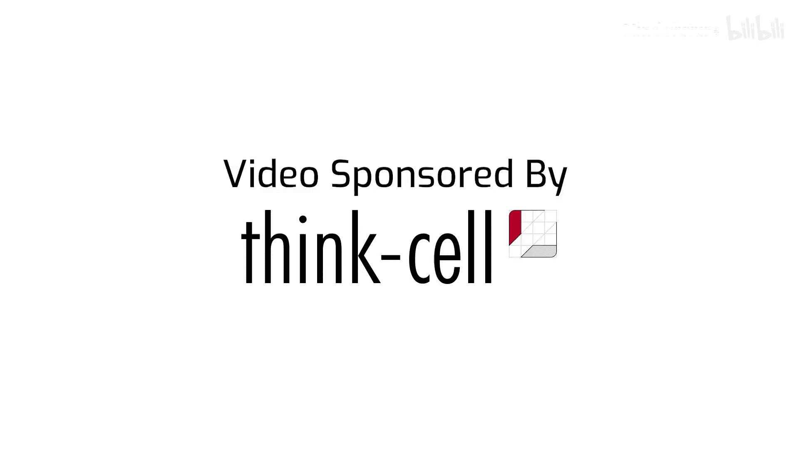
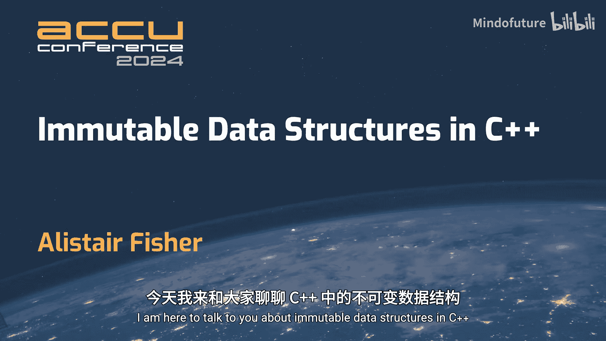
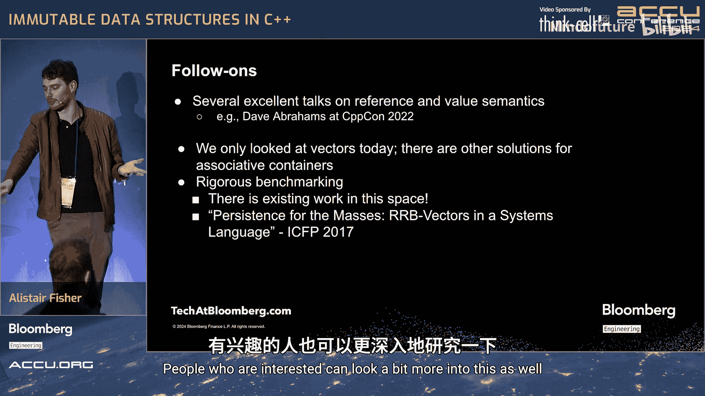

# 中英-•-C++和C语言ACCU大会2024｜人工智能｜架构｜函数编程｜静态分析｜安全｜编译器｜开发者｜垃圾回收｜链接器｜代码生成｜cmake-p29-P31-Immutable-Data-Structures-in-C++---Alistair-Fisher--BV1pNotYYELk_p29-

Hi everyone， My name is Alistair。 I am here talk to you about immutable data structures in C plus plus。

 before I start who's enjoying A CU this year。😊。

Electric， cool。 I am aware， of course， it is 4 o'clock。 You've been in three talks already today。

 Some of you are probably thinking about the bar。 Some of you thinking about the lightning talks are try and keep it a little bit relaxed and a little bit kind of lighthearted。

 If you have any questions， feel free to interrupt me。 It's fine。

 We're all friends here no hard ones， please。😊，The other thing， there are code。

 that's code on the slides。 It's why I like to call presentational code。

 That's a euphemism for a few things。 Firstly， it's all gone through a compiler at some point。

 That point maybe a bit of time ago， maybe got broken during the slides creation process。

Sometimes happens。 It's also going to be deliberately illustrational。

 It means I will be a little bit verbose in places like illustrate the concepts。

 Some code is deliberately how to put it。Bad in places to illustrate some of the concepts。

 please don't judge me too critically for it。Before I go into the material。

 just a quick self introductiontro， I am a software engineer team leader at Bloomberg LP。

 I work in a group called Mars。 Mars stands for multi risk system。

 It's basically Bloomberg's large scale enterprise risk solution。

 So we process on the order of 12 billion calculations every day across mostla classes as the name kind of suggests And what does one of many teams doing interesting work at Bloomberg。

 So if you want to hear more about it。 We've got a thief outside of our booth。

 feel free to talk to me or any any of the other Bloomberg engineers about what life is like at Bloomberg。

😊，Another quick kind of， I guess note about the talk before I get into it。

I find tech talks tend to fall into about four categories， usually。

 The first category are tech talks， which are really applicable。

 You go home and you start using them straight away。 I think， for example。

 if you've never seen standard ranges before， you go home tonight and you can start applying them immediately。

The second category of the tech talks were perhaps it's not immediately applicable。

 You imagine not many of it are probably working in C+ 23 nowadays。But you can see it's a horizon。

 And you can see in two or three years， able Jesus knowledge。

 and it's very clear how it will be helpful for you。

The third category are the ones where you go along and think， that's quite interesting。

 but I'm not sure I's ever going to apply to my actual life day to day。But maybe in six months time。

 you have a novel problem。 they come along。 And you think， actually。

 that tech talk from six months ago is the perfect solution or it is a solution。

 And it helps you gonna see things in a novel way。😊。

And then just for completeness the fourth kind of tech talk。

 the ones where you never find them useful at all。 I hope I'm not about to give one of those。

 but you never know。 if I'm honest， this is probably going to fall into the third category。

 while the thing that I'm looking at today are certainly real problems facing the languages。

 the solutions are a little bit more blue sky thinking。 though where。

 I think one of the future directors may end up being some of the problems we face today。

 you may not be able to go home and apply these tomorrow。

 But I think hopefully you will think at some point when you face some kind of no problem。😊，Cool。

 somability， imutability， typically something associated with functional programming languages。😊。

I think we've been saying for a long time。 T+ plus is becoming more and more functional as the years go by。

 Who's heard this kind of phrase。 know C plus is more of a functional language nowadays。It's true。

 because if you look at the last 20 years。So you're plus 97。High level functions in the S T， L。

 lifting， all this algorithmic stuff。 being more associated with functional programming。

11 lambmbda's anonymous functions， probably the most typical functional feature。

 We've got that one now。17 algebra data types， Op andvari。 Yes， they've been with us for。

50 years in the form of unions， but。In this kind of more modern format， a pretty new feature。Rangers。

 and see plus 20。 if you saw my talk last year， I was comparing the standard ranges to functions and mon as and functional programming。

 And certainly there is some inspiration there from the kind of classic functional world onto this new feature。

😊，And then finally， C plus 23 introduces Montic operators for optional。 And interestingly。

 we're not even scared of the M word anymore。 The artist called Monads in the documentation。

 So we've come a very long way。😊，So from some point of view， you know。

 we're basically there we have all these cool new functional features。From another point of view。

 we're actually nowhere near。😡，The kind of key tenet of functional programming， really。

 is not around cool， cool sugar like landers。It's about data， so。In a functional language。

 it's a pure one like Ha school。 you're not allowed to mutate data。 It's just not how it works。

 The same way when you do some math home work， you don't start mutating the variables in your math home work。

In functional programming， data is immutable。😡，We don't live in that world。 We love mutation。

 our C plus plus code。 That's what makes us。 makes us who we are， right。

 We mutate our vectors all the time。And I'm not here to preach and say。

 we should all become like Haskell。 This is not ICFP。 We are C plus developers。

 What Im to talk about instead is there are other ways of solving problems。 and actually。

 sometimes from the stuff from the functional world does help with some of the real challenges C+ is facing today。

😊，So let's look at the agenda quickly。 So I'm going to start talking about value and reference semantics。

 something a bit more in the kind of real world of C plus plus。

Then I'm gonna look at mutual data structures from a different perspective and see how those two things relate to each other。

Then we'll look at implementations。 How hard can it be to do this functional stuff in the real world。

And then it turn out actually quite hard。 And we'll look at some of the kind of more modern ideas from modern functional languages。

So， reference and value semantics。A bit of a kind of， I guess， broad broad definition。

I think the first thing that comes to mind is C plus developers is quite simple， right。

 If it's gone Ampersan， it's got more than one aman， it's probably some kind of reference。

If it's not going to understand it must be a value， right， It's pretty straightforward。

 So you need to1 minutes to talk about this。This is not actually a terrible intuition。

 but it's not quite the definition I'm gonna be using today。

 So I'm gonna be using something from a talk as peak on 2022， given by Dave Abraham。

 to gave a more generic definition of reference reference and value semantics to be used cross language。

 not just C plus plus。So according to Dave， value of semantics basically is based on two properties。

The first property is to have value of semantics。 When you write to a variable。

 you don't impact any of the other variables。When you have a variable。

 it also cannot be impacted by rights to other variables。

 If you have a variable that satisfies these two properties， you have value semantics。

This is a slightly narrow definition。 I'm not really talking about ownership。

 which is more of a C plus plus concept。 I'm putting that to the cpherphon now。

 I'll come back to a bit later。 But for now， we're going use this as our definition of value semantics。

One way that is sometimes treated is I thought I forget to give the。

 I think it might be be honorna saying， do what the ints do， right， The way you can think about this。

 if you've got two ins right into one in can't influence the other in， right。

 They just not They just don't work that way， right， They're independent of each other。

 And that's one way of looking at this。But let's look at some other examples。

So I've got two functions here。 They called increment。 They are very， very similar。

 They take in an int either by value or reference。 They increment it， and then they return it。

 So really， it's only one character of difference， right， Who prefers the code on the left。

Who prefers the code on the right？Good as I was hoping for。

 Why do people prefer code on the left and should shout something out。You know what happens exactly。

 So I can read this function， and I can see exactly what it's gonna do if I want to。

 I can quite safely just rewrite it。 I don't know why I'd want to。 But I could do plus。

 plus I and if I plus， plus， I could do some other crazy stuff。 And it would， you know。

 basically be quite safe。 I know what the input is I know what the output。

 As long as I can preserve that。 I'm more or less okay。😊，If I'm looking at a 3000 line file。

 I've got this set decement on the right， and this is incrementing a reference。

I don't know why it's doing that。 I don't know what the impact of it is。 If I change this to。

 you know， taken by value and remove that side condition。Why。

 what what what what's going to happen is no idea， right。

 And this is kind one of the really core differences between value and reference antics。Typically。

 with value semantics， the code is very localized。 You can more or less read what's happening without really thinking too hard with reference semantics。

 You have these very remote effects where you're implementing the other side of the program。

As suddenly， you have to read the code very， very carefully and be very， think quite hard。

Before making any changes， because you may blow up something you've never even seen before。So。

 this is。Arguably a disadvantage， and it's called remote remote action。

 There are a few other kind of disadvantages you run into with reference semantics。

 which you might not do with value semantics。The first one I can keep this slide up， actually。

With these two versions of increment， if you have the right hand function。

 you actually don't know if I is valid or not。 You could your cooler could just written a bug in their code and just pass you a null dangling reference。

 And your function is gonna blow itself up。 And I thought really anything can do about that， right。

 You're basically completely in the hands of your cooler to manage the memory for you and give you a valid input with a left hand side。

 that's probably something like you know， they give you in which can't be incremented or something。

 But by and large， it's much harder to run into an invalid input because how hard is it gonna be to pass in。

That's one of the disadvantages。Another ones slightly more involved。

 So I've got this function on the screen。 I give you a few seconds to read it。

 What I's trying to do is append one vector to another vector。

 So you have one vector could append from。 We're gonna it it over it。

 We're going pass everything on to append to。 And we're just gonna， you know。

 write out the sizes of aend from4 and after just to be safe。😊，So a pen from。

 you can imagine the as size of pen from at the start of the function is 4。For some reason。

 I've just decided to write it out。 Obviously， the size I pen from can't change， right。

 because it's a constant reference。 It must stay constant for the length of the function right。

 So it's gonna be four at the end as well， except。It's not。 Well， How is that possible。

 is is there a bug in the compiler， It doesn't make sense。 How How has my append from got bigger。

 even though it's a con reference that that shouldn't be allowed。

And the reason is because the coolers are something slightly unusual， and they've passed back twice。

Honestly， does that look like a bug from the cool site。

 Maybe if you know what the implementation is doing behind the scenes， but actually。

It looks more or less reasonable。 I'm gonna to pen the same vector to itself twice。

 seemss more or less O。The code on the left actually will work in this situation because it's written in a very particular way。

 So your output will be produced， and it will be 1，2，3，4，1，2，3，4。 So it will work more or less。

 as you'd expected to。 There's no bug on the screen， but it is a little bit surprising。But。

Who would actually write that for loop like that in real code to people typically， you know。

Right index based for loops nowadays。 Is that a thing we do。 No， it's bad practice， right， so。

A few things that can go wrong。 So firstly， even if I write the code like this。

 So rather than precaching size beforehand， I'm going to continuously， you know。

 query size each time in the full loop。This code is more simple。You， is look crazy。

What's going to happen？It's going to run for a very long time。 Yeah， does that， that。

 Does that look like a bug if you， if you're reading it for the first time。Really， right。

 I think if you're an amazing code of view， you might spot it。 But actually。

 that's that's a pretty innocent looking code。😊，But also， as I was saying。

 we don't do index based for loops。 They， very 7s right。 we don't do that anymore。

 This is what you' probably end up writing nowadays。It's nice Os very， very innocent looking code。

 Nothing can go wrong here， right， Are you run it。It's probably actually undeed behavior， right。

 because he is going to get him validated at some point。Very innocent looking code。

 referenceerence themantis can put it into very， very scary places。

But this is a bit of a toy example。 I've actually never seen this happen in real K different models。

 It's quite a fun thing to look at。 It's a very difficult bug to spot。

 but not something I've run into in the real world。😊。

The next bug is something we've run into in practice。 and it has actually caused us， know。

 some actual production issues。 So let's look at this function I've got next。

This function is called count evens。 It does what you'd expect。

 It has a predicate deciding if the number is even or not。

 And then just iterates over its input vector and。Counts a number of even numbers。

 I think in practice， you might stood counter because' be a little bit more brief。

 But for the sake of illustration， I written out the full loop in full。

Can anyone see any bugs in this code？I hope there's none。 So that should be okay。 So you can imagine。

 you know， I've been working at my desk。 I've got this beautiful function to count the number of ints。

 even numbers in my a vector。😊，You know， I go through。 I do my unit testing。 It's all beautiful。

 I go to Beta。 There's no problem at all。And then I go to production and it was all happy。😊。

And then a week later。My boss comes to my desk and says， hey， your count even functions crashed。

And I'm very confused by this because my unit test still passed。 and there's no obvious bugs in it。

And I'm thinking。Well， you know， maybe there's a problem with， with the input reference。

 Maybe it's a lifetime issue。 Maybe this once past me a no reference。

 So I look at the code for a bit。 I can't really find anything the crash stops happening。

 I think maybe some cosmic radiation just flip my reference to no， I don't know。

 I'm gonna forget about this。 And I move on with my life。 It's a one off crash。

And then it happens again， a week later。And my boss is okay， no， this is not a one off crash now。

 You've got to go and fix it。And I spend a long time looking at this function。 I think。

 how can this function crash？ no There's no obvious problem with it。 What What's going on。

And so I asked a senior developer in my team。 And he says those very scary words。

 What are the other threads doing， What are the threads， What are they。

And so I spent another week to bug in the program。 And it is that there's another thread also running at the same time as mine。

😊，And for simplification， it looks like this。It's pushing back into a vector。 And that's my vector。

 It's got my vector and is pushing back into it。Can then people see what the problem might be now？

Is what？Exactly， yes， if I get unly with， even when I don't get unly。

I's going to invalid the iterator。And then this program is going to crash。

Good luck finding that in a unit test。So this is something we ran into an actual production code and they caused some minor issues because we had some。

 insafe access to shared data。So this is basically a classic race condition。

 And sure you can catch if you're very， very clever at code of view time。 Most likely。

 it's gonna blow you up in production once and twice。

 Then you'll come up with somewhere fixing it with a lock or something。So。😊，You know。

 not great and something very unique to reference romanticman。

 sharing code across multiple multiple places at the same time。So there is an easy solution to this。

 you just use。Value semantics。 So now Im going to take my vector by value。And now。

 no one else can touch my vectors is mine。 I have the only copy of it。 It's private to me。

 and no threat can hurt me。 And to be reasonable。Provided you pass by value all the way。

My my crash is now fixed right。 I cannot crash inside。My account even function。

He thinks this is a good idea。😀Ha。😊，Yes， there is a small downside in that now。

My count evens function used to be。Was linear linear in time。

 but at least constant in space where I didn't have a space requirement。 Suddenly， I'm。

 I've got a linear space requirement to count the number of even numbers。

For a pretty innoccularous looking， you know， function。That's not really very good， right。

 I think while value semantics clearly does fix the issues we had。

We can't go around passing things pay by value everywhere because we don pay a lot more costs。

And for completion， it also fixes my issue with a pen from as well。

 if I pass a pen from by value and keep passing a pen to by reference， that's fine。

 now I'm no longer going to be updating a pen from while I'm also pulling from it and the code will were completely fine。

 But again， is it reasonable to be passing these things around by value at high cost just to avoid these problems。

Probably not right。 Val semantics may solve some problems， but。We're writing C plus for a reason。

 We' be copying every single vector we're dealing with。And so in practice。

 I imagine most of us are working with coding standards where we have something like if you have these user defined classes or data structures passing by reference to save time。

 and primitive types is O to pass by value。So。There's there's a partial solution here， But clearly。

 we have some kind of performance button that keeping us from going all the way。 Does sum up so far。

Reference semantics where we normally do things。 There are quite a lot of downss。

 This action of distance is confusing。 You have lifetime issues。 You have aliasing issues。

 You have race conditions。But wild value semantics may fix all of those things。

You have a real problem with heavy objects， if you go copying objects everywhere。

You're basically defeating the point of using C++ in the first place， right。

So I'm going to pause this here for now。 The big takeaway really is。

We would like to be using value semantic to solve the problems above， But in the current state of C。

 we can't always justify for heavy object classes。So taking a， a slight diversion。

 I want talk about imutability now。So I think we have some intuition in what intermutability is。

 for it' the constant thing right How can， how hard can it be is thing that can't change。

C plus is slightly confusing because it has slightly different use of comps through other other things。

 But by and large， it's fairly simple because comps can't change， right。

I'm going to look at mututability from a slightly different point of view。

 I'm going to look at it from the point of view of value and reference mantics。

 So just to recap the earlier slide。Value semantics require two properties。 Number one。

 writing a variable does not impact other variables。 Number two。

 the variable is not impacted by rights to other variables。And I look at some code。😊。

So I've got a vector。 I'm going to call it my V。 and I've got four references to my vector。

All of these things are consed， so my visual vector is consed。And。All my references are also coned。

So I think quite clearly， we can see the vector probably has value semantic for its a value。

 It can't be impacted by other variables， right。The slightly more interesting argument you can make。

What semantics do the references have。I mean， clearly。

 the references can't be written to because I can't。 therefore， they can't inbed other variables。

 But in this world， they're also not impacted by rights to other variables， Right。

 These references actually do have value semantics， at least in in in my， in my interpretation。

There is here， as always C。 there is a caveat。 If I take my V and I concast it away and I modifying it。

 of course， I lose my value semantics and all the references。

 but what the hand wave that away and say， concast are bad and you shouldn't do them。

But this is quite interesting， right， What I was talking about value semantics before for heavy objects。

 The disadvantage was that， the copies that killed you， right。But these references have。

Value semantics。 I get the benefits of all the safety without paying the heavy， the heavy cost。

But there's always a but， right， So these quantums references do， I think。

 have values have value semantics。Do these cons references have value semantics。No。

 because they can be updated by and changed to my V。The painful thing about C plus plus is。

If you're consuming a reference， do you know， do you know whether it's this kind of reference。

 a reference to a conve or it's this kind of reference， a reference to a noncon vector， you do not。

 And that's when the confusion with constant C plus plus。

 You don't actually know exactly how constant you are。 if that makes sense。

 You don't know if you've got your constant constantst or constant nonconst。

 which is a little bit annoying， right。So this when start going into slightly more creative thinking。

 What if I。Cheated a little bit。 What if I defined a new vector。

 And I just deleted all the noncons operations， And therefore。

 I know it's cons because it doesn't have any noncons operations in the first place。

So I'm gonna to have a new class， and I'm going to call it cons vector。

 And I'm there's a delete load of stuff。 So no assignment， no updates。

 What can I really do with that。 I can， you know， I can check the size。

 and I can look at the elements。 And that's basically it， and to be honest。😊。

It doesn't matter if it's con or long cons because it effectively is always con。

 You can't change it unless you start doing some weird memory manipulation， so。

I've got a class called con Victorctor。 I can use it as my basis。

 and I can pass cons for reference everywhere。 I've got， I've got。Valleymands， cool。

What's the butt here？The challenge is， you can't do very much with this thing， right。

 All you can really do is。Check the size and check the elements。Of course。

 you can't update it because that would be a noncon operation。But typically。

 with this kind of functional data structure， you have the ability to add elements by a pushback。

 And it looks at it differently the pushback we're familiar too。 Let's have a look at it。So。sorry。

Which one did I miss。不许。W which one。Which one you want？Yes。You are， you are correct， Jeff。Yes。Yeah。

 and I， I left the I left the non concenturators in because I couldn't find a nice way to strike them off。

 But you are， you are right。 I was a little bit clunky。是兵的。Is which one。Data， yeah。Very is。 Oh。

 you're right。 Yeah， sorry， I should have been be more careful with my strike food。 You are right。

 So yes。Take the criticism， imagine everything noncon stroke and I've takenricken off。嗯。

So often these cons data structures produce have some kind of operator like this。

 which is cool we'll call pushback for consistency。 As I mentioned。

 you're not allowed to actually modify the actual data structure itself。 So typically。

 what this operation will do is take your existing value。

 add one more value and then give you a new data structure with the new value， right。

 This is pretty common and functional languages。 know。

 you got your camerals and your hasasks of the world。

 They will have this kind of append operator or that wrong word。

 cons operator pushback operator where it will just add one element and give you a new data structure。

 right。What is the complexity of that pushback operation。It's not good。

 I tell you that that's a linear time update， right。 So if I want to get a new data structure。

 just I've got 1，2，3，45， I'm1，1，3，4，5，6。 that's a linear time operation。 that is extremely expensive。

 The whole point of this is super plus to be fast， right， is I'm introducing a new data structure。

 I want O N time and space to push back onto it。 I've got a bit of a problem there， right。

 And that does while is a step in the right direction。 It does kind of poo poo the idea a little bit。

😊，But I was saying a second ago， this pushback isn't some crazy thing I've just invented just now。 I。

 partly is。 but it's also something I've taken from other languages。 So as I mentioned。

 the list structures in say， a camel or Haskell will also have this kind of operation of。

 I've got a data structure。 I want to add one more element and get a new data structure。😊。

Or all the functional programme is running down round with linear time updates。

 Actually maybe they are who knows。But probably not。 So let's。

 let's have a look at some different languages。This is the only slide in the entire presentation of a different pro language。

 I'll go through it slowly in case we not really familiar with a Caml。

 but hopefully it's fairly straightforward。 So this is a three liner camel program。

 Line 1 is defining a list object。 So in a camel， this kind of square bracket is a list literal。

 And for whatever reason， they've chosen semicoal there a list separ rather than comma。

 So list A is a list of values 1，2，3。😊，Online  too， I'm going to define a new list。Called Li speed。

 And this kind of double colons thing you can think of as effectively a push front。

 So what it's doing is gonna create a new list of value 0，1，2，3。And then just for completion。

 I'm going to append the two lists together。The interesting thing about a camel and other functional programming languages。

 Data structures are always immutable。 List A is 1，2，3。 List A will always be 1，2。

3 until the end of the universe。 or at least till you turn your computer off。 It will be 1，2，3。😊。

No matter what you do to other variables。It will always be one， two， three。

 so an interesting thing is that。😡，A can was a bit of a special case。

 It has some reference semantics， but for most functional languages。Everything is value semantic。

 So think a functional program I may have found the first 15 minutes very confusing because why have you even been messing around with us in the first place You use value semantics everywhere。

 So lists Day is always not is always 1，2，3。 and Lis B is 0，1，2，3， and dependent together。

 you should get 1，2，3，0，1，2，3， and show the output quickly。 This is what we get， right。

 So you have 1，2，3。 You have 0，1，2，3。 and you have 1，2，3，0，1，2，3。

 So this is hopefully a fairly simple program。😊，What I'm really interested here is not the kind of simple code itself。

 But what the language is doing behind the scenes。 So let's look start looking into at least the imaginary version of the programs of memory。

 So this green thing is list A。 It's 1，2，3。😊，What's Li B gonna to look like。

 Li Li B is an independent variable with values 0，1，2，3。If we do it naively。

 we're going end up with that， right， It is gonna to be a completely different data structure。

Linear time to create， Line memory to create。 I have to basically redo the whole thing。

 and my push front。Has has linear complexity。But functional programmers are clever people。

 and they're going to exploit what I just told you， list A is 1，2，3。

 and list A is always going to be 1，2，3。So I've got a 1，2，3 in list B。

 I don't need to go away and make a brand new 1，2，3 for myself。 I've already got one。

 So functional program is a sneaky， and they will optimize by reusing list A as part of list B。

 This is effectively structural sharing。 So list A is the green 1， list B is the yellow bit plus1，2。

3 And I've got two complete independent list from the point of view of the programmer。

 behind the scenes。 I've effectively got one list with four elements， right， This is pretty cool。

 So I think often when we think about。😊，Mutability， we think speed and performance， but actually。

 sometimes you can exploit a mutability to save yourself time and memory。

 But I think is quite quite neat。😊，So。Ls seem to be the answer to our problem。

 Maybe we should use lists everywhere in our code instead， instead of vectors。

 who likes the idea of that。Then thin things say。What was wrong with lists？Sorry。Yes， well。

 among many other things， yes so。Liinnk lists have many problems。 Obviously， as you mentioned。

 cacheicality is very bad。 You're doing all these hops around your memory。

 Your element access is very slow。 You have linear time to access things in the middle of the array or sorry in the middle of the list。

😊，And， yeah， I mean， thoses gonna get it smoked by C plus vectors in most circumstances。

 So to quickly summarize， I have my cons vector with O of N time space updates Pret bad。

 My list has O of one updates， but it's got O of N element access。 and also even that aside。😊。

While push back and adding to a list of both O1 operations。Freine Ve list。

The vector is going to be much faster， purely because of the memory locality。

 So it's a more perform data structure。 So we get part of the way there。 But unfortunately。

 we're still not quite where we want to be。 We slam got a perform comps data structure。

So let's think where we are so far。 Firstly， con structures are very hard to write performly。

 There are a lot of challenges。 We tried twice， and we've kind of failed。

Structural structural sharing is a technique used by functional languages to optimize。

 It can make things faster。 It's pretty cool。 It didn't help us too much here。

 but it's important to bear in mind。😊，And the big thing， arrays beat linked lists。So。A few years ago。

 this is probably at the end of the presentation。 we say it's pretty cool。 You know。

 we get some of the way there， but the technology has not yet exist to get us to the future。

 It's like exaggeration。 But I want to introduce one more data structure， which。

 while it is not perfect， takes us a lot closer to where we want to be。😊。

And it's called a persistent vector。 This is something which was introduced into modern functional programming in the early 2010s。

I couldn't find a very clear sourcecing line for the very first originator。

 but certainly it introduced to closure in Sc in the early 2010s and really was written to keep the parameters of functional programming。

 value semantics immutable data structures without burning yourself to pieces on performance。

 having some kind of competition with what Cus plus another language can give you with mutability。😊。

So it looks a bit like this。You move a few questions。 Firstly， that is a tree， not a vector。

 What's this guy talking about。 And secondly。It looks pretty slug。 What is in direction in here。

 what's going on。 So let's look at it in a little bit more detail。 So what are we looking at。

 So you are right， This is a tree， but it's also a vector。 So your elements。

 your vector are on the bottom here。 And you have a header pointing to the root。

 and then your elements are vector laid out in a tree structure。 So this is a vector of length 7。😊。

All of these boxes are fixed size arrays。 So I start from the top one， which is the header。

 you defined some branching factor at the start of your data structure。For this1， I've chosen4。

 mostly because 4 is nice to fill on the slides and press use a much bigger number。

And you basically go down the tree in order to find the elements you want to find。 So first question。

 how do I actually find an element in this tree。So let's say I want to find the fifth element。

Unfortunately，0 indexing is very nice for many things， but not for this。

 It's very confusing in this situation。 So the fifth element is this guy number 6。

 which is very confusing。 This is element 0。 That number， number 5 is the sixth1。

 So how do I find the fifth element。😊，So it's actually pretty cool。

 You use base conversion to figure it out。This tree has a branching factor of four。

And so what I do is I convert 5 into base 4。 And I get this number looks awfully like 11。

 I'm not gonna to call it 1 because that's confusing。 but I have this 1，1， which is 5 in base 4。

 And then to get to my element， I just traverse the tree， right， So I get to the first1。

 I pick the one， This is confusing。 The one element， which is number two， which is confusing。

 And then again， you pick the second one again。 So you can traverse the tree in this way。

 And by using the index of the。😊，Of the you're looking for， you just go down the tree。 This is。

 I'm gonna pronounce this wrong。 This is like a try T R， T R I。e。 structure。

 So this things also sometimes could vector try。I would use a bigger one just to prove that wasn't luck。

 So this is a three tier tree。It's in theory has a capacity for 64 elements。

 Some of them are off the side of the screen because I ran out of space。

 So You have to use your imagination a bit。 So I want to find the 38th element of this tree。

 And I'm gonna do a base conversion to， to base 4。😊，In base 4，38 is this thing that looks like 212。

 which I'm not gonna call 212。 And then I go over here。 I say， okay， I want the third element。

Then I want the second element， number one， then I want the third element again。

 And my 38th element is a three。You can count them out if you really want to。 You can just trust me。

 That is， that is the correct answer， so。That's quite cool。 guess that's quite an neat algorithm。

What's the complexity of looking at an element in this vector。Log N。 Yeah， that's pretty cool。

 So probably nothing mind blowing there， looking something up in a tree as log N。

This is where the the slightly creative maths comes in。 So I apologize， but it is important。 So logs。

 I we know what logs are。 They're quite， quite quite relevant。 No the logs you put in yourha drive。

 the log rhythms。So on this data structure， many of the operations are logarithmic in the branching factor。

Typically， the implementation thing is a branching factor of 32。

Log based 32 is often not a very big number， so。Loug based 32 a billion is about 5。

Lg based 32 of a trillion is about 8。😡，So you can be a little bit naughty here。 And you can say。

 actually。It's Lo based 32。The biggest is ever going to be is about 20 right。 you even just say， hey。

It's cons。This is a little bit informal， and it's a little bit cheating。

 but this is kind of the kind of fundamental here is that a lot of your operations actually effectively have comps complexity。

But it is constant with a big overhead。 It's not constants way， you know。

 pulling back to a vector is very， very cheap。 It's a big con。But when you have， you know。

 a trillion things in your vector， you've all got much bigger problems。 But having， you know。

8 operations to do is not not so bad。So。I have updated it to be O of one time and O O of one time for those of the。

 the O of one is an italic to， you know， mention this a study creative use of O of one。

 But in theory， you have O of one time。That's kind of me。 But， you know。

 adding things to a tree or looking at things in a tree at log n， No no one's mind is blown。

 saying log B 32 of n is one a bit cheeky。 but no one's mind should be blown by this。

Let's look at the actually cool thing。So I want to push back onto this tree。

 I've got a thing of 7 elements。 I want to push a 10 back onto it。And afterwards。

 my tree is going to look like this， right， So I've another about a size of 8， not 7。

 And I've got a 10 on the end。What， whats it going to cost me， I mean， if I wantt to。

 I can just copy out this entire structure， and then。It's linear like I was in the first place。

 probably slower because all this indirect and stuff。But we can reuse what we learned earlier。

We're not going to do a naive copy， we're not going to be over。We're going to use structural sharing。

 That red looks really bad at the back。 I apologize。 It looks much clearer on my screen。

 Can everyone see it at the back， O。Okay， so rather than copying my entire vector， I can say。

 actually。Between my first vector and my second vector。Most ofs actually the same。 So on this slide。

 the blue vector is the original vector and the red vector is a new vector。

 and the green vector can be shared。So when I build my new vector。

 all I've actually got to do is update three of the three of the boxes。

 whereas previous I was copying all all six of them。 So I'm getting some some optimization here。

 And I'm just sharing things between my old vector and my new vector。😊。

For if small vectors is still very expensive， because you have copied an awful lot of things。

 when you have thousands of things in the vector and you're copying on the order of 4 or  five arrays of size 4 of。

 you know， it's much better。And again。It comes to the cheeky， the cheeky question。

 what's the complexity of this operation。So you're only going to operate in the height of the tree。

 which means you're going to be log n again。😡，It's an expensive login because you're doing a lot of copying。

 but it is log N。 And as we've learned today， log N is one。😊。

So this thing is just as fast as a st vector。😊，😀So。😊，I slightly creative my math here。

This is unfortunately a very disappointing part of the presentation。 Unfortunately。

 I didn't have time beforehand to get all the benchmarks together in order。

 I've only got some very rough estimates， rather than many proper graphs。

Is this thing as fast as a do you think， no。But it's not as slow as you think it would be。

 I think there has been some more detailed research into this。 It's not going get back the st vector。

 But for some， for some use cases， you are going to get pretty okay performance， right。

 It's gonna be better than the list。 It's gonna be okay， right， There are this in my often。

 as I'll mention a bit more。 So it gets you some of the way there， right。

But I think this gonna illustrate it's kind of the real， the real question。

With some very creative thinking， we can have this kind of constant data structure。

 It gives us good value semantics。But the stood vector is， you know， basically unbeatable， right。

 And at some point， you have to say， actually。Do I want value semantics or do I want speed。

 And as a trade off， every developers got to make for their own for their own thing， right。

 I think one thing I've learned in my career， there usually isn't a perfect solution for both speed and safety。

 And I think what we be looking at here in theory， gives you more safety around race conditions。😊。

But you are looking at it in the context of。D performance。 Well let's be open about it。

So two weeks and conclusions then。We live in a multithreaded and multi core world。

 This is going to be the case， probably with the rest of our careers。

 And something very seismic changes。 We're maybe using a language from the 70s and 80s。

 but we live in a multithed world。In that world。The reference man C plus， not always super friendly。

 They have downsides。 There's all these kind of dodgy things。

 and they're extremely prone to race conditions。Often， there are many presentations saying。

 reference semantics are bad。 You should use value semantics and it solves all the problems。

 And it kind of does， right， Many of the problems we have worse off by value semantics。

It induces a whole lot of other problems around performance instead。

 So there isn't a perfect answer here。As of today， the data structures of native B and C+ in particular。

Don't work， particularly with semantics。 Coing vectors is extremely expensive and cumbersome。

Passing vectors by reference or by value。 Sure， it helps you with the erase conditions。

 Sure it helps you with aliasing。You have a lot of other problems on the side。

But there isn't a new problem。 Value semantics has been the default in functional languages forever。

 And yes， C+ is probably fast almost any functional language still。

 But they've come an awful long way。 and they've found new solutions for things。

 And it's persistent vector I've shown Sure it's not as fast as a real vector。 But it's pretty fast。

 It's come a long way。 And are this will move further and further。

 I think if we are going to use value semantics as as our actual solution to things。

 We should be looking into the other the work other languages are doing。

 And they could make things a little bit easier for us。😊，A few follow ones。

 If you are interested looking a bit bit further into this。

I schemed to a value of reference semantics very quickly at the start of this talk。

 There are much better talks on it out there。 In particular， Dave Abraham， does peak on 2022。

 give an excellent talk on value semantics and why he feels it's the answer many problems the language is facing。

 I'd recommend anyone who's interested to take a look at that one。😊，And I think it is， well， it'。

 it's still any a very useful tool to look at。I've deliberately focused on vectors to keep things narrow。

This isn't because vector is the only problem things have been solved for。

 but because're the most simple thing。 People looked at associative containers， maps， sets。

 etc cetera。 You can look at those as well。 to see where we are。And benchmarking， unfortunately。

 I didn't have time myself to get my own implementation quite up scratch。

 but there's a lot of existing work in this space。 in particular。

 there's a paper from ICFP 2017 about persistent data structures。

 I actually implemented entirely in C plus plus crazy rights。

 ICFP is the biggest functional programming language conference as someone presenteds the C plus paper。

 very brave。 and it did look at the benchmark around this。

 And with some additional performance optimizations。 Yes， it wasn't as fast as vector。

 but it was pretty now before many other kind of standard data structures。

 So there is already some some work in this space。 people were interested can a little bit more into this as well。

😊。

That takes us to the end of my presentation。 and any questions。

