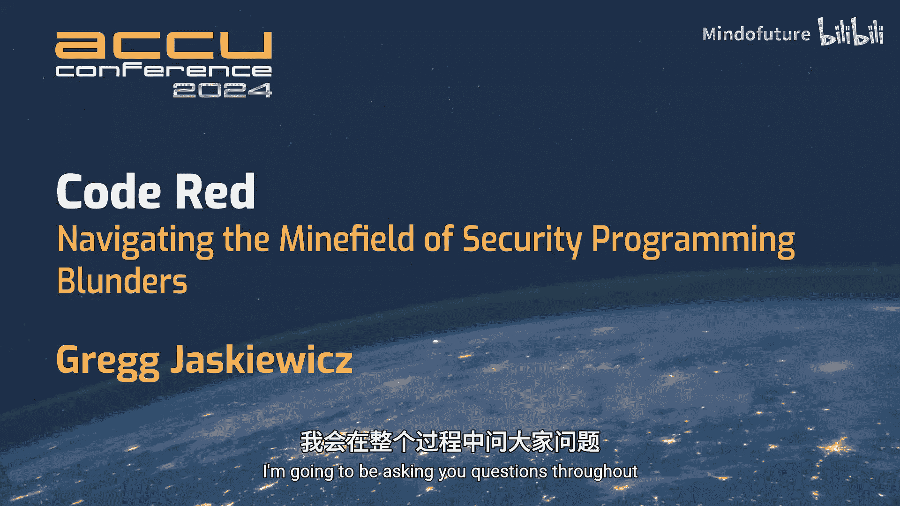
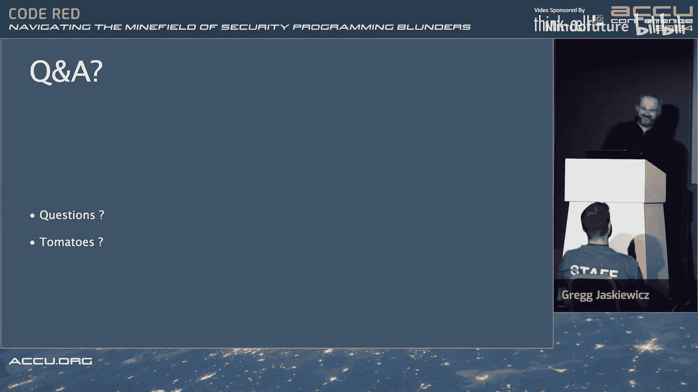

# 中英-•-C++和C语言ACCU大会2024｜人工智能｜架构｜函数编程｜静态分析｜安全｜编译器｜开发者｜垃圾回收｜链接器｜代码生成｜cmake-p30-P32-Code-Red---Navigating-the-Minefield-of-Security-Programming-Blunders---Gregg--BV1pNotYYELk_p30-

So welcome， everybody。I'm going to be asking you questions throughout so show of hands。

 who's ready to answer some questions or just。

Raise your hands。That should be everybody。Good， I can't see people in the back。

 There's not that many people in the back anyway。This light is blinding me， by the way。

 So if I look away， it's not because I'm。You know， trying to avoid you it's just。

 I can't see anything。 if I look at it too。Too much。 So my name is Greg。

You can pronounce my surname however you like Jessicaitz， Jessica Wooditz， Yashkich， Yashkich。

 depends on where you're from。I'm fine。 My wife can teach you how to pronounce this or can I as well。

So， I。Yeah， the talk is obviously called code red， you know。

 navigating the mine of security programming blunders。

 The there's not gonna be any code samples or or demos in this in this talk。 I'm afraid。

 I purposely kept it。Vanilla， I'm always kind of annoyed that the there isn't any emphasis on security at these conferences。

 And I was asked specifically to create a talk where I， you know。

Walk you through security as such so。好肥啊。That's okay with everybody。 So imagine yourself， you know。

 waking up or not waking up。 unless youll be drunk or something the， you know。

Half an hour till till the great whatever party。 And you get a call from your boss saying that there has been a brgt。

You need to fix it， right， or。This is obviously like an extreme example。

 But these calls happen at the wrong time。 You know， you get a colon the middle of the night or。

 or woes worse than that。 It both appears on the telly。

And it has to explain himself to a random journalist。 You know。

 why there's been an appvalanche of complaints or a warrior a company's secret data or a customer data has been leaked。

 which goes fun。 Not that I have a personal experience with this。

 but I've seen this happen so many times。 I thought I'll I'll start this talk by just kind of showing you what happens when the。

😊，嗯。When when that occurs。It doesn't usually go this dramatic。 This is like， you know。Very。

 very dramatic example， but。When customer data is lost， trust me， people go on nuts。So。

Let's just rewind first。I'm gonna， I'm gonna give you like an intro to， you know。

 why am I here and what am I going to be talking about just a bit about myself。嗯。So。😊。

If you're going to be playing with security because your're inspires， you know， after this talk。

Get a permission。 I have to say that。 Don't break random stuff that you don't have access to or whatever。

 It's not cool。I purposely put the other one。 The views are my own。 I， you know。

 I work for security companies， security vendor。But I'm not in in any way。

 associating this talk or whatever with them。 just have to make that clear for legal reasons。Sudly。

 and also， yeah， anyway， so I。You know， about 45，46 now。 And I've been programming， you know。

8 with computers starting with something called Atari 65 X Z， which。

Some of you might know what I was。 Some of you might be like a museum。But this was a， you know。

8 bit computer back in the late 80s and and 90s where you could actually， when you turn it on。

 you could just program it willially and。And save programs to to the the tape recorder or or or disk and see what's going on。

 And it was quite， quite friendly。 Let's just say for hacking。

 And as as somebody who used to have or what has still has prior like， you know。

 experience with electronics。😊，This was very enticing to me。 So when I was given a computer。

Think it was for birthday， whatever it was was I got very quickly bored with basic and and just started looking at the assembly and。

65，02 is a is a very， very friendly processor I I'm gonna reference it later。 So， you know， who。

 who's ever used 6502。 and， and he's at 80 funbo here。 I don't w， I don't want to start that war。So。

 yeah。I should have made these actually， like， you know， appear one by one。 Sorry apologies for that。

 So why， why am I talking So the。At some point， I got rid of thery， I， you know。I got myself a PC。嗯。

Had friends at something called demo scene。 I don't know if you people know what the demo scene is。

 but it's basically。Back in the 90s， at least when I was younger。

 it was a bunch of people gathering around and hacking on computers。

 It would usually be graphics or such。 just to kind of push the hardware to its limits。

 It's still done to these days。 you've got demo seen things。 And， you know。

 I've never wrote them on myself。 I've， I've written those of 3D engines and4 86es and whatever。

 That's， that's a different type of talk。 But that requires you to actually know the the underlying hardware and assembly very well to be able to optimize things。

And。As a sort of fun and game things， we。We used to write keygens for software。 Again， this was。

Back in the the country where I used to live in。 and in those days。

 it was actually illegal believe it on us。 was wasn't illegal， shall I say。

 But the I grew up in a poor family。 we would， you know， once a month， we would get a magazine。

 whatever PC magazine。 And there would be a C D with it with loads of shareware on it that I couldn't suddenlyly used because I didn't have the money to pay for it。

 And but I had loads of time。 And I had loads of skills。 and mum was feeding me。 So， you know。

 all good。 I was 15 or 16 or whatever。And one of one of these days， actually。

 one of those days people， somebody from the De scene， showed me a piece of software called soft ice。

 I don't know if people know what soft eye of what what ice ice is。 It's it's。

 it's stands for in circuit emulation。Basically， when youre on a test piece of hardware。And。

And you wna kind of debug your processor at a very， very low level。

 you take out your CPU or whatever， and you stick in a device that is basically bucked by another computer。

 And that allows you to emulate or step by step emulate。

The CPU or other piece of hardware these days， It's way more fancy because actually。

Inside its emulator was actually built into the microcontrols these days methods。Again。

 doesn't matter。 there's there's a piece of softer or there used to be。

 I don't know it still exists called soft ice。And it basically allowed you to stop windows at any point and debug it。

 So if you wanted， this was very useful for device drivers。嗯。And so if you wanted to， you know。

 I don't know， debug your。Network card or whatever device driver。

And you wanted to step by step debug it or or or other device driver that actually would load before the US properly launched。

 I don't know。 graphics card driver or whatever。 You wanted to be able to step by step debug issues in it。

 potentially And software was a software that actually allows you to do。

 I'm not affiliated with them。 And I was using a correct version。 So you know。It was 35 years ago。

 So I'm sorry or 30 years ago。 Anyway， we if we had to have another card in your computer called Hercules。

 I don't know if anybody remembers what a Hercules card was。 It a different monitor。

 It was like a black and white。Graphic cloud。 and you。

 you would see the the debugging console kind of like GDP in the previous talk but simplified on that monitor。

 and you could step by step everything。 So even if software was actually trying to circumvent debugging。

 You're literally just stopping the whole system。 The whole O would be stopped。

 and that will allow you to do funny things and crack software that wouldn't allow otherwise be easy to crack。

 So why am I telling you all this， because， you know， this has been。

My fascination with the the security has been like going back to when I was 15， basically。

 and I'm still very。Very。Not surprised， but like enthusiastic would be probably the best way to put it about security。

 So these days， obviously。We have it very easy。 We can just take a piece of software and disassemble it allowed using something called like Gira or other pieces of software。

That allow very， very easy decompilation and， and introspection。

 So you can actually see what's going on， but。I actually have a note here that says。

 don't talk too much about yourself。 And I just did。 I'm sorry。嗯。走。😡，W。Why am I giving this talk。

 Like I said， you know。This was my history， but I started working as a software engineer。

 and my focus has always been in the background。On security。

 And it always pains me when I work on features or stuff。

 and people don't take this serious this stuff seriously， because the。In security， there's。

 there's a saying that， you know， you can slip however many times you want。

 But the the hacker or the intruder only have to get lucky ones。

 So you have to be like on top of of the game， right， It can't just be like， okay， well。

 we've we've introduced this bug。 But we're gonna fix it in next version。

 Who cares that the you know，1 hundred and50 million user data have been stolen or， you know， leaked。

That obviously is not going be。Good with any anybody。So I'm not gonna be give so。

I'm not going to be giving any code examples， like I said， because。You've seen plenty of those。

 And I wanted to be broaded， basically。 so， you know。But if you have any questions throughout。

 if I say something and you're like， I mean。I'm interested in this， just shout out and I'll。

I'll let you know what the answer is。 I'm gonna be like。

 just Google it because it's all these things like I was just talking to Tim beforehand by the way。

 Tim here in the the front row。 I， I always find it irritating that security is like this mysterious。

 you know， thing。It's no。There's load of little， you know。

 things in security that are in themselves interesting。

 But I think this field is actually quite approachable if you。Read about it and think about it。

 You know， as you're developing a soft time， so。I'll be giving some links to some of the things that I'm gonna be talking about。

 I'll， I'll post the。This slides on the Discord afterwards。

 So you don't have to take the screenshots or whatever， you know。All these things are Googleable。

 Like I just， you know， I Googled us of these things because I don't remember all this。

 So the history， right， This is the。Again， going back to the 80s。

 this like something like viruses or vulnerabilities in the past when you had a PC running dose。

People this， this is like， this is funny to me。 I don't know about everybody else。

 but viruses used to be like things that people did as a challenge， right， You。

 dorsso or unx or O too or whatever。 And the， you found a way to prank your friends when they put it the the disc。

嗯。It would， you know， it would load the first sector and actually would load up a program or a piece of software into into the memory。

And a message would appear on a screen or everything would go， you know。

 inverted on the screen or whatever。 The it was， it was all about fun， excitement， You know。

 the the typical engineering， and engineering challenge， right。😊。

And it's I actually had to Google this up。 Maybe there's a prior version of this， but。

One example that I always remember is the there was a virus called brain。

 I't know if anybody remembers what that was。 but apparently it it originated in 1986。

And it was a IBM PC doss thing that was replacing a booth sector on the floppy disk。

 like I said with the with a copy of the virus。 And the whole point was to just show。

Like it was a demonstration of the possibilities。 right， This is what we can， we can prank people。

 We can have fun。 Actually， was， it was created by two people in Pakistan brothers。

And the message I'm think on the screen would just say， actually。

 I should have pulled it up and and showed this here。 But the。

 the message would just say this is just a demonstration。 And ha ha。

 And if you want us to remove this or help you， whether it just let us know。

 I don't know how because 1986。The people people didn't have emails or some people have emails。

 but I don't know， I don't know how it works。So， you know， it used to be fun。 It used to be exciting。

 It used to be just engineers， buddies， right。😊，Or， you know， it was all friendly。

As move on to the the present day， this is not gonna be as much fun。 It's a。

 it's a serious multi billionllion。Dollar industry。It's， it's， it's gruesome like the。

 And here we have a guy。This name is there on this， on the side if you wanna read it。

 Maxim Victor Vich Yakubit， I don't know what's his current whereabout But the。

 he was obviously wanted by FBII。 And this is him running around in Moscow somewhere。

And it's our age， just being silly and， you know， just being。

Where is the word that the police would use in this country， antisocial behavior， right。Of course。😊。

I'm sure with the amount of money that the guy has， he was able to do this。

 But this is just one example out of many。 And of course， you know。

 corruption in Russia and those sort of countries so rampant that he just got away with it。

 And I got this there's a longer video on the National Crime Agency YouTube if you wantanna watch that。

 if So don't why would you。 But know I thought I'll just give them credit because I saw that video once a couple years ago。

 and I was like， I remember that。 I I need to bring that up。 But the point is。These days。

 if you have money and you want to be malicious， you can literally pay somebody to target somebody and you don't even have to have any skills。

 This guy is actually a brilliant software engineer， as it turns out。

But he had a bit of a funny bone in his brain and decided to beer。To to use it for bad。

 basically instead of for good。 he was actually born in Ukraine。 and， but obviously。

 hes a resident of Russia。 Again， I don't know what the the current whereabouts of him。

These people get away with their crimes for very long because they live in countries where， you know。

 they can't be brought up to justice are they。The buddy buddy with the with the government or whatever I don't want to get into that。

 but you know it's a serious serious thing these days， sadly。

 that's why we have to care about this because again。

 people who are gonna target your systems or you know your employer systems。

 they're not going be do this for fun most of the time。So just just to， you know， further this， I。

I'm not quite sure how this is gonna play with the with the room or people than YouTube。

 but I have to actually say this because otherwise。

 I'll feel bad because it's like an elephant in the room sort of say crypto， right？

 It's a serious business because people can get away with the with paying for this and transferring money using crypto。

 That's essentially。What it is the just like， you know。Trading markets。

Gain company value gain value or lose value， depending on whatever real life things。Sadly， crypto is。

 in my opinion， this is just， again， my opinion。Proropped up while a lot of shady stuff。

 And hacking is one of them。 Like if you， if you get hacked and somebody is trying to extort money from。

 for you， like run somewhere way。They're going to ask you for money in Bitcoin or such。

 They're not going to ask you for check or or vouchers， right。So。Any questions？ I mean， I mean， I'm。

 I'm not trying to bring the room down。 I'm just， you know。Just have to mention that。

So I'm going give you two examples that actually。I actually put in the in in a description of the of the talk。

And they。对。Everybody should be aware them of them if you。

 you have to live under the rock to actually not know them about them。

 I think if you're in the industry in the software， like development industry。

 but they're gonna serve an example later on so， but。Just， you know， after this scary， scary stuff。

 I just w to say， like， security is still fun。 Like as an engineer。

 you can have loads of fun playing with security， testing stuff。 Again。

 I'm not gonna be bringing any code example because I think。😰，They're easily Google， and actually。

I don't have this in the notes。 But the， if you go。

 I was trying to prepare lots of things for this talk。

 And there isn't like an easy way to Google A C V E and。And then say， okay。

 well give me an example of the code that actually will close this because they're just very so much。

 And if you're trying to go actually through open source examples of。

security breaches that that happened to open source products。 Obviously。

 you can look up the the Gilog or whatever because it's usually on Github these days。

It would be quite a complex piece of codes that would narrow down to like couple of lines。

 but they will be spread apart。 it's not an easy presentation。 Its my point。

 So I thought I'll spare you。But it's still fun。 like， by all means， you know。

 give yourself a challenge and look up one of the Cs and an open source product and and see what happens because you'd be surprised how simple it is。

 Yet how much it can cause in the damage as。Who knows what Equifax B also heard about it or remembers it。

I， I wouldn't be able to tell you at the top of my head what the date were。

 so I've got some notes and I've written them down here。Hopefully， they're not wrong。 Again。

 there's like million sources of that data。 So， but the this is a funny one because。

This incident happened in March，2017。There was a A Apache Struts Java web observer。Vulnerability。

 which I'm going I'm going to go into more details again without any COVD examples later。

That was some。The this business， this is a massive bank in the US。They've ignored the S C E R T。

recommendationcommend to， to patch it for whatever reason， Or maybe they patch top of it。 Maybe they。

The， the people working in I T security were off， you know， maybe they didn't have procedures for it。

 Who knows， I'm sure there's a report somewhere that actually goes through the details。 Again。

 if you're， if you're running a big business or you work for a big business， I。

 I urge you to actually look at these things and actually bring up these things to your bosses and see whether you can improve your security stances because it's quite important。

 And this is a great example。 I think So yeah， what happened， basically。

Is the the vulnerability has been discovered in the Apache struts。Three days later， or so。

 somebody decided to scan the whole web to see who's running the Apache strs。

 And if they have that vulnerability on their service。 And these guys， obviously had。

 So somebody founded。Somebody managed to exploit it。

 And this is one of the ways you can be targeted if you don't patch in time。 The the。

 the hack has actually gained logging credentials for three servers， somehow they。Again。

 technical details would have that there will be a separate presentation on its own if I wanted to go into it。

 and one thing。Got the， you know， foot in the door。 so to speak。

 they were able to navigate the internal network。And they， this was all。

 this was all done via this portal service， which if you want to complain， basically。

 to your bang about stuff， apparently。They have service for that。 I don't know。

 I don't know I've never worked for a bank。 So I've no， I don't know， I don't know the。The。

 the normal way of doing this。 But the the， the crucial learning point here is that it's。

 it's quite important to， you know， not just。Actually。

 I'm going to get get to another point on this in a moment， sorry。So。Second， second。Issue。

 the internal traffic was encrypted， but the certificates that were verifying the validity of。

 you know， the encrypt the certificates expired。 So the。

 the the verification of the of them basically was disabled。 I don't know。 I don't know exactly。

 I couldn't find out exactly what happened， but。The point is。

 they were able to man in the middle themselves and decrypt more more traffic or inter sub more traffic and find out more logins inter or break into more server。

 And as a result of it， they got a lot of data out。😊，From that organization， in fact。I think， yeah。嗯。

Don't have it on the previous slide， sorry。Yeah， I did split these slides up in a sort of。

Cllumsy way they， they were able to get 140 million user user data。You use data accounts。

 information that makes sense from the that organization， which obviously cost them quite dearly。

Up to up to 20 k per person， so you can imagine。It's been， it's been an expensive exercise。嗯。

The probably underrrated by some insurance company。 So， you know， they didn't have to pay the money。

 The banks usually get away with these things。 but or maybe American taxpayer for paid for it。

 Who knows。 But the， the， the， the point is it wasn't just one breach。 the， the， the， the initial。

Vulnerability they've ignored and they haven't patched was just a little foothold in the。

That allowed them to gain access to the whole organization。 And they have other massive issues。

 e lapses in security procedures。 Who knows。 Again， banks are complicated。And data was lost。

 you know， and I'm sure there was load of like you don't get awarded 20000 of dollars sorry in damages if somebody just got your credit card number out。

 there has to be serious loss of money and， you know， time for this to happen。

 It's one of those examples where， you know。People forget。

 often that even if you have firewalls or whatever outside， your organization again。

 I'm going get back to that point in the future。If you， if you。

 if you allow allow things to kind of float internally without any restrictions。

 you still might have a massive problem just because you had one crack。 again。

 going back to the print previous saying， you know， they just have to get lucky ones。 and they did。

 and they did in this case。So。It I found this hilarious。You know， in。

 in the best kind of in a technical way is because。对呀。The。

 the original vulnerability was actually not in the code that was verifying the input。

 They've done all the verification and， you know， sanitization of the input correctly。

But if something went wrong， if they found that something didn't match whatever requirements。

 the code that actually was catching the exception， because this was in Java。

That code was vulnerable， which， you know， just goes to show you that you have to be pretty。

 you have to be pretty serious about how you handle exceptions as well。

 not just check for your inputs and sanitize your inputs。

 which you'd be surprised how many how many web services and other pieces of stuff that don't do that。

 And in this case was it was it's a quite complex。H TP sortr of standard for the for the large file uploads。

 it's， I don't fully understand it myself。 It's quite complex。

 Basically there's loads of things going on。 load of machinery to kind of allow you to send files in bits and I don't know。

Poイントで。Just be careful about how you sanitize your data and what do you do with that day with the。

In case it doesn't match， right， I the， the usual security guidance is basically unless the server is in debugging mode。

 like a development mode， Just disable it。 just so just。

Either don't return anything back so that the the TCP connection times out。Or just say。

Com remember my come believe that I can't remember my H TP return costs off top of my head。

 whatever the 403 security or un unauthorized， whatevers unauthorized。Something like that， whatever。

 one of the 4 hundreds， right， not404 because that's not found， but you can。

This is this is another thing。 You don't have to be truthful when something goes wrong with like sometimes it's just best to just say。

 nope。And that's it。Another one that is of， on a different spectrum。 so to speak。

 is a solar wind attack。 I don't know if you anybody remembers that。 This is more recent。

 This happened in late 2019。In September。A third party that's been working for solar winds was providing them pieces of of again。

 doesn't matter what they。Spificca we're not gonna， this， this is a close software。 So， you know。

 we're not gonna find out what's gonna actually went wrong with with code examples。 I'm afraid。

 But the it's， it's what's called the supply chain attack。

 Some slipped in a piece of code that was malicious。Solow winds can improve it。

 I can imagine that these are， you know， giant organizations that work for。

For government institutions and and what they have standards when it comes to traceability。

And like approving the code that goes in， everything has to go through multiple processes and whatever。

 somehow it's slipped in and， you know。And， yeah。I'm kind of skipping ahead， but the。Actually。

 I'll go back to that before this company called Crowtriike。

The what's called the Fal consensus have been running on the on their servers。

 and somehow they managed to spot a a strange activity and flag that up as a as a as an issue。

It's quite clever， actually， you know。Cause this wasn't obviously no， but no。

 this went through so many， the slip through so many nets。 Yet the。

 the piece of software was able to spot。An odd behavior。 so to speak。 So I I think that's。

 that's quite brilliant。 if you ask me。So the what what happened basically was the this Orion platform。

 There was a a back door that was was created by hackers to be able to。

Access and imperson aid users on the in the victim or organizations just basically be able to snoop around。

At will。I'm not going to go into like。Examples of this。 Again， this is a talk itself， just you know。

 how you detect things on the network that are funny and how。

 how this is usually done by malicious actors with command and and and control centers and whatever。

 let's just say that the the software was able to spot it， which is you know， I， I。

 I think that's a brilliant， brilliant thing。So， they， obviously。I'm sure they were able。 Well。

 they were able to trace it back。 But how do you improve that， I。

 I think it's almost impossible to actually。嗯。Protect yourself against this。

The primary attack was obviously sorry， primary purpose was obviously to gain number of a number of entry points to the system and being able to。

 to change the behavior or snoop around or just have entry。

 just have the root shell somewhere in the in the network。

 and it is believed to be done by Russia again。 I don't know why I'm picking on Russia And this one is's not on purpose。

 but。The this is like。In security land， people like to give the give hostile agencies or or hostile nations。

Fky names。 And in this case， this one's called Noble Bear。AK A Aruska。

 as people would call it in my own country。I don't know how they found out that。

 but they somehow managed to find that out so。The goal was， obviously， to have eyes on the inside。

If somebody watches this video in two years， they're gonna be like what。 But the these days。

 everybody has to talk about ex。 I don't know。 I don't know people have heard what's happened recently。

 but the when I was when I was preparing this talk obviously， this was before the ex happened。

 And as I was editing this and kind of preparing for for today。

 I thought I just have to mention the fact that it isn't just open source software somehow that is vulnerable to to supply chain attacks。

 it's， you know。It's close software is as well， and。

I don't have any examples because I couldn't like prove it or or give you solid URLls。

 So this might be a bit of a hearslay。 But the it's kind of known in the industry that。

How do I put it mindly。The， if， if you， if you work on a piece of software that's gonna be potentially supplied to。

 you know， a giant in industry like banking or。Or you're going to control。

 I don't know water supplies or government。There might be some interested parties who will work for the full said supplier。

From， as Americans like to call it a3 three letter agency。Or a foreign a nation， hostile， you know。

So just。Russian Foreign In Service as V are。That might be adding stuff to， to the software。

 And you might never find out， you know， because they。

 they obviously will know how to circumvent the procedures to to kind of just like the exit is the the the good example of of。

 of the。The library， the encrypt library， not the compression library is a good example of how to circumvent and kind of file under。

 fly under the radar。嗯。对哦。Once that settles down， I I would love to give a talk about this because it it's fascinating as well in itself。

 How how that happened so。No questions so far。 I that nobody's bored， Nobody's sleeping。

 So that's good。So， the。So the， you know， again， this， this list would have to be like。

90 minutes longer in itself， I was to go in details and to give you presentation about like how to do these things or how to。

just show you code examples。 But the off top of my head， this is literally like the top。

Whatever it is 5 or6 things。Memory issues。 And yes， theyre， they're possible in C plus plus。

As you've seen in the previous talk and many others today and yesterday。

C+ puzzle is not bulletproof when it comes to memory issues。 I'm sorry。Quite frankly。

 no languages like the all it takes is a human error。 B overflows， again。

 very much possible in the in C plus plus and such languages。诶。Yeah。ReResource leaks。

Whatever that would entail， again， this is like a broad umbrella term。 You basically just you know。

 show。Print out a piece of information that you shouldn't or a log piece of information that you shouldn't。

 or。Or somebody you forgot to put， you know。Noor point determination the strength and somehow that escapes。

 whatever， whatever it might be。 It's a very， it's a time。I thought I'll bring in some interesting。

Examples of Cs。This one's a use after the free。 Unfortunately， it's a cold， close source source。嗯。

Application or piece of software。 This is， this is what I mean about security being like kind of obscure to people and like。

 you know， C V 2019，0，0，1。 So obviously， first one that was reported on the in 2019， it was a。

I'm gonna read what it actually says here because I can't remember off top of my head because again。

 very sexy name。 myform packets on M X services device with dynamic Vlan configuration can trigger an uncontrolled recursion loop。

Apparently called by use after free code written probably in C plus plus。Or what delete would be。

 But， you know， they're not gonna say delete。 They're just gonna say free in a CVE。嗯。

Integer under and overflows。 So again， I'm kind of going back to examples that I've seen today and in other C plus plus talks。

 But it's quite easy to sometimes just pass an integer into a function that pass an integer that expects to a function that expects a cha。

 And for some reason， you have warnings turned off on your compiler that happens in real life。

Or you basically have a a you know， string that you get from Jason or or X ML or whatever。

 And you don't， you didn't check the the the Internet type and somehow the。

The function that actually turnss it from the string into the intoger。Has a bug and it all happens。

Insecure memory after usage。This one actually is something that happened in an open source project in。

 in a ghost script。PDF passing， believe it or not。 It's one of those real world examples that。

You've got P D F is quite a complex file format。So to speak， so to postscript。

 technically a language， programming language probably， I don't know if you can say that。

 but I'm not， I'm not an expert， but the P DF， you know。

 like another example would be something like passing H TM L。Unicode， strings， like all these things。

 you know， complex， complex pieces of code these days in this case。嗯。It was是。The the， the。

There was an attempt to， to reference in a wrong point for some reason。 I think。

 I think Gostr is written in C， though。 So， you know， maybe it was in C plus plus good knows。

 I don't know and。The last point is like going back to the the earlier history of， of security。

 you know， back in the day， it was quite easy just to。Cody was written in C mostly。

And somebody had something like S print in the in the， in the code， or they were trying to print。

string that you passed them as a， as a value。 and， and they were expecting as， you know。

 different length string。 and you。Or they， they had a static array of 256 bys。 And you gave them 512。

 It was very easy to， you know， override memory that you shouldn't have。

Quite often a stack or another variable that would cause the funny things。

 These days you actually have to， for， for issues to be exploitable。

 usually have to find multiple problems in the code， but people do。

And people who have loads of time and motivation and money behind them will do that and often。

 you know， live in somewhere like Russia where they don't have anything else apparently to do。Again。

 not picking on Russia a particularly bit。 You know， you know what I mean。So how do you avoid this？

Again， I'm gonna be going back and forth between these things。 but just， you know。

 first kind of throw at it。 SA is something called software composition analysis。

 I don't know people know what that is。But that basically means。You're， you're looking at， you know。

 the things that。Your your code depends on， essentially。 So what libraries use。

 what third party code you using。What system APIs are you using， just knowing these things。

 just writing them down sometimes is actually quite quite helpful。

 especially if boss calls you later and tells you that there's been a breach。Or you have to do。

 you know， analysis of your code because there's been an issue that。Ca a massive loss in。

 in production，It's actually quite funny。 I don't have any any this is I'm breaking away from what I'm I just about say。

 But the just the random thought that occurred to me quite often。

 people find vulnerabilities in their code kind of not knowing that's a vulnerability。 Basically。

 the software crashes randomly for a customer。And technically， it's a vulnerability。

 Some could have exploited that， but customer just misused it， right， but。Things。

 things like that happened。Honestly， and I've seen them more than once and。

Makes me chuckle when people say， oh， this is just a user error。 I'm like， oh。

 there's a vnerability in your codemate。 And you have you just just didn't know about it， so。

Another one that I am gonna be bringing back multiple times is pen testing。

 I don't know if people know what pen testing is， but basically in layman's terms。

 you get a couple of people or one person in your company。

 I've done this in the past multiple times You get somebody who's never seen your code doesn't know your culture of doesn't know your lead developer and his ways or hairways and has a fresh look at the code and just brings up all the points and just tells you okay well。

 you could have improved on this。 These are the things that you know could have been done better this is terrible like whatever just gives you a report at the end of the day。

 These things usually take a couple of weeks because again。

 the person's new and they have to be kind shown the code so to speak。But they it's very。

 very helpful。 And pen testers like I've， I've done pen testing a couple of times for customers。

 But there's people who just do this as a as for living。 And they usually way。

 way smarter about security than me。 And they've seen way， way more things， so。

I highly recommend every business to actually hire if you， if you're serious about your， you know。

Your code。 And actually you want your code to be。To be more secure and， and， and withstand any。

 any potential problems， whether it's customer， you know， disruption or vulnerabilities。

Give yourself a pen tester of。 and it will save you load of money in the future， potentially。

And it will improve your your organization as well。

 because people can learn from it a lot if they want to。Fhret modeling is another one。

 This is something that people require you to have If you have a， if you supply to， you know。

 more serious business and that are regulated by。Whatever your regulation might be on your in your particular。

Marke or I O I S O standards or whatever that you have to follow。

 There might be a need for you to actually， you know。

 have these things like pen testing and thread modeling。

 All it is basically is is you gonna you gonna sit down and say， like。

 I think this might be disrupting if this happened， this might make our。You know。

 this might wake me up in the middle of the night。And my boss might appear on telly。

 worst case scenario， right？whyhy is this helpful， obviously， you know， you can。

 work your way down from that and be like， okay， well， I mean you did something about this。

P tests often actually bring up threats that you might not have thought about。 Uni testing。

 Phil would be。Disappointed if I didn't bring up the TDD。 But when it comes to security。

 actually writing the code in its own way and actually having。Shed loads of tests around is very。

 very crucial。8月呃。I'm not going to make name any names of the people that I worked for in the past doing stuff。

 but the I was employed once working on a piece of code that let's just say pretty much every Fortune 100 company in the world used at the time。

For their board meetings to document， you know， future。当。Discussions or whatever quite important。

 Like if that data leaked， you could have predicted what the value of the company might be for the next couple of years。

 put it that way。 And the the company no longer exists。 so I can bb them whichever way I want。The。

 the， the security layer encryption was， was just horrendous。 It was a。Single file， but。

Com remember but about 20000 lines of code written no objective C。嗯。They're all static functions。

 It was not。 it was a mess。 My job was to unravel this and turn it into loads of classes and structure it。

 and loads of tests。 And this was one of those examples where I wouldn't be able to do this without T TD because I had to introduce the tests into the mess and then unravel the mess and see that the tests actually still passed。

 And I found loads of issues along the way。It was fun。Yeah。Let's just play it that way。

 Fuzzing is another thing that's I'm gonna go back to fuzzing in in the future。

 Who knows what fuzzing is， Any buddy。Who doesn't know fuzzing is well friends here， so。

Fuzzing simply simply put it is you're fuzzing your input。 So you've got a， you know。

There's just say a network port that's open listening like S S H。

 And you're just sending random data to it。 That's， you know， kind of looks like it should be okay。

 but you're changing things。 So instead of， you know， one somewhere you put it two or you whatever。

And you see over the breaks。 And because computers are， you know， cheap and you can run service over。

 of the weekend。You can throw throw things at it in a loop in a random manner and see what sticks and what doesn't or what。

What breaks it or what doesn't， You know what I mean， static code analysis。 That's another one， like。

I've got a big。 I've got a big issue with the way people。

Misuse or don't use or ignore static code analysis。 sadly， it's。

Because it's a computer that's analyzing your code。 It will either miss things potentially。

 code analysis， static code analysis is quite expensive computationally。

 If you think about the tree that it has to produce of all the dependencies and possibilities， it's。

'， it's a vast structure that it has to produce。 Obviously， computers got better over time。

But it might throw lots of false positives。 And that actually。

Is something that leads people to ignore the the output of it。 And I don't think you should。 I。

 I have many anecdotal。I'm going to go back to them in in the next couple slides。

 but I've got some anecdotal。Stories or anecdotes about the， the companies where I actually。

I was told to ignore the static analysis， and I would get a phone call， but， you know， or。

 or just meet with people that I worked for in the past with in the past and like， oh yeah。

 the comment that you left， you know， how like such such GJ。Look at this in the future。 Yeah。

 we had a， you know， a week worth of， of disruption because that actually caused an issue。

 And I'll be like， yay。嗯。But， you know， it's something like sometimes， sometimes it'， it'， it's just。

The business procedures are obviously such So you have to do a， you know。

 cost analysis of the whether it's worth actually rewriting a piece of code。嗯， anyway。

Runtime memory and threading analysis Don't know if have anybody used vulgras or vigras whatever the。

 the correct way of brownun it。 Does anybody don't know what it is。ItBaically， if you're using Linux。

 or I don't know if it works on Windows。It's a piece of code that。

 I think it emulates your CPU essentially and puts loads of hooks in the into API calls。

 So everything runs much slower。But it's able to spot load of issues with your code。

 potentially like memory issues that your compiler， your static analysis， tools， whatever would miss。

 It's， it's invaluable。 And I don't know if it still does it nowadays。

 But back in the day when I was a wee boy。 and I used it initially。When computers were slower。

 basically， something like cash misses were very， very important。 So it will tell you， actually。

 like， you know， this， the way you're using this structure of data。This is slow。

 There's gonna be loads of L3 cash misses。 And again。

 I'm not gonna go to into I'm gonna have a slide about CPU in a couple slides because I have something to say about that as well。

 which is quite funny。 But the oh。😊，But yeah， it's it's， it's an invaluable tool。 So Val grains， if。

 if anybody。If you haven't used it， I highly recommend throwing it in。

 running through vgrain would show you loads of issues in your coat。 and trust me。It's。

 my experience is never wrong。Like going back to the company where I work for an I live loads of comments。

 Sta analysis and Valgras would be these tools that actually。Pointted， you know。

Loads of potential issues。 And suddenly， I wasn't allowed to fix all of them for various reasons。

 All I， all I could do is just leave some code remarks to the future。Employ and management to say。

 hey， it was me。 I used to work here。And red team exercises。 This is for large businesses。

 So does anybody know what the red team blue team。it's basically basically you've got those who don't know。

So you have， this wouldn't happen generally for a small business。 but if youre， if。

 if you have a high stake business， even if you're a small team。

 it's worth having somebody basically trying to break into your code or do something funny。

With your higher Air boss knowledge so that， you know， there's a bit of risk。嗯。

AnEst that somebody else made。And。Usually when you're a techie working at the desk。

 they'll watch you sweat whilst you're trying to find out what the problem is。It's fun。

 I highly recommend if youre， if you're running a large organization to actually look into red team。

 red teaming。😊，And， and thanks somebody to this， because again。

 you might learn quite a bit about your business。 So fuzzing。

So just the the organization that I mentioned where I left some comments in the code。Again。

We're gonna to mention the names。 But the it's， it's it's a funny one when I joined， they。

 they actually。We， the company was working on。DVB encoding。

 And so basically processing the video signal。That would end up on your set box。And set boxes。

 I don't know。 People don't use set boxes as much as these daysca you have streaming and stuff。

 So this might be a， again， old me， but。Cer box is is you know， it'。

 it's a computer that runs in your living room or whatever under your telly。

 usually or inside your telly these days。And it's as far as the security threat analysis modeling goes。

 it's your house is a hostile environment。 Why， because you can open it up and fiddle with it。

 So just， you know， like the all these terms are actually quite funny because， you know。

 hostile environment。 That sounds scary， but just means that basically somebody can mess up with stuff。

 So the on the， on the back end side of things， It's quite interesting。

 The architecture of it was quite brilliant。 It was well done。😊，They had software running。

 little pieces of software running on the Linux server or server， because it could scale。

And in the middle of it was common what the piece of software was called。

Let's just call it a a routeuter。 right， It was a piece of software I was supposed to communicate with all the components。

 And if， if one of them died or we had to spa another one， it would do that。啊。

And to communicate with all of them， they it used a binary protocol because there was lot of data exchange。

 loads of keys and stuff。 It was more efficient。 Basically， it had a port open。

 current The port number was， again， doesn't matter， but the。The point is that that portal was open。

And you could fiddle with it。 So， and， you know， this was done because you could。

 you could have another server that was a web。Interface to it， whatever。 it doesn't matter。

So when I joined， I was doing some other things。 initially， I was actually。

 I was brought in as an SQ L expert at the time。 I used， I used to do lot of positiveqL contracts。

 But because I had security on my C， they were like Gregs， right and。And I。

 I was fiddling with things。 And one day I decided to do this。 I don't know。

Does anybody don't know what this is。And see， that cap is basically kind of like。

It takes the input on the on the pipe， on the standard input pipe， on the Uni system。

 opens up the port on on that IP， and will just send that data binary as a binary data to your to that particular port。

 And you know， you can intercept the output of it。 and it's quite quite a fun utility。 of course。

 if you throw it goes a garbage， it will just send that garbage to the network。

 And if you do that in a loop。Fun things will happened。This， this is。

 this is like a primary when people， when people ask me what fuzzing is。

This is the example that I always given because this is like the the bare bones buzzing fuzzing。

 sorry you' not buzzing。And this actually， we found loads of issues in the parsing of the the structures。

 like they had。 the code was very well written。 It had loads of checks and stuff。

You miss things is' just the way it is fuzzing， you know。Couple of minutes of of this。

 And we found loads of issues that would potentially， why is， why is this important， because you may。

 this is the question of management ask me， like， why would we care about this？ This is a， you know。

 server Iraq。It's gonna be in in a customer data center。 Nobody's gonna be fiddling with this。 Yeah。

 they're gonna have the web web service， whatever， but what if somebody plugs in the the wrong Ethernet cable into the wrong socket and another piece of software uses port。

 let's just say 66000 and send some random data to this to our service and it brings it down and we like。

 and you get you get this call from the first slide， right， this is， this goes back， you know。

 this is all kind of a big happy family of security thing。 So I think I'll bring this up like if you。

 if you wantna have fun。And if you have permission， obviously。 And if you。

 your organization is using。Binary protocols， for whatever reasons， cause some do still just do that。

 have a， have fun with us。 These days， there's actually。Fuzzing frameworks that will， you know。

 cause obviously， fuzzing doesn't just apply to binary protocol。 This is just a crude example。

 But you can actually take something like。A piece of XML， H TML， whatever。

 And just say to the to the fuzzing framework have fun with these fields。

 And these are the permutations you can go about and you can have some regular expressions。

 whatever There's there's loads of people who've written really， really cool。Fuzzing frameworks。 And。

 in fact， if， if anybody。Seen like there's been loads of H T L rendering。

Issues found using fuzzing as an example。So， for zinc。I highly recommend。 It's， it's great fun。

So yeah， modern threads。 I don't know why I'm looking there。 I can see this here。 whatever。

 this is it the lights。嗯。😊，Again， this is one of those slides that I， I would be。

I'll be told off if I didn't bring this up。So。I， I'm gonna go the company that I previously mentioned crossrowtriike。

 I found this on the block。 I thought this looks credible。

They basically said that the approximately 55% of identified insider threats incidents involved unauthorized use or attempted use of privileged escalation exploits。

So。Somebody brought， you know， their iPo or or their Android phone or iPhone whatever plugged it into the computer at work and a piece of software got executed。

 right。嗯。45% of of insider threats happened， you know。

 by people who were unwittingly introduced to the they unwittingly introduced the the risk。

 I don't know what the difference here is but the。Oh sorry， the first one is 55%。

 People actually tried it actively So they， they knew what they were doing。

45% of those incidents are people who。Pluged in their iPod or whatever。Which， you know， not fun。

 right， but it goes to show you that were actually quite often in a large organization with the weakest link。

 we're the ones who could be firsted。I'm going to name names， but， you know。

This is how people find out where you work for， who you what are you using at the organization。

 they create like。They， they get a view of what they can。

 how they can potentially exploit your organization or get get their foot in the door and then find another issues internally and suddenly。

It's just a real thing。 I， I， I get loads of training and fishing。 And I'm always cuckling when they。

 they try to fish me because， you know， when you， when you know， you've been。

You're gonna be slipped1。 You kind of like seriously。But， you know， we have to be。Mindful of that。

 especially if you have non technical people who。Don't， don't find it as easy to spot。 You know。

 everyone who by， by nature， we want to be helpful。 especially when you're having a business。

 yourena help your customers。 But sometimes these things actually can end up going wrong and。

And you have to kind of create layers internally that will prevent that， right。

 We have to have another layer of， you don't。You know。

 Bob working in a bank to be able to withdraw the money from somebody's account because just because they called them and told them that they've lost their phone。

 right and they're in this in great need of。Of help。 or they。

Sot know I should go into political things but the NP and the the call you at33 o'clock in the middle of the night and told you that somebodys threatening them and they need 5000。

You have to be kind of mindful of that。Yeah， open source intelligence。

 I love this one because it's googling basically just finding stuff in the incident。And， and。

 you know， it's quite scary how much information we can find these days。 You can go to the。😰。

You can do social engineering on the on the the business rate is social platforms。

You can do googling。 You can find out， you know， stuff on the Google Maps， whatever and。Yeah。

 it's sorry threads。 Fun， Fun thing and。No technical， but I think， you know。

 it's quite important to to remember that。So， let's go to。To another fun one， which again。This。

 this makes me chuckle you know， the， the 6，502 boy in me。 if I told you these days that。

Somebody can basically just look at your Ram content。I'm going again。

 I'm going to refer to this again in the next slide， but。Things。

 things can be found out about security and encryption and whatnots and passwords。

 just basically by measuring timing， timing attacks。 Again， like all these things。

 I could probably do a talk。Not that I'm an expert at any of these things， but。

I could bring you examples and actually show you some examples if I wanted to spend another hour talking about this。

 each one of these things because timing attacks。 I don't know if people know what timing attacks are。

 but the you basically I mean， you're measuring time basically。

 So you're running a routine measuring time calling an API。

 whatever and you vary the input and you see what the you know what the time different differences and you can you can find out those about how it behaves internally just based on that depends on obviously how the code is crafted。

On on the embedded systems， there's， there's a power analysis attack as well。

 which kind of iss the same thing。 but you just analyze how much power something uses using and on embedded systems you can also have fun by starving or brown browning as it's called microcontrollers again。

 another talk in itself and would require loads of demos。

 But you basically if a microcontroller requires fivevol。

 you give it four and a half and see how it copes basically and rules it will do funny things。

Especially if when I get get access to a piece of data that's been encrypted in the hardware and you don't have the key or and the security has been kind of you know。

 funny。 So the the code， the data you， you wna get access to is actually not encrypted。

 but it's kind of protected by some layers of code。 and you don't have。

 you can't really replace that code in whatever Ca poisoning。

 don't know if anybody knows what poisoning is， but basically。CPUus are complex these days。

 Any's heard about specter or specter attack。It's that again。

 CPUs are so complex he says it it's a talkcker itself。 and I'm not an expert。

I know from like the olden days when I was writing demos and stuff on how caches work and stuff。

 But the computer CPU are even more complex these days， you know。

 this layers and layers and layers of of obstruction on memory access and caching and whatever and。

Predictive branching and。It's complex。 It's all just， you know。

 to make it faster at the same CPU clock speed， but it's just， it's scary。Complex， and obviously。

 that leads to security issues， surprise。So yeah， CPU of vulnerab is like something like 6，6，5，02。

I think it was designed by one bloke。Literally， maybe he had a team to work with him。 But the it。

 it was a。Maybe it was a small team， but you could probably these days download if you wanted to schematic of it and just look at it and be like。

 oh yeah， I understand this。 I understand this。 You can't do that with modern CPUUs。

 It's just impossible。So obviously， you know， complexity， when you increase the complexity。

 you're increasing the potential for things to go wrong。 It's just the。Natural law。 So， yeah。

 this leads me to another funny。Scary。Slides， which， again， we show this to me。When I was 15。

 I'll be like， seriously， dude。but yeah。Things you hold in real is are not as situation， I think。

 same goes for， for your。For swap。说 sorry。Quite often encrypted these days。 And there's like。

 you know， layers to， to ensure that they're secure but ra。

And just by the nature of it has to be accessible to the software。 So it's not going to be encrypted。

呃。Again， this。Variations on this。 But like for a straight Windows running computer。

You don't want to be。 you really don't want to be stirring long term crypto or secrets。

 Basically in your in the realm unobfuscated， such as， you know， like clear text passwords。This is。

 this is something actually speaking of pen testing。

 I thought I I did say I'm gonna refer this to this to pen testing again。

One of the things that you often see on a pen testing report， especially on you。

cause I used to write load of i applications that used to be my kind of contracting job。

And and penest that we would bring in。 and again， I would put that on pen test reports myself。

 would often bring up the fact that when users trying to log in or put in the password。

 we keep that in memory in clear text instead of obfuscating it。

 but it's all to do with the fact that， you know， another application running in the background could potentially smooth out and get access to it。

Through through various means， if you don't obfuscate it in run， samee goes for crypto secrets。

And the， the big one on top is the API keys， API keys。 I'm not a， I'm not a web person。 So I， you。

 I don't do what load of web development or web API calls。 So I I'm not sure wh whether people still。

When I used to do that， a lot， people would give you like a hash that you had to zip in into one of the fields to get access to the API and。

I actually worked for。For a company。For a big broadcasting studio or a big broadcaster in the UK。嗯。

And when I started working on their Ios application。

 I noticed that the API keys and AE S keys to do with the RM or whatever。

 were actually in the head of file。And we had obviously different staging and production and whatever testing environments。

 So itll be a different header for each one of these。 And I was like。

Can I talk to something about this？ So when the， when my manager found out that， you know。That I。

 I know something about this。 He actually brought that up apparently in one of the meetings with CTO and C TO next day。

 was like， can I meet with this guy， So I had a you know。

 three way meeting basically where I to explain to them that this is not great。 And he was like。

 yeah， I know about this， but。There's nothing I can do about this I'm like， yes， you can。 So did any。

 well， this， this is something that probably。I'll be surprised if anybody knows about this。

 I'll be like， happy。No surprise。 I'll be happy surprised。

 Does anybody know what the white box cryptography is。那。

So white boxing basically means that you're doing something in the open， right， Black boxing， you。

 you're hiding it。White box photographyies essentially means you're unrolling whatever encryption routines you're doing。

 I don't know， like A S。 I could， I couldn't explain A S off top of my head。

 but there's like multiple bit hashing and And and Xiring goes on essentially with a key。

 you unroll the key。Into a massive piece of memory。 And then you do multiple operations on。

 on the piece of in input against that key。 And that basically is your encryption or decryption because it's in symmetric。

Key operation。That and basically for white books， cryptography， for in case of A S， as an example。

 you basically write a piece of code that unrolls the key。And creates a。

 a linear piece of code doesn't have any E statements。 essentially， that just encrypts the。

 does the encryption run in one go。 You end up with about 3 to 4000 bys of。

Assembly code or machine code， sorry。So。You know， it compiles quite a quite quite a long because it's usually a C function that's mile long。

 But at the end of it， you get basically a white box cryptography。

 And basically the key is no longer in clear text。 Yes。

 somebody who knew what they're doing could say， okay， well I'm gonna sip here。

 Sip here and plop that in somewhere else。 But somebody has to know that this is a white box and white boxing quite often involves random number generation that kind of cancels each other out。

 So you throw in loads of things in the middle that， you know， X or each other out。 So it's。

 you can run it multiple times with different seeds。And you'll get a different piece of code。

 It's gonna be usually the same length， but it's gonna， it's gonna perform the same way。

 It's gonna be usually quite fast because it's unrolled loop， but you。

You're no longer have gonna have your key in plain text in the in the code So you win。 And actually。

 you know。I was a contractor so I didn't get a bonus for this。

 but I got a pat on the back of me like and you know。

 forever from then on when I met somebody who I used to work there， they will say like， oh yeah。

 I want to talk to you about this because you know， I'll be interested in knowing about this。

 Do you have a question sorry I thought somebody is raising a hand But yeah white box cryptography cool stuff。

 when it comes to API keys。 know the long hass just them in the memory and then just unhsh them before you send them using T L S hopefully encrypted connection。

Sttoring passwords in the in plain text in Ram。 Any heard about a company called Microsoft's Windows。

 Yeah， they've been doing this till about 2，3 years ago。 There's Any knows what M cast is。Partly。

 it's something about casts in French。 But I don't know。 There is， this is blog。

 I'm gonna refer to mine as the Benjamin Delpe。 is his name。

He's discovered a flow in the flow in the in the Microsoft Windows。 Basically， he was able to find。

In Ram， where the passwords are， apparently， Windows basically used to store passwords in Ram so that you don't have to retype them every time the connection got renewed。

I had to renegotiate keys or whatever， which is you know understandable。

 but they just decided to leave it in plain text in RAM and Windows has these functions called open process read process memory。

 write process memory that allows you to gain access to the actual ra if you have enough privilege obviously on the system to get passwords and you know you might think。

 oh yeah， but you need to have a root access to your admin access to your system but you find another you know vulnerability on that system。

 you gain access to it and then you have passwords to other systems So again this is like a cheese theory basically you need to you give your holes aligned and you get in。

That's a security in a nutshell， cheese。嗯。But yeah， it's， it's， it's。

 it's a funny or not funny thingca the， he actually created that piece of software as。

 as as close So software。 And he was giving talks about it。 And one day， he flew to Russia again。😊。

I don't know why's with Russia and。After， after giving a talk about this vulnerability。

 he went back to his room and found out that somebody was actually。

In his room using his computer and apologized for the for this behavior。 And they were like， oh yeah。

 I think， I got it in the wrong room。 But he basically， you know。

 somebody was trying to get the the softwareer of him。 and he decided to open source it， so。

look up Mmcastscause it's， it's a cool， it's a cool kind of thing。 I don't use Windows personally。

 but the。For security reasons， only enough， but。'm gonna go there。 But the but yeah， it was a。

 it was a Windows vulnerability。 I think in Windows 10， they added an option to。Optionly。

 if you wanted to， they would encrypt that in Ram or hash it in some way， whatever in Windows 11。

 it's it's always on。 I don't know if you can turn off or I'm not a Windows admin， so。The。

 they were actually， they were。Probably Russian again。

Moware called not petia and bad Rabbit that would basically gain access to to your Windows computer。

 It's always Windows for some reason and would sneak out the passwords and send them up somewhere so they can you know reuse them for other things in in the future。

 It's not just passwords actually it's keys and。And hass and API keys。嗯。White box cryptography。

If you want to talk to me about this， I'm happy to to I can even give you a piece of old code that actually generates。

Not written by me， but。II， it's been already been an hour。Nobody's asleep good。Just checking。So just。

 you know。Loads of things in insecur are about rehashing。 You have to kind of。

Have to have to have a checklist and just。Sanity， so。

Impput volume manipulation is one of the other things that kind of catches people。

Inte integer under overflow。Fununkky things that happen when you pass values through functions or through APIs。

 S Q L injection。 I'm gonna have another side about this， which some people might recognize。

 but S Q L injection is。It's a funny thing。 Yeah， I'm gonna go back to it across site scripting。

Shouldn't be possible these days， but it's still possible。 So the reason again， I'm not a web guy。

 but I was told this so。Still high high on the list of things that you need to be aware of。

Command injection。 the year， going back to the。Equifaox。

That's what essentially what they've done in the end， they basically allowed themselves to。

 to call a a command on the server。 doesn't have to be。 I mean， technically。

 S SQL injection is a commanded injection。But yeah， this could be you。

 you try and run L S or or cat on the on the system。 Like。

 I've seen so many vulnerabilities and in various pieces of software that allow you to。

Gain access or or lists or or or share no。It extracttracts， that's what I was looking for。

 content of the etc cetera shadow and， etc cetera password on Linux systems or equivalent on Windows or whatever。

 just by command injection。Good stuff。 So you have to be kinda aware of it。 You know， if you're。

 if you're running something on the shell。China to allow the external input to actually dictate how what。

 what data gets。Speaking of the Web， hidden form field manipulation。

This is a thing that some clever people think that they can just put in hidden fields in the in forms and。

 and pass the data through know， along the session。嗯。

You shouldn't be trusting it as much as you as you think and I'm sure there's way way more， but。

This kind of gives you a bit of。But of a taste for it。 So speaking of the E Q L in injection。嗯。I。

 it's still an issue today。 I I I've actually， like when I was this talk or writing this talk。

 I Googled a couple of these， as you can tell， from 2023， these are all FQL injection issues。And。不是。

I'm， I'm sure you're all familiar with this onecause I， I find this funny to this day。

 It's like an inside joke。 if you， if you're not like。X X KCD， brilliant stuff。 This is quite old。

But if you， if you don't know what the it's funny。 my wife was actuallyread my slides。

 And she was like， oh， there's a comma missing there。 I was like， no， that's on purpose。

And the these camera are wrong， but that's just the way the software does it。 But does anybody know。

 doesn't anyone doesn't know how SQL injection works。

So you basically have something like select star and don't do select star and S Q L。 I can， again。

 again， give you a talk about S QL if I wanted to， I don't want to bore you。

 but the select star is not very memory efficient。Select the， let's just say， select user， password。

 whatever from table。You know， students。Where the name。Equals equals， say， or whatever the or is。

And then。What happens is people， write that query。And， and add something like stream， you know。

 break in the， in the， in the string。Whatever the user typed in， put in there。

And then close the the thing， send it to the SQL server。What can happen， basically， somebody can。

Finish your your sentence， then in inject their own S Q L statement。 in this case， drop table。

 which will remove that table。 And then at the end。

 the the the hyphen means basically ignore the rest。 It's like a， you know， the rest is。R EM， as the。

 as they used to say， the the comment。So this would get you desired output and then remove all the student data。

This is just an example， but the。In the UK， there's a company called Talk talk or they used to be。

 I don't if this will exist。Quite few years ago， there was a a giant memory， not memory， data leak。

It was was SQL injection the。What I found， what I found actually。Appalling myself。

Is is that the CEO of the company at the time？The lady thought that she's also chief security。

Person and。I'm sure she's quite smart， but you can't be a CEO and a security person at the same time for such a large organization。

 It's just these roles are， you know。Theyre not compatible with each other。 Like。

 you have different goals， right， what， what the security。

Dctor or chief security officer would recommend it's quite often costly and you know。

 would actually slow down thoses of things so you can't be a CEO and like it just doesn't work。

 But speaking of people appearing on the telly and actually having to explain itself。

She had to do that multiple time and she she had to be called out on those of things that she are wrong。

And yeah， it's just， it's just a sad thing that the that they the people have to go through that。

 loads of people， load of， loads loads of money， loads of people loads lost loads of time because of that and。

Let's give the injection。I mean， S QL is still valid these days。

 I I think people as people were popoing on on SQL SQL is brilliant。

 I I think it has still long life ahead of it。 So how to how to avoid this。

 And I can't believe that I have to do this in 2024。

 but use prepared statements in S QL just use them every if if your database engine doesn't have prepared statements。

 Don't use it。 Basically is what it is。 It's a security know requirements。 if you ask me。

 you start procedures as well。They kind of work like functions。

 You just give them some parameters and you get some output back。

 prepared statements are usually much faster because the the the database engine doesn't have to optimize and whatever the query。

 It kind of knows what it is already。 It's like its sort in the binary format。 essentially。

 So it's kind of like passing。 It's a difference between you telling the S QL。

 this is the function you need to run。嗯。Instead， instead， you' just telling it， Okay， these are。

 these are the functions that I'm gonna call in the future。 Just store them。

Just care about the parameters that I'm going to send you in the future。 So the prepared statements。

 good stuff。80 technology would be helpful for these people。 I'm sure and more。

I actually have a list of here， but I'm not gonna bore with it becauseuse I've been talking already for an hour and 14 minutes。

嗯。So I， I promise you， I'm， I'm nearing the exit。 So actually。

 I wanted this tu to be short and kind of light and。It's been， it's been a long one so far。

 So the other， the other kind of thing that secure security experts would actually。

Suggest that you take up is is some strategy called divide and conquerca。

 which obviously like anybody who's done like algorithms and stuff。 very all。

 but this is architectural level stuff。 just like I mentioned。

 the company that I worked for in the past where they had the router thing in the middle end loads of little programs。

 though running independently the same thing should apply for any bigger you don't want to have basically a monolithic piece of code that does loads of things。

But that brings up some other challenges。 Like you don't want to trust the input and output of， of。

 you know， when you， when you talk when each each one of them talks to each other。

 So there's there's other challenges。You wantna use something called principle of least privilege。

 I wanted to make a joke here， but apparently it wasn't allowed。

 So I'm gonna leave your your fantasy when it comes to that joke， but you can。

You can imagine what joke about privilege could be。 anyway， least privilege。

I promise it was a positive joke。 anyway， I had to actually write write this down。 compartmentalize。

 I can't really say that word。 It's too long and segregate responsibility。 Again。

 it means what it says。 And you can Google that term。 This is like a wki article about it。

 which goes into way more details than I could。 but basically。

 you want to segregate things You want to have a module for each thing。 essentially。

 It goes back to the the divide and conquer。You wanna keep things simple。 I couldn't believe。

 I can't believe still to this day how much third party dependencies code has。

 like people just bring in libraries， open source libraries for all sorts of things。

 Web developers used to be like the worst at it。 Like they just， you know。

 include javascript randomly just because they wna have a bread button or whatever， like just。

Take that code and I don't know。I don't understand it。To old avoid external dependencies。

 This goes back to that， you know。Remove any， anything that you don't need。

 Look at the like quite often libraries are。Have a very liberal。

Licensing agreement like MI IT licenses。 You can literally just copy and paste that code into your code。

 You don't have to use the whole library。You might be able to simplify that code， actually， you know。

 put it in your code ways and and maintain it yourself， which would be a great thing。 In the end。

 I promise you。嗯。Yeah， I could go on about these things forever。 but the privilege separation。

 So this goes back to my point where you have a web application and you can somehow gain access to your。

 you know， et cetera shadow or whatever whatever passwords are stored these days and learning systems because your your web is running as route。

Or is executing a command a pseudodo or whatever。 Don't do that。 Basically。

 If you don't need to have a privilege to do something， you know， or separate it。

 have a have a script that just does that particular one job And that script has has a high enough privileges to to do it and security first。

 it should be like the the title instead of code red， bla， bh。

 should be should be the title of the talk security first， because it paints me how much。

How many times security is like the forethought， not forethought after thought， sorry。

 I wish it was forethought。But you， you have to look at companies like Google and Apple。

 where they bring in features and some features are actually quite hard to use。

 It's because they have to think about security and all the attack surfaces and security makes things hard。

 So quite often， they have to design things internally。 you know。

 it goes to like key passing and whatever layers of security。

 And then they they put the API laser on top of it， which is why things behave certain way。

 But that's just the way it is。Cryptographic strength。So。How should I put this？Things get。

 computers get faster。Right， and things get broken。

So you have to be mindful of the fact that you can't just use whatevers the。Possible security。

 cryptographic principle or algorithm these days。 You have to be mindful of things changing and have a contingency。

 so。嗯。If you think about。You know。Browsers like like Chrome or Safari。

 they use different mechanisms to do what's called the certificate pinning again another， you know。

 subject， that's quite simple。 and everyone should use it actually didn't mention it。 but。

 to verify the communications two ways。But certificates expire。 So you have to be prepared for that。

 Or certificates， you know， certificate authority could be breached and somebody could issue a certificate that's valid as far as your browser is concerned。

But it's actually been crafted by a mallitious answer。

 So you need to be able to swap those certificates on an existing machine。

 So you have to have a conting contingency。And very important。Obviously， no， you。

 I don't think anybody here works for Google and Google knows Google knows about it already。

 but I think it's something that people should know about。When it comes to the the。

 the previous things， there's a guy called Daniel Bernstein。DJ DJB， if you go DJB。Security。

 funky things come up because it's DJ stuff and whatever。 But， if you look for Daniel J Bernstein。

He has a very cool way to approach security that kind of。Covers all these。

 And most of the the products that he open source things that he came up with。

Haven't been breached as far as I know。 So， you know， it kind of works。

 It's a pain in the bus to actually write these things， but it pays off in the end So pen testing。

 got very loud for some reason。 I， I thought I did say that I'm gonna come back to this， but。

Have somebody go through your code。 It's very important。 Re team exercise， very important again。

It's an opportunity to learn， if anything。 People will find things in your code and you will you will not believe what they might tell tell you that you've never thought about your。

 your very experienced developers might not be aware of。

Cause they haven't gone to any security conferencees。 or they haven't attended any security sockss。

And， you know， like annotate， like ask your engineers to just basically write down what they're using。

 They might think on what a pain in a butt， but it'll be helpful when you have to do a threat analysis in the future。

 when you have a pen tester。 It's gonna to save you， save you some money。嗯。When it comes to security。

 like， don't trust anyone， it's like the the big thing。 You know。

 you don't want to like sanitize your inputs is basically wash your hands， right。嗯。

Just look over your shoulder before you enter home， whatever。 Le is more En obfuscate decoy。

 I didn't go to decoing。 But， you know， it's like basically just creating。Things in the code that。

Don't do that if you don't have to。 But sometimes when its when stakes are high， actually。

 it's important to do that。 and get your product called regularly test regularly tested。

And something that I actually， again。I，I listened to a conversation with a Microsoft AI guy recently。

 and he basically said something that just chilled me。 He said， AI will enable new types of attacks。

 and we don't know about them yet。Because， you know， AI， I had to bring up AI。Not on the slide。

 but just like in the chance。And， yeah。I I'm done， questions， any tomatoes。

