# 中英-•-C++和C语言ACCU大会2024｜人工智能｜架构｜函数编程｜静态分析｜安全｜编译器｜开发者｜垃圾回收｜链接器｜代码生成｜cmake-p31-P33-The-Data-Abstraction-Talk---Kevlin-Henney--BV1pNotYYELk_p31-

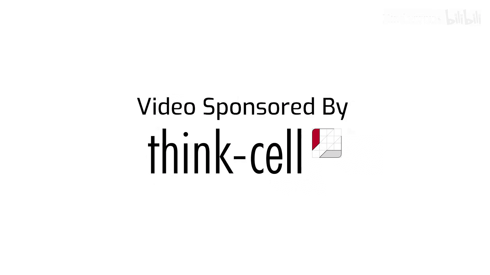

Good morning。And if you're watching this after the fact， good， whatever time of day it is for you。

 if you're watching this online at the moment， I will be looking at the Discord channel afterwards to answer questions。

 and likewise， if you're in this session real time。

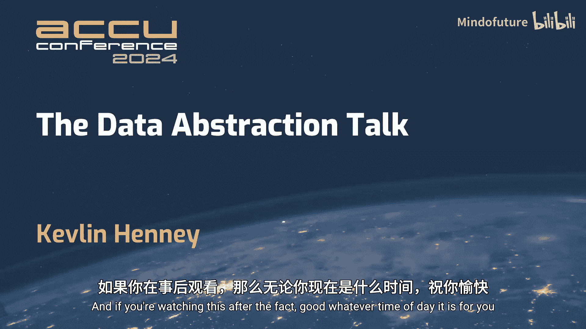

In the room， I will be answering questions over lunch rather than at the end。 although you know。

 if there's something， I do ask you kind of questions all of this。Heckling， then， you know。

 I will handle that。 But I might tell you where to put it if it doesn't feel in context。

 But if you have a question， then either I ask me direct or by the Discal channel。 Okay， so。

This is the。So we're going to talk about。Data abstraction。说的是。😊。

A they starting late or how does this one work。 So this is the data abstraction talk， so。

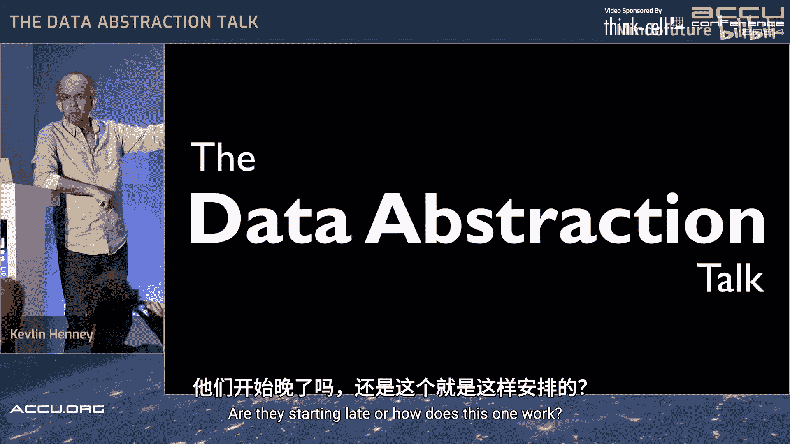

Where， where does this talk come from， This talk comes from a couple of years ago when it was in a Twitter exchange when before Twitter was my ex。

And it was about a decision that somebody was talking about saying， oh， you know。

 I I I just sort of make this stuff public and this kind of stuff。 And， you know， I I you know。

 and I just tell people you shouldn't rely on this。And it's kind of like， yeah。

 that might not be such a great idea for various reasons。

 given the history that we actually have in software development。

 but also the tools and constructs we have available and。

I sort of wanted to highlight a number of things because one of the most。

 there are a number of things that I see in code that people show me code that I see online。

 code that。I see people producing during just simple training courses。 You know。

 people often have this idea that legacy code is something you create over many years。

I have been doing training courses for so long that I can tell you。

 legacy code takes less than five minutes to create。Okay， it can be done remarkably quickly。

 As developers， we can optimize anything， including the creation of legacy。 In fact， we， these days。

 we call it machine learning and generative AI。 So there's an element there。 But what I also find。

 And there's a couple of workshops I run where people bring。😊，Their pain code， as we call it。

 to the session and。A number。 So interesting， I did a workshop on Tuesday。Absolutely， great fun。

 It was a focus on refactoring。 And between that workshop and this talk。

 I would say that most of what I see in pain code is a solved problem。It's not a new problem。

 It's not a challenging problem。 We people are fighting the。

 fighting the battles and ghosts of the past most of the time。

 but also in just simple habits that we can acquire。 But we often don't know how to acquire them。

 And Some people who've taken a particular journey through software development。

You think you kind of， you think everybody else should know what you know。

 because it's obvious to you。 You've been doing it for years。 The problem is。

 most of the industry has not been doing this for years。 And， you know。

 some ridiculous statistic like， you know， half the developers have got less than two years commercial experience。

 You know， it's a very， very， it's very， very narrow experience and and very。

 very wide at the new end。 And you can't blame somebody for not knowing something that， you know。

 given the how much there is to know。So it's a case of like sometimes going back to the fundamentals。

 but also to recover a bit of history as well， we are surprisingly bad at our own history。

Software development is not that young。 Yeah， it is older than everybody else in this room。 you know。

 and there are professions that are younger than us。 Okay。

 the fact that our parents still don't know what we do is a separate question。嗯。😊，So， yeah。

 there's a bunch of social。 I' like I've given up on trying to just。I'm somewhere。 you can find me。

 Okay， so let's start somewhere else。 There are some this is a I've used a slide from about five years ago。

 the couple of A talks that I am also incorporating a couple of elements from。

 but I'm taking a different path through。 So so here we are on Mars。😊，And I want to go back to。

I want to go back over 10 years， the Mars Curiosity Rover。Was its an impressive piece of engineering。

 absolutely staggering piece of engineering。 NA' says JPL。 it's probably。 you know。

 one can have a favorite probe inter planetary probe。 It's my favorite perseverance。 Yeah， it's good。

 but it's the younger sibling。😊，Curiosity，1 ton of awesomeness with some exceptional software。

Incredibly reliable software runs on VX works， written in C 99。呃。

C plus plus didn't get to Mars until perseverance。 And you can find that code online。 And yeah。

 it's not great。 But， but that was for the ingenuity Coter， the stuff。

 which was not mission critical。The what was interesting is Garret Holtzman。

 who LED the development of。led the development of the。Basically。

 the software for curiosity wrote a really nice piece。

 And he also did a a talk you can find online Mars code。 And he talked about how they developed it。

 There's some really interesting aspects as to how they developed it。 They took this philosophy of。

 You know what。 There's a bunch of problems that people have had。 Let's not have them again。Yeah。

 whereas most of the most， most of us seem to go， oh， you know what。 Yeah。

 I've had that problem before。 And other people have had that problem for decades。 they decided。

 let's not have the problems。 Let's find fresh， new and exciting problems to have instead。

 Let us actually learn from this。 And so they've got a tool stack。😊，And guidelines that enforce that。

 But one of the observations in this piece， which I thought was really， I love the way he phrases it。

 I often use this when talking about architecture。 There are standard up precautions that can help reduce risk in complex software systems。

 So first of all。2 things to note。 One， he's talking about reduction of risk。

 He's not saying we're guaranteeing perfection。If you do that。

 you are you are setting yourself up for a fall。 What we're doing is saying this is a game of probabilities。

 and we would rather the odds were in our favor， rather than against us。

 The other thing he says is standard precautions。 There's stuff we know。 Let's just， honestly。

 let's just stop talking about it and debating it and just use it。

 This includes the definition of a good software architecture based on a clean separation of concerns。

 data hiding modularity， well definedfin interfaces and strong fault protection mechanisms。

That's five things。Of those five， only one of those is specific to this class of software。

 strong fault， strong fault protection mechanisms， because。Honestly， if you know。

 if your probe crashes and doesn't reboot then。You can't got send Matt Damon out to kind of hit the reset button。

 Okay， this mission critical。 I think it was about $700 million。 Yeah， this is a big deal。 Okay。

 so there is a genuine requirement for that that we see there。 But the others。

Clean separation concerns， data hiding modularity well defined interfaces。 Let's。

 let's just go through this one。 Clean separation 1970s， data hiding 1970s， modularity 1960s。

 well defined interfaces 1960s。 There is not a single new concept here。

 how we've articulated them and understood them， however it has matured with time。

But the origins of these， they go back ages。 These are kind of known things。

 And we' are actually quite poor at applying them consistently because it does require requires understanding why it requires acquiring a habit。

 It also requires group intelligence。 You're not perfect。 You're gonna miss stuff。 Okay。

 Other people will go， oh， wait a minute， if you thought of this。 That's， that's。

 that's the group intelligence we can take advantage of。So this stuff being known。

 This is a paper from 1987， David Muer， Alexander Stepanoff， a library of generic algorithms in Ada。

 So if you're not familiar with the history of the standard template library it starts the origins of generic programming and scheme then through Ada。

 then it arrived in C+ plus but a lot of the core ideas and descriptions of the underlying philosophy。

 of not the mechanics you can find in here and they spend a bit of time talking about different kinds of abstraction。

 but it's a cornerstone。 it is well known that data abstractions are crucial to good software engineering practice and we find that we find that as a characteristic of the STL。

So this stuff is really well known。😡，Really well known。So Barbara Liskoff。

 we're going come back to her later。 She won。The cheering Award in 2008。And her husband， there's。

 there's a Ted X talk that she talk where she talks about data abstraction。

Her husband found online somebody going like， why did she get the award？Everybody already knows this。

She even says。😡，Her students。😡，Don't know that you know her students are unaware that there was a before。

😡，They just think that this is how you do it， and it's always been this way。

It's just like that's you've done such a good job that nobody knows you've done the job， okay。

So the point here。We often talk about abstraction。And we talk about。我呢。

Communicate you the idea that software is basically。A a set of carefully constructed illusions。Okay。

 you are trying to convince people when you are writing software， whatever。

 whether you user interface， whether you are in the code。

Of a particular illusion that this is a useful way of looking at and understanding whatever it is that you're trying to work with。

 Okay， so。At the moment， I am dealing with presentation software。

 We've turned this bunch of silicon and and metals into something rather than just being an rather than just being a universal computing machine。

 It is now a presentation device， okay。😊，We turn these things into video phones。

 We turn these things into all kinds of stuff。 We maintain these illusions。

 And for as long as they work， those illusions are wonderful。 But sometimes they fail in the code。

 we have choices about how we organize stuff。😊，Do I want you to understand？😡，This concept。

 in terms of functions， do I want you to understand this concept in terms of processes。

 in terms of objects， How do I arrange the relationships between the parts， How do I name them。

What are the points of style， These points of style are actually points of substance when it comes to software。

 You， I'm offering you a set of illusions。 And I want you to think like that。

 If you like paradigms are just different illusion options。

 But the illusion shatters in various cases。 The ultimate leaky abstraction is obviously a failure。

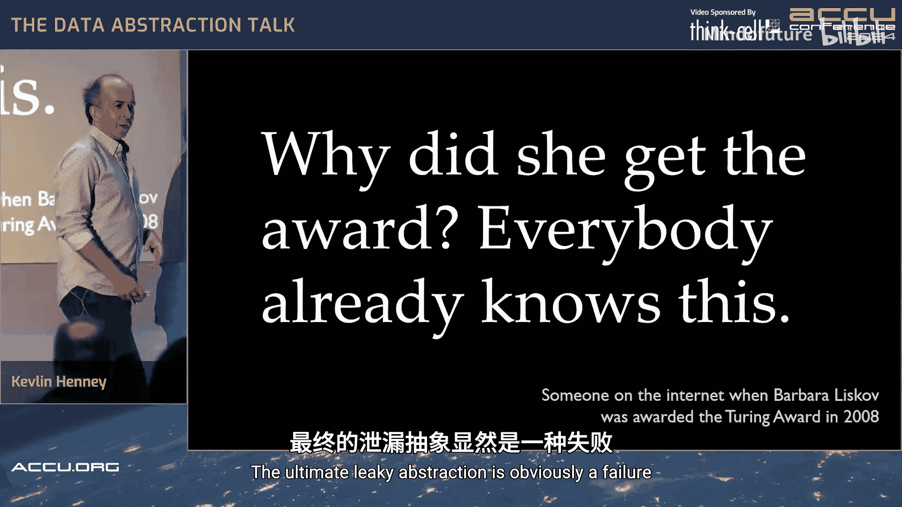

so啊。I get associated with failure screens。 Here's one from a few years ago。

 Is still one of my favorite ones。 I haven't been able to recreate it recently。 So Visual Studio。

 this license will expire in。😊，Yeah。Now， what's interesting about that is， again。

 there's a kind of notion there that as software developers， you immediately look at that and you go。

 yeah， yeah， well that' that's that's in max， isn't it， thats that's 2 to 31-1。 You know。

 anybody else who does not know anything about software development will think either that you are slightly mad and are not gonna to preclude that possibility。

 We embrace all possibilities。Or that you are some kind of mathematical genius。

 feel free to embrace that one。Okay， you know， because it's just like。

 how can you look at that number， which to most people is just garbage， it's just noise。

And you go like， no， no， that's significant in my domain。 That's。

 that's where abstraction hits concreteness， and it's very familiar。But clearly。

 there's something here because it's not just that， because， honestly。That's a long time away。

A long time away。 That's a like post human civilization kind of time away。 I'm not worried about。My。

 my， my license to Microsoft there。 So how， how does a number that's so large。

Get mistaken for something that has apparently expired because you， your license has gone stale。 Now。

 I'm good for a really long time geological es。So that also tells us it reveals something about the nature of the structure。

 Not only are we using 32 B integers， and they language the。Supports that so clearly， not Python。

And clearly， this is not JavaScriptscript because it would have screwed up something else before this。

We've got separate。 We've got a disagreement over abstractions because this is coming out a very large positive number。

 But clearly， something is being expressed as as， as as a negative number。

 There's a comparison somewhere。 So we see that the software is made up apart。

 We don't necessarily know what parts they are， but we are already given a kind of heads up。

 We can start seeing the shape。Or the questions we want to ask of the shape of the software by its failure。

 Yeah， the illusion is shattered。 And now we're looking at the pieces， trying to figure stuff out。

 I mean， sometimes it becomes particularly obvious。啊。I quite like this one。Its。

 there's quite a few ones， you know， there's。Just out of just as an interesting point when we talk about legacy systems。

I often get the question。Why why are these always windows screens on ATMs？You know。

 other what we're finding is that Linux is used for a lot more signs and signage。

 but you don't tend to get Linux ATM failures。 There's a very simple reason for this because ATMs are written using Windows。

Most of the industry is based on a historical path dependency that goes back to OS2。

And the tight R S 2 of you， if you are young enough to not know what R S 2 is。 Well， you know， the。

 the standard line at the time was it was， it was an operating system from IBM for the PS S2。

 The standard joke at the time is it's O S slash2。 and it was P S slash2。

 half an operating system for half a machine。But the point there is that just the point the ATM market was beginning to grow with people like Siemens。

Nixdorf in Wincorps as well and NCR and so on。 just as it was beginning to grow。

 they tend somehow somebody at IBn did a very good job。And they started using O S 2。

 and Windows N T was the most compatible at that point。 And everything else is history。

 So just in case you wanted to know。 sometimes it makes its way out into the real world in various cases。

So， I mean， you might know Canada， they speak， you know， it's officially bilingual， French， English。

 trilingual， PhP。But we see something about the object structure reveal beneath it。

This one goes back to the 2000s。 It's Mozilla rather than Firefox。

 This is a failure screen I experienced。 trying to visit a friend in Dons direct when I was in the Netherlands。

 And I wanted an earlier train。 Par， there are no earlier trains。

 So there's only Java dot land'll point of exception。

 We see something about the construction of the system and how it was developed。 So， first of all。

 we know it's in Java。 But actually， we knew that already。 If we look at the URL。A bit of， yeah。

 abstraction leakage。 But also， we find that we can reveal。

 We can guess something about the development practices。What they weren't doing this was。

 this should have been contained。 Yeah， I should have got a message in English or in Dutch。

 but certainly not in Java。 So we see these various failures。

They've updated so that now you can get you can now get failures in Javascript。

 That's a more recent capture。 But we see these failures。

And it is that point where an abstraction kind of falls apart or our series of abstractions。

 Our illusions fall apart。 So we need to understand why it is that we want these illusions。

 why they are desirable。

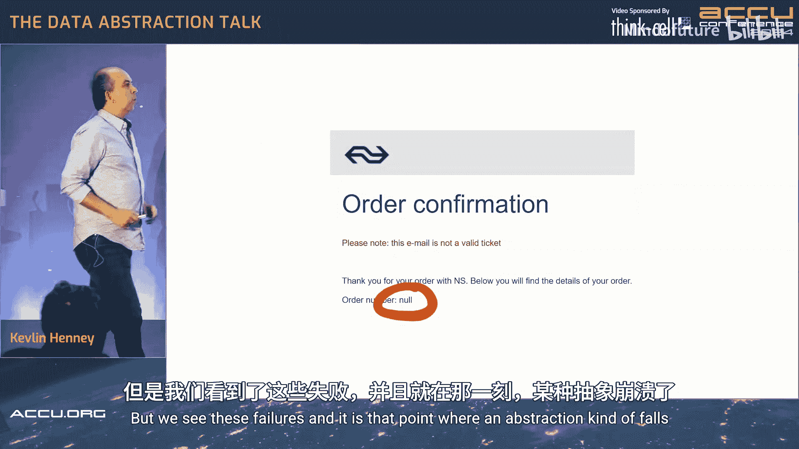

We notice them when they fail。 but also， we want， we want them to be not noticeable。

 We want them to be so successful。 People don't notice when they're actually working。

 And this ultimately， everything runs on stuff like this。

And we kind of think of this as being low level， although typically we kind of smother it in ones and zeros if we're going to really talk about low level。

But that said。Even at this level。This is far higher。😡，Massively higher than this。

 This is not just a bunch of voltages。 We are already removed from all the constructs that now dominate modern hardware architectures。

 This stuff doesn't talk about。So hit the next level up。 that's， you know。

 there's a transcription from there to there， and there's a conversion from there to there。

This stuff feels low level， but it's not hatchty that low level。 It's just awkward。

Because it doesn't talk about any of the things that people call low level。

 Our languages don't actually allow us to talk about pipe instruction pipelines。

 They don't allow us to talk about caching levels and stuff like that。

 So why the time we hit actual code。And people might say， oh， yeah， well， this is C plus plus。

 that feels really low level。 It's already so far above what's actually going on the machine。

 C plus plus does not capture anything to do with the architecture。

 So you're always going be trying to you're always going be working at a far too many levels of indirect。

 C plus plus is based on what machines kind of certain class of architectures of the 1970s。

 which have not existed since about the 9 1980s。 So， you know。

 we're building an illusion on an illusion。So we， we increasingly。

 and I can describe the behavior of this thing。Using a different kind of level， another model。

 each one， we would say， is progressively higher level。 We use that language。

 And here I've got a hll state chart。Which kind of describes the overall kind of behavior and what I'm expecting from this thing。

So以。Taking us back to 1980， Maya Lehman observed in its kind of classic paper programs。

 life cycles and laws of software evolution。 There's this quote I've used before， but I love it。

 It's one he must have had so much fun writing this。😊，Writing this sentence。

Feel free to offer this to anybody who asks you what it is you do for a living。

Any program is a model of a model within a theory of a model of an abstraction of some portion of the world or of some universal discourse。

 that will shut down any kind of conversation。Okay。But it's。

 it's actually quite a good description because he's adding in this whole idea of it's not just， hey。

 it's model based。 It's actually。We've got models built on models。 The idea that people will say， oh。

 I'm I'm a C plus plus program。 I'm a C sharp programmer。 And it's just like， yeah。

 So you don't actually program the machine。 know， that's very few people do。

 That's firmware development。 electrical engineers， that kind of stuff。 You're actually already。

 even when you're low in that。 you're already quite high。

 But then you have a choice of abstractions or paradigm that you draw from。

 And then you have something that you might sketch up on a flip chart or a whiteboard when conversing with your colleagues。

 And that's another level there， another level removed。 So this notion here。😊。

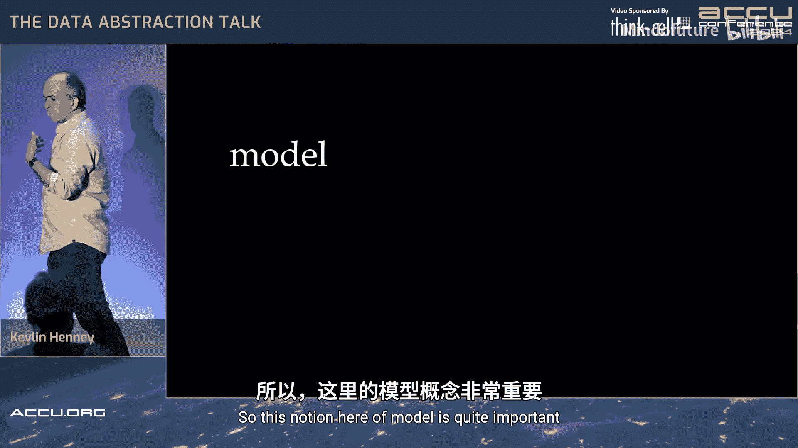

Of model is quite important。 Now， I've got got to say the。In the C++ community。

 the word model in the kind of concepts theory， they use the word model unusually。

I'm going to ignore that。 They got it back to front。 I'm not going to say it's wrong。

 I'm just going to say it's。It's， it's uncommon usage and shows a curious platonic bias。

 And I don't mean that as in like， we're having a really good relationship， but no touching。I mean。

 the idea of an idealism， we need to strike that kind of idealism from computer science。

 So I am going use the word model in what I would consider to be the more correct sense。So。

There is a term modularity， which I kind of came up with a number of years ago when doing my master's degree because I was trying to describe the properties of a good program and modularity。

 which will come to a moment。 But I also wanted to talk about modularity。

 And I did actually include this definition in a previous A U talk。

 which now I find depressingly somehow as quarter of a century ago。

A measure of the correspondence between the components of the problem being modeled those in its solution。

Okay， so this kind of， we got an idea here of like， I can look， I'm looking at source code。

 and I've got a concert and I can go， oh， yeah， that fits in my conversation。

 That's how we think about it and how we talk about it。

And that idea of modularity is quite important。 We often find a disconnect。Sometimes with code。

 we find a disconnect to go like what's going on here。 Some explains it to you。 and you say， well。

 you could have written that。In fact， I've even had code reviews， a code of where I。

 I spoke to somebody， and they kind of gave me a beautiful sketch on the， on the board and。

Walked it through。And okay， that makes sense。 And then we looked at the code。 and then after。I know。

20 minutes or so， I said， I'm a bit concerned。嗯。I mean because none of the things that are on the board are in the code。

And that was， you've got this description up there and all the names and all the relationships appear to be different in the code。

 And They said， oh， yeah， that's how I think about it。

 But I'd have to change the code to make it look like that。 And I don't want to change the code。

And it's just like， yeah， that's a bit of a problem。 That's a very you problem。

 But what about the U problem， We would like to be able to come back to this code and understand it without。

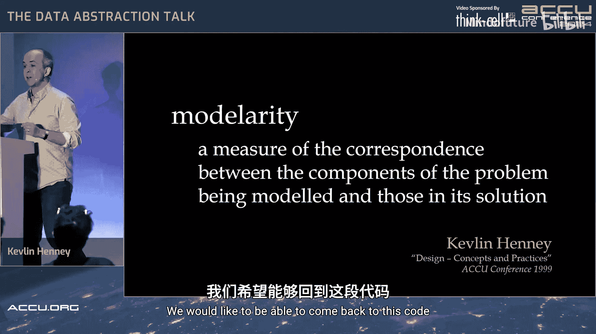

Trying to read your mind。所。😡，Here's what we were actually。 You know， here's a real stack。 Hopefully。

 you've had breakfast and not feeling too hungry at this point。 But and we are approaching lunch。

 So there's already， there's a part of your brain that's going like， preparation。

 Let's just start thinking food。 This is a stack。 The other stuffs weren't stack。

 So they they were kind of， kind of metaphors and descriptions and models of stacks。😊。

Its easy a stack。So what's happened， Well， what's happened is basically abstraction。

The result of abstracting the idea of something which has no independent existence。

 a thing which exists only an idea。 So this is the Oxford English dictionary。

And worth remembering a couple of things about the OE is that it is not a。

 It's not a usage dictionary。 If you want to find out what a word means。

 this book is almost entirely useless。

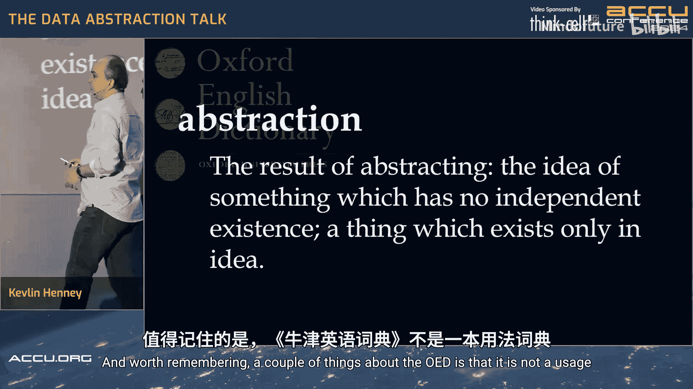

It is an etymological dictionary。 If you want to know how this word's evolved over the last thousand years。

 this is your book。 Okay， and it gives everything in in in in order of history。But so it's very much。

 it's not， it's not prescriptive。 It's descriptive。 Okay， so these are。

 this is how these words are used as opposed to how they should be used。 it's un opinionionated。

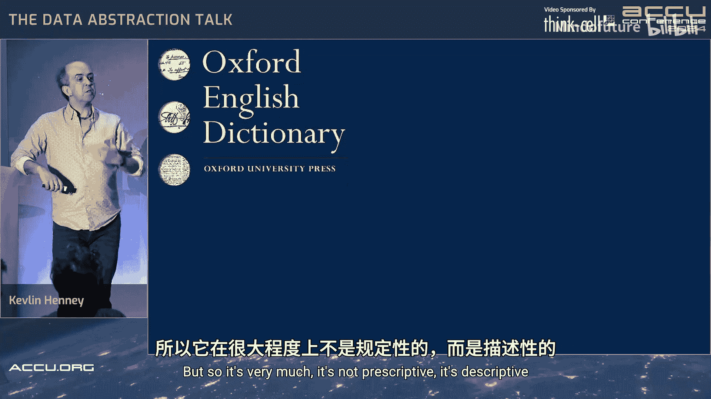

With respect to that， the result abstract the idea of something which has no independent existence。

 a thing which exists only in idea。To， so we have from this abstract withdrawn or separated from matter。

 from material embodiment， from practice or from particular examples。

 And it is indeed opposite to concrete， which kind of， fortunately， for once in software。

 we are actually using this term quite correctly。 Most of the time。

 we pick somebody else's word and then go， like， yeahep， forget whatever it meant。

 Let's go and use do something different。 Here's version 2 of this word。

But there is this idea withdraw。 Let's actually play with that word a moment too abstract as a verb。

 literally means to remove。Okay， it comes from the Latin Amtra heroro to draw off。 literally So。

 for example， to draw off water。 you are removing something。 It's about the elimination of something。

So what is it that we're trying to eliminate？

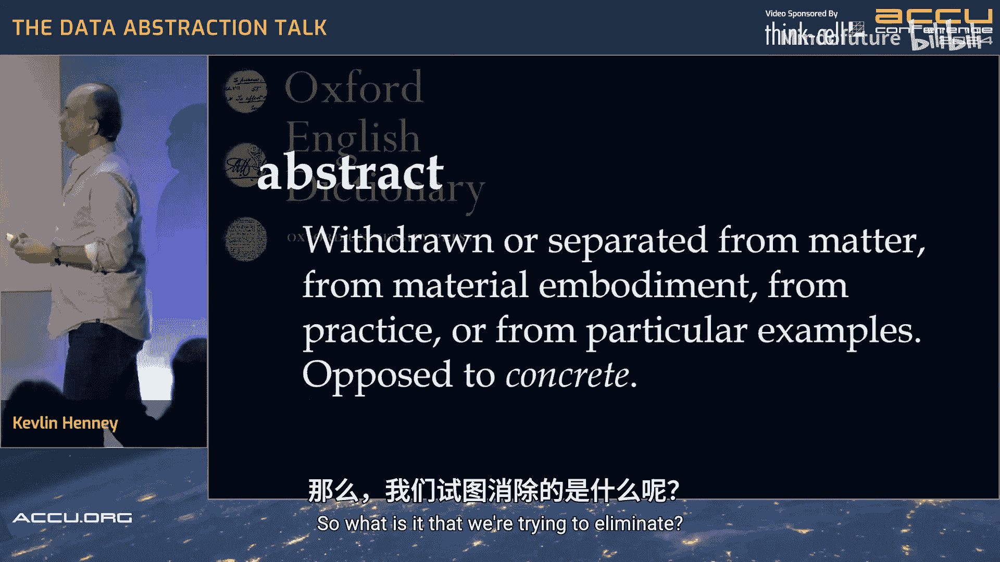

When we went from here to here。We were。Eliminating。Details of the machine。

If we go back to the source code level， we might say， y， got a stack of pancakes and we would say。

 oh yeah， this is a higher level of abstraction than those ones and zeros。From that asemler。

And we have this habit of referring to this in terms of altitude， high level and low level。

 it's all the way through our language。All the way through our metaphors。

But there's a curious thing we need to watch out for。 We are curiously biased。

When we have a particular choice， when we talk about certain things in language。

 So something I wrote about a number of years ago in a blog post down on the upside。We have a bias。

 The bias is。Towards people who are working in software， as developers。So。

Talking about the problem domain as being at high level of abstraction。

 the machine domain at a low level betrays an ingrained bias。 If， yeah， we might say， oh， yes， yes。

 we are， you know， the concepts in our code are very high level。

 They are close to the customer's domain。That's not how they see it。

Talking about the user domain in terms of concept familiarity to users is low level of abstraction。

We got it upside down from their point of view。 So I love it was just， oh， yeah。

 a low level of abstraction is close to the machine。 High level is close to the real world。

I just want you to think about that for a moment and realize how bonkous that actually is。

 because actually， what's happened is， as far if you talk to somebody in the in in meat space。

 in the real world， if you talk to somebody and you start talking their language， they don't think。

 my goodness， you're talking at a high level of abstraction。They don't experience abstraction。

 You're talking on their terms。If you start talking code， then they will say， wow。

 that's really abstract。 They view it the other way around。Yes， Gu。That's okay to be wrong。😡。

Surely know when we're talking about abstraction。And we're talking about abstraction in the solution。

Attraction from program。Yes， that' that's so do you want to repeat that， I disagree。😡。

It's okay to be wrong。 Yeah yeah we don't know that so I think that when we're talking about abstraction in this domain。

 we're talking about our distance from the solution domain， which is the silicon。

 not not the distance from the problem domain absolutely I totally agree and I say that in in this article as well excellent in other words。

 it's a point it's to do with your point of view you just have to recognize you have a bias and therefore a point of view because it turns out okay。

 bizarre enough， if you happen to be with anybody from Australia here。😊，Okay， no。

 they've all fallen off， but they haven't because this far turns out。That it's about a point of view。

 It's just like， I have a particular bias towards which way is， which way is north。

 I have a bias towards seasons。 I have a bias towards where I think gravity goes and stuff like that。

 And that is anchored to my point of view。 So much。 so I don't even notice。 I have a point of view。

 And that's all I'm saying The point is we we just， we get so used to talking to software people。

 You know was where we are saying with respect and solution domain。 And we are abstracting from that。

 But we also need to see somebody coming the other way and going like， oh， actually， no， I'm not。

 I'm not really abstract from their point of view。 I need to be looking the other way。

 And there's just a matter。 it's just this idea not so much up and down as。

Which direction you're heading and that's very much the point there。So， but from this point on。

 we will be in the solution to Ma unless I say otherwise。

 So let's talk about other kind of aspects of abstraction。Where we push stuff into。

We push stuff into people's faces where really， we should probably do a better job。

 So this is one of those credit card numbers that's that's used for testing。 So it's not mine。

 You can't know， you're not，re not going to get any benefit from that and。

I'm sure we all have this experience even now in 2024。 Every now then you go to a screen。

 It's just like， yeah， I'll type this in。 And it says payment card number must not contain spaces。

 It might even use more words like error。You know， invalid and really strong。😡。

Strong software developer style words rather than， you know， whoa， who， who。

 what's what's going on here。 Payment card number。 Yeah， I think it costs。

 I think it it takes more code to do this than it does to fix the problem。

Removing spaces is not really one of the hardest problems in computer science。

 or at least so I thought the last few decades have suggested otherwise。 Okay。

 this is like somewhere up there with， with， you know， MP P completeness， you know。

 apparently based on experience。But what we've done here is we've failed。

To align with the user's domain。But we're also， we， we're， we， we're failing to do certain things。

 We're failing to support an illusion。 We're failing to recognize the real world。

 That's how it's printed on your card。 So therefore， there's a reason for that。

 It makes it easier to read。 Turns out 16 digits is surprisingly difficult to chunk。

 but four groups of four。Honestly， that works really well with this。So。😊，We should accommodate。

 I don't know。 What are they called humans。 That's what， that's what。

 that's the word I was looking for。 We should accommodate them。 But here's。

 here's where we get interesting。 A lot of people look at this。 And again。

 this is something that I see。In production code， I see it in。I see it in blogs。

 I see it on training courses and workshops。 People's got， okay， yeah， yeah。

 we need to represent a number。 This is a， this is a credit card number。

 And so they'll do something like， yeah， yeah， it's in。

 So we're gonna pass it from a string to an end。 First problem。Probably won't fit。 Yeah， yeah。

 because that's 60。 Yeah。 So going back to， you know， statistically and it's very。

 very likely depending on， depending on language and platform， it's pretty much gonna be 32 B。

 If the world ever decides to do anything different。 Lots of things will break。

 So we're fairly cautious about that。 So that's not gonna fit。 So people go out， Nope。

 I have this long。There is a problem here， though。It turns out that。😡。

Credit card numbers are not numbers。But Kevin， it's got number in the name， whatever。you know诶。

Yeah know， that yeah。People's Democratic Republic of Korea is apparently Democratic。

 It has it in the name。Yeah， maybe it isn't。 You know。

 just because it's in the name and the former DDR in Germany as well， the same kind of deal。

 Its just because it's in the name doesn't mean that is actually true。But maybe also。

 number is not a strict concept。 People natural language is surprisingly informal。嗯。

So the problem here is it's actually not a number。 Numbers have certain properties related to arithmetic and and all kinds of other stuff。

 which really you're not supposed to be doing with your credit card。 Okay， you。

 you deal with the amounts， but not the numbers。 Diding that number by2 is not a thing that we want to support or encourage。

But you know， Nuns get everywhere。 Thank you， Love Ta。This beautifully self referential statement。

 Again， more jascript。 tried to pass bananaan， but it is not a number。 Wow， mind blown。Okay。

 now there are a lot of now。 I'm not saying that you never want to do that。

 That is a valid optimization in some cases to take advantage and exploit the contours of your problem domain and say。

 actually， I could shove this。 I could take advantage of certain features in Europe。

 But that's not something I want other people to depend on。

 That's a choice that I want to be able to say， I'm gonna do it like this。

 But the minimum carrying vehicle。This is the common thing。

 This is probably how we're going to store it in a database。

This is how we're gonna send it over services。 And we'll do that。

 And then we can easily solve the the spacing problem。 That was easy。

But if we're gonna get into this space， we should start actually recognizing。Well。

 it's not a string either。 A string is a carrying vehicle。But it is not a string。😡。

We already have constraints that we want to apply it， apply to it。 So， for example。

 it actually turns out these numbers have a particular， there's particular structure to them。

 So they must they are going be between 8 and 19 digits。 The1 I showed you is 16 digits。

 That is one of the most common， but actually payment card numbers。

 there's a bunch of standards floating around， there's， there's a difference here。 And actually。

 if we then breaking it up。 We can see there's a further set of constraints。

 There's an issue or identification。There's an account identification。 Then there's a check digit。

 the long based on the loan algorithm。 So in other words， it was， oh， well。

 this is a bit more than a string。 And these aren't digits。 So it is a sequence of digits。

 which can have leading zeroes。Hence why we say it's not a number。

 as well as it doesn't really do as arithmetic。We can throw in the lunchche digit and throw in a bit of Python。

 And that all kind of nicely works。 And yeah， we can do these various other things。

 So we find that in addition to the string， there's a set of associated concepts that hang around with it。

It's not really something that we'd expect to capitalize。

 It's not really something that we expect to go around concateating with Hello World or anything like that。

 The idea is that it is a string plus these。 But this there's a lot of affordances in this that are nothing to do with this stuff。

And that becomes the， that becomes the issue。 It's not simply that somebody might willfully change it。

 That's not the problem in large systems is more， it's more about I think Bianna Strasstrump put it as it's more about Murphy than Macavelli。

 people at hell bent on doing something。 They will probably eventually Ben to hell， but。

It's more about you don't necessarily know somebody else's assumptions。 How do you communicate those。

 Please don't do anything to this other than this。 That's。

 that's the bit that we're missing in the larger a system gets。 And by large。

 let me just characterize large， spatially， but also temporarily large in time。

Whatever you thought you knew 10 years ago， you've probably forgotten in terms of key decisions。

 Yeah， that system has become large。 You can have just a few hundred lines of code。That you wrote。

 and then you come back to it 10 years later。 Now it's large。Yeah， unless you have perfect recall。

 but I'm just going to talk about humans here。So we often end up with the problem。😡。

Of stringly typed systems， we see this at pretty much every level。 In other words。

 strings are surprisingly versatile。I'm not gonna knock them for that。

 but they become the containers for these things rather than the direct expression。

 We fail to express our constraints。 They are very， They're scattered around the code。

 We're requiring a certain amount of archaeology and detective work from people。

 And there's a name for this concept payment card number。

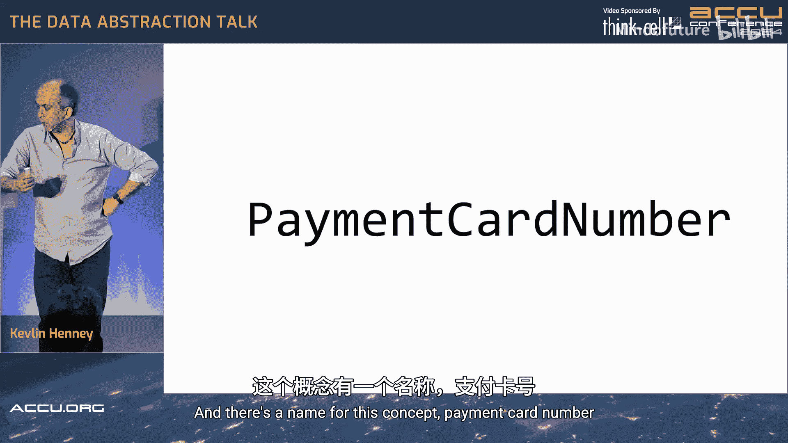

So there's an idea in 97 things。 Every programmer should know Dan Ts North described it code in the language of the domain。

 That's going to be our default starting position。 The idea is that I would like to get close to the domain so that from with respect to the solution structure。

 I recognize all those layers beneath me or as much as I need to。 And I'm going to say。

 you know what， that's fine， I'm high level with respect to those。

But I am low level with respect to the concepts that other people would recognize。

 I increase the communicability of the code。 It's the idea of it。

 actinging as a communication medium is very powerful。 Now， this is clearly not a new idea。

Paent languages， a collection of Pats papers from the early 90s。

 we see Ward Cunningham talking about this as a pattern。Whole value。 Now， this was。

 this was early 90s。 And he talks about this。And if those you not sure who War Cunningham is。

 if you know what a wki is， yeah， Ward invented that。

He did a few other things as well that are very notable。 But let's。

 let's just talk about that one is the easy one。 It's the one my kids are actually impressed by。

 know words， yes， I know the person who invented the wiki is far more credible than I know the person who invented C plus plus。

 it turns out in terms of currency with children。Whole value。

 This is besides using the handle of literal values offered by the language， numbersumb， strings。

 true and false。 and even even smaller complement of objects， normal users values， date， time point。

 you will make and use new objects with this pattern to represent the meaningful quantities。

 This is about meaning。 So this bridges to a talk I did five years ago here。 What do you mean。

 It's about the semantics of this and communicating that。

 Construct specialized values to quantify your domain model。

 make sure these objects capture the whole quantity with all its implications beyond merely magnitude。

 But more importantly， you're capturing this is what it's supposed to do。

 But you're also constraining。 And this is what it's not supposed to do。

 you're putting a boundary on that。The word value here implies these objects do not have identity of importance。

 Okay， so therefore， in languages that are reference based and where these are expressed as referential objects。

 then the the reference equality is of no use。 It's something like C plus plus。

 I'd be sitting there going like， well， the address of this is not really part of the relevant conversation。

 Yes， it has it， but that's not relevant。 not salient at that point。 It's。

 it's a true statement of it， but it doesn't affect how we're going to work with this as users。

 It doesn't define its usage。We see driven design from Eric Evans， which is now over 20 years old。

Where he really try and re reaffirmmed this kind of thinking。

 he just simply refers to his value object。 It turns out that a number of people myself included in the 90s into the 2000s documented and red documentcumented this very。

 this kind of idea to really emphasize to people because a lot of people going around like got big things and half the time when people and we。

 we saw it back then And it was already becoming worrying。 half time， yeah。

 I'm doing object orientation。 okay， let's have a look。 Oh my goodness， what are all these managers。

 Where， where are your actual objects。 Youve， you've got a middle management problem。 Yeah， you know。

 and you've got then these anemic kind of other things going on。 Yeah， yeah。

 we're doing object orientation。Dude， whatever it is is， it's not O O。 Okay， you know。

 so we're trying to say it's for the little stuff。 It's not about the big stuff。

 The whole idea is that it's just like， yeah， the， the， the small change。So value object。

 express their same idea， reinforce when you care only about the attributes of an element of the model classifier as a value object。

 make it express the meaning of the attributes it conveys and give it related functionality。

Treat the value object as a mutable。 Don't give it any identity。 Now。

 they don't give it any identity。We see from we see from wars writer。 But as immutable。

1 under one always has to understand the bias here， this book presents in Java。 Okay， so basically。

 it's a purely reference based language。 We're basically saying。Actually， we don't have copying。

 In fact， you don't really want copying because it's surprisingly awkward in that language。

 So please don't do that。 So therefore， in that space， the way you express this idiomaticically。

And you do the same thing as C sharp。And indeed， you know， I do the same thing in Python。

 We actually see a better enforced in some parts of Python than the same Ruy。

 which doesn't really get this right at all。 Just not to say I don't like it， but it is。

 it's a bit loose on this。 The idea of。If we are sharing a thing and we want to agree on what it is。

 and it's not a thing whose identity matters， then we need to make sure it doesn't change。

 We don't need to make its identity accidentally matter。 Okay， oh， I'm going to give you。

 I'm going to give you a date。Okay， I'm gonna give you a date object。

 It happens to be on my date birth， and you can go off and change it。 That's a bad thing。 Okay。

 you need to isolate that。 And we have two ways of isolating here。

 You can't change this because you can't change this。Cause it doesn't allow you to change it。

 Or here you have a copy。 You can change it as much as you like。 But I've got mine。 Okay。

 that's the two techniques we isolate that and express this。

 So when it comes to value objects more broadly。And embracing things like dotnets。

 value types and things like vuchcher， copy types。We kind of work at that level。

 So there's a slight translation needed here。But nonetheless。

 term beautiful gives us a kind of a thought here。Imutability relates to invariant or invariance。

 something that doesn't change。 Now， we use the word invariant in a number of different cases。

 One is that something doesn't change。And the other is， here is a thing that should always be true。😡。

Which is a slightly different shift on the word in the kind of more formal approach and things like design by contract。

 and invariant is effectively。 Here is a rule that is true。Of this data， and it is always true。😡。

Because it doesn't vary。 There we go。 We have a truth that can be established。

 The idea is that it is a rule。 Okay， so what kind of rules we talking about。

 Let's go back to our stack of pancakes and express this one in Python。

 And this is kind of how a lot of Python programmers will develop it。 They will imaginatively call。

 they will basically say， okay， If you can't。 if you， if you can't read Python。 Here's Python。 Yeah。

 see it's quite readable。

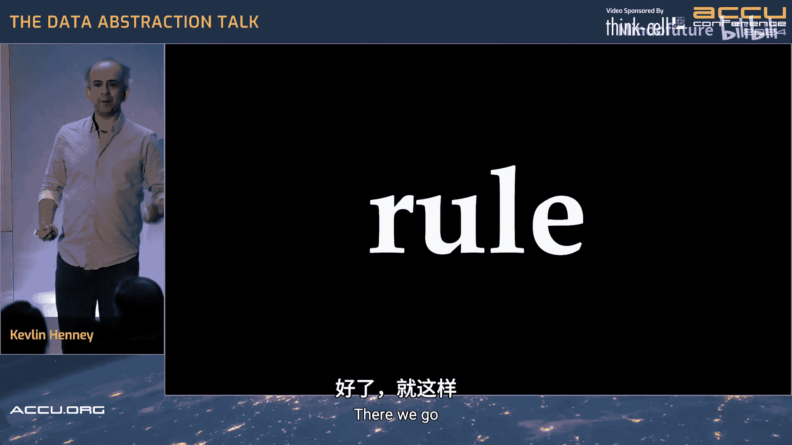

Everything's explicit， including your。Your self reference。 So we bootstrap within it。

 That's our constructor。 And we're gonna say， yeah， I'm gonna add in a list here。

 and I'm gonna be really creative。 and I'm gonna call it list。😊，If we have a second list。

 I guess it's going to be called listist two。 I don't know if we haven't got that fire yet。

We're going to find out we can say it's got a death。We've got a top element。 We can push。

 and we can pop。 And it's gonna be a strict pop。 I'm not gonna to return anything from。

 just to keep things simple。Now， the problem is somebody comes along and says， you know what。

 honestly， that list is not a really great name for list。

 It' kind of already been taken by the list type， not that there's going to be any collision。

 but it does show a surprising lack of imagination。

 And given that we've got the terminology floating around of item。 We might as well just use that。

 say， the here are the items， it's still implemented as a list。 But I'm gonna say， you know。

 it's gonna be that。 Now， of course， if I do this in the way that a lot of Python developers will do。

 I do this。 and then I go and break everything with this。嗯。There's a number of things going on here。

 one of which is I've just got made this decision incredibly public。Everybody can access this。

 This is surprisingly common in the Python community。

 it's one of the first things I always pick up on is just like， oh， good heavens。 You。

 you've decided to make， you've decided to like， put everything。

 make everybody depend on things that don't matter， awesome。😊，so。😡，Here's a structure。 So。

 let's just say we've got the naming issue。 Here's a structure。 I can the current implementation。

 the current implementation I am appending to the list。 I'm putting it to the back。

But we also recognize I could be preending it。 And that's perfectly acceptable。

 I could be doing that。 And that should be， from a semantic perspective。

That still looks like a stack。 The problem is that if I go and make that change to the code。

If I can make that change to the code， then。Everything still runs。There's no kind of。

 no attribute errors like， hey， you try to access the thing that doesn't exist。 No。

 everything kind of runs。And the problem is if you don't have tests。

This is a surprising number of map Python code that doesn't have tests。What you're going to find。

Is that an assumption that you previously had that you could dive into the data structure for those of you not familiar with Python。

 Python allows you to count backwards。 Negative indices are perfectly legit。-1 is the last one。

-2 is the penultimate one。 So that's quite a nice little feature。 So that is the last element。 Okay。

 that's the top element。嗯。😊，And that's great。 So I can， I can， I can basically say。

 here is my equivalentence。 And then we do the， and it passes。 and then we do the refactoruring。

 and it fails miserably。 So we have a semantic failure， even though we've got syntactic informance。

 We've got a semantic mismatch。 And what we've done here is we revealed an assumption。

 The assumption that people have。 And I get this a lot when I do related exercise。 But also。

 we're looking through people's code。 It's just like， well， you've just made that。

 you've made that map public。😊，You've made that list public。

 How do you know that that's the right way to think about it or that that's the most effective way to think about it。

 There are performance considerations that we might have， but also abstraction considerations。

 People seem to love looking through linear data structures。You know， in other words。

 I' am going to search for this。 It turns out that there are all these other things。

 dictionaries and maps and stuff like that。 If I realize， oh， that's what I really mean。

 And sometimes we don't discover our meaning， our intent until later on。Okay， now that's fine。

 We should allow ourselves a little bit of。Forgiveness。But the problem is。

 if we make certain decisions， we do not we， we are not not in a position to forgive ourselves。

 We've just like， oh， you're stuck with it。 Okay， so that becomes a problem， so。

We have this idea of trying to kind of classic separation of concerns。

 separationation concerns is a di extra phrase from the mid 1970s。

When talking about separation concerns， he wasn't actually talking about separation in terms of modular structure。

 He was talking about different concerns。 I want to consider how to use something versus how it's implemented。

 I want to consider， perhaps performance characteristics。

 whilst not having to worry about everything else at the same time， that becomes overwhelming。

 In other words， this idea of separation concerns is a human thing。

 It's to allow me to focus on something。 whilst not focusing on other things。 And by definition。

 focus。Is ignoring other things。 Yeah， that's the thing we always have to remember。

 If you're focused on one thing， it means you're not。 you're ignoring everything else。

 And in software development， we absolutely need that。 If somebody says， hey。

 here's a code base of 3 million lines。 You cannot focus on all of it。 It's not gonna happen。

 You need a way to learn how to ignore it。And sometimes that's death metal。

 And sometimes it's abstraction。 I'm going to make a case for the abstraction。

But here's the earliest use I've been able to find the term contract in software development。

 Butler Las in 1983， an interface is a contract to deliver a certain amount of service。

 Cls of the interface depend on the contract。 We've got a client supplier arrangement。

 It's quite a powerful metaphor。嗯。And just to kind of disabuse anybody。

 it's not to do with a contract， pre impose post conditions。

 not all contracts can be expressed in pre impose conditions。 They are kind of a subset of stuff。

 that's that's kind of really important。So we've got this。😡，We can also do this。

Create a link list that will adequately do this。 And we find that we hit a different set of breakages。

 as well。We get a name issue。And we're going to get a bunch of other things such as we can't actually use the subscripting at all。

 It turns out that doing linked list in the Python is surprisingly easy。

 but we cannot use the subscripting at all， not just because the name has changed from items to head。

 It's just like actually it's not an indexable structure of any kind。 So therefore。

 we're going to get syntactic breakage all over the place。

So we have this kind of advice coming down to us。Curiously enough。

 one of the most enduring pieces of advice of this book， which is published over 30 years ago。

 G a four design patterns book， is actually not described as a pattern。

 but is actually probably one of the strongest patterns in the book。

 This one programme to an interface， not an implementation。 And yet， still people like Singleton。

 That's programmed to， Yeah， that's programme to an instance。 That's even worse。😊。

But the point here is that even in a language like Python。I can sketch out and say， yeah， no。

 this is， this is fine。 This is what you， This is what I'm going say you are allowed to depend on。

 Or here is the contrary。All the stuff and dots。 That's the implementation。 And therefore。

 I'm going to remove myself。 I'm gonna remove the public aspect and get that out of the way。

 I'm gonna to use this double underscore convention， which Python treats are special。 Again。

 I find surprisingly few Python programmers actually use this or really appreciate this。 I kind of。

 if I look at a piece of Python。 and I don't see people doing。 This is kind of like。

 we need to have a conversation here。😊，I， oh， it's so difficult to type the extra underscore。

 Oh my goodness。 And I don't even have complete。 No， I'm not buying that。 It's a very clear。

 it's a very clear signal。 Work with the idiom of the language。 Work with what it gives you。

It allows me to freely change my implementations。The idea is this stuff。 That is not a public name。

 That name is not available publicly。 You cannot see that encode code outside that class and have it work。

 It's as simple as that。 That doesn't mean that you can't access the value that that name internally refers to。

There is an alternative path that does a bit of name manly。I'm not a massive fan of this。

 but I am more of a fan of this than than the alternative。

 which is to make the name available and just have a convention。

 And given that most names are not as short as stack。

 this makes it really obvious when somebody is doing something that is of questionable value。

 It's just like， oh， my goodness， your code。 You know， is clearly doing something questionable。

 Why are you doing that。 Oh， because I want to do this。 Here's a suggestion。 Yes。

 there's a learning cycle here。 So this brings us to another related idea。

 which we often put in the same space。 encapsulation。😊，嗯。Literally means enclosure in a capsule。

 It's not an exciting word in terms of meaning something really different。

 It actually does pretty much what it says。 enclosure in a capsule。 it suggests that there is。

Something with a boundary and there's an inside， and there's an outside。Okay， that that's， that's it。

 And therefore， to encapsulate is too enclos in en capsule。Now， what I quite like is that。

Its regular English usage actually also leads us to the term abstraction。

To summarize or isolate as if in a capsule， it captures the essence of something。See idea。

 I'm going to draw away all the stuff that is not related to its essence and focus on that。

 These two ideas are aligned。

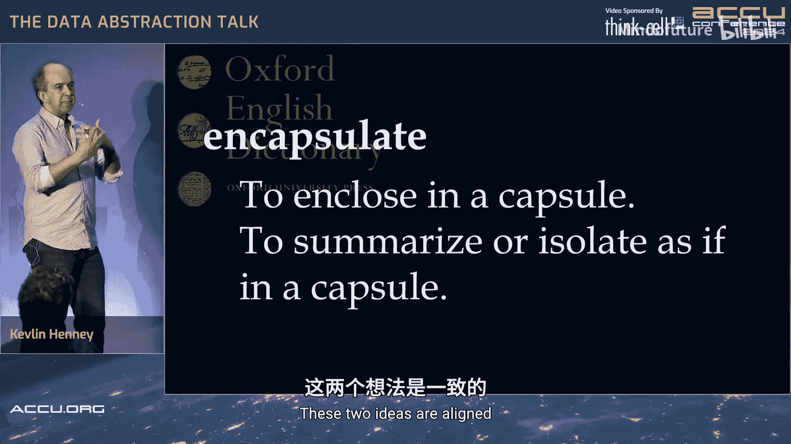

So I'm gonna pick， go back to our friend the payment card number。 And actually。

 this relates to something I had with。A client a number of years ago。 It wasn't payment card number。

 but it was surprisingly similar。 So its， it's just like I'm going translate， given I dont， you know。

 I'm probably still under N A， I'm gonna translate it into this。 And they had all over their code。

 They were kind of like。嗯。😊，C plus programmers， or as we often refer to them these days a C slash C plus plus。

 but I still prefer C plus。 It gives me that halfway house more explicitly。

 They were C plus programmers。 And they had this all over the code。 And these， these。

 there were these， these codes。😊，All over the place。 And I said， why， why are you doing this。

 Why are you not using。Strings， so， wow， they said efficiency。 And I said， have you measured it， No。

 but we know things。 And it is like， okay， but I said the point here is， I said， I think you。

 this is going to cost you a lot。This is gonna cost you a lot in a number of ways。

 And they had as many people do when they， we can't help it。

 I'm not gonna blame anybody here because。We have we pick up stuff。 We learn it。

 We learn it by osmosis。 We learn it explicitly。 But when we learned it explicitly。

 it was however many years ago， And it turns out that things change with time。

 And their assumptions were pretty much based on different hardware architecture。

 different operating systems and clearly different languages and compilers。 And so they。

 I dont know we're savings space just just a pointer。😊，And I said， yeah。

 but you're spending an awful lot of time doing Stlen。 You're trying to find the length of it。

 Hunt the hunt the null Terinator。 That's not the point of your coat。 You know， you。

 that's not the game you're supposed to be playing。 You know， if if you went， you know。

 if you asked your。If you ask your customers， hey， what does this code do。

 they wouldn't say it looks for an L terminator most of the time。 That's not a thing they'd say。

 Okay， so in other words， this， this becomes an interference。 This is getting in the way。 So I said。

 why don't we use that And they say， oh， but that's gonna be really expensive。 And I said， well。

 do you know about the small object optimization， And they said， what。And I said， well。

 the point is this has discretion。To hold things internally。And to do whatever it needs to。

 this is not written by somebody to be willfully inefficient。 I mean。

 sure it might just be a simple wrapper for that， but it might also be more。But then I said。

 but even then we don't know that it's gonna to fit your domain。

 So let me go wild here and suggest that the concept you're after is a payment card number。 Okay。

 it wasn't in their case。 But let's just say it is。It's a PCN。 That's what it is。 Well， yes。

But we want it to be efficient。 And I said， so do I。But I also， you also need it to be effective。

 at the moment， you have something that you are hashing all over the place。

 You're checking its length。 You're passing it around。 You've got memory management all over。

 You're hitting the heap。 like it's a punch bag。And， you know， let's establish。

 how are you trying to use it。Not theoretically， we're not doing this like C plus plus standard。

 Like， let's make shit up。 Sorry，There are some people here， but I was there in the late 90s。

 And I know that people were just like， oh， well， how old people， let's just add this。

 People might do this。 You know what they might。 But there's a very good chance they might not。Okay。

 if you look at the string interface， that's what happens when you。

 that's what happens when you design by committee。 When you look at classes like Valerre。

 for those of you who don't worry about C plus， plus， don't worry。your problem。

But there's this idea of， let's do this empirically。

 Let's actually go out and look at real code and see what people are actually doing。

One of the great discoveries of C plus plus 20 was it turns out one of the most common string operations that people do is they want to check if a string starts with a sequence。

 Apparently， nobody knew this until a couple of years ago。😊，But if you look at most code bases。

 that is one of the most common operations。 So therefore， we did this with PCNs。

 What are the things you're doing a lot of。Let's find out。 That's how you're using it。

 You're not using it as a string， as an alternative string。 What are you actually doing。

 Because you've already got a body of code。 Always look at， So here's a positive thing。

 If you have a legacy system， that's a positive thing。 You actually know what you're doing。

Now that's a strong statement， but I'll let you let that one sit。You have the。 Let me reriend。

 You have the opportunity。 The knowledge is out there。 You can see it being used。

 So when you come to design something， you can say， actually， how are we using this， empirically。

 what is required of this construct。And pretty much， it looks a bit like this。

 So I'm gonna sketch this one out。 Now， that there's a bunch of things here that。

You might want to make a little different， but I'm looking for something that's a relatively stable core that also fits on a screen。

 So we might want to make spaceship operator make that non member， make that a friend。

 We might want to context for a couple of things， but I'm not worried about that。

 the essence of how am I using it。You often use the length moderately。

 You do actually look at the the content individually。

 that that actually makes sense at certain points。 You often compare it。 That's a biggie。

You often hash it。Okay， and then for presentation， you will look at its digits。 Okay。

 these are some of the things that will happen a lot。 And there are other things。

 So this is what we want to anchor this one around。

 So we could indeed just go and wrap this and do our own memory management。Or we could say。

 you know what。Will take advantage of somebody else's hard work， Peter。事。Just to remind people。

 string you is a pointer like thing。 So you better， at least you return a pointer to the guts。

 make this member function qualified to not return reference to。 I not not。 Yeah， I'm not gonna。

Caats， but I'm giving you the usage interface。 But， of course， you can tweak it as appropriate。 Yeah。

 so， but these are the things that will work here。 And then you can start saying， well。

 what are the odds that string。Is going to recalculate hash every single time。 Probably quite high。

 It does。 There's no reason that it has to necessarily optimize that by caching it because it can change in a number of ways。

 It turns out a PCN doesn't change。 That's the thing that we know All of those operations I've just shown there are constant。

In other words， we look at the object。 once youve created a PCN， you don't go around manipulating it。

 pulling it apart and doing various things。 You view it in different ways。 You inspect it。

So therefore， we don't have to optimize for mutability。

So even though this is not a reference based language。

 we're still leaning more towards the way I tend to look at it is restrict mutability。

 Reding mutability has a lot of benefits， so。You know what， actually。

 there is a benefit to precalculating this， because for a given value。

 it's always going to have the same hash code。 Why recalculate， that's great。

 So that's always available。 It's always on tap。But we can go， we can do better。

And what's nice about this？We you actually say what's nice is that by glorious coincidence。

 PCNs are 19 characters，19 digits long， which with an extra null on the end brings up to 20。

 And you throw in all these other bits and pieces。 And that comes out as a very convenient size on a lot of architectures。

 So yeah， this， this is， this is quite nice。 So the， there is a。😊。

There's a number of different things that we can do here。And。😡，We've got the option to do that。

 If you really want to go to town and this one didn't apply to my clients to me。

 you might then consider， you know what we will。Actually shove it into a lung and treat it as a number。

But we still have to know the length。You can kind of get away with that if you're prepared to recalculate the lung code every time and then just put it all into 8 B。

 But we won't explore the implementation of that。 And notice I have changed the name from value to data because at this point。

 you will be doing some very clever bit twiddling。 But the point is that's that's your business。

 The usage is relatively stable。 I've had to make a couple of changes to that。

 but it is relatively stable。 we've got a strong compatibility not AI compatibility。

 But we have the idea of you have been shielded from a number of different decisions。 Now。

 It's not a new idea。😊，This is about modularity。😡，Take you back to 1972。David Pars。

 on the criteria to be used in decomposing systems into modules， people loved。

These kinds of titles back then。 it's not a， it's not， unless you're parodying this。

 I do not recommend that you write papers or articles with these kinds of titles， however。

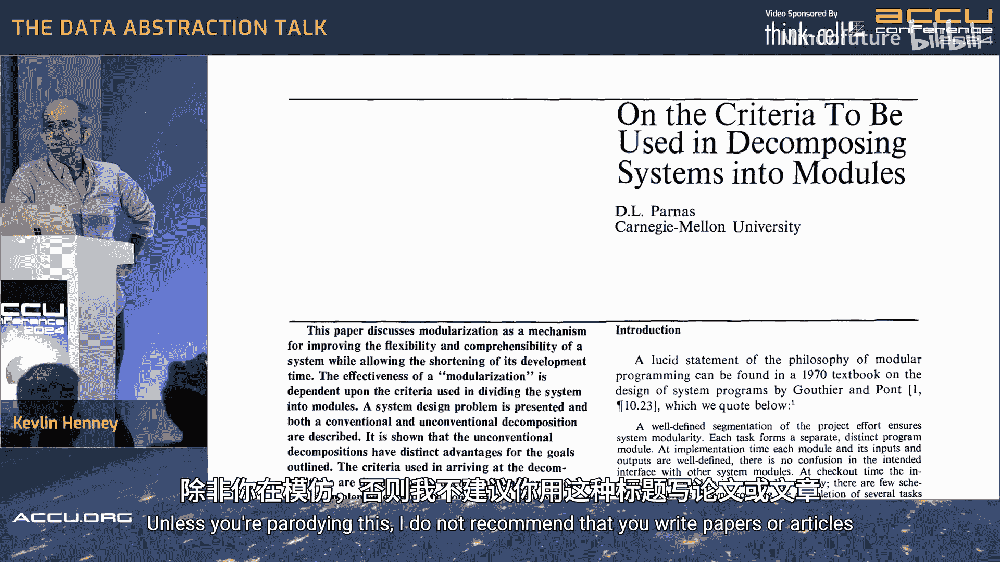

He was looking at units of modularity due to separation。

 Every module is characterized by its knowledge of a design decision， which it hides from all others。

Its interface or definition chosen to reveal as little as possible about its inner workings。

So we understand this is where we lead into modularity。Property of being modular。

Use of modules in design or construction。 And as that becomes as part of the medium of how we talk about and think about the system。

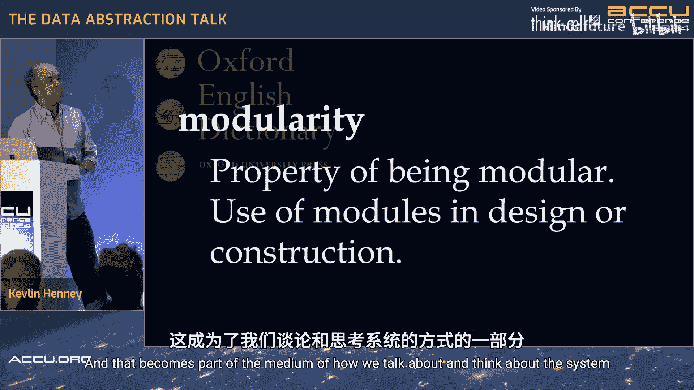

And so the history of modularity and data abstraction go very， very close hand in hand。

The idea of modules predates that。😡，Go back to 1968。

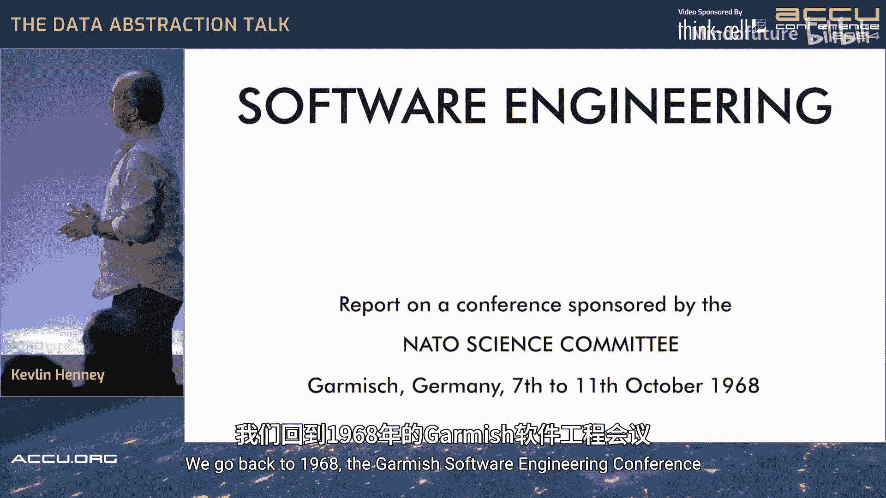

TheGarmish Software Engineering Conference modules were already mentioned。

But perhaps the criteria were not as clear。 But even then， some of them were still fairly clear。

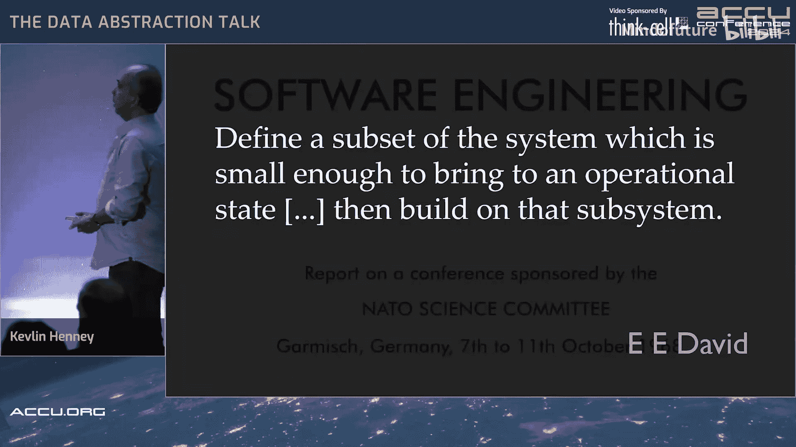

Define a subset of the system， which is small enough to bring to an operational state。

 Then build on that subsystem。 This strategy require the system be designed in modules。

 which can be realized， tested and modified independently apart from conventions for intermodular communication。

 Feel， you can take this quote， and you can apply it from everything to from classes to Python modules to microservices。

 whatever level of scale。 We see we're reinventing the same story and revisiting the same story every single time。

But that idea of that separation。And the benefits， again， they haven't really changed。

 the benefits expected the moduleular program， notice the wording。It's still tentative。You know。

 Pars is not saying， we know this。 He's saying， this is what we're expecting。 If we。

 we roll this one out。 the early 70s， people are exploring a bunch of ideas。

Benefits expected in moduleular programming are managerial。

 Development times should be shortened because separate groups work on each module with little need for communication。

This is about four years after Melvin Conway published his observations that become known as Conway's Law。

Product flexibility。 should be possible to make drastic changes to one module without a need to change others。

 We're not denying that we might need to change others that there will be some ripple effectt。

 What we're saying is that that shouldn't be the normal case。 That shouldn't be Os。

 Small change and tsunami rolls through the whole system。Comprehensibility， the human factor。 Well。

 in fact， they're all human。They're just at different levels of humans。 Okay， compresibility。

 It should be possible to study the system 1 module at a time to recognize this as the limitation of my individual bandwidth。

 But what we see is these are all human concerns。 The idea will' also notice product。

 a very rare use of the word product。People tend to phrase a lot of software development in terms of projects。

 This is the wrong metaphor。 Okay， product is the more powerful metaphor， but it's， you。

 very interesting that he uses that term。He also actually introduced the term information hiding。

In terms of the ability to control the amount of information in a previous paper。

 information distribution aspects of design methodology， again。

These titles have a certain quality to them that we don't necessarily use today。

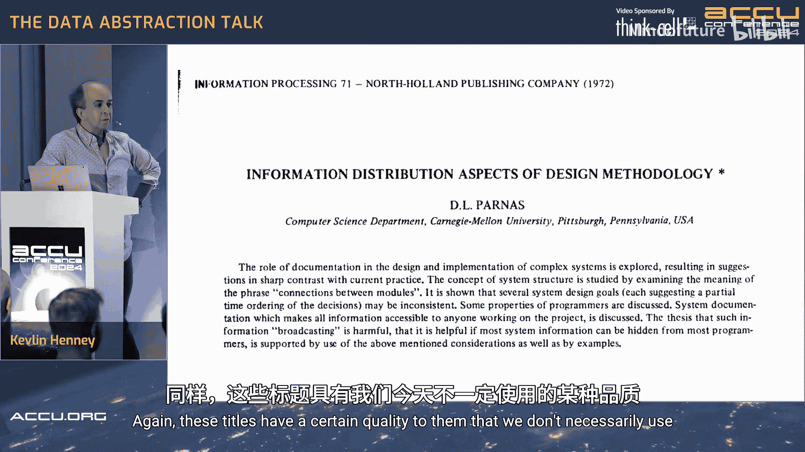

But he also said something else here。Connections between modules are the assumptions which the modules make about each other。

 I really like this because often when we talk about dependency management。

 we often think just in terms of physical things， I include that。 I import that。

 We think of it in those terms。 These are the terms that are relatively easily alyzable by Ides。

 and we can click through these dependency chains， but that's a subset of the dependencies。

 There are other connections that are assumptions that we're following the same convention。

 We have the same view of things。 And sometimes those assumptions are related to things like， well。

 I assumed you weren't running any threads。There isn't a piece of。

 There isn't a code construct that says， hey， there are no threads in this piece of code。

 or this piece of code is thread hot。But it's an assumption that we might have。

 And the point there is the code will compile just fine， and it may even work。Most of the time。

 except when it doesn't， but that's never going to be usefully repeatable。

 The idea is some of these assumptions will are hidden。 They are hidden in our heads or just imply。

 They are the conventions that we just see being used。So they're not as explicit。

So we can see if we have a thing and we depend on the thing。

We have other things depending on the things that depend on it。 If we go and change this。

We might experience a bunch of breakages。Now， depending on your language and what these units mean。

 if this is a dynamically typed language or this is a distributed system effectively dynamically typed。

 These are very loosely coupled， and that kind of breakage might stop there。

But if your system is bound as a whole。😡，Then that becomes true。

 structural breakage and everything breaks。 So this is， you know， if。

 if a little bit of your statically typed language doesn't compile。

 then the rest of the building going go that well。 Okay。

 so the point there is that these work out what your boundaries mean at various point and what these penencies are。

 So we simply say， you know what， let's separate。The concern， here is how I want to use it。

 And here is how I want to express it。 I will borrow a term from a book that I've kind of been forgotten by many people。

 particularly in the in the C plus community。 But from 30 years ago， Barton enactment。

 scientific and engineering C plus plus， which if you don't know。

 it does not immediately sound like a book of advanced techniques that might melt your mind。

But they had some really interesting ways of talking about things。And one of them。

 but they were referring to class hierarchies here。

 They were talking about separation between how you use something and how you create a usage type or use type versus creation type。

 And they're very much talking about the difference between here's how I build it。

 here's how I want to use it。 Now， obviously， these are not totally independent。

 But the idea is we want to give them a little bit of， we， we don't want to couple them too strongly。

 You want a little bit of allow certain amount of movement without shaking the other1。

 I want to be able to allow people to change。Certain forms characteristics without getting this huge ripple effect on the semantics。

So we go back to our dependencies and we make a core change that does not affect our interface。

 We may change something fundamental。 It's just like， well， that's great。

We may find that sometimes we have to change something about the interface。

 depending on what compatibility we're after， that may have the similar aspects of breakage there。

 But we're now in a position。 we can make that as a conscious choice。 rather than as an accidental。

 Oops， sorry， everybody， I just broke something or as as opposed to， right。

 here's something we can roll out。 Or yeah， here's， here is a breaking change。 But actually。

 most of the changes have been relatively non-breaking。But it also teaches us something about。

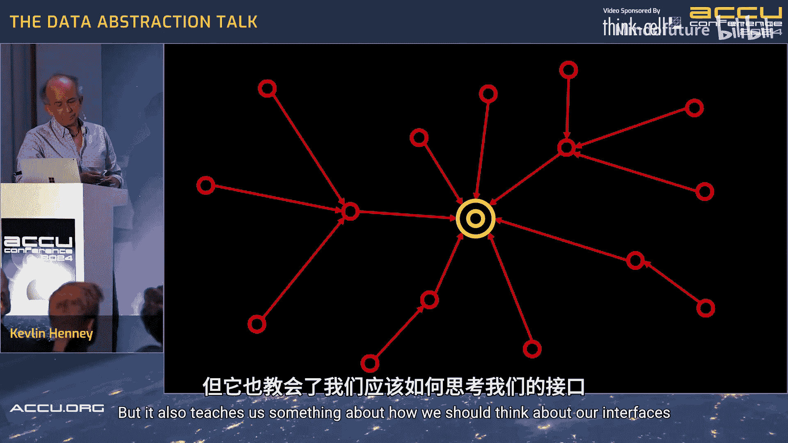

How we should think about our interfaces。So Martin Fowler。

 he talks about this idea in his refactoruring book， which was published。

 The original refactoruring book from Martin was published in 1999。

This was published in IEE software in his column in the early 2000s。

 published public versus published interfaces。And it's quite a useful idea。 The idea of。

A published interface。To something is something that you are。

Making available to people who are effectively outside your immediate control and influence。Okay。

So a different department。 Yeah， here's the stuff we have in my team。

 and we're able to change that freely。 We are all in the same repo。 We're all in the same branch。

 And that's great。 And then there's another part of the company that operates differently。😊。

But we're working with them， but they are not us。And therefore， whenever we make certain changes。

 we tend to get very irate people coming towards us。 So therefore， maybe。

 maybe we need to not do that。But also， there is this idea of that， So the published interface。

 The published interface is published and be damned。 You better be supporting it。

 You better be prepared to support it， but to make a difference。 Now。

 our languages typically don't have these as a construct。It looks exactly the same。 If I look at。

 if I go into Java， then a public interface looks like any other public interface。 I mean。

 C plus plus， this head ofophil looks like any other head ofophil。

 If this becomes a social convention is what I'm saying here， you， I'm。You can， can rely on this。

 I can support it。 this is， this is ours， this is separate。And we can change it freely。

 And we may be able to enforce that in various ways。

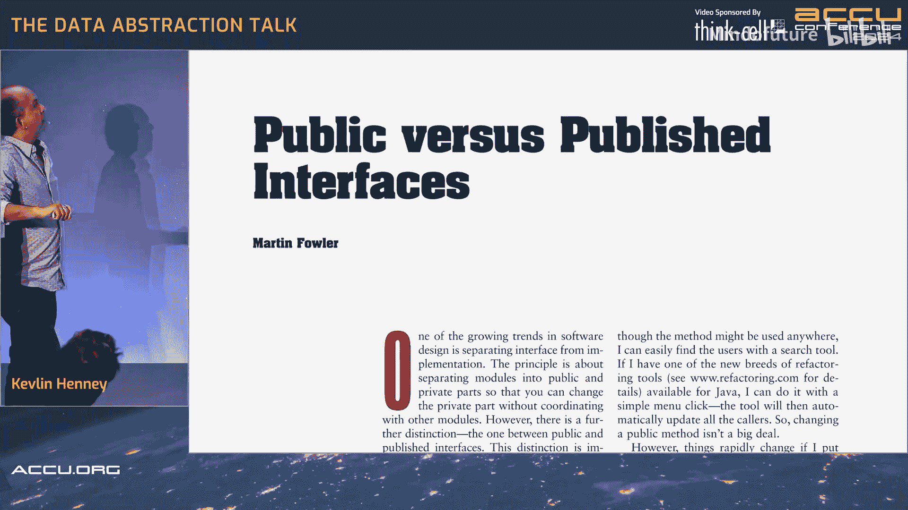

Don't treat interfaces as published unless they are。In other words。

 allow yourself the ability to change stuff freely and radically， if needs be。Within your own group。

 in other words， find where the boundary is。Hopefully it's not just around you。Otherwise， which case。

 you have some， you have some code ownership and management issues already。 But the idea is。

 where is that boundary， The boundary where you need to start having meetings or people start complaining when you do certain things。

 Where is that boundary。Is it within your organization or is it a boundary to another organization or other organizations。

 But don't treat everything。 And this is quite important because sometimes people say， oh。

 all code is， is library development， and we should treat it all like that。

 And's kind of a useful metaphor。 And I kind of went with that for a number of years。

 And I realized that's actually hampering our development。 We're supporting this。

And we're putting a lot of effort into stuff that's not giving us any value。 honestly。

 I should just be able to change it because the only people who。The only people who are affected are。

 you know， visible to me in this room or on a Zoom screen。 And that's it。 It's just like， no。

 we can change this。 It's our code。 Why are we giving ourselves。

 Why are we preventing ourselves the softness inherent in software。😊。

But then I need to recognize the boundary， but that boundary， you know， yeah。

 we've got to respect that。 We， we published it。And we realize we want to do something different with it。

 but we still have to support it。 We're gonna have to have a deprecation policy in place。

 And there's much more effort involved in that。 But find where that line is。

So don't publish interfaces inside a team。Publish as little as you can as late as you can。

 Do this empirically。 Discover what stabilizes， don't。Don't do what a company。In Marsbury。

 which is not not too far from here， half an hour，40 minutes drive。the诶。They had。

They had an interface definition a of years ago。 It's an interface definition。

And distributed system stuff。 And I was looking at it。And I thought this is really bad。

 from a distributed systems point of view。 this will incur terrible performance。

 This is not how you should be designing these interfaces。 And I was looking at this。

 But the best bit was when I looked at the version history。I， it was excitingly named， version 1。

Initial version，Honestly， that's a winner。 Well done for being very explicit。 In version。

 the best bit was the next version。😊，Which was three weeks later。 you could see three weeks later。

Amended to allow compilation。You've got to do this empirically。 If you're not， you know， this is。

 this is a dog fooding thing。 You've got to be actually using this stuff。

 You've got to generate and learn what it is that you want how you want to use these things。 Don't。

 don't publish something that just came out of an idea in your head。

 That's' that's the idea that came out your head。 That's your first draft。 fantastic。 Go for it。

 but don't publish it in a way that you are now committed to support it， or to apologize to everyone。

 So what does this mean， It means that there's a common practice， which is actually。😊。

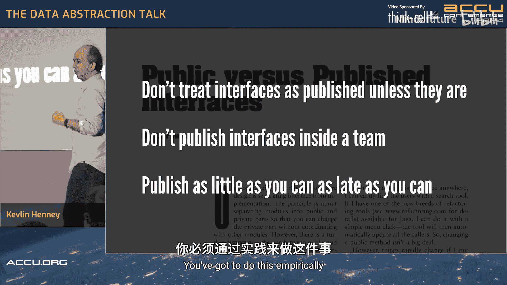

I don't want to get into this discussion， but the common understanding of the open closed principle。

 who has come across this。Yeah， yeah， it's wrong。 It's actually technically wrong。

 You can actually go and look at where it came from。 and it means something different。

 So that's a different debate。 So the publicized version of open closed principle is not what it actually means。

 originated with Bertram Meyer。 and it's actually about language design， not application design。

 Okay， it's actually about something quite different。

 But we are saying that we want our we want our classes in this particular case to be open or our units。

 he def framed it about forms any form of modularity。Should be open to extension。

But closed to modification。And a lot of people kind go， oh yeah， that seems right。

 And then they just start putting plugs and all kind。 That's not actually what it's about。

 But there's this idea of close to modification。 Why should I close my code to modification。

 That seems like a failure mode。This is exactly the opposite of what you want。

 If you are practicing O CP on your project or rather what you think is O CP。Stop。

 it's a bad practice， and I will defend the idea that it's a bad practice。

 It's basically the whole idea is I should be able to change the stuff that was within my boundary。

It's the stuff that's outside that boundary that's tough to change。 If you don't have any boundaries。

 Well， when there are social implications for not having boundaries， but。

If you don't have any boundaries， that's the problem you're dealing with。

So don't treat everything as a library。 Avoid them。 So this is surprisingly close to。Open， open。

So let's actually look at this， because a lot of people then start talking about， oh。

 he's going talk about object orientation。 Yeah， let's talk about object orientation。

 Where did it come from， so。

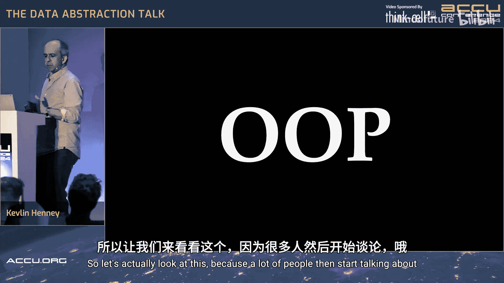

Here， we've got an array of pancakes， references to pancakes。ve got an in account。

We've got a bunch of procedures on them， depth， top push pop just we had before。

 and we've got an initialization。 That's a block of code。

 This is written in something that is like Algal 60， which gave us the idea of block structure。

 which variously is interpreted in terms of either words like begin and end or open curly closed curly grace。

 And then what we're going to do is we're going say， well， it's not just a block。

 It's a block and persist and endure。 Let's call the things that persist and endure objects。

 And let's characterize them as a class。 That's actually where objects came from。 Now。

 this is similar 67 code。 The clue to the year is in the name。

It was the first hour language developed in Norway。嗯。

But what people often don't appreciate is the fact that originally it did not have protection of state。

 It was not actually very good at data abstraction。It was good at putting things in a capsule。

 but it was a bit of an open capsule。It wasn't until S 86 that you could actually say， oh， no。

 please don't touch these and formalize it。So curiously enough。

 the original O O language did not have many of the things that we tend to associate with that。Now。

On this point。It is worth addressing something， because。I see a lot of stuff where people go， oh。

 yeah， I don't really like objects。 or I don't。And， you know， that's fine。 I'm not。

 I'm not here to say there's one true paradigm。 I I'm actually here to say there are many paradigms。

 But most of the time， people either understand object orientation is that ghastly manager centric stuff。

Which honestly， if you can do anything badly。 Yeah， that's one of the ways of doing it。

 Everything's a manager。 And we've got everything services and the rest of it conversation I had a few years ago。

1， one guy came up to me。I just done a talk on unit testing。 And he he asked me Kevin。

 do I need to test all the setters and getters on on these little objects。 And I said， well。

 you know， in my head， I go like the very fact you're asking that question tells me youve got a problem。

 What getters and set。 What do you mean all these getters that， well， You know。

 we got all all our datas in these classes which have getters and set。 And I said， well why。

 why would you do a thing like that？ that's a terrible idea。I said， well。

 that's what lots of people do。 or that's what， you know， know， that's I said。

 well because he was looking for an excuse to not test these because theses are trivial。 Well， yeah。

 But I said that's not your application。 Is it， You know，'s， there's not a lot of behavior there。

 So where's your behavior because in an object oriented system， your objects have behavior。

 But getters and setters， that's just like a glorifiedstruct， You know。

 but you're in denial about itsstructness。And he said， oh， yeah。

 all the behavior lives in these big manager classes and said， what， what about the test for those？

 He， they're too big and difficult to test。 So we don't test them。I said that， yeah。

 that's your problem， but a lot of other people use。The term object orientation。

 when they don't mean object orientation， Some people don't like data abstraction。 That's fine。

But a lot of people assume that these are equivalent。 They're not。 data abstraction is is is。

 is a separate quality that we find across a number of different languages。

 So in this book by Abardi and Kdeli， Obory program， they make a point here。

Objectated programming does not have an exclusive claim to all these good properties we've described。

Systems may be modeled by other paradigms。 Resilience can be achieved just as well by organizing programs around abstract data types。

 independently of taxonomies。 In other words， there the bit about object orientation。

 that makes it object orientation。Is， is the dynamic binding and the hierarchical relationships。

 It's not the。It's not the protection of state and stuff like that。 That's not unique to it。

Although we often take it as that， because perhaps our background。

 certainly when I first got into O O， my background was Fortran and C at that point。

There ain't a lot of hidden stuff there。 There ain't a lot of private。 So therefore。

 the thing that grabs you most is this。 And that's the idea that remind me。

 But it turns out that's just data abstraction。Which is a valuable method for organizing programs to make them easy to modify and maintain。

 These words keep popping up。 Inheritance allows one implementation of a data abstract to be related to another hierarchically。

 These two ideas are presented separately。

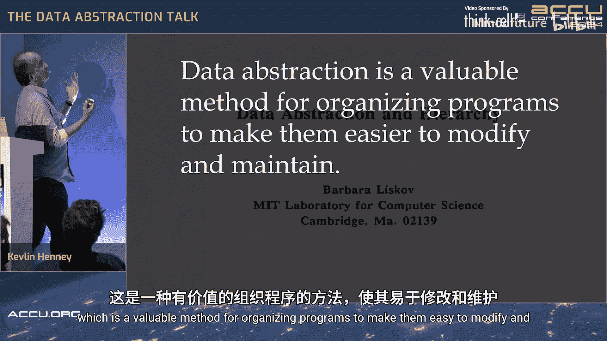

They come out of Barbara Liskov's paper， which is an addendum to the Os are 87。Proceedings。

 data abstraction and hierarchy。😊。

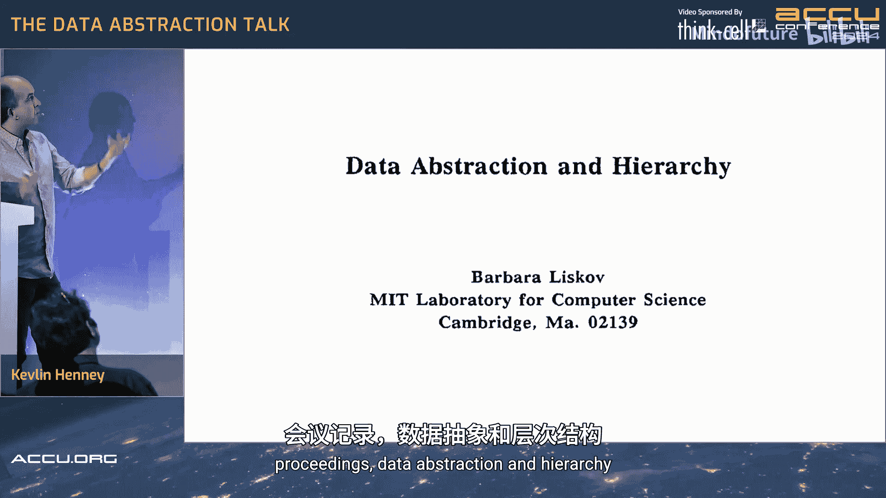

嗯， and。Lsoff highlighted this paper investigates the usefulness of hierarchy in program development and concludes that although data abstraction is the more important idea。

 Hierarchy does extend its usefulness in some situations。 She's been very cautious about this one。

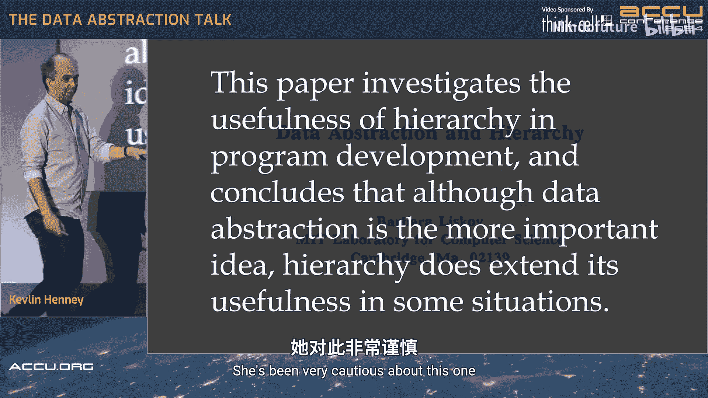

Right， and I agree with her。The point there is that most of the time when people are talking about hierarchy。

 it's not as important。 It's the data abstraction that's going to make the bigger difference over time。

嗯。And so we go back to the early 70s， her work with Steven Zills。

This is the first this is the first occurrence of ADTs。 I can't remember this is 72 or 73。But here。

 she defines the term。An abstract data type defines a class of abstract objects。

 which is completely characterized by the operations available in those objects。

A program is concerned only with the behavior which that object exhibits。

 but not with any details of how that behavior is achieved by means of an implementation， so。

This is very much the first definition。 This is what she's kind of describing。 And if you look。

 if I put， if I put that in a book today， you'd immediately assume while I talking about object orientation。

 But we find abstract data types underpin a number of different paradigms。

 We see them lot in the functional space as well。 statically type functional space。And。In this paper。

 we see the first occurrence of our friend， the stack。

 the most over specified and overused abstract data type in the history of computer science。

But this is its first outing to the best of my knowledge。 Okay， this isn't a language。

 a language that。Lsoff and others were developing clue， which was designed。With this idea in mind。

 modularity， modules were called clusters。And clue。

 the name is taken from the first three letters of cluster。It hid up there。

 you can see there's a reptype， The representation of something is hidden。 There's a public part。

 And then there is a hidden part。 And then we have these various operations。

 which are imagin to be enough called operations。 This is a lot of good stuff in this language。

There's also iterators。 This is where iterators came from and the yield keyword。

 the Co routine style iterator， all of this comes from here。 You worked with Python。

Ruby or any any or indeed， actually， this is closest to the C sharp iterator model。

 or rather the C sharp iterator model is closest to the the original clue one。

 There's a lot that goes on here。 that this language is just filled with history and possibility。

 but。This is what she describes。Now， most of the time when people refer to this paper。

 they refer to the list of substitution principle。 and often people apply that in an O O context。

 But that's not quite what she was saying。

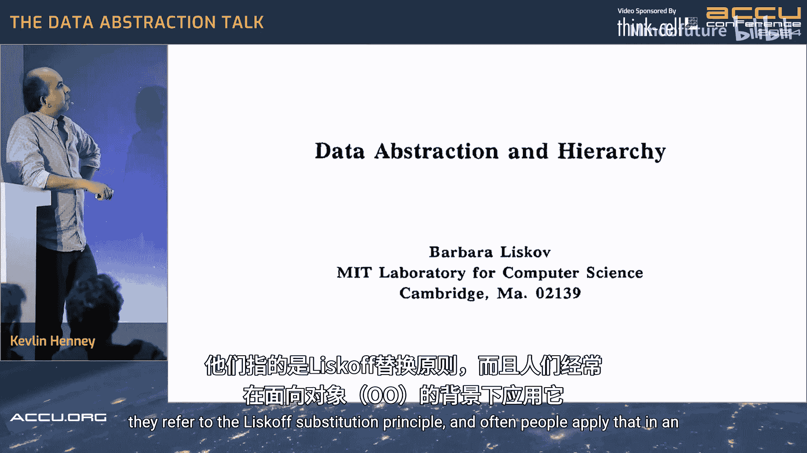

She's actually talking about type conformance， not class conformance。

 She talks about different kinds of hierarchy， subclassing versus sub typing。

Typing is about expected behavior， whereas classing is very much about representational inheritance。

 And she talks about this in terms of types。 So what is wanted to here is something like the following substitution block。

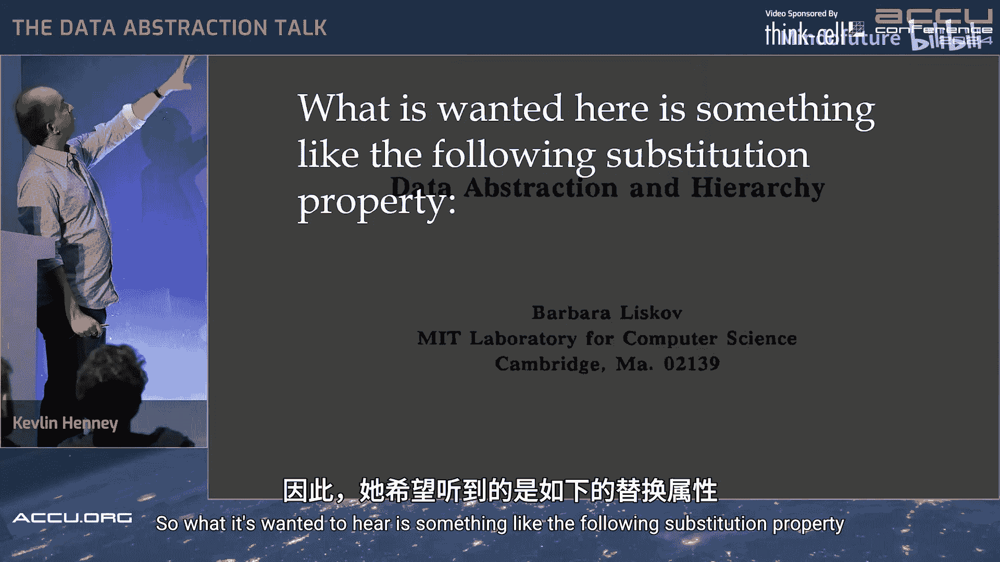

If each object O1 of type S， there is only， there is an object O2 of type T。

 such that for all programs P defined in terms of T。

 the behavior of P is unchanged when O1 is substituted for O2， Then S is a subtype of T。

 It doesn't exactly roll off the tongue。But， and because it doesn't roll off the tongue。

 People have often taken this as a kind of a general pluggability principle。

 Pgability is not the same as substitutability。 What most people see when they look at LSP is they think of it as。

 oh， simple conformance， simple pluggability。 but that's not what it's about。 It is very much about。

 She said the behavior is invariant。She's saying program behavior doesn't change。

So there is this idea， why is she talking about this？Why why do people pick it up as the wrong thing？

Okay， it's often used as a a kind of a guideline。 It's not that it， it's wrong。 It's just， well。

 it's not that， it's not a useful guideline。 It's just that it's not quite what was originally intended。

Why is that？ Well， because she presented it at an noO conference。

 the U in Uopsler is a bit of a clue。But also， her background is ADTs。It's about abstract data。

 So she's talking about the idea of。When we rebuild this with a different implementation。

 then we should expect the same results。Semantic results。

 there might be other characteristics when she talks about behavior。

 she's talking about semantic behavior， not performance characteristics and so on。Now。

 there are a number of these ideas that we can see。😡，Well play out。 We can come back to these。

 So for example， let's go back to see。Which I then learn I could actually do a number of these to apply these techniques in。

Let's have a struck stack。 and I'm gonna type def into that， rather than pollute the name space。

I'm going deal with the existential operations， create and dispose。And then I'm gonna have push， pop。

 depth and top。 So I've got my pancakes all nicely lined up there because I'm a seat， you know。

 because I recognize I live in a a multilingual world。 I will put these guards around it。

So this will build。 this will， I can deploy this head。 or I can ship this header to people and say。

 you know what， this binary back here， it does what you need。 You know。

 if you need to stack pancakes， I have a solution for you。Okay。😊。

And I can go and implement it and see。What's also nice is I can go and implement it in C plus， plus。

And they are link compatible。 And I'm able to simply do this at deploy or linkage time。Okay。

 depending on my linkage model， the whole idea here is the separation。

 this is even binary compatible。So。That idea that Par was describing a data structure。

 its internal linkings， accessing procedures and modify procedures are part of the single module。

 The degree is the question is how much does our language and environment support that view of the world。

So this takes us back to this idea of I want to support a rule。

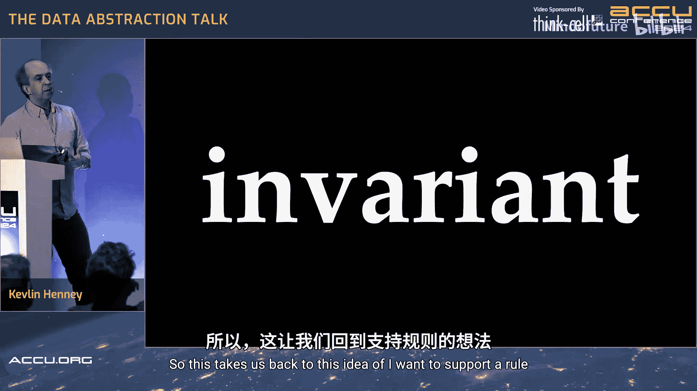

Let's look at let's look at a final example。

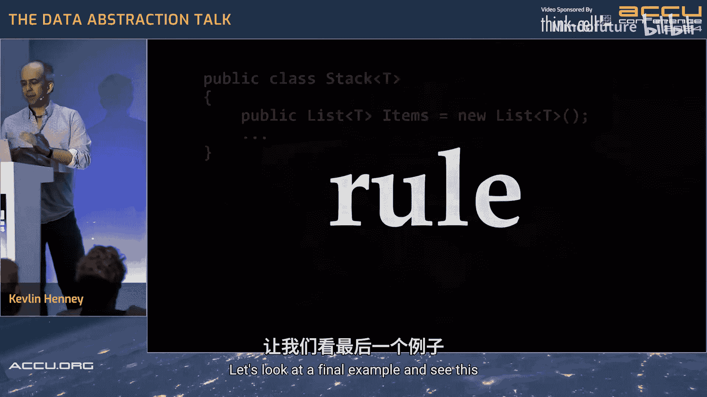

And see this。 So sea Sha。Again， a not inconsiderable number of C sharp programmers will go go ahead and make this public。

 But actually， most C sharp programmers won't。 will'll get to what they actually do in a moment。

So I've got a list of tea。 I've got my items。 It's going to initialize a match enough to a new list。

And I can initialize that list in the constructor。Honestly， take advantage of field initializers。

 But sometimes people will write a constructor or actually write a constructor。

 and they will tend to go for the biggest syntax。 You know， we will initialize this。

 even though we could have actually done it at the point of declaration。 Now。

 first obvious problem with this is I can go right ahead and say， you know， that list you've got。

Yeah， I've just killed it。Just throwing it away， no。Yeah， that's not good。

 We're not supporting the rule。 The rule is that， you know， once I've created a stack。

 you should be able to use it， you shouldn't have to say， by the way。

 has anybody meddled with your your representation， I should not be asking that question。😡。

The idea of a boundary， a capsule boundary is that thats where we。

 that's where we are able to guarantee what goes on inside。 We're able to offer some assurance。

So what do C sharp programs actually do just before I。Just before I'm terribly rude about C sharp。

 I' I can be rude about every program programming language。 I have that capability。 But just to know。

 C sharp， people who use C sharpr all。There's a few you。 Yeah， okay。

 so the most common thing that C sharpp programs will do is go， you know。

 you shouldn't have public data。 So here， what we're gonna do is we're gonna have a public property。

And public property。Is like public data。And we're gonna。

 it's gonna automatically create something you can get and set。 In other words。

 you can assign to it directly。 And it's just like you going like， well。

I've got exactly the same problem， but now you've used more syntax。😡，so。😡，Slightly more guru option。

We'll make the set private。 now we're getting somewhere。 Okay， now I can't write that。 Good。

 well done。 We've actually preserved。 We've actually respect。 We've got a。

 we've got some kind of rule。Its being enforced。 In fact， be say we'd write that as in it。

But honestly， you can just make this read only as a just make it a feel。 you might as well。

 instead of horssing around with like， oh， yeah， we have cleverly created getters and setters that are optimized away at runtime。

a bill time， you guys should just say， honestly， just look at it。There it is。 Ri don't。 Now。

 this still has problems， but at least we're being honest about what it is。

 rather than pretending it's， it's， it's got， it's shrouded in the syntax and therefore。

 somehow better。We go back to our friend top， which corresponds to that。

 And if we were actually paying attention， we could actually refer to our own operations。

 if we imagine that we've got an undo， an undue history。

 a classic example of a stack as opposed to pancakes。And on do list， we now that is the top element。

😡，Until we go and change the representation and flip it around and put it the other place。

 So we've got exactly the same problem that we had before。 This no longer does what we're expecting。

It's now shifted。But the bit I want to make a little more exciting here is I'm going do some validation。

I am going to say that。You can't pass me notes。Okay， you can't pass me nulls。 That's not a thing。

 Okay， I'm gonna to say a very simple philosophy here is that。This is an empty cup。This is not a cup。

 yeah。It's not a thing。 The， the value is not a value And you're not allowed to push that because it's actually not a T。

So therefore， I'm going say there are no nulls here。 That's become part of the rule。 Okay。

 we have an ordering rule。 We have all of that。 and we've got that。 And so therefore。

 this assertion should be true。True for all items， they should not be known。😡。

That's what I'm expecting， that's a rule that I'm going to say is true of this。😡。

The only problem is I can just go ahead and assign straight in。Well， that didn't work out well。

 And that's because guess what。 It's still public。 We've made that choice。 We've over offered。

 We have to make the whole damn thing private。 And then we might say， well， how do you traverse it。

Offffer people Look at how they're using it。 It goes back to the same thing。 Instead of like。

 here's a bunch of stuff。 figure it out。 It's like， here's how you want to use it。

 Or you tell me how you want to use it。 Or let's have a development process that feeds our knowledge about how to use it。

 Let's build stuff with it。 Get rid of the stuff we don't use。

And make it easy to do the stuff that we do。And optimize around that rather than yeah。

 we're just guessing what that team over there wants。 And so I can offer indexing， I can offer。

An enumeration method。 I can offer the ability to integrate more closely with constructs and C sharp by making a numeral that that works well with with link and with for each。

 I can do it at that level as well。 In other words。

 find out what people want to do and then build the thing that you want。

 But notice none of that depends on the private representation。 with simply offering service。

So now we can actually guarantee this because people do not have a way to mess about with the internals。

So this is this point。😡，Purpose of abstract is not to be vague。

 but to create a new semantic level in which one can be absolutely precise。

So that idea of the invariant。Being preserved by offering views。 Now。

 we can take views as a general form， allowow people to look at something， but it's the look。

 but don't touch。 idea。 It's the idea of I'm gonna I'm going to control what you can see。

 which allows me to optimize。Certain aspects of implementation。

 but also allows me to prevent you changing things that you shouldn't。

 but also not simply that you shouldn't that you you don't know you shouldn't。

 but also allowing people unrestricted change reduces your optimization opportunities。

 If you know that you know， if you， if you' are able to control what people do。

 you can optimize around them not doing certain things。 If certain things never change。

 that's an opportunity。 If you don't know whether certain things change because you publish them。

 that's no longer an opportunity。So controlling a view is kind of an important consideration。😊。

So let's come back to。A simple C plus plus stack。 I'm gonna implement it in terms of a deck。

 We'd have to worry about which way round it is。 We've done， done all of that。And I'm going to。

 I'm going to offer the simplest view mechanism that I can offer。Because we only have， you know。

 finite time。 I'm not gonna do ranges because there's far too much syntax。

 And that we're just gonna keep it nice and simple in old school。 I've got an iterator。

 And so I'm just gonna re exportport the deck iterator。 That's So that works nicely。

 It does the right thing。 so I can allow， I can make this integrate。 I've got my stack of pancakes。

 And'm gonna go ahead。 now I can sort my pancakes。 Yes， of course， pancakes are adable。😊，You know。

 they're not just regular pancakes。 They are audal pancakes。 You。

 there are some pancakes that are better than others。 We all know that。Or if you have， sorry。

 if you have children， you know that some pancakes are better than others。 I'm not eating this。

 Why not， because it's different。 It's not the same as the one on his plate。

 And it's just what There are ones that are better than others。 so we can order them。

So that's going to compile。 But my question to those of you who work with C plus plus。Is。

Will that compile。😡，Or will it not compile。Now， if you're not sure what I'm saying here。

Let's change it to a vector。Is that going to compile。Maybe， yes， that is the correct answer。

Because of the way the iterators are， we don't know what the hell is being returned。

 They are absolutely implementation defined。 That could be a pointer。

 It turns out that pancake is not in the SD namespace， so therefore， it will not find sort。

On the other hand， if it is something that is nested with inside vector， then， yes， it will find it。

 On the other hand， it could be something that is defined by the library。

 but is not in namespace S D， because there's no requirement that is actually in the standard namespace。

 So that might be provided by the library vendor。 It will then fail to find it。 In other words。

Honestly， we， we， we're really not sure。 or rather， it's one of those things that somebody else says。

 oh， you can't rely on that working。 Yes， but it compiles。The way you say in a static type language。

You're not supposed to do this is you make it not compile。

 So C plus plus is argument dependent lookup is anti modular。

 it weakens the type system staggeringly。 And there are examples of code where you have to go around and tell people。

 oh， you shouldn't do that。 Why not？ You can't rely on that。 We're just compiled。 And it works。

 It's very difficult to fight that。 So watch out for these little pitfalls。 because it's。

 it's basically leakage。Of an abstraction， you kind of encourages you to do this。

 So as examples of leakage of abstraction， there is a。

A practice studio near here that I go to sometimes with a bunch of others to jam。

 And what I want you to notice is so factory studios want you to notice in particular。

 the abstraction leakage here。You can tell how it's built。Okay， we have these accidental leakages。

 It doesn't even sometimes take failure to bring out these ideas。

 The idea is that unless we pay attention， we will accidentally leak some of these details。

So to kind of wrap up in terms of thinking about these kind of core ideas and return to。

Let we started。 there is this idea Mu and Stepanoff wrote about data abstractions。

 our data type and sets of operations defined on them。And this is very much the basis。

 whether you're coming this from an S TL perspective or classic O O perspective or whatever。

 you can do this。 This idea is expressible in a surprising number of languages and is and can be found in part or in whole in a number of different languages and what varies between languages is support and affinity to modularity and the way it's supported strongly or weak and by the conventions around。

 There are abstractions mainly that they can be understood independently of their actual implementation。

 Now， that does not mean that's the full understanding。

 When we come to certain characteristics we care of that。 But it allows us to separate something。

 The biggest challenge we have is complexity in dealing with it。

 And we need ways of accommodating humanity and the code。So quoting the artist Han Hoffman。

 the ability to simplify means to eliminate the unnecessary so that the necessary may speak。

The idea we're doing here， Elilimination is a strong word here。

 I'm gonna to use separate because it turns out that it's true it's actually just as true in art as it is in the code。

 You never really throw anything away。 What we're trying to do here。

 A lot of software development is about separating things going， aha， this is not what I wanted。

 I can throw that away。 or I can combine this。 It's mostly about separation and simplification。

And data abstraction is one of the classic ways that allows us to make this journey of discovery effectively。

 It's not a silver bullet， but it's not a bad bullet in that sense。 So thank you very much。

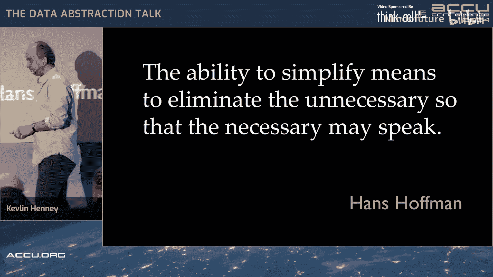

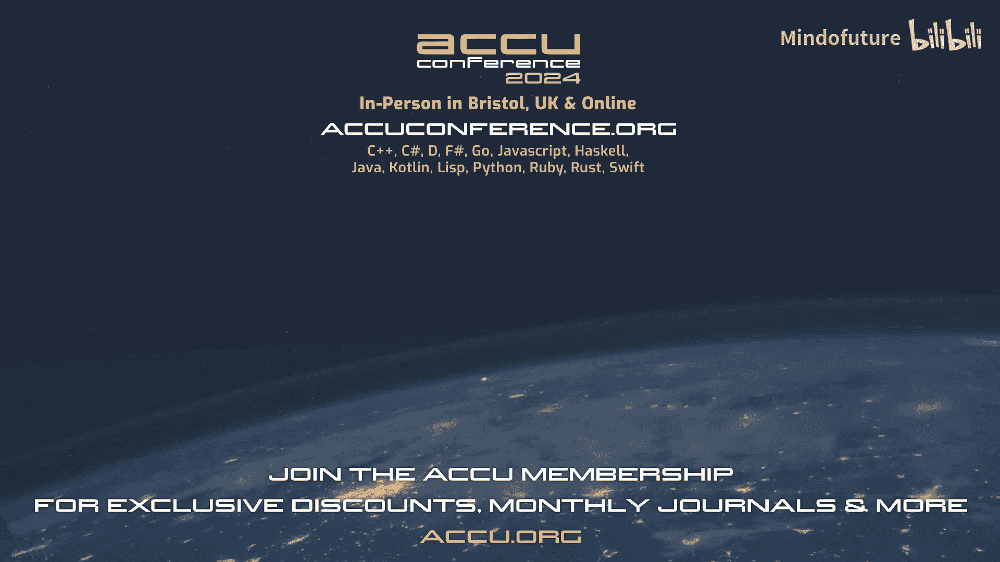