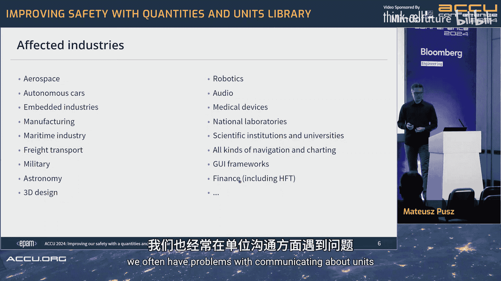
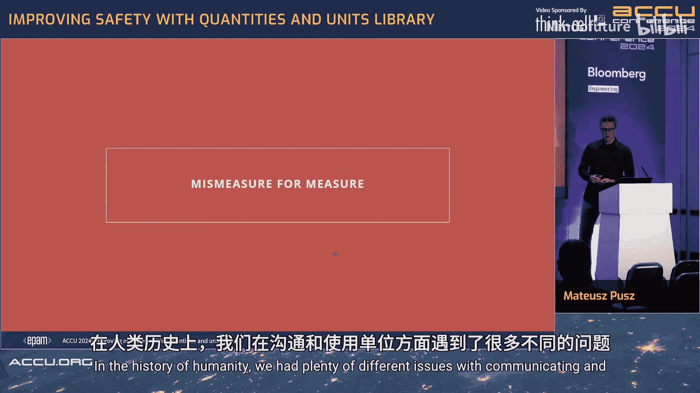
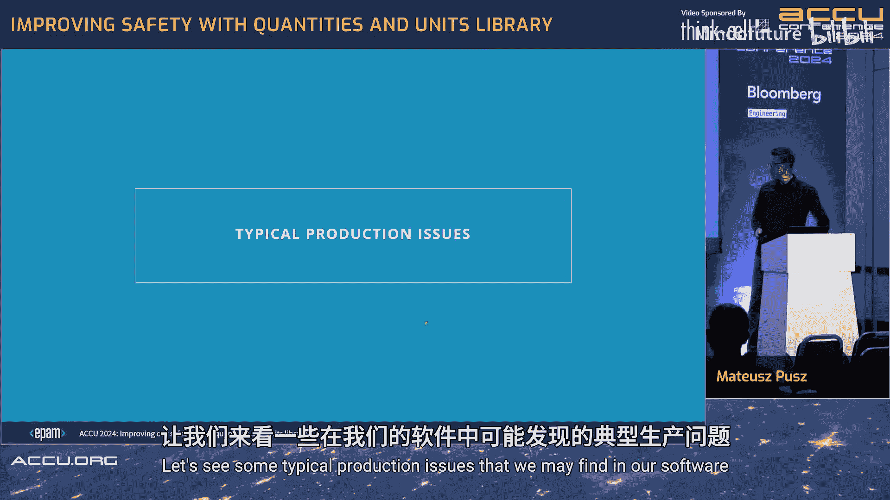
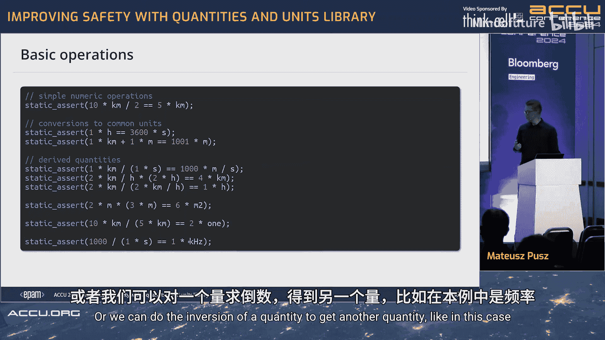
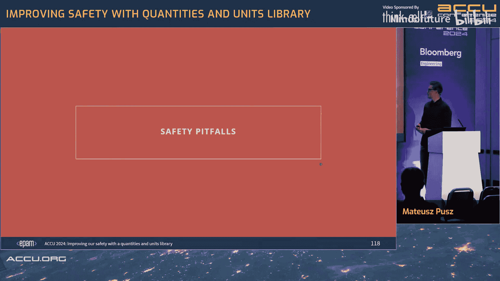
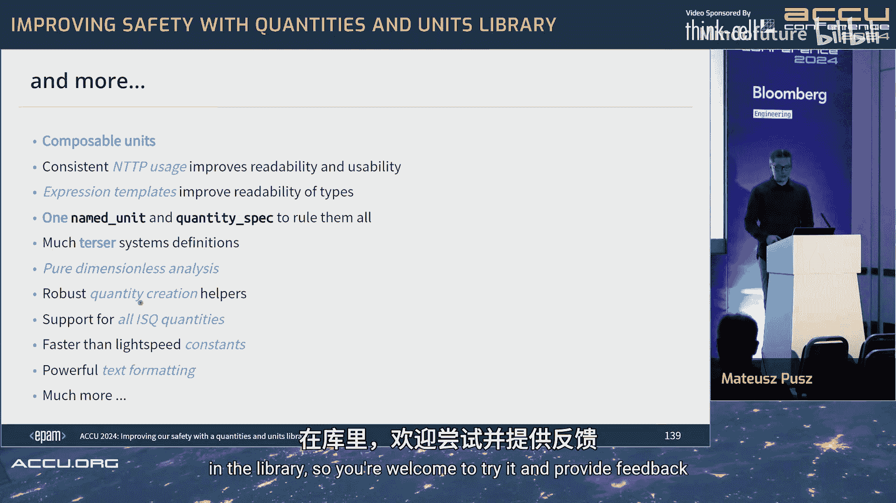

# 中英-•-C++和C语言ACCU大会2024｜人工智能｜架构｜函数编程｜静态分析｜安全｜编译器｜开发者｜垃圾回收｜链接器｜代码生成｜cmake-p32-P34-Enhancing-Safety-in-C++-Code-With-Modern-C++-Quantities-and-Units-Library----BV1pNotYYELk_p32-

Welcome everyone。 Today， we are going to talk about safety。Safety is an important aspect。

 especially in the latest times when some people， some governments state that C plus+ is not a safety language。

This way I would like to show you some examples where actually C++ can achieve more and then any other language in the world and actually on the example of the Conntingent Uni library。

 we will see how we can improve the safety， not only of our software。

 but also of our daily lives because we are not only programmers。

 but also users of our products often that we are going to talk about soon right so。

Not that long ago， said driving cars were the thing from the scifi movies placed in a distant future。

 right， If you've seen some old films with， I don't know， Arnold Schwarzenegger or other guys。

 it was like years 2，22000 or whatever。 And the guy was getting into the。

 into the car and the car was autonomously driving to the destination without that driver。

This distant future actually starts to happen right now on our roads。This is our reality right now。

 right。 And while the autonomous cars are driving us to the destination。

 we would like to be able to rest， maybe sleep or do our work in the meantime。

 trusting the machine that is doing。 it's a job。And it not only bought an autonomous cars， right。

 in our daily lives and in our current。Reality， we depend on machines， more and more。On daily basis。

Right， we have surgical robots。 We have planes。 We have rockets。 We have plenty of other things that。

Make our life easier。But also may make them unsafe if they are not programmed properly。

And there will be more and more things that we will depend on in the near future。

C plus safety is a major concern in the C plus plus community In the recent years。

 We discussed potential improvements to the low level fundamental types， like safe teacher types。

 for example， and， and other。Proposbilities to， for example， find overflows detect truncation and。

 and so on。We also would like to update some core language rules。 for example。

 in sation to be safer and better。But we can also provide safer high level structures with librariesers。

 And this dog is example of one of such cases。Cpl developers need some help here。

 It's not only about training because we lack a lot of training in our industry。

In order to make our engineers grow， but also。It turns out that。

The safety domain is a special domain in C plus plus programming。

 and not many people have experience in this。And this experience is quite hard to come by。

And it also happens that often in this domain。People that use C plus plus are actually not C plus plus programmers。

 I mean， not experts。 Those are just。Physicists that do the work using C++ as a tool。Right。

 so they are not template masters。 They are not able to understand the template errors by by C plus plus meta programming。

Libraaries。And that's why we have to try to somehow， address this。Com问电子文。

There are plenty of affected industries by such laborers。

 The obvious choices are the autonomous cars in aerospace embeddeded industries。

 This is the first that comes to our minds。 But there is much more。 There is manufacturing， maritime。

 military， astronomy， Gui design， even audio。 we had really nice talk about audio on CPcon last year。

😊，Also， finance including even H HF T， so plenty of different industries can benefit from such a library。

It's not any niche。 It's actually really popular and needed。 think on the market。

And this is not that the， well， first of all， this is really hard to to use C plus plus in many cases。

 but units and quantities are not only about programming。

 They are inherently complex problem by themselves。Right， even in daily lives。

 not doing not talking about programming at all， we often。

Have problems with communicating about units。

And the history of our。Basically， in history of of， of of， of， of， of humanity， we。

Had plenty of different。Issues with communicating and using units。

Let's start with Christopher Columbus that on October 12，1492， unintentionally discovered。America。

 while travelling to to Japan and India。Right。Actually， he survived because he made a few mistakes。

He actually we， he used different length for a mile that he was about to。Used for his calculations。

 And because of it。And he thought that that the world is much， much smaller。

 That's why when he reached Bahamas， he thought it's Japan already or India。

Va was a famous worship that in 1628 sunk less than a mill mile into her maiden voyage。

The result of this was the 30 sailors died， unfortunately during this accident。

 And the reason for it was that one of the sides of the。

 of the ship of the hull was thicker than the other one。

Aronologists claimed that it is the reason because there were two different teams working on two different sites。

 One of them were using ruleers that were calibrated in Swedish feet with which is 12 inches。

And this， then the second team was using the other ones using absurd up fit。 That was 1 f shorter。

1 each shorter， yes。And because of it， it was heavy on one side。 also because the ceter of buoyancy。

 because of other errors was above the water。 It was really easy to collapse during windy day。

I reckon the flight，143。On July 23，1983。Run out of fuel at the altitude of 12，12000 M。

The reason for this was that fuel had been calculated in pounds， instead of kilograms。

And there was not enough to reach the airport。 Fortunately， no one died the airplane。

Glided to the to the nearest airport and was able to somehow land。And everyone survived。

British rug band， Black Sabbath during its Bgan tour in 1983。

 Order the repa of Stonehenrench as prop for the scene。Unfortunately， the manager。

 while submitting the order order， wrote down the dimensions in meters when he fit。So as a result。

 they built huge replicas that were really expensive。

 and they couldn't fit in nearly any venue they were providing the the concert。 As they said。

 it cost a fortune to make。 but there was not a building on earth that could fit all of this into it。

Actually， it was bigger than actually the original Stones。Korean Air cargo flight，63。16 on April 15。

1999 crashed the miscommunication between between the first between the first officer and the and the pilot。

 The first officer officer misled 1500 m to 1500 feet and ordered the pilot to go down。 pilot obey。

Entire crewite， three persons and five innocent people on the ground as well。

Mars Claartometerter is probably the most famous accident that we had in our engineering。

 right in 1999， it failed to enter the Mars orbit and crashed while entering its atmosphere。

The reason for it was that actually NASA was using S I units while the Lock marketinging was using US customary system。

 and they didn't communicate well between the interfaces of different modules in the space probe。

Clarence de turtoise in February 2001， was moving from one zoo to another。

The crew crew of the Moon Park College Zoo built an enclosure for it based on the information that they obtained from through the through the phone from the source location that this。

Turtter white，250。It turns out that it was 250 kg， not pounds。As a result。

 Clarence broke entire enclosure in the first night， and they found him。In the garden。

 eating vegetables next day in the morning。To Disneyland Space Mountain coster due late in December 2003。

The reason for this was a broken axle that was caused by some confusion after ebrading dis specification from imperial to metric units。

There is a bridge between Switzerland and Germany。Over the Rhina river。嗯。

The bridge was started by two different teams， on two different sides。

And they were meant to meet in the middleu of the river。Unfortunately， it seem it。

 it turns out that the Switzerland and Germany are using different reference level for a mini level。

Germany using North Sea。And while the Switzerland is using Mediterranean sea level。

 the difference is 27 cm。But if， if you think it was the difference， you are wrong。The difference。

 actually， was totally different。As we are going to learn later on， but。Basically。

 there was assigned signed error and did one of the teams， instead of。

Subtracting the value added the value because they forgot which one is lower。

An American company sought a shipment of wild rice to a Japanese customer quoting the price of 39 cents per pound。

 while the customer fought its3 per39 cents per kilogram。

And then they had to resolve the issues during the transaction。And even recently， in October 17，2023。

 the Guardian provided an article stating Malavi sweatlters with temperatures。

 nearly 68 Fahrenheit above average。If you know something about foreign Hes， it's quite a lot。

Above the average。Right。The actual temperature increase was 52 Fahrenheits only。嗯。

And the reason was because they misled the abstractions in I find space。

 So they use differences and points。And， and recalc the， the title that was meant to be。

Published in Europe， then they've translated this to the US and used incorrect calculations to do that。

And there's plenty of also of documented medical dose errors that happens all the time because medical those errors and。

 and， and units are really， really strange and and hard to communicate as well。

And nothing of this has has。C plus plus。As a source of the issue。

C plus plus just adds another layer that that makes this problem even harder。

Let's see some typical production issues that we may find in our software。

This is one of the open source softwares that I。Contributed for a while。And， and， and。

 and the Windows interfaces really scary。 And this actually motivated me to start working on physical business libraries。

As you can find it， double can be used everywhere。Right。

It's so hard to actually remember the number of arguments。 It's so hard to refactor this function。

By changing did the order of them。Or adding a new one in the meu。

It's insanely hard to basically maintain the software。Another function。

Pvides plenty of magic numbers。I was afraid to touch it。I don't know what it does。 No one does。

Any more。Such software uses plenty of conversion macros to the deconversion from one unit to another。

Of course， not all of the。Conversions error。Defined， so you have to do this in steps。

 which is another inefficiency of the software。But it turns out that even with such an approach。

 there's a possibility to do mistakes。When I grabbed the same repository for the same macro。

 I found at least four different results in the same repository。This is one header file。

 Those functions are one next to each other。 Exactly。 This is copy paste of the header file。

We have distance。Sp face S latitude， longitude， double distance latitude longitude。Ltitude。

 longitude， longitude， laitude， longitude， latitude， to be consistent。Right。

 or to be consistently inconsistent， the same applies to the stance and bearing here and here。

How to make it work correctly， How to play with the software。

 how to prefactor stuff if the interface is like or like this。And you think this is just。

Bed open software。That doesn't have any standards in the rules。I'm doing this for seven years。

 And when I started talking about this， plenty of people contacted me saying。

 I cannot share my source code， but spice source code is much worse than the one you presented in your presentations。

We have much bigger issues in the production， as well。

And I assume you are here because you know something about it already。That's why we want to improve。

So。😡，I started to write the MP Uist library， about seven years ago。And also。

 it is proposed for standardization。 Soization is not the ultimate goal of this library。

 but it would be nice to have it in the standard， if only possible。First of all， of course。

 we want to provide compile time safety right by this having correct handling of physical quantities。

 Uni and numerical values， correct and and detectable at compile time。

Performance has to be as fast or even faster than working with fundamental types like Taoo。

 otherwise no one E++ does will use it。Right。ThereThere should be no runtime overhead and no space size overhead。

Which is for for us may be obvious in C++ domain。 but if you look for other solutions like in paint or Java。

 they are paying enormous cost for abstractions on units。

Both in random performance and in space needed to store those abstractions。

So C++ is an awesome language， probably the only language that allows for any all of the features of this library in the way we do here。

Great to experience。As I said， typically our users are not engineers， C++ masters。

 they are just using this as a tool to make the things done。

They do not understand complicated templateepid error messages。

We want to provide something as red and as easy to use as possible。And also， easy and flexible。

Because this has to be extended by the users for their own needs。Scope。

 we should be able to provide any unit's magnitude， huge， smaller floating point。En of those。

We should model a system of quantities， system of units， the Fine space abstractstructions。

And we should provide， of course， text output for debugging and printing stuff。

There are color vector and tel quantities we would like to support。 And also。

 there are some users that would like to use this with natural units。Which is quite tricky。

 if you know the domain。And， of course， it should be easy to extend。Currently。

MP unit compilelies with C Pla 20 on two major compilers this and Clk。

 Apple Clk also somehow supports this because it's always like one release behind the clk。M SVC。

 unfortunately， sucks and doesn't compile it at all。 I try to fix this。

 but there are just too many issues in the SVC compiler on the first+20 support。

 I'm not talking about C plus 203 features here right now。Hopefully， MS SBC will will catch。Soon。

 the party， but for now。I have to deal with D C and the clk。Besides C plus 20。

 we try to benefit from the latest possible extension to the language in order to provide the best API。

Possible for the possible standardization in the future。 right now， we consider C+ 29。

 So C 29 should not be fixed to C+ 20 because it will be already all at this time。

We should try to benefit from the latest feature as much possible to provide the best possible experience to our users。

 That's why we also benefit from St format from 20 C plus model from 20。

 but also with additional 23 abstractions and possibly we also use 26 abstractions， if possible。

 to improve the library。There are really nice features coming in 26 that could improve this library。

 as well。But always， we try to be compatible with 20。

 So all of the new features come with workarounds provided with compilation presor macros to be able to work compatible C plus 20。

 So don't worry， C plus 20 will be enough for this library for a longer time， at least。都。

Compet fine呢。Only if you have a better compiler and new a compiler。

 you could benefit from simplified interfaces or maybe a bit faster compile times。

The library is available on Gitthub in Canan， and you can find it on compiler Explorer as well。

Ty hospitalization。 I provided this paper like 4 or five years ago。 It was before Covid。 So， yeah。

 time flies。5 years ago， at least。Where I provided analysis of what is on the market and asked the committee if we want to follow this path。

The answer was yes， and I started my work on standardization。 Unfortunately。

 COviID happened in the mid， so everything slowed down。But there are more preparation coming。 in 29。

80， I provided motivation， scope and plan for physical in。 And in 3045。

 I am describing the design and all of the aspects in detail。😊。

There are also some associated proposals， some dependencies for this library。

We would like to have also the library of number concepts that would allow us to provide better interfaces。

 better constraints to our， to our interfaces。啊I不。I implemented basic fix drink and provided a paper about it that will allow us to have standardized way of passing。

Text to entityTTP parameters of templates。And also， we could benefit from Comp  time prime numbers。

If this was standardized in the library as well。It's seems that there's a high interest in both Io committee and in Cpl community to have it standardized。

The aspects are first of all safety， but also， it's important to be standardized because those。

 this is about so called vocabulary types。 vocabulary types are the types that are used to communicate between different vendors。

 interfaces。And those are exactly due cases here， right。Talking about Mars Clmato orbiter。

 NASA and and Lo Martin， they should have common language to communicate their interfaces。Otherwise。

 well have mistakes like this all the time。Before we go into the interface as Cpl code。

 let's maybe talk about a bit about quick the domain itself。

 So let's do some some simple introduction。We have system of quantities。And the system of quantities。

Is a base for several system of units。This is something that this library does a bit differently than all of the others in the market。

 because most of libraries scope only on system of units， one or more of them。

But none of them tries to model properly of quantities as an orthogonal。NT弟。

But this is how it's defined， officially。And set of quantities。

 the set of quantities together with a set of equations relating those quantities together。

We have one big system of quantities that is specified provided by ISO。

It's a set of quantities based on the seven based quantities that you are probably aware of。

 I will show them on the next screen。And there is a system of units。

 System of units is a set of base units and direct units together with prefixes。

For a given system of quantities， so system units is always based on system of quantities。

 and SI provided by CGPM is based on the ISQ， and they stated officially in their documentation。

Those are the major entities involved in this domain。Dmenion。

Maybey either a base dimension or or a dimension of a direct quantity。

 and we have seven base quantities in the ice co。Lth mass， time， electric current。

 thermodynamic temperature， amount of substance， luminous intensity。

 Each of them has the unique symbol。We also may talk about dimensions of the right quantities。

For example， force is denoted as LM T-2。But notice that the force by itself does not have an associated。

Simbol。There's not as as a dimension of force。Force has some direct dimension based as being a product of base dimensions。

But it's not a derived dimension by itself。 It's not like strong type， right。

And this is what most of the developers in the market do。

 let's say incorrectly because they define things like dimension of speed。

 but there's no such thing actually in Tori and the domain。

Because dimension of speed or force is just。Product of base dimensions。

 rather than a thing by itself。Denssion is not enough to describe a quantity， it turns out。

There are quantity of different dimensions， of course， like length time speed power。

But there are also。Qu its of the same dimension， but different kinds。Like work versus talk。

 frequency versus activity。Or even things like aea versus fuel consumption， right。

 Fu consumption is like litters。不。Km。Eers is a volume。If you divide volume by length， you get areaea。

But I would not like to be able to add football football field to the。Few consumptionial of my car。

 right？It was insane insane。To allow such calculations。At least in some domains。

 because maybe you have a domain where actually it doesn't matter。The same， also。

 there may be quo of the same dimension and the same kind。

 but still distinct radius with height are different quantities， the same as potential energy。

 kinetic thermodynamic energy。Sometimes you don't want to mix those。In the interfaces。Right。

Aic documentation states that there is something called quantity reference and quantity reference can be a unit。

This is a strange term， and especially in C plus plus， it's quite overloaded。

 So I don't know if the term would survive， but we try to be at least for now。

 compatible with official specs and saying that。Contiual for being， in this case。

 a unit is basically designated by commissionary assigned， name and symbol。

And do you have base S units for all IQ dimensions。Right， we also some derived units。

 and the may be shared between different quantities like heat capacity and enroppy are using d calovin。

But also， it turns out that。Some quantities have dedicated units for their needs。

 even if they mean exactly the same。 So one per second is a unit by itself in many domainomaamines。

 But if it's about frequency， then we should use hertz。 if it's about activity of radiodnucleide。

 it should be be。Even though technique is one per second in both cases。

And you should not be able to say activity is measured in herds or。Or frequency in backgrounds。

 because it's incorrect。Additionally， quantity difference is a measurementasable procedure or a reference material。

 but its something that we are not going to cover in C plus+。And quantity， by definition。

 is't just number and the reference。So。Those numbers may be either colors。Vectctorors。Or tensors。

This is also important in the aspect of linear library usage。

You would like to address those use cases as well。 and right now。

 no library on the market can survive that。In the C++ industry。

 the only one that I' am aware of that survives it is paint in Python because it's based on nup。

The basic operations we do in the library are of course。

 simple and array operations like division or multiplication by scholars。

 we can of course convert some units and find some common units during conversion。

 this is what Chrona does。😊，But something new that comes with the library is dividing different quantities or multiplying different quantities by themselves so you can get speed and speed by time is length and so on。

We can also multiply the same quantity to get even another one like areaea。

 we can divide two of them to get a dimensionless quantity。

 or we can do the inversion of a quantity to get another quantity like case in this case frequency。

So， let's see。How the code using continuous library looks like in practice。

This this is a code that is Legaan with no。Library used， right。

 What's important here is that each and single identifier tracks the unit being used。

If you're not using this right now， probably it's really hard to real reason about the code you。

You德会老。Or们 maintain。We have distance in meters speed in mice per hour。

Then you have provided here some ratios in order to convert those。Actually， this is。

 I think meters per hour in this case。 and this is mice per hour。

 It's even hard to not not find out those。Those post fixes， what they mean。And you have some reason。

In order to get the result， you may provide。Magic numbers。But we don't like panic numbers。

 That's why。In the library， we typically provide some conversion macros。

 the same thing that you've seen already。 if someone thinks that macros are wrong。

Then people provide concept， nice conversion factors。Yes， I'm good。 I' am using concepts。

And that' is where we have。In many cases。With the Uni library。

You don't have to spell any units in the names of the arguments or variables because this is embedded into the type。

In this case， we're using CTt， so cluster program inductionuction to not spell it because it will always deduce the correct type use on the right hand side in the initializer。

I'm just interested in， in the abstractstruction here and say， I'm dealing quantity here。

 It's always better than than say auto。😊，With quantity you know what you are dealing with with。

 sometimes you may be confused。Right， but seeta is enough to spell it。

 You don't have to spell an entire type。And you're using here meters miles per hour。

And you can easily。Co divided， take the value in seconds and have the result without need a need for intermediate value like here。

And you get exactly the same result in both cases。There's no need to track units。

And library by itself knows all the conversion factors you don't have to provide any magic numbers。

 macros， context， ratios。And in users are not needed because the library will do。

All of those steps for you， if needed。The main。Go of such a library is to generate errors。

If you are not going to make any errors in your software， this library is not needed。

If you are flawless。Then while to bother， Russio's doubles。Right。

 so if I will provide the mistake in my calculation。

Is that the I will do multiplication in both cases。This code will happily provide the result。

Whatever it means。If you will do this with library， that is safe。

You will get a compile error error like this one， no magic member function to call it to full constraints are not satisfied with the unit being second。

 because unit of second is not the unit of quantity of length to power of two per time。Alright。

You can also provide functions with those interfaces right if you don't have library。

 you have to specify arguments using the same syntax have post fix。

 but also functions should get the post fixix to say what is the result of it So this is time to go in seconds。

And then you implement the the logic of a function。With strong types， you know exactly。

What is the unit in the type？So you don't have to encode this in the variable name。With0 plus 20。

 we can have this great syntax。Usic entity piece。Where。It is really easy to read， and reason about。

And this was not possible before C 20。 That's why this library requires at least C+ 20 to work。

And there's no way to provide it。Earlier， with those interfaces。It is to be really， really。

 really hard。So if you want to call this function。You have to again。

 provide all the variables with the post fixes。And you'll have some result。In this case。You can。

 you don't have to do postpices。 I just provided those because I want internationally to have two different objects here。

 I will show you why in the， in a moment。And this is how I create entities， right。

10 km kilometers per hour。And they call it， and they get exactly the same result in both cases。

If I will use kilometers here。This code will happily compile and provide some result。 Of course。

 it's incorrect because this is not meters。 Translation was not applied。Conversion， right。

In this case， of course， if only it is nontri anti conversion。

 then the conversion will happen automatically by the library and you still have 400 seconds the same as it was before because this is the same value just converted to a different unit。

If you will provide。The arguments in a different order， in both cases。

 you will get another incorrect result。From from， from from the legacy code here get another error。

 right， st could not convert speed from quantumnt。Quantity of kilometer per hour，2 m。

If you do other error with multiplication in the implementation。有一个也在哪头。一修。From this code。

 and here we get another compact error saving that we cannot convert。The result。Bing kilometer。

Per hour two second。And what about performance。You have left code and right coat。

This is the assembly of the left code。This is assembly of the right code。

Exactly the same instructions， in this case， they are reordered because I'm doing the computations in another order。

 but those are exactly the same instructions。But this often requires us to convert the input and output to a some specific unit and then from some specific unit to maybe unit you are working with。

With strong types， we can provide。Buttter abstractstructions， we can provide generic interfaces。

We may say that we have quantity of length， quantity of speed and quantity of time being used here。

But we don't spell what is exactly being used， what unit is being used。

 what representation type is being used， We don't need to pay for those conversions if they are not needed。

It was not possible。If you not could not contrain this easily with contacts。Right。

 if it was interfaced just on doubles， there would be no way to spell it for this to be type safe。

If there were no concepts， it would be really hard。To make it right。

Argument you could constrain maybe in a leaf in an older language version。

 but constraining the return type。It's quite。Prigmatic co they believe。So let's see。

 I may provide fits and mice per hour as arguments and get the result， convert these two seconds。

And find out how much time is needed before I have to turn right。On the crossroad。

I can use different units。You think this turns to the garden lake from my home。

 the ever speed I predict to have and find out was the time in hours in this case。To destination。

The only cost we pay is the cost of this division。 You don't have to pay for any intermediate conversionvas on the input and output。

Because typically if a user provides something in kilometers and hours。

 we would like to have a result in our as well。So forcing the user to convert it to meters per second meters and then seconds and then back。

 it just paying for uneded calculations and also possibility to do truncation errors。

And some precision  errors， right？If I want to run a half more at on distance。

 I can provide distance kilometers， pace in， seconds per kilometer， and provide it the save function。

And what I will get。A can error， right， because space is not the speed。But we often forget about it。

 At least non experts forget about it while were working with the watches。 That pace is not a speed。

I always have to like explain to my mom or a girlfriend。 what does it mean to。

To have a pace of the speed。Of this of of， of， of of this value。Right， you get information that。

Quantity of seconds per kilometer is not speed。If you did it correctly。Provide innovation of space。

 Then of course， you can find out that the expected time to for the race is one hour。

38 and 27 seconds。By the way， notice how easy it is to co cooperate with this library with Stutchronno。

Right， it just converts。Implicity to Chronotype， and you can print it with Chrono helpers。Also。

 if you're using F space abstractions with quantity points。You can have two points with cloudbase。

 glide their altitude。Have a thermal strength of 4。5 meters per second。

 This is how fast you are going in under the cloud up。And find out。まい。Substracting those two。

Find out how much time is left before the cloud will suck you in。 So you have to exit this before。

Those are's only some examples of how working with such API works。

But let's cop on safety features in isolation。 what such a library provides。First of all。

 we have safe unique conversions， right， We provide some quantity。

 and we can convert this to a quantity in a different unit。And get the result。

You can convert this either with a member function or with a converting constructor。

Magnnuitudes of the source of the station are not at compile time and applied by the library automatically because you don't have to worry about the conversion factors。

RightThe library uses that information to calculate the result for you automatically。We cannot use。

Stoo ch。We continue to ratio that is being used in street ground duration because。

It has some limitations。 It's not enough for a general purpose library， for physical units。

St ratio implemented in terms of stood in marks。Which is huge， but not big enough。

Imposible to define units with huge or tiny magnitudes like electronvolt， Dalson and many others。

Actually， St ratio is not able to cover six S prefixes。That are specified in the standard。

 but none of the libraries， not none of the compilers will ever support them。

Because in maxax T actually is not the size of the biggest integer on your platform。

 it is in 64 and it will never change。 You know why？The answerr is A B。

So if it will get longer each types， it max T will not change。It sucks。

So situation ratio will never cover those prefixes that specified to the standard。6 of them。

 as of today。Besides having huge and tiny ratios， also。

 we sometimes need to have an irrational number being a ratio between two different units。

 like raions and degrees。You cannot express this with ratio at all。Right。So how we define units。

 we've provided our own abstractions like Mac power to specify prefixes， it's a power4 kilo。

So it provides keyos as class template and then variable template that is useful to build things on the fly。

And we provide meter， we provide second。And you provide unique symbols in a specified name space。

Dedicated in space for this， just using kilometer。Unit symbols are provided in an isolated nice space and they are opt in because those short symbols easily collide with existing symbols in your library。

We don't want to。Trush your namespace， your scopes with all of those short names。

 So you have to opt in in order to get them。You can use either using directive or using declaration。

 whichever suits you better。Also， not everything is just a prefix of another unit。

 sometimes you have to have conversion factor different than the prefixes。

 so you specify our minute as being 60 seconds or hour being 60 minutes with this syntax。

Or sometimes you have to use ratio。As a factor， like yard is the of meter and then have also mile here。

So this is how we did with。Different ratios in the library。

Another feature of the barrier is preventing truncation of data。You I you laughing here。

 but you know how many， how many times I already ended up with0。In the libraries like this？

Because I was just dividing things on integer types。This would be pretty surprising on the highway。

 right to see such a sign and all of the cars stopped。So in case we are using integral types。

 then there's possibility to do truncation。If you will have meters and you would like to convert this to kilometers。

 of course， a trunccate do that would be 0。 all the cars who will have to stop。

That's why you can compile time error， both using this member function and both using the conversion constructor。

Floating point types are considered at least for now value preserving we here follow what stood ground duration proposed as we don't have any better ways to state what is value preserving and what is not。

 we follow st ground duration abstractions。啊。Hopefully， we'll be able to improve。

 There are some type trait。Proposed。In the pipeline， that may make this even even better。

 But for now， we assume that floating point is value preserving。 We know it's not。

 but we assume that。And。😊，In this case， we can convert meters to kilometers with function or with converted and it compiles。

We can also use。Here integralte type and explicitly cast it。

With value cast to specific type before we convert， and then it works。 Nice here。 Also。

 it works because the double is used by default。 Here we use in。 right。

 Here is the double by default in the quantity。 So it converts as well。

You can also force the conversion explicitly from the code if you have ins。You跟。Do force in。Km。

I know it ring read long and I know it read wrong here because in terms in the subject of。

Quantite library reading force in kilometers seems wrong。

If you have a better but better name to propose， please let us know。 We fought for a few。How to。

Express。First conversion。To not specify force in newtons。In this case， it is， yeah overloaded term。

But for now， music force in and we're looking for a better name。Or you can use valuecast here。

8 kilometers of Q1。Also， conversion from a floating point representation to an integer representation is considered truncating。

 right。So you can use valuecast as well， but this time not with a unit。

 but with a type saying I want to force this conversion from float to end， and then it compiles。

All right， but I think a lot of those things were quite obvious to you right because you know probably should from duration。

 So this was not a surprise， but let's see how those things already work in practice。

 Let's find out why Columbus fought that he reached India。He started from Europe。

Went to Canris and then from Canarris， he reached Bahamas。How it happened。

That he fought he is in India。And that how actually， he did not。Die on the ocean。At the times。

 there was a famous cartographer called Abu Al Abbaas Ahmad In Mohamd In Ktir at Agni， AK Afgs。

And this cartoographer。Was from Persia。Columbuus learned from him the estimated degree of latitude。

Ba。spans，25， dot 67 miles。Right，So he thought， okay， so latitude on the equator。

 longitude should be roughly equivalent。So this is how far one degree。On the earth takes to travel。

56 dot，67 miles。The land system used in Europe at this time was the Roman system。

The Roman system was based on the Roman food。The length of the foot officially right now is measured as the length of this foot on the statue of Cosuts。

This is， as you if you don't see， it is 2296 mm。 This is official。

Sours for the truth of Roman mile or Roman foot， sorry， in this case。

Rman pace is the length of every other step of a Roman legendary。It was equal to 5 Roman1 feet。

Roman milele was the total distance of the left foot of the Roman legendaries hitting the ground 1000 times。

Easy system to implement， right？Based on the。Actuaual realities of the， of the era。

So we have an estimated degree。😡，56。67。Ofever might。We have Roman food。296 mm。

 We have Roman pace being five times of food。 We have Roman mile being 1000 Roman pies。Notice again。

 How entity piece。Make this library easy to define things。Again， not possible before C plus plus 20。

Also说被京发院。fi。😡，Before C 20 was really tricky right now， it is quite easy to use。Interpret parameters。

However it turns out that the Persian geographer was not using European Roman system。

Was using Arabic Ma when he communicated his。Measurements。And the my。

Had different length than the Roman one。I also provided the currently measured with satellites and all of the current technology。

Lth of a mile of an equator。We can create here the length of Columbus degree。

 ano's degree and Eator Reg degree。We can define the function， measuring an error。

 it takes approximate value， exact value， we just constrain it to find out if you can subtract them。

We abstracttract， take absolute value， divideiv， and we have an error。I can put Roman mile。

 Arabic mile。Both of them to the error。Express them in meters。

 and well find out that the difference is quite significant between what Columbus assume and what Algans。

Stated。31% difference already during calculation。Let's go further。

So let's put this degree multiplly it by 360 degrees。 and let's find find the equator length。

By Columbus， Afgans and Ri。Equator length。If you print it out again。

 this time in opticalutical miles。We'll find out that Columbus'sequator length was 16000。

Notutical mice， Alfrranos claimed it is 23。And the real one is 21000。

 So the truth was hammer in between。So actually， it make the error of Columbus a bit shorter。

 a bit smaller。So luckily for him。So， so， so because as overestimated the size of the earth。

But this was one of the errors。During preparations for the travel。

Second one was based on the apocalyptic book。That is。Provided in some English versions of the Bible。

This book。2 asstradas says that six parts are habitable， and the seventh is covered with water。

He preparing for a life。Life's adventure for a travel。 Why not trust the Bible， right。

If the land is six parts of the of the of the of the of the earth and the water is just the one7th。

Dan。Let's go。So Colomus estimated that the distance in degrees from。Cans。多在盼阳那里眼的。

It does 68 degrees of latitude。Which is really optimistic if we know current geography。Because， well。

 how much water can be on the earth， right， according to Bible is not much。T Bahamma's distance is。

6000 km nearly Tener Japan distance is 10000 nutal miles。

If I will print all of them in the same unit， nowut miles， find out the error。

We'll find out that Colomus's distance that he planned to travel was 3000 notut miles。

The real distance。To the target is more than three times longer。

He made an enormous error during his estimations。And now he prepared all of the stocks， food， water。

And went for the travel。He was so lucky that he found ground on the in the meantime。

 because otherwise， we'll never hear about Columbus anymore。

Because the real distance between Tenf and Bahamas is just 3200 notut equalal miles。

So they just suffered without food for 200 miles。Of course， he probably had a bit more for。As a spur。

 so probably。They were quite fine， but knowing this story。I know why he was so happy to get there。

And survive。All right。Notice that the code I provided to you was corrected by construction， right。

Thanks for to to the usage of the Q Uni library。 We could focus on the business logic of our application。

 And probably no one of you had to track and do code review if I'm doing quantities right。😊。

And they use really different strange quantities like Roman miles， foot feet and。

 and Arabic miles and nautical miles， me， kilometers everywhere。And this just worked。

 This was just self explanatory， easy to use code。 And we don't have to scope on this。

 We just have to scope on。The logic of the program by itself。

Imagine you had to implement this with conversion macros。

This would not be that fun and easy to follow during those slides。Right。

But those features are probably obvious to you。However。

 implementing a physical quantity in a new library is much harder than it may initially appear。

 Plenty of people tried it because how hard can it be。

And plenty of them stopped in the meantime because it's much harder than it usually appears。

They are even talking about just safety。 I'm not talking about correctness about some other corner cases。

 There are other aspects that are not that obvious。

 and I would like to explain them in the following slides。For example。

 let's talk about duration that we have in the standard for more than 10 years。

We are having here structure X that has a vector of chronommb seconds。

And we initialize it with M back 42。Can you see some issues already。

What will happen if tomorrow I will refactor this code， too。Use microseconds。

Code continues to compile fine， but has largely incorrect values inside。This is not safe。Right。

This is afi that we didn't think about it。 We thought that duration is a really great type。

 And it is。 It was revolutionary at the time it was standardized。

No one thought about issues like this at this time。But it's inherently unsafe today， as we know。

 and there are plenty of issues already that happened because of it。With users of Con library。

Those issues are not a problem because this will never compile。In MP U library。

 it is not possible to create。A quantity from just a value。You always have to spell a unit。

If the unit doesn't much。It will either do the conversion。Or failed compile time with truncating。

As you've seen before， right， and you can use either multip syntax or you can use two argument constructor。

Depending how you like what you prefer， but you always have to provide two entities rather than just one。

Another issue， something that probably you realize， but it's also source of the issues is that。

If you want to。Work with some legacy function that takes seconds。With total duration。

 you have a function called count re that。Right。You have em placed back in 42 seconds。

Function takes seconds。So I'm fine taking count， right or not。Unit。Much， right。 Second。

 seconds count。But tell me the type you are storing it。 It's micro secondcond。

So the count on microseconds， where you're not return you seconds， even if you put seconds inside。

And this will be the result wrong by really huge magnitude。Dence， of course。

 there is a tool called duration cast in the standard to force it。

 but you have to apply it and remember about it every single time。

 it turns out the users don't remember about it， don't want to care because today it works fine the types match。

But they may not march tomorrow。Right。So it's not enforceforced by the design of the library。

With n needs。We know it's more variables， but we want to be on the safe side。

 You always have to spell numerical value in and provide a unit。

Even if it's the same unit you are using， you have to spell it。

And it will always provide you correct value。 if， if the conversion is see that the conversion will happen if it's not if it's not truncating。

 otherwise compared time error again。So in this case， you put in seconds。

 it's converted to meconds and then two seconds back。And everything works fine。

So numerical valueators imp views always require a unit and an argument。

In order to provide type safety。Do you remember Clarence that has too small enclosure for him。Right。

Let's try to build an enclosure for Clance。You want to implement a box。

This is how you do without the units library， length width height， length width height。

 all of the Mar doubles。 you have areaea。Multiply length by width， right on the double。Works。

Youic and and the library on the market。This is how you implement length， length， length， length。

 length， length， area。Is it safer？Probably not， right。

 But this is the state of all of the libraries we have on the market right now。

Nearly none of the libs in the market try to solve it。 And as Norman would tell you。叻啲。

Disquity between different lengths matter， right， You want to provide a vertical。Cage。

 rather than horizontal one for this pet。So that's why we introduce a new abstractstruction called quantity spec。

 because dimension is not enough to specify all properties of a quantity。

There may be more than one quantity。For the same dimension。

We may have the qualities of the different kinds， frequency moderation rate， activity。

 still having the same dimension。Or conditions of the same kind， even like length。

 width altitude distance， radius， position vector， wavelength and more。

Quits may have different characters， scholars， vectors， tensors。

 Some of them are also defined as non negative。And you would like to express all of those and benefit from the safety introduced by those obstructions。

ISQ specifies all of those quantities as quantities on the length。And they form a tree， a karahi。

There's plenty of those， and you want to benefit from such abstractstructions。

User could also easily extend those trees with their own types。

 So let's add something like horizontal length。 Were st that it is a quantity of length as a。

 as a leaf of length。And you have horizontal areaea， building a leaf of areaea。

With the equation being horizontal length times width。So it is a horizontal on that area。

We may check that horizontal length is a length， but not every length is a horizontal length。

Every crta area is an area， but not vice versgon。And then we can also convert lens by lens to area。

But we cannot convert length by length to horizontal area。

 because not every length by length is an horizontal area。But好像 doesn人。Time is swift。Always。

 this in the rear。And to lens with is horizontal areaea。So all of the logic works。

And provides additional type safety。So that' is how you can implement this with MP units。

 specify quantity of horizontal length， quantity of width， quantity of height。

 provide the constructor。And provide。The floor。Being at horizontal area。

It's up to the user to specify how the user wants to initialize it。

 Use may totally ignore the fact that we are using strong time type quantities and just provide those things。

 which is unsafe again， but easier。 user may decide that they won don't want to occur。

 But if user care。Then you can provide either this syntax or dis syntax。

And this will create proper quantities of a strong type。

There is a small difference of how it's done under the hood。

 but the resulting thing is exactly the same。So it's up to the user to define if they want to be safe or not in any of those things。

 But as a vendor， you may provide libraries that are always typea。

A user may decide either to opt into the safety or just use simplest think if they don't occur in this specific case。

If you will reor arguments， provide an error， you will get a nice error message saying that no non conversion from quantity of height to a quantity of horizontal length。

And this was our intent here。 And then Norman will be happy。

Another possible issue is what will be the result of this calculation。

1 hertz plus one beckerl plus one bot。Hs the unit of frequency， but carries as unit activity。

 but is a unit of modulation right。All of them are quantities of dimension of time， -1。

I asked several different libraries in the market。物ちに。That doesn't have bought。

 So I just use her and backarl。And claims it's too hurt。I thought， baby。It's always left inside。

 right， that's being taken。 Let's try another one。Was the result？2 her second。

I asked another librarian in the market， one of the most popular ones and a really good one。

That answer it was。Two seconds to -1， something a bit better because it's a common unit。Right。

But still， the edition was allowed。I ask Pi。 Pi has a boat。Free hurt。

I tried it again the audio reverse version。Freebecca。I asked Dev。What they do。 Don't laugh。

 This is how people in Java have to do arithpatics。And they get an error。

What do you think which one is correct out of those answers。Drava Java is correct。

 This should not compile。 and actually this compile error。😡，Is freaking good。 It's really。

 really good one。 And this is entire error。 There is no 10 pages more like N C plus plus。

And this is runtime， but some things are detected in Comp time as well。In I think。

 I think it could be complicated by。 time。 I don't right now。

 but I have proper this in my other talk。Drava has something found at Comp time。

 some of them are found in runtime。 Pt always finds in run time。

 There is no way to find something at comp time because there is no comp time in pin。

 But Java some things are found at comp time， and the results are really， really good1。

 I'm really happy to， to see those results。 I mean the error messages。😊，I hope that at some point。

 N C++ well be able to have something similar， but we'll see。

 there is a paper proposal for  C+ 26 that allows us to provide better。Text。

 better tracing of error messages。Hopefully， it will be able to provide something similar。

Why the language Java is correct here is that I 80000 says that there is something called quantity kind。

And says that quantity may be group together into categories of quantities that are mutually comparable。

 mutualually be comparable。 quantitiesities are called quantities of the same kind。

Two or more quantities cannot be added or subtracted unless they belong to the same category of mutually comparable quantities。

Quantities of the same kind with a given system of quantities have the same quantity dimension。

 but quantities of the same dimension are not necessarily of the same kind。

Those are official definitions from IO 80000。And。Java was the only one that was correct here。

And if you look into the ISQ definitions， there are plenty of definitions of quantities of dimension t -1。

Angular velocity frequency， rotational frequency， angular frequency， activity， transfer rate。

 and many others。In order to express kinds specified here， we introduced kind of modifier。

 it denotes a family of quantities belonging to the same kind to the same tree of quantities like quantities of length that you've seen before。

Can we obtain it through get kind， if you call get kind of width。

 it will the same as get kind of height。And get kind of width is actually a kind of IQ length。

Kind of quantity spec is implicitly convertible to any quantity from a tree。

 So kind of ISQ lens is an imp convertible tool， for example， with。

 So it behaves like any quantity from the tree。Quantities of different kinds can be compared。

 added or subtracted。So if you provide definitions for base units in Si。

We specified that each of them。Each of those。Youit is useful for specific kind only this is only for kind of time。

 kind of length， kind of mass and so on。Right， so meter can be used for anything with height radio use。

It expresses entire kind， entire tree。For the rest units。

You may just provide the equation like here for do。

 or you may also say that some of them are restricted to specific kinds only。Like Raon， St Radian。

 hersbekerel have associated kinds that they operate only。

Because herdtz and Beccal are not the only ones that are interesting here。Rad'str， also。

A the use cases and you don't want to do。Add on the radance as the radance in the same equation。

 right？It means something slightly different。So what is the result of this equation？In MP units。

Comp' buy the mirror。Invite the parents to binary expression。

Most of labour on the market happilyal such operations and provide an incorrect result。So。

Those things will compile in other libraries。Ins of sds to grace， for example。Will compile。

Some libraries， for example， Au， Aurora units， decided to not provide st， I think， or a gray。

 but one of those is not provided in aI at all because they are afraid of those errors。

So they say it's better to not provide a unit at all rather than provide them and support converttibility。

Also， this one will compile on every library in the market。

 including paint and and all of the C plus+ libraries。Which is to study nonsense。Right。

 what does it mean to add radon plus B and compare this to Radian。

But this compiled fine on most of the libraries on the market。

So dimension is not enough to describe quantity。 and that's why we provide quantity spec abstractstruction。

Besides it， we have a spaces that we already。Discus briefly before in FA spaces。We have points。

And displacement vectors。Right points provide specific position。

 and this specimen vector provides a difference between two different points。

And we can do a limited set of operations in the E space domain。With this， we can prevent some。

Strange， some incorrect operations at compile time， if only possible， right。

 If I have two quantity points of temperature， I should not be allowed to add them。

And this is found at Comp time。Inviteted the F space operations involved， adding two quantity points。

Subtracting quantity point from a quantity。Multiplying divine equi points with color。

Multiply dividing quantity point with a quantity， multiply dividing quantity point with themselves。

Mixing quantity points of different quantity kinds。

Mixxi quantity points of inconvertible quantities and mix quantity points of convertver quantities。

 but unrelated origins。So let's look how it may be applied in practice。

Let's go back to our Guardian article that provides incorrect。Article title。For US。Market。

This is how we defined Kelvin。 Calelvin is first before we define Kelvin， we have to provide。

Point origin for the scale of Calvis。 We provide absolute 0。For a thermodynamic computer。

 and then in encouraging definition， besides the symbol and the kind， we specified also。The origin。

For Celsiuselius， we provide another origin that in this case， this case， the origin is not absolute。

 So it's not like beginning of the scale。 It's relative。

 relative because we say it's offset by this number of mill veins from absolute 0。

And then we provided this zero degree Celsius to degree Celsius definition。As well。

 not just a unit and a symbol。And also， we have frenheit。

That has exactly to say we have been providing the origin for Fahrenheit。

 and we provide a unit of Fahrenhes， putting the origin into the unit。

With all this information in the type system， we can write quantity point。

Being max temperature in degrees Celsius， average temperature in Celsius。

 and provide the delta between those。If I print the title for EU market。I just print the delta。

If I print the type for US， I take the delta in Dhe。And I have correct。The picture is being printed。

And this works on a quantity because subtracting to quantity points is a quantity。

If I want to print another part of this article。By Saturday。

 parts of Malawi saw a maximum maximumim temperature of compared to an average of newly for the time of the year。

I'm using points for this case， and in order to print that point。

 I have to take quantity from0 because point by itself right now cannot be printed into the library。

Because point may mean different things and may be measured according to different different things。

 So， so we don't。Provides automated support for printing that。

 we always have to take quantity from some point。 So you take quantity from0 for max。

And we do the same for maxs in degree Fahrenheit and the same for average here。

And do you get information that this is 43 Celsius in this much of Fahrenheits。

25 San this much or Frenhes， but this time for points， this was for quantities。Different conversions。

 different calculations， easy to use， heart to abuse。

Points are more common than you most of us imagine。 birdss are everywhere around us。And typically。

 we are not using them because we just don't have enough。Experience with them。

We have temperature points， of course， we have times timess because this is in Chrono。

 So this is obvious choices to use points， but there are also others。Like。

 if I stand on the mask every single day， reading my， my mask。This is a point。

And those points can be subtracted。And， and， and I can find out whats a Delta mass or the the the change of my white between different days。

 right。Attitudes of the manine peaks on the map， current pin measured by cars autometer。

Today's price of the instrument on the market。All of those are points。

Improving the F space points intuition will allow us to write better and safer software。😊。

Talking about points， let's see maybe another example。The Cochrane B Bridge case that we discussed。

Right。As we said， the German uses nervecy as a reference。It's so called Amsterdam Sea level。

Swis is using Mediterranean Sea。The difference is 27 cm。

The main architect says that the difference of 27 cm was certainly known。

 and everything had been drawn correctly on the paper。But something went wrong。Right。

 even during the early construction phase， it became clear that something was wrong at Christmas 2003。

 the bridge builders received an unpleasant gift， a clear difference。That was bigger than 27 cm。

A signing error was hidden with the calculation of the responsible engineering office of the Swiss site。

Instead of 27 cm higher， the Swiss built 27 cm lower， which double the difference to 54。Cim。

So let's see how we can implement this figure。You have level being absolute point origin。

So it's like our ultimate zero on the scale。 And if say Mediterranean sea level。

 it's a relative point origin。Relative to Amsterdam，-27 cm。

I can define types for quantity point of altitude inters for Amsterdam， I a Mediterranean being。

The German and ands and Suiss altitudes。And then I just made it up。

 I don't know what's the height of the bridge， but let's assume。This alt is。330 M。

We provide some point。Expected the bridge altitude， right the road level on the bridge。

We look for both landmarks on both sides of the river。 Let's assume 300 m。

 There should be some landmarks somewhere saying this is 300 m measured by our。

scientistsists on both sides of the river， then they find out where is the base of the ground to build the pillar。

 how much higher and lower it is compared to the landmark that we found。

And we found out what is the attitude of the base of the bridge。Then。We can find out。

What should be the pillar hard， height， right， If you find the expected or altitude of the road on the top of the bridge and the base of the of the of the of the pillar。

 we can find out what will be the height of each pillars。

And then you can find out that the British pillar height on Germany and Switzerland， Of course。

 those are made up values。 I， I wasn't measuring this exactly there。Right， will be 27 m， 32 m。

然后再去 you。未毕。330 and 330 with 27 cimem difference here。

 If you will measure this according to the same Am stand up C level quantity from Amsteram C level。

 you will get exactly the same。啊第9。This is what you expect， right？

So this is where the library helps us in many different places。

 and many of those things couldn't maybe they were not obvious for you in case you thought about being this。

 doing this as a homegrown or in house。Library in your company。Or if you did it already。

 you probably found issues like this， or maybe even other。On your journey， by inventing that。

But those libraries are not bulletproof。 There are some potential issues that still may arise。

Let's talk about them。What would you expect as a result of such。Division。

If you divide5 hours by 120 minutes。What would you like to see here。

Let's keep the answer in our heads。 and let's come back to this in a few seconds。Now。

 let's see this solution。If I divide 100 kilometers per two hours。

 probably all of us would expect to see 60 kilometers per hour。Right， this is obvious case。

If this has to work this way。Then this。Ha to0。Because all of the units。

Go to a type and you just divide 5 by 24。If youll right， int equals 5 divided by 24。

 none of us will be surprised that the result is 0。In this case， it may be a bit surprising。

In this case， maybe even more。But the lib will not try to bring it to a common unit before division。

Because that will mean that we have to try to find a common unit here as well or here。

It has to be consistent。So dividing five hours by 120 minutes。Will will be。0。This is why。

You should be aware that teacher division is tricky。

 You should always prefer to work on floating point numbers with satellite libraries libraries。

By the way， modular works。 Okay。 So if you do five hours， moduleular 120。

 it will be one hour difference。Other issues is that we lack safe numeric types in the library。

And this。Goal of this lib is to not to implement those， right。

 We are doing whatever underlying position type supports。 If it's truncating， it is truncating。

 if it's undefined on overflow， It's undefined on overflow。

You have to specify proper type in order to have to have safety in this domain。

 But we don't have those in the library， right， It is just can overflow。 and theyre already。

Engnic issues like a flight via a date that crashed。Because of overflow on arithmetics。

Inters can be truncated during assignment to an narrower type。

 Fing point types may lose specific during assignment to a narrower type as well。

Conversions from 64 to double。Mailless British， as well。If you had set up such safetyic types。

 our domain could be even safer。We would like to encourage anyone to come up with proposals if you have such types in your。

Repoitories。Please come out。Provide papers， provide proposals because we really need such types in the library for everyone to be safer。

Also， having a type rate， informing if a conversion from between two types is trunctic or not would help us to provide even better logic for the library as well。

 right now， we are doing S chromdu does。But we know that it is probably not the best case。

 but we cannot do better unless we get this type rate in the standard February。

Another question is which style do you prefer， left side or right side？

I got plenty of issues on GitHub saying that this doesn't comply。

Why doesn't compile What's broken in library。Right。Intoic quantity is a number multiplied by a unit。

By a reference， as all of the standards says。 So， in fact， this is correct。 This is unit。

 This is number。 but none of the users wanted to write this this way。So we had to do some compromise。

And we allowed this syntax。 But this means that this also compiles。And what is the result of that。

This is not speed。Right。If you will try quantity of speed， provide some strong type here。Some check。

 You get a complete error saying that， well， it is。Unit that multiplies hour and kilometer。

Because this is how it works。 Arithmetic C plus plus， right。

Have 60 km divided by2 and then multiplied by hour。The correct solution is to put it in parentheesis。

 of course。The everything works fine。In order to support this syntax， we had to agree on this syntax。

Which。I Sam。Trade off。Also， if you have a function template， make length。

You multiply raw value by meter and provide 42。 Everything looks nice。If I will provide 42 m。

To makeland。I will not get length anymore， right。This is Ben。However， fortunately。

 all of those errors can be easily found at Comp time sooner or later in our application。Right。

Initially， you produce errors for those cases。But in order to support this case right now。

 it's allowed and doesn't work。 But as I said， we can find them easily at compile time sooner or later。

 because sooner later， you have to assign the result to some specific type。

 If you specify the result of this to a type or or a or or a type quantity or a concept。

 you will get a compile time error。If you have this function， make length， again。

 if you assign this to two types， think you will get an error。

If you will provide concept as a result of make length。You will have an error as well。 If specified。

 it should be just a representation， not a quantity。 Again， you will get an error。

 So it's not as bad as it may seem。But there may be some potential surprises with this syntax。

There was an engineering trade off。And we' will have to decide theization process。

 if you want to come back to this。Pynthesis all the time。

 which is inconvenient on everyday basis or agree to such issues that will be found later on。

 possibly a few lines later in our calculations。Another possible issue is that libraries sometimes may allow irrational quantity combinations。

Everyone probably can imagine length by length being an area。Or wave behind being an。This is logical。

 right。 But what does it mean。Height rise height height times height being an lawyer。

It's hard to reason about this， but the library doesn't know the context。Its just length by length。

 It's an area， and it works。We cannot constrain it to not work。So， some。Comns here may be illogical。

 but will work。Last， but not least。Structural types。Quanttic Quatic points。

 cloud templates are structural types to allow them to be passed as template arguments。

 You've seen an example， for example， in our Hoen Bt bridge example when we passed 27 centimeters。2。

A template。Dfining native point origin of Mediterranean sea level。This is关弟弟。Past to a template。

 So it has to be a structural type。Such type has this nasty property。

That it has to provide all of the members being public。

Which means that all of the type safety we provide with all of those type safety gather that you have to always to the unit。

Can be work around by just getting the value directly from the type。

And this' is actually what I found out in my users code， because from time to time。

 I like to like open Google and find out who is using my library and how to find out how I can address the issues and how I can improve my library for the user code to be better。

 And that's what I found。 And I even provided a code review to this guy saying， well。

 this is not what you should do。😊，Because initially， we had number。 number was short。

 but it was unsafe because it didn't get unit。 So you've seen that we renamed a number。

 We renamed it to numerical value in and required a unit。 So it was a really long one。

So the person find out I can do it shorter。Because getting a value was shorter than calling my interface with a long name。

We are lazy， right。And they provided。AF， please don't use members that's date directly。

 This is implementationation detail and should not be used directly here。

 It seems I have to obfuscate the name more to discourage people from using it。The person agreed。

 but says， don't know if efuscation would be effective。 Maybe a shortened oxygen comment。

They discourage the user。Such a comment would pop up in most ideas。So what I did right after that。

 code review。I changed in the name of my member value。I could write in different time。

 but I wanted to be particularly correct here。So I dis spelled numerical values in implementationation detail and provided a oxygen comment。

Now， it's longer that my I D that my API forter。 and hopefully no one will use it directly。

 but it's still provided as a public one。Hopefully， at some point。

 the structure type requirements will be loosened and， and in the in the standard。

 And then I will be able to put it in a private section of the of the class。 But for now。

 it sucks that it has to be public。Question。根们题。Ma克phone。

Yeah'm sorry most ID will also pop up all the public members when you type anyway so you don't have to type it you just select it from the list Yeah exactly so most Is just pop out the public members and actually this is how I learned that this person found this member because this was not through code review of my labor implementation this member this person just typed do in the ID and this was the first thing that happened the public member on the list so it was just to be used right？

And this is actually how users will try to use it。The same happens for the purpose to to arise and aggregate。

 So it has the member data public， but none of us probably never tried to use the data member in。

standard library plantation。Publicly of Suar。But to summarize， because we are nearly out of time。

MP units is， first of all， about safety， right， we have automated， but safe unit conversions。We have。

 we prevent truncation of data。As we learned， explicit is not explicit enough in the simple language。

We have safe quality numerical value getters。We can model quantities of the same dimension。

 but different kinds。We may provide the various quantities of the same kind， as well。

And the F space abstractstructions。Besides safety， we have plenty of more features。In library。

 so you're welcome to try it and provide feedback。

Do you have any questions？

