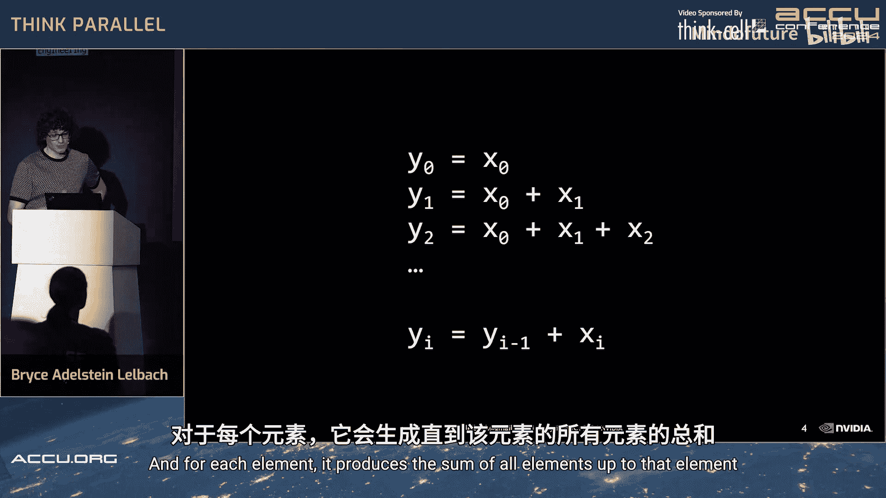
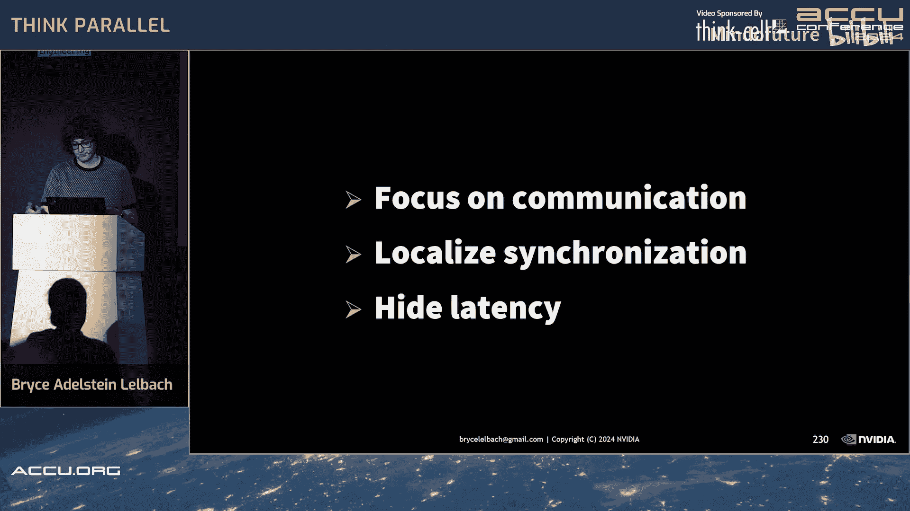

# 中英-•-C++和C语言ACCU大会2024｜人工智能｜架构｜函数编程｜静态分析｜安全｜编译器｜开发者｜垃圾回收｜链接器｜代码生成｜cmake-p33-P35-Think-Parallel---Bryce-Adelstein-Lelbach--BV1pNotYYELk_p33-

So hello everyone， I am Bryce Adelstein Lawellback。

I'm a principal architect at NVDdia where I drive our strategy for parallel programming models。

 compilers and C++ libraries， I've served in leadership roles on several programming languages and standards bodies。

 including the C++ Committee where I served as the Library evolution group chair。

And I'm very lucky to have my wonderful mother here with me today for many years she was my sole caretaker and role model。

 and I owe all of my success to her love and guidance， so let's give her a round of applause。

 she's right here。So I started programming 12 years ago and since the start。

 parallelism has been my passion and focus and I'm thrilled to have the chance to share some of that passion with you today at the start of my career。

 I had the good fortune to apprentice under Hart Mc Kaiser who taught me how to think in parallel and developing that mindset sort of at the start of my programming career has been invaluable throughout the years because that's the default way that I think when I'm approaching a problem。

And I think the challenge with parallelism is that by default， we think sequentially。

 parallelism is often seen as challenging and complex。

 it's a tool to be used sparingly and cautiously and only by experts。

 but the thing is that today we live in a parallel world almost every hardware platform is parallel from the smallest embedded devices to the world's largest supercomputers。

 and so we have to change our mindset， anyone who writes code today must think in parallelism in parallel and parallelism must become our default way of thinking instead of this way exotic thing that we only use sparingly when we need to。

😡，So today we're going to focus on one fundamental parallel primitive upon which much can be built。

 the scan algorithm， and through our exploration of scan。

 we'll cover some key aspects of that parallel mindset that I believe everyone must learn to develop。

So a scan takes a range and a binary operator， and for each element。

 it produces the sum of all elements up to that element。😡。

So the scan algorithm is sometimes called partial sum or prefix sum in C++ we have a few different forms of scan。

 we have partial sum and then the more recent inclusive scan and exclusive scan today we're going to only be talking about what is the equivalent of C++ as inclusive scan。

Now， the output of a scan is a range of the same length as the input。😡。

And you can use any binary operator with a scan with some requirements on that。

 And we're going to use addition to represent the operator today。

So scans preserve the order of input and thus the order of summation。

 so the operation does not need to be commutative， so an operation like string concatenation is supported。

 and this is very important because a lot of the interesting scan operators are noncommutative scan operators。

😡，Now， to parallelze a scan， we must introduce temporary aggregates。

 which means that associivity and left identity value is required。

 just what that means is that we need to be able to initialize a temporary with some default value that we can sum to something in the sequence and get the same thing is that we just summed it into。

 allowing us to arbitrarily divide up the input and process it in different chunks in different threads and then combine it together later。

😡，So here is a simple serial implementation of scan。

 which operates in place for each element after the first。

 we compute the sum by adding the prior element to the current element。😡。

So let's walk through the computation of a simple scan example。

 so our input here will be a range of nine single character strings and our operator will be string concatenation。

So the first element of the result will just be the first element of the input。

The second element will be the concatenation of the first two elements。

And the third will be the concatenation of the first three elements。

And then here's what the full scanned sequence will look like。Now。

 note that the last element of the result is the sum of the entire sequence。

 the result of concatenating the entire array of strings。 Now。

 this is an important property that we're going to rely on later。

So now how do we go about paralyzing scan at first。

 this may seem challenging as the result of each element depends upon the results of all prior elements。

 so if you just look at this simple version that we wrote here it may seem like there's a linear dependence and this can't be paralyzed。

 but in fact it can。😡，So when I approach a parallel problem。

 I tend to break it down into three different components。😡，First， distribution。

 how will I divide and distribute the work？So today we'll be dividing work into tiles。

 which are just contiguous subsets of the input sequence。😡，Then second， calculation。

 what calculations need to be performed on each of those tiles， and then third。

 what communication needs to happen between the tiles。And of these three。

 communication is the most important to identify and understand。

 but communication often dictates how you distribute work and what and when you can calculate。

To paralyze scan， we should first consider how it communicates。 And， in fact。

 I think of scan not as an algorithm， but as a communication primitive。

Every element of a scan sends information to all subsequent elements。

 The scan operator will see every single element。Ordering is preserved so we can reason about relations between neighboring elements。

😡，So scans can perform global order aware reasoning， which makes them very powerful。Now。

 if every element had to communicate directly with every other element in parallel。

 we'd have a lot of overhead。😡，But as we discussed earlier。

 we required that the scan operator that we've been provided is associative。

Associivity can limit our need for communication because we can divide the problem up into tiles and do a local serial scan of each one of those tiles in serial and then update the local scans with information that's been communicated from other tiles to get the final correct result。

So let's look at how we do that。So our algorithm is going to take two inputs。

 a range which will operate on in place， so it'll be both the input and the output and the number of tiles to divide the range into。

😡，So we're going to launch a parallel forage on the index space of tiles using C++ 17's parallel algorithms。

The body of this parallel forage will be invoked once for each tile and will handle a single unique tile。

The number of tiles may exceed the number of threads that the system will use to paralyze this。

Within the tile body， the first thing that we do is calculate the subrange of the input that this tile is responsible for。

And we're going to do that with this range for tile helper function。

 it just divides the input among the tiles as evenly as possible and then handles things like remainders。

So then we take the elements in each tile。And we perform a local serial scan on them。producing this。

Which we do right here in the code。Next， we need to propagate information between the tiles。

 so the sum of each tile needs to be added to the elements of all preceding tiles。😡。

We need somewhere to store this information， one slot for each tile。

 So before the parallel for each loop， we create a vector。

The sum of each tile is the last element of the inclusive scan。

 both serial local inclusive scan that we just performed。

 so we can assign that to the applicable slot in locals。

Assignments to locals from different tiles may happen concurrently。

 but this is fine because each tile uses a different and unique slot in locals and no one reads from locals yet。

 so there's no data races here。Then after all the tiles have completed their local inclusive scans and written to locals。

 we need to have one thread do a serial inclusive scan of locals。

So the result of the scan over locals will look like this， and as you can see。

 the information that each tile needs to add to its elements is in the local slot for the tile directly preceding it。

Next， we need to go parallel again to update the elements in each tile with that correction value。😡。

So we skip the first tile because it doesn't need any updates， there are no tiles before it。

 so it already has the final results for its elements。

We perform the update with a serial for each which adds the appropriate value from locals to each element Now note we add the locals value on the left hand side to preserve order you'll notice throughout the talk that the order in which we do summation is very carefully thought out because we have to preserve the global order。

So after that edition， we will have the correct result for every element。So this is a classic。

 simple and work efficient implementation strategy for parallel scan it's often called up sweepep down sweepep。

However， it requires old input， temporary storage and has two passes and thus two global synchronizations。

 so that's a lot of temporary storage because we may have a very large input size。

 especially if we're computing in parallel。So we start in parallel in the first part， the upweep。

 performing the local scans and storing it into the locals vector。

But then we have a global synchronization and all tiles have to wait for all other tiles to complete。

 and only then can we perform that scan over locals， which is that little red section there。😡。

Finally， we go parallel again， That's the down sweepet pass where we performed the update。

 But as we can see here， we have clearly a bottleneck that that serial inclusive scan on locals in the middle。

This sprint synchronization comes with a great cost because it decreases the proportion of our code that can be executed in parallel and increases the amount of time that we must wait with no other work to perform。

 so this will gravely hurt scalability impeding performance as we scale up from a single thread to hundreds of threads on our CPUs and hundreds of thousands of threads on our GPUs。

😡，So two of my guiding principles in parallel programming are to localize synchronization and hide de latency when we have to synchronize。

 we must minimize it only synchronizing with the actors that we must actually communicate with。

 we have to identify what the true dependencies are and not just rely upon the convenience of the global synchronization。

😡，And if we do have to wait， we need to find other useful work that can be done while we are waiting。

So applying these principles to scan， we must think about what each tile actually depends upon。

 Does every tile need to wait for all the tiles to finish before proceeding？No。

 we only need to wait for the tiles preeding us to finish their local scan and write to the locals vector。

So now let's go about implementing a scan a second time。

 this time using a scalable strategy called decoupled Look back。

 where we will only wait for the tiles that we actually depend upon。So in this version。

 instead of a vector of temporaries， we'll have a scanned tile state object which facilitates communication between tiles。

 and we're going to cover how that works in detail later， just suspend disbelief for now。

We'll only have a single parallel pass this time， a parallel forage over all tiles。

In the body of that for each， we're going to compute each tile's subrange just as we did before。

And we'll perform a local serial scan just as we did before。

But instead of storing the sum of the tile in a vector of locals。

 we'll pass it to the scans tile state by calling set local prefix and again。

 we're going to look at how that works later。Then if we're not the first tile。

 we need to communicate with other tiles to get the prefix that we must prepend to all the elements of our tile。

😡，And we're going to do that by calling wait for predecessor prefix。

 and that will return the prefix that we need to add to all of our elements。😡。

And then we'll update each element in the tile by adding that prefix to them on the left hand side。

Now， let's break down what's happening here。 So each tile performs its local serial scan。

 and that's all roughly going to be a fixed amount of work。And then calls set local prefix。

 which publishes the information that subsequent tiles need。And temporarily。

 that should happen at roughly the same time。 what may not happen at the same time is other threads observing that memory right。

So then each tile must wait for the predecessor prefix to become available。😡。

And while those tiles are waiting because they're waiting locally。In this parallel for loop。

Other tiles can begin performing their local serial scans and publishing the result。

 overlapping useful work with the necessary weighting。And eventually。

 the predecessor prefix for each tile becomes available。

 the tile completes and another tile starts executing。So by utilizing oversscription here。

 that is having many more tiles than physical threads。

 we can effectively hide the latency of waiting。But for all of this to work correctly。

 we need to guarantee that tiles are executing in monotonically increasing order。

 that is tile X can only be executing if all tiles preceding X are either executing or have completed。

 so I call this monotonic progress。😡，So if we don't have this guarantee。

 we could stall forward progress on systems with weaker progress guarantees such as a bounded thread pool or a GPU。

 we could end up with all of our physical threads executing tiles that are waiting for tiles that have not yet started and those tiles will never start because all of the execution resources are blocked waiting for them to execute this is a classic sort of deadlock situation in parallel forward progress guarantee systems。

So to ensure monotonic progress， we have to change how we allocate tile IDs thus far we've been creating a range of integers with Iiota and just passing that to the parallel forage。

So instead， we're going to create an atomic integer and we'll have each body of this parallel4 loop do a relaxed fetch add to assign itself a unique and monotonomically increasing tile ID。

So now let's look at how scanned tile state performs the actual communication between tiles。

So scan tile state contains a vector of descriptors， one for each tile。

The descriptor has two prefixes for the tile， local。

 which stores the sum of just the elements of the tile and complete。

 which stores the sum of all elements from the start of the range to the end of the tile。😡。

Thescriptor also has a state which is either unavailable。

 local indicating that the local prefix is available or complete。

 indicating that the complete prefix is available and this state is updated atomically。

 and this is how we actually do communication and synchronization between the threads。😡。

So when you construct a Scile state， the local and complete prefixes for each tile are default constructed to that left identity state that we discussed earlier。

 and the state is initialized to unavailable。And that's the only way that a state can become unavailable is that initialization time。

Tileles publish the sum of their elements by calling set local prefix。

 which we saw before in the scan algorithm body， and set local prefix takes a tile ID and the value of the local prefix that you're setting。

Now， the first tile is a special case。It has no predecessors。

 So its local prefix is also its complete prefix。 So we assign the value that's been passed into to both of the fields of the descriptor。

And then we do a store release to set the state to complete。

 signaling that the prefixes are available， and this will synchronize with a weight acquire and wait for predecessor prefix。

 which we'll see later。And for all other tiles， we set only the local prefix。

And then we signal that it's available by setting the state to local。Finally。

 we do a notify all to wake up any tiles that are waiting on this atomic。

Now weight for predecessor prefix is called by tiles to retrieve the sum of all elements before the tile。

 which must be added to all of their elements。😡，Wait for predecessor prefix。

 searches through predecessor descriptors， reconstructing a predecessor prefix from the local and complete prefixes of its predecessors。

So there's three types of prefixes that I've been discussing here， there's local prefixes。

 which are the sum of the elements in a given tile。

 nothing else just the local sum of those elements。😡。

Predecessor prefixes are the sum of all elements before a given tile。

 excluding the elements in the tile itself。 So all the elements from 0 up to the start of the tile。

Predecessor prefixes are returned from weight for predecessor prefix。

 but they're not actually stored in the descriptor。

 they're just constructed on the fly because there's no need for us to actually store them。

Now complete prefixes are the sum of all the elements from the beginning of the range through the end of the tile。

 so a complete prefix is the sum of the predecessor prefix。

 which is everything before the tile and the local prefix， which is just the stuff in the tile。😡。

So there's three types of prefixes here。All right， let's look at this。

 let's work through this in an example， we're going to scan a vector of strings with string concatetonation。

 so we're going to divide the input into four tiles of three elements each。

So we start with the local serial scan of each tile， which will produce this。

The local prefix for each tile is the sum of all of its elements， which。

 as we discussed is the last element of the local scan。

The predecessor prefix for each tile is the sum of all preceding elements。 So for the first tile。

 that's nothing。 For the second tile， that's the sum of the first tile， ABC。For the third tile。

 it's the sum of the first two tiles， AB，C， D， EF。And for the fourth tile。

 it's the sum of the first three tiles， ABC， D， E， F， G，HI。

Now the complete prefix of each tile is the predecessor prefix plus the local prefix。

So now that we've understood how we calculate these prefixes。

 we're ready to look at weight for predecessor prefix itself。So to construct the predecessor prefix。

 each tile will search the descriptors of the tiles preceding it。

 starting at the tile directly before it and moving backwards towards tile0。

So for each preceding tile。If its state is unavailable， then we wait for it。😡，If its state is local。

 then we add its local prefix to the predecessor prefix and we continue searching。

If its state is complete， then we add its complete prefix to the predecessor。😡。

And if we encounter a complete prefix， then we can stop because a complete prefix incorporates all information from the start of the range。

 from the first element all the way up to the current position。

 And so as soon as we hit a complete prefix， we're done。

So this is why we call this technique decoupled lookback each tile searches backwards from its position and each tile searches independently of each other。

 although they may use some information that's been published by each other。

 so independent is important independent searching is important here because some threads may see publications of prefixes before other threads just because of how memory systems work。

😡，And so if a thread sees an update before another thread， it allows it to make further progress。

 and it also may be the case that two tiles are looking backwards at the same time。

 perhaps computing some of the same things， and that's perfectly fine because that a little bit of redundant work is okay。

 it's better in many cases than waiting。😡，So now let's look at the implementation of weight for predecessor prefix。

So we begin by default constructing A T， which we will sum the predecessor prefix into。Next。

 we loop from I minus1 to0， so from the tile directly before us， all the way back to the first tile。

And for each proceedceding tile， we do a weight acquire until its state is not unavailable。😡。

So this establishes a synchronizes with relationship with the store release in set local prefix。

 so this call here will return once that state is no longer unavailable and we know that it's already in the unavailable state because it starts off that way if it's already been updated to not be unavailable。

 then this will return immediately。So after the wait， we load the state again。

Because we need to know what it is。Either local or complete。

 So we know at this point that it's no longer going to be unavailable because states are only ever set as unavailable during initialization。

 and that is before the critical section。So therefore。

 the state must be either local or complete at this point。So if the state is local。

Then we add it to the predecessor prefix that we're building， adding the local prefix from that tile。

 and remember we must summit from left to preserve order here。

 that's why we're not using plus equals because it would do things in the wrong order。

 it would add it to the right。Otherwise， if the state is complete。

Then we summit into the predecessor prefix and we stop the look back because we've encountered a complete prefix that covers all elements from zero up to the current position。

 and therefore we are done。So once we finish building the predecessor prefix。

 we must calculate and publish our own complete prefix。

 and we calculate it by summing the predecessor prefix with our local prefix。😡。

And we signal that it's available with a store choir of complete to our state and a notified to wake up anyone waiting on our state。

 and this will synchronize with the weight and the load earlier in this function。

 ensuring that if a threat observes that the state is local or complete。

 then they will see the right of the local or complete prefix。😡，So finally。

 we return that predecessor prefix that we've built up。

So let's work through another example to get a better understanding of how this works。

 so here's a snapshot of a scan execution with eight tiles。

So let's perform wait for predecessor prefix for tile3 here。So we start by looking at Ti I。

 whose state is local， and so we sum its local prefix into our predecessor prefix that we're building up。

😡，Next we look at Ti1 whose state is local now notice that Ti1 has actually written its complete prefix。

 but we haven't observed the store release that changes the state yet so we can't use it because we don't have that coherent view of memory。

 this may have temporarily happened yet in the other thread it may have already happened but it doesn't mean that we've observed it happening yet。

 so we can't use that information。😡，So instead we just sum its local prefix into our predecessor prefix and continue instead of having to wait。

Finally， we look at tile0 whose state is complete， and so we add this complete prefix to our predecessor prefix and we finish and we would have finished here anyways because we're at tile zero。

 there's no tile before it so we would be done at this point。And tile Ze is also always complete。

Or it's always either unavailable or complete， it never becomes local。

So next we compute our complete prefix by summing the predecessor prefix in our local prefix。

 and then we write it to our descriptor and we set our state for this tile three to complete。Okay。

 so next let's do tile5。😡，So we started T4 whose state is local。

 and we sum its local prefix into our predecessor prefix。And then we look at Ti III。

 whose state is complete。And we sum its complete prefix into our predecessor prefix and then we're done。

 we get to finish early here because we found a complete prefix。

 somebody else did the work of searching backwards and getting all of the local prefixes from all of our predecessors and summing them up and we've found it so we're done。

 we don't have to continue searching。And then finally。

 we calculate our complete prefix and store it to our descriptor and update our state to complete atomically。

And that's it for scan tiles state and so now we should have an understanding of how we perform communication in this decoupled look back scan that we wrote before we call set tile as we call set local prefix after we do our serial inclusive scan and that publishes our local prefix and then for tiles that aren't the first tile we do this look back search in the call for weight for predecessor prefix and once we get the。

Resulting predecessor prefix there， then we just added into all of our tiles， and we are done。

So our decoup of lookMap implementation needs only O tiles storage while our two pass implementation。

 the upswoop downsweep version that we wrote originally needs O input storage。

 and for context for my benchmarks I ran with  four billion elements and 1 thousand0 tiles。😡。

So you definitely want to be in the regime of only needing order of magnitude tiles storage。

 not order of magnitude input storage， I'm going to take questions at the end。😡。

There's slide numbers， so if you got a question in a particular slide， you can note it down。

So our decoupled look map implementation is single pass， it only needs one global synchronization。

 while our two pass approach needed two global synchronizations。

 there were two parallel launches and two parallel joins。So in terms of just raw performance。

 I observed the decoupled lookback scan perform about three times faster than the two pass scan on a 64 core CPU system with a four gigabyte problem size Now at GPU and distributed scale。

 decoupled lookback will outpace two passs even more like orders of magnitude faster。

And this is roughly how we implement scan on NviIDdia GPUs。So scan is worthy of study on its own。

 but its importance lies in what we can build with it。Many problems have a summing， counting。

 filtering， searching or neighbor aware aspect， and those can often be solved with a scan。

 so we're going to look at two examples of problems that we can solve with scan today。

And the first one is copy it。So copyF takes an input range and a unary filter operation。

So as an example， here we've got a range of characters and a function that returns true for the characters that are letters。

So it produces a range that contains only the elements of the input for which the filter operation returns true。

So copy of cannot be evaluated for each element in isolation because to determine the correct place in the output to write an element。

 we must know how many elements before it will pass the filter。😡。

And figuring that out how many elements before it will pass the filter。

 that how many part that's a count task， Scs are good for counting tasks。

So that sounds like a scam to me。So we're going to start off with a simple implementation of copy of。

In terms of scan， so our copy of function will take an input range， an output iterator。

 and a filter operation。So first， we're going to create a vector with a flag for every input element。

😡，Then in parallel， we will evaluate the filter operation for every input element。

 storing the result in the flag vector。😡，Next we're going to do a scan of this flags array with integer addition as the operation and integers as the output。

 and this is called the plus scan and this technique of evaluating a predicate or some sort of comparison function。

 and then scanning the result is very common， for these class of algorithms of filtering。

 combining grouping， etc。😡，So we'll create storage for the output of our plus scan。

 We're going to need one integer for each element。 plus we'll need an additional integer for the final count of how many elements we've copied。

 just trust me on that part for now， it'll become clear in a moment。 It's a little trick。

 I suppose that I'm using here。😡，So now we do a parallel scan of flags into indices。

 starting at the second element of indices for the output。

 so the first element of indices has been default initialized to zero。

 which is always the correct output index for the first element。

So we're going to write into indices offset by one。

 and now let's look at an example that'll explain graphically why we do that。

So let's build the indices vector for this problem。By fiat。

 we said that the first output index is always zero。

We offset the output by one because when we encounter an element that is true。

 we output it at the current index， and then we bump the index for the next element that we write。😡。

So like here， a is a letter， and so it's going to be written at index zero。😡。

And when we we see that we have that true flag。 And so therefore。

 we know that the next letter after a will need to be written at index1。

B is also a letter and it's going to be written at index1。😡。

The next letter will be written at indexex2。So two。Is not a letter， so it will not be written。

 and thus the index is not incremented。Likewise， three is not a letter and the index is not incremented。

😡，The same is true for four。But then E is a letter， and it's going to be written at index 2。

And then the next letter is going to be written at index3。

So then the rest of the indices is scanned in a similar fashion producing this。

And we need that additional extra element there at the end because if the last element does return true。

 which is not the case here， but if the last element does return true。

 then the very last element of indices would be incremented by one。

 and that would give us the correct count for how many elements returned to true。

 otherwise we would have we'd be off by one on that count。Okay。

 so we now what we're going to do is we're going to perform the next step where we walk through the flags vector and for every true flag。

 we write that element at its associated index and we call this the right pass。😡。

So a is written at index zero。😡，B is written at index 1。E is written at index 2。

And G is written at index 3。And then the final element of indices has the count of how many elements were written for。

So let's look at that right pass in code， so it's a parallel4 loop or yeah。

 it's a parallel4 loop that iterates the input， flags and indices all zipped together。😡。

And for each element， if the flag is true， then we write the element at the As index。

Now to calculate the bounds of the subrange that we return of how many elements we actually copied to output。

We use the last element of indices， which gives us the count of how many elements were written。

And so then we return the correct subrange of out that we wrote to。And with that。

 we have a parallel copy of implementation。Now this implementation needs a lot of temporary storage on the order of magnitude of twice the size of the input because we need that flags array and we need the array of indices。

 so especially if we have a small input size we might end up needing a lot more temporary storage than we have actual data and this also uses three parallel passes which means that we have three global synchronizations and two of those we would hope to avoid in a single pass algorithm。

😡，So now let's improve this with decoupled look back。

So refactoring this to write it in terms of decoupled look back， we now need to do tiling。

 so that means we're going to need to take a tile size in addition to our other parameters。

So we need a scan tile state for indices， and we need an atomic to assign the IDs just as we did before。

And so next we've got our tile loop， our parallel tile loop。And in the body of that loop。

 we assign the tile ID and calculate this tiles subrange just as we did in the scanned decoupled look back implementation。

Next we'll create tile local storage for flags， one for each element in the tile and we'll evaluate the filter operation into the flags now here we're just dynamically allocating this storage on the fly。

 but it could also be preallocated depending on how many physical threads we have so if you were running with a thread pool with like 16 threads you could just have each thread have its own little cache of here's my scratch space to compute these tiles。

😡，Or it could be statically sized and on the stack， which would require static tile sizes。

 and that's how we actually do it on the GPU is that this range of local flags is actually just on the thread stack。

So then we're going to create tile， local storage for the indices as well。

 and again we're going to need however many elements are in our tile plus an additional one to get the correct count of how many things were here。

So then we'll perform a decoupled look back scan of flags into indices using set local prefix and wait for predecessor prefix just as we didn't scan。

And we'll output into indices offset by one just as we did in the three pass copy if。

And then finally， we do the right pass， and this is the same thing that we saw before。

 its just localized and tile here。One thing to note is that we do not tile。Out here。

We do not get a local range for out because we're going to index into out with a global index that's been built up。

 so if if we had local indexes from you know element zero to whatever in this tile。

 we'd have the wrong we'd be writing to the wrong place。😡，So finally。

 we're going to return the subrange of elements that we output。Using the last tile's complete prefix。

 which will have the final count of elements written。So this is， again。

 very similar to what we did in the three pass version。

So now we have a much better copy of implementation。It only needs order of tiles。

 storage instead of O input storage Now remember in my testing。

 I was using billions of input elements and thousands of tiles， so this is very significant。

And it also performs a lot faster， about 11 times faster than the three pass implementation that we saw before on the 64 core CPU system that I was testing on。

All right， so now we are going to move on to the climax of this talk。

 an algorithm that I think is really truly beautiful， although a little bit。More complex。

 which is chunk by。So chunk by takes a range in a binary comparison operation。

It splits the input range into subranges in between each pair of adjacent elements for which the comparison operation returns false。

 so its output is a range of subranges， so in the example shown here we have text with new lines at the end and an operation that returns true if the lefthand side is not a new line。

 so this will split the text into individual lines each one terminated with a new line。😡。

So the tricky thing with chunk by is that it works on adjacent pairs of things。

 which adds a little bit of complexity。So let's look at another example here。

 We've got a range of nine characters， and our comparison operation will just be equality。

So we're going to group consecutive equal elements together。So for the first two adjacent elements。

 the operation returns false because they're not equal。Then for the next two， it's true。Then， false。

Then true， then true， and then false。And so on。And we can see from this that there are four splits。

 the four falses， and there are five different chunks that we need to form。

So how do we go about paralyzing this？There's three pieces of information that we're going to need here first。

 we need to know what index is this chunk in the output like what number is this index is this chunk。

 how many chunks came before it， this is similar to copy if we need to count account of how many things have we already written so we can make sure that we write this one to the correct place。

😡，Next， we need to know where each chunk starts。Again。

 this sort of sounds like a counting problem of some sort。And finally。

 we need to know where each chunk ends。And again， that sounds like a accounting problem。

 that's what scans can do。Now the trick here is we don't want to do three different scans to get these answers。

 we want to do one big chunky scan that does all of these things at the same time。

 that means we're going to need to define a clever data type。

That's going to track all of this information for each element。

 And we're going to call it interval for reasons that。May become apparent。So in interval。

 it's going to have four different members。The first is a flag。

 which has the result of applying the comparison operation。

 It is false if there is a split between this element and its neighbor to the left and true otherwise。

 This is the one member of interval that we will not scan。

It's just something that we set when we evaluate the comparison predicate and then use later。

So next we have an index which indicates where the current group should be written in the output。😡。

Now， this is going to be a plus scan of the inverse of flags。It will make sense in a moment。

Both flags and index are calculated in a similar fashion to what we did in Copi。

 in copy if we did a plus scan of noninverted flags there。

 but in copy if the predicate returned true when we were going do something。

 whereas here the predicate returns false when we're going to do something。

 and that's why we scan the inverse of flags。So next we have a count。

 which needs to keep track of how many elements share an index with this element。

 how many elements are in this current chunk。😡，And because all of the elements that shareron index are in the same chunk。

😡，And finally， we have end， which is simply a running count of how many elements we have in total。

 so this gives us the one past the end of the current element。

 which is one of the pieces of information that we would need to construct the range of this chunk。😡。

Okay， so next we need to define how we sum intervals。

So think of an interval as an aggregate of three summed components， index， count and end。

So its some operation must perform three separate but related sums。Now we don't sum flags。

 I mentioned that earlier， flags are just going to be set by the comparison operation during the initialization of the range of intervals。

 so when we add two intervals together， we just always take the flag from the right。

So index is initialized to the inverse of flags， and then we just plus scan it。

 so it's just thing on the left plus thing on the right， just basic addition。

Now count is a little bit trickier because it tracks how many elements are in the current chunk。

 so it needs to be reset whenever the current chunk ends。

 and we can tell that the current chunk ends when the index changes and this will happen when the index on the right side is non-zero。

😡，Because otherwise， if it's zero， that indicates that it's a continuation of the chunk on the left。

It's only if the index on the right is non zero， that it's the start of a new chunk。And in fact。

 as the case will be， it's pretty much always going to be either zero or one。So finally。For the end。

 we just do a plus scan Now end is going to be initialized to one for every element and to zero for some identity elements。

 so that means that there will be a one in this sequence for every element that exists and that therefore summing this up will give us account of how many elements we have。

😡，A cumulative running count of how many elements we have， which is exactly what we want。

So just suspend disbelief for now because we're going to work through some examples that will demonstrate how all of this works。

So our chunk by algorithm is going to take an input range， an output range。

 and a comparison operation， and we'll start off writing a simple multipass version。Simple is。

So we'll need a vector of intervals， one for each element。

 plus an additional one for the final count of how many groups we have。

 this is the same thing that we did for copyF or we're adding an extra element just to keep track of the size。

😡，Next， we need to initialize the intervals， which is a little bit more complex than the initialization of the indices that we saw for copy of。

So we're going to start off by initializing the interior points of the intervals。

 so everything except the first and last elements， and we're going to do this initialization in parallel because we want to evaluate our comparison。

 operation and parallel。So for each interval。We need to look at two adjacent elements as our comparison operation must be applied to two elements。

An interval always represents the element on the right hand side of the operation。

So we also need a special identity value on the left to handle the first element and a special identity value on the right to close the last group and give us the final count of how many groups we have。

😡，So we're going to handle the identity values right here。In between that initialization code。Now。

 for each interior point。😡，We first evaluate the comparison operation。

 we set the flag to the result of that comparison， and we set index to the inverse of that。

And we initialize both count and end to one， because this interval， when we're initializing it。

 represents a single element at this point， As we sum up intervals for a tile。

 they'll begin to represent multiple points and then count maybe greater。So for our example problem。

 the initial state for the interior points is going to look like this。You can see we've got flags。

 we've got index， which is the inverse of flags， but as an integer。

 and then we got ones for count and for end。Very simple thus far。For the first element。

 the left identity， we set flag to true because it does not represent the end of a group。

And we set index to zero， because that's the index that we'll start writing to in the output。

 We always start writing at index 0。For the right identity， the last element。

 we need it to close out the last group， otherwise the last group will never be written out。😡。

So we're going to set the flag default false， which indicates a split。And we set index to one。

 which indicates that this element does not belong to the same chunk as the earlier element。

 as we saw when we defined how we scan index or how we scan count。

 it checks the index to see whether the thing on the left and the thing in the right are in the same junk。

So with the addition of those special identity values。

 we have our completed initial state here for intervals， which looks like this。Okay。

 so next we do a parallel scan of those intervals， and we're going to work through how that happens。

So first， we're going to handle index。So we just plus scan index。

 which starts off of the inverseive flags， and so we end up with this。😡。

And it's quite similar to what the scan for copyF over indexes looked like。Next。

 we're going to scan count and remember， count gets reset whenever the index changes。😡。

So for the first element， the output is the same as the input one。

That's just what we have from the original account just gets copied down。Now for the next element。

 the count is going to get reset because the index has changed。

 the index on the left is zero and the index on the right is one。

 so the count would have been two otherwise， but we reset it to one because we've detected that it's the end of a group。

😡，So for the next element， the count increases because the indices are the same。

And then for the next element， the indiceses are different。Which means that it is the end of a chunk。

And that we must once again reset the count， so we start counting over again at one。

And the indices are equal for the next element， so the count is incremented。

 likewise for the element after that。And then we proceed in this fashion for the rest of the elements producing this。

Finally， we need to handle the scan of end， which is a bit simpler。

 So this is just a plus scan with no reset。 And so it just results in this。

Just one to however many things we have， plus an additional one for the right identity。

So this is what we're going to have in our interval vectors。On our interval vector after our scan。

 I'll let you look at this for a moment。Okay so next we have the right pass here。

 which is going to be similar to the right pass for copyF this is going to be where we will use the information that we've built up in intervals to produce the chunks and write them out Now the difference between this right pass and the copy of right pass is that this right pass is done on adjacent intervals。

 which is a little bit different than what we did for scan and for copyF。

So if the flag of the right interval is false， then it represents the end of a chunk。

But the right interval represents one past the end of the chunk。

 so the chunk that just ended is contained in that left interval。

So the last element in the trunk is going to be represented by the thing that's just before wherever we saw this false flag。

And so that's what we're going to use for the right。So we can see here。

Which flags are false and then which indexes we're going to write into。

So we write to that index that's specified by the left interval and remember the output of a chunk by is a range of chunks。

 so a range of ranges， so we need to construct the range that we're going to output here。

And so we're going to do that with subrange and we're going to we need to now construct the indices of the beginning and ending using the intervals end and count members。

 so range indices are half closed in C+， so the ending should be the index one past the end of the last element。

So interval that count has the count of the elements in this chunk。😡。

And end has the index one past the end of the current element。

So the index one past the end of the sum range is just the intervals end member。😡，Easy。

Now the beginning of the interval is the index one past the end。

 which is interval dot end minus the count of elements in this chunk， how many things we have。

 which is interval do count。So here's what the constructed subranges will look like for our example problem。

We have four splits here producing five different chunks， and we have five false flags。

 four from the splits themselves， and one from that right identity element that exists to close out the final group。

So the first chunk starts at zero and ends at one with a length of one。

The second chunk starts at one and ends at three with a length of two。

The third chunk starts at three。Ends at six with a length of three。

And the fourth chunk starts at six and ends at seven with a length of one。

And the fifth and final chunk。Starts at seven and ends at nine with a length of two。

And you can see that these chunks they represent， they cover the entire range。

 and they represent exactly what we're looking for here。I'll let everybody look at this for a moment。

 soak it in。So finally， we return a subrange of all the chunks that we wrote and we know how many chunks we wrote by that last element of intervals that has the size that will have how many things to be right that'll have that index that's one past the end。

That will tell us that。 So you can see right here。The the final right identity element there has five for its index。

 which is the count of how many things we wrote out。There's other ways to compute the count。

 you could just like add one or do other stuff or evaluate the predicate a second time。

 but if you want to avoid doing another prediiccate evaluation or doing you know。

Plus ones and minus ones。 This is a clever way to do it at nearly the cost of one additional interval。

And so that's it， we have our chunk by algorithm。I think it's pretty nice。As with copyF。

 this requires O input temporary storage， and it has three global synchronizations。

 which is not ideal。 so now we are going to rewrite this with decoupled look back。

You can just tell from the decrease in font size that this is going to be the scary part of the talk。

So we'll take an additional tile parameter now as we'll be tiing here。

So we're going to create a scan tile state of intervals and an atomic to assign tile IDs。

 just as we did in both scan and copyF。And as with all our other decoupled look back algorithms。

 we'll have a single parallel for each over the space of tiles。

And each tile determines its tile ID via that atomic now because many of our calculations here are performed on adjacent views of ranges。

 and we must add the special identity values on the left and right。

 we have to treat the first last and interior tiles differently in a few different places。

 and so we're going to define three bulls here to classify what kind of tile we have that we're working with。

 either the first， the last or the interior。😡，So next we'll calculate the subrange of elements that belong to this tile。

 Now for the first tile， we'll skip the first element， which has no neighbor to the left。

Now recall that we did this in the multipass version by offsetting the output of our scan by one。

 but it's more convenient for us to do it here by shrinking the subrange by one。So next。

 we must initialize the intervals just as we did in the multipass version。

 except this time we do it locally in serial within each tile。So for the interior tiles。

 we need one less interval than we need for the first and last tile， which have that additional。

Identity element， the left identity and the first tile on the right identity on the last tile。

So for the interior ones， we don't have that， so we want to do one fewer evaluations here。

Or one fewer intervals here。So this is because， again。

 the first tile has the additional left identity and the right tile has the additional right identity。

 and we're going to initialize them here this time guarded with whether or not we're the first tile or the last tile。

 because if we're an interior tile， then the first element and the last element of intervals represents real data。

 not one of these boundary conditions。So next we initialize the interior points for the first tile we start off by one to skip over the left identity。

Now the initialization of the interior points is done just as it was done in the multipass version where we evaluate the comparison operator。

 and then the result of that is what the flag gets set to。

 the inverse of that is what index gets initialized to。

 and then count and end get initialized to one each。So that's it， that's done， that's pretty simple。

So next we perform a decoupled look back scan of intervals using a local serial scan。

 set local prefix to publish the results of our local serial scan。

 and wait for predecessor prefix to do the decoupled look back to build up our predecessor prefix。

 and then an update pass to some that predecessor prefix into the elements of our tile。

So it's the same thing that we've seen before in all of the other decoupled book back examples。

 nothing different here。So， finally。We have the right pass。

 which is over adjacent intervals just as it and was in the non decoupled look back version of chunk by。

So this works just as it did before， if the flag on the right interval is false。

Then we write out the chunk using the information from the left interval。

And finally we return the subrange of all chunks using the complete index of the last tile to get the count of how many chunks we actually wrote。

 again， same thing that we did in the90 coupleup look back version。

 we're just looking in a different place to get that information here we get it from the scanned tiles。

 state descriptor previously we got it from the back of the vector of indices。

And that's all that there is to this。 It's a parallel and scalable single pass chunk by algorithm。

So this only needs order of magnitude of how many tiles you have storage。

 and it has a single global synchronization。When I benchmarked it。

 it was about nine times faster than the three passs implementation on a CPU， again on a GPU。

 it's going to be many times fast or a distributed scale， it'll be many， many times faster。

So these are just a couple examples of what we can build with scan and with decoupled look back more generally。

 this scan can be used to solve all sorts of problems， summing， countering，ing， filtering， searching。

 sorting， many more。It is one of the most frequent tools in my tool bag that I reach for。

 it's usually scan and reduce， and pretty much every problem that I have encountered can be solved with some combination of scans and reductions。

 or it's just a straight up for a loop maybe with some boundary condition communication。

 but all this sort of interesting algorithmic problems like this tend to be either scans or reductions。

So there's three key principles that I hope you take away from today's talk。

First is you want to focus on communication because it dictates everything else about the design of a parallel algorithm。

 And I like to think about everything in terms of communication。 As I said。

 I view scan as being a communication primitive， not an algorithm。

 And I think that's the right mindset。Second， we want to localize synchronization and avoid global barriers whenever possible。

 global barriers are often convenient， the versions of this code that did not have to do decoup of lookback were certainly simpler。

 however they performed a lot worse。And so it is certainly worth the effort to figure out what your true dependencies are and figure out how to efficiently have just those actors communicate with each other instead of relying upon a global join。

And especially as you're scaling up to things like GPs or to distributed。

 those global barriers are really going to kill you。Finally。

 we want to overlap waiting with useful work in the places where we do need to wait。

 we want to do so in a way where either we can progress with other work or where we can defer and some other tile can do other work。

😡。

So if you want to learn more about parallel programming and algorithm design。

 my buddy Connor and I have a podcast， ADSP， which is algorithms plus data structuress equals programs。

 it's available on all streaming platforms， you can go subscribe now we did three episodes talking about chunk by and we've done a lot of other episodes talking about scan algorithms I'm sure Connor will put together a playlist of those that people can look at。

And so I want to thank Connor， who contributed greatly to the development of this talk。

 listening to me， ramble about this theoretical chunk by algorithm that didn't really exist two weeks ago。

And as I mentioned at the start of this talk， I sent my colleague David Olson a copy of this slide deck about 10 hours ago and asked him to review it and he sent back detailed notes that were specifically designed to be things that I could actually change prior to the talk。

 so I thought that was very thoughtful and quite impressive， so thank you， David。

 I really appreciate that。And I should also thank Dwayne Merrill。

 Jared Houbbrock and Michael Garland， who have done a lot of the groundbreak research on parallel scans。

 in particular， Dwayne and Michael wrote the seminal paper on scans。

 which is the paper on single pass， parallel prefix scan with decoupled lookback。

 which is sort of the basis of all modern parallel scan technology。

And thank you all for your attention， I hope to see you all at next year's conference。

And so we now have some time for questions if people have questions。

