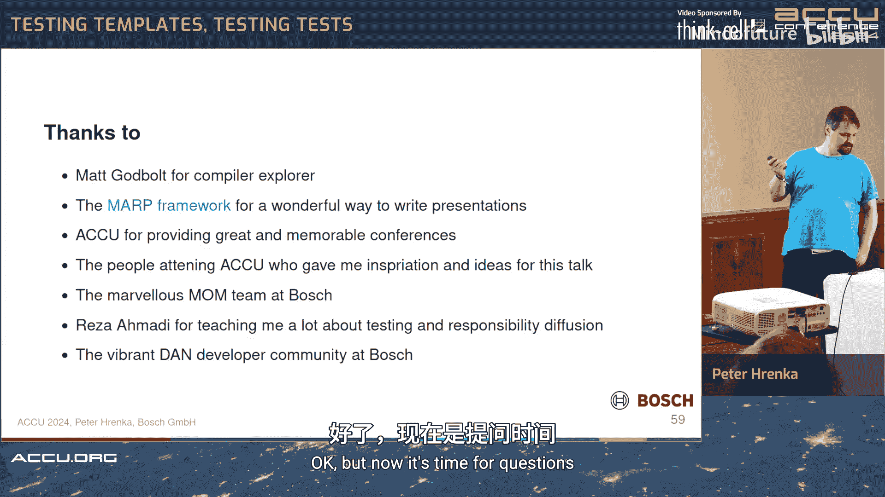

# 中英-•-C++和C语言ACCU大会2024｜人工智能｜架构｜函数编程｜静态分析｜安全｜编译器｜开发者｜垃圾回收｜链接器｜代码生成｜cmake-p34-P36-Testing-C++-Templates---Investigating-Tests-for-C++-Templates-using-Adversar--BV1pNotYYELk_p34-

Welcome， everybody to my talk， Test templates， testing tests。

嗯。Let's see how this okay works。 So this talk is about improving test methodology step by step。Okay。

 first about the content of this talk。Will talk a bit about me。 small prefacese。

 I'll explain how to test tests and how to do it in a structured way。

 We talk about compiler runtime variations， measurements and my new ideaversarial testing。So。

About me。So what brought me to this topic was I've studied both mathematics and computer science。

 and I'm， I'm kind of switching back and forth through my career through my education between those topics started actually with computer science。

 but I thought mathematics is very interesting。 So so studied that。

 But my work is really more in the computer science area。So when I'm not doing any of that。

 So I found a new hobby is like a He radioio operation， which is also very fine。

 You get to to communicate with people all over the world。 If you're interested， ask me。

 I can tell you a lot about that because I'm want a trainer。 And if I'm not even doing that。

 I'm playing the piano， not very good， but it's okay。😊，Okay， so。Well， what about Bosch。

 some people don't know that。 So I'm were always told to give the people background。

 Some people really don't know Bosch outside of Germany。 So it's a technology company。

 we're not we're privately owned basically。 So through a foundation。

 So that means it gives us more freedom。 Were not chasing some so much stock rates or something。

 and we can have research center。 many people are doing fundamental research。

 So I'm coming from the automotive area。 specifically I'm doing radar。 and video sense development。

 and I have。Basic template library that is used in all of these devices there you see there are other areas which you power tools you might know home appliance is something that people tend to know but as you see all of that involves many embedded applications so I will naturally focus more on these embedded applications we use all kinds of programming languages you see you see plus plus but we're so big we basically use every language that there is。

Okay， so what I will present here is I will take some topics and examples from my work。

 and that is really the C++ template based library。

 which has some special containers that we use and some mathematical functions so I will talk about unit tests specifically because that make my most sense for in our use case。

 and but I think some of those concepts I will present might be also relevant or usable in other contexts。

😊，For the presentation， I will use Google test because that's what we use and I think it should be known to many of you。

 so I will try to explain the things that might not be known So I will also not claim that this is some kind of research or research overview。

 it's just like practitioners view from my side and some opinions from my side。

 So I don't think anything is radically new in from the idea but the thing how I used it might be might be new and some of those things we test that we use them in production。

 but the newer ones were just starting。Okay， so。How do we go about that？ what can we do？

 Let's say I want to test a template function。 I have a template function。

 something very simple square function。 but as a template。

 taking a template then so what we're using is Google test here。

 So this has these handy test macros and you just put some expectations in there。

 you can give some names， name for the test， which is important。 then you say okay。

 so we test some nonzero inputs。 okay， if we square 1， we get one， if we square 2。

 we get4 if we square 10， we get 100。 and we put this in a different section。

 test 0 is something something with0。 great。Right， but。So okay， so this， if you use Google test。

 you basically compile it。 it will run through。 It would say， yeah， it's great。

 your expectations are good。 You're good to go。😊，But looking at these tests， you have to think。

 come on。 is that everything that seems very superficial， right， So integer has most。

 most oftentimes， it has like 32 Bs。 just testing for cases。 I mean， that's probably not enough。

But that's a template function， even so。It's not enough to think about ins。

 You have to think about all kinds of other data types that might go than that。

 That might be bigger even。 So， and if you even consider all the building types。

 you still have the types that the user provide。 So because the type is open。

 Everybody could put everything in there that has multiplication operator。So。Right down。

 let's look at class templates。Last templates。 Yeah。

 you can also put them in this Google test framework。 You just write a test。

 You just take your own vector implementation。 then you say， okay， I create a new vector。

 then I expect it to be true。 size must be0。 Okay， nice。 I push back one element。 And I say。

 okay now it's not empty anymore。 The size is one。 Okay， the front， the front element is one。

 The back element is one。 Okay， cool。 I raise something。 raise the first element。 Okay。

 then it's empty again。 yeah， great。 and then expect the size to be0。 Okay。

 so I did lot of these macros。 that and you can follow that through。 it makes sense。

 And you see this is the result from on the right side。 you see the result from Google test。

 So that's how the output looks like。 you get， yeah， I'm running this， it's okay passed。

 and I get nice summary。 so that's fine， right。😊，那 okay， so。

If you look at the code which which function did we test， actually， Did we test the constructor。

 Did we test the empty， Did we test the size， the pushback， Well I'm not so sure。So again。

 here the question what about the other types that we have the in there。 Yeah。

 that works with one value K cool， but just one pushback that doesn't seem very comprehensive。

 And so where will I put that so。I would obviously， still vector has more methods。 So we I put this。

 this is in the same test。 So it will be get longer and longer and I have like several hundred lines of code。

Now， I don't think so that's a good way to extend that。So。

Another thing we have to take care about when testing。 Let's have a look at this。Function。

Template functions are okay。We have template function here。 that takes some kind of sequence。

 some iters。 Okay， nice， then okay， it takes the first element somehow， right， then theres it starts。

 it goes to the end right， and it increments thiss the first element and stores it back。Okay。

 you can do that。 So， and， and now we've write a test， okay。I have vector that's unssortted。

 I just call this salt sequence。 Yeah， and I expect true。It sorted。 and well you think it sorted。

 Yeah， yeah。So， so what， what would be the reaction。 So okay， So we say， yeah， it's it's。

 it's sorting。 it' it sorting。 No， it's that's not sorting。 So， but really。

 what we find here is naming really matters。The naming is really， really important。 and why is that。

 because the requirements matter。 So the only thing that gave us the requirements here for these functions is basically the name。

 and the name implied something with sorting。 So let's forget the name for a second。

I just present new requirements。I I three comments。

 the function sort sequence shall generate an scanning sequence in the given range with the generated sequence starts with the first element of the given range。

 and the following elements are incrementally incremental by the value one each。😊，Okay。

 that sounds more like it。 It seems to match the code we saw earlier。And so， so what。

 what's the point here。 So we might assume if we look at the code， the code is wrong。

But why is that because we had this implicit assumption about the sorting function that is sort something。

 which is not doing that。In the way that we want。 So really。

 what is important to have some kind of specification。

 This might sometimes be implied by the function name or the context。 but this。

 you really have to be careful when testing really be aware of the implicit assumption and make them explicit possible。

 So if somethings called thought， it should not change some elements。

 create some elements that we not there previously。 And so the takeaway here is for me。

Every program is correct to some specification。 So if you have no specification。

 how can you say this is wrong， That's， that's really something they have to remember。

 So some people say， okay， this function is bug， Yeah， but according to which specification。嗯。😊。

Sometimes people forget that。 I know that it's hard People。's， it's really inconvenient to say， okay。

 please write a specification for this function。 But without specification。

 I cannot really test against anything。Okay， just first break now。 Okay， what， what have we seen now。

It's possible to test templated functions and class templates。

 but it's really clear we have to know what we're testing against what we want to test so that we have to have some requirements there。

We do have to think about the the runtime data。 So we。

 we have some data that we want to test against。We we have to know where this is coming from and which one is the data。

 And also we have to somehow define which variations in the compile time we have。 And by that。

 I mean， mostly the the different types that I put into these templates。So for me， this， the。

 this approach， which Google test， if you open Google test documentation will。

Bt you out this many examples， how to do that doesn't seem really good for for testing templated template functions and templated classes。

And therefore， we need something better。 And it's certainly not a good way just to do copy replace or some templating engine generating the tests that doesn't make sense for me。

So it would be cool to have like a cool structure where I can see which is the data。

 which is the types that I'm testing against。And。😊，But really， what I want to know is。

When is the testing done， when， when， when I'm， when is my test really good enough。

 I can go home and say， okay， this， this code has been tested enough so that we can put this in cars the drive on the street。

Okay， so I have some requirements towards my testing。And what would that be。

 it should be easy to generalize。 So so many people say， code tests， it just writes only one code。

 you write them down。 and then it's fine。 And then you go home， you never touch tests again。

 that's a philosophy， but not mine。 So I want to be easy to generalize。

 I don't want to use magic numbers everywhere。 and next requirement for me would be they should be easy to extend。

 So once I have set up my test if I come up with different data or different types。

 it should be really basically just one line， I have to add somewhere。 and this will be in it。

 I don't have to copy everything around and change that。

 and as a reviewer I also want to see really what is tested which types I tested and which values are they tested。

Okay。So， let's see if we can。Cheap that。So I was relying a little bit， maybe， of course。

 there are templated tests and Google test。 you can do that。 So so what you need is some basic。

 you need a basic you need a test class， a template test class actually。

 so you can derive that from testing test， which is we see here。

 then we define list of types with testing types that we want to test with。 Okay。

 now that's closer to what I need。We define something called a test suit， basic test types。

 and there this is assigned somehow to these basic types。Then you have a different macro。

 if you remember， we've seen this test macro and now it's type tests all something with types。

And then you have to be look you have to look here。So what we put here is this type。

 and as is coming from。 Yeah， it turns out it's part of this macro magic here。

 So you have to know and remember， okay， this typeor is like magically appearing from the macro and you use that。

 Okay， I can can deal with that probably。 And thenll just I make a simple test。 Okay， I have some。😊。

But just here， I want to test a contract。 So I just make。

Vectctor with three elements cast that to the type I want to use。

 and here's another test where I just have a similar setup and I just say， okay。

 let's just access the element and accept it and see what's what's in there。That's possible。

 So what will this do basically here， all these these are all also implicitly template classes that get instantiateated somehow with all these different types that are above。

 So， so I would say this solves my part of my problem that I want to have different types tested。

 So in one dimension， we're kind of clear。Yeah， but what was's the problem here？

So there's even more macros， right， So there was this macro for testing where I can live with that。

 But there I have like two different kinds of macros I have to use。

 And somehow they don't the structure there is is not so not not how I would need it。

 So it it's really hard to customize。 And if you have different types you want to test。

 you have to have a new test suit and sometimes we found that if you use these macros and you have some name space where you put it。

 you get into trouble because macros， of course， don't respect namespaces。嗯。

Then there's this type parameter which appears out of nowhere and you have to deal with that and you can have only one parameter so this type types tests will always have this one type parameter and there's really no way to change that so you can you have to wrap it and then unrap。

 I mean that's all possible but it looks awful。嗯。So and another problem we ran into was if we do it like that。

 we have problems with modularity and extensibility。 So what do I mean with that。 So our ideas。

 as we are a very basic template library that not we cannot know all the the types that the users will use。

 So we can ship our tests to our users and we can say， hey， look， we have tests here。

 just put your types in there， and you can run the tests and see if if there's some incompatibility but that's not possible with this approach because here we have to know all the types that we want to test beforehand right So we cannot easily separate that the way the structure of the macros is working So and and still it that doesn't solve my runtime variation stuff。

 So we've seen the setup is everything all still the same class。嗯。Okay， so what did we do？So we said。

 yeah， okay， it's possible to do this with macros， but actually they're not adding much value。

 so they make it a bit nicer to write it down， you can kind of save some lines of code。

 but in the end yes， just some minor infrastructure stuff you need and you can make it work with just regular classes。

 template classes。And we， we can just use the， I mean， we。

 any we have to derive from this text testing base class。 just do that as we did before。

 And we just implement everything else that we need to just provided by the macros。By ourselves。

 and we can see how this works out。 and hopefully， we have more control over these。So。

This is how it looks like。 So it， it's pretty similar。 But I put this in namespace。

 So that our tests are pretty they're taken care of。 And know， it's in the namespace。

 name So we don't get name cles with different types。 Then it looks basically the code is the same。

 So what we have to consider here is what what the macro is doing for us usually is you it's basically have to provide a virtual function。

 So it's， it's all actually class。 you have to implement this test body and then you have basically the same code as before。

 So it's a bit more wordy， but。😊，With much more control here。 So here we see， okay。

 I can give two parameters and nobody stops me from that。 And I used to here the the type names。

 the the names of the parameters。 I can choose them。 I can use whatever I want。

 and it's not so much more to write。Okay。So。But but then it's unfortunately so finished。

 So the stuff that we're seeing now here is the replacement of this test suit thingy。

 So what do we do here。 we have to instantiate that。

 and and this is where we have to kind of reimplement some of the stuff that that Google test is doing in these macros So we just made template that can instantiate multiple times。

 So we have here we just manually instantsiate that。

 and so we could have done it the same way as Google test。

 but then we would have just you pass at the type list basically it gets instantiateated with a test class but that make problems So here we decided just to to put this explicitly there。

 then you see what's happening。 and then here you have also the possibility to have multiple parameters in the instantiations。

 which is difficult if you have。some some。Just the simple test macro。 Okay， great。Yeah。

 so we're going for that approach and is used successfully for us so we can group the instances like we want。

 we can put them a different files if they get too big on our embedded platforms we have really the total freedom to separate them and we can also say。

 oh， your customer please run our tests with with your classes that you use them with so they can they can test test their classes with our containers and you really have a complete freedom you can do everything in the template space that you want with this approach and of course。

 because it just the infrastructure we've seen is basically just pureC plus plus there's no magic stuff happening in macros and just in the expected macros we we can use basically whatever we want as namespaces。

Okay， so just next point was the data， so the usual solution to having different data is okay。

 I have this test class， we didn't use that right correctly so the idea is classically okay all the data that you need for your tests put them in the fixed so this is a base class of your tests and so everything you have there you can reuse them in all these tests。

And makes sense。 So just just so here， I just make it， it's it'， it's public just a structure。

 I put 3，4， sorry，44 vectors in it that I want to test。Different constructors。 And I try to。

 try to really explain what this is supposed to be。 So the one's supposed to be empty。

 The next one is just one element。 And then I just 100 element copies of one。

 And then I have like four primes because have some variety would be nice in the values。Okay。

 but yeah， what's the problem with fixtures？Yeah， one problem is it works in many cases。

 but there are some cases where it's really not so nice。

 So consider you want to test a copy of move constructor any of these examples。

Then you somehow want to test to move to copy every instance to the other one。

 right to see if this works。 And and if you do it manually， if you write it just down。

 I'm pretty sure you will forget some case。 or if you change a test later。

 you will you will never find it。 So our idea was if if like move constructors copy constructors that you want to trust especially the ones you've written yourself。

 also binary operators you also you need so two sets of items。 So that's some in those cases。

 it will be very awkward to test it。 So and also there's a kind of coupling between the instance of test data。

 So what we said okay it might be easier if we just don't couple the test with the data generation too much。

 and so we said， let's move it to another special class。Okay， and this is how it looks like。

 basically the idea is we can take a member class and we call it equi classes and usually we call it the same way every time。

 just equi classes。 And then there's some the classes inside in some kind of could be an array could be vector。

 And then the pattern how it looks like when we when we run this test is basically we run through all the classes。

 we just have a full loop and we just take every item out and we do the testing on that。

 Okay So whereas the advantage for that。 I mean， it's not much difference to the one before。

 but the idea is really to make really sure the test classes a test class and the equivalence classes and'm dealing with equience classes。

 So I think it is important to distinguish between the test infrastructure and the data that you're dealing with。

 and you could。Also pull this out if you think it's not good to have a member。

 if it's in the namespace， it's usually the context is is quite clear what this is used for and a big advantage can intensate multiple times。

 So many times you also need to to have like different sets of these copies of these classes also。

You have to test con methods。 and how do you get the con element。

 You can do concast and cons references， blah， blah， but you can just do take the whole thing。

 instantsiateated the con， and you gut it。Yeah， so again I talked about the alternatives you could it in vector or some other container that you like and so also we can don't have to instantate it if we don't need it。

 so if we not need it for some specific test you can skip it also because we have it as a separate class we will not be part of the of the test infrastructure so everything happens on this text so for us it's important to have some good control where the data is located。

Yeah， okay so and this is okay I think this is the way how this is the setup would look like here。

 so we have basically the same examples here， but we just put them in this equi class structure so that the difference is not so big on this side but here we see now a complete test for the copy assignment operator of our class which might have all kinds of pointers in it and we can do might break in different ways so if we test it here or what we do have is a double loop the outer one is the constant one we just take as the source we take a set of another set of equience classes we instanttensate that we do it inside of the loop so we have a fresh copy there and then the overrite the destination every time with the source and of course we expect the size and quality there。

And so whatever if we change or extend the set of our equience classes， it gets automatically tested。

 we don't have to touch anything and we get like both sides of the assignments and we don't have to think about that。

So。Yeah， and of course， we have to insate that we can put all the types that we want。

 just for completeness。Okay。We use that a lot。 and， and there are some variations。

 So you might put that really out。 I told that。 so。

 but what you typically have is this equivalent class。

Class has just a default constructor where you do all the setup。

 What we sometimes found is it might be helpful to have a templated constructor if you pass in some fun or whatever。

 to make it more customized。 you can do that， of course， And one thing。

 what you typically always have is some kind of iteration possibility so that you can iterate over all your current classes。

Sometimes you also do like aliases for some members of these classes where we say， okay。

 this is somehow really special。 We want to handle it specially。

 or we want to to have it a good name for that。 so you can just add and reference Elias member。嗯。

And what you can do is you can do some kind of minimal checks also in the construct just to to make sure that you didn't end up with the wrong construction or something。

 So but really the the the task of the equi classes is to be to set the stage。

And make it ready for the tests that can go over them in a structured way。Okay。

So so the advantage of this is we really have a clear class that is responsible for all the runtime variation that we have so everything that's created at runtime is done here we can have multiple instantiations and the test code is kind of automatically very abstract if you do it like that because the only thing you can do is okay I have this I have some instance here and now I have to test some property or some requirement and this clearly separates the test data and the test code and and we just use like standard language tricks there's nothing special here no macros involved。

😊，Also， we can instantiate。Like if we want to have expected results for some method calls。

 we can just instantsiate like the sort object on the test， but also some expected results for。

 for some functions。Sometimes what we also do is if the test is rather complicated and if you want to know what F class is failing。

 that we also put the name there， so if you have like a failure that you get a good name for the output。

Of course， there are disadvantages so we have another level of indirect that's another line of code。

 at least and the fixtures， if you're working with fixtures it's kind of hard to get away with that and probably you're already dealing with it okay and that also is it's not always clear why this is better so I've shown a case where I think it's better but maybe there are other ways to work around that it's hard to see and it's not very selfdescriptive sometimes so you have to get used to that a bit and another thing that people say is problematic that sometimes you have to do runtime decision so if it's an empty vector which you don't know because you're just getting a list of elements there you don't know if it's empty so you have to have a runtime check inside of your test and this is some people don't like it。

 they say okay。I should be should be all one on go and no no special handling in tests。

 I'm rather pragmatic for me。 that's that's kind of okay。 And there are some ways around that。

 If you put some like。Temp parameter on the constructor of the clear classes。

 you can just select if you want to have empty containers or not。嗯。Okay。Right。

So what do we have here？嗯。Yeah， another limitation here that we run into coming more to the mathematical stuff here。

 let's say we want to test some addition function。It's unfortunately not on the slide anymore。

 but we can think how it looks like。 It's just adding to two integers here。

 we also have like double loop to to test let's say we test all the combinations。

 right So we want to be really thorough， complete。 and we just add everything。 And I mean。

 there's mild problems here on different behavior。lah， blah， but anyhow。

 so the if if we run this and if we run this in compile Explorer， Okay， it gets killed。 Okay， why。

Intest， in like 4 billion possibilities。 Okay， we're just doing half of them。 but okay。

 it will basically never finish。 whatever computer you have。

 if you have one that that really can finish this loop， you're really， really lucky， but I doubt it。

嗯。So here it， it gets killed。 like， I think， about 15 seconds in and。It doesn't make sense。

 So even if we。Even if we can write codes to test it， it will never finish。 So oh。

There there are some exceptions。 If your data type is really small， it will finish。 Okay。

 so like 16 bit integers。 Okay， go。 but like everything that has like a total bit count of more than 32 B is is probably too much。

So that means if we cannot test even simple addition。We we cannot test everything。 That's impossible。

 And so， so that leaves us with incomplete tests and with incomplete tests。

 we cannot prove that is correct。 Okay， that that's that's。Bad， so。

 but let's say we have enough compute power and we can have we just buy more servers。

 We put it all in the cloud and we buy Amazon and let them do the tests。

 So even if we could do that it might not be a good idea， right， So what are we testing here。

 addition。 do we really want to test that。 so it would costs us a lot。

 And like we produce a lot of carbon dioxide。 And we don't really want to do that。

 And so especially for unit tests， we say， okay，If， if it takes really long， it shouldn't be。

 it shouldn't be un test。Okay。Now， next point。 So we have this structure of equience classes。

 So we have neatly enumerated all the classes that we want to test。 and so how do we choose them。

 So I've shown that for my vector class so we could we have to decide which other equi classes。

 So of course， the empty one should be in。 then we have just one element。

 which is also a good equi class and then many elements。

 and maybe we want to define many elements to be a reasonable size。

 I won't take1 million but maybe some some odd number or any larger number，And we can say， okay。

 this is our for our testing area， that would be the standard number to use， okay。

And but also what also is the clearance classes is like combination of parameters to。

 to pass the function。 So， so we could。Have different kinds of iterators we're using。

 And then also we have the equivalent class for the object state， which we defined before。

 and then for the iterators。 Of course we can have the begin iterator and iterator something in the middle。

 And that would be another set of equivalent class for for the iterator。 and of course。

 we can combine them both。 we have the the state for the vector and for the iterators。

 And we will combine them。 So we can test everything。

 So what I try to avoid is really putting everything in the compile time。

 You could probably do all of that。 also as a compile time construction。 But we really。

 if it's possible to construct the equivalent classes at run time。

 It should really do that because constructing something and also variation at the runtime is is really cheap。

And that's what we do。We had some different numbers here。

' what's also important if you're dealing with some kind of mathematical functions or functions taking float numbers。

 there are these like special float values that not everybody's aware of and they have really really funny properties。

 especially they're not a number， let's topic for another talk。

 but if you're testing and it to be thorough， these should be good。

 candidate it that's for your equi classes。Okay， now coming back to to the container area。 So。

 of course， if you have container， so it should work for the primitive types。

 should have a bunch of those。 So you will also get type different alignments。

 you may may have you will check for forced alignments。

 you want to check if it works with cons qualified types。 if that's a thing。

 and also with special member functions and deleted member functions。

 So you might have move only types。 So this is what。

Our users are starting to discover so but not all of our containers are really supporting that。

 So that's a good thing to put in your tests。 so you can be sure。

 And then there are even more crazy users， maybe that it's not immovable and it's not copyable。

 but I would still want in a container and you say。

 okay right So this is and there might be other combinations that you want to look at。 So also again。

 for mathematical functions you should try also all the science types that you could can you domeic with the floating types that you support and for non- primitive math objects like if you have something vectors matrix and unit types So that is something that you want to take into account if your。

Templates allow for that。 Okay， so because those often have overloaded operators plus。

 and so so these are very prone to also appear in inside of such algorithms。Okay。Yeah。

 now we have that's a question。そは。I want to ask what's the motivation behind testing types with different alignments。

Sorry， what is the motivation behind testing types with different alignments？ Yeah so。

 so we had issues if we have containers with different le aligned types that the alignment rules are not very strict and some strange platforms have some strange rules。

 So this can break on special platforms， if you put in we can break some assumptions at least on some platforms if if the alignment type if you put values there with special alignments。

 So we said we want to test that therefore it's on this list just we found out that we need to test that。

And and of course， alignment are different on different platforms。 So。

 and this can can have different consequences than， of course， also for for the test。Thank you。Okay。

 yeah， but now we have a way。To define runtime variations， we have also the type level variations。

 but of course， this multiplies， right， so。ItIt's getting more。 It's getting more and。

So if you do it like this， it's quite easy to generate code that。Generates lot of generate code。

 that test really a lot， but it might be too much because we just not。

 not having just the the runtime dimension， but also the type dimension。

 So everything is compiled again with different type and it runs again。嗯。

So we really have to be careful here。 the method is quite powerful， but again， might be too powerful。

 So really have to consider what are you testing。 So the example that I gave is like。Yeah。

 shouldn't do that like testing addition。 but it's very unlikely that this will yield anything in your context。

 So it's that's basically testing both your compiler and your hardware that doesn't really make sense。

 but if you have a function your non function that might really be worth testing So you should really concentrate on that and really be careful and considerate with a selection of both your equivalent classes and with your types that you test。

Okay。So another step back。 So I say， break。 let's do some water。Okay， so now where are we？

So I would say this seems more structured to me。 So that's nice。

 We have clearly defined where the runtime variation is going and where the compile variation is going。

 So are we finished yet， am I finished yet， No， not really。So there's even much more stuff going on。

 Okay， we cannot test everything。 Okay， that was somehow clear， but it's， it's with templates。

 it's really getting worse。 And we have to be careful not to test too much， so。

We have kind of conflicting goals here。 So we don't。 wish we want to be done quickly。

 and we also want to test as much as possible。This leaves us in a very bad place， right。

We have to release good software， but we have no way of saying， okay， that seems reasonable Now。

 I can， I can stop now。Okay， so。Where does it leave us？嗯。What are people doing？They turn to coverage。

 coverage。 Let's do coverage。 And if we have coverage， everything is fine。 If 10% of coverage。

 we can go home and everything is fine。 Yeah， okay， so what's coverage for those who don't know。

 There are tools out there that just can measure which code path are taken。

 There's some instrumentation going on。 and you get nice outputs which which statements or lines have been reached。

 Okay， cool tool。 So what， what they do is they can output some。

 some percentage number of the lines of codes that are have been covered。

 So the idea is you reach 100% of code。 and it's， a cool tool。 You see， okay， my test is。

 is reached there。 Oh， I didn't test that case。😊，Totally and useful。But the thing is。

If management sees that， okay， you have a metric。 Okay， let's optimize that metric。

 Then government the management is saying， okay， optimize that metric。 I want 100% coverage。Okay。

I don't think that's a good idea。 So I' chose some some explanation here。 And， and really。

 that's the that's a very common interpretation。100% coverage。 Okay， tests are done completely ship。

No， I， I disagree。 Let's， let's oh， okay， that's， that's not so nice visible。

 But the point is more in the colors。 Okay， forget the code。 Just look at the colors。

 So I didn't want to present like a full coverage tool。 But if you have template。

 sometimes this works， so。So here I have a template on tablet specialization。 and。

 and here the first。In the first part， it's no colors。 Okay， and here。

 because I forgot to to test the implementation of the specialization。

 So if I put this compile Explorr， Oh， all of a sudden I see thats something missing something obviously。

 And here it's， it's covered because the compile Expr is generating code for that。

 and that gets visualized。And of course， you shouldn't do that to use it as a coverage tool。

 but in this case， it works and kind of illustrates how it would look like in your tool。 And yeah。

 totally useful。 I can see something I missed Now with templates， we have additional problems。

Because template is instantiateated with different types。

 so it might be instantiateated in for one type， but not for another， okay。

 but you have only one line of code。And there are now different interpretations what how to interpret this coverage result。

 And so one interpretation is， okay， yeah， if if it's templates， then。

 of course this line has to be covered for all the possible template combinations people are laughing。

 Yeah， no， but really， that's an interpretation。 that that's used。 and the other one is okay。

 I'm relaxed， just if any template value is used there， that's fine。 Yeah。

 I think the the first interpretation is too strict。

 And in the practical systems it's not reachable to to really use that。

 especially if you have like things like sna or funny specializations you cannot practically reach that and。

😊，So。I'd rather stick to， to interpretation， too。 So at least we should have that that every。

 every line that we can reach is covered。 And this our tool is showing us that we can。

 We can do that。Okay， so here's the extreme example why， if， if。

 if you need something to convince somebody that coverage alone is not enough。 Okay。

 a square function。 So from our first example。 And yeah， it looks covered， okay。

 because compile Explorer shows that' code for that。 But what did I test them。 No， I just called it。

 I just call it。 And the coverage says， okay， it's covered。 Oh fine。 But I didn't do any check on。

 I didn't do any check on the value。 so that that means the code is obviously executed。 But。

It doesn't verify anything。Okay， and that's， that's really strange。 Shouldn't do that。 So for me。

 the answer is， okay， just coverage is not enough。And we， we this doesn't make sense。

 You can reach coverage without doing anything meaningful， so。

It's certainly a good tool to it helps you， but it by itself， it doesn't for anything。Okay。Yeah。

 sorry， I just present too many negative aspects here， but lets let's do another step back， okay so。

What is a test， actually， But what what， what do we want， And the picture that I have is， yeah。

 it should be， what is a test。 It's some kind of filter。 I have some inputs。 and the test says， okay。

 it's good or it's not good。 Okay， so a good program gives me a green light failing prong gives me a red light。

So， so that's how the structure is basically from our tests。

 So we have input somehow in the fixture in the equivalent classes and， and then we get these lights。

It doesn't make sense。 So if， if its， but if I think it's， it's a filter。 So what's a filter。

 So filter is something I， I， I throw something in。

 and I expect some things to pass and some things not to pass。Okay， so I have a new picture now。

So I think what we really need is。We have to treat the function itself and input to the test。Okay， I。

 I know which function I'm testing。 And classically this， this function is integrated in this test。

 Fy。But I think it actually really a parameter， because that's how I would test the filter。 So I。

 I have to throw something in that that doesn't come through。

 And I have to to put something in that I know it comes through。 Okay， so I have two cases。

 I have to， to check。So， and I just do that by supplying the parameter of the function as a separate the or the class。

 whatever， as an input to the test。Okay， and this gives us a possibility to check。

If our test is good。Because that's what we're doing。 a test is a filter。 I want to test the filter。

And this is how I do it。 I I， I have some things I know that have to pass。

 and I have some things I have to know that that fail。 And usually we're not doing that。

 We're just testing the good face， right， so。Okay， so the idea is to do some short selling of tests。

 So I have a test。And I say， okay， I don't trust that test， right， so I。

 I wouldn't buy stocks of that test。 That's that's not good。 And， and so what can we do。

If the function to test is a parameter， we can just go and provide some functions that we pretty sure won't pass the test or shouldn't pass the test。

Okay。So we say， yeah。I want to see the test fail。 If the test is not failing， it could be anything。

 It couldn't have assertions。 It could。Be broken， it could be optimized out， I don't know。Okay， so。

 so that's the idea here。 We want to have it a test that can be fail and that we want to test it with some。

 some inputs， which are functions in this case。 So we need some negative testing functions。

 So some functions or classes that we know will not。Work or should not work。

 So we expect those to fail。 And what can we do there。 Yeah， most of the time。

 empty function will not require will not。Youiels to we implement the requirements that we have。

 Also， what we can do is just some function， some functionality， just writing anything out， some。

 some constants， all the just writing zeros all the time everywhere or similar functions that。

TheyHave a different specification。So we can add parameters。

 We can remove remove parameters for those functions。 and we can just write a small wrapper。

 maybe to implement something that is clear that doesn't fulfill the requirements。 And， of course。

If we have this infrastructure， we can just use old versions of our old implementations that we know didn't didn't fulfill expectations。

So I came up with this name， adversarial testing， which really means to have an infrastructure in place。

 to test good functions and bad functions。So， okay。

 so now I have to to change the infrastructure a bit because I have to make the test framework work with that。

 It's really simple that basically all there is to it。

 we just have a template class and one parameter and if we the good parameter the parameter is good if it's true we don't change anything。

 we don't do anything。 And if it's if it's false， what do we do we increment count of how many times failed。

 So also what we do is in the deor， we do expect that there's a nonzero number of failures。

 So what's the reasoning behind that。 So we we assume that once this is past。So the problem is。

If we test an adversarial case， some function that should not pass。

We have to know that there were no failures。And we only know that after the test is through。

 So we need this guard to， to re check if， if， if there have been no failures， then， of course。

 the adversal test is failed， right， because it has to detect a failing it has to detect the wrong function。

Okay， that's it。 And yeah。 so we， as we have Google test， we， we have some。

 you cannot really change these macros in a nice way。

 So I just defined some additional macros here and those macros just to。

 do some to some adding there of these its called this gut object that we have to provide otherwise。

 if it's not in the good case， we just call the original macros。And that's it。 And yeah。

 there's this little trick here。 you know maybe that for these Exp macros。

 you can just do the output operator and put some additional information there。

 And if you do it like that， you can still do that。Okay。So sorting。 Okay， yeah。

 I'm just having reusing my equi classes from last time these。

You've seen them don't need to talk about that。 And so。I have this test here。

 So that's really the change。 We have to provide the sorting function as a parameter。

 and we have to provide the the parameter that says， okay。

 this is a good test or this is a bad test function that we pass。

 And so we can use the types that we have。 We're just testing the。Some sort function。

 And we just have to add one adversarial guard here， which is one extra line of code。

 We have we use equivalent classes from above。 We have to start instantiate the sorter。 and yeah。

 we go over all the equivalent classes。 And we say， okay， is it sorted。 And if it's so it's cool。

 right？ So not not a big change。 we just have to add this guard at this different macro。 Okay。

 seems feasible。Okay， so unfortunately we for our C plus version， we need some kind of wrappers here。

 but basically we just have this which we test the standard salt function in this case because I don't want to talk about salt functions just about tests。

 And so what we can do so what I said something that doesn't sort at all。

 actually doesn't do anything at all。 we just put in here non sorting class that doesn't do anything。

 and also we can do just like reversing the input and see what this brings us。ok。嗯。

So what's the difference here now， So we have this infrastructure in place。

 and you explicitly just say， okay， this， we have still the normal cases that we should have before。

 And then we have adversarial test cases。 We say， okay。

 we provide this functions that don't do sorting properly。 how we need that。

 And we expect the test to fail。 So this really explicit。 you see that that this should not pass。

 okay。😊，Okay， and I run it。 And oh。What's happening。

 So I would expect everything to pass because adversarial test， the nonsing should be detected。 So。

 but let's let's look at the output。 The number of failures is not 0。 So it means its， its it it is0。

 And so let's see what which case this is。 So here we see it's the nonsing one。

In the cha with the cha。 So if， if don't sort it， it's still sorted。 So how is that， Let's。

 let's have a look。 What， what did you do wrong。嗯。嗯。Okay。We found we found no failures。

 So let's see what's going on。 Nothing has changed。 And this passes。 yeah。

 the inputs from our tests were already sorted。 So， everything was sorted already。 And， of course。

 that's， that's silly。 But I mean， that happens。 So it might have some， the inputs data。

 the test the values that you want to test might be inappropriate for testing。 right， Okay。

 so I mean， that's， that's easy just at something that's not sorted。And then it passes。Okay。Okay。

 we can do I I actually try to do this， this online。 This is really， really satisfying if。

 if I can make it work。Because that that's really kind of the trick here。 So we start here。

 We are we are in this failing case， you see this has failed。 You just all know， failed。

 And so the only thing here actually that you have to do is just to provide some let's see if this works。

 So what's it's doing。Okay， great。 It works。So we have to provide a new vector my vector with type。

 and we just。Just something very simple that just just is not sorted， right？Okay。

 so I don't see that properly。So what's the point here。啊。Okay， it's hard to see here。 Okay。

 let's see。 Okay， great。 thank you for debugging。 Okay， and， of course。

 I have to hear because I've just used plain arrays。 I have to fix that， too。But， but， but， but。

Come on。Probably now the inside it breaks down。 No， it works。 it works。 So here everything passes。

 all the tests passed。 yay， we did it so。就诶。Cool， so we we just wrote some code。 We use some。

 some empty code， actually。 and it showed us some defect in our tests。😊，So let's do do more。 Okay。

 so。We've seen a similar the function from before。 It was to illustrate that you need requirements。

Here， I try to give a better name。 So generate sequence from first。

 So here I have to deal with a special case because it's empty， we have empty inputs。

 We have to deal with that， but basically the same function from before。So let's put that in。O呃。Okay。

 we can show this online， maybe that's also more fun。That's definitely more fun。 Okay。

 so I have prepared that。 So the only thing I have to do here is， is at these these cases。 So okay。

 I I did can do just add reverse。Let's see if this makes something better， No， probably not。

So reverse doesn't away should the compiling still running。

Should be four tests yet forecast tests no no change。 So okay。

 so that didn't reveal anything interesting。 but let's have let's have this one。And。

 and what's going on now， Come on。Oh wait a minute。 Oh， no， Another failed test。 damn。Maybe actually。

 that's what we want。 We want the tests to fail to see if， if there's something going wrong。

 So what's what's going wrong。Okay， let's， let's look at the what。

 What is the test really doing again。So the test is really just testing。

 The test is really just testing。 I this thing sorted。 Yeah， of course。

 it's sorted because it's generating a sorted sequence。哎，OK。So how can we fix that。

 so I've prepared this one， so how can we fix that basically what we need to fix our tests。Okay。

 it's on the slides like that。 Okay， let's see。 So we fixed that here by just adding another test。

 so。What do we expect from sorting， we expect from sorting that the old elements are still there。

So what we only only have to do， we copy the data that we want to test， we sort it。

 And then we just have a small loop checking that the items of the old element are still there。

And once you have that， yeah。It passes。嗯。Okay， so so so what we've seen is we have really a way just providing silly functions to ensure that the test is really appropriate。

 So this， the second part that we checked for the copy， that's something that people might miss。

 until we just use a very simple function to show that the test is not appropriate。Okay。

 what we should not use for as test functions is if。

 if it's like really randomly behaving if thism calling some random function。

 random numbers that is that is probably hard to detect or might not even produce a failure。

 Also if I try to force undefined behavior or try to invoke that。

' it's probably not not not good to do that。 it might be possible if you have like sanitize us。

 but I would I wouldn't recommend it。 So also whats what's shouldn't be done is something that that's not in the part of the requirement。

 And this is the same has the same effects like you could also use stable thought。Should also pass。

 You shouldnt use that as a negative example。Okay， so。Why I think that this is a good mythology。

If you use it like that， you will get better you find your bucks earlier。

The tests will automatically become better because they're shown to detect inappropriate values。

If you can provide these inappropriate functions also to to testing。

 so they they know what to detect。 So it's kind of painting negative space。 You don't say， okay。

 this is what what what's happening， but also say okay。

 but you should absolutely detect if something like that happens。

And this is something that we we didn't have before， basically。For the testers， why should they care。

 I mean， probably they， they will have to come up also with negative examples， so。As a tester。

 you can think of it this is this methodologyology。

 the adversarial testing is really the way how to test your unit test。

 So these are the test for the test and this adversarial testing can be a testing of your test right So what we also seen before the test becomes really generic because the algorithm itself is just another parameter and you might reuse some aspects that you're testing of other functions。

 So when you might just consider you might have different kinds of sorting bubble sort。

 quick sort merge sort。 and you just basically run run test。

 Why why would you write multiple tests for that And so you just pass you just have make your testing automatically better because it's kind of part of the design of the tests。

And yeah， you can test current implementations， so。But， let's say。What。

 what what often comes up is the discussion。 Okay， is this test good enough or not。

And if we have just one positive test， it's really hard。 So typically， the discussions go like this。

 Yeah， I think that's okay。 And I no， I don't think that's really covering everything。

 So I'm not so sure。 I think you test should test more， but I don't know what。

And this really turns out in the philosophical discussion。 There's all kinds of。

 of testing strategies and philosophies around there and。I'm not so sure with this approach。

All the failure is， all the failures are concrete。 So if it doesn't work。

 you get an error from G test and you know what to do。 So there's no philosophical discussions。

 Everything just fails if it's not correct or it passes if it's correct。And， of course。

 you can express your expectations。 You just not don't pay the positive part。

 but also the negative parts。 And it's often very easy to， to have these。Examples。

 and you can put them in a review comment。 Okay， look， nice test。 But I think this。

 this case you wouldn't catch。 And then you can try it out and see， yeah， okay， right， you。

 you're right。 So I I I changed the test。Okay， another point。We're in the age of AI， not everything。

 not everything， not all the tests that are written will are written and will be written by humans。

 So we have AIs to help us。 Oh， cool， great。😊，Yeah， but how do we know that the test record。I mean。

 that' that's， that's my my question here。 So and we have some kind of partial solution here。

 So that means。The developer in in the future will just generate code。 I mean。

 that's what developers do and。I will do the testing， Okay， nice but。Now。

 how do I know the test is good， the AI my mighttaize something。

 but now I have a possibility to test it。If the II is generating rubbish， okay。

 I just put generate an adversarial implementation and the test will not work。 and I can say， hey。

 look， no， that's that's not what I wanted。 It doesn't。 The results produced by you is not good。嗯。

And， of course， I mean， because you， you just need really stupid functions。

 you can also let them generate by the eye。 and it doesn't even have to be good。

Right so just have to compile and so if you ask the AI to implement your program and it's not really working。

 don't throw it away， just keep it and it will give you an improved test and if it's successful。

 yeah， also nice then just tweak the specifications a bit and it will produce something that will be useful as an adversarial test。

Okay， so okay， so some， I assumed some questions。 so， but but it's more work。 Yeah， sure。

 I I have to come up with these negative examples。 I mean， if if you look lose use this approach。

 you have maybe to do some of this rapping of these functions。 if if they are functions。

 or if they are classes， you have to write whole classes or something like that。 Yeah。

 it's more work definitely。 but。If you don't do it right the first time you'll do it twice。

 and maybe the arrow just appears in production。 So it's always better to do。

 to have good tests before。And one of the main ideas of test room development is really to start with a failing test。

 And I say， why start with a failing test， You should always have a failing test。

 But just with with the right inputs。 So once you have a failing test。

 you should make it part of your， your test concept。You can use that。 You can。

 This is this really important。 And yeah， So somebody， some machine， I don't know。

 What's the correct word here for some AI might do the work。I haven't tried that yet。

 how this turns out。 If I say this， this is a new test idea。 Let's find out。 Yeah， another。

 another point that I expect from my superiors。Yeah， so we have not courage。

 What are you still doing here。 Why are we doing that？ So， yeah， of course。

 we've shown coverage is not the answer to all my questions， but really have to。

 the test must be able to find an implementation that is not appropriate。 And this is。

 this is how I can show it。 And this gives me a good feeling about the code。 Yeah。

 coverage is really should be required。 but by itself， it's not sufficient。That's that。Okay。

We're not done yet。 Not quite yet。 So Ive presented this mythology。

 I think it's better than what we did before。 Yeah， but， but still my， maybe there。

 there's something still not something still not working。So how could we do that？In AI。

 in machine learning， that's the idea of whole outset。Okay。

 and this holdoutet means I do the training， and I do my， my work with some set of inputs。

 which I know are good or bad。 I mean， this is really matching to， to this method here。

But I really don't do that all the time with all the values that I have， all the inputs that I have。

 but I have some set that I also know the answer of， but I don't put it to the test。

 So this is something we can do。 if we have enough time to just hold something back。

 And you can maybe something that's really complicated to do and can put this into some special step to test it。

 So thiss this idea of mutation testing。 And you might say that this approach is like manual testing。

Okay， but so the the idea here is often that you have a framework that somehow magically changes the implementation。

 for me， that's not controlled enough。 So you can sometimes you can change the algorithm。

 you can totally change a structure， you change a single operator and it turns out it still works。

 Maybe it's less efficient， but that doesn't prove anything and if it's useful， I mean， do it。

 but I think it's not useful to test the tests。嗯。Yeah。

 what you can always do is look at some higher level metrics because you will see number of returns or number of complaints。

 tickets， whatever。 will show you probably if， if your method is， is good。 And of course， ideally。

 you would do kind of some kind of double blind test where you have like two teams。

 two products and one is using this method and the other is that， so。

That's how we could verify if this really helps。 I haven't done that。

 So if anybody has the time or the budget or that would be really cool if if somebody found out。

 but yeah， so that that was my idea。 and I will feel more confident with this。

 this is really the first proper idea that I came up with that has some teeth As I said。

 coverage is too weak and we didn't have anything else actually so。With this， I， I can。

 can can rest assured short。 So another example that I have is at the airport。

 So I came here by plane。 And so you have to put your， your your bags and on。

 through the screening and。How do they test that this works， Okay。

 they look at stuff all the day all the time。 They might not just find something that is dangerous。

Okay， they've had all the water bottles and so on。 Okay， that's okay。 But so。

 so what I heard is that they sometimes have checks people coming， having some fake weapons。

 fake explosives， whatever they put on purpose and and the people have to find that。 So。

 and this is kind of equivalent。 we we， we have to know that that the system is able to。

 to find the thing that's supposed to find。 and this can help us really to ensure that the method is really helping us and。

Yeah， that's， that's all I have to say for now。 and now。I have another conclusion， obviously。 Okay。

 so another big conclusion here is。😊，We have these influence classes and I think if you structure it the right way。

 it doesn't have to be the way I did it， maybe for your use cases it looks different。

 but I think it's important to have like a good definition separation between the testing infrastructure basically and the data that you're testing。

And。The important thing with that is we can improve the quality of tests with that。

 So we've seen the examples if you add just very stupid functions。That really improved the test。

 So the functions were not hard to write。 They were not very complicated。

 but they they showed some defects on our testing。And if our tests better， then， of course， our， our。

 our code will be better by design， right， no， no， by。呃。

by necessity right so we havet test if the test is better。

 we want to get better code and that's the idea。嗯。Of course。With AI。

 this has a big potential to really check the AI output。 if the AI output produces code。 Okay。

 I have to write tests okay， and if the I also writes a test， what can I even control。

 But if we let the AI write the tests， we as humans have a possibility by rather simple examples to to really double check if the test that is produced makes any sense。

Okay， now I have some thanks。So many thanks to Matt Gobals for compile Explor we saw that in the live demo and I think it's a great tool if you don't use it already。

 please do it's great it's life changing then I used for the slides here the map framework which is basically write this in Markdown and you get slides like these here。

😊，嗯。Then of course， ACCU for providing this possibility here and these very nice conferences also all the people attending ACCU for inspiration and ideas for this talk and I want to also thank my team which also came up with many of ideas for this talk and also Rea Ahmadi he teach me a lot about testing stuff and responsibility diffusion。

 which is another nice topic but you Kt handle here and of course the Dan community at Bosch。

 which is the developer Advoc network that really is caring about the developers and giving the right tools and。

Incentives to， to work。Okay， but now it's time for questions。

