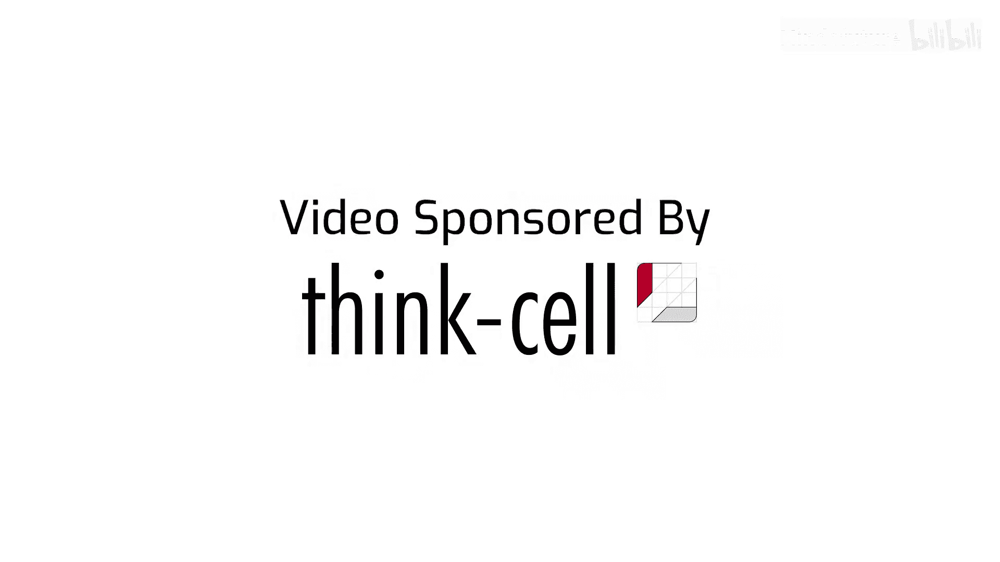
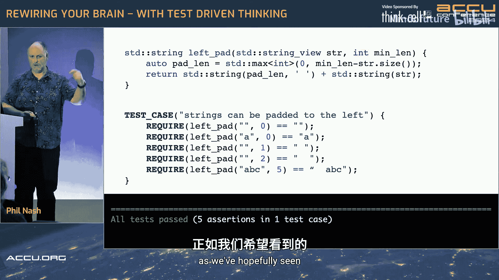
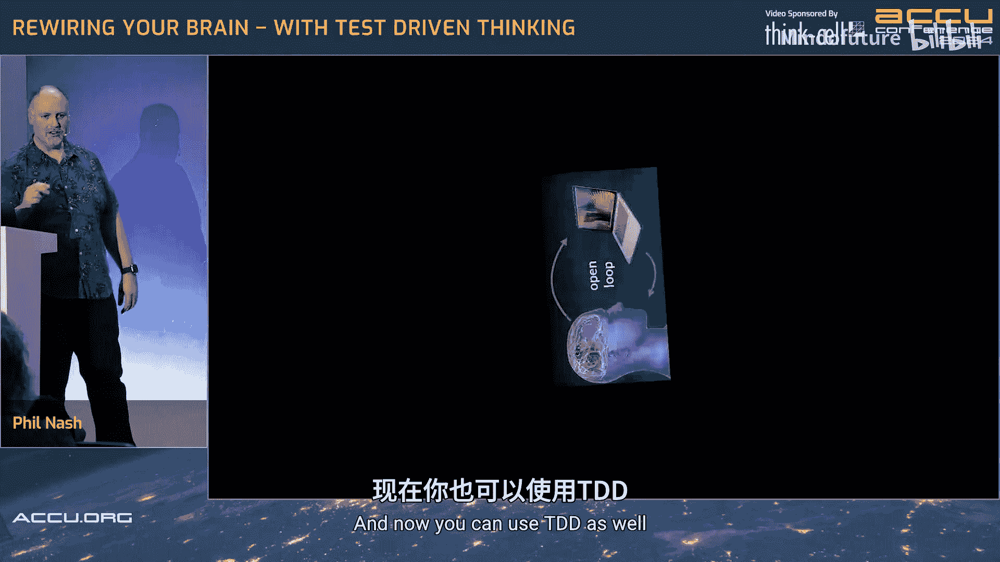
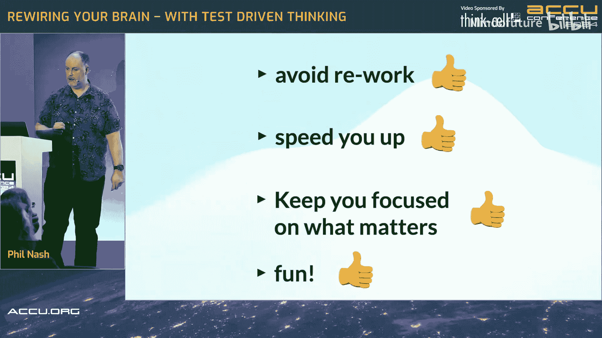

# 中英-•-C++和C语言ACCU大会2024｜人工智能｜架构｜函数编程｜静态分析｜安全｜编译器｜开发者｜垃圾回收｜链接器｜代码生成｜cmake-p35-P37-Rewiring-Your-Brain---Boost-Productivity-with-Test-Driven-Thinking-in-C++----BV1pNotYYELk_p35-

So they have still the doors now。 It too late to escape。

If you are stuck here with me and。Just toy the lighting guy。

 I'm gonna stand here for my introduction。Skip past the test like， okay。

Do we only use 10% of our brains。Well， his and spoilers up front here。 It's， it's a popular idea。

 We've probably heard it many times before。Unfortunately， it's not true。And we。

Have actually done experiments so we can see all， all areas of our brains are activated when we're performing any sort of activities。

😊，But are there ways that we can make。Much more effective use of the brains that we do have。

And to that， the answer is definitely a resounding yes。

 And with lots of different techniques and approaches。

 some of which you're probably familiar with to do so。

 It's been a big area of interest of mine for many years now。

 in at the first couple of talks ever did at this conference。So over in Oxford in those days。

But theyre all about some of these techniques。 and some of them have got a lot more mainstream in in the intervening years。

 So， I don't talk about them quite as much anymore。 but I'm still really interested in them。

Still learning new things。Something else that I've been really interested in for a few years now。

Is testing and TDD， particularly in the context of， of C plus plus， but in general。

So I read a test framework a few years ago。 catch now catch 2。

 I know some of you will be familiar with that。 And recent years。

 I've also been doing training in TDD。So I'm now fully independent。

 So if any of you need TVDB training， do let me know。But the last couple of years。

I've started to realize that there's actually quite a big crossover in these two areas of interest。

 And I've been trying to really formulate。Or gather my thoughts on this to put it together into a。

 into a cohesive talk。And， finally。Think I'm ready to do that。 And that's what this talk is。

This intersection of the psychology and neuroscience of productivity and TDD and how they work together much more effectively than they really should。

That's what I want to talk about today。Hence the title。

 rewiring your brain with test driven thinking。Not just development， but the whole thinking process。

And in brackets in C plus plus， because we're gonna have a code demo。 that's in C plus plus。

 But that's really the only thing that's specific to C plus plus about this。So before we get started。

 just to introduce myself。I'm Phil Nash。 That is my。What do we call it now X handle， I。

 I'm actually never on there。 So probably don't use that。 I've got my master don handle， as well。

And this is now my company， Shave Yanks。Did I mention I do training。

Let's start right with the fundamentals。Talking about testing， why do we write tests。

We say we should always start with the why。So。I want to start with the why。

 but I want to start by taking that off。Go even more fundamental。Do we write tests？

And maybe I can ask this question of the audience， so。Jahhoo here says that they regularly。

 as part of their development activities， rights， unit tests。So that us have a pretty good number。

 say more than 90%。Its usually closer to 50，60%。So good self selecting crowd。But， okay。

 how about this one， Who thinks that they should probably write more tests than they currently do。

Alright，Similar number。 And that's usually the bigger number。不。

Why do we write tests or just flip it around because you just said you should write more tests Then why do we not write。

Enough tests。What's stopping us？We think we should， but we don't。There must be a reason。

There's actually lots of reasons or justifications that people have for not writing enough tests or not writing as many tests as they think they should might not be the same thing。

'm not going to put up all of them。I just want to pick a few that maybe will resonate with you。

 These are ones that are commonly hear。For example。

 maybe you just think that writing test is extra work。I'm sure many of us。

 most of us have had that fault。some point or another， a lot of people that's there。

That definition of testing is it's a extra work。And， I've written this code。

 I've seen that it works somehow Well set aside whether that's actually a test or not。

 for the moment。 I've seen that it works。 Now， I'm gonna to write some extra code to show the same thing again。

 That's extra work。Okay， that that seems fair。 But if it's extra work。

 that's going slow you down because he're doing more stuff。

And one of the reasons it slows you down is because it actually distracts you from the thing you were doing in the first place。

You were trying to write some code to solve this particular problem that was was motivating。

And now you've got to switch your mental frame of reference over to how to actually test it。

Maybe even like writing that test in a different language or at least a different approach to writing code。

Or maybe we just think that testing is boring。Let's not what got got us interested in this in the first place。

Particularly if we sort of came up as like a hobbyist programme。 I know many of us did。You know， we。

 we get that buzz out just hacking some code together。

 seeing that it does the thing we wanted it to do。 And then moving on to the next thing。

 Testings not like that。Is it。Let's say there are many more reasons。

 We're going to come back to these ones， in particular。本less'。Put that aside for the moment。

Come back to this question， why do we write tests？Put up some reasons that people。

Give for not writing tests。 So why do we do it then if it's got all these problems。

Put the emphasis on the do。Again， I'm going give a whole set of reasons。

 either by no means exhaustive。And in fact， as part of my training。

 I asked this as like a flip chart exercise。 and I get people to call them out。

 and I have a whole page and I run out of room。 And there's always some that I hadn't thought of。

 And I I've been collecting those over time。 So this is not my complete list。

But just want to give you a sample。Perhaps the most obvious one for most people。

Is we write tests to catch bugs。And certainly that is an important use case。

Perhaps the first one that they come across。If that was the only reason， then you could see， well。

 you know， there's a diminishing return there。 Is it worth the investment。 Cating bugs is great。

 We want to do that。But there's a lot more to it than that。How about this one。

Maybe this is a slightly different way of thinking。We write tests to encode our expectations。

We're thinking right。 This is what I expect the code to do。Write that down in a way that。

Can be verified。We've encoded that expectation。This is going to turn out to be really important later。

So watch for this one。Maybe closelyd to the first one。We might test to catch a regression。 Maybe we。

 we caught a bug some other。Means maybe it's reported by a user or。

Or you just stumbled across it yourself。 and you think， oh I'm going to write a test。For that。

 to make sure once I fixed it， we never see it again。But actually， even tests that have never failed。

 they can still act as regression tests in the sense that。Once you've got a body of tests。

 you can make some changes over here and say， oh， did I break something that I wrote earlier。

That's the type of regression test as well。 So that's a really important use case。

Shall we familiar with that。What把 from them。This one tends to divide the room。Into 2。

 not necessarily literally。 but for some people， they think。

 what a test got to do with documentation。Or you might be the type of person think that's the most obvious thing in the world。

How often have you heard someone say， if you want to learn how the code works。

 Go have look at the tests。That shows the code actually working。 This is how you're meant to use it。

And the great thing about using tests as a form of documentation。

Develop a documentation is that they don't get out of sync。😊。

Unlike just about every other form of documentation。Because if they do get out of sync， they break。

So the code test， the test， the test， test the code。Works both ways。There is a。A flip side to this。

 So it's a double edge sword。Because。Not all tests you write are really how you want people to use your code。

 You may be like probing at edge cases and， you know， the the dirty underbelly of of your code。

 You just w to make sure that it actually survives that。

 But that's not what you want other people to be doing。So if you're gonna use tests as documentation。

 do try to have some way to separate out those two， two ways of using it。

So that you can point people to the right place。So it's obvious when they get there。

I won't talk too much about how to do that today。This is just a sampling of some of the many advantages。

Of writing tests。I'm going put a few more up again， still not exhaustive。

 but I won't go through these all individually。What I want to point out here。A3。

All the ones on the left， as I put up here， we can get these benefits from writing just about any type of test。

Many different types of testing。I to focus a bit on you in that test today， but ass many others。

And you get these benefits from all of them。The ones on the right are really much more specific to doing testing in the context of TDD。

Test driven development。Again， not exhaustive。 These might look a bit odd。

And we will actually dig into most of these a little bit more through this material。The point is。

 there's a whole set of benefits you're not getting if you're not doing TDD， even if you're testing。

Before we get to that。And come back to this。Instead of excuses or justifications for not writing tests we looked at earlier。

Extra work slows you down。Deisttract you from what you're doing。A little bit of a spoiler。

Just to give you an idea where they're going。What if I was to say to you？

That instead of testing being extra work。It would help you to avoid rework。

I see dumb nodding enthusiastically here。Such that over time。

 and maybe sooner than you think you would have done less work overall。

How much time you actually spend redoing things， fixing things up after the fact or。

Just working around a bad design。Yeah， save you time to the long run。What if I said to you。

But instead of slowing you down。That can actually speed you up。For similar reasons。

 but some more as well， we'll look at these later。What if I said that instead of distracting you from what you are doing。

They can actually keep you focused on what matters the most。

And this is one thing that I want to dig even deeper today than you might normallyminate hear。And。

 of course， what if I said instead of testing being boring。It was actually fun。Yeahep。Believe it。

We'll get to that。Okay， I mean， this all begs the question。How。

Are we going to approve all of these things？We will get there。And。

The main way we're gonna to get there。Is by。Looking into the。

 the psychology and the neuroscience of how these things work。

First time I did the version of this talk。 I was told that talking over this slide。

It was very distracting。 So I'm gonna move on before I carry on。

I' tell you that one of the most important fundamental principles we're gonna be basing all of this on today。

 something very simple that I'm sure you're completely aware of。

But just's keep this in front of their minds because it's really going to make things easier。

The human brain。It's a big association machine。It's all about the connections， the neurons， pathways。

If you can connect things together， then it's not just about memory。

But it's also about accessing different mental resources， putting you into a different frame of mind。

Being able to work in different ways， It's actually a really powerful concept that they're going to be looking at again and again。

This is really the fundamental of it。And we're going look at free areas。1。Is habit forming。

And whyhy is this relevant， Well， let's just assume I convince you that TDD is going to solve all of our problems。

 you know how to do it and go away anything， you wake up， like。

 come out of the matrix and I know TDD。But you've eventually got to do it day to day。

And that's where habits take over。You fall back to old habits。

 and you realize six months had gone by， and you hadn't written a test for three months。

Where did it all go wrong， Well， if you haven't developed a habit。

 you don't know how to develop a habit， that's going to be really， really hard。

 So we're gonna look a little bit about the very sort general。Principles of habit forming。

 and then specifically。How we can tailor that to adopting TDD in a way that's going to accelerate the whole thing。

Related to that， but a subject to its own right， something I call dopamine triggers。

So we look at what dopamine actually is and how it relates to all of this。

And can help with that habit for me。And an area that I call externalizing your brain。Using tDD。

To have a bigger brain， basically， by offloading a lot of it。To free us up， to work on other things。

So we're going look at those free areas。Before we get to that。

I want to come back to the technical side of it。And make sure that we all on the same page about what TVD actually is。

So it's not going to be a general。Introductory talk on TD。

 But I want to cover it just enough that we at least know the， the fundamentals， so。

Going to go into a tale of two cycles。look at two cycles。 Now。

 this is also an excuse to get a photo of my kids up。 This is actually about 10 years ago。

 They were a bit bigger now。 so are their bikes。 But nonetheless， you can see two cycles there。😊。

They're not the ones we want to talk about， of course。The first one I want to talk about。

Is the TD cycle。Now if you haven looked at TV before， this should be familiar。

 You've probably heard of it， anyway。Sometimes known as the the red green refactor cycle。After the。

 the， the colours used。Apologies， if you do have trouble distinguishing colours。

 they're not strictly necessary for understanding this。 It's just a metaphor。But the， the red。

 green stages。Have the color。 I've just colored the ref a bit。

 sort of orange around but to complete the， the traffic light metaphor。嗯。But this is the TD B cycle。

 You've probably seen something like it before。 This is my version。

 It's got a couple of extra bits in my version。So how does this work then？Let's say， woman。

Make sure we all on the same page on this。TDD itself。It's really simple。It's all here on one side。

Mastering TDD there's a lot more to it。But I can at least explain it to you。 So you always start。

With a failing test。Keyword there is。Well， two keywords start。That's a bit softer mist。

If you haven't start with a failing test， it's not， not TD。And it has to be a failing test。

So if you write a test and it passes first time， that's not part of the TDD cycle。

That doesn't mean that it's wrong or bad or something you should avoid。But just be aware。

 it's not part of the TDD cycle。And sometimes there are consequences to that。 Well。

 we'll look at that in a minute。 look at a code example。To be part of the T B cycle。

 you have to start with a failing test。 But the word test can be a bit more woolly。

Doesn't have to be an assert surgeonion and a test framework。 It can just be a compiler error。

Because you've written some code， makes a call that doesn't exist yet。

 uses it a class that doesn't exist yet。And then you have to write that code to make the test pass。

Part of the TDD cycle。That all works。 And you can generalize that even more。

 This is where we start to get into test driven thinking。It's not even necessary about the code。

The more you do this， the more you start to see these patterns in more and more things， you think。

 I have to set the expectation， have something something that gives me a signal when I know that it's met。

 there's my test。And you can apply the same things。But let's just scoop it to the code for now。

Go a failing test。Then， and only then。Do we move on to the green stage。

Write just the code to make the test pass。Again， I've highlighted the word just。So another subtlety。

Part of the reason we want to do TDD is we want to have like nice， clean code。

 Well factored code design principles come into it。But we don't do that here。

That's not the purpose of the green stage。 We want to write just the code to make the test pass。

Simpt thing that will work。mentionedented earlier， many of us started as hobbyist programmers。

Hacking code。See why what works。Brings back a bit of that sort of mindset of。

And how can we just get this to work。Quickest thing。Now if that was the only thing we did。

 we would soon end with a big ball of mud。 I'm sure we've all been there。

That's why we have the refactor stage。 only when the tests are all green。They're all passing。

Can we move on to the refactor stage， And that's where we can and then apply。

Our clean code principles， design principles。Factor I code。 Well， it's not just about that there's。

 there's a book refactoring。Chrisiff Howood made a joke about it the other day。

there is actually a second edition。It does have new content。

 but it's not just about that specific salaryary factors， although it is very valuable。

 But this is where we then。Change the code to be have a better design， same functionality。

Better design。And we can get it back to a working state if we broken it because we know that the tests are there to show us。

One of the tricky parts of the refactoring step is we often don't do anything there。

 We don't have to do anything there。 So we'll go around this cycle a few times。

 skipping the refactoring step。 and then we forget。And then we can end up with that big ball of mud。

 So that's one of the。One of the tricky bits we need to keep in mind。Once we've done that。

 we're all green again。We get this extra stage。 This is not usually part of the cycle。 I like to。

Put it as a separate step。 just to ask， are we done。Do we have another test to write。

 Do we have another feature to read， It might seem obvious， but as we'll see later。

There's a difference between asking the question here。

When we're just about to write the next test and asking it when we're sort of down deep in the。

The code mines。Hacking away at code。Because you have a different mindset。

So I like to separate it out。And then either we go around the cycle again or we're done。

And that is TDD。So thank you very much。No， there's more to it。

That's what I'm going to say about the process for the moment。Yeah。Why we decide after refactoring。

Why do we watch sorry decide whether we are done？after啊 ok。So the question was， why？

Do we ask the question， are we done after refactoring and not before。Bear in mind。

 you don't necessarily need to do anything at the refactoring step。 But if you do。

 it's because the code's not in a。In them。The best， most well factored state， you know。

 it may have some problems， design problems。So we're not really done until we've addressed those。

We we're done when we left it in in a clean state。But we will， well come back to that a bit later。

When we， we talk about the mindset。Thank you for the question。

Any other questions on this before we move on。It's probably a good time to， to lock those in。Okay。

 let's go on。 So I want to。Just establishes a bit more with a worked code example。Now。

 I Ive prepared it all on slides， but I try to give it a live coding fill。

 I think that tends to work better， so。The example I'， I've chosen to do。

 this is what we call a coding catter where you just sort of practice a very simple example， too。

Just as an excuse， to try something else， in this case， TDD。So the problem itself is not challenging。

 but it's just challenging enough that you have to think about it。And the 1 I've chosen is left pad。

Who remembers the incident which Javascript her a few years ago where。

The left Paddle library was pulled from MPM。 And it turned out that half the Internet transitly depended on it and all suddenly stopped working。

And we said， why does half the Internet depend on this tiny little library that anyone could write themselves。

Well， let's do that in C++。So of course， we're going to use catch。Catch 2。Mentioned earlier。

's the framework I wrote。嗯。Really， all you have to do is include the head of file。 Actually。

 it's slightly changed a bit now。 but we'll press that aside。

This actually is a fully working program。It doesn't do much。But it does tell you that no test friend。

 That's actually a feedback。 It tells you that you've got it up and running。

Working end to end doesn't do anything。But now， anything can get out on top of that。

 any problems are because of what you just added。That's an important principle。ok。😊。

Maybe you're not convinced yet， don't worry。That's not a test case。

So nice thing about catches testings can be free form strings If for use to other frameworks that might。

W， look un'familiar。So。Hey， we just put in the。The description of what we want to test as the testing。

We want to function such that strings can be padded to the left。It's a bit fake。

 Maybe you could do better。But that's what we're working through。And actually， we can even run that。

now some different feedback。Baby steps。It's a really important principle in TDD。

 Every time you can check that the thing you just did has some， some feedback。

It's different to the previous one。Take that baby step。

Because then when something does differ to what you expected。You know。

 it's only because of that tiny little thing you just did before。Really important。

Which does also mean， and this is particularly important in C plus plus。

You need an environment where you can get that feedback quickly。If you have to wait。

For a 45 minute build before you get this message， that's probably not gonna be a very comfortable cycle。

 So make sure you can get this like within a second or two。Before you start。

Another reason take these baby steps， you'll know when that starts to go wrong。Okay。

 so nothing too interesting yet。But actually， we can do better than this with， with catching。

 you might not always do this。 But if you run it with the dash W Noah surgeons argument。Then。

It would say， well， I've got a test case， but it's got no assertions。 that's now an error。So but now。

 we made this into a failing test。Right， we， we've gone one time round the TD cycle。

A little bit extreme， but it can be worth doing this sometimes。

 especially if it's in a new environment。Okay。😊，All right， let's。fi that。Alway succeeds。Y。

 I'm stringing this out， but。This is the real thing。Okay。This is some real code。So。

Require is the assert searchion macro can catch。And we're going to require that when we call a function called left pad。

We give it a string。And I string length。 and we're going get back the string。I've got empty strings。

 zeros。This is what we do in TD。 where we start with the simplest possible values。

Which are empty strings and  zeros， isn。Empty containers， null pointers， any of those things。

 that will all。serve two purposes。1 that often flushes our edge cases， simple edge cases。

Might not otherwise think of。And， secondly。It helps us to， to keep that baby steps regime。

The smallest possible increments， having failing tests。long the way， one of the。

 the big challenges of TDD is being asked to write that next fading test without making a big jump in functionality。

The way we do that is we start with the simple values。And we progressively ratchet up to。You know。

 a more complex value， a variable， a conditional， and so on in in complexity。

 We're gonna to see that practice at a moment。But this is a test。And it's a failing test。

 because he doesn't compile。Just say the compiler。Access your test framework here。

C+ pass is a static language。 We can use that。Statically typed language。

 So use of undeclared id Leftpa。 We haven't written Leftpa。

We don't even need to compile it these date。 Most compilers will just highlight the code for us in red。

That's fine。 That's your signal。That's our failing test。So。Let's right and left pad。Now。

 here we're just returning an empty， an empty string。But we'， we've fleshed out the signature。

 We now get it to compile。Trouble is， if we run that。A passes。万3。A problem。I mean， we went。

 We had a failing test before。 never we' going to test it passage test， right， isn't it。

TheThe tricky bit here is that we actually wrote two tests。The， the compile error was the first test。

 getting its compile。Was passed in the first test。now we've got a runtime test。

And the runtime test also passes。So this one passed first time， not part the TD cycle。

 Can we do better。In this case。We wanted to start with the simplest possible value in the implementation code。

 as well。Also， an empty string。Well， one of these two were going have to change to be correct。呢度杯。

Return a different value from our implementation， or we test against a different value in our test code。

Which one should we change。I'm not sure there's an absolute answer here， but my thinking。

 my approach is that the test code should always be correct。I've written a correct test。

 I want to make that correct test pass。Whereas the code under test is under evolution。

 We are evolving it to be in a correct state。 So along the way， I can make it deliberately incorrect。

什不拉电す。Return some non inchy string。And。Now it compiles， but we now get the runtime failure。

And then we can see some feedback。We we've got an X instead of an empty string。

 exactly as we expected。Baby steps。Great。Because sometimes you're going do this and you'll get something different here。

 You think， actually， it passed and I expected it to fail。That's new information we connect on。Okay。

Now we can go back to the empty string implementation。Got the passing test。It still seems a bit odd。

 though。 I mean， we know we want this function to do more than return an empty string。

So why do we start there？Right， this is。One of the， the hardest things for a lot of people to。

 to really get their head around。 why we do this。 But really， it's all about。

How much we can get out of those baby steps？And how many tests we can write that fail。

 And then we write the code to make them pass and see that transition。

 So we know that every test we've written。Is testing a line of production code。

And every line of production code has a test for it。

And we can only do that if we do this sort of lockstep baby steps approach。

So we start with a simple value。And that now says， well， I know that's not the implementation。

 So I now need to write another test。So let's right。At testest that。Passses of non empty string。

Keep the paddin string。Value 0。And now of course， it fails as expected。

We have to write a little bit more。To make that pass so we can return the string that we passed in。

Now， both tests。Pass。Because， we have to keep off with the original test passinging as well。

All right。We're not there yet， of course。Forces us to write another test。So， this time。We have。

Let's go with an empty string and a non zero pad length。W should give us a。Antipatded string。Fails。

 of course。now。We have to。Make our implementation code a bit more complex。

 We've introduced a conditional。Interesting thing here。Be。

They the first branch of the F here is the same as the code we had before。

 which means the L portion is now new code。 So the same rule applies。

Now we return a hard coded string。It forgot got。The variable and hard codeed string。

We're still not done。 of course。 So we' write another test。And we can see it fail again。嗯。

So empty string， a different padlet。Right， so we。We can't use the hard code string anymore。

Forces us to generalize a little bit more。Now， there is， there's a construct and stood string。

That takes。A string， this a character and a number of repetitions for that character。

And gives you a string at that length。And if you're like me， you'll always write it like this。

Which fails。Because that's。The arguments are actually halfway way around。

Yeahahho here always does it that way。第汉。The test caught it。That's， that's a nice result。

 So here's an example of a test that we。Sort of expected to pass。 but now it fails。

It doesnn't happen that often， but it does happen。Great， that could have been nasty。

Bug left in production， all right。So we switch them around， and now they're all pass， great。Now。

 already at this point， you know， we're only four tests in。

 When I use this example in my TDD classes， I'd say about half maybe more of the the groups that I have doing this。

They will have already had to write one or more tasks that fail past first time。

So they didn't follow the TDD cycle。That's why we do this， this process of。

Starting with the simplest possible， hard coded value。Different high coded value， variable and so on。

How far can we push this right？That's now combined。No inch string and a pad lamp that's even greater。

 So now we have a padded actual string。Five tests in before we got here。Still fails。

We're only returning the， the， the padded portion。 So we just need to subtract the length of our input string。

And add the string itself on。Love a little baby step。 But notice we've。

 we've done that separately from working out the correct constructor for strength。So that was nice。

It路 passes。And， in fact。That is pretty much our。A complete implementation。

And I'm struggling to think of many more tests that I could write。

That would fail first time at this point。So one thing we haven't done。

I look at thatfactoring the step。Maybe reflected a bit long。 in this case。

 I think we wouldve been okay。But certainly， once we've got things actually working in in the right shape。

 it's a good time to have a look and think， what can we refactor here。Not a lot。

 But there's things we can do。都是不办。Min then minus extra length。What does it actually represent。

 Be nice to get that。A named variable。 Let's pull that out。 That's our padding length， Pa length。

Do do thing。But actually， no， we've got that。We could think well。I've got that if in there。

But do I even leave that？I could say， well。Well， if I took the backs of。0ero and。A padland。

Cause if it's 0， then。Our constructed string is got to be empty。I hope we can just do it。

With no escape， no conditional。 I mean， there is one that's hiding in Stm。

But we haven't had to write it。Is that going to pass？See someone shaking that。That fails。With。

 with an exception。Anyone spot what the issue is， by the way。Sorry。

Sting of zero mark oh I don't think it likes to create a string of Yeah they got。Unsigned and signed。

Types being mixed。We're ending up with a huge number， basically。

 and then trying to allocate the spring that size。So in this case， just。Adding the in on Max。

Will be sufficient。I'm also changing the， the argument So out there Minland。

 I've changed that to an in as well because that's a little。

 a little bit more honest about the size that we can， we can represent。

 That does now mean that we should probably write a test against passing zero negative。

Pad length are expected to pass first time。But we should probably write a test for it。So， O， we。

 we call that。 Now， I think this is a nice， simpler implementation。

We might also want to go in the direction of making this more perform。

This might not be the most performing implementation， but's a good start。It depends on your use。Okay。

 no， and of course the test pass。So I'm going to stop there。Simple example。

 But I think it gives you a flavor of how we approach T D D。

 It's all about those baby steps and making sure that we maximize the number of failing tests that we can write first。

😊，Because every time you write a failing test and make it pass。

We're tested one more branch for your code。So if you follow TDD strictly。

 you should easily end up with 100% code coverage。Troub is， we can't always follow TDD strictly。

 but assuming we do。Willll have 100% code coverage。But that's the line or statement coverage。

One thing it's much harder to。 in the general case， impossible to test for。Is branchnch coverage。TDD。

 if you follow this approach， will give you a much greater branch coverage as well。

As we've hopefully seen。

So that's how worked example。Hopefully。Even if I've not entirely convinced you。

 you've got a better idea what it's all about。 So this is seem I've convinced you。

How do we then carry that forward。That was the first cycle。啊说都不错。Second ones where it all changes。

We're not in Kansas anymore。So let's look at habit forming。Bit of a change of place。But as I said。

You've， you know， you've practiced TDD， you've done it a bit on your own。 You said， I wna。

Start doing this in my， my production code。But then you've got to establish a habit。

 And we were to have a habit around writing code that's established。Your habit may be different。

 but maybe。We approach code by thinking， right， I wanna， wantan to write this feature。

 So I'm just going in。Hack away its encode until it seems to work。

 Or maybe you've got some other process。 But it's gonna be different to the TD process。

And so your habit is going to keep drawing you back。To the old ways of doing things。

And you're probably going to link that to TD just being a failure。That's not the case。

So how do habits work then？And maybe you've looked at this before since it might be familiar。

 but if not， this is actually a really great thing to know about in general。

Because being able to change habits， build new habits is a really powerful。Think in general。

So habits consist of these three things。A cu or a trigger。A behavior， sometimes called a routine。

The thing that we actually usually think of， there is the habit itself， the thing you do。

And a reward。The reward is what you get， positive thing out of it。Here's the thing。

Once the habit is established， you don't actually need the reward。Fucker。The program， you。

 you're basically programmed to perform this routine， given a certain cue。

Remember those associations。In the brain， you just made a pathway。 It's easy to follow。

 path of least resistance。Readally what it's about。

A lot of these rewards come from another principle that we can draw on。The pain， pleasure principle。

 we have heard of that one as well。So we can imagine animals。Primitively。You know。

 we will always motivate you towards towards move towards pleasure or away from pain for main drivers。

And we can override it。 We have to do that consciously， with effort。But subconsciously。

 we're always move towards。Immediate pleasure away from immediate pain。Mecy is key as well。

They often drive these。 So there was some pleasure， something positive that we wanted at some point。

😊，That caused us to reform some behavior， given the presence of some trigger。

And once that's in there a few times， you've gone around that loop a few times。Esablish that pathway。

Then， any time。You have that cure trigger。 You all perform that routine， unless you take conscious。

Actions are overbi it。 And it doesn't matter if you get the reward or not。 the patent is established。

 And once it's established。There's pretty much nothing you can do to change that。

You can't change the cues in the rub。Pos to this anymore。What you can do。

Is it in establishing your routine？Has to be done consciously。

And you have to identify the cue and the reward。Most of the time， when we have a habit。

 we only think of the the routine or the behavior。 It can actually be quite hard。

To establish what the Q and the rewards actually are。So I've done that for you。In this case。

And it may vary， but。It's going to look something like this。

The queue would be that you want to write some code。We want to implement some new feature。

The reward is where you get some immediate positive feedback， you know， you see it working。

Or you get， you know， somebody saying， you did a good job with that， whatever that reward is。

You have to think of that part for yourself， perhaps， but the behavior。You may have had。Will be。

 you know， hack away or you follow some process。 But that's the bit we want to change。

 right we now want to say， well， want to write it with a test。I want to drive it。

With test when you use TDD。 That's the bit we want to change。So really the key is the reward part。

How can we establish the reward in such a way。That it's met by following TDD。Well。

We already looked at that。So， we said that。We we performing these baby steps。We see a test fail。

We write some code， and we see it pass。You see the change from red to green。That's a positive signal。

 immediate positive feedback。But now， instead of having to hack away for。Minutes， hours。

 days before we get that positive feedback。We'll often get it in second。

So we've actually increased the frequency of the rewardvolt。it's worth consciously taking that in。

I'm thinking every time I see my test。Framework or whatever we're using。Give me that immediate。

 positive feedback。W want to take notice of that。Great。Experience the reward。Tied in to this loop。

 As it。With the behaviour of writing TDD。That's not the only one。On a slightly bigger scale。

You might get to the end of a piece of functionality。 You think， he， I'm。

 I'm happier with the way that's turned out。Better design code。Its got less bugs。And， you know。

 bigger scale still。 This is more maintainable over time。Lower defect rate。

Meeting my deadline sooner。 every time you'd notice that。Positive thing。 Take note of it。

 As it with the use of T。And it will establish this pattern onto an already powerful habit。

And this really works。And in the moment， I'm gonna tell you how to take it up to an even higher level。

8。The important thing here， as I said before， is。Once you've done that。

 you don't even need the reward anymore。So you need to become aware of it for a while。

 reestablish a habit with a new behavior。And they don't need the reward。And at that point。

It's hard not to follow the habit。Which means if you do this。It comes with a bit of a warning。

You're going to find it hard to write code without using TDD。Which is normally not a bad thing。

But do be warned。It also means that you might find yourself getting more creative about how you can apply。

 a test driven mindset to code。Once you've established your habit。

 because you're gonna be more motivated to do so。Places where I might think， oh。

 I'm going to write that off。 I can't use TDD for that。 It's too hard。They think， oh， no。

 it's worth the effort。So people want。All right。That's the habit loop。

Let's look at dopamine triggers。We were know about dopamine。I'm sure。It's a Wikipedia。

Description of dopening。It says in popular culture and media。

Damine is often portrayed as the main chemical of pleasure。

And that's what we usually associate it with。In a feeling of pleasure。Reward for doing something。But。

It's not exactly what this says。She's interesting。Sas popular culture and media。

It's often portrayed that way。So does that mean it's not the main chemical or pleasure。Well。

 it is related， but there's a bit more to it。If you read only in Wikipedia。It says。

 but the current opinion in pharmacology is that dopamine instead cons motivational salience。Okay。

 what does that mean？Well， let's， let's break it up。 motivational， as' easy to understand。

talkedalked about motivation in the context of the habit loop as well。 In fact。

 does that the word motive from motivation。And it conveys a sense of movement motion towards。

Pleasure away from pains， as we said。we could say how that all fits in。What about salience。

If you're not familiar with the word salience。Maybe think of the word salient。Like the salient facts。

Maybe more familiar。The salient facts are the the relevant facts， the important facts。

In a particular situation。A salience is the awareness of the salient facts。So。

This is really about motivation。To find。The sot facts。Become more aware。

Of what the important facts are。What's this got to do with what。With dopamine in the first place。

Well， there was an experiment that they ran， which shed a bit of light on this。

As with many of these experiments， we， we train monkeys。

They put a trained monkey in a room with a lever。And every time the monkey pulls the leader。

It would deliver a treat。Great， and， of course， you know。

 it's all wide up so they can detect levels of dopamine and they'll see the dopamine spiking every time they've got the tree。

 that sort of matches this idea of dopamine and pleasure being linked。😊，But then after a while。

The dopamine starts to tail off。And after a bit longer。The monkey will stop pulling the lever。

It's got enough bananas or whatever it is。 for now。 It knows if he wants another one。

They can just go back， pull the lever any time。It knows what the pattern is。

That's the salient fact in this situation。So they did another experiment。

Where they only deliver the treat 50% of the time at random。

And what they found was the dopamine levels stayed high。And the monkey would keep pulling the lever。

Or trying different patterns。 They're trying to establish what the new pattern is。

Because that's now the salient fact。And because there was no pattern who was random。

 they would just keep doing it。That's what dopamine does。

It puts you into a heightened state of awareness。So that you can find something that's going to give you a reward。

Rather than necessarily being the reward itself。Whichs a really interesting。

 different perspective on this。Okay。So what's that going to do with CD？Well。

 what things in the TDD cycle。Can give you a reward。But not all at the time。Here's a few examples。

We looked at some of them earlier， seeing a test pass。I it going from red to green。 it happens a lot。

 but not every time， because sometimes it's going to surprise us。

Sometimes we expect the test to pass。And it didn't awe。 Sometimes we expect the test to fail。

 but it passed。And when that happens， when it breaks out pattern。Well， now that dopamine。

Is priming us。For learning， for looking for the pattern， looking for the reason why。

It didn't follow the expected pattern。Which is exactly the right frame of mine you want to be in。

Similar， you， seeing a test code from red to green。Also， that， that raced to green。 you know。

 when you're at the green stage， I said， that's not when we're worrying about clean code and design principles。

 We're just hacking away。 again， particularly if we come from a hobbyist background。That can be fun。

Yeah，And that that also ties into the， to the pleasure part。Even the， the reffactor step。

 cleaning code without breaking anything。Yeah， it's the challenge。

You get where most of the time you're going get it。 And then sometimes it still breaks。It's all safe。

 but。You know， you're ready。 You're primed for learning again。Why did it break， What did I do wrong？

You see the interplay here。But also， you can see how that can strengthen the habit loop。If you。

 you tie this in。So that's dopamine triggers。 And I think it's it's a really powerful way to。

Ha more fun。And also become more productive at the same time。All right。There were free。

Areas from psychology and neuroscience。 want to look into the third one。

It's all about externalizing your brain。Thes are a little bit different。

But it's still based on that underlying principle of the brain being a big association machine。

That really comes back to how we are wired up as humans。

We have what's called an open loop architecture。So we are not。

 we've not evolved to thrive in isolation。We thrive with other humans， part of a group， a tribe。

Family。Friends。And so our communication and thinking styles have evolved in that environment。

So we can actually sort of think openly。Through communication。

OfDifferent forms and establish bigger thinking patterns than than individuals。

 That's this open loop principle。Now， set aside that， you know。

 some people prefer more isolation than others。In general， as humans， this is the way we've evolved。

 And at some point， we discovered。We don't necessarily need other humans to take advantage of this。

Just。Being able to write things down。Actually helps us to offload our thinking。

So that we can focus on something else without losing track of what we were thinking about。

It's still part of that same open loop process and more， more recent times。You know， we used。

Computers and other equipment like that to capture our thoughts。Write them down。Great productivity。

 at all。And now。You can use TDD， as well。

How？Well， let's come back to the TDD cycle。Now we've established these three stages。

Red green refactoro。Turns out that each of these stages requires a different way of thinking。

A different mindset。You're playing a different role。So when you're writing a failing test。

You're thinking about。High level design requirements， user experience。 You know。

 what's it like to be a user of your code。And how does this relate to what the problem is I'm trying to solve。

Yeah。Then。😊，So when the magic happens， remember I said， you know， encode your expectation。

 we write that down in code。And not just written down like on paper。

 but we've written it in code that's going to tell us when that requirement is now met。

 That expectation is met。It frees us from having to worry about that anymore so we can seamlessly switch。

So a different mindset。Because over here， at the writing in the code to the test pass stage。

Now we're implementing。We're not worrying about requirements， we're not worrying about design。

We're not worrying about any of those things。 We just have one goal。

 and that's to make this test pass。And we can bring different resources。

 different mental resources to this problem。And it's a really powerful switch， as well。

I'm sure you've had the experience where。You you come into a room to look for something。

 You can't remember why you came。You go back to where you came from and you remember because of the contextual clues。

That can be really powerful。And if you're in the middle of thinking about something。

 you need to switch。In a sort of a very artificial way， that can be really hard。

But when you've got these like natural save points。

 all that thinking you've done is encapsulated in in the test， Frees you up to now think of。

Prom in a different way。I don't have ever switch。When you go from green to reffactora。Now。

 instead of hacking away。To get the code to the tester pass。 Now we're thinking， oh。

 I just need to preserve the functionality and improve the design。Only thing I need to focus on。没的。

The test has now locked in that behavior。One thing at a time。Freees us up。 and similarly， back again。

 at the end。Now we're thinking about。Design requirements again。 And that's why。

I like to put the Rrb done step over here。When we're now back in this requirements mindset。

We're thinking about what do we actually need to。Rather than what I could do。

And it's a Jurasic park quite in there summer， I'm sure。So。This is how externalizing our brain。

Works with TD。We externalize it into the code， into the tests。And then into the implementation。back。

And if doesn happens straight away。 It takes a little while to get used to this flow。But once you do。

You will start finding that you can make these transitions very quickly。I mean。

 the whole TDD cycle can often last seconds。And in those seconds， you are playing different roles。

Semlessly switching。Notice those things because it actually helps you to accelerate them。So。

 that's accelerate。Externalally I in our brain。And that's the third of those three areas from psychology and neuroscience I to look at。

So let's see how we stuck up。On these things we looked at earlier。Well。The。

 the fun and keeping you focused。 Well that what we were just looked at。 You know， the the dopamine。

 the hacking away。嗯。Bring us up to just。Work on one thing at a time。 That all contributes to。

 to these things being fun。 There's a bit of gamification in there， as well。😊。

Keeping you focused on what matters。 Well， that's the externalising our brain part。

You're focusing on one thing at a time。Rather than having to make these mental switches artificially。

It's a much more natural experience。But what about these， I mean， surely it's still extra work。

 isn't it？ItStill going to slow you down。Well，'ll dig into that just a little bit more。

You probably heard of。Left shifting。Shift left testing。

I actually traced it back to this article from 2001。By Larry Smith， Schiff left testing in Dr。

 Do's Journal。Anyone read the original article？嗯。But I'm sure we were familiar with the term。

Actually， the the idea itself。Is even earlier than that。

 I think that's just the first use of that term。 I first came across it in this book。 this is the。

The 1993 edition， there is a later edition， as well。Co complete。Steve McConnell。

 who's read this book？And for the people。It is quite old now， but still entirely relevant， I think。

Now， they're in there， there's this shop。And you've probably seen something like this many times。

 but。Different stages of the software development， life cycle。And the。

 the cost of change or the cost of a defect at different parts of that life cycle gets more expensive。

Particularly in money， but also in time， the later in the， in the process， it occurs。

 So the idea is lift， left， shifting。Is to move things further back。And particularly， with testing。

Testing earlier。Means that we reduce the cost of finding a defect。So just from that alone。

We could say， well， if we're testing before we write code。

Then it must be cheaper than the testing after。The left shift。But we can go further than that。

I' want to ask a question。And I can't remember if it was Kevin Heney or John Jagger。

 I originally heard this from， but I， Ill credit both of them。

 So I think one of them got it from the other anyway。Why do cars had brakes？

And when I'm doing a class， I actually ask the question and expect a response， but。

It's obviously a trick question。 So you're thinking what what's the trick。 But the。

 the natural response would would have been something night to stop or to slow down。But in fact。

 so we can go faster。Because how fast would you drive if you didn't have breaks。Not very fast at all。

 I expect。嗯。And if that's not your response， then please don't give me a lifetime time。

The metaphor is， obviously。With testing， you know， we don't have tests to slow us down。

 We have tests to speed it up because they will stop us。If we make a mistake。

We can move faster because we have less to worry about。Can also me faster？

Because we have a better design， and we haven't had time to get into design today。

 But that's a big factor as well。 If we have a better factored design。

Refactoracting leads to better factored code。It's easier to make changes， faster to make changes。

So lots of reasons but。This is one of them。We will end up。

Being faster overall， we avoid。Rework。Weve avoid chasing down bugs later。And。When we do have issues。

 they tend to come up earlier where they're cheaper to fix。So that's。

How we can rewire our brain with test driven thinking and C++。

All the some references to other material。On my site。

 levelofindirection dot com slash refs slash rewired。 Html。

So rather than putting up a whole set of references， you can go there。 If。

 if this URL is too hard to remember， I've also an extra level of indirection that redirects there。

Of course， or you can， you can find me。One of these places will catch me afterwards。

But that's the end of my talk。 Thank you。

