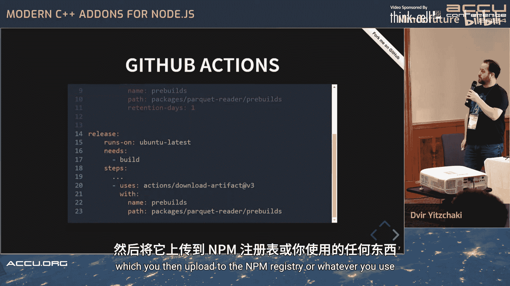

# 中英-•-C++和C语言ACCU大会2024｜人工智能｜架构｜函数编程｜静态分析｜安全｜编译器｜开发者｜垃圾回收｜链接器｜代码生成｜cmake-p36-P38-Modern-C++-Addons-for-Node.js---Dvir-Yitzchaki--BV1pNotYYELk_p36-

All right， thank you all for coming。My name is De Ve。

 and I'm going to talk about Spapa salons for O JS。 So why I come to this subject， I。

If you know visualsual Studio code that probably most of you do。

 it's an idea for Microsoft written in a framework called electron， which is an OJS frameworkmo。

By the way， any no Je programmers here or。Yeah， just a couple。诶。

So I'm not a professional ja developer， simple+ developer， but still I。Worked in this company， and。

We use some file format for big data。Application called parquet， which is an Apache standard。

 And to view it， we had some。Application we had to run。 So in the middle of development。

 which I used V S code for。 I had to go out and run this application every time I wanted to look at the file。

 So I just wrote this extension to V S code。That simply caused that application。

But then that application was deprecated and didn't support newer versions of Poque。

 so I found some other JavaScript library that did about the same thing and used that and that also got deprecated pretty soon。

 and so I looked at the source the reference implementation of this protocol and it treated in CPOSpa so I thought why not just use the original and called that directly。

And for that， I。Looked how to basically call C plus plus from node GS。

 And this is what the talk is about。 So I won't do the VS code the extension this time。

 I thought doing something a bit more。Visible or so I thought。I will write this calendar application。

In the electron。 So this is how I'd like it to be。 You can enter what year you want to look at and other the start of the week。

 other Sunday or Monday， and it will show you the calendar for that year。😊。

So you wrote the HTML and JavaScript that's needed。But then I all right。

 so how do I generate the calendar itself？And。Luckily， last year in ACCUA。Did the。Not so visible。

 exactly same thing。Using S+ 2 to3 ranges。And stealing the idea from Eric Nibur to implement。

A library that generates calendars in C++。Let's just use that。So。

No JS As are basically shared libraries or DLs。That you can load from an OJS application。

Importantport them like every other node JS module。And it has a C API， which is called the node API。

And。On top of that， you have。AS pluspa wrapper， which is。Eon is called the node add on API。All right。

 so。How do you create this， a。Soum。At the beginning， when they started working on it， they used。Jeep。

 which was the Chium build system。And that is written in Python。

 So you basically need Python to use that。啊把。As a simple fast programmer， I。Usually for my。

 at least for my personal projects， I like to use C make。And also。I wanted to use S plus modules。

 which currently。Onlyly see make or。At least there are some build systems that support it， but。

Simmiosso does， which no Jeep。It's not。So it turns out there's a jascript library that。

Can help you with that， and basically invokes。CMake for an O JS。Backcas。So as I told you。Basically。

 you need Python also for an Ogy， so I thought， all right， just use also Python to install CMake。

So I'm usinging PN， which is a Python virtual environment manager。

 the main advantage there is that I don't have to activate the virtual environment to use the whatever I install。

 I just do this PN run command。And it finds the virtual environment for me and runs that。

So that's how the description file for paper looks like。

So you can see I'm asking it to install sameM forming。All right。

 so every nodeJS package comes with this package Jason file that describes the package。

 so I request this node add API， which is the S+ API for node JS adds。嗯。And。要多少时啊。是咩剧？S Mc J。

 which I'm using， as I told。And then。Whenever someone installed this package。

 first time'm installing， I'm requesting it to install。When requesting paperss to install cemicic。

 basically。嗯。And then。So just ignore this verify thing for now but。Let me just scroll。嗯。

So scrolling the notes does not。Scroll the。Allright。And then， I call。NPM run build。

 which basically is calling us。Yeah again， I only scrolled the notes， which is calling Cic J there。嗯。

Now every API， node JS API has a version attached to it basically means what node JS versions you'll be able to use this addom。

And there's a nice table。In node JS documentations， that tells you if you use version 7， for example。

 that what I'm using you will support。Whatever node J version you want。All right。

To configure C X J S， you can just pass。Command line arguments to it。

 Or you can put them in this NM or C。 So NPM is the package manager for node GS。

And it basically looks at this。Fing。You can put different configurations there。

 And so here I'm telling themaker， where is my source， where I want the build folder to be。

And I can put any theic variable there。 So， for example， I want C++ 23。

So now I come to my semimic lists。So it。Pretty standard team make。

But then I have some some more work I need to do some。

Here I'm finding where the Cic addon headers are so I can include them。And also， I need to tell。

To build my add on to the appropriate API versions I'm using so here I'm passing packet J instead of repeating myself or passing the packet Jason to get the version。

And then against Donald Simic Im creating a shared library。

 I'm telling it where the Cic JS includes and the API is。I'm passing the version。嗯。Yeah。

 and there's also a library you should link to this the jazz Lib。

Right now I'm getting to the interface of my of my Edda。 So I'm including the node the API header。

Now every adddon has this should use this node API module on the last line there to declare itself。

 and then you pass some initialization function， which is called init。嗯 no。Before that。

So in its job is to basically declare the interface you'll exposed。

Here we only have one function called generate calendar。

Which is basically will forward to the generate calendar function defined here。All right。

 so are every。你没爱哒你。Function， basically， as this。signatureignature。 So you get some context， this。

 this inform argument。 and you should return an N N value。Then I'm checking for。Basically。

 if I got the parameters， I needed from the。A jascript player。So since it's dynamic。

 I need to check it explicitly。So I'm checking， I got what here。

I need to generate a calendar for and what day to start the week at。Otherwise。

 I'm throwing exceptions。Now， even Im。Even though I'm throwing exceptions。

 I still has this return there because it's possible that the client will compile without exceptions。

 And I， then I don't want my function to go on。So I just returned undefined her。Value。Right。

 then after I verified my arguments， I can extract them。 So I have the year and the start date。

 and then I can generate。The calendaro。Using another module， which I'll show in a minute。

So this which will will return a range of。嗯。Strengs， in this case， so。

Every line of the formatted calendar。Will be an item in this range。 And finally。

 I'm creating a JavaScript array and copying the range to it。

Since the Javascript array doesn't have a range interface。 I can't use SDD copy or something。

 Som just。Have I had just have a follow loop， even though I do use inorary to get the index there。

All right， so as I told the actual implementation of how to generate a calendar is in a different module。

 which I'm importing here。And this is the module。I't know how many of you got to play with modules yet。

First time I wrote import something。 It was very exciting for me。

So if you happen to use headers in your modules， you should first have this module semicolon。

 then you can include some headers and then actually start your module with this export module calendar and then you can also import other modules you depend on。

So I I won't go over all the details of how actually generate a calendar。As I told you。

 I did it last year in this conference。But I have just two functions I'm exporting out of this module。

 The first one takes a year。Where I want to generate my calendar from and returns a list of or a range of dates。

 and then I have another function for my calendar， which needs the first year of the weekend。

Formatite， again， using range adapters。Now。I my my oh yeah。 skippped the slider。

 One of the functions in this module needs cont view， which is not in civil 23。

But well probably be 26。And so to use it in last year's talk， I implemented using stood generator。

 but for this， I just decided to use an external library range V3。So I'm included it here。

 and then I have I implement Concat by just delegating to range V3。Or so， but to install Ra V3。

So again， you can just download the headers or。啊，上么人？

We probably know of more ways to install the penencies， but personally。

 I prefer using package managers。So I'm using conan here。And since I'm already in Python land。

 I can just paper and install con and I got it。And to integrate colon with seamakers。

A yous scmic module you can use。That supports Koan， too， and。It's quite recent。And you just pass。

 again， use this semic variable where you pass this module to Seemic。 it will include it。

Automatically， before it generates a project and this basically tells same where to find your dependencies。

And then I can just again， start a teammate。declare that my calendar module depends on R3。

You can also see the same syntax for。Compiling modules here。

 So you need to declare this target sources with fastt with type 6 X modules and pass all your。

没交费事这啊。So now we。Like to show you。It actually works。Just have话。This code open here。你这是。Sorry。

 I'm I'm running a Veesco task to。Build the applications， you can see it calls a CHGS build there。

It should already be built， so it shouldn't take long， also its module，We。

 they promised it would be fast。Actually， the。Oh， yeah。Of course， theres。Es。嗯。Yeah， all right。

 So just have to believe me in this one。😀は。😊，Yeah， if I had more time， I would fix it。

Does other speakers waiting for the line。All right。This is。All right。

 so how do you deploy this thing Again， there's。Few jascript packages you can use for it， basically。

Unless you want your users to also build the target， the the simple plus code for。

Their own platforms and forced them to download the GCC and all that fun， so。Basically。

 what you want to do is to just rebuild it for each platform you would like to support。

So that's basically what those packages do for you， the other。

 the question is what to put those prebied shared libraries。

 so you can either upload them to some web service like S3 where it downloads them from or to Git releases or。

Just inside the NPM package， which is what package premiums do。 And that's。What I use。嗯。So yeah， to。

 to use the package brs， you need to provide some。Some description file for it again。

 you need to use the API versions， which was seven。So I'm just again。

 including the package Jason and past it here and the name of your package。

And then if you remember this line， which we ignored first though。

 basically then when someone is installed， your package， it runs this package pre bills verifying。

 it checks that it has the required pre library， otherwise it will call the bill system and of course it will fail unless they have the tools or。

For some other reason。And in CMake， I had this custom chart to copy whatever I just built。

To the appropriate directory where packet pre builds can find it。 So again。

 if the other code there will be published and。You'll be able to check it out later。Um。

And actually also when I call it from the JavaScriptscript or Tscript plant， I'm using again。

 this package prebus module and passing it the description file we just。Since so it will be able to。

 to match the。At the previous library and load it。And if you use some C pipeline or Github actions。

 basically， as I said， you just run a build。stage to build all the。The。Sorry。

 those you want to support， by the way， Github actions are now free support for Mac M1。Processors。

 which is nice。And then you do something like upload the artifacts。

During the specific O S U build and download them then and just combine them to one package which you then upload to the MPM registry or。

Whatever you use。

And that's basically how you write modern C plus plusals for NagiS。 Thank you very much。Does it。

