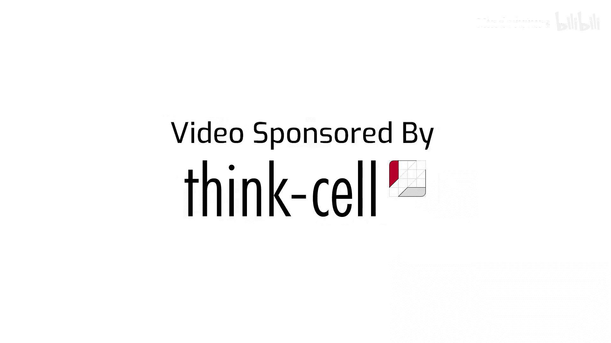
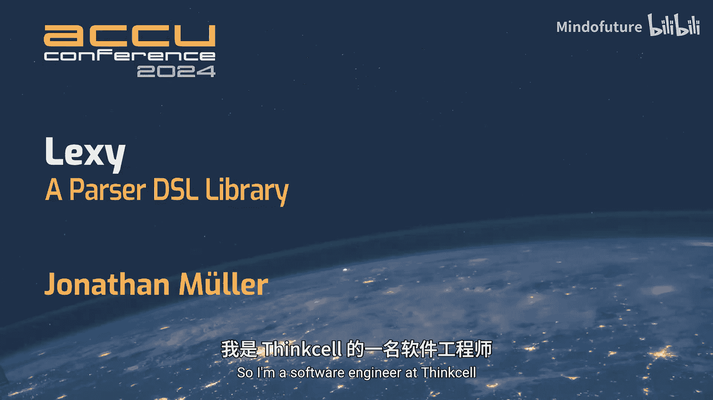
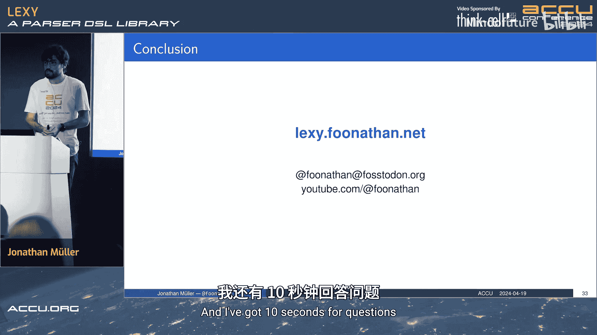

# 中英-•-C++和C语言ACCU大会2024｜人工智能｜架构｜函数编程｜静态分析｜安全｜编译器｜开发者｜垃圾回收｜链接器｜代码生成｜cmake-p37-P39-Lexy---A-DSL-Library-For-C++-Parsing---Jonathan-Müller--BV1pNotYYELk_p37-

Yeah， so I'm gonna talk about Lexi。So I'm a software engineer at Tel The talk has absolutely nothing to do with Tel。

 I just want to mention that we're hiring people。 we've got some pretty cool plus dress code。

 So if you want to come work with me， I'm also no blogging at that URL。

 So if you follow me and I've got one think raincoat that I don't want to take with me。

 So if you're interested， grab it up。😊。

So I'm gonna to talk about Lexi。 absolutely nothing to do with things started with my personal project I started before。

 Lexi is a C+ plus P DSL library， and it's essentially syntax sugar for recurive decent。

 So it allows you to pass stuff， but it doesn't use some abstractators some abstract generator stuff you've got weird shift reduce errors or whatever。

 it's just syntax sugar for recursive de。 This means you've got full control over branching decisions and backpacking and you can pass that directly into your own data structures without intermediate copies。

 So has advanced features like automatic error recovery。😊，So essentially。

 it gives you the flexibility and control of a handwritten Pa without point update。So to use Lexxi。

 you need three things， you first define the grammar， then you create the input。

 and then you call a pass。So let's say we want to pass like a CSS color into this fact。

So like hassh and then the thing， and then we pass that instruct RGB。

So first step define the grammar。 the grammar consists of productions andxi they are fuck。😊。

So we've got ourstructs， and they've got define a rule and value。

 So the rule defines using X TSL how to pass the thing。 So in this case。

 we want to pass a he sign and then the color channels。

And a channel itself has another production whose rule says， okay。

 we want to pass two hex digits and convert that into UN A0 integer。

This will then produce a UN 80 and then the value is just a callback that forwards it as is。

 so when we pass our color， it will pass the channels。

 each of those channels will produce a UN80 and we then use that to construct the color。😊。

So then we create an input， for example， we can just pass a string lit or we can read from a file and use the file contents for input。

 or we can pass an hour to into range， or we can pass the command line arguments。

 So various inputs and then we call a pass action。 So in this case。

 we want to pass something in data。 So we cally pass， give it the entry production of a grammar。

 give it the input and give it like an error handler in this case。

 the default one just print out the error and the terminal。

 and then we're checking whether we have a value if so we can use it。

 And this also demonstrates a bit of error recovery here。

 So we've got like a syntax error in the end So we get an error message printed to standard out。

 And and the browser we covered a bit and still is able to like a partial color which is sometimes useful。

 If you don't want error recovery， can just check for success instead of has value and then you will not continue like partially produced values。

You can also pass create， for example， passpy。 So this will pass the same grammar into passpy。

 which you can then visualize。 So this is pretty efficient data structure。

 It is a lost as representation of the entire input using including white space and all that stuff。

 Or if you don't know exactly what's going on with grammar， you can call Le trace。

 and this will debu the grammar and Le will print out on the terminal exactly what it did at any point。

 So we can see we can have the error we cover here at the bottom。

 So we get the error message and then error cover still continue the single digit。

 And you can also add like print statements to a grammar which will then show up in the trace。

 So if you want to figure out what's going on。So it's important to point out that Lexi is not dec clative。

 So when we've got to back X a star a， this will match 10 A。

 but the equivalent code and Lexi will not match anything。

 This is because Lexi is syned sugar for a handwritten the Senpa。

 So when you want to say while a and then another A。

 this directly translate to while a and then another A。

 and obviously will not match an A after we've consumed all A'。 So this will never match anything。😊。

Similarly， when we have branches， So re X， A or A B matches A or A B， but Alexia。

 this only matches A because syn sugar， right， we've matched an A。 So， so this matches。

 So we will never consider the second branch。This is because Lexi will never backtrack。For you。

 unless you explicitly tell it to back。 So decisions are made using branch conditions。

 There can either be individual tokens like digitals or Sk character classes and stuff like that。

 So essentially， L1， look ahead。 or you when you want to do back tracking。 You have to say。

 for example， peak peak checks where the wool would match。 then backtracks。

 And then that branch consider taking。 And you can combine a branch condition with the rest of the world using the shift operator。

 So this will。😊，Match condition， and if so， it will then continue with the branch。

 otherwise it will pick the next one in the choice。So when we want to pass for example。

 also the function called syntax， we needs two branches。

 so the first one the condition is the he sign， so when we've got the heh sign we will pass the three channels and then the second one。

 when we've got the RGB， then we can pass the channels separated by commerce。

And then we have a choice at the end。 So this will not do any back trackingracking because both of those branch conditions can be just checked as is。

 And this gives you like full control over when exactly backtracking happens and how choices are being made。

So some other features Lexi can be used to pass text， it has Unicode support。

 It has compiled some access to the character property database。

 it has basic rules to pass like nested structures， quotes， escape sequences and so on。

 it has automatic white based skipping。 you can use it to pass programming languages。

 I've written three compilers on top of Lexi。 it supports keyboardword and identifyifier passing。

 you can specify operator precedence， and then just figure out how to pass those。

 you've got automatic error recovery， you can pass binary input。 It's a pretty cool library。So。😊。

On the implementation side。😊，Lxi is built on top of Pa commmininators。So a PAer is a function。

 Our that meant to be a bull there。 So it's a function that takes a reader and returns true or false。

 depending on business met。😊，And then we can combine multiple PAss together by with a function that takes a bunch of pas and returns a combined PAs that。

 for example， passess them in sequence。And traditionally。

 this would be implemented using Lambdas and higher order functions。

 So we can imagine that the passer combinator returns a Lada that combines all the pars。

 but this is nice for like functional languages。 but in C+， its at overhead。 So in Lexi， instead。

 I use empty types， which is then entirely composed in the type system。😊，So， for example。

 this is the rule that passes a single literal character。 It's an empty type。

 So all the specification is in the type。 And then if has a pass function that takes the reader。

 checks whether we've got that character。 And if so， we bump it and continue。 Otherwise。

 we turn forth。 And then the thing at the bottom， this is theL object。

 It's just an empty variable that we're using in our signature。😊，And for example。

 a sequence a pass a combinator。 It takes two w and passes them in sequence。

 And this composes nicely into empty types。 It doesn't have any overhead because it's just the entire grammar is composed in the types system。

Now the question is how do we produce values， So when we want to ask an integer， for example。

 we skip our digits and then we get our integer and then what how do we return that integer。

 This signature doesn't give us a return channel。😊，And， but we could just say， well。

 let's just return it， right， so a puzzle returns an opportunity。And then we can compose them again。

But the problem with that is， but what values are being returned。 So like for an integer。

 it' the into。But for literal rule， it's nothing。 So we can return void。

 except we can't have an optional void。 So let's return uppercase void， which is just empty type。

 Okay， it's a bit awkward， but it could work。 and then for sequence。

 we need a triple because weve got zero more things。 So we put them in a triple。😊。

And then for choice， we've got a variance because we've got one of those things。

 And then for dynamic sequence， we use a vector。 and O。

But then we've got rules like this where we've got a bunch of lits with a choice。

 and this can produce a type like that， which is a tuple of variants of tus of voids。

 And this isn't really nice to use。 so we can start， okay。

 let's get rid of all the voids because we don't need them and then simplifypl it。

 but there's still the tuple of variants。 And I want to pass them into our own data structures without copies。

 So how do I do with that。 And that didn really didn't want to go down that route。😊。

So instead I took inspiration from senders receivers which are used for asynchronous programming。

 so there we've got a sender which describes work that should be done and we've got receivers which are just codeex that receives the results and then we connect the sender into receiver and then we can start executing the connect thing and this will produce work from the sender and pass that on to the receiver and do something else。

😊，And this crucial idea that we've got the separate thing that we need to connect。

 and then we've got the callback really solves a problem。Because Corbeex。Are really useful because。

 for example， we can easily express void。 So void just means instead of down to anything。

 just invoke the callback with no values。To have a Tple。

 where we invoke the Quebec with all of those values。 We don't need to create a tu。

 We can just use multiple arguments。And to have a choice， we don't need a variant。

 We can just have an overload， invoke the callback with one of those types。

And so this means that our world now look like this。 So the world on itself knows how to pass itself。

 but it needs to be connected with a continuation。 This is done by instantiating thestruct P with the next passer。

 which has the pass function。 the pass function takes a context， which will just pass on。

 and all the previous arguments。 It will then do its own matching。 And when it succeeds。

 it will call the next passer pass function。😊，Giving it all the previous arguments and our current value。

And that way we can compose the thing and got the channel to produce the values。

So the integer will just use that to produce the result， pass it on to the next puzzle。

And the character rule， which doesn't produce any value。 Well。

 it just calls next pla with all the previous arguments and doesn't add anything else。

 And because this is initially empty empty， if nothing produces any values。

 we just never add any arguments。And the cool thing is about sequence。So sequence passes r1， then r2。

 so for that we need to connect r1 with a continuation that passes r2 and then passes the next par。

 and this doesn't add any code。😊，RightWe just created a type。 And when we call pass on this type。

 we call pass an R1， which does something， then called pass an R2， which does something。

 then calls pass on next path。 and all the arguments are nicely chained through。 And in the end。

 we invoke it with all the values。And so this is the final puzzle。

 It just doesn't have any continuation。 It just receives all the arguments and invokes the callback。

And this is the callback that's specified in the grammar， and it will produce the final value。

 which is then stored in the context and returns to the user。So when we go back to this thing。

 instead of having two pills and variants and so on， were just having two overloads。

 We and work the call back with two ins when we take the first branch and we work it with one and when we just take the second branch。

 and we've got nice representation of all the values without having to store them in anything else because we can just store them in the overloads。

😊，But is really cool。Now， you might notice that I've used this reader instead of just iterators。

 So why did I use the reader with the peak and the bump method。 Well， I wanted to have a wrapper。

 This should dynamically request my input。 So it initiallys prompt character and ask for one line of input。

 and then it starts passing it。 And when it reaches the end of the input of that line。

 it for more input by just printing something again and asking the user to enter another line。

 And only when the user't doesn't want to enter any more input if be considered EF。

 and then it's an error because we wanted to read my input， but didn't get anything。

And so let's try and write iterator ands for that。 So an input iterator be operations， operator star。

 operator plus plus， and operator equals equals。😊，And in one of those operations， we need to check。

And prompt for the next line。So let's say if we want to prompt for the next line in operator plus stars。

So we've got operator star， which just returns the current thing in our buffer。

 And when we we increment it， we check whether we reach the end of the buffer。 And if so。

 we request the next line from the user to fill our buffer。Okay， now consider this code。

 this ones to pass ABC。So we check whether we' have got a and if so be consumed。

 we check whether we have B， if so be consumed， we check whether we have C， if so be consumed。

 but this final consume might prompt for the next line of the input。

 which is not what we want because we're done at this point we don't want to ask the user to enter anything else because we successfully pass what we wanted to pass so we can't prompt in operatorta++ because we would always add this additional line。

Okay， so let's say we request more input in operatorta star。😊。

Because we're not going to call star on the final thing， like after the end， because we're done。

 So this might work。 But whatever about this thing。 So we just got to skip over everything。

 And depending on how the check works， this might either be an infinite loop or end prematurely。

So we can't really prompt in star anything because we don't need to call star in the iterator model。

That' also better to be for my input， then。Well， we can do it in operate equal sequence。

Which is like the final thing。I mean， it works。 It's just really weird that we've got an inertor who does all the important work in equals equals。

It's just uses the fact that you have to call equals equals before you can do anything else and just happens to work。

 but it's not really nice。So this iterator model doesn't really fit the input that I wanted to do。

 which is where wrote this reader structure， which has a peak and a bump。

 and the peak can safely request more input。And with that。I'm done。 So Lexi from my Android net。

 it has an interactive playground on the website。 You can enter grammar。 You can enter input。

 You can see the past tree。 You can see the trace。 So just find it out if you want to pass anything。

 and I've got。😊，10 seconds for questions， thank you。

