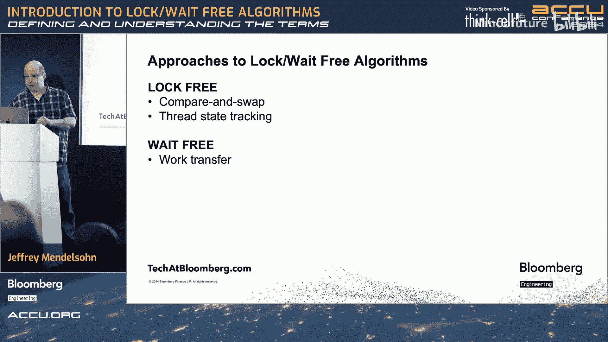

# 中英-•-C++和C语言ACCU大会2024｜人工智能｜架构｜函数编程｜静态分析｜安全｜编译器｜开发者｜垃圾回收｜链接器｜代码生成｜cmake-p38-P40-Introduction-to-Lock-Wait-Free-Algorithms---Defining-and-Understanding-the-T--BV1pNotYYELk_p38-

All right， so hi， I'm Jeff Mendelson。 I'm a senior software engineer at Bloomberg。

 My talk today is introducing Walkway。Free algorithms。Not so much giving examples or details。

 but sort of just giving an introductory definition， trying to remove some of the mystery。

 trying to get more people involved with working with concurrent code。Okay。So。To recapital。

 I said so far， I'm Jeff。嗯。Please interrupt with questions and give me feedback as we go along。

 I don't do well talking into the void。 I'll start making bad jokes。

 and things will degrade really quickly。Jaaseson points， okay， and again。

 I'm trying to provide a working understanding of block weightry algorithms。Nothing exact。

 nothing too detailed， nothing too complex， just something that getting you into a conversation。

So I'm going to start with sort of describing how we got here。

 how we have a need for this definition in the first place。

I'll have to go through what are synchronization primitives and some of the problems associated with them。

Give some simple definitions， I have a new one， I have a new one mostly so my talk would be accepted。

 it doesn't have any particular value over the other ones as we'll see。

But I do try to tie them all together to make sure they're roll。Giv me the same type of。Definition。

 the same type of content。Then we'll very briefly ask， you know。

 do you even want walk a weight free algorithms， Is there any particular value in them。

Just just to get you shocked now so that you pay attention。

 I don't think there's a particular value in walk free algorithms。

 And that's kind of contradicted to what you expected， I hope。

There's a lot of value in what we do to make something walk free。If that makes sense。

 so it's more a journey as opposed to a destination in my mindful lack freedom， way freedom。

 though is very concrete and valuable where you use it。

And I'll give some brief overview to some of the approaches。

 some of the background techniques for block and wait free algorithms。Good so far looks good。

 thank you。So how we got here， I don't know what brief subset of history I should give you here。

 So I'll just say avocus。Really revolutionized how we did Ed。It was great。

Then a little bit of time passed， we have computers。Computers do a lot of computations。

 doing a lot faster， great tool， we love them。How do we make them better？Well， we make them faster。

 right， whatever we're doing。Doing it in the less time is better。So we increase the speed， you know。

 we decrease the size of these things， they become more and more powerful。At some point。

 we reached at some point， we reached the point。 Sorry about that。 We're just making it smaller。

 faster， wasn't so easy。So he said， let's just have more of them。And now we have multi chos。

 and things are great。So through this history， that was sort of the hardware side of computers。

 through this history， where was the software side？Doual computation， run a program。

 run multiple programs at the same time。But we're still doing on one core so that required some technology。

 then we branched out into hardware and we needed some way to paralyze our work over these different pieces of hardware。

 why why can't we just run one program on one core， well we want to reduce waittency。

 we want to be able to do a big computation across all the hardware。

 whether it's cores or GPUs or AI hardware， we just want more， we' just people I guess。

The problem with that was now if I take a computation and I break it over a bunch of courses。

 somewhere I have to take those results and recommined them， there has to be synchronization。

that's just one example is other types of synchronization needed， but let's move on。

So what is a synchronization primmeter synchronization primitive and something that synchronizes I take different things and I want to bring them together at the same point in time。

 I take a matrix multiplication， I break it up into a lot of pieces， I set each piece to a core。

 they do their work， and then I have to recombine those results to get the final result that's sort of like a barrier sort of like everything comes together and gets put together I could have a different problem I can say I have a bank account classically and I have different things that are trying to update that balance and I need to make sure they happen one after the other as opposed at the same time in corrupted data。

I might have a mutual exclusion problem， so to speak。

So some of the common mechanisms you may have heard of are Mutex barrier， semaphore， so Mutex。

 while' one thing through barrier requires like n things to come together。

 Sephore says instead of one thing going through， you know， I can have three things going through。

 just some number。Again， I'm being very high level， very simple here。

 If you want to grill me because I'm pretending you， please do so。 I still don't see any hands。

So are great， but they're kind of。Really not what I want。 All right。

 I went ahead and I made my computers fast。 I made them have lots of different pieces of hardware。

 And now I'm saying only one thing can go through at a time。

It's it's kind of the opposite I mean if my goal is latency。

 you know for a system that's very counter that goal， if my goal is throughput。

 I've restricted what this one program can do， how much of the hardware it can use he asked me maybe I have enough things running on that hardware to keep it busy that's my ultimate goal I guess right to keep my hardware busy。

But。This one particular program is going to become more latent。

So common problems withch with synchronization terms。

 we're not going to talk about here really besides what we just discussed so like Dlock。

 which I don't know why I have here， it's kind of a bug， you know I have。诶。A waiting for B。

 B waiting for A， and it neither can go forward。woWould be deadlock again。

 that's more of a bug than a problem in priority inversion where I say I have some work which is really important。

 I want to do it quickly， but somehow it ends up waiting for something with very low priority and it takes it a long time to complete。

Again， that's not really the topic here。What is the topic is。

 is the lack of progress that I I if I make， if I use a mut text。

 I word everything together and only one thing can continue。 I wanted to have you know。

100 things running at this time， this time on spread over the hard。 I can only have one。

And that's kind of where the lock free and Wfr comes in。

 it's making sure we do have some measure of progress。嗯。So。

I'm going to introduce a new definition for lock free and weight free。 There's nothing。

 again special about this， or。It's just a different one to talk about。嗯。

There'sThe problem with walkfr is that if you did a search。

 you'd find multiple different definitions and some of them are really complicated。

 Like I saw one that said， if I try something an infinite number of times。

 it succeeds an infinite number of times。 anything with two infinites is not fun。嗯。Why。

 why isn't there a simple definition we all agree on， why is there not？

One way of saying what we want for Lock freedom。 And again， I come back to you。

 I don't think lock freedom has value。嗯。It's hard to say something doesn't have value when I haven't defined it。

So let's try to boil through this。Chicken egg problem a little bit。

I'm gonna to say for every So I'm gonna to say threads。 It could be processes。 It could be whatever。

 whatever runs on a computer。For every subset of threads。

 at least one of the threads can make progress。So what does that mean。

 let's say I how to read a write a lock？I have a bunch of readers going through and they're all happy。

 that's a good thing。All of a sudden， this writer comes up and he says， no。

 all your readers got to wait。And those。Guys get blocked and they they're not scheduled anymore。

 The writer can make progress。However， if I look at a subset that only contains readers。

They can't make progress， they're waiting。Is that our problem or not as up for debate。

 but it would not be walk free。 And that's kind of what you would expect was it has a reader writer walk。

So I emphasize the word lock there， maybe you should be nice if I define the lock。

 that's kind of a problem。 What is a lock。I think we could say mut text or some of these other synizations we said before。

 which is a lock。There's also sort of things you can do in code， which cause locks。

And the word locked itself becomes a problem。诶。So it's my definition。

Pretty queer and simple to apply。I think。Okay， so if for weight freedom。

 which I think has a lot of value。If you need it， all the threads can make progress。

 Anything scheduled。We'll make progress it won't fall won't need to be。Unscheduled。

 you won't have to wait for anyone else。That's hard to accomplish。

So let's move through some more definitions。Come back。

So the simplest definition I can find for lock freedom is there are no locks。

 And as we it's kind of a totality， I guess。嗯。I don't know what to say here。

 the problem with this definition is the definition of locks。I think in most people's minds。

 it doesn't meet all the requirements because it's possible have situations where threads weigh infinitely and can't make progress。

 but they're not using a lock。I don't want to get into too main details。

 So there is a similar definition for weight freedom。 There is no waiting。嗯。

So what would that mean to people， it mean there's like no whoops。

That's not exactly right either because loops are fine。

 It's just that loops have to be bound in how long they run。And we'll get into in a second。

AMy good so far， I really feel need to make jokes。No。

So this is I took from Just Software Solutions blog。Walk free， if any thread is suspended。

 the other threads must still be able to complete their tasks。

So you can imagine if I have a thread which takes a muttex and then I have five other threads that block on that muttex。

That is unfortunate because I did not sit that on my screen， give me a second。

i know you want to minimize。诶。How do I feel that？I don't have a deferral。I didn't quite start that。

 I quick to submit， I think。 So I don't know what that does。

We'll find out it'll be an adventure between us。So if I have a new text。

And a thread has that mut text， and I have a bunch of other threads block on that mut text。

If that one throw the mutex never comes back， I never make progress again。Now。

 I mean we can debate whether if that thread crashes， is that really a problem or is that a bug。

 but if that one thread never comes back， I never make progress again and that's a problem right we want our programs to make progress。

 we want them to eventually complete。And that's sort of。Where Free is taking us。

 things we want this program to always be able to move forward。

 we want to always be using some amount of hardware。嗯。

Wade freedomdom says not only whatever the set of threads are that are're in memory and running。

 each of them will complete in a bounded number of steps。

The interesting thing here is the bounded number of steps right when we hear that we think， oh。

 it's going to complete five steps， great。Well， maybe it's 50。

 well maybe founded means it's founded in the sense of big O notation。on arbitrary things。

The interesting thing it may be bounded by is the number of threads itself。

So if you go walking through on the web and you find the weight free with like three different types of weight free。

I don't know why it said that， I should have said two。

 but let's go with three is the common one once it's kind of vague and the other two separate whether or not the bound in this includes the number of threads。

That's the big difference there。Another definition。From people plus concurrency in action。

Getting a bit more detailed。If multiple threads are operating in a data structure and they have to a bound the number of steps。

 one of them will complete its operation。And again， bounded can include number of threads。

 so it can actually be。There's some sort of loop where if the threads come into the loop as long as they're ordered。

 it'll always finish in about the number of steps。And wait for you is every started of working on it。

Complete in about a number of steps。A good so far？嗯。

So I claim that while there's difference in the details of the definitions。It's somewhat meaningless。

 it's somewhat。Walk for you saying something will move forward。

 wait for you saying everything will move forward。So。W me to move on。So do we want weight freedom？

So wave freedom has this properties， everything finishes in about the number of steps。

 although it may be linear or whatever in the number of threads。It gives us that runtime guarantee。

 so if you have something which is truly mission critical if something is truly a wife and death or whatever we might want this guarantee。

 we may need this guarantee if we were had a self-driving car。

 it may need to finish this operation in a millisecond。

And weight freedom is the only thing that's going to give you that guarantee。

 And that's a very concrete goal。 So it has a very consistent definition across。Bard。Unfortunately。

 implementing， excuse me， weight for algorithms are very complicated and they tend to be slow。

So if you need to guarantee weight freedom is definitely important to you， if you don't need it。

 it's probably not something you' ever going to see in your life。No， so I had a question。

 walk freedom。So this guarantee of one thread making progress， is that useful？Yes。

 it's a good thing to add。 It's good to know your program is going to eventually finish。嗯。

Is that really what I care about， and I don't think so， I care about my program running quickly？

And the things I do to make something lock free give me lower overhead。嗯。

My code runs faster and that's a goal I think we all share。So again。

 the path I think is very important there， the destination， not so much。

The code for lock free algorithms tends to be a little more complicated by little I know。

Elementary school like grad school。嗯。But it's not impossible， and they have some common themes。嗯。

So another thing we skipped over is when we say something is locked free。You generally don't mean it。

You can imagine， for example， like on a queue if I had a push operation I wanted to push operation to be locked free。

 but if the queue is a bounded amount of memory， it should block the threads。

 that could be part of the contract， hey， if it's full， block the threads's trying to push。

That's not a bad thing。So I might say the fast path。Is lock free。So again。

 we're having trouble to lock free definition because we need to qualify on what it's applying to and I have five minutes。

 thank you。 that's the first bit of feedback I've had。嗯。哎， what's point。So。

Every time I've done this thought I've messed it up。

 you think I'd put a note in for myself but I haven't。

 So compare and swap is something you'll typically find in lock free algorithms。

 Why do I specifically mention that atomic operations is opposed to other ones。

So they know what comparing swap is， and I got to talk really fast because I only have five minutes。

So oh， we have someone who knows， but I can't ask you because I got to go， I have a value。

 value is three。So at some point I look at the value and I see it's three。I say， well。

 the comparison swapwab says， if that value is  three， make it a five。Good so far， okay。

The problem is I looked and sort was a three here。 And down here。

 I'm saying if it's a three make of five， something could have happened in between。

Could it became four？So if the value goes to four and I say， hey if it's three make of five。

 it's going to say no， you failed that， it's actually four now and rethink what you gotta think。

 so this is very common and I guess the most common place you'd see it is in a linkedist implementation where you want to push to that head of the list。

I create a new node， I set the next pointer to the head。

 and then I compare and swap the pointer this new node to the and I've lost you。No， good。 Okay。

 So I compare and swap。 Now some other thread came through， it could have replaced the head already。

 and this fails and I re trieded。Okay， but I just said I retry。

 I have to retry an infinite number of times。 How can I retry an infinite number of times if it's locked freight。

Well， the idea of Walk tree is that one thread is making progress， doesn't mean it's this thread。

Every time I fail， means some other thread swapped that head out and it made progress。So we're good。

嗯。You'll also find some complicated。Accounting， how only I took a break， No。

You can also find some complicated accounting and walk free algorithms where you're tracking like the number of feds that have come in to read。

 number of feds that are don't try it again， that are attempting to read or blocked。

 waiting to read and things like that。In weight free algorithms， you tend to find work transfer。

I'm doing an operation， I can't go any further because some other thread is doing something。

I'm going to tell the other thread to finish my operation。嗯。And since we're allowed。

To be bounded by the number of threads that works fine in the weightfr definition。Good so far， okay。

And that's kind of where I wanted to go if I didn't accomplish my goal of giving a quick five minute introduction in 15 minutes。

 tell me now。All right， thank you。

