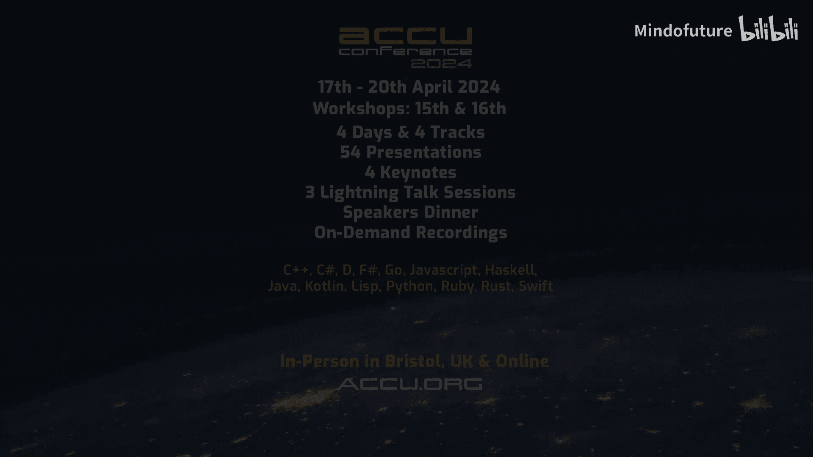

# 中英-•-C++和C语言ACCU大会2024｜人工智能｜架构｜函数编程｜静态分析｜安全｜编译器｜开发者｜垃圾回收｜链接器｜代码生成｜cmake-p01-P01-ACCU-2024-Keynote-Preview---Interview-With-Björn-Fahller-by-cppevents--BV1pNotYYELk_p1-

Good morning and good evening because I'm with Bjorn who's in Sweden if I remember right and I'm over here in Arizona。

 but welcome everyone， I'm Kevin Carpenter kind of become a professional volunteer and and this morning we're talking with Bjorn about ACCU and his anchor keynote well I take the anchor to be the last one but Bjorn welcome are you doing this evening？

Thank you so much for inviting me to this。 I'm good。 I'm good。

 I'm having a week off until Easter until after Easter weekend。 so it's great。😊。

So it's it's funny because I was asking before we started， you know。

 I know you have snow in the background there and today it'll be well。

 I'm not good at my Fahrenheit to Celsius conversions。

 but we'll be about 68 degrees here in Phoenix so。I'll get to the reason why I'm picking up the two different ends of the world。

 but anyways， it's great to chat with you。I want to de gra in sos。Wow， there's all kinds of things。

And now Yrn， I think we really got to meet our first time when we were sitting at the table together at secret Beyonce。

Yes， I believe that is correct。You know， got to see a meeting C+ plus two yes。But AU。

You know it's this is so to everyone， this is my first year going to ACC so I'm super excited about that。

 but I started volunteering at CPPCon in 2018 and ACC your first talk was in 2017。

Maybe I probably shouldn have looked that up， but it sounds reasonable， probably correct。

Um I think it was for your mocking library， what was the name of that oh I'm mispronouncing it because I really don't speak French but it tru playing。

SoOkay， it literally means to click the eye， so it's a it's an art form that Tlo is an art form that where you。

Craate the peace， that。Makes you believe it's something else than it is。

Which I think is a fitting name for a mocking framework。

That is and I has to laugh because I remember seeing the name。

 but I didn't want to try to pronounce so you know， thanks for taking that one for me。So。

That's pretty cool do you still work on it actively， I have not used it。

 I mean we use mocking a little bit my day to day job。Yes， I am working on it。

It's it's not a lot of work anymore because it's it's mature its but。

a few things there once in a while。 it's actually the 10th anniversary of it is coming up so I looked at the Git repo and the first commit was in。

2014 in October， I believe。T0th anniversary coming up。Congratulations， man， that's really cool。

 like I don't have anything that old on guess， that's just sure。So。What got you in the computers？

I grew up in the 80s， No said。Yeah，The Comodoreos and the Sinclairs and we had some Swedish machines also that nobody knows about。

And it was， I don't know， most in。Most of my friends who got them。

 they just played games on them now I thought that I did some gaming。

 but mostly I found it fascinating too。Do stuff， make make the machine do things for me。Last thought。

 but it was fun。So it's funny because you， you know。I'm sitting here thinking about the。

Things that I well so my first language when I started。

 you know you talk about the Commodore 64 and you know we had some assembly and stuff and of course you had basic。

 but I picked up tuurbopasel and CPM machines when I was and that followed with a tuurboC。

 which it was interesting because I actually pulled TurboC up for the talk that we did in meeting。

I don't miss that interface。被。For having been in this for as long as we both have。

 you've been with your company that you're at now for quite a while， right？Yeah， first。

 I just have to say it was fun that you mentioned Tber Poscal and CPM。

 you're the only person I know beside myself who did use that。😀哈哈哈。😊，Hop down， hop down， down， yes。

Okay， I hate this question because it's it's a bit weird。 Yes， I'm working on the insight。

 I have been doing so for quite some time， as you mentioned I。Joined。Originally， I must say。

 I originally joined in 98 in the spring of '98， so that is some time。

But I've actually left the company twice。And done other things and decided to come back。

And so I I mean， I saw I was looking at your Liedin so that's where the question came from because I saw that。

 but you know， the other part I was kind of leading to， I think， is the fact of。U you know。

 for what net Insight does， the kind of poetry you're writing is probably dealing a lot with the performance in various latency environments。

Or do you work on specific parts if you can talk about what you work？

I've been involved in pretty much everything in RND net insights doing various stuff。

 except we make our own hardware for data transmission and we do most of the troubling in FPGs。So。

 so most of the software is actually just to。To configure the FPJs to start doing their job。

So most of the code is not very performance critical， at least not in terms of bandwidth。

 they can be in terms of response time to some events but。

But but there are some cases where performance really matters and also one of our product families is about doing video streaming in software。

 which I have worked with and there， of course。But when the thinking about memory layouts for cash efficiency。

 etca is super important， so it depends on what you do。Yeah， yeah that's that's true yeah。

 the stuff that I work in is。It's transactional it's credit card processing so you know I only have to be fast for them in the moment that you hit that one swipe。

 but then you know doing that over 100000 transactions in hours they're not coming in that becomes the scale part right yeah yeah mean the interesting thing though it is the。

But what is performance critical is code that。Should ideally never run because it's about handling a catastrophic event。

where you need to be swift in reacting to it， but of course the catastrophic event should never happen right so all all the normal performance tuning advice goes out out the window。

Yeah， that's true。And then it becomes your most performant code because if you do it right。

 it never happened， right？Yeah， it can happen because of things that are completely outside of your control。

 somebody uses a digger and cuts a fiber that you have to react to that。Oh yeah。 oh my god。Yeah呃。

That's that's a different level than what I end up having to do with credit cards， you know。

 the credit card fails i'll reply back and somebody might have a sad day。

 but it just has to happen fast。Someone else for our side is taking care of that network if they hit the cable。

So ACCU。You know so I brought up pastcal's stuff because ACC I think the thing that different else so again backing up I started volunteering at Ci Pecon and I hadn't heard of ACC you know just being on this side of the world and so but ACC has been running a long time and I know it goes back I'm sure the conference goes back well before you know our YouTube because that seemed to have in our history how long have you you remember like your first time you went to ACC I do remember it but it wasn an old occasion'。

To。One it was， it was still in the previous location in Oxford。Currently。

 it's in Bristol and has been for quite a few years。

But that was just one of thing that I went to that I begged my manager to be allowed to go to a conference and I could go and I was。

Overwhelmed with so much happening。But then it was opposed for a couple of years before I could go again and said。

 oh come look， Sean。When of was there done。Okay， but not being sure when I was there just talks about the institution。

 if you will， that the ACCU conference must be because that's like I can tell you。

 you know I've been to Defcon， I started going to Dcon when it was Dcon sit and this you know my last Dcon I went to I think was Dcon third and so' you know it's been interesting to see how the conferences and have shaped some of the things you know Dcon of course is security but how it shaped the gatherings that we've had that you know seems to have started but ACCU。

 I think the other thing that you know at least unique to me from other conferences of it'。

I want to say language andstic， but it's not a C++ only conferences。True。

 and that is one of the things I really， really like about HU。

So I can say my two favorite conferences of all conferences I've been to our ACCU and NDC tech town and what's common with both of them is。

They are not language specific they they tend to they tend to have a lot of focus on C++ and adjacent problems problem domain but but they are not about those languages that is not it it's so you can go and listen to talks about。

Or culture about how to use git in a good way or talks about。I don't know， Python right song。😊。

So that's interesting to me Sue because like as much as I I've had my periods at the company I'm currently at where I've written C++ for a year straight。

 you know， but it's interesting because right now I'm actually doing C++ and you know I'm running some goinging that's one of my projects is fully and Golan and then on top of that you know。

Other projects helping with volunteering for conferences that are now using python which I've never done python before I joked in my last talk i'm not so sure about the whole self thing you know but it's been interesting to learn you know the lunch ordering will be taken care of thanks to Python。

So do you use other， do you have another favorite language outside of that seat plus plus I'm ashamed to say that I。

else is really the only language that I see。Comfortable with because that that is the one language that I have worked with for a very long time。

 so I。I think it's fair to say that I know it quite well。

 despite that it is a pretty bizarre language and difficult to know everything about it。

I know Python well enough to get work done， but I'm not good。currently。

 currently I'm actually diving head first into Typecr， which I don't know at all。

 so this will be super interesting。Do you find lots of learning between the languages？

Like like with Tcr as you started to do that， have you learned something in Tcr that made you go。

 I don't know about C+ plus， not yet。so I ask is。Go lay， you know。

 the amount of like everything out of Goling it feels like tuples are being returned so you know because every time there's a lot of functions in go lay where you will return some value and then the error and some other value and so it was just interesting because I never used tuples in returns that much in my C+ plus and then I spent about six months in gold now I using return equal。

So， you're。Peynote， which we have you close out the conference this， that's kind of cool。Yeah， it's。

I'm always very tense of building up to giving a talk so it's when I have given my talk I can relax and start enjoying the conference and yeah that doesn't really work in these days。

对。Yeah。😊，So learnings teaching is sharing， which I'm going to jokingly add is Karen。

 what can you give us some highlights of what keynote is going to be about？Okay， so。Yeah。

 the the title realer has it， it's about。But I'm try to look at how。We together， however。

 you and your colleagues together。看 be。Can improve be be better as a team or as an R inD department or a。

How you work together？And I think。One of the keys。To there it is。Is informational sharing。That you。

 you， you need to have a free flow of。Ids and also about embarrassments because we all。Make mistakes。

 of course， except for the people who never do anything at all。

 they they don't make mistakes but otherwise people do un bad information is important to you。

To share， but I'm also。I'm going to。Actually， use parallels to。嗯。

A work environment that I'm not going to is leak currently Okay rather that literally was。

Deadly and a deadly。Culture， but。Literally people died because of of the culture。

And I'm also going to use a really weird example， I'm going to show a little bit about how to do engine management on our World War I fighter aircraft。

right on。Okay， so I'm getting a sense of of。So I saw you do a lightning talk which I thought was a named because you know I'm right outside of Phoenix and so I will say it was a beautiful like I loved it it was one of my favorite talks you've given and I do think it's interesting on the C++ point just because like the benefit of being in a language that deep is your talks on C++ of just been you know likewise I always come away learning new things so I appreciate the time you put into all。

But I will be excited to see。you note your end note for Ra matter to close out at ACCU。

But I do feel for you a bad gu。你经啦。Yeah， yeah，s。I I also I thought a lot about what do I want to to talk about。

 because that is one of the。For me， unexpected on the kind of weird things when when you give a keynote that it' the conference organizers say。

 hey， you want to do a keynote and they say， yeah， I can do that， okay。

And that's it it up to me to find something to talk about and since we we talked。

A couple of minutes ago about how ASCCCU is not a language specific。Old friends and I thought， yeah。

 pretty much everything I have talked about has been super of mouse and。

I don't want to do a CL keynote because the keynote， you're speaking to the entire couple of brands。

Everything else do have you have a number of sites and people can choose to go to your talk if they find the topic interesting。

 but where keen not to speak to the entire conference and then I don't want to。去是呃。A subset or of。

Of the audience is to ask my target and the rest I don't care about that， that doesn't feel fair。

So that's why I'm， I think why I decided after some thinking to。

Share some of my experiences with what I think has worked and has not worked so good about how。

How teams work together。That's cool and it's kind of interesting because like well I like to use the word interesting I when I do these as interviews and such。

 you know， I am。I feel I'm a good developer， you know， I love what I do。

 but I always like doing the interviews because then I get to know。

More of the you know especially because it's with speakers or trainers it's like that that bit of life。

 that bit of personal part because if you want to see a video that specifically covers you know why you should use a certain C++ feature generally that's what the talks are about I like to learn you know just like where you started in the coding and you know when was your first time at ACCU because those are the parts you know I want people to come to ACCU and enjoy it。

对。Great conference， but。That's that part where I'm excited to go to it I want to have other people get that part too。

I'm tangenting a little bit， but it's like there's so much that we have that's language specific so it its really nice to see our humanity as developers I don't know if we bring that out that much you know and so that's cool Ka Gregory has done that a lot and she she's done some really good talks about that。

I have to say big shout out， Kate because she was u she's the reason I started。

My first CPP con was because she said you needed to go my first lightning talk was because she said hey。

 you know she we were working together and she's like。

 there's this bug here you got to give a lightning talk on it and so I have not got to see+ plus art so I have not seen Kate a couple of years so I need to this year。

Yeah， I do I was there last year， it was really to go to cold France， so I strongly recommend it。

Excellent but right now we're still talking ACCU so it kicks off Monday the 15th of April with pre conference classes I know that we got Matus and Nikco are given classes and Eat Summerla。

Kathvelyn He is actually doing a class two， which all that is。I， I was。I excited and like， you know。

 because I love watching his talk。But then the main conference starts on the 17th and runs to your End note。

Yeah。😊，Are you excited to get over there？Yes， absolutely。It's always a great conference。

So many interesting。There are interesting talks and there are a lot of interesting people there and yeah as you said。

 I've been to ACCU quite a few times。what happens when you？

Go back several times to that and there are others who go back to the same conference several times。

I have a number of people that are sort of my A friends that I only meet there and I'm looking forward to meeting them。

Yes， and and I totally understand that because it's the same thing with the conference as I volunteer out there and definitely the people that this is the conference we get to see and catch up and hang out and you know talk a little shop but talk more life and so so speaking of talking life。

 I appreciate you giving me your time this morning and I hope you enjoy the rest of your vacation。

Thank you， and it was a pleasure for being here。Oh。

 absolutely the same and I will see you in a little less than three weeks， I think。Yeah。

 scary thought I haven't finished my slideshow wait that that's going to be that it'll be Monday and you'll still be finishing at least in the youth like you said。

It's， it's not the easy part， I will say。Meeting C+ plus I got paired up my first talk that I'd done in like five years and you know right after BRNA。

 but it was at least the second， you know the first talk right after BRNAs thought which is scary because it's right after Br。

 but whatever it was going to be it was going to be done。

I think I slept through the next session because that was all the energy spent Oh yeah that's how it worked yeah。

 yeah， poste from brain doesn't work Yeah， no it doesn' know。

thank you very much and I hope you have a great afternoon evening。See at the conference。

 See at the conference bike。

