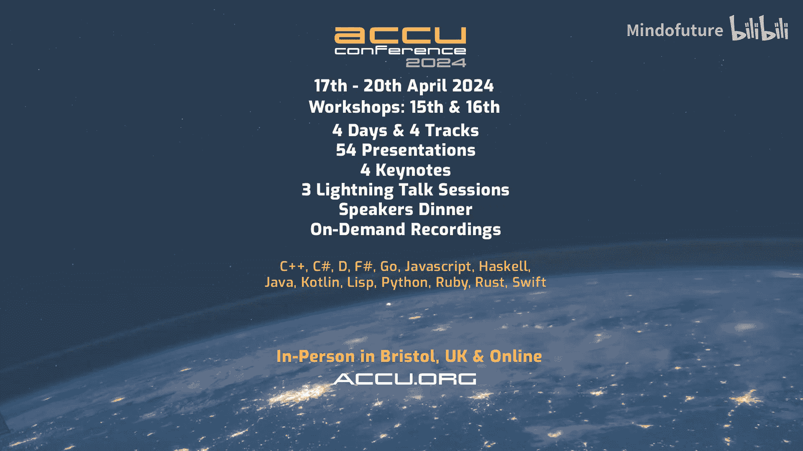

# 中英-•-C++和C语言ACCU大会2024｜人工智能｜架构｜函数编程｜静态分析｜安全｜编译器｜开发者｜垃圾回收｜链接器｜代码生成｜cmake-p02-P02-ACCU-2024-Keynote-Preview---Interview-With-Herb-Sutter-by-cppevents--BV1pNotYYELk_p2-

Welcome everyone， Kevin Carpenter here， I have the pleasure of chatting with herb Herbsutter。

 we're talking about ACCU coming up here on April 17th and so I just have to hit because I know you've posted this on Herbsutter。

com， but aCCU says that the title for your talk for your keynote to kick everything off to be decided。

So tell us about your keynote at ACCU this year because I'm excited。But。

Well in fact yes I owe them that and I hope to done that today so thank you ACC for your patience I was the short answer is I want to talk about safety and I want to go an update on CP front the slightly longer answer is I'm sometimes tempted to do with Scott Meyers successfully did for many years and never got any pushback for it was to put in a title that says three cool things in C++ and then he could decide the day before what things to talk about。

😊，You know， but I mean， with the amount of time， you know， I think of you and and Scott。

 it's like for the amount of time you've been doing C++。

Is it actually pretty easy to hop on a stage and just talk for an hour about various C plus plus I mean。

 I think of how much prep I have to do for a talk and。I like to imagine it's easier for you。

It is easy to to step on a stage and talk poorly okay。

 it is never easy to step on a stage and talk well。😡，You need to have your Dux N row。

 you need to have your information updated your demos actually test it to make sure they compile and to do a rehearsal in fact。

 the number one tip I give to new speakers if they ask is like after you've done all your preparation and all the usual things make sure your main points are orderly and one builds on next and you've got the connected so they related and make sure you have a concise introduction and conclusion so you don't spend half your talk on the intro those basics。

Rehearse because after you've done all that work， you are only shortchanging yourself and more importantly。

 the audience， if you don't just do the whole talk out loud to your cat end to end and ideally with a couple of other people in the room。

 but even just to your cat。And when talks go along， and I include myself here， when talks go along。

 it is a tell that the speaker did not do a full rehearsal out loud because that shows they didn't know how long their talk was。

So yes， it's easy to get up on the stage and just talk poorly。😡，It requires work to。

To dig to you know respect the audience and make sure there's something worth saying in a baked way。

 not a quarter baked way and I totally get what you're saying because even like I said you know as a newer speaker the few talks that I have given you know my last talk I did at C++ online and I'd never done a virtual talk so I was a little extra nervous not being able to see the audience and I think I spent about three hours on the treadmill you know for three separate times to run through just walking and talking it out loud and I felt sorry for the person next to me I was trying to be quiet but yes and then you know it goes so much smoother just because it you never say the same thing but I think you。

You have a better sense of exactly what I want to say and so it comes out with that smoothness， yeah。

Even if I have reversehes to end one thing I've noticed to。

 but for me the best way to have a salleuth talk is to say it out loud the night before。

 like yeah if I do it the morning of it's not quite the same effect if I do it the day before what I find is I give what I think it' the same talk but it's just smoothuther。

 there are fewer regressions， fewer hesitations， fewer repetition。

 it's just helps keep things in mind。I got shot， so we can talk a long time with our unprepared speaker。

Oh， I mean for。I mean， because you go all the way back I was looking and I said I was going to pull something from the archive。

 so in 1998 I read your state of the C++ union you wrote when you were coming back and and it's interesting because I pulled that up because you talk about our prepared speakers but it's like you've been publishing and writing for a long time so I'm sure your' experience is fast。

One of the things that was in that though that you were talking about is when it comes to the committee。

 you have this combination of features versus making you know documenting what is actually done and so my question is。

From where you were back then to now， how much do you think that that is still the juggle when it comes to C4+ and the standards？

I don't remember this article at all， but I think that those two are perennial things to balance and so we try to do a good job of that one thing that we didn't do then that we do a much better job of now is writing Tri reports both by individual people like the folks that RedOut off and writing nice one but there's a the best one is usually a nice crowdsourced one that many of the committee chairs and others work to create on Reddit after each meeting and so the Tokyo meeting that just finished day or two later there was a nice trip court on Reddit with a lot of detail about what's happening in individual proposals and especially as the committee is now growing quite a bit。

It helps people to see what's going on because the interest in CQ health continues to grow。

 we've had our tide for our biggest meeting since in the history of the committee。

That's including virtual attendees because since the pandemic or hybrid。

 but it still ties our previous record of people participating in some ways it's actually harder to participate virtually because many people did that by being completely inadverebted time shifted on the East Coast of the North America or in Europe where they are working through the night to be able to participate remotely。

 in some ways that's a lot harder than getting on a plane to Tokyo and doing the jet lag once than than just you know working with the sun instead of against the sun。

But I think that as things have grown and as we've done a better job of communicating。

 I think that's helped a lot I think consider that we're now 220 230 people at the most recent meeting。

And it used to be that 60 was a big meeting， right？😡。

So it's coming long way that's incredible and I was reading actually your trip report this morning and so it's it's interesting because I got your note about how you know we've had high school classes show up。

 you know， even just a view and and so that leads me to a question if someone that's a pretty regular thing these days and that's really cool for you know anyone is so correct me if i'm wrong but anyone is allowed to come and join in and view from watching it。

The the。The meeting happened， correct？So yes with an asterisk okay I have to invite them so the conve the chair of the committee has to invite them so I make sure to invite people gotcha so at this most recent meeting I think it was about 35 individuals that I invited who were first time attendees and that's not counting the high school class the high school class was like a 3 omnibu invitation and I can tell that I still getting used to it because the first time I did that they're like well who are the individual names I just said the class of here teachers it the local high school computer science class they have one of those this is great now they don't question the honor anymore they just say oh okay another high school class so fortunately I as much as a stickler for rules that they are and procedures which could be a negative and a positive they are flexible and so I'm very glad that they let us do that and even if the class is just there for half a day just to see how the saages made see how。

People work on a standard and produce a standard review new papers。

 the feedback we've had so far is that they found it interesting which。

Is a happy surprise to be because I could imagine it all coming across as completely dull to teenagers but i'm glad that at least some of them find it interesting what we do that's really cool so back to your talk so safety C+ plus a big thing especially with some of the news articles that have come out lately so CPP front you know that's we're going on three years now I mean at least when i'm looking at the Github I so 2022 two years okay well。

Well， I first announced it a year and a half ago， okay yeah I know it seems a lot longer。

 but I first announced it a year and a half ago， TB called 2022， which was toward the end of 2022。

But yeah I've been working on this in various ways since 2015 I kind of figured because I was reading through the notes that you have there of where some of the pieces came from so I'm curious for you CPP front like' I like you know I've heard the comparison to a Tscript or C++ I have not used it a lot so I'll use that caveat I've started looking at it I like where you're going with it。

Is it。😊，I like the fact that you're saying it's not a replacement but。

How much of it in your mind is more research and building ideas that can carry forward versus do you think it'll。

 I mean the amount of people that are contributing to it now compared to when you first introduced it I think is incredible。

 but what was your as you started doing it， where was your mindset。

 what were you going for on that if you don't mind。

To try some ideas to learn some things to have a personal experiment out in public and I appreciate the interest in fact at first it was kind of surprising I got the interest because I didn't know how to create a GiHub repo that had no。

That had no issues， I turned issues off， so people submitted PRs incentive issues instead。😡。

So I had to turn on issues and so over time it's grown and so diverse discussion pagers and wiki and actual documentation。

At the one year anniversary， which was last CCT column， there was a session to that CCC column that。

Folks asked to have organized just to talk for an hour about DP2 in and get together and have a verbs of a feather and I took a quick poll of like here's five things that I think are important to be working on。

 if you could pick any two of them， what would they be and we took a vote？By far。

 number one was documentation I'm。And I got to write， okay， well I don' know how to write。

 but I also know writing takes time， so I learned M docs and the material theme which is just great and thanks to Greg Mar and others for pushing me to do that and for helping to write documentation。

But that， you knowte ate a couple three months。But now there's actually documentation as well。

 so I still bill it as my personal experiment， experimental compiler with an experimental syntax to learn some things I'm contributing those back to IOC+OS proposals for today's C+ syntax with evolutionary proposals。

 but who knows I'm still I'm still building it out on it and we'll see where it goes but。

My personal experiment it's just already gone farther than I thought it would so that's nice to see thanks for the interest everybody that's really cool well I will say that if we want to see what comes out of the safety talk you need to get your ticket for aCCU now April 17th there's some preclass if you if you want to join them by all means please check them out I could talk with you probably for another hour and a half but you know we've already discussed people will drop off。

I will finish up with that and I we can do that aCC that's what I say like i'll finish up with this and then I'll see at ACC soon and we can continue chatting there I appreciate your time this morning herb thank you so much。

Yeah， thank you， see you soon。

