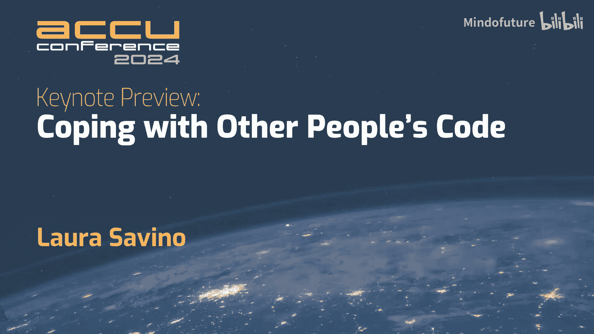
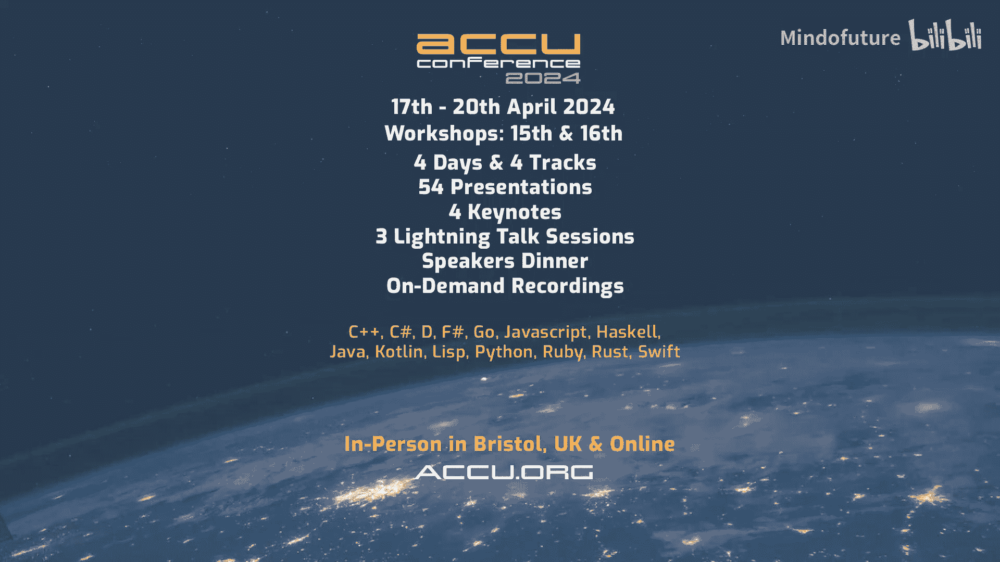

# 中英-•-C++和C语言ACCU大会2024｜人工智能｜架构｜函数编程｜静态分析｜安全｜编译器｜开发者｜垃圾回收｜链接器｜代码生成｜cmake-p04-P04-ACCU-2024-Keynote-Preview---Interview-With-Laura-Savino-by-cppevents--BV1pNotYYELk_p4-

Good morning afternoon evening， depending upon where you're at when you're seeing this I'm Kevin Carpenter volunteer for CPPcon ACCU I like to volunteer that's how I go to conferences but I get the pleasure of being here with Laura who just keynotes like all the time it seems。

😊，I'm sorry， I'm looking at the list on the page how did you so I the talks I I didn't get see your talk in person at CBBcon。

 but。You speak so well。 So how does that come about， How did you get to where you are， Laura。

 I want to go。 Oh man， so。I。I'm actually， more a writer than a speaker。 I， I like to。

And when I have an experience， especially a really tough experience or one that makes me go like why did that just happen or I mess。

 I've really messed up or they really messed up and they need to know how to do better then I like to write it out into a story and then。

Put it together into something that can make sense to other people。A lot of my talks。

 the unwritten subtitle is like do better people。So around like localization or teaching。

 that's one that I really enjoyed giving was like， hey friends。

 we're attempting to impart information to other people all the time。

 it turns out there is a whole industry out there like and discipline about how to teach and let let's learn from that。

you know， teaching is hard， so I say that because you know during the docoms when all the colleges were trying to catch up。

 I actually got asked to write a Linux course and so I done enough Linux and you know it's not something that I have a you know I didn't have a computer science degree so that was even more odd for them to ask me to write a Linux course。

So I wrote the course and it turned out being used for quite a few years。

 but then after writing the course they asked me to teach it。

Um the the hubris of my 20s thinking that I could teach a course without having had any actual training on teaching。

You know， in the wisdom of being older now。I feel bad for the students I had you know。

 it's like teaching is a skill it is。It is a tough thing and I have a lot of respect for people that can teach and you know there's certain things I can definitely teach more now。

 but to that point。It is definitely a skill， isn't it？Yeah， and it's。It's always amazing how。

You put something out there with an actual student and the first time you're like， oh no。

 this didn't land at all I I was I also like to volunteer when I have time I used to volunteer with App camp for girls。

 which took middle school girls and in one week would teach them to make an app in Xcode wow yeah。

 yeah， in objective C two weeks just to open Xcode let alone learn to do it in a week we had we had some scaffolding and Swt playgrounds have made things a bit better。

 but I was on my way down to teach I was taking a train from Seattle to Portland。

And I had written up how I was going to intro this swift playground to the kids。And then thought。

 okay， I've got this pretty good and I happened to be sitting next to like a 10 year old and I said。

 hey， do you want to learn to use X code and like try teaching this stuff to her and realize she wasn't even sure where to put the cursor to type the code in the function like I had function function bodies written out and she didn't know like well of course the code goes between the braces like that's not intuitive when you're seeing it for the first time so yeah it's it's trial and error that makes teachers great。

😊，Da and and boy， you never really know how much you don't know something until you try to teach it to someone else。

 absolutely， yep， you know。But the other example I have is that thing of。You know。

 there's the intellectual point of oh， I know that like you can tell somebody everything's changing and everybody knows everything's changing but there's that deep point where you realize change over time and it's that and so my other comparison is trying to teach and by case my teenage daughter to drive a manual transmission car。

 which she hated me for。But you know。It was interesting trying being technical I started off while you know you hold the clutch。

 you do it like this you do it like that， but then finally it became more of okay you need to feel how this is you have to have that you know okay put your foot now slowly let it you feel when this particular thing happens and then you get that actual learning of it and I think that that's a cool thing when you see somebody get that a I mean the giving part right car at scale I think was part of one of your talks for at least there was a lot about that talk but I like that that was a good one too。

hings we saying so it yeah， that that one came about when I was， I was working at Khan Academy， you。

 a nonprofit with huge reach and。Found that sometimes I was like。

 do I really have to fix this one bug or are we really going to rewrite the data layer for the third time and how I was going to stay to stay engaged and excited in something that。

What was important to me at a broad level， like access to education for everybody， yes。Yeah。

1 thousand%， but the day to day got。It。You don't always feel the import of the thing that you're building。

No， I agree。It's I do like what I do for a living I work for a credit card processor so you know my customer is your terminal that you swipe your card out at the gas station or stuff and。

And it does make me feel good that， you know， yes， it's credit card transactions。

 but you're able to get your groceries or pay at a restaurant， you know。

But I do enjoy doing other things outside of that just for the， you know。

Fling some of those gaps that we were talking about in your talk。So we're here to talk about AU。

 which I think is funny because you and I are in the same bubble。In that neither of us have up bit。

知看了。So。Are you excited so had you been？You've been to London I'm sure with all your travels that I've seen yes。

 I yes， yes， I've' been to London that's actually where I had my first date with my husband while we were on a choir trip and our first date happened to be going to see rent in that's really West The yeah。

But yeah， I've I've not， I've not been to AU and I did when I was。Guy approached me about。

 about speaking and I thought I that sounds nice。 I don't know what it is。

 but I didn't say that to him。 I， I pinged actually the other CPP Khan speakers from Adobe。

 So Dave Sanko and Abrahams and Sean parent and said。😊，Is this。Should I go and they were like， yes。

 yes， if you have a chance， absolutely do it。And I have a British co who sits near me and I mentioned to him that I was going to do like this conference in Bristol and he looked it up and he said。

 oh AU I went to that in the late 90s when I still lived in the UK it's cool。

 I am excited to get to know。Like a long running conference that has。This own history。 and yes。

 I mean， sorry not to interrupt， but that's the same thing。 Like I started volunteer， you know。

 CPP con， I think my first one was 2014， which I think is when you were first starting to speak around that time。

 at least from your school list， you probably had stuff before that。

But yeah aCCU and just how long it's been running is is is an incredible thing to me and so for anyone who's watching if you haven't already done so the conference starts April 17th so get tickets there's pre conference classes too。

But so let me ask this because when I was looking up and trying to understand more about you。

 how do you go from？French religious studies。C+ plus。

Yes yeah I double majored in French and religious studies。

 my minor was in Japanese and my thesis was applied linguistics， which is like language teaching。And。

I I started off as a language teacher for primaryaries， as I taught French in Seattle。

 I taught English in France and in South Koreaow and then realized that I didn't want to be in front of a classroom anymore so because that is it is so much energy every day。

 like you if you have a bad day， all your students have a bad day too， it's a lot。

So I started working in a school office and this office。

Had a system where they printed out reports every two weeks and then would print out a new one and copy highlights from the old report to the new report like physically and I was like oh my gosh we can we can do better than this started getting it so because it was my job to copy the highlights is like this is not going to happen。

嗯。And my then boyfriend now husband， he was a programmer and he always said like Lauraura you should try to learn programming you would love it and I always said no I'm too creative for that that's not my thing but then working in Excel I noticed like oh I'm doing these really repetitive tasks I'm gonna I wrote more and more complicated formulas I learned about making buttons that could do a lot of my job for me and started coding in VBA visual basic for applications oh yeah no。

And get the it's it's not a lovely language， right， but it was one that let me。

Achieve a goal and that was the most fun that I ever had at work and that I wanted to stay late and finish it because I was involved in what I was doing and thought I maybe okay。

 maybe my husband was right maybe I should look into this programming thing so he taught me data structures and algorithms in C++ so。

Wow， that's that's a jump like， you know， I talk about going from like basic to Pascal to turbo C plus plus you went from Vba to algorithm and C plus plus Yeah。

 I legitimately thought I couldn't get hired unless like I could just bow a red black tree on the fly Like I thought that was just。

Table stakes for being a programmer。Well， I mean， there's some truth to that though。

 that depending upon， I mean so everybody's got different interviewing processes， you know。

 and I will say like where I'm at， that isn't the process that we use but I have been humbled by one or two Bloomberg interviews I will just say。

To code up this mut text from scratch Evidently， the answer is I have stood mut text。

 why would I code one from scratch is not the through there。I'm a， that would be my answer for sure。

I understood the prim of what they were looking for。So ACCU， I'm excited to go and see you there。

 what's see your keynote going to be about？So it's called coping with other people's code my initial title had been handling your feelings about other people's design patterns and then I found out like that people kept expecting me to really dish about specific design patterns I'm like no。

 that's not the point the code like is is the code， but but this is about the human process of。

Seeing。You know， some code and a pattern that you really hate and you ask the person to change it and they say no。

 and then like what do you do with that？And to these these things that come up over just over the course of your career with。

Living with imperfection or。Living with code that doesn't match what you want it to be after you have a good idea of what code should do。

it's painful。I think of all the pain that I've probably caused to other people as they've read my code and I'm just going to prescribe your talk at ACCU which is going to be on Friday。

 mind you you'll be the opening keynote Friday， so for everyone watching you want to come see Laura's talk live and in person and hang out in the halls with everybody at ACCU and and join join us to to meet all the people that have probably been going for a long time and we're going to realize what we miss。

Or all the new people that are like， oh， this is what the institution is all about so。

I excited to see there， we got less just over two weeks。是。I it is， it's going to be great。

 I'm nervous， but I am a deadline driven developer。Yes。

 even the deadlines that are prescribed to us by management at faster speeds than they think we can make。

I'm fortunate that I。My folks are extremely reasonable but。Yes， I am。

Looking forward and that is a cue for everybody else that is watching this that their folks aren't reasonable to go apply at Adobe。

 Laura， you know。Yeah， so Laura can help you out with that。It is a genuinely。

 genuinely great place I've been here for five years now and I guess that is。

An interesting similarity to ACCU is that when I was looking for jobs。

I was impressed at how long people stick around at Adobe like and that's the kind of stat that you can't paper over。

 you know you can't be like we're gonna to add a ping pong table and it's like no。

 we have skilled people who stayed for 1020 years and that's why I'm so excited to go to ACCU because you don't a conference doesn't run that long by accident like something extremely intentional and something extremely valuable that people keep making time to come together and I can't wait to be part of it。

Same well， I look forward to seeing you there in a couple weeks， Laura。

 thank you so much for your time this morning can we？It was a good day， bye。

