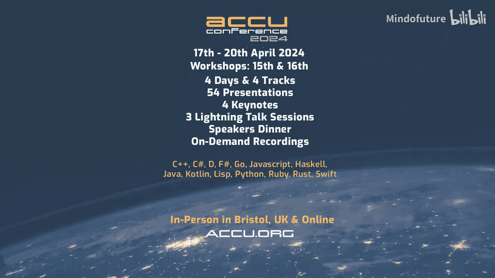

# 中英-•-C++和C语言ACCU大会2024｜人工智能｜架构｜函数编程｜静态分析｜安全｜编译器｜开发者｜垃圾回收｜链接器｜代码生成｜cmake-p05-P05-ACCU-2024-Session-Preview---Interview-With-Mike-Shah-by-cppevents---Rereleas--BV1pNotYYELk_p5-

Welcome everyone， Kevin Carpenter here。I'm going with professional volunteer because I do this for so many conferences now。

 but I'm with Professor Shaw and I saw that on， you know I can't remember if it was on your YouTube channel so you know at Mike Shaw he's got his own YouTube channel and and 16000 plus subscribers which I definitely can't claim anything too you know mine just get posted for the conferences but we're here about the ACCU conference 2024 that starts on the 17th of April goes to the 20th。

 there's some great preclass and we'll talk about that but Mike welcome。Thank you， family me， Kevin。

 can't wait for ACCU looking forward to our conversation and it's a pleasure to be here。

So in all fairness I've。I was thinking about it this morning。

 I can't remember when I first met you I just feel like I've known you for a long time Mike so I I mean。

 how many conferences CPP con core I think core CPP yeah yeah meeting no you didn't make meeting this year I've not not this past year I've been before Yeah I think it's been several years now and several adventures together so it's always great talking with you absolutely。

So。ACCU I know you were there last year， I want to say and you gave a talk which was about teaching C++ and I mean Professor Shaw's you know' that's your main gig right yeah tell me about that tell me about plus year and your main yeah I give a talk let's see at ACC on how I teach C++ modern C++ one pixels at a time and this is really a playoff of one of Kate Gregory's talks from the conference many years ago at this point that I always look back to on how she teaches C++ so again me basically a stealing tricks from Kate is wonderful speaker programr trainer everything she has been trying to just you steal as many of those tricks as I can and put them into my courses over the years and make programming really fun in C++ by having a graphical element again so students understand the purpose of what they're doing we're using the tools。

 the abstractions。E++ provides again， keep them motivated and again。

 make C++ programming fun and to see the power in the language。So。

That makes me think of programming logos。Which i'm guessing is a ways further back from when you started yes this this is true I do have origins and basic programming and funnily enough that came up as a question during my talk about how you considered programming and logo and toographics and these types of things。

😊，So okay， I love the idea of using C++ from the graphical point because I mean LEDs space that it's even CPPcon this year you know they're gonna have a big game dev track。

 which you know I think is is really cool and let's be serious there's probably not a game out there that doesn't have I know that there are a lot but you get the point I'm making like when it comes to performance you know I think I read it in a piece that in one of your videos it's like even when you have something that's not necessarily you know it might be a 2D scroller。

 but still from the fact of saving battery because you're running on a phone it's your flight the algorithm you just did a video and you're doing it right now on you ph pattern yes that was it it was like you know and it's a great point you're saving battery and you know either way you're working with finite resources still not quite。

The Z8 with 28 kilograms or 28k of around Yeah exactly I mean。

 there's this great quote which you know speaking of ACC the first time they gave talk of this conference way back in 2019 was on performance and cash oblivious algorithms that kind of doing a deep dive there but one of the quotes I is from professor Charles Lys another professor much wiser than me but he kind of gave this gold nugget of performance is a currency C for you so you know even if you don't need it even if it is a simple 2D scroller as you said。

 you're getting battery life you know a smoother experience。

 maybe the codes more correct you're not taking shortcuts So it is always something to think about and that's kind of one of the nice things about C++ don't have any handicapped on performance for better or for worse right no that's true so it's interesting because you know thinking of cake Gregory So I had the。

or working with her when I first met her because she was helping us with the contractor the company I was Rkia and one of the quotes she would use on me a lot was working as a feature because I would I would write something you know and I'd be like well it works and she would be like yeah and working is a feature even in performance how much do you find that the code you're doing is iterative like。

You get that part and then you know you're you're continually just improving upon that part is is that this same experience for you。

 I mean because I did is I think as we progress in experience you can you jump a level or two。

 but doesn't it always start that way is that？I think always is at least in my development， you know。

 it' it's kind of， and maybe we get a little bit of a biased perspective。

 you know and you watch somebody like me giving a YouTube video because I've thought about a problem for a long time long enough that I'm comfortable right recording it putting myself out there publicly but development is so iterative I mean you know even often enough it's like oh I need a sorting algorithm so you just reach for you know whatever's in the standard library or there's even been times where I've just coded up a quick brute force sort because I wanted to see it sort of working but we know that's not very performance so right yeah。

 the development is so iterative and understanding maybe the why of why you're doing something is so important I think maybe as you get to it more you know put in more years of developer experience and a specific domain because it even changes domain domain like if I'm in graph。

Fix their tricks you use for performance and how you architect your code and then you move to something else and maybe it's totally different you know it's kind of interesting No it is so because you know we just did CPP online and I unfortunately didn't see your talk because I went head to head with you so that's right Yeah know why did they do that I got done with my talk and and I was I'd never done a fully online talk so I have to say I was more nervous about doing a fully online talk than anything else。

😊，So sorry I'm I was just I don't know where I was going with that。

 but it's like when you're preparing for a talk and stuff it is that difference of you know you've trapped with a problem。

 but to that part of that's what I was saying is like for CPP online you know my talk was about the intuition that we have when we're working with our tooling and stuff and this was the second time I gave the talk but the first time was in meeting but this time in between I started to learn Python a little and so I've never written in Python before I you know I go back basic tuurbopascal PhP pearl。

I'm not， you know， I joked about it in the talk I'm still not so good with self that just kind of you know python。

 but the point is is that I felt new like you know， when I would talk about the intuition talk。

 there was that part where in the talk。I've done C++ for a while and so when I gave it the second time and Id spent that time like learning a new tool set learning a new layout。

 you know， tabs actually mattered it it brought up something different you know and it's like that that far yeah I'm still working in my code but far more iterative approach compared to what I would write in C++100% as like you said。

 you know learning a new language is something that's。You know。

 I encourage everyone to do because it changes how you think right again as you mentioned。

 the performant way to do things and and python or you know， whatever language can often be。You know。

 very， very different， which is， you know hell。So。For AU， I want to ask this because Gail Oliis。

 she's running a I want to say it's a one day early careers day for you know junior developers and that's running on Tuesday。

 April 16th， so being a， you know。Being an instructor。

 how important do you think is it for because even to that part。

 like I'm learning a new language and even all the knowledge that I have about how algorithms work and I。

I just I feel pretty roughth from the way it started out so you know a conference like gales or you know。

 I say conference， but a pre conference workshop。For students， what do you think？Love it， love it。

 you know， if students can go who are either volunteering for the conference or are， you know。

 just starting their career。It's amazing how well one I can speak a little bit to Gail because I've known her in passing very friendly you know' seen her at the ACC conference as just listening to her CPP cast interview a learning some of her background and understanding the psychology of software should worked for many。

 many years as an experienced software engineer I believe and then went back and study well how do we build it how do teams you know function together so it sounds like you know it's the right person for you know junior or someone getting started in their career to get for these pieces of advice that could maybe save you years of time you know along the road or maybe just having yeah No I was gonna say or maybe going through your third interview with Facebook because the first time you know I am not I'm not a computer science major I never was I was selfhoaught and so you。

Going through a coding interview， at least it's online and not on a whiteboard because honestly。

 I'd rather house I'd rather have that here than a wife。100% yeah。😀Yeahへ。😊，But yeah。

 so if you're if you're a new developer or new from college and you're trying to work on that next position。

 you might want to check out Gail's pre conferenceence workshop。

 but to the point of learning and education in different languages。

 so your talk this year is on D and how D。Helps you with you know C++ which I can appreciate because I do a lot more go now and I use twoples in a new way and C++ than I never did before go because you know go returns two and three things every time So tell me about the talk what inspired the talk Yeah so you know I started really getting serious about the de programming language probably two years ago and attending you know the Dcon giving talks there but D itself was born from Walter Bright for those who don't know the history and I'll give up brief history during the talk but he is one of the folks who created you know the Zortec C and C++ compilers which were famously know back in the day very optimized and you know hes sort of a one man team this very smart guy and then he also has this history with the D programming language with Andre Ags and Drscue who's also very popular in the C+ community and still giving talks amazing talks。

Intertaining and insightful but anyways throughout these history。

 they've kind of teamed up and in some ways learned from C++' lessons。

 I would say in the as it was a language in the 90s pre modern C++ I would say right so it's a little bit of a different path。

 but again， folks think of it as you know， see C++ then the joke is you know the D language right after。

😊，Um but it's kind of interesting with the language and having learned it just in the same way that you're talking about Python that different languages make you think in different ways。

 right。So D has me thinking about different paradigms that it emphasizes。

 so things like templates and metaprogramming， they make sense to be in D because they've you know they've had time to learn from other languages or try out new things and kind of learning or doing template meta programming and introspective coding or that is you know doing stuff that compile time。

 these other paradigms that are just now really becoming an emphasis of C++。

 but I've been a mature part of the D language has been very insightful to have almost like a playground to learn this stuff and then translate it into C+ plus you know for whatever domain at working or means working that language。

So I have to ask now。BecauseD's the memory safe version of seat+ plus。

Rus how does it compare yeah it's interesting so i'm starting to get some insights and again this is as you mentioned on YouTube folks can dig into that if they're interested I've been doing a first impression series where I look at a language for one hour and so I looked at Ru amongst many others there's like 20 oh yeah 20 languages now。

Um， but even when I think about rust， as soon as I started。playlaying around with it。

 And again I'm not an expert so yeah some folks are going correct me but you immediately have to think about things like ownership right this is the famous thing with the Bchecker and so on right at having various compile time guarantees so Rus to me almost falls in between D and C++ in the middle somewhere so now you're asking okay look at no no I was just yeah so I didn't want to you know put you on the spot a little bit。

 but it was just more because you know we've all seen the article that came out you know and and it's funny because the thing that I think that's interesting on that is I you know like I said lately I've been doing a bit of dough because go has a great interface for JWTs with Jose you know the cryptography and everything's already built in where there aren't that many C++ libraries that I've found that are actually doing JWTs well without having to do。

And I that one so however was I was asked to write this and go and so I was listening to another YouTube。

Terson that was doing you know go examples and he was talking about the latest release of ago and he had this quote in there where basically said。

 you know， they the go when you're writing a route a router for HttP it won't return an error so it's one of the problems but then his the quote that got me he's like well you know go they say they won't do this because they want to leave it backwards compatible for every version of go before that and and it just made me go you know I mean because that's。

Okay， so it goes， you know， 10 years old now C++ is what？Or do call close 50 50 I think yeah。

 50 or probably close that so you know it just it made me it it gave a different view of it I'm like。

 okay so you know， you just have that point of breaking changes。If go。

 which is a new language is experiencing that， you know I know Rus has been been out for a while。

 but that makes me go okay is every language is gonna experience the same problem to a point because otherwise you have to have breaking changes I mean because that's why we went from Python2 to Python3 you if I understand right correct Yeah correct correct I mean it's really interesting I mean there's a few points in here one I think it's interesting just how young our field is of computer science you know should talk about C plus plus you know that's nearing 50 years I think C is probably more than 50 or so years but we look at that to biology chemistry math etc that's our measurement thousands of years right and that's just the recorded history right maybe more more has been lost but you know as you're talking about go and Python and these different languages it's interesting and maybe this is a point if I can sell my talk for folks to come。

Absolutely just come to the talk and see it's it's not going to be a comparison talk where at the end I say this language is better。

 so use it， but exactly as you're talking about in your work。

 sometimes you're using go sometimes it's C++ or Python or whatever picking out the right tool for the right job is important oftentimes you don't experience what the different paradigms are in a single language so you have to kind of。

Dive into rust， which enforces safety and say okay。

 it's about ownership and these types of things Okay and see plus plus that's unique pointer for everything right and then you right okay。

s it's a pretty safe language at that point， which is kind of interesting Yeah you know。

 us getting the the same guarantees I mean in some sense if you're actually writing modern stuff but I didn't mind when that article came out because it just means kind of like cobalt programmers I'm just going get paid more all the way into retirement。

Yeah， exactly if until chatd GT can do all the optimizations for me and well you know that's okay。

 then I'll just sit off。So， you know， I just have to dig and ask， so how much as you're， you know？

For where you are today， how's your experience from when you were writing web pages ofbasp。net Ne？

You've done some good digging here。😊，I tried a little bit what I can。Yeah。

 I think my my first official internship on paper I did some like writing and freelance work in games。

 but I think the first official one was doing asP。net I mean all I can say is my code has changed a lot with how I write things and。

And what I learneded， I mean， and I mean， I think that's an interesting thing， you know。

 how we start development， maybe it's hopefully it's comforting for other folks to know that you know。

 my journey was look at tutorial， look at stack overflow， those glue stuff together。

 try to learn a little bit more iteratively。And I probably wasn't even thinking at the level of paradigms and best practices and imutability and some of these things that can be very intimidating coming to different talks。

 but again， just just taking out little pieces at a time。

And tried to apply them yeah so I I started off as a after my little game programming freelance work doing yeah web development which I quite enjoyed again that visual quick visual feedback is useful for me yeah it is。

You know， and it's it is interesting because that part of。You know， I， I。

 I don't want it to be an age thing， but that's the part where it's like a， you know。

 hitting the spot where u when I was younger， you know。

Everything was in focus right then whereas you know， when you get that arc finally of， you know。

 I remember when I was first doing C++ probably for my first eight years templates were just a no。

 you know I was an ad more of an application developer you know when Kate and I were working on that project I hadn't even used the standard library that much because I was doing MFC and it was an little rap and but to that part it's like those incremental little pieces。

 which， you know to the intuition talk when I gave it the second time it's like that's the part that I think is interesting is you know。

 every little bit that we pick up as a developer。It it adds to the overall experience。

 which then just makes you a better developer and some of the small things that you don't think。

End up having anything to do with code。Even to， you know， so as a teacher。

 you probably because I noticed you spent most of your time in well。

 I understand a lot of it's been in academia so。I do all the volunteering at you because I like I like helping out it's good to see people it's good to see。

 you know do the part that I can to help people grow because I。

I didn't get my PhD like you congratulations because that's that's that's a lot of schooling and a lot of education but you know what I'm saying like the part where we grow and I think that's the part that i'm trying to you know just lead into conferences talks you know struggling through that piece of code where you're taking a tutorial and trying to customize it because I don't want that feature I need this feature and and then you spend an hour and a half staring at SQL alchemy because it's got some self reference that you don't understand that。

No， I'm not speaking personally， not at all。对面。Yeah， Mike。No sorry go ahead oh I was going to say。

 I mean， I wonder just to flip this script because I'm only thinking about asking my students a question in this case' you're this you'all teach the student。

 which is great。No， I don't think that， but go ahead。My years of schooling。

 maybe we're just a marathon， which that's we're going to need a longer interview slot for that but。

Yes， because it scrolls， it scrolls。But but I wonder if you know， thinking about this topic。

 are there any talks， you know， whether ACC you or others that you've listened to， you know。

 many years ago and you've actually revisit， are there any that come to mind and you listen to it again in your perspective is you know changed or you just pick up something way new So the thing that so the reason I point out you know you've never been you know I make I don't want to say the joke。

 but it's like when I think of someone such as yourself and you know Patrice Roy。

 you know someone that's really gone through a caramme who's a volunteer that's worked with me a lot。

 you know that are going through doctorateates program you know and I my brother had gone through a doctor's program and and the producing you know new artwork I will say is you're writing your thesis and stuff which is just incredible to me it's mind blowing to me because I literally started in school with you know I started with the Conmodore 64 I learned Her Pascal on the CPM machine as I was talking。

Yrn the other day。And so for me， you know， which I think points to both you and class as well。

 the back to basics stuff really is， you know， those are the talks that I ended up revisiting a lot more。

 I'd say maybe not so much in the last couple years but when we first brought those talks out because because yeah template scared me and not just me so the company where I work when I first started there for the first four years we had some even older developers that started with TurboC like I did and templates。

 you better not have any template code in our stuff。Now。

 ironically I worked for a credit card processor there is not that much difference from American Express Mastercard visaa Citibank euro card that's perfect for templates right you know that is the ideal spot where you would want to use it but until you can make that leap you know。

 I think is is the big part so for me the back to basic talks your talks Klaus's talks I've always enjoyed listening to Kus he does a great job at explaining patterns and stuff I like Kate's talks to just could you mentioned Kate。

 you know Kate Kate brings up those things that aren't just。Like naming is hard。

 that's one of my favorite talks that you gave because it really is， you know it's like。

 oh I'm just going to throw a name on this and you don't think much about it， but yeah。

 when you actually go back and think about how we're trying to write self documenting code if it。

Naming is really our you know and so so for me， those are the ones that you know and I still enjoy。

 but because of all of those kind of。Entry level， beginning level talks， you know， again， not being。

 you know， I didn't take computer science in college， everything I've learned has been in that。

Pick up the book pick up a tutorial to your point let's code out the algorithm just to see how it works I know it's not as good as what's in the standard library。

 but then I understand that base which to back that one step backwards for it is where you know for someone that's new and going for a job when you got to sit down and somebody's like okay I want you to you know code up a mutex from scratch why would I do a mutex from scratch I mean there's one in the standard that's not the answer they want I mean it's one you should use but then you still better be able to code up a mutex right so。

All to build knowledge。Yeah， yeah， it's it's really fascinating how well， as you said。

 there there's no one right way to do it too because it often revisiting， you know。

 learning from others， coming to conferences， you know。

 or you get a lot of this knowledge that isn't you know。

 I try my best as a professor to give as much of a industry experience but sometimes you just got to。

Dive in。Li bit a little bit and talk to some of these experts who can give you good advice kind of nudgeging you you know one way or the other so again you know Gail's workshop sounds awesome just giving that those little those little nuggets of advice I mean i'll give you one quickly here on Titus winner always gives greatest tightus winners on a software engineering。

And he taught me something I've been thinking a lot more about which really in our industry we need to think a lot more about people and how they're working together but to think about when you write a piece of code how long is it supposed to live right and of course he's someone who works on standard libraries and these great projects but it's something I never really think about and as we talk about this iter of code and performance you know to start this talk thinking about well maybe it is okay to just quickly scrap something together。

 but I better put a little note here that this is just temporarily you know we might want to revisit this you know create a little thing in the Grolo know to the performance or switch to the standard library or whatever so that's something that really has changed。

How I approach my own software engineering， how much time I spend planning。

 which again we're taught to do， but I feel like you just have to live it for a little bit that important say planning yeah so I'll kind of close with this because it's funny you mention that about how long things live。

 you know I give the example and one of my talks about B live binary coded decimal right you know。

 and so if you don't know it look it up you can store two single digit numbers in a single byte。

And this is still in the ISO standard， which all credit card processors use because way back in the day when you were dialing up on a modem。

 anything you could do to save bytes including binary coded decimal you know 16 a 16 byte card number just became eight bytes at 300 bod that mattered but to backwards compatibility is go and C++ and every other language we'll have to deal with at some point。

I'm still working with BCd all these years later， so excellent I'm going to clip this and show my students because we do learn that stuff。

There you go like I appreciate your time this morning I look forward to seeing you at ACCU I have never been so you know you can show me the ropes when we get there and and thank you very much yeah thank you so much for time Kevin this has been a pleasure and hope to see everybody at ACCU。

Talk to everybody then， thanks。

