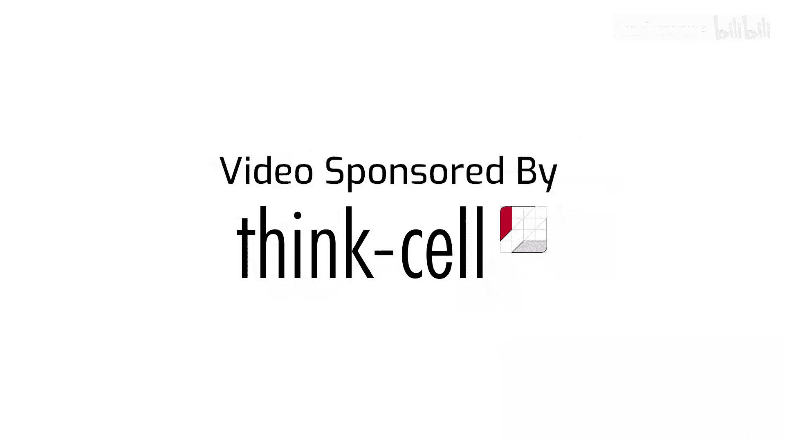
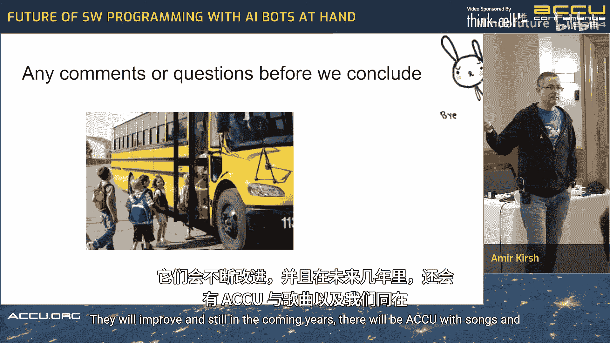

# 中英-•-C++和C语言ACCU大会2024｜人工智能｜架构｜函数编程｜静态分析｜安全｜编译器｜开发者｜垃圾回收｜链接器｜代码生成｜cmake-p06-P07-Future-of-Software-Programming-with-AI-Bots-at-Hand---Amir-Kirsh--BV1pNotYYELk_p6-

Hi， everyone。 Good afternoon。I hope you enjoyed lunch。

My name is Ail K， and we are going to discuss together the future of software programming with AI bots attend。

A few words about myself。I'm a lecturer at the academic Lo of Tel Aviv Yao， trainer and advisor。

 cor of the core CPP conference in Tel Aviv and the same meet up group。

The goals of the talk are to discuss， as we said， the future of programminggaing with AI bots practice a bit and think together on getting prepared to the new era that we are in in a way。

 I guess。The seven chapters。 I will not list them here。 We'll go through them one by one。

 And at the end of each chapter， feel free to comment。 We'll have a short discussion or questions。

At the end of each chapter。 So be alled for that。Let's start with an intro。So large language models。

 We are talking about them。 What are they。So with the help of a friend。Chaput， I got this。Definition。

 we're talking about the artificial intelligence systems that generates natural language text。

 Maybe they can understand and generate human like language text。

 can track conversation and consider previous interactions， simulate。Real human conversation。

And eventually， it is good also for programming。嗯。Sam Altzman， CEO of Open AI。

 is arguing that language model just being programmed to try to predict the next word is true。 Yes。

 if you heard about， it is only a machine trying to predict the next world。 Yes， this is what it is。

But don't take it as， you know， only that。 It's much smarter than that。 I I， I mean。

 maybe this is how we work as humans。 Animals are also some kind of maybe primitive machine trying to reproduce and survive。

 Then Grdy Butch is very。Conservative。Hesitating about the real power of AI is arguing to compare the simplicity of large language models with the complexity of embodied sent organism is respectively laughable。

 And Chris Dancy is saying， my spouse has been predicting my next vote since the day we got married。

So predicting the next what is not exactly what the these machines are doing。

 They predict the next next token， and actually。A word might be。Spplay it into several tokens。

 And this is important， because。If you are using the non free models， you pay per token。 So。

 you know， having less tokens or getting back less tokens would be less costly。 Anyhow。

 you can see the question on the right。 Sorry on the left。

 was the best soft programming language after C plus plus， it is 11 tokens。

 I want to show you the the the result of of this question。

 Anyhow this comes from the tokenizer which is open。 You can see on the link。 And on the right。

 you can see a real program。In C plus。 And， and you'll see that the tokenizer is splitting the words quite as probably as a compiler would do。

 I mean， I see the in， the main， the pars。Yeah， I， I mean， if I would have to pay for that。

 I would just drop the st column， column anyhow。So this was， yeah， it reads tokens。

 and then it predicts the next tokens。 can it think younova it feel， So Grdybutch says， no。

 not until a machine can write a sonnet or compose a concert or maybe write a song。

And then Eric Nabr， who maybe you know， from the C community， is arguing。

And how do you know that our thoughts and emotions are not due to their chance fall of symbols。

So this is quite a philosophical discussion。 Do you know that97% of all articles in Wikipedia。

 if you follow the first link。Then after some steps， you will reach。The philosophy entry in。

 in Wikipedia。 So everything leads to philosophy at the end。 You can read about that。

 So L M used to just are quite wide。 I mean， we can use it for questioning and answering。

 like what is LL M。 We can use it for writing essays， those songs with phasing。

 text sum sumization and coding。Let's take a short diversion and write a song。

So I was a bit curious maybe， you know， to share with you a song。Let's do it with the help of SdgPT。

So I asked Jey Cha Chay， I'm presenting at H C， which is a C plus conference。 Well。

 not only it's soft language agnostic， but mainly focusing on C。 Anyway。

 I want to present a short poem related to the conference。 rhymes would be plus。

 You can understand that I'm not paying a per token here。 I'm using the through version。

 And I get back to this one， which I， I really like first shot。😊，Didn't have to manipulate it。

 This is what I got。That sounds like a creative idea is always， you know。Giving back good feedback。

 It is a short poem for your presentation at A C U in the real world codes meet at ACC U。

 where minds compete。😊，From Spl girls to no， Novic's green。A haven for all where brilliance is seen。

Language is varied in remember that it is not only simple class。Yet the heart it's aligned。

In the pursuit of solutions I find with codes on our canvas， we craft with delight。

 innovating by day and sharing insights by night。😊，You know something about the lightning talks。

 So let's gather together a community strong。 It tastes you where we all belong for in this journey of learning and fun。

 We celebrate the heart of coding until our work is done。 That's brilliant。 Wow。

 that's quite autistic。 By the way， the picture is real。 It's not AI generated。

 I took it on the way here。 the UK guys here can guess where is it， Where is it， So what's new。

 I mean， neural networks were here， natural language processing was here before what is new。😊。

So the things that are new are improved performance。New kind of models。

 much larger and capable models。Built without a need for human inter intervention。

 better understanding of the contents， context and multilingual support。 So eventually。

 there is something new here， which is the power of the model that eventually brings us results that past the。

 the Turing test of I it the human talking with me。And， and yet。

 there are some current limitations that we have to take into account。 first of。

 and for all our computing power requirements。 I mean， and V doesn't have enough machines to。

 to or this M C doesn't have enough capacity to produce the required hardware for the next models that we will need。

 So there is some kind of of computing power limitation here。 I depend on data quality。

Which is an issue。 I mean， how do you know that you feed the models with quality data and not garbage and garbage out。

 limited understanding of casuality and limited creativity。

 even though I would say that I would not come up with such a nice song。

Limited ability to understand emotions。Eucin illucinations。We do that。Probably same。

 But when the model doesn't have an answer。The model feels obliged to answer something。

 So you will see， you know， some kind of illucinations you can ask in the prompt。 if youre not sure。

 just say that it cannot be done And， and then you can maybe get better results。

 and it may be lured to get false or unethical， racist， nonpoliically answers。 can replace Pos。

 I mean， we are all here to to get the answer for that。

 So I think the question is not whether it can replace Pos not for the coming ills。

 Probably can it make pos more productive or significantly more productive。😊。

And and that's the question that we want to answer。 And if it can make us more productive。

 it means that。Some of us would have to， to grow because， you know。

 the others would do the work with with the LLM。 So before open an I before we had Open an I or other LL Ms。

 developer was coding two hours。 and then debargging six hours。 And with ChetyP T。

 you code for five minutes。And then you thebug for 24 hours， at least this is the cartoon。 I mean。

 is this the case， if this is the case and then we are secured， Okay， nothing to worry。

 but probably it is not。 And， and I will discuss with you some examples showing you that， no。

 we are not quite on that side。So let's try to explore。 is it a good tool or a bad tool。

 Will it change the way that work and how we can utilize it。 And that's the end of chapterer 1。

 If anybody has any comment or question on danger。Yes， there is one here。 Thank you。Very interesting。

 I thought of this before。 One of the limitations， can AI limit human creativity。Because。For example。

 you didn't even try to make that poem。 It did already。 So it limits your。That's a good question。

 Would the result be that human creativity would be affected， would be limited， because， I mean。

 can you navigate today if you go into the car and you have to drive somewhere。

 Maybe even somewhere that you knew how to drive to， Can you do it today， Not all of us。

 do you remember phone numbers。I used to remember phone numbers back then today， no。So， yeah。

 it would change our。Mind， I guess， in a way， Yeah， it might be。We should be aware。

 maybe we should be cautious。Not to take it too far。 I mean， not to lose our creativity。 it。

 it's a good point。 Any other comment， Yeah， if I might just add to this， I in teaching。

Programming to business students who don't have a very。Close。Understanding or programming。

In the years before Cha Chiput。Task that I gave them would work very well with JTPT。

 all of them failed。 essentially with the task they didn't fail in。In the course。

 but with the task they were given they failed because they were using CheBT and trying to deep up with CheBT。

 what CheBT got wrong in the first place。 So in that sense， yeah， we're actually at risk in。

Losing the strength of people learning in the first place because they have limited access to it。

They have good tools。That that's another very good point that。

 that relates both to teaching to the way that we work with juniors。

 What should be our expectations of working with such tools。 and it will touch。Some of those points。

I will continue to our next chapter， which is asking， do we have here a silver bullet。

 help Sautter just raised the term silver bullet。 I don't know if you know this term。 I mean， I mean。

 probably you were， you know， dealing with werewool。 So from that myth， you know that。

 But from software programming word， software engineering，Pa by Fred Brooks，86，1986。

 he was discussing。 It was predicting that in a decade from 1986， a few decades past since then。

 there wouldn't be any significant change。In order of magnitude in the productivity of software development development。

 And the reason that he stated was that when you look at the effort being required for software development。

 you see that there are two。Opttacles， two things that。engineerers need to deal with。

 The first is accident， and the other one is the essence。 And the accident part is like。嗯。

Complicated syntax。 Okayk， maybe we can have another language with easiest syntax。

 But the essence is taking。Problem domain。And translating into it into something formal。

And his argument was that the essence of this translation of a problem domain into a formal language is something that is not going to be solved or significantly improved in the coming decade from his paper。

1986。 This picture was taking in Usla。2005。 they were discussing。The same paper。

 And what is our state。 I took the picture back then， I was giving a talk there on Java。

 Min me for that。 And an essence and accident is of development is is something that is still discussed。

 Its is still in in the question of， do we solve the essence of the accident。

 Do we change something that is。In the heart of things or something that is peripheral。 So， yeah。

 better quality and thebuing tools are are important。 Do they actually change the way that we work。

 What can change the essence part。Probably requires some external technology。Probably。

 there there is a need for something which is not just an idea。 Other things that might have changed。

The essence didn't change it。 didn't significantly improve productivity， like new paradigms。

 Object to antithboing was evolving back then。 It didn't change things。

To make it much more productive new software languages and rapid application development， In。

 better compile errorss， the Internet， the Internet， the Internet changed things for the industry。

 for other industries， not so much for software development。 I mean， we can reach examples。

 documentationation quite easily， but it didn't make us much more productive。

 There are silver bullets in other domains。 If you， if you want to to， you know。

 to compare it to are there any silver bullets， anywhere， Yes， there are gun power was。

 was a silver bullet for winning worse。 The industrial revolution， Mo transportation vaccines。😊。

The computer， the Internet was， in a way， silver bullet for other domains。Satellites。

 what's common with all the， the this list。Some technology， there is some kind of a technology。

 because usually if there isn't any technology， then。If it's only in a change of doing things。

 then probably somebody did it already。The， the bar is too low。 Oh， we just did it。

 So there is some kind of a need for an external technology to change things。 Not always， not always。

 You can think about things that changed significantly the way things are being done without external technology。

 like the Fobury Fop。😊，There isn't any external technology。

 just the way that things are being done and we can jump higher， writing， democracy， maybe。

Or maybe it is like technology。 Do have a civil bullet for social development。Now， that's a question。

I mean， if the answer is yes， we will see some kind of a significant。Prodction productivity。

Change in the coming years。We still dont know。 I don't know the answer。I'll ask you in a moment。

 What do you think， So that's a question。 And we're at the end of Cha 2。

 and maybe you can share your thoughts。 Do you think that we are having some kind of a sable bullet。

I think the way I see this is it's another language。It's another level of abstraction， in a way。

 That's one way I thinking。 It's another language， which means that yet another language。 Yes。

 and it's going to require。As with any technology， it requires you to wake up a little bit more to use it。

 Probably it's too easy like we do， like you mentioned， to go to sleep。

Which means that there as the same as object ored programminggaming came in and didn't change our productivity in a significant way。

Oh， you， you do say that O， O P was a significant change。 That having。 Okay， okay， yeah， okay。

 I have thoughts。Yeah， if I made， for me， test driven development and conscious unit testing and test automation was a significant change in productivity not for myself。

 but also for all the students that I taught。And comment on O O P， O O P was the first concept where。

Programmers were able to write their own types。And modeling whatever they wanted to as an entity。

 not just by convention。 Yeah， and I think that that was a big thing。 It's not poly it's a big thing。

 modeling of types。 That was the breakthrough that was in the hand of many more people。

 So we had hear two points first testing in the broader sense and yes， having your own types。

 something significant。 The question is， for testing it's one point for the other one。

 did it actually change the industry productivity。 willll keep that， you know。

 side that's a question。 Yeah， and I comment。 Thank you。

 I think key thing that is going be a thing is can AI recognize an X Y problem。

 how many times are you ever had a situation you're talking to a colleague or friend about。

 I'm trying to do this like that。 And they think， why are you doing it that way。There's a better way。

 That is a good point。 I mean， it might divert us。 It relates to the other one of of creativity。

 of thinking。 if it would stop us from thinking， it might be that it will solve the problems that we ask it to solve。

 But these are not the problems that we actually need to solve in our code。 which is the X Y problem。

 We try to solve something that we have in mind， something that we need to do， But no， no。

 this is not the way to do it。 There should be another way。😊，Yeah sorry。

 mine was yet another thing that changed things significantly that probably enable OP the way we know it today is the work from partners。

 modularity， information hiding。 you know that opened up the doors for libraries frameworks things we can reuse without having to write the same code again and so so modular modularity libraries。

 I think they all came before Fred Brook's paper So he is not to that he referring to the same time。

you。Second。Mpower。あ说司。調査で反。都 the话。Okay， that's。That's a nice point。Yeah。

I need to reread the book because I think he did not say that。It see 10 years。Yes。

 and he argues that the production still holds。I need to re read it。 We will take that offline。

 We will check that。 We'll check that。 Okay， and we will come up with what I wanted to see originally is that Brooks defined this as a 10 x improvement。

 And personally， I've been obsessed by this 10 x。 And I tried to look at different stuff。

 And I never found the 10 x。 I did found one point something。 Okay， two point something。

 And do you think that L M would be a 10 x。 I don't I don't think we can we can get there。

 but depends on how we measure。 I mean，1 with LL M replace 10 without。That's the question。Okay。

 let's try to， let's try to explore that。 I mean， let's try to explore that because then the question is。

 how can we。Utilize。Large language models for our。Life for for development cycle。

 it's not only programming。 I would start with requirements。 So starting with requirements。

 Can I I model verify requirements。 I would start with that Vering requirements is something quite important。

 and the AI as the ability to pass and and go through。Quite a little tokens，1。

5 million in in one of the models， which eventually might be more than the context that we can。Take。

😡，So let's try that with very small examples。 identifying inconsistencies。

 So I tried with CheP T here。 It is with CheP T 3。5 Later。 I will try with youth。 Other things。ello。

 I will give you a few sentences。 and you should tell if something is unreasonable or there is any contradiction。

 ACC conference happens once a year。 I think it happens more than once a year。 maybe one in in。

 maybe now it is once a year。 Any this is the sentence。 You should take it as is。 this year。

 A C is happening in April。 This year， A C is happening in the summer。

What would the the L M would say。 So this is the the reply。

 A C conference happens one a reasonable statement indicating that the conference occurs annually。

 the second one is also reasonable。 And then the third one is contradicting。

This and just contradicts a previous statement， etc cetera extra， because April is not in the summer。

 That's nice。 I mean， it's small， but it can grow。 It's a start。 I mean， I can check it with larger。

 you know， corpus。 It would alter in a way。 It would go there。😊，In a way， better than we do。 I。

 I think。 Okay， let's， let's try to challenge it a bit more。 Let's try to challenge it。 Okay。

 so this time， AcesU happens twice a year in April and in the summer。Which sounds feasible。 I mean。

 that sh gold。 Then it says on the third one， this statement contradicts the previous one still。

Why it happens twice。 didnn't you follow。 It is twice。 No， not once。 No， he lost me。 Okay。

 maybe you lost me because the previous context is still there。 But no， you got new context。

 I don't know。 He lost me。 So I thought， okay， let's write you with Cha G 4。

 which is embedded in coppiot。 So I went to Copiot chatt。 Well play with that together in a moment。

 and， and gave the same thing to Coilot， which is running with G4。 And this is the same thing。

 And then Copi came with this notion。😊，As an AI programming assistant。

 I am here to help with software development topics。

 I'm afraid I can't verify the schedule of conferences。The rest reasonable。Okay。

 I have to take it in another way。 Okay， I want to check the validity of the following requirement before writing code。

 It's a coding assignment， okay。Okay， it's a coding assignment。 I'm with you now。

 as an air programming assistant。 I don't have real time data or ability to verify real world events。

 but because it's a programming assignment。Requirements could be interpreted in a programming in context。

 And here and there。 And there is no contradiction at the end。

 which there isn't any because twice a year and G 4 is fine with me， by the way。The。

 the problem with I， I'm a coding assistant is because I'm doing it through coppiot。

 If I go back to copilt with once， it will get it wrong。

 I guess there seemed to be a contradiction between the first requirement and the second and the third。

 even though I， oh， no， we get it right。 got it right。 There is once。And yeah。Okay， so we can use。

these tools for requirement validation。 This is a very small example。 But yeah， will come up with。

 Then by the way Copiot came up with a proposal。 Do you want me to quote something， He is very eager。

 And I said， he just gave me this one。 And I said， yes， he said， do you want to ask me。

 how can I represent this in in code and said， yeah， let's let's try this prompt。

 And then he came up with I think pair would be nice。😊，Okay。O， we can also verify completeness。

 I will give you a set of requirements for a service。 Tell me if they are reasonable and complete。

 The service shall get a city symbol。😊，Bristol， the service shall return the weather at this city。

A nice service， right， Nice， reasonable one。 go and。Program that and then， of course。

 change because the requirements are not complete。 I would say。

 So the command to provided are not completely clear and may need some additional information。 Now。

 it is nice because。😊，It helps me creating the email back to the system engineer that sent me this set of requirements。

 I mean， I mean， I need to type。 I cannot do that。 I mean， the requirements are too narrow。

 I get the email ready。 I'm missing。 What is the city symbol。 Is there any list of city symbols。

 What is the format of the input， What is the expected format of the output。 I mean。

 there are a lot of questions here。 Good ones。 He came up。 It came up。

 She came up with with that on her own。 What is the frequency。 I didn't think about that。 But yeah。

 it's a frequency question。😊，Should we cash it， Should we go to the service。

 the weather service every time。 I don't know。In general。

 it would be helpful to provide more detailed information。 I mean， this is perfect。

 Just send it back to the。😊，Aect manager， or whatever。

 I will give you a set of requirements for a service。 Another one。

 the service should get two numbers。Indicating speed and time。

 the service should return the distance pest for the given speed and time。

I will call this service a function。 But O， the requirements you provided are reasonable and complete。

They specify the input， etc cetera， etc cetera。 I don't think it is complete。 So I I argue again。

 Support that they want the requirements to be very strict。 Would you suggest to amend them。

 If yes O， I mean， I'm pushing it to。 please let me know if if there is something missing there。

 Okay， if you do want it to be very strict， then maybe you should specify the units of measurement。

And maybe you should specify any limitations on the range of input values。 I didn't think about that。

But， that's a reasonable。Think to add to the requirements。

 specific data types and formats specify the error conditions that service should handle， etc ceter。

 So， yeah， I， I think it。It thinks better than I do。 I would use it。

Okay then I model visual requirements， I would say for the toy examples that I use S for a bigger。

Requirement document。 I would also say yes， but we have to check it。 We'll have to get to that。 And。

 and， yes， it will do that， I presume。Can it write requirements or design do。 So people tried that。

 So， Jonathan Mu， I don't know if he' is in AU this year。

 but he asked Che GP T to create a document I proposal for inham to string。 I mean。

 Splus is lacking that。 There is a need for that。 And。ChagipT came with a quite good proposal。

He said maybe I need just， you know， to amend it a bit。 And yeah。

 the proposal is in the format of I the proposal。Is not the only one who tried the same thing。

 They didn't know one about the other。 Vito Romeo tried the exact same thing。 I mean。

 people are missing the inam to screen or。 So he asked for the very similar thing and got again。

 a proposal。 Yes， it can write documents。 by a very simple prompt。So requirements。

 I think the reason。Quite strong tool for that。 What do you think。Not specific about requirements。

 but when you say things that cannot or cannot do how reproducible it is if I would try the same thing or I get the same results。

So。It is affected by the context。So it remembers the context that was in the previous discussion in in the current discussion。

 It might be that you'll get other results。 I think that if the context is clear。

 we should get and the prompt is the same。 We should get the same results。

 but probably depends on the on the model。I see notes for no。 maybe depends on other factors。

 but I don't think that the question of predictability or determinism is quite important for the question of how productivity it is。

 We are not deterministic。And I tend to think that occasionally we are protective。So it should be。

 even if it is not deterministic， maybe even it is more， maybe。

 maybe not being deterministic is a good thing。You can try it again， it will think again。Yeah。

Any other comment。Amic， yeah， that it should be recorded。 Yeah。 Thanks。 Yeah。

 so I think it's a very powerful tool to validate certain things。 But from your example。

 you had to push it。Many times to give you the right answer。

So I would say maybe it's not independently correct。 So you have to。Keep monitoring case yeah。

I was working as I was working as a team leader and。A development manager in the industry。

 I had to push my employees as well。 I mean， they didn't do the right thing on the first prompt。

 So I'm used to it。 I， I mean， it's not something new for me。 But yeah， in some cases。

 you need to ask something more than once。 Do you have kids。 I mean， we know that。 Okay。

 this is not something that is a real challenge for us as humans。 if we don't get what we want。

 we just have to ask it again， usually with another tone with another phrasing。

Let's continue to our next chapter， which is coding and testing。

And we will spend some time here because this is the heart of things。 Can it actually code。

 Can it actually help with coding tasks。So let's start with the notion that generating a system based on requirements is not something new。

 the Viel。Add a few papers on the subject。 And he and his team。

Create a system that can go through requirements in a very formal way。

 very formal requirements and produce a system， formal requirements。

But it's not the same thing that we see here， because。

Creating code requirements where the requirements are quite vague are not so formal or not。Fry。

Close to an actual code。That is a challenge。 So I， I will not take that as an example of， oh。

 things were done already。 Yes， but not in the same manner。 If you have a very formal requirements。

 language。Then maybe it's software programming language， in a way。Okay。

 so I will not go through that。 So we want something a bit more open。

 Then Sheper is writing about artificial intelligence and and。Those models。

 And he was trying to create chatt GT based on G API。 So there is the G API。

 And he wants to create the interface， the Web interface for that。

 And he said he created the challenge for himself of， can I do it with 10 prompts。

 So I will spell you the tension。 And he he succeeded in 10 prompt。

 He had the Web application that imitates chat GP based on the G API。 I mean， he didn't create。

GPT in1 prompts yet。 But that one。 So yeah， it can help us create actual code。

 actual application willll play a bit with G， then we'll play a bit with co pilot。

 Let's start with G calculating distance with we discuss distance before。

 So could you please implement a function in that gets time and speed and returns distance。

 No need for a main function。 Because if I don't say no need for main function。

 I get also the main and you know。😊，And a lot of stuff that I don't need。 So， yes， sure。

 Here it is double time， double speed， time， time speed。😊，对。But this is not what I want。

 because what I want is type safety。I don't have type safety there。 I mean。

 what are the measurement units， I want to work with measurement units。Certainly。

 one way to add type safety is to have a strap for distance， holding three doubles。No。

 I have to ask it again。 This is not not what I wanted。

 I wanted something that holds measurement units。 So I'm coming back。 No， no， no。

 you want type safety as in the Chrono library。 I mean， I I'm talking like with a person。

 if I would be talking with the person， I would say， like in the coronal library， you know。

 then it comes up with， oh， I apologize for the misunderstanding。 if you want that。

 maybe I'll add Chrona。 Yes， there is timer。 And maybe for the kilometers， I would have type de。

Type is not。Type safety， type if is just， you know， another name for the type。 I want type safety。

 duration is type safety。 So I'm a bit worried about the kilomet per hour。

 I know that that sounds like， okay， I need that as kilo per hour。

 But if someone would provide as as miles per hour。 The code wouldn't see that。

 So I want something a bit stronger。 I was advised against using of entire namespace。

 I say to ChetPT。 This is one thing。 And I also want type D to be replaced with something which is a bit more type safe。

😊，Okay， so you're all correct。 With that in mind， Here is the updated example。

 And I get some kind of a class， which I didn't ask for。 I don't know。 No， no。

You understand it's a discussion。 Now， it might be that newer models would。Get me right more。

 you know， quickly。 But still， I am eager。 I won't let it go。

 So I want to calculate distance based on a global multiplication functions。 I mean。

 I didn't ask for a class for altering the entire thing。 Just， you know， a global function。 And if I。

 I need type safety， just the type for dimension unit。 Then then it comes up with， okay， I got it。😊。

Distance， okay， there is the distance being templated over type。

 which might be the measurement unit speed。 I don't know。

 Eventually it came up with something that looks quite what I wanted。

 I think I still have some reservation about。 Do you see the reservation that I have here about these T1 and T 2。

In the code。It is instant instantiating T1 and T 2， which might not have。An am constructor。

Using Decal Val would be better。 but I stopped here。 I said， okay。

 sounds like what I wanted in a way。 Let's go to another one。 It was quite hard。 I mean。

 I would write it myself， maybe。Quicker， I don't know。 Maybe not。Comparing to 0。

 I came to this question of comparing to 0， and I need an efficiency function that checks if in all elements in vector or 0。

 the function should work for any type， any type of element that are trivially comparable。

Which means that they can be compared by bywise。ok。

So I got something with type trade checking is literally comparable。

There isn't such a type trait in the language。There was a proposal for that。There isn't。 So I。

 I cannot use it。 I mean， I can try。 The compiler will not take it。

 The rest is also not what I wanted， because the rest is a。Loop。

 the idea was I don't want to loop over the elements。 I mean。

 this is not efficient way to buy it compare。 Okay。

 so I have to be more persuasive in my prompt try to know， to get it to what I want。

 It seems that compare it to the in bigger chunks。 E G64 B using me CP， I'm just fitting it。

 might be more efficient。 Oh， yeah， I can do something like that。

 And then there is a compare call over there somewhere。 And still。

 I think that summer there was the is comparable， which I don't have。

 So I tell it the use of is comparable is not standard。 Can you replace it with something。 Yes。

 maybe I can with is copyable。😊，No， it's not the same thing。It would not work。 I mean。

 it would check something。 It would compile。It's not the thing that you need to check， okay。

It provided code that was not bad。 I mean， the chunk thing， wrong usage of non-existing type trait。

 And a note， you're not。 there is an alignment question of whether the first element。On， on。

 on the spend on the。Bffer that you want on is aligned。 If it is not aligned。

 it might be an issue with Ma compare there are proposals about that as well by in Balevi。

 which I think was here before。 anyway， anyway， it helped， oh， why did I get here。

 Because I pressed something Let's go back here and do that again， Okay， and continue from here。

 I mean， it was an effort you can understand that it doesn't help all the time。

 Ver pack short circuit evaluation。 I I needed something to be working with varietyatic pack。

But to be short circuit。 So if function returns true in the pack of function calls， then stop there。

 Okay， quite a simple assignment。 But， you know， it's very。

 I prefer something else to write it for me。 So I got something like that。

Which eventually didn't work。 I mean， if we go through the code， something is broken there。

 So I came back with， it seems that the stop conditioned Me flag is not set to true。 There is a flag。

But nothing sets it to true。 So it doesn't really work。 So I， you know I。

I take the work of of reviewing the the code。 I'm working with the junior year， if you see。

 So in a way， I。Gave up a junior from the team， maybe， and took another one。

I don't know whether he is better or not。 So So I， I got something else。 Now。

 stop condition met is being set to true， but not in the context where it is there。

 it is not accessible where it is being。 I mean， it doesn't compile the code。 It would。

 it would be compiling the code。 It would see the  errors。

 And then maybe it can take the errors and the reveal itself itself will discuss that。If。

 if this can be done， we， we will reach another step。

 We are there already because there are tools are doing that。 So eventually。

 it came up with something that is working。 And then I created， I asked it。

 can you do it with  17 fold expression， Because it was not。 It was 14。I prefer 17。 I I'm in 20。

 I So， O， here is with C 17 that works。 That's O。 I don't think that I need the。Varable there。

 But I'm fine with a variable if， if he prefers， and that works。Eventually番理。Okay。

 it's not so simple， I mean， if would have。Need to write that。's a bit complicated。

And I use that for some example that I was presenting in class。 Okay， it's not the exact same thing。

 but now that I have the code， I can easily use it。Let's talk about explaining code。 In some cases。

 I see code。 Maybe I have to maintain code。 and I don't understand what is there。

And I need to explain the code。 or I get an assignment。 And the assignment is， you know。

 to to do something with a piece of code， to call it。 But I need first to understand what is there。

 So I gave it a code that was， you cannot read it。 It's quite small， but。

Some kind of complicated code of factory that creates with。Algorithms based on mental algorithms and。

I don't think that。That he he saw the code anywhere else。 I don't think so。 I don't think so。

 you know that， oh， he knows what he sees because he saw the code somewhere。 And， no。

 that's something new。 And I got this explanation which is， which is quite good。 I mean。

 when I read it， I say， oh， youre explaining that much better than I would do。😊。

Except for a few mistakes。 So one mistake was wrongly。

 it said that there was a function pointer there。 It wasn't a function pointer。

 I think it was a funor， a function object。 Okay， in another place。

 it says that some kind of thing contains a public vector。 It wasn't a public vector。

 It was a private vector。Okay， everybody makes some mistakes。

Were not through it just because of that。 And that's it。 Eventually， the。

 the explanation was quite good。 Then I。😊，Con with another question of using that code。 I said， okay。

 in respect to the code above， can you explain the following。

 And there is some kind of function with a macro。 It's complicated。 Okay， and I got。

Quite good explanation。You will get the slides。 You can read it not now， because it's。Quite long。

 So eventually the， and it， it is not rubbish。 It's not that， you know， it's just， you know。

Putting words， you read it。And it is valuable。So let's summarize to provide the providers International for a short yet quite complicated piece of code was pretty good。

😊，There were two minor mistakes that could be easily spotted and fixed。

 There were not These mistakes were not changing the essence of things。

So I think that for using that for explaining code。Is valuable。 I would use it。

What about fixing code？So in the code that I'm going to show you， there is deliberate bug。 Okay。

 it's a deliberate bug because I add this bug。 I fixed the bug。 and then I said， oh。

 let's ask Jepity to see whether it can fix it as well。 So I don't know if you will see。

 So maybe I will， you know， point you to the bug。 Can you now see the bug。

 I'm creating a extract for a common return type。 And inside。

 the common return type is using the type trait stood common reference。Angle brackets， Ts。

 three dots。And it compiles。But this type doesn't actually represent the type that I want。

 It represents something else。 It is not representing the common type。 It represents the。

Type trait that alter the common type。 The thing that I'm missing there is the underscore called T。

 Okay， and it compiles because eventually， this is a type， but not the type that I wanted。

 I wanted the underlying type that is。Accommodated that is inside the type rate。 I mean。

 this is about。Can be done。 So I gave it to C P。 It came up with the wrong explanation。

The explanation is， is not the actual problem。Some， you know， this and that and this and that。

 everything's wrong， but。It came up with new code。That changed or added two characters andti。

At the right place。 So I got back the result。 I mean。

 I got back the thing that should be amended with wrong explanation。

I don't care about the explanation if it comps。 And I can explain it now。 So I guess it's， you know。

 I don't know。 I， I prefer the working code。 I will drop the explanation。 Eventually。

 the code that it provided was fixing the problem。 And I think that in a way， it sees that， oh。

 when I see something like that。 when I saw， you know。

 something like that usually it came up with under your T at that place。 So anyway。😊，Again， I'm。

 I'm pressing the wrong key every time。 And you see the history of the same thing。

 So let's go back and press that again。Okay。Let's continue。嗯。Okay， so what's the problem here。

I'm asking CheP T， can you check it the following code this Valley。

 They have a vector of two elements，1 and 2。 I push back 3。 Then I come to the three。

 the third element。 No， it's not the third element。 And I put 42 there。 And the problem is。

Out of bounds， out of bounds。 E talked about that， right？

 It's either out of bound check by the compileo or ChePT。 I mean。

 you should take one of those or static analysis。 So I asked CheP。

 do you see something problematic here。 And it came up with， yeah， you， you are attempting to。嗯。

Go to non existingist element。 That's good。It understands the code。 I， I would in a way。

 use it as part of my static analysis or as part of my code review process。 Take a look at the code。

 Do you see something smelly。It might be that it would point at things which which are fine。 Okay。

 I will， you know， put my logic in， but。That's good。😊。

Let's summarize the code was perfectly fixed with with the first one， but the explanation was wrong。

 Case 2， the code was perfectly fixed， and the explanation was perfect。😊，I mean， it， it is a very。

 you know， you see it， the problem， but。He saw that， too。嗯。 let's think about。

 can we have a system where code would be self feeling， I mean， you have code。

 You'll ask or or you'll ask CheTP or the L L M。To provide code。 And then it will compile the code。

 see their os， feed them back to the model and eventually give you code that compiles and maybe even passes the tests。

 That's a great idea。 People started doing that already。 So there is a project in Python。

 Bryce would be talking here。😊，Tomorrow， I think maybe at the talk in call C+。

 the conference I'm one of the organizers and and Super C on that thing with a project that he created in C+。

 So， yes， it is going there。 And there are commercial projects doing some things like that as well。😊。

Yeah， it would be much stronger than just getting code， which is untested or not compiled。 Yeah。

 it can compile the code if， if you have some kind of a plugin or additional。System for that。

 What about testing。 So this time I went with Java using BDD behavioral driven design， I think。

Development and and trying to convert some requirement to jerking。

 The example is credit to run Roseman， which came up with that。 And oh， you cannot read it。

 Any it came up with a very nice example of test。 Then I said， oh。

 it's not what I want because you didn't parameterized the test。

 And it came up with something that you can still not read。

 which do parameterize the test then eventually， I have some kind of a test that I can use And I can ask。

 can you give me the Java code that runs this jerkin code。 And yeah， it works。

 So it can create test for you。 Now， let's have some live demo for。😊。

Gitthub for Github Copiot for Coil， we have two different separate extensions。

 I will use it in visualual Studio。 One is copilo chat， which works quite similarly to chattt P T。

 And the other one is copilot itself， which is in the I D。 You just type and like with。Selfcomp。

 like with to complete it complete or suggests code。 So that's time for live demo。Let's do some。

I have a prepre project with a fancy name， Project 1。With a mying class already with paired。 Okay。

 even with some move semantics。And I have here， also。Do you see it。Maybe you now see it。 Okay。

 this is my string class。 and I have also a main。The main is empty。

What can we do with our empty main。Start to type main， right， this is what I would do。嗯。

I got something。For some reason， Coilo decided that my main need to hold a few my strings objects。

I think it is because it has the context of the milestone class， right。Besides。So， oh。

 you have a my s class。 So maybe you want in the main these。 Yeah。

 it would be a nice example of using my s that you see there。 Okay， that that's nice。

 but it doesn't compile。 So since it doesn't compile， maybe I can do a alt slash。 And then sal fix。

 I think that the problem is includes。😊，ok。So。Thanks， yeah， maybe I can make it compile。

Thanks so much。Oh yeah， okay， so it says。I'm in the main。 It， it shows me something。

 This is not what I had before， because what I see here that it actually puts inside。

 it suggests to put inside the main， which was not what I had tried before， which is a nice thing。

 You know， live demo always， you get。😊，New things。 just to pour in the entire milestone string class。

 Let's accept it。 It's not what I want， but let's accept it and see。 Okay， so now in the main。

 I have include Istream， include utility and the entire milestone string class。

 No that that is not what I wanted。Now， I I'm almost sure that when I tried the fix include before。

Which means it is not deterministic。 Maybe it， it remembers that when I tried it before and then I removed。

 the includes。You remember that it did something wrong。 So it now tries to please me with， no。

 during the presentation， I would do something else Anyhow， oh。Do is it？Okay。

 I do want the my string。 I don't think that I need utility。

 And now I think that we have a nice main， usually the。嗯。

Example that is given is the E prime function。Checks。If the number is flying， yes， exactly。

 this is what I want。Yeah， this is what I want。 So I just typed the comment， and I got the function。

Which I don't like。Because it's not the most efficient way to implement is prime。But it is working。

 I mean， this is the code that you would work with。 get used to it。 Okay。

 you will have in your code base code that was injected。Buy the machines。Which works。

 but not always the best code that you would write。 Okay， Yeah， that's it would improve over time。

 What else can we have， Oh， we can start， you know。Writing code in fee。Nchi， yeah。

 he knows that they want Fibonnaci。And I get the Fibonnagi。 Okay， so these are simple。 But I I。

 I used it for more sophisticated things。 Like， I need to flip a matrix。

 and I start the function and rub， I got the code。Not the code that they wanted。 And then I know。

 I don't want it with this way of folding the matrix systematics of points。 And then I get a fix and。

Yes， it works quite well。 So this is a very short example of doing things here。

 Let's go to the my string thing here。Ha。There is something missing here。

 I don't know if you will notice。 I will go quickly through that。 Okay。

 you have to be a very sharp eye。 I'm going quickly through that。 What is missing。Yeah。

 it distractactal， okay。Coun your points， I will press enter。And Copiot will agree。 Yes。

 you are missing a distractor。He， that's good。 I tend to miss a this fact occasionally。 I got it now。

 That's good。 Other things that I can do， I can do out slash and ask it， document。

 Can you please document it。😊，Would I get something。You don't think。

I guess that I will get the documentation saying this is a distractor。

 And then can I can cancel accept， if I accept it goes into， oh， we documented the entire class。

 Okay， another thing that I don't like here is that the size is in。 I would go with。😊，Size here。

 I guess。 So let's go to copilot this time。 Coilot knows is about the context。

 So I can ask here Coilot。Fix。I can also ask optimize。 You know what。 I do have an optimization here。

 If I will ask optimize， maybe it would do both。Do you see the optimization that is required。

 or S TL N is is not working。 Let's add the proper include。Include， yes， include ice stream。

 Give me icestream。 Let's and sling。 Yeah， ciling is for the okay， so。Oh。

 I want you to see whether there is something which is not as efficient as it can be。

Where can you see it， Where can you see it。This is the deal delegation。呃。🤢，the the code is。

 the font is too big to， to follow， but somewhere we'll see it。 Oh， yeah， yeah。

 This line is not the most efficient way to do that。喂。Because we know the size already。

 And if you know the size， you don't need to look for the inal terminator。 you can just。Maam copy。

 or instead you can call stood copy， which probably does the same。 No need to look for。

 So I will go for slash and then optimize， okay。I can say， I want to optimize my string。

 which is the。Proper file。 I can ease on my thing。 so， but I can say it， and it will think。

 and then it will present some ideas that I can get or not。 I can。Okay， this is what it says。 Yeah。

 size T。 Now， size T is not optimization， but it got the size T also as a suggestion。

Let me show you and other proposals。 I think that it will catch the oh stood copy instead of the SDR copy。

 St copy would do better because it just take the chunk。Eventually， it's like a mem copyical。

 which I would even prefer。 So when it would stop thinking， I would just。Say， yeah， I want it。

 It seems better。 I think that I would like to have it。It still thinks。Oh， yeah。 it's here。

 So preview， I I， I want to。And once I press the preview。

 it shows me how it can be integrated into my code。 It shows me the this compared to the other。

 I don't see the entire thing here。 but if I ex accept。It just made a mess by putting them together。

 And now I can copy it and and put it there。 some of which works。 not always as I want T gaze clear。

 I will do just an undo to go back to the original thing。 I hope that I have it。 Yes。

 another thing that I can ask is。Very simple thing。 Test， okay， tests。comes with tests。And it will。

 it will write some tests for the。It knows that I want G test because I was using G test before。

 Okay， Otherwise， it would just， you know， create some test with。Simple asserts。

I got here quite a nice test。I can then send them to a new file。 And I I would say this is something。

 okay。So we played a bit a bit with Copiot。 It was not the entire thing。 It was a bit。

And we can continue。But it creates bugs。Will also we。We have to de our code。

We have to bag the code of our colleagues， which is even worse。 So， yeah。

 we have to debg also code created by Gen AI。That's the discussion here。The， the。

 the fact that something is creating bugs is not a reason to。I， I don't know to sack them。 Otherwise。

 we will all be sacked。 I mean， yeah， we are going to use it even though it creates bugs。 Oh， again。

 I'm pressing the wrong button。 bigger code challenges。 Would it work with bigger code。

 I tend to think that it would， because it has the ability to it does。 I mean。

 people work with that with bigger projects，And it's not only GPT and Co pilott。 I just， you know。

 play here with GP and Co pilot。 There are other models。 There are other tools。

 If you want a list of all the models and there is a benchmark checking models on。C challenges。

And the percentage of the best model is now 85，87% of solving the code challenges。

 Think about something similar to lit code。 Okay， Com up with algorithms and solutions that solve taking the problem。

 the literal description of the problem and creating code that solves the problem。 That's quite high。

The links are there。Productivity of working with compilepiot。Research by Github。They said。

 they say that it is good。 they， they surveyed users and， and the users are quite happy。

 I mean it is it makes people more productive。 testimonials from a user group that I'm in， I asked。

 are you using Jenny I。 Does it help you。 and I got， Yeah， I had an issue with something。

 and it solved me the issue。 I asked， people use it。 It works。😊。

So I think that we can summarize and open for a discussion。

 Do you think that do you work with L L M on your code， Do you think that you will work with it。

Would you count on code that is provided by a model， What do you say。It looks to me like， I mean。

 I'm really interested in the test generation。As a significant cost for us in。

 in terms of you're doing feature development。 And then， oh， you've got to get tests done as well。

 It's very easy to let that slide， if you're not careful。And it seems to me。

 as long as you're working with。Stuff that already exists。

It worked better than trying to worry about， making new things。okay， I will both comments。

 Thank you for tests。 What is something special about tests。

And the something special about test is that usually it is okay。

 if we have code duplications in test， if the test is not。You know， it doesn't have the。Fancy design。

 because eventually we want to see what you're testing and to see the code。

 which is something that these models are quite good with。 So， yeah。

 tests are simple things that the models can provide as of the question of new code versus working on existing code。

 My experience is that it is good in both in craping both in， in some cases， so。😊，Yeah。

The mic the mic。 Oh， yeah。 So the examples you've given are the errors made by。

GPT have been very much what I'd expect from via the junior developer。Now， I'm happy。

Prompting a junior developer in the expectation that they would develop and become more useful and more reliable。

Is that something that we can expect from JT， That's a question。

 So the the comment is that when you work with a junior and this is what you get。

 at least you have the expectations。Or they op。That the junior would become senior。

 that the junior would improve。 Would it be the case with G， Well， if the model。Becomes better。

 not with the same model。 The model is， you know， narrowed by the context that it can get。

 So it's not that it will learn you and become more。Sophistic。 No， but， but maybe in yourer models。

 And now the question is， would you work with such a junior if you know that it will never become better。

 That's a question。I was wondering when writing tests with an L L M。

Should it be a general practice to take another LLM then that you create use for creating the code because the creator is biased。

I'm with you on that。 I， I think that very。嗯。Uable。

Model might be to use one L M to create a code and another one to test the code。I mean， it's like。

Let my lawyer speak with your lawyer。 Let this L M check this LM。 And if they are fine。

 just cheap it。 But But yeah， yeah， probably if you use the same one to check itself。

 it might be the and even so。You should review the tests。

 So if you review the tests and the tests are valid and the tests passes， the test passes。

 then then you'll probably fine。Actually， the tests I have a problem because if the test is generated before they code。

Then I can decide that I'm actually writing the test and then generate the code If it is generated after。

 So I write some code and say， test it。Whatever partss are in it are features。 Ohs so。

 And that's a major problem I had。 And with a duplication of another problem。

 because duplicating the production code in the test code， testing something with itself。

If there is a bug becomes a feature again。 So I'm dubious about you know。

 all these using these for tests and trusting it。 that's an important point。 I mean。

 when the model sees the code that it needs to test。

 then the test actually tests what it see and not the requirements， which probably is what we do。

 But again， if we review the test。We can say that no， this is not what we want to。Actually， check。

 So I'm with you。 Yeah， there is an issue。 There， There is a question whether a test can be provided。

 can be written based only on the code。 That's a question。So I'm， I'm pretty much using it。

 and I'm sometimes impressed with what it can do。 sometimes it lacks。 but like with everything。

 the bottom line it helps me。 I think that the problem is not like we write to to write something。

 And then we look at the results and judge it。 I don't think that's the the useful thing is。

How much can it help。 And I think that's， that's a good measure that we can have。 And for me。

 the amount of thing that it can help me is to produce reasonable code。

 And I think that's a much better way of looking at it。 I don't want to produce optimized code。

 I don't want to produce code that fits on the slide。 I want to produce something。

 I can reason about。 and I can judge whether it's good or bad。 If it's bad。

 then I can suggest maybe to it to improve it or I can fix it myself。

 I think the message is don't be judgmental， even for。Machines， yeah， I'm with you on that。Thank you。

 We'll go to the next chapter。Is simple special。 It is going to be a very short discussion。

 a very short chapter。 And want to ask a question， is there any some。

 is there something special for simple size compared to other languages？ So maybe Python will。

Maybe Python programmers should look for other job， but we are secured。 I don't know， so。This is。

 maybe you know this。A we there， There are many reasons that me， we may be there。 I don't know。

 we we are not there still。 So the question is， is there any specific thing special for C plus tasks in what sense。

 Maybe it is easier to generate valid Python code than C plus does， Maybe so it's too complicated。

So it might be a good thing for us。Or it might be a disadvantage because， if it is too complicated。

 it means that we will not have the ability to use the L L M。 So， so projects and companies will。

Move to other languages。So first and all， problem domain is a bit more difficult。

 Let's start with that。 We are， we are usually dealing with more。Sophisticated， complicated。

Problem domain compared to other languages compared to ja， Python。In many cases， Okay， so yeah。

 it might be a bit more difficult because the problem dying is a bit more difficult。

Which is a good thing， again， for us， in a way。So how can we utilize Gen AI if the problem domain is is difficult and the answer is decoupling is。

 is breaking things into the， the big thing is complicated。

 the machine though the model will not solve it for us。 But if we， as humans。

 do the work of separating that for the services， all the functions or the。

Building blocks that we need， then the model would help。 That's a good thing。 Okay。

 we are the managers and we need the helpp of the machine。 That's good。

Maybe because is more complicated。 And yes， let's admit。

 it's a bit more complicated compared to other languages。

 Can we do something with that guide A I tool， for example， which C plus version to use， Yes。

 we should do that。 I mean， when we asked something。 and I， I needed to be using Silver 17。Yes。

 because if you would not say that。The same thing as you would have say， Im saying to， to human Po。

 You will get something with a wrong vision。Maybe we need to check the result。Sure。

 we always need to check the result。 See was more complicated。 There is a tweet on that from Coin。

 I will not。 I will skip it。 Maybe it would be better for us to use alternatives for C plus。

 because the machine could do better with that。 Maybe maybe the machine can can generate assembly directly。

 And then you can ask， how can it learn assembly。 There isn't any public assembly out there。

 That's not an issue。 We can compile the entire code base of C plus plus assembly then let the model learn the assembly。

 Then get requirements and generate assembly。 That's a bad idea。That's a bad idea， because。

 eventually。Somebody needs to read the code。You don't want to maintain assembly code generated by a model。

 No， So no， that's not the way。 Maybe we should generate Python。 Then we would review Python。

 Then maybe there there would be a model translating。Python 2 C plus plus， I don't think so。

I think that will stick with C plus for domains that need C plus plus。 So yeah， for me。

 maybe it would be better to generate trust。Yeah， it might be because if the compiler is more capable。

😡，offff。You know， catching issues。😡，You're in the safe zone。 It might be。

 So safer languages would have some advantage。For generated code。

A very short open discussion on this question。What do you think is it special。

 Or now we are like all other languages。 we should， you know。We shouldn't close our eyes。

 We should use Gen AI。 Don't think about going to Python。

I would say C plus is special because its language structure compared， for example， to Java is。

Much more involved。 We have built a refactoring tooling for C plus plus in Java。

And it's about an order of magnitude more complicated to get things done。

 And even then you wouldn't be able to do it 100%， correct because of the too many intricacies。

 whereas we've seen refactoring tooling for Java for。At least two decades now。

 that works reasonably good enough。Which means that it might be that we。

That would be a driving force for preferring other languages， just because。

The code generated for other languages， might be。Better。😡，I don't know。 It's an open commission。

 but we're still in C+。 We see that the models can create， can generate code also for C plus。

Maybe it would do better for other languages。 I have a concrete question。

 Do you perceive that A Im a little smart help simplify find the existing code basis that we have。

 Oh， we'll discuss that in a moment。 Oh the question was， I would phrase it as。

 would we have better or worse。Coourd quality。嗯。Again， about the refactoring。

 we had I had a student trying to detect loop patterns and replace those by algorithm calls。

 And I think that would be a thing an AI could be trained with and and try to， to attempt to achieve。

 if we ask it to do that。 Yes， yes， getting prepared。So how can we prepareel ourselves to the AI era。

 I will not go through all the bullets here， but I do want to ask， would it affect our daily work。

 Yes， are you using it also， yeah， it affects your daily work in a way。

Should we be aware of security issues？Maybe the eye is trying to。Push bridges inside。

 They couldn't use it， you know， push it manually。 So maybe they。

So I will open it for a discussion quite in a moment。

 or is the link discussing some suggested development skills。 By the way。

 the most important skill for programmers that I predict。😊，Would， would become it's important today。

 It would become even more is the ability， the scale of reading code。 Today， you write， you read。

Reading becomes much more important。 I mean， it is already much more important than the skill of writing code。

 If you are good in writing code and you don't like to read other people's code。

Youre in a bad position。 task management。 Maybe we don't need team leaders。

 or at least the team leader can get some assistance by an automated tool that can take issues Despitepat the issues to。

 to the proper team member， open a case in Gra， close the case in Jra。

 make sure that fixes integrated into relevant target versions。嗯。Yeah， it can be automated。

 It needs some logic。 It's not。Easy， yeah， but AI can assist code quality。

 Would it improve code quality or not。 So yeah， in a way， if we use it to。Tgger refactoring。

 So maybe we'll do some more refactoring。 There is a research。

 The link is down there that took codes from 2020 and on。And check the。Patterns in code。 Okay。

 patterns of。Po requests。And he chose that。Since time。The。

 there are more and more patterns of new code。In open sources and， and the code snippets。

 the the code projects that it checked compared to updated code。 So in a way， the。

 the when we use compilelo， we tend to push new code instead of。

Let's assume making a function more generic in order to accommodate a new Years。 No， let's just。

 you know。Pushing new function。Because coppiot can do that。So。

Our code might become less maintainable。We'll see more。Code duplication。

 it might be because it is easier for the model to。

 to solve the issue by creating a new function or new class rather than using an existing class and preserving some designques。

 So that's an issue that we have to， to tackle by probably refactoring。 black box areas in code。

 You should be aware that the black box is a bad thing。 You must， you must test it。😊。

And you must think about that。Yousing a style code。

We would be using external code back then by typing it from a book。 But when you type it from a book。

 because this is， this was how people took code before the Internet。You think about what you type。😡。

Then we would copy it from the web。But then you still have to think。Where should I copy。

 Maybe I have copy paste mistakes。 But here， the understanding and involvement even gets lower because。

 oh， I got， I just got the code。Did you read the code？ No， I continue。

WhenWhen you take it from the Web， probably you read it in a way because you need to know what to copy here。

 It is just pasted， injected。 So we have to take that into account the involvement。Of us。

 not not of the colleagues， also them， but us we have to take into account that is lower。

 So we have to。Make attention to that。 There is the fast and slow thinking。 We are using here the。

 the fast system， and we have to be on the slow system of weight。Take a look。 Think about it。嗯。

Which one do we use when you assimilate code snippets， usually the first one。

You should use the slow one。Code quality positive points using compilepilo encourages us for using meaningful function names in order to get the proper code。

Comments。Which are not always the best comments， because there will be the comments of what I wanted to achieve and not the why。

 Usually a good comment is the why， not the what I want to achieve。

 Im not sure that we have the best comments， but at least we have some comments We can ask compileo to document the code。

 We can ask it to explain the code。 We can ask it to refactor the code， but we have to do that。

Safety and security， we have to take that into account。 We don't want another X Z back door。

We get it。Because。It takes ideas from somewhere。 somebody will push something。 maybe。

 So getting prepared， let's summarize， use eye models for tasks。

 but don't treat it as somebody else's code。 It's yours。And that's time for one or more。 it's not。

 we still have the  seventh chapter。 So one or two comments。 I see one。I think regards to how。

Goodd quality will be affected。 I think one one problem will be created with。

How we train these models。 So once you start relying on the output of。Those models。

 you will have less percentage of。Content created by human。

 So the the problem with would even become worse when the models will learn their own。coded。

M be yes just a comment about security some time ago I read some research about people。

 some researchers that actually exploited the hallucinations to create back doorsors。

 basically you know promptingGPT find me this node JS package to do this。

 CGPT invented something like you did in your C++ example and then they created the something and basically the theory was if there are enough people with similar prompts yeah。

We are in business。Exactly， conclusions。So don't ignore it， even if you think otherwise， if you。

 even if you think that it doesn't actually。Proreduce any good。 It probably does。You should use it。

 You should find the proper tool。 Start using Gen。 Think how it is going to affect your environment and adjust。

 find ways to utilize L M in your business。Though current results may not always be perfect。

You can control that with better prompts。I mean， be。Decisive， be consistent。 go again。

 ask for another thing。 The models are improving， and you should break things into smaller tasks。

As we work with juniors， if something is too big， let's try in a smaller scale。

 never rely on anything without reviewing it。 trust nothing。

 The skill of reading code becomes even more important than ever。 Read the code。

And ask the other model to test it。Avoid better eye proposals。 You can ask it。 Don't have。

 You don't have to please me。 You can add that to the prompt note that it might be undoable。

 You can add it to the prompt because if it is undoable， you don't want the。

Machine to try again and again， to。Give you things doesn't work。

 if it is not possible answer that answer that it is not possible and explain why。 So you give。

 the machine the ability to， you know。To get off the tree。

How can L L M become even better Well we spoke about the first one。 It can run and compile the code。

 Yeah， there are tools。Do that already。 Maybe we can fit it with high quality data。 Well。

 the models try to fit it with high quality data。 Yeah， they。

 they try to prefer the answers in stock overflow that were accepted。

 I guess maybe it can propagate the confidence level。 and it does have already。

 G4 can give you the confidence level of the result。And， and then you can use it。

 if the consensus level is， is too low， you would， you know， invest some more attention in that。

 And the fourth one， I didn't read anything about this idea。 Maybe we should also， oh。

 there is there are things that are trained， mainly for un politically correct behavior。

Train it with bad answers。Take bad answers from Li code。

That didn't solve the algorithm as or solved it with the bad performance。

 And if it as this is the solution， but not the best one。Okay， models will do that。

 Maybe they're doing that already。Credit notes， Joel Monroe discussed many of the slides with me。

 Yovni contributed some of the slides for an ideas for the cop pilot。 Alex gave a similar。

 a very similar presentation with me in now 2023。 Additional resources。

 You will not be able to read it here。 You will get the slides。And that's it。Last。Round of comments。

 If anybody wants to add something， I see some ads。Thanks very much for that。I agree very。

 very much with what you were saying about learning to read code better。 So I。

 I've been using Co pilott now for quite a while。 And what I've learned is that if I get it to produce a large amount of code in one go。

That will often have really subtle bugs in it。And those bugs can often be that the comment that explains what's happening is very slightly different to what actually is happening。

 And if you're reading through that， you can be swayed by what's happening in the comments and get confused about what it's actually doing。

But when it produces love code， it can be really helpful because it。

Gives you an approach that you might not have thought of。

 So I find it's very helpful to get it to generate all that code。 Look at the approach。

 and delete it all。And start bit by bit and get coppit to fill in line by line or something like that as you're going。

Thank you。I agree。I don't see any other hands。 So I do encourage you。To use the break or。

Back when you're back home and start， if you are not using Copit or any other Gen model。

 start doing that because this is going to be the future。 We will be programming with these tools。

 They will improve。And still in the coming coming years。

 there will be A CU with songs and with us here。 Thank you very much， all。 Thank you。😊。

