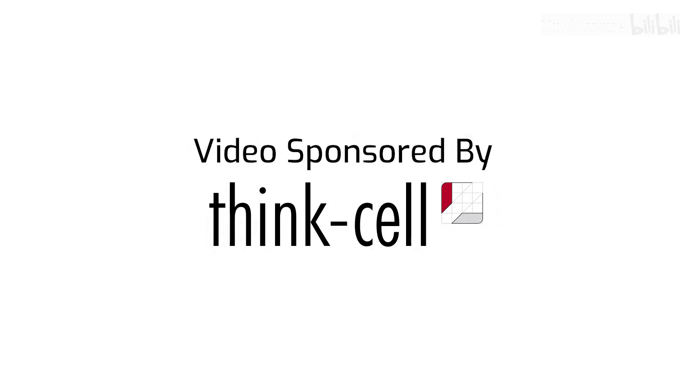
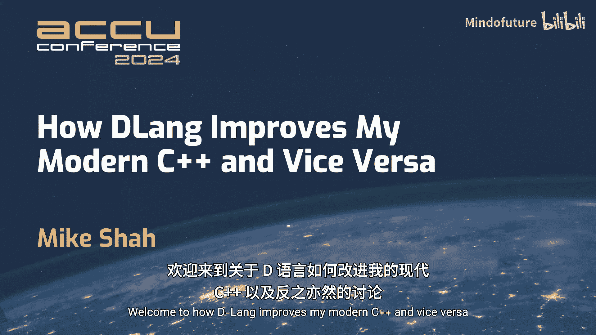
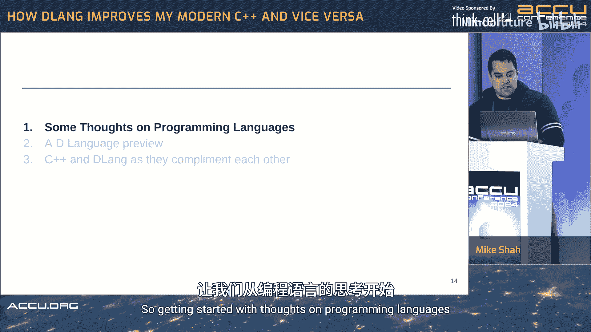
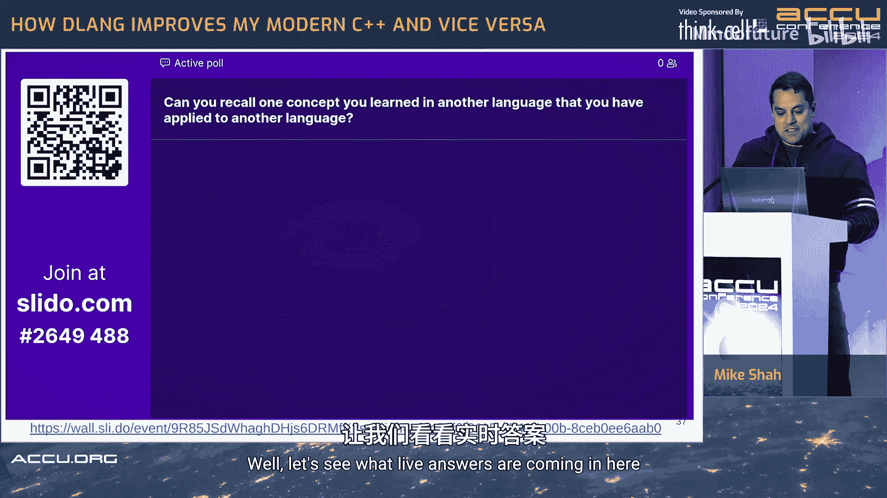
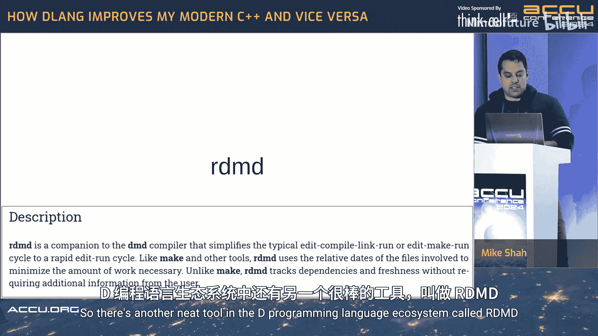
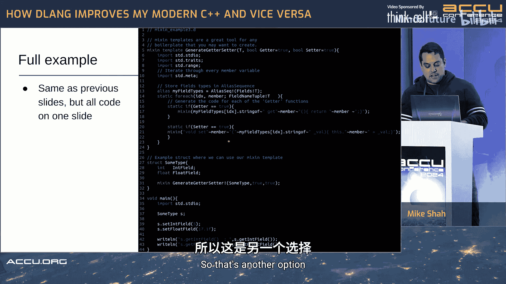
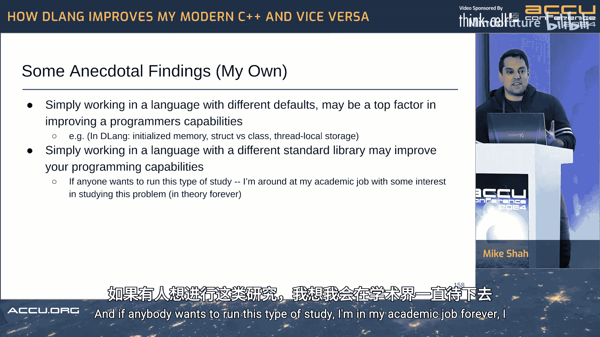
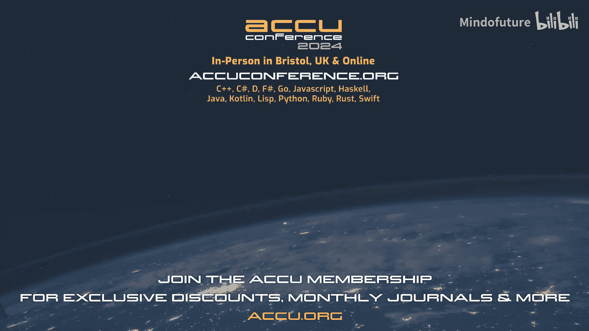

# 中英-•-C++和C语言ACCU大会2024｜人工智能｜架构｜函数编程｜静态分析｜安全｜编译器｜开发者｜垃圾回收｜链接器｜代码生成｜cmake-p08-P09-How-DLang-Improves-my-Modern-C++-and-Vice-Versa---Mike-Shah--BV1pNotYYELk_p8-

Welcome to how De Lang improves my modern C++ and vice versa。

 Great to see everybody whether you're in the audience here at ACC as we're kicking things off or virtually hellello everybody Great to see everybody today。

 we're gonna have a nice talk here introducing what I think will be new for many folks the depro language but also talking a little bit about C++ and how these two languages compliment each other So I hope you'll enjoy。

 feel free to ask questions at any time。 we'll have a microphone running around or I'll try to repeat questions the best I can。

 and there will be some interactive prompts as well because I want to hear from you folks as well as we're just starting off this conference here。

😊。

So my name is Mike Shaw， and I'll introduce myself in a little bit here。

 But we've got a nice90 minute session here。 So let's go ahead and get into it。😊，And again。

 I'll show this QR code if you want to follow along。 otherwise， I'll also take participation by hand。

 whichever you are comfortable with。So I want to just go ahead and as I mentioned。

 kick things off with a little interactive exercise and talk about the deep programming language。

 just a first impression。 and maybe just by a show of hands。

 how many folks have heard of the deep programming language。😊，Okay， so we got about。

 that's probably like 95% of the room。 How many folks have used the deep programming language。Okay。

 a smaller handful。 So about a handful of the audience members here。 So let's。

 let's go ahead and just take a peek at it。 So we've definitely heard of it， right。

 We know D comes after C plus plus or so on。 just little pop quiz here。😊，Just take a moment。

 a minute，30 seconds to look at this code and try to figure out what it's doing。

And I'll let you think about it as I look at my timer here。Alright， let you wanna raise a hand and。

Shout out something that looks interesting or take a guess at what's going on in this code。

I heard something about sorting。I heard someone say sorts an array I compile time。

 must be one of the folks who's used D before。 Very good。 What else here， Anything else jumping out。

😊，U pile time。That's great。Let's go ahead and work with us here。So I'll give you a few answers。

 And if if you look at the deep programming language home page。 Yeah， right at the top。

 the sample sort in array I can file all time。 So perfect a plus plus for。

 you know you folks and what's kind of interesting about this just to you know。

 look at some of the examples is， of course we've got this import statement here。

 bringing in the standard libraries that we can use。

 you'll notice it's within main so we have some sort of scoping that we can use line 5 shows what I'm gonna introduce later is universal function call syntax where we could have a string and then dot it can sort of flip the order of the arguments there。

 So it reads well left to right， which is often very readable and very nice。😊，Line 7 has in a nu。

 nus must be known at compile time。 So we're setting up this array here of numbers。

 which are just set up with brackets。 And then line 9 we have in immutable value here。

So that's not going to change at all。 So mutable usually a key for doing computations at compile time and we're able to just call a regular sort function。

 So there's no special compile time or any magic with that sort function。

 it'll just sort the list or the array， excuse me and then the prag here will print out finish compilation when we just compile the program with the sorted array right Then when we actually run this program it's just going to print out starting program and that's it。

😊，So it's kind of amazing some of this stuff at compile time and we're seeing a lot of this type of work in C++ coming in as well。

 so I'll ask sort the same question that I started with how many folks have programmed in C++ on this audience？

And this is， I think every hand in the audience here。So， you know， that's the crowd。

 that's sort of the expectation coming in here， but we'll look at things from a deep perspective along the journey。

 So again， why you might care about some of these things。

 D's trying to compute as many things at compile time。

 that's usually good for performance and it just looks like regular code which is often also a good thing。

 there's ways that you can check to see if something executed at compile time of course。

 but you want to sort of know what's going on runtime versus compile time and again squeeze out as much performance as you can。

😊，Okay， so that's just a little fun exercise to get us started here。 I'll introduce myself again。

 my name is Mike and primarily my role is teaching， so I teach， you know day to day。

 I do do consulting in various technical training and I've had it passed as a graphics programmer and occasionally I'm still doing that type of stuff。

 So anyways， you can learn a little bit more about me and check out some of those resources as you have time。

😊，The code for this talk will be posted at this GitHub if you're interested in playing around with any of the snippets or sharing with your friends。

 just a note on that。And of course， the abstract that brought you here。

 so thinking about the D language here。And usuallyly I don't give talk outlines。

 but I figured we should still have a roadmap since we've got 90 minutes together here。

 but really I want to break this talk down into three different pieces。

 So I'm gonna give a little bit of thoughts on programming languages。

 and hear from you folks also some of your thoughts。 then I'm gonna give you a D language preview。

 So we have some tools and for the other 90% of the audience who hasn't used D before will understand why maybe it's an interesting language or maybe why it matches up with another language that you're using。

And then I'm going to talk about how C++ and D have complemented each other by knowing both or exploring two languages。

 which is really the central idea or the thesis of this talk that learning more than one language and trying to master more than one can often benefit you in your day to- day programming。

So getting started with thoughts on programming languages。

D L versus C plus plus。 Okay。 So here they are about the battle。 Okay， not quite。

 not quite that talk here。 Okay， so this is gonna to be a little bit more accurate of today's talk。

 D language and C plus plus here。😊，And of course， there's， you know。

 tons of other languages you could substitute for， you know which， which two you w to choose here。So。

 you know， just speaking about programming languages a little bit here。

 I'm a bit of a programming language enthusiast myself。

 I've played around with lots of different languages。

 I've used various ones in various professional or research capacities Here is a range of them。But。

 you know， I've explored these languages by choice。 again。

 just because I think programming languages are very interesting。

 the different ways that you can think about approaching a problem。

 the different sort of ways that they're optimized to solve different problems and different domains。

So， you know， many of you have probably again used one or more of these programming languages。

It be multiple languages you're using day to day and using C++ with Python to script or automate some activity or writing a library in C++ that you call from Python。

 for example。Maybe you're just required to use some language for a specific platform。

 and I know it's you can use Swift on， you know any platform you want。

 but it tends to be used on iOS just as an example or Coin for various devices。

So maybe that's why you're using or choosing a programming language。

Or maybe the domain you're using some language in is just dominated in that domain。

 So I see a lot of data scientists and bioinformaticians using Python and are， for example。

 for a statistical analysis or Julia or you know， all these sorts of different languages。

And maybe you get to choose， maybe you're lucky enough。

 if you're running your startup or your researcher and you just get to choose the language。

 you're the boss， or you're working on some desk that allows you to choose some other language of your choice。

And I bet at some time， someone also said to you this when looking at programming languages， I said。

You should just learn a Haskell。you know， it's just the right language。 It'll， you know。

 teach you how to think。 and it's the best and it's pure in all these things。 And， you know。

 you should learn it。 You should take a look here as we go through this talk。😊，But the question is。

 again， why here？So I want to give us a little activity here。 again， if you'd like to participate。

 you can scan the QR code or go to slidlido dot com and enter this number here，2，6，4，9，4，8。

8 folks online feel free to participate as well。😊，I just want to hear from you。

Why should you learn a programming language， And Why are your friends telling you to learn Haskell。

 or I'm telling you， D is an interesting language。And we'll put these up on the。W here。Let's see it。

See folks responses。I'll just read some of these as they're coming in。

 exposure to a variety of programming paradigms and idioms。New idioms， new ways of thinking。

Perspective。Extend horizon。And better understanding paradigms of problems that can exist functional。

 became a better C++ programmer， Mon ads。Different perspective on problem types， curiosity。Why not。

 I love that？Ranges， okay？Have fun。Yeah， see how to approach different problems in different ways broadening your perspective。

To show off， yeah， sometimes。I speak 20 programming languages， right。

 and they finding the best tool for the job。 Yeah， thinking about maybe the domain that we want to use it in。

 laziness and streams， again， maybe thinking about different features that we use。 This is great。

 This is great。 Okay， so go ahead and close this poll off。😊，We'll have another one here in a moment。

That I'll activate。In a few slides here。Okay。So， you know， competing with this talk right now。

 you can find some more answers so that Francis is giving a talk on the benefits of learning different languages and I suspect you're going to hear a lot of those different things as well throughout that talk。

 so I encourage you to watch that on the playback after this one。So for me， you know。

 the past few months， I have been doing this experiment and documenting it to've been spending about one hour or so with every programming language that I can think about everyone that somebody' has told me I must learn and have to try out。

 And in particular， I'm trying out languages that are new to me So go V Rass Zig free basics。

 Free Basca， Ruby， Now Some these I've used before， Some of them I'm revisiting after 10 years。

 So it's like a new thing。To mean my memory， but again， the point of this exercise is to， again。

 go through that process of expanding your horizon。

 learning new paradigms and idioms in different languages。😊。

But one important thing I'm going to go through this talk as I sort of alluded to at the start is this isn't a language versus language talk。

 so I'm not going to pick the better of two languages。 maybe I can do that privately if you want。

 everyone's got their favorites reason one of the reasons they'm not going to do that is there's really good talk by Dan Sacks from CPPcon in 2016 who says。

 you know if you want to remember just one thing from his talk when it comes to persuasion or trying to learn something new or tell your colleagues hey。

 maybe we should try this thing if you start arguing you're losing so I'm not going to argue for language today。

 but I am again going to tell you why learning one other language is going to help your C+ plus or whatever else you're doing。

Okay， so you're going to have to be motivated enough to want to decide， you know。

 that you want to answer that question of which language is better， you'll answer that yourself。

So that's for me。And again， I personally think new languages help you think about concepts more efficiently in your default language。

 whatever that might be。So with that said， time for that little poll here。

 feel free to chime in here。Can you recall one concept you've learned in another language that you have applied to。

 say C++ for another language， psych could put language and then idea， for example。

 if someone put laziness in streams， where did you learn that from？Well。

 let's see what live answers are coming in here。

Rust ownership。Great。Moone ads again。Weust be our Hakell programmers。Functional programming ideas。

 okay？Yeah， I wonder which language。You you folks they more？

The idea is behind functional programming， yeah。And we've seen some of those starting to trickle into the C++ language itself。

Ml， yep。The S M L， Ocael family scope exit。 Yeah， great。

 That's a great feature of D and other languages， async weight， share hipian Java script。

 for instance， list comprehensions。Maybe from Python or Or LiR or some of these， yeah， great。

Great list here。All right， let's go ahead and。I'll stop that poll here。And we'll get back into it。

Allright， so I do have one sort of goal through this talk， something that I'll just put forward。

 though。 If you are just gonna to remember one thing， my sort of art of persuasion is to go ahead。

 set a timer， go to the D language homepage and just try out the tour。 same thing up' and been doing。

 you can see me do it on camera over and over and over again。

 I do the same exercise to get started with the language。

 If I've successfully done my job with this talk today。

 you'll be cururing us to curious enough to try out the D programming language。

 and you can watch how I do that on the talk below。😊，At the very least。

 doing this exercise might just help you em， empathize a little bit with your junior engineers who are starting from scratch again。

 you know， putting yourself in the beginner's shoes and just seeing。

How things go and what it is to be a beginner again。 I think that's always a valuable exercise。

All right， so with that said， that's a little bit of the thoughts of programming languages。

Now I'm actually going to give you a preview of the D language While D is similar to C++ in many ways。

 it is its own language。 so I want to give this common ground here and just see how the D language works。

 So I'll go through some slides。 I'll highlight some things。

 I'll move faster or slower depending on how our questions go and feel free to ask any questions as they arise。

All right， so looking at the de programming language。What is it， what exactly is this language？Well。

 described from their website， it's a general purpose programming language with static typing。

 system level access and C like syntax with a deep programming language， you write fast。

 read fast and run fast。 All right， sounds like great things to me。But again。

 it's gonna to be something very familiar。 It's in the C programming language family。

 you can probably look at some decode like we did at the very start and understand what it's doing。

 That's a systems language。 So access to pointers， memory， low level stuff on static typing。

 which maybe we often associate with safety and type safety。

That's a little bit of history on the deep programminging language right there on this righthand side picture is Walter Bright in the middle of the photo。

 there's me being goofy but he's the creator of the deep programminging language but he's a good figure to know and to read some of his papers he's done a lot of work writing C he wrote one of the first C++ compilers。

 he's done some game design work， but most famously these days he's known for the deep programminging language which he started in 1999 So De's been around for quite some time。

 I imagine for folks who said they've heard of it caught wind of it at some point。

 maybe in this era 1999 to 2006 or later on。And that was a D1 version of the compiler。 So again。

 similar to C+ plus a language going through evolution D is as well。

 just like any language that's alive and well。 now around 2006 or 2007。

 a name that C++ folks may surely know is Andre Alex and Drscue also joined the D project and started contributing heavily during that time through 2019 and theyre still on the foundation together。

So that's a little bit about the history there。So D itself is 25 years old and it's been steadily evolving and growing to the point where there's actually three compilers。

 You've got the official compiler called DMMD， which stands for the digital Mars D compiler。

 That's what the language was originally called。😊，And folks just insisted to call it C plus plus because it looked like or excuse me。

 to call it D instead， because it looked like the next evolution of what C plus+ was。😊。

And these ecosystems very interesting because they have this。

Very nice setup where you have this DMD compiler， the reference compiler that says this is what the language is。

 this is what it means to be correct because it compiles very， very， very fast。

 So that's the goal if you want fast iteration times and then you've got the Gcc implementation called GDC and then the LLM or Kang-based compiler called LDC and those are the compilers used to generate your optimized code So you get this really nice development cycle where you compile in DMD and then can run an optimizer code for different platforms with GDC and LDC。

😊，Tools are readily available to download for free。 It's an open source project。

 and along with the download of the Dcompilr， you also get a package manager called Db。

 the D package manager， you get some static analysis tools and code formatting tools like D format and D scanner。

 and there's visual studio code extensions， there's intelligent extensions。

 all those different things for the D language as well。Okay。D itself。

 Where is it being used actively today。 Here's a list of a few companies where it's been used previously in production。

 It's found some interesting niches in performancebased domains。 gaming， for instance。

 image processing， finance and so on。 So I'll just show you a few pictures。

 It's sort of nice to look at。 it's been used in AaA game projects。

 So games that you would find at your local store or I guess you'd buy digitally these days。

 but AAa game quantum break was used decode for their animation system。 So very performance stuff。

 took down a little bit about that。😊，It's been used in various game engines that are available in open source。

 Again， you can check those out there。Here's another game engine that was built that was quite nice by independent developer。

Here's another game engine that was recently displayed they have a match game。

 but what was interesting about it in particular was that it was available for PlayStation， Xbox。

 Android devices， so many different platforms as well。

 so you can run Decode everywhere with these different compilers。

This is a tool for doing fluid simulations on gas simulations， so again， yeah， good question。

Absolutely。Be will mess up a place where you're doing theory idea。 the war is taking this siss。Bs。

Yeah， so the question was about the where is D displacing which language is displacing。 Yeah。

 that's a good question。 I wish I had exact data。 I mean， I'm looking at some of these。

 So we do see it pop up in commercial games on occasion。 the biggest proponent of D I'm trying。

 I don't see them on this list is symmetry investments， which is a financial trading firm。

 So they've done work with D because of again， the stability funk work is another big one which works on trains in Germany。

 We've seen it showing up in data science more frequently。 as we're gonna find out the D language。

 almost looked like Python in many ways。 but you get the static typing。

 you get the performance In fact， that's where I'm pushing it a little bit more。

 And in the food and gas simulator。 know， that was one of their decisions。

Ds also used it's got a really nice web framework called vibe dot D。

 which is being used for web applications。 I have some lists of this somewhere of companies that are using it but again。

 you could see on their website other domains。 Now if the question is about is D taking over C plus plus or people using it instead of rust or some other languages that I don't have good data on I think it comes down to this sort of。

Preference and。You know， what we're gonna find out with languages is once you like something。

 you kind of like something。 as far as languages go。 you know。

 it's about convincing maybe your your team to try something new and be efficient in it and so on。

 Hopefully I'll give you enough evidence today to see that D might be worthwhile choice if you're starting a new project。

 The other interesting thing that I'll note about D as it has a built in C compiler。

 So you can just take any C code and compile it with a C compiler and miningles with your D code perfectly。

 So there is some work being done in operating systems。 There's one or two that are being developed。

 So yeah， it's got a lot of potential in many different domains。😊，Others， yeah， yeah。Let's see。

 So just some other ray tracing。 I use it in graphics and teaching。

 That is one place where it is displacing。 in my own teaching。

 I found students do an excellent job in the deep programming language。

 I think it's actually an excellent first language。 That's another talk that I'll link later on。😊。

So anyways， you can find out more， I list a few more projects in a different talk on the source code and those projects and why they might be interesting to study in my review of the D language here。

So the D language itself has many， many different features making up the language。 again。

 it's a large language， like C++ is's a large language， but that gives us many。

 many different tools to work with， which I think is very exciting。

 So it's got built in dynamic arrays， associative arrays or maps the bounds checking for their arrays can be built disabled or enabled as needed。

 Lambda does and delegates function or the equivalent of stood function。

 the universal function call syntax， many different paradigms for functional programming programming。

 opt oriented parallel programming and so on。 and it's a garbage collected language by default。

 or you can turn that off and do manual memory management if you need for performance like in the gaming examples。

😊，D also comes with batteries loaded， meaning it comes with a standard library。

 One of my things that I'm going to mention here is I think we need a little bit more of this in the C+ plus ecosystem but it's been a little bit more liberal in bringing in more packages and so on in its library which I think has been interesting to take a look at so it's got containers。

 it's got data structures it's got a large algorithms library ranges is sort of the default that they have available and you'll find other packages for working with JO data。

 CSV files， zipping files， sockets， networking SQL databases and so on。

 all that stuff out of the box and ready for you。So thats said。

 you know that's very exciting but let's look at some D programs here。

 here's a little hello world like get us started at the same spot here again。

 you'll see some familiar constructs here with import statements to bring in standard library they've got a main function starts out with Boyd right line and of course the fully qualified name here for a standard standard IO and then writing up the name here。

And as I mentioned， you'll find that D incorporates very well with C libraries， in fact。

 all the C standard libraries also available if you want to use that。

Towards the bottom if I draw your attention， again it's a compiled language here。

 so I can just do DMD， the file name， and then the output of the executable and run it as you normally would from the command line。

The modules themselves can be scoped locally to functions。

 I found that this is helpful and generally it's accepted as a best practice folks might have differing opinions。

 but generally it's accepted in the D community to allow for easier refactoring and keeping all of your functions and the scope of their imports in one function here。

And then other thing that I will note about this is this is what we're hoping for in C++ right to get our module support fully available right so know sympathetictic eitherers have this and are incorporating this more and more。

 but this is ready to go and D in its advantage for the compilation speed。

So there's another neat tool in the programming language ecosystem called RDMD。

 which is just for running DMMD and this allows you to basically run D programs as scripts。

 so you could just run them with the RDMD program if I draw your attention towards the bottom you'll see there's RDMD in the file and it just runs like a script In fact if you put at the top of the file the pound bank signal slash binlash RDMD it'll just run and execute as a script file which is really nice so this is one thing again more of my personal projects it's displaced all of my scripts。

 I don't use Python anymore I use D but again that's why I'm giving the talk here showing off my favorites but it's actually quite nice to do this。

So here's an example with the script here。If you just want to run and execute your files as D scripts。

D， in my opinion， gets the defaults right， right they've had time to learn from other different languages。

 meaning that variables have initial values。 So every value is allocated unless you say otherwise So that means you don't have to worry about garbage being in your memory if you do for performance reasons want to not initialize some value。

 you can set it equal to void。 I'll talk about that later as I think there's been some proposals in the C+ plus community for that but for safety this is a nice feature。

 the primitive types are also well definedfin for their sizes， So an int is always4 bys。

 so you don't have to worry about。You know exactly what the data type is。

 which is nice on different platforms。So every data type has property， property basically。

As as a field， but it's a function call so you can check what the initial value is。

 you can set the initial value if you have your own default types， you can see the size， alignment。

 mangle name and get a string value back。As I mentioned， D is a system programming language。

 This means we get to work with memory and D have by default is a garbage collected language that is turned on by default。

 So for instance。If I draw your attention towards line number6。

 you'll see a new here and you won't see a delete， so this will be familiar if you've used Java or other languages。

 it'll eventually be cleaned up by a default stop the world collector。All right。D has pointers。

 same syntax as C， I could take the address of variables and work with them so if you're creating data structures。

 no problem there。And here's just another example here。

Now when we're using this stuff like allocating memory and working with pointers。

 maybe pointer arithmetic。 sometimes we have to be careful。 So as I heard from today's keynote。

 we might want things like at safe or the ability to say， hey， don't， you know， do bad things here。

 So indeed， we do have attributes。 I'll draw your attention towards line number four here。

 where there's an at safe mark here， which means that we can't call other functions that might be。😊。

Unsafe， which is at system by default， which means， hey， we know what we're doing here。

 because there is pointer arithmetic here。 Okay， and that's considered something that could potentially be unsafe because we could。

 you know， add too many values and jump to an address that hasn't been allocated。

And so D in this way allows us to write safe code。 There is also a borrow checker at Live as an attribute。

 I don't capture it here， but just wanted to mention that。

 since someone mentioned ownership and borrowing。 So that is also available in the deep programming language。

 that not a lot of people know about it， but it's it's a new thing。

Just as an aside because D has a reputation of being a garbage collected language。

 you can still just malic memory and take ownership over it so no problem there right just make a regular call to Malik cast a ti yourtype exactly what you do and see。

 but again you're responsible for freeing that memory and you can use standard tools like Valgriin and so on to check for leaks at this point if you run into errors because that's using the C library。

And the benefit， though， with D is even while you're using some of these features from C。

 for instance， like mallocing memory， you can actually take slices。

 as I'll introduce here in a moment to arranges。 just like you normally would。

 line A to have a little example of a range here。 but I'll explain that in another slide here。

 So there's a convenient way to access memory， balance check it and and so on。😊，And here's。

Another sort of safety feature of the D language that I'll mention。

 I think again this was something else that came up in Herb's keynotes a nice transition here。

 but we do have scope guards as well。 folks might know these as defer and other languages but indeed。

 we can use scope exit。 So after draw your attention to line 14 through 16 which is basically the same idea as resource allocation is initialization。

 where when we leave this scope here， we want to make sure we free the memory at line 6。

 So this will call it in a deterministic order when we leave the scope of main we'll make sure we free the memory。

 So very nice very simple thing that we can do。And if you really want to avoid the garbage collection。

 what you can do is again， put a at no GC attribute trie on a function。

 So I'm looking at function at line 11 here on main。 You could just put at no GC。

 And that's a transitive property。 So if main。Has a calls into some other function that calls another function if any of those functions allocate memory。

 which right line in this case does right It allocates a buffer large enough to print hello。

 That's considered that won't compile。 We'll get an error here it says， you know。

 main cannot call no GC function。 And you need to use another function that doesn't allocate。😊，Pam。

So there's many other different strategies or summarizing how to take control of your memory。

 there's scope variables， there's reference counted things in the standard library。

 as I mentioned there's an ownership system as well。

 so you get to take control here which really makes D a nice language if you want to just use it as a better C fact we're going to talk about better C。

 which is a thing in the D language here， as well。Indeed， we have Kst as well。

 just like in the C programming language。 So again， Kst makes things read only memory。

 Now things' changed there。That something that's even stronger than con is immutable。

 and immutable is truly read only。So the difference is if you have something that's immutable， again。

 this is transitive， so if it is an a pointer that points to something。

 the data that it points to can never change here。And I'll show it in a brief example。Pre。So again。

 if I'll draw your attention to line number nine here or have a cons pointer here so I can point to some memory address where data is and I can actually still change that data here the pointer won't change what it's pointing to that's the idea here so we could still get away with that but immutable is much stronger So anything that I'm pointing to that the data truly can't change。

 so I like immutable， especially if you're doing concurrent programming and want something to be truly read only again this is a strength that was designed into the D language by making things immutable。

And that's the default that we tend to opt into。Control flow stuff， pretty standard。

 you have your if statements， case statements and so on， again since D focuses on ranges。

 which I'll introduce， we could do neat things like from case zero to dot dot case5。

 we could switch on strings and again a few little improvements there。

For functions we have local functions， so local scope is totally allowed in the D language by default。

 we can have Lambda or anonymous functions are allowed。

 and we can use a short syntax as well for Lambdas so a few different ways to do things。

We also have higher order functions， so we use the function keyword similar to how you would use perhaps a stood function or a function pointer in C and C+ plus。

 so that makes the syntax relatively clear here for what this is or what the parameter types are in the arguments for the type of function pointer。

And then we also have delegates as well if you want to capture surrounding members or variables。

 so if you have a member function and want to make it a delegate。

 you can do that similar to other languages like C sharpp and so on。

One of the nice things about D that I've grown to appreciate a lot is the universal function called syntax。

 so this is the idea of just being able to put a dot after the function and that treats it as the first argument so you can be the judge here if you look at lines 8 and9 and compare them to lines 15 which one you think is cleaner。

I would argue that line 15 is much pleaer， again， to read left to right with the universal function call syntax。

And again， this makes me think of things like and design patterns。

 like a builder pattern for structuring our code that are just nice。

 but we get this out of the box in a deep programming language。

Here's just another example comparingairing line number 11。

 where I've got a function that calls a function that calls another function， calls another function。

And some arguments versus line 15， you can see that in a one liner where I have a sentence that I want to strip the white space from。

 make it all uppercase and replace Mike with Joe， and then strip more white space from it。

 and that's again just nicer to read。And it tends to be not only nicer to read。

 but from my experience， a little bit less air prone when I'm following this code。Alright。

 so there's a lot more on functions again， I'm not going to give you the full language。

 but there are ways to make functions lazy。 you can memize them if you want to save their state。

 but purity is important enough that it deserves a slide here。

 that I can make a function or market as pure and check that it doesn't have any side effects。

 So things like global variables or pointers into that function would make it impure because you could have a side effect So that's pure you can have functions that are also weakly pure。

 So for my functional people meaning that the actual arguments。

 you could pass it with a pointer and have them those change state but the actual function won't change any other global state otherwise。

😊，So that's a really nice feature here。We get some other features like auto is available in D。

So same， same type deduction as in C plus plus with auto。 So that'll be familiar。

 So you can almost always auto if you like that。 although I tend to， I like that rule。

 I tend to be more explicit。AndSo here's just some more examples of auto。

 I'll kind of move through here。And auto is smart enough to deuce things like， again。

 if you have auto P of X and point it to something。

 it'll figure out that this is a pointer to an integer。 Okay。

 so you don't have to specify a little pointer by the auto or anything like that。For type creation。

 the equivalent in C++ we have a decal type， but in D。

 you have type of so you can just take the type of something which reads nicely and it'll deduce the type。

 and you can use that for a type declaration。So for templates， for functions。

 a little change in the syntax here from C plus plus line 4， you'll see add。

 then you'll see your template parameter list so no angular brackets。

 just the same app parentheses so you don't have to stretch your fingers out And then we can see the template parameters and the regular function arguments here。

 Okay so that's the idea。 and you can use auto for the templated function and it'll deduce the type here。

😊，Now getting into some more interesting stuff， Ds had template constraints we know these as concepts and C++ right to being able to put some sort of constraint in the type so you can do things like use the builtin traits to see is this a basic type and it's basically just anip statement here again just some condition that's being checked here to make sure that that's true and if that's true。

 then you can create or instantiate a version of this function here with any of the basic types here。

And here's an example failing here while string is highlighted， you might think it's a keyword。

 it's actually a string is actually a im mututable character array。

 so it can read only can't be changed， can't have any other data changing it so you'll see the template a little error message here telling you that it doesn't pass this basic condition here this concept or this template constraint。

And these can also whereki can put contracts， as I'll introduce here for functions as well。

 to make sure that things are passed before we actually can use them。So you have static arrays。

 fixed size arrays， as you might imagine。These are stack allocated， they're bound checked by default。

 but you can turn that off again if you care about performance。And we have dynamic arrays。

 which's a little bit more interesting to look at。 these are basically your stood vector built straight into the language here。

 so you could use those and any of the tricks that you've learned with vector for reserving memory ahead of time and all those different things also work here。

We have associative arrays or maps built in to the language， so I'll show you an example at line 8。

 you can see we have a students here， the key is the integer and the type is the string。

 so maybe a student ID and then the student name for instance， as demonstrated by line 10。

 so it works very similar to maps in C++。We also have alias。

 which is again going to be similar to using in C+OS+。All right， again。

 as mentioned in Deling strings are in alias for these immutable character arrays， so again。

 we can't change strings， but that's what we have here。

A really interesting feature of D that I simply can't live without now that I've gotten used to it is slices and slices themselves are a view into memory so we're thinking again about string view。

 span， these types of things in C++ that we get those by default with the dynamic arrays and the D language so I get the view into memory you can see at line number nine here I create something called slice。

And I'm just taking a slice from0。 the first element2。 Well，4 is not included here。

 So the whole are right here。 you could just take part of it or so on。 Again。

 the slice is not owning that actual memory。 So again。

 same sort of semantics in C plus plus when we think about string views But we can read it into that data。

 we can also do operations like concatenate them and so on。 if we want to make a copy。

 we can just use the dope D U P function shut at line number 20 to just get our own copy if we do want to actually mutate and preserve that change。

😊，Right， getting into ranges， indeed， they pretty much took a pivot when they were designing it。

 they don't really have the iterator model now of course you can implement iterators just a pointer or some folks have made different libraries based off of cursors。

 the same sort of idea of having a begin in an end pointer but de Lied into ranges so you've got range base four loops by default。

 so for each for each underscore reverse and then just looking through the elements you can use similar things like structured bindings if you've got two different types here for like a key in a value for instance。

 in a map so that's no problem there。So D again， has fully put their standard library into ranges。

Okay， so with that， you know， D itself， those are kind of the language features。

 hopefully getting kind of interesting。 And maybe just as an observation。

 you could see that it's got a lot of the features that C plus plus 11 and beyond has had for a while。

 So again， should be kind of familiar， but you're defaulted into them by default。 Now， again。

 what makes D sort of stretch different domains and interesting is the different paradigms that it supports。

 So some of these slides， again， I'll go through quick。 I don't need to explain， you know。

 object oriented programming to you。 There are a few interesting。😊。

Things in this language that again， make you think about how you use your daily programming language。

So， of course， we've gotstructs， which is a way to structure our data。

 butstructs are known as value types in the D language。 So again。

 if you're coming from say a C sharp world， there is a difference between a struct and a class。

So strs themselves are a value type， you don't have inheritance。

 and they're stack allocated by default because they're a value type。Okay， so the type is final。

 again， catch no polymorphism with it， so it's just truly using the structure as a data or like a record in other languages。

This I like overall， it makes you make a design decision upfront now of course it's very easy to just change the keyword。

struct a class， you can do that no problem you still have constructors， deors， member functions。

 all that sort of stuff operator overloading and so on but again it makes a clear documented use case of how you're going actually use that value here So in this example I have a struct for a student there's not going to be any polymorphism there or any guesswork。

Classes on the other hand are references our reference type。

 so this means that they're dynamically allocated， you allocate them on the heap。

 and they'll be garbage collected later or if you mallic them yourself。

 then you'll release them when you decide。You have single inheritance for classes。

 so there's no multiple inheritance， but you do have interfaces。

 as I'll show in the next few slides here for if you want to create some derived type for multiple interfaces。

So again， in most languages are in C++， I should say there's no real change betweenstruct and class other than the default privacy levels with inheritance and the members。

 but indeed that is an important distinguishment for if you're stack allocating or he allocating something by default or if you want inheritance。

And here are just a few examples of you can have interfaces， same as in Java so line4。

 I have interface for an animal that can walk， talk and eat and you can have final member functions if you want that are included from anything that derives from animal so line 19 you know it's a little bit small。

 I have a dog driving from that type there。So again。

 interfaces are just a the equivalent in C++ you have class with all purely virtual functions。

 right set to zero。We do have abstract classes as well in D。

 the difference being that you can use or add member functions to them。

 that's the only difference most folks end up just using interfaces。

 but if you do want some sort of base class or an abstract class， you can set that up as well。

And here's just another example of abstract class， same as before。

Now getting into other paradigms just in the standard library， D has things like filter map， produce。

 if you're using map produce or this style of paradigm you have that available again。

 you can do things cleanly。 So the same rules that apply in the C plus plus world。

 this idea of no raw loops， you can apply those in D just as well。

 So this is often an exercise I go through and it's a great way to actually learn the language or any language that you're studying is to try to dig through the standard library and figure out well。

 how do I get this to a one liner right and you can do this often cases with the universal function called syntax。

Am。A question here yes。It's all nice with。Yeah， thanks so when you have one collection。

 it's really easy to replace these loops right， but it gets interesting with multiple collections。

 So my question would be， is there a nice way zip or something that can do that。

 we have zip in the standard library， if you want to create pairs。

 we have things like chaining for instance， if you have two collections that you want to create pairs of elements and then run some other and it's also cheap like doesn't it doesn't copy but it correct as it cheap as an index loop as cheap。

 correct shouldn't it be any cost the ranges also again acting the ideal with ranges is that they're being evaluated lazily as well。

 or if you have infinite ranges that's like another reason to kind of lean into ranges So if you're just pushing data or downloading and streaming in data there's no problem again with having a range zipping together multiple collections and then operating on it。

I think I've going to shown another slide too， another little interesting trick is with these universal function call syntax。

 we can actually do dot parallel as well if you're thinking about performance and which is again pretty much equivalent to the execution policies and C++ as a parameter。

 so you get those very trivial to use。😊，So it's very nice， very clean。And some of these examples。

 it might have been interesting to。Well kind of gives away。

 but to ask you what languages this look like。 in my mind。

 this looks very pythonic or almost Ruy like if you've had experience with those languages。

 So it just reads nicely。so there's mapped， here's filter。

I think we get the idea with the universal loop， but you could do this sort of as some examples here。

 and then reduce as well。And then to answer the question that was asked。

 you know which code has fewer branches， fewer decisions。

 ideally they should be the same performance。Excellent， excellent。Okay。

 so I think I got one more topic and then we're going to get into some language stuff and takeaways here。

But templates are a big part of the D programming language。 So as we know。

 one of the benefits of template to avoid us having to rewrite the function。

 so in this example I'm showing add integers， add floats。 No， we don't like that。

 So let's use function overloading。 So again， also supported and D。

 it'll choose the right or deduce the right function to call from the parameters。 So again。

 I think there's a talk going on concurrently right now with class template argument deduction So D can do that with classes and with functions。

 It has a implicit these fun acronyms。 but implicit function template instantiation for calling the right type here。

😊，So anyways， what we probably really want instead of redefining this ad function over and over and over again is to write a template here。

So of course， your sort of introduction to templates line four through6 as we saw is a add function here again。

 this type here probably want to change that to auto so it'll deduce the common type that we have available and it'll return the right type here。

Of course you can have multiple template type parameters。

 so that's how I'm updating here at line4 here， you can have T1， T2 and so on。

 and if you have multiple， then it's to use the types add exclamation point to get no angular brackets and then the parentheses of the template parameters that you want to supply。

Okay， so here's a few examples here。Template specialization is also allowed as mentioned。

 if you have different types and then of course you can add different template constraints or concepts again。

 just a really powerful part of the library again from a traits library So if you're doing similar stuff to this in say+ plus this might be one of the you know。

 if I'm picking something again to one of the earlier questions about where does D potentially displaced things。

 it's with the ease of doing template programming or meta programminggramm it's just a very clean readable syntax and the traits library is quite rich in the different things that you can do。

Again， things you can do in C++ as well， but just a little bit cleaner。

 and that's going to be one of the takeaways we'll see here is I usually learn how to do it in D first and then I take that into C++。

 So again， you learn from one language and apply to the other。

 but you see if something's possible and then you can approach it。Okay。

 so here's just some more syntax examples of template specialization specifying the types。So again。

 I'll move forward from that。And of course， you can have templates forstructs and classes。

Which again might be a classic use case of templates。And so again。

 getting back to one of the superpowers of D is generating code。

 So just understanding what this code lowers into line 5 through 7， this structure that's templated。

At line 12， we instantiate it with an int and we can see the int type that's instantiated below from lines 33 through 39 here。

So this will actually create a template block for that particular type。

Now where things start to get interesting again with the meta programming is this idea of a feature called a mixin。

 just by a show of hands， how many folks have heard of mixins before？Okay。

 probably more than half the audience here， great， so 78% of our personal audience or so。

basicallyically， mix in is just mixing in literal source code。 sounds like a kind of silly feature。

 you'd say， well， why don't I just write or type out the code。

 but when you combine this with tools or when you're generating code。

 it actually becomes quite nice here。😊，So here's you know a little member function here where I could mix in a print data that prints out all the values of this dynamic array here。

 for instance， you know we don't have to put that into a string。

 but effectively you could think about this like a preprocessor， there's no preprocessor in D。

 which again I find keeps things relatively clean， you do things through the templates。

But this basically just mixes in this member function here。

Now what's kind of neat here is with mix ins， again。

 if we're just pasting in code similar to how you would think of it in a preprocesor。

 but this is stronger， this is going to be type checked with the actual compiler。The idea is。

 I could just have this what I'm showing on the left side， and you don't have to read the code here。

 but it's that entirestruct with its member functions， all that text。 And then I can just import it。

 so I could just do mix in and import。So what's neat about this is， again。

 you can pull in pieces of code。 you could construct types at compile time by pulling in different text files。

 how many folks have seen embed and C 23。 has anybody seen that Okay， two or three folks。

 is gonna be one of the superpowers of D learning about this feature of just grabbing a text file and popping it into your code。

 What's neat about that is if you have some data that you want to embed into an executable。

 you just pass it in as a mix in。 This is like having static data and you're executable。

 So it makes things quite clean and easy to use here。😊，I'll show you some more examples here。

So here's a small structure here from lines 27 through 32， called some type。

 I've got an integer field and a float field。 And then I'm actually gonna mix in something here。😊。

So again， mix ins don't have to be just about copy and pasting in text code。

 but we can mix in this generate giter setter function here。

 And I've also templated that function here on some type here。 and then I'll pass in true and true。

 Okay， so I've added in some parameters here。But what we want to know about this or what we've seen from mixons it's just a way to paste in some code here。

Genrate giter or setters going to again use this trait library to look at all the fields of thisstruct and just generate the inch field and float field giter and center functions。

 Now， just as a little example here。I'll show you what it looks like。

 You can kind of study it on your， on your own here。 But I'll just draw your attention to line 14。

 I've got a static for each loop。 Again， I just wan to show you some of the superpowers today。

 but static for each。 So this is happening at compile time。😊。

I'm looking at with this strangebased loop， a tuple for the type。 Okay。

 so my type is whatever that struct is。 and I get back all the fields of that type。

 and then I'm going to mix in some code right through some for each loop。 So for every member。

 I'm going to mix in a giter and setter function。😊，Okay， so。This is just really nice because again。

 if you don't want to generate a lot of types or construct things or construct things from configuration files。

 you can just do this kind of stuff， which I find quite magical。 And in fact。

 it was always impressed when folks would show this and C+ plus。

 but I couldn't It was always a bit of a head scratcher for me。 that actually do。

 But then I saw And D was relatively clear。 Yeah， question the code was Yeah。

 so the question was this has to be done at compile time。 Yeah。

 this is being done at compile time correct。 Now there's nothing that stops you from and this is where the game folks like to work and build like a reload system and reload the code as a plugin。

 you could certainly do that。 that requires a little bit more work in engineering。

's no so you get the static like reflection that you can do a compile time。

 but no at runtime where you can generate code again， can't do that。😊。

But those would be nice features。 Those are cool things。 So anyway was， here's a full example。

 you can dig through it in the slides just if you want to see how to generate giter and setter functions。

 So you never have to do that again。 D also has properties so you can access fields like functions。

 So you know that's another option。😊。

But anyways， alright， So anyway， that's just a little outside on on meta programming。Okay。

 so some other things， indeed， I know I've taken you through the gatlet of thena language or a big chunk of it。

 thanks for your patience there。 I' gonna again， get us into some more high level， you know。

 ecosystem things that are neat but compile time features。 Again。

 we're seeing this in languages like C plus plus C plus plus 23。

26 or every time I look on CPP reference more and more functions or cons expert so we can do things at compile time。

😊，D by default as well as other languages， just try to evaluate any function at compile time if。

 if it will evaluate。 So again， that's where these things like pure functions are very useful。

 And again， picking up some of those ideas。 if there's no side effects on the program。

 we can just evaluate at a compile time no， no computation paid。😊，With threading and safety for D。

 everything in D is thread private or uses thread local storage。 So again。

 something that they were thinking a little bit ahead on for concurrent programming right I think it was her Se's article。

 I think it was in 2001 on Dr。 Dobbbs there's gonna be no free lunch for concurrent programming right。

 this idea that we'll have to understand what's going on the nice thing is again。

 D pushes us you know， a few steps closer there。Otherwise， you。

 D has a stood concurrency import similar to thread where you can do thread based concurrency。

 you've also got things like message passing， built in so objects can just send and receive again as another way for different threads or different objects and different threads to communicate。

And D， there is a safe subset called Sa so you can read about that。

 and there are whispers of a certified D compiler and these sort of things， again。

 thinking about different Ds being used in the auto industry in different areas where they're thinking about that。

So anyway， there's much more to cover here。 But again， this is like a full semesters worth of stuff。

 So we're gonna get to part 3。 because've been very patient。

 but that sort of rather comprehensive introduction there。

 So how does C++ and the D language complement each other because that's what we want to kind of get into。

 So you know that was a claim or some hypothesis that learning another language is a good idea。

 we sort of get excited about all these features。 let's actually talk about some of them。

 And it's not just a one sided argument again for D， but C plus+ has complimented my D programming。

 So again， this is from my perspective。😊，Both languages are evolving， both are large and growing。

 it seems overall， you know， that tends to be a big good thing。

 It does require time to achieve some sense of mastery， I suppose。

 by learning both languages together and side by side。

But let's talk about a few of these things here So from the C++ perspective。

 how does that improve my Dpro Well， C++ itself is performance minded so we're always sort of opting into performance first and I love being able to use a tool like compiler Explorer or my compilers to dump out the generated assembly and see what the instructions are doing that's a lot easier to do in languages that are like C++ or C。

 for instance， D does have a runtime， it does have a garbage collectors So again。

 if you're not doing everything manually you can still do that same dumpout of the assembly。

 but that's something that I've learned from C++ how to do and again to think about it in the D language so you can go to compiler Explorr and you switch to the D language if you want there。

😊，D on the other hand has improved my C+ plus just being a little bit more securityminded now again。

 even though I'm coming from sort of my graphics background。

 it makes me think about some of these things， but this idea of how we initialize memory and as I mentioned D gets the defaults right in my opinion by default initializing stuff but you can of course opt out of it equals void so really curious to see what happens and that's going to be maybe be part of discussions that go on if we'll get a way to zero initialize objects either by default I know there were some proposals previously we'll see what happens but indeed。

 it was interesting to see a similar proposal with equals void to memory。Now of course。

 I've got the guideline here on the top right， there are reasons again for performance why you don't want to default initialize right if you're going to allocate a huge buffer and then just fill it up right away。

 you know there's no sense in double allocating it right so anyways。

 that's just something to think about on the performance side and security。On the C++ side， again。

 we're always， you know， by default， we're carrying the C language within C++。

 this ability to interrupt with C code。So the ability to work with C libraries。

 these types of things or something that I'm used to interfacing with C， for instance。

 so that's really helped my deprogram and just understanding how the binding sort of work here。Now。

 as I mentioned before， the D language has a compiler。

 a fully built in compiler that even handles weird， you know， I shouldn't say weird。

 but many extensions， compilers provide that you don't think of as the standard language for instance。

 So again， that's Walter Bright working hard on this project to be an expert but that way you can just again read in a C function file is demonstrated here。

 just import it as a regular do C file that you're compiling and use it so you can really use the D compiler as a better C and then take advantage of maybe some of these nice features。

 like if you want lambdas and so on in the C language or slicing or you know these different ideas here。

Thinking about a few things like again， from T plus plus， we default into vector。

 so all that knowledge of vector is useful， beneficial to the default dynamic array。

 So you don't want to forget about things like if you create a dynamic array in the D language and can catch annate right。

 you can still use things like dot length to reserve memory in the D language。 Okay。

 so we don't want to forget some of those tricks as well。😊，In C plus plus trusting the S TL。

 which I think has been echoed at many conferences。 This one included， which I had to learn as a。

 you know， young programmer。ToTo trust， you know， tested algorithms and use them as building blocks has been particularly valuable。

 If there's one place or a piece of advice you can give new programmers who' are watching this now or in the future is to actually lean into algorithms。

 Now， of course， in your domain， if you need to get performance or specialized you'll do that。

 But understanding what the blocks are and maybe getting in the habit and removing loops to try to write nice code。

 I think is one area where you can grow lots of programmer versus brute force。

 you know trying to do things with four loops and reinventing everything。

 it's nice to think it a little bit of a higher level of that abstraction。

 So that's something I learned from C+ plus that I could immediately dive into the D language。

 C plus plus has a particular advantage and that it's been around for a long time。

 It's been well documented。 you'll find many authors of books at this conference who are written about the STL and how to use it which I think is a great thing。

😊，On the the language side， thinking about how it might improve C++。

 and this is maybe a hope and what I'm starting to see in C++ 26 and other further proposals is to have some trust in the standard library as I mentioned。

 D has a larger standard library with things like a zipping files it's got SD。

 you know forgetting performance it's even got a memory mapped library there， again。

 more performance things that work with JON files， you know。

 some things that you just want to have out of the box。Of course。

 you can always grab from the package manager， but these are some things that might be interesting for C++ to think about。

 and I think we're going to hear more about that with the different networking proposals that are coming in and so on on C++ in the future here。

I really like slices in the de programming language as I mentioned and again。

 in C++ have these as spans and string views， but it took me working in the D language to really understand what it means to own or not own something and again just kind of keep that straight in my head。

 you know， just take some practice， but again working in a language where that's sort of the default idiom is very useful。

Again， as I mentioned earlier when talking about some of the object oriented stuff。

 the distinguishment betweenstruct and class， this is in C+ plus a stylistic choice many times which you use。

 I tend to treat my C++structs as plain old data types or pod data structures again。

 I just find that as a helpful signal So it's something you might consider in your style guide。

 but working in thinking indeed D that's affected my C++。D uses ranges by default。 and again。

 to be honest， this was something that you know was quite nice。 In fact。

 the interface for writing a iterator or a way to iterate through a range in the D is quite nice you need three things you need an empty either function or something that determines if the range is empty or not。

 you need a front So you can look at the first element and you need a pop front so you can move forward and that's it and to be honest。

 as I started writing iters in D that made it less scary to try to understand the different categories and things in C plus plus all the different types to be honest。

 So it was just moving at a higher level of abstractions that I could move lower again。

 something that you might consider as you're working in different languages。😊。

And then it also made me appreciate some of these benefits。

 as we mentioned in the questions about infinite ranges and handling and evaluating algorithms lazily with ranges。

 generally speaking ranges are going to be a little bit more safe。

 it's less likely you pass into invalid iterators or two pairs that don't match again you could and you can still get iterator and validation and ranges in both languages。

 but it's just a little bit harder。Universal function call syntax， again。

 I've mentioned how much I like this， so I don't need to keep mentioning it。

Okay moving on here mixins again just have to emphasize that I hope we get something like this in C++ where I'm in bed to just be able to bring in code and it's a really nice way to if you need to embed resources C 23 has it I don't know exactly the story of C++ but I imagine we'll get a stood in bed maybe。

And again， the defaults D has had， you know， 30 plus years to catch up and watch what C was doing。

 So initializing values and these are things that we want to make habit okay。All right。

 getting into some other interesting stuff here。 D has contracts So keeping an eye on well。

 exactly about three and a half hours from now， teamers is gonna be talking about contracts in C+ plus so get a little bit of a preview of what that looks like but D has in and out statements that you can put So just like put the template constraint as it demonstratedator you can have in and out blocks as well for conditions that must be true when you enter a function and what must be true when you exit function so you can have assertions or static assertions there as needed。

😊，So again， just another nice feature。 I think I'm gonna learn from D。

 I think maybe folks are even being influenced。😊，Potentially in the proposals， but again。

 we'll find out in three and a half hours here。哎看。And there's lots of other little things here as I mentioned type of just spread better than decoal type again。

 you know， you could just kind understand these things。

 template constraint is just a little bit more clean or clear to me than telling someone what's a concept because that's kind of an overloaded English word So if you're maybe telling someone oh。

 it's a constraint on the template that's kind of a nice way to think about things。😊。

But on the C++ side， I didn't really understand D's delegates。

 or it was perhaps easier for me to understand delegates in D by understanding what funkdo are in C++ right these objects that carry state and are callable and then that's how lambmbdas or implemented and so on。

 so these are just some little things again， working in other language that benefited my D。

Other big things with the D language and garbage collection。

 people are very afraid of garbage collection。 And in your domain， you might， that might be true。

 right， but it is nice to have safety effectively for free with a garbage collection。😊，You know。

 you don't have to use it， I think which is the important takeaway。

 And it's interesting to see a C plus plus， you know， game engines。

 a very a domain where stop the world collections and so on aren't really a great option。

 still use garbage collections。 So I'm still waiting for someone to answer my tweet。 So this is know。

 why is why are they using garbage collection when everyone says it's really bad so。😊。

Someone will answer it， maybe。So the other big things， again with D。

 I love the module system and C plus plus as soon as the compilers have a you know。

 import stood standard I O supported across all the compilers， I know。

 I think Microsoft Visual Studio is the one that's most reliable。

 but that really has improved compilation speed。 Again， D compilation speed is very fast。

 makes iteration time very， very nice。😊，And then con expert again， as mentioned， on the D side。

 I've gotten so used to evaluating functions I compile time that C++ I'm always looking and saying。

 why isn't this con expert， and there might be very good reason why， but you know。

 it's something that I'm always looking for and wondering about。😊。

There's other little things to you know D has built in unit test blocks， just these little tools。

 it's not a very highpowered system。 you can build on top of it using some introspective capabilities。

 but having low friction features is something interesting to consider in the C++ language there's going to be some more testing talks again on Friday so maybe we'll learn more but as far as my C++ goes。

 I'm just gonna grab the most popular tool these days to lower friction if it's not built into language which is my takeaway in the ecosystem。

 there's all sorts of other cool stuff。 D has built in package managers。

 it's got a built in profiler you can profile for allocations as well as performance。

 that's got a code coverage tool for your tests you can use the static analyzers and so on and those are all things that I've learned from various tools in the C++ ecosystem which is a huge part of why C++ why I taught software engineering in fact to locked in C+ because you had。

Put tools together to complete things。 C++ has a very vast ecosystem。All right。

 so I'm going to kind of start wrapping us up and then we'll have time for our questions before lunch。

 So I stand before you lunch。If you're going to search for a D language， search for DLing。

 let youll get better results。The D languageage tour。

 don't forget about your homework that you can do for an hour。There's some nice guides too。

 for understanding the D language from various languages， again， C+ plus C。

 there's also interfaces to objective C as well， which I didn't talk about here。

All the books are good because being a smaller language。

 that the folks that are going to write a book about a small language are going to be you enthusiastic and put a lot of care into that craft。

 The free book is the one on the left there by Ali Treli， and I really like Mike Parker's book， too。

😊，It's a great book if you're a C++ programmer to start from。YouTube。

 we can check it out so you've got about 100 videos。See+ plus， I've got to even more。

 so check them out。But teaching the D language has been interesting。

 so you can hear my perspective even better， you can hear students perspective。

 I just told them to be honest so you can hear from their words in the second half of that talk。

 They said what they liked and didn't like， which was great。😊。

And you can also look back on my AU to hear about teaching C++ as well and how I think about that。

So more resources if you're really interested in that side of things。So， you know。

 just some ancidotal findings， you know， my own here to wrap things up。

 I think working in a programming language with different defaults。

 that's probably a top factor in how you improve a programmers's capabilities。 Again。

 I think if there's something I can try to measure choosing a vastly different language can be very useful for again。

 thinking about how you approach different problems。

 I wouldn't say D and C+ plus or that vastly different。

 But there are enough different things in there to make it interesting。 So， you know。

 chooseose two languages as you will。And even just simply working with a language with a different standard library might improve your capabilities。

 I I didn't know or think about things like zip and fold and chain and all these different things。

 but they're very prevalent in decode， so you just kind of pick up those things， which is nice。

And if anybody wants to run this type of study， I'm in my academic job forever。 I think。

 So feel free to talk to me here。😊。

All right， so don't forget your homework， is that your timer for one hour。

 check out the D languageguage tour， try it out， see what you learn。

 see if it improves your C++ or whatever language you're using。All right， with that。

 we'll take any more questions。本 here。😊。

