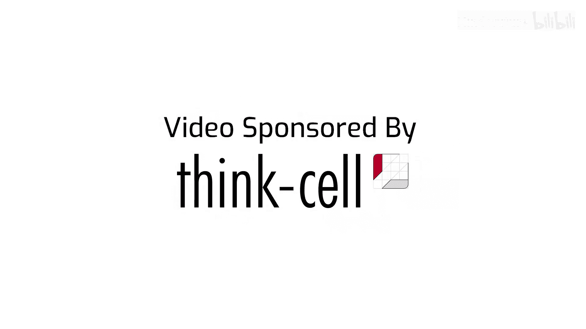
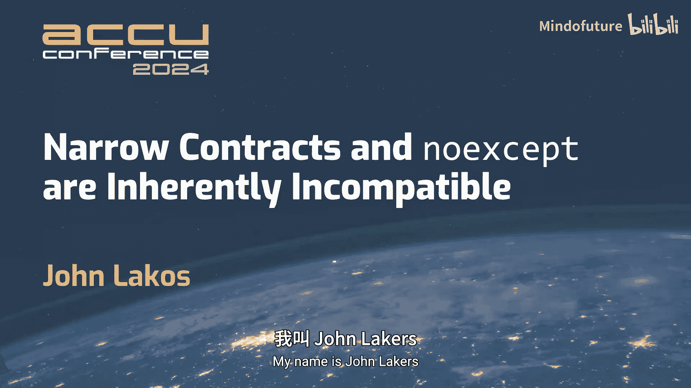
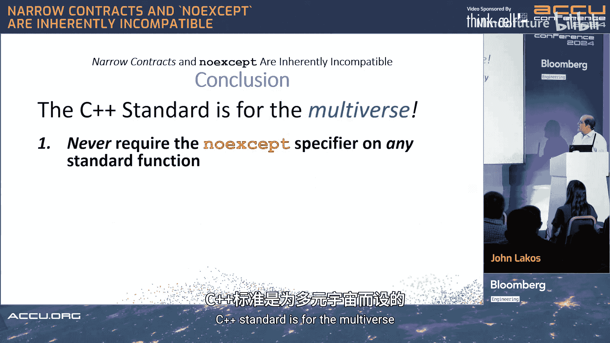

# 中英-•-C++和C语言ACCU大会2024｜人工智能｜架构｜函数编程｜静态分析｜安全｜编译器｜开发者｜垃圾回收｜链接器｜代码生成｜cmake-p09-P10-Narrow-Contracts-and-`noexcept`-are-Inherently-Incompatible-in-C++---John-La--BV1pNotYYELk_p9-

So welcome， everybody to ACCU。 My name is John Lacos。 I work at Bloomberg。

 and I am about to give this talk for the first time in a。😊。

Public setting， it was originally given in an earlier form at the C plus plus Standard Committee in a joint session between E W G and。

I think it was the library working group and I've given parts of its sense but it's very important in it was instrumental in changing some people's minds about some important things and I felt it was one of my best talks at the Standard committee the most well received even by people who don't particularly care for my opinions or what I was trying to tell them so you're about to hear something that's arguably controversial and that's good and normally I would pontificate and use up all my time showing you all my slides so this time I'm gonna to pontificate a little less and try to leave a little time at the end for us to argue I think that's important but at least you'll be informed by what I'm about to say。

So。This is the other slide。And there's something called the Laco rule。

How many people have heard of the Las rule？Oh， there's some people in front。 Yes， okay。

 So the Lagos rule was not named by me。It is de facto what it is called and it appeared in Madrid because somebody came up with this crazy operator called No except。

 and it was they came up with it in Pittsburgh in 2010 because otherwise move semantics would not work。

 So what it does is it basically allows us to decorate a move operation and say。

 we know it compile time this won't throw so you can write a better algorithm。Period。

 that's all it's good for。Until people started getting clever and noticing that their compilers produced a little bit less code。

 if you put no except on it。And， of course， if something is smaller， it must run faster。

So lo and behold。We got this myth that if I put no except on things， they'll run faster。 Well。

 on some exception mechanisms， ancient ones， that's true。 But today， that's not true。And in fact。

 the0， the zero overhead exception model， when they say0， they don't mean small。

 they mean  zero because what it comes down to is there's a point where you have to branch and you either the branch this way or this way。

 It's that kind of0。And the thing that you branch to when it's an exception is somewhere on disk and the thing that you branch to when it's not an exception is right here in cash。

 so there's no instruction， whatever， so just going to say upfront for all of you people to believe the more no accept I put on the better no。

 now that's basically the whole talk。Now， I'm going to explain why。

 but I want you to know that I came here to tell you no， except bad unless。

It makes the program faster。If it doesn't make the program faster。

Then don't do it because' it's like you don't take a medicine if it's not going to help。

It has side effects， bad okay。That's the whole talk， now。

We're going to go through the rest of it quickly so we can argue about that topic。So here we go。

 The objective of this presentation is to demonstrate that the Laoss rule。 Oh。

 I have to tell you what the Laos rule is。 The Lacos rule is。

 don't use no except on a narrow contract。 period。 Just don't do it because that's where it gets really bad。

We just don't do it， okay。Apart from move operations。

 no except is unneed in the standard library specification。

So that's not to say that implementations couldn't put it on。 That's another can of worms。

 And there's good and bad to that。So what we're going to talk about is what do we want to do for the standard library specification。

 what do we want to do for implementations of the standard library。

 what do we want to do for third party libraries and when do we want to use no except ourselves？

That's what we're going to talk about。Okay， before I start。

Half of this talk has nothing to do with exceptions。In fact， half of this talk has only to or。

 I mean， it has to do with plain language contracts。 Now。

 I will mention that if you're interested in C plus plus contracts for 26。

Our buddy tumormer over here。Is going to give you an excellent talk about all the crazy work that we've done for the past six years and then even building on work that's been done since 2012 When I first introduced macro based contracts for the standard。

 Now， I will tell you that I got all the way to the plenary。

 and then it crashed and burned because somebody heard the word macro for the first time。😊。

The next time we tried it， we got all the way to into the language。

 and then there was controversy because we wanted to try to make a change and once something's in the language。

 it's extremely hard to make a change， and it blew up。All good。

 This is all in the process of coming to something really good。 And John Spicer and Timmer Dumbler。

 the two of them together have been chairing co chairing the the the S G 21 and have done a fantastic job at stwarding a fairly motley crew of。

😊，Very bright， but not always agreeing people。And it's been interesting。 And one other side thing。

 something that came up during contracts and as a direct result of contracts is something that we've been trying to explain as principal design。

 So this is an advertisement for yet another thing。 the papers at 3004 and 3005。

 And they explain how this notion of principal design can be used for both solving engineering problems and other problems and creating policies in LwG。

 And you might look at in the say， man， this is a complex thing。 Yeah。

 but if you try to argue with 500 reflector comments， that's a complex thing too。 So at some point。

 you have to you have to sort of rip the bandit off and actually analyze it。

 But this talk is not about principal design， however。

 I think principal design is fundamental to solving really hard problems with a lot of people with strong opinions and lots of solutions。

So now we're going to talk about something that applies to all software engineering。

What is a function contract， it's a bilateral agreement。

It's typically written in a plain natural language。And it represents。

The preconditions and the essential behavior that are promised assuming the preconditions are met。

Now， I also wanted to ask a question。I'm gonna try to go through this a little faster than I normally would。

 For people who are really beginners， We could spend the entire time on the first half of the talk。

 First half of the talk is relatively easy and obvious。

 Second half of the talk is not at all easy or obvious。 In fact， when I gave it yesterday。

 I had never gone over the material since I wrote it。

 and I'm standing in front of the people at Bloomberg。 And I'm going， read the slide。

 I'm gonna have to read the slide because I can't remember why I put this here。 So last night。

 I spent about six hours reviewing those few slides that I never got to and added some more things to say。

 oh， yeah， look at that。 So the stuff is hard。But it's all true。 So when we get to that hard stuff。

 what I'm gonna do is I'm gonna say all this hard stuff is to prove to you this。

 And then if you want to take a break and look at your phone while I go through about 20 slides to prove what I just said。

 Go ahead。 But then come back right at the end where I'm gonna make the real points。

 and then we'll have time to argue， which will be a lot of fun。 Allright。

 So I'm going go through a function contract， for example， half。This is a declaration。

 and this is a contract return the value that is numerically half of the specified x value rounded towards  zero。

Here's double for a contract for double return of value whose representation is numerically as close as possible to that of the positive square root of the specified x。

 Now， here you have two English contracts。You don't know how this is implemented， doesn't matter。

 That has to be true if it doesn't do that。We have a problem。 However。

 the second one has a precondition。 It says the behavior is undefined unless 0。

 less than or equal to x。 It's not an accident that I said the behavior is undefined， unless。

If you say the behavior is defined if you're putting yourself out for risk because when you say it's undefined unless it could still be undefined for something else。

 you're just saying this is definitely bad。The other way you're saying this is definitely good。

 And almost always， you'll be wrong。 I promise you， it's very subtle， so。

Be advised that behavior is undefined unless it's purposeful and covering your， you know what。

All right， essential behavior， what is it？It must comply with expressed post conditions。

 but it involves more it involves。The result。啊。It also honors any promised behavior。 for example。

 the function implicitly runs in of one time or the function is threads safe。

 So if you don't say that a function doesn't work if if or if an object doesn't work if there are two instances of it in different threads。

 if that， for some reason wouldn't work， you don't really have to say you don't have to say it if it does work。

 you have to say it， if it doesn't work， because certain things are so wrong。

 you have to tell us if it's that broken， So certain things are implied anyway。

Implementation defined behavior。 So behavior that's not specified or strongly implied as being essential within a valid domain。

 So what's an example of that， So here we have a point and a sort and the sorts asort the specified contiguous range of point objects in nondeecreasing order of their representative X coordinate values beginning at the specified start address and extending for at least the specified length objects。

 Okay， so here we have is there any room for implementation defined behavior in that contract。

 What do you think。I see nodding heads good。 We're going to go a little quickly。 Yes。

 And here's an example。 So after we call this。Here's one possible solution。 Here's another。

So both of those are perfectly fine and complying results。 Does that make sense to everybody。 Okay。

 this is， this， I'm going to speed up from this。 It seems like people are getting it。

 If this is confusing to you， then， okay， well， you might have to go back at the video and take it slower。

 But I do want to go quickly because， as I said， I want to argue at the end。So how about this one。

 Is there any room for implementation to find behavior in half。

 Take a quick look and then give me is there somebody raise their hand if there's room。Sir room。

I see no hands。Raise your hand if there isn't room。Okay I see some out， let's see if we're right， no。

 there's no room， okay， good。How about square root function？

Is there any room for implementation to find behavior？Okay， I see someone in the back。

 His name is Kevinlyn Heny， and if he says so there must be。I said no with an asterisk。

So why do we think so， Kelin？あ自分のる。Oh， okay， what was the bet？

the expectedIt's related to the expected precision of double as numerically as close as possible。

I is potentially quite vague Okay， so the numerically a close as possible means that you have。

 you have a representation of a double their discrete。

 they're quantized and if you're on one side or the other， in other words。

 whichever number would be the closest or equally close。That's what we mean。So I'm gonna。

 what I'm going to do is possible you can be on either side of it。 There are at least in some cases。

 you will find there are two。 going to say that they're equally。There are two that are equally。

 but you'd have to prove that， and I can actually prove the opposite。Hold on。

Could return either positive or negative zero。 So you're right。 That was about。 Yes， you already won。

 You already won。But I'm to prove this's not what you think。 trust me Gu， Yeah。

 but you've not covered some of the interesting cases in double。 Okay， let me， let me get to this。

 I'll let I'll let you know， but it's going to come out。

 Never interrupt somebody while they're doing something wrong， Okay， excellent。Kvelin。

 I would admit I'm wrong in a heartbeat to you if I could possibly agree with you。All right。

 let's look at this one， notice floating long。This is a slightly different signature。

 Let's assume that a float is shorter than a double and a long。

 a long double is longer than a double。 Let's just make that assumption。 if that's true。

Then there's absolutely room because。We can prove that that's possible， and here's the proof。

So in other words， we can pick the largest Z for which they can be represented exactly and we can generate a case。

Do you see what I'm saying？Let Z squared be the largest value for which Z can be represented exactly as a float。

 can represent 9 Z squared exactly as long as double， but only 2 Z or 4 Z has a float。

 So we have an example where it's equally apart。 So if we pick the right signature， yes， but double。

 double， no。And I can prove it， I did prove it。But you were right because of the 0，9，0。

 And I got caught out。 So here's another one。 What does it do if you pass in impf。Fasing if。

 it's not specified what happens， right， And if is a number where Nan isn't。 Nan would fail。

 So it gets very complicated。 You see what I'm saying， and I've been wrong on this enough times。

 and I got called out yesterday because I not have never thought of him。 But Nan is not a problem。

 You win。 Now you win。But I just want to point out it's subtle。 It's on the edge， right。Okay。

 so observation， the declaration of the function informs the contract， which was really the point。

 And， and Kelin got to win again。Okay。More on this later。 So preconditions， what must be true。

 any inputs， any relevant objects or program state。 Otherwise。

 the behavior of invoking that function is undefined。

Unfin the behaviors behavior for which there are no requirements。 Now。

 remember that part of the contradiction that I'm going to talk about。

Is that undefined behavior has no requirements。What we don't want to do is have a domain that's not allowed。

And put requirements on it that we can't change later。 Remember that。 Okay， moving on。

Preconditions with respect to a vector。 Does the constructor of a vector have any preconditions。

 Klin， me make you go first。 Does the constructor of， of a vector have any preconditions。

 the default constructor。Not that I can think the universe works， the what the universe works。

 the universe works given that the universe is working as expected， you get it， you get it。

 I'm not gonna to pick on you anymore， but I had to give you that one because that's a good when some people say。

 well， wait a minute。 what if it allocates memory。 Let's hope big does it。Even if it did。

 it would still be defined because if it allocated memory and it couldn't， it would have to。

 It would have to throw a a a bad ac exception。 So the standard has it covered。

 There's no way that can happen。 What about the capacity of a vector。 Does it have any preconditions。

Well the answer is no， It's a constant function。 How about pushback， This is a little harder。

 Does pushback have any preconditions。What what do he thinks。

 who thinks it has a precondition and what is it？No ahead， somebody else precondition， yes。唉。

Well one precondition I can think of is if vector is at Mark' theoretical capacity。

 you cannot add another element so if vector is at the maximum theoretical capacity I'm not sure quite what that means well well I mean say vector has like consists of two elements like point or to ma and the size right and size is limited to by its type says like U in 64 so there cannot be more than I'm unfamiliar with how you can tell a vector that its maximum size is this。

Well， no， I'm not saying you can tell it them， but it's limited by its implementation。All right。

 because it has to store its size count Roman。 The vector can grow spontaneously。 Anyway。

 the answer to this question is either either the vector is going to do it or it's going to be exactly like it was because we have the property of the strong exception safety guarantee and you'll throw about Alec that's it So it's fully defined So the answer is no。

 but I wanted to just show you things are not as easy as they might seem。

 What about front frontron seccont function， right。What does Front do？Re。So。

 so it's going to return something reference to the first element。 So what's the precondition。Okay。

 so that there is a first element， So the answer is yes， what about this one， operator bracket？

Does it have any preconditions？Yes， it does。 Obviously， the index has to be less than size。

 And finally， what about my least favorite function in the world operator at。😊。

Does it have any preconditions？Anybody think it has a precondition？Okay， the answer is no。

 it's fully defined。 There's nothing。 There's no room left over。For anything you do to it。

 it will give you something。 You're out of range。 it will throw， okay。So these are wide contracts。

 Guess who named wide and narrow curious。 Does anybody know who did that。I did。Back in 2012。

 and I got told nobody's ever going to use those terms， John， nobody。嗯嗯。😊，Right。

Anybody ever heard of levelization。Guess who name that？Alright， so explicit preconditions， Ha。

 does it have any explicit preconditions。Yes， no。No， how about the。How about square root。

 Does it have any explicit preconditions， Look for color。Yes。😊，Okay。What do you think？

What can't we do here？What happens if we pass N， What would happen if we check to see if x is less than or equal to 0。

 What would happen。We return false。Interestingly， we didn't think of Nan when we wrote that。

 but it works for us because if we had said。The other way around， it's good if it's not whatever。

 then we fail。 So always write your code in the double negative。Anyway。ok。How about this。

 does this have any implicit preconditions。I won't hurt you。Yes。Can anybody guess what they are？

It's stupid and nobody would ever even talk about this， but。What if you pass an indeterminate value。

Oops can't do that。So this is bad。We don't talk about that， but it is a precondition。

 you can't do that。It's undefined behavior。 And， in fact， just the effort of trying to pass it。

 even if the function didn't use it at all。I is undefined behavior。Do we say this now？

So here are a bunch of things that I'm not gonna to even discuss。

 I'll just put them on the slide and don't do these things because they're stupid。Okay。

Implicit preconditions， not everything that we might。State has to be stated explicitly。

Arguments are to be written that are written are to be in a constructed state and read are to be an initialized state。

We know that， so we're done， we don't have to talk about that anymore。All right， declaration。

 oh okay， so next。Does the declaration affect the contract Clearly。

 when you saw the different lengths of the things， you saw that it will affect the contract， right。

 A double double square root is different from a float， long， double square root。

The declaration provides a lot of quick and handy information and that's one of the reasons why people want to put things like no except and no return and such in the signature so they can quickly glean the information The trouble is sometimes that works and sometimes that doesn't work。

 sometimes that's too much and so we're going to see how when when it's okay and when it's not。

Each parameter return type is apparent。So look at this， see all this noise that's there。

They could go away， obviously this is better。Because whatever we see in the signature， that's a fact。

That's every bit part of the contract。There's nothing wrong with writing the English contract first。

 but I always write it below the signature。 So that's the headline。

 And here's the first paragraph of the story in the article。Now， unfortunately， because of tooling。

We have to do this。And this is better for tooling。 But it。

 but you have to remember that what you're reading here logically follows the signature。 So you。

 you go down the list of， of the slash slashes and you find that that is what the slashlashes are referring to。

 So that is our new coding standard at Bloomberg。We're not。 Well， I'm not happy。

 but I have to live with things that I'm not happy with because the majority of people are happy with it。

 Oh， well。Okay， moving on。So has anybody ever heard of design by contract？Okay。

 has anybody ever heard of Liskoff substitution？Does any very， very。

 very brave person want to tell me how they're similar or different？啊ha。Good move。All right。

By the way， Wikipedia won't help you。It will lie to you。

And I'm not making this up and I have the receipts。I'll tell you later。All right。

So design by contract is a theory。That really is often applied to virtual functions。

 And it says that the derived type， the functions in the derived type should have a no。

 no narrower of。Domain and， and， and the， the range should be no wider。 right， That's the idea。

 And he said different words， but that's the idea。 Now， that as a heuristic。Is often true。

But it's categorically not true all the time。And we can easily prove it。 I could give you an analogy。

 For example， I could have something that has a narrow contract in the base class。

 The base class function F is defined only for non negative numbers。😊，And its range and。

 and the name of the function is return。 its argument。

 So the range of the function has only non negative values。 Now， I derive from it。

 a function whose domain is defined on the entire range of integers。 And hence。

 its range is defined on the entire range of integers。 that is perfectly fine。 And yet。

 some people would say， wait， that doesn't follow design by contract because the range is bigger than the domain。

And that's where things go south。I give you another example， suppose I have a base class。

 it's called car。Now， if I derive toy car from car and car can go from  zero to 60。

Toy car can't go from 0 to 60。 so people would say that's a bad design。 I tend to agree。

But in practice， we do that all the time。 And for good reason， I can derive。 race car goes 180。

 So obviously it can go 60。 No problem。But what about I derive electric car？

We have a lot of electric cars that we derive from cars。 for example。

 because I have something where it doesn't work till I open the database and read in the the data。

That's like charging an electric car。 So we find out that the。

The hierarchy isn't valid over the entire lifetime of the program。

But that's okay because there's an initialization phase where we charge the car， get the data。

 and then release the threads。And so for the preponderance of the program， it's perfectly fine。

 but it's not okay at startup。But compile time includes startup， so it's bogus。

So don't believe in this as an absolute rule。 Believe in it as something you teach high school students to think about。

Just remember that。So it turns out that if you have a deep inheritance hierarchy。

 there could be all kinds of michiga in between， but you have the calling interface。

 Let's say we have AB，C， D and E， and each one is derived from the other。 Call interface might be B。

 and the implementation might be D。 the derived D。 That's what's actually implementing B。Whatever A。

 C and E say in English doesn't matter because none of their code is incorporated。 so ignore them。😡。

And worry about the two things and then perform the checks at runtime when the call occurs。

 And that's what contracts C 26 will eventually do。

 even though I haven't yet convinced everybody in the group that that's what they'll do。

 That will be what they do， because there is no other answer。Just saying， again。

 this is prediction it's not agreed to yet。But it will happen because no other answer makes sense。

 all right， anyway。So I digress。So this is the key point。

Does anybody believe that if I derive two different classes from an abstract base class that the functions in those two must perform identically。

Must。😡，No， absolutely not。So what's that all about？Bertrand Meyer is talking， excuse me。 Yeah。

 Bertrand Meyer was talking about what's effectively about virtual functions only。

When we talk about functions that are not virtual， they follow a different rule。

And the behavior must be identical in the given domain。

So virtual functions are about variation and behavior。 Now， we normally say super set。

 but typically when you derive a class， the domain is the same unless for some reason。

 you plan to be calling that derived class directly， which case it can have a wider。

Doomain perfectly fine， and outside of the domain callable from the base class， anything goes。

So I just want to emphasize。D音。The derived class。Acts like a wide implementation from the point of view of the caller。

Just like in a conventional。Header， CPP。The header tells you what the contract is。

 and the implementation can do more。And that's fine。 There's nothing wrong if an implementation does。

Works outside of its domain。 It's just not promising you that it will。

And when it's not promising you that it will don't depend on it， even if it might save your life。

 Think of it as a circus net。And you don't know whether the net's there or not。 So act accordingly。

 But if you fall， you might live。That's how you should treat contracts。All right。

So just pointing this out in practice， it's typically the same。

 we'll talk about wide implementation shortly。No， this is a big deal。

If you're applying design by contract， you are talking about virtual functions。

You're not talking about what we call structural inheritance What can you use this for Well。

 when Strstrop teaches contracts at school， he can't use conditional compilation because that's gross right that's hard to explain in whatever and so he doesn't have a proper contracts facility So what he does is he derives a class that checks the index value's and it simply hides the other one。

I'm going to show that later。 And that， and that actually gives you a poor man's contract checking。

 but you get slicing。 In this case， we're talking about design by contract and。

What we have is we have three different shapes and the way they calculate whatever this thing number vertices is going to be different based on whatever the derived type is。

 so that simple function nu vertices will give you different values。Does that make sense？Okay。

So clearly， when somebody says。LSP， and they start talking about this stuff。

 They know not of what they speak， because this is not LSP。This is designed by contract。Very clearly。

 what's it good for？It's a good heuristic。It's for variation behavior。

 It's been known about that for a long time。 Should the contract facility naturally support this at compile time。

 And the answer is， of course not， because we have a multiverse。 The multiverse says。

 if you want to follow design by contract religiously， do it。

 But if you have a need to do something different。You're welcome to do that， too， right。

 The standard must support the multiverse。 So even if somebody wants to write really crappy code。

 and I know it's bad if they have a legacy code base that has adopted that style and they need to continue it。

We must allow them to continue it and we must make sure contracts work on it so that they can migrate their lousy code base to a better code base if we say you can't use contracts until your codebase looks like my codeb。

 we've missed the point contractss are an evolutionary tool as well as a safety tool and a correctness tool so we must always consider the multiverse。

😡，The only reason I mentioned design by contract is to juxtapose it with what I'm really talking about。

And I suggest we look at Cargill， he talked about this in the early 90s。

This is something he said many times in his book， and he was right。He said。

Inheritance is for variation in behavior and data members are for variation in value。

This cost subsutability。Now， does anybody want to tell me how risk of substitability might be a little different from design by contract。

No。😡，Allright， I'll tell you。Any object of subtype D of its supertype D can be used in any context in which B could have been used and more。

 That's the short version。Okay。😊，Behavior for D in domain of B is as if identical。Not similar。

 not does kind of the same thing。Identical， yes， identical。So if you've ever used LSP and said， well。

 the behavior is compatible， no。It's not identical。

 It doesn't satisfy the Liov substitution principle。At all。Okay。All right。

So if I have a base class and I I just derive a derived class and hide the base class functions。

 as I was talking about， as long as they do the same thing in the domain of the base class。

 there's no problem。So。If list of substitution applies to anything。

It would apply to non virtual functions， not virtual functions。I hope that's clear。Now。

I'm not making this stuff up。 as they said， I have the receipts。So here we have St Ve。

 I told you about this。 This is how Bjorn Strstrip teaches it。 and he creates a checked vector。

And he ders it。And he hides。He hides the racket operator with another racket operator that is。

 in effect， the ad operator。That's what he does。And these are non virtualr functions。

 and the check vector will catch accidental bugs。 So let's see that happen。

So this is what happens here。 What's going wrong， What's up？

Nothing because I haven't shown you the bug now ask the same question what's going to go wrong here？

I sorted it。And now I'm trying to print out the。The values。What's going to print？All right。

 I'm going to show you this， this is what prints。hy。😡，暂你放。It's undefined， absolutely。

 It's not always what prints， but it's what printed for me。 What， Why is it undefined。I right你。

All right， that。 All right， so this is out， this is undefined behavior。

And why is it undefined behavior， Because people make mistakes， I've made this mistake。

 And that's why I use the idiom for I equals 0。 I less than size plus plus I every time。

 And I never even think about changing that to a less equal unless I have five people review it。

 In any event， if I made it that。Then what happens？Well， the checked vector would do this。

So if I put in the check vector， it'll find the bug。That I can fix it。The trouble is。

 if you have something that's always checking， you're burning CPU cycles when you don't need them。

 So what you do is you use the check factor in your beta build。

And then you take it out in your production build because once the bug is fixed。

Things tend to continue to work。 This is not the best answer。

 The best answer is not to use check vector。 It's to use a standard vector whose implementation employs。

20 C plus plus 26 contracts。Then you're good。But anyway， that's the real answer。

So why do we care about lists Go substitability， And it's for the same reason we care about backward compatibility with the C+ F standard。

Right，So our goal has always been to make a correct program in C plus plus03， work in 11，11。

 working in 14，14 and 17。In that sense。The standard11 is， is listoff substitutable for03。

Does that make any sense？Means that every program that was written in 03 ostensibly will run N C plus plus 11。

 Is that true no。But that's the goal。Right。Do we agree that's the goal？Clearly， that's the goal。

In fact， in principle design， there are two principles that are right at the top。 Number one。

 when we go to a new version of the standard， we don't change the runtime behavior of defined code。

 That is a no no。Another one is， if we had defined behavior in a previous version and now we make it not compile。

That is a no no。Why， because somebody will take the new standard， be all excited。

 put it on their code base， and their perfectly good code will stop compiling。 Nowll go crap。

 We're not going to adopt this。 And then you get out of sync with the new versions and blah， blah。

 blah， blah， So these are principles are like。😊，Iperative and super high。Sometimes we have to do it。

 but we try not to if you see what I'm saying。Okay。

So what is the actual list of substitution principle。

 I'm going to rewrite it slightly and apply it to versions of a program。

 because that's the easiest way to understand it because otherwise， when we get into language。

 it gets all kind of weird。 So if for all current programs P written correctly in terms of the current version V of a library L replacing V with V plus1 of L results in no change to obable behavior for any P。

Then v plus1 is substitutable for V。Does that make sense。In other words。What we're saying is。

 if I upgrade my version and all the old programs compile and do identically the same thing。

 the same thing。Then the new version is Lisov Substitutable for the old one。

And we can do some other stuff because more things can be compiled。 Now。

 I really want you guys to understand that that's what letsco substitution is。

 And there is no room for variation in behavior， None inside the domain of the previous。

 that's what we're gonna try to learn about。 This is basic 1980s software engineering。 Nothing fancy。

 but you need to know this stuff。嗯。Question。Are you able to cite any references here where I'm not familiar with the definition。

 I have the receipts。 Yeah， well， that's not。 I have the receipts to know that I'm right。

 but I'm not going give away just yet。 Do you acknowledge that this is a very radical rewording of the concept。

 There's a 1987 paper by Barbara Liskoff in Osla。Where she says it very clearly。

Once you've read it 20 times， okay， thanks。And I did read it 20 times。But as I said。

 I have the receipts。 I will tell the story， but I want to wait for the heckling section so I can tell the story。

Thank you， okay。So we've got two kinds of listskoff， we have Macavelli Liskoff。

 which is like I'm going to figure out a way I'm going to use artificial intelligence and find a way to prove that these two things are not what you think。

 and then there's the one where we say it would be pathological for somebody to write a program in C++03 and then write another program in C++ 11 and have the meanings be different you could do it but you'd have to you'd have to work exponentially hard to do it such that it would never occur in practice。

So that's why I say there's theoretical listoff where Macchiavelli can't be。

 even Macchchiavelli can't win， and then there's practical list off where we。

 if you're a MacAavelli go away， but if you're a Murphy， we care， so if you're just incompetent， no。

 we need a competentetent。For， for us to forgive that little bit， it has to be deliberate。

 If that makes sense。 Anyway， let's take a look at this。 So here's a handle。 And I just want to say。

 here's a narrow contract。I's another narrow contract that's a little less narrow。

And here's another contract that's wide。So notice that I've just kept building on the contracts。

 kept building on them。 I haven't broken anything in the past。

 These are list of substitutable additions。Sably accumulate usage。

 so here's some usage that works for A1。 here's some usage that works for A2。

 and here's some usage that works for A3。And notice。

We're using more and this is what I added last night because I couldn't figure out what the heck I was trying to explain with this slide。

Each time we use a little bit more functionality， a little bit wider， wider contract， you see。

So take a look at this slide。 Just take for the gist of it。 You get the idea。

 Now that this doesn't mean anything。 It' is just code I wrote。 The point is。

 those red things use more and more of the functionality of the handler as it evolves over time。

This is software engineering。 This is what we do。 This is list of substitution。

 It is not designed by contract。Thank。Now， we've got this wonderful， no return attribute。

 Does the no return attribute affect the type of the function。No。

So I'm going going to do the same thing。Look what we've got here。

I can't put no return because in this third one， I decided I wanted to return。Okay。

 so I have to take the no return out。 Now， no return is an optimization。

 No return doesn't have any effect。On how people can query the code， you can't really ask the thing。

 does this thing never return in code， You can't ask that question。😡，That's great。

 So this acts as in。As an optimization hint， that's all it is。 So we take it out。

 It's just an optimization hint。And you can see we stably accumulate things。Wish we could do this。

 We can't。 But if we could do that， that would be even better and say。

 I'm using this handler in a no return context。I'm using this handler in no return context。

I'm using this handler in a return context。And there we go。 I added this yesterday， too。

 so I could explain it。This is where it gets hard。 So if you guys are finding this hard。

 I found it hard yesterday， too。 I was also jet lag。

 I also lost my bag for four days and had to go out the day before and replace all my medicine。

 And never mind。But anyway， this is stressful。Losing your stuff。Now consider these two contracts。

Which is Muskov substitutable for the other。This is not a trick question。

Which one is Liskovv substitutable for the other？You said neither， that would be a trick question。

One of them is， is it the first one or the second one that's substitutable for the other。Gay。

The answer is this， because the only thing that this gives you is the potential for slightly better codegen。

That's it。Any questions on that， yes？为什么。Yeah。It's written。 It's part of the contract。

 Nothing new here。There's nothing to see here。 They're the same function。

 One is optimized slightly for people who can't see the implement implementation。

 If The compiler could see the implementation of this could write exactly the same code。

 This is for another translation unit。 It is only an optimization hint。Okay， okay。

 I just want to be sure everybody， I had to pick on you。 And I't wantan to thank you。 And I would。

 of course， be happy to buy your drink afterwards for being a plant in the audience。😊， I need the。

 I need the heckling。 I miss it。I really do。 I miss it terribly。啊。

I want you to got a little fix from Kevinly， so I'm feeling better。Slightly better code Jen。So。

Ilied contracts of an implementation。Conforming implementation of a public contract。

 These are things we're going to talk about， wide implementation。ok。So。Let's talk about these things。

What's the implied contract of an implementation。Basically。

 what it's saying is I look at the implementation， figure out what it would guarantee and then just write it。

 We don't do that。Here's the implementation， what's the implied contract。Okay。

 here's an implementation。 What's the implied contract。You get the idea， right， You look at the imp。

 You write some stuff down。Depending on the implementation， you write some other stuff down。

It's not how we code， we go the other way， just in case anybody cares。ok。What next did I need to do。

 Conforming implementation of an interface。 What does that mean。

 The implementation implements the interface， Anything that can go into the interface。

Implementation will take care of。So I'll put that out there， you can read it。

 while I take a break and have some water。Does anybody have any questions about this straightforward stuff？

This is the slight low before it gets really bad。Okay。Is this a conforming implementation。

 I know Kelin wants to comment on this one。I know he does。 They'll look at it and go。

 but you can say， is that a conforming implementation？Thank you。Why not？Overflow， overflow。

Absolutely。Many people will write this， wouldn't it be great？Great， if C plus plus 29。

Had built into the language。A way to check at runtime。That this overflows。

Maybe based on contracts in the language。Yeah， that would be a good idea。

Maybe we could turn that on with something called a label。

That's known and published for everybody so that anybody who wanted to check that in their code in their legacy code without doing a stitch of work。

 but simply recompiling their code with a different label set could know that they have integer overflow in their programs。

 Why don't we do that， Timber， why don't we do that。

 Why don't we go ahead and put contracts in the language。

 And will would you chair that and make that happen。So that we can catch this overflow。

How about this？Yes， okay。How about this？Is this conforming？In。What is it depends on the rounding。

How about it's incorrect for A greater than B。Just yours yours is a good point， we'll get to yours。

 how about this？It's hard。I had to write a serious test driver that looks at the low range。

 the overlap range of from -2 to plus 2 and the high range up to whatever。

 and make sure that it worked for each and every one of those。 And then I was sure， but only then。

But then again， I've been doing this for a few years。 So， yeah， that works quickly。 Is this right。

 Yes or no。Yes， how about this one？Yes。How about this one？So just because it exists in the library。

 if you don't read the contract， you might not be successful。 So keep this in mind。

 it's good to reuse， but you have to R T FM， which means read the manual。ok。I had some fun。

What's a wide implementation of a narrow contract？So。White implementation says。

 I've satisfied the contract and if we were to extend the contract in a future version of the language。

 I'd satisfy that too。Maybebe。So you can have a white contract that anticipates。A future change。

And you can use contracts to ease yourself into those things， like you could。

Either narrow or widen a contract by putting an affirmative。

 you can't drive this car faster than 80 miles an hour today。

 but I'm going to warn you that in a little while you can't drive it faster than 60 so we can start implementing more efficient cars in derived types。

Think about it， contracts can be used wonderfully for evolving code。

 and that's one of the uses one of our good friends， Vla has been using it for。

 and it's an important feature and we can't restrict contracts in a way that follow just one person's use case。

Okay。What do you think？Yes。It is。What about this one。This is the old， by the way。

 this is the old bracket notation for C plus plus 20 contracts。 It doesn't look like this。

 but I left it in because it， it's really clear what's going on there。Is that why It's just the same。

And by the way， standard library functions， if you call a standard library function out of contract。

 which means you violate a precondition， doesn't have to call it。

 It can actually assume that the this will never be called and optimize your code。

 do time travel and cause bad things to happen。 General speaking， nobody cares about that。

 We do that all the time。 And it's fine。 But as soon as somebody started saying， wait。

 you're gonna to put that on a user function。 Oh my God。 and hair is on fire。

Well you don't do that to start。 You start out with using check contracts that enforce。 Actually。

 you start out with observe。 if you're putting into old code， then you find out everything's working。

 and then you put it to enforce。And then after that， you put it down to ignore because it's working。

 And then finally， you can say assume and actually get a speed up from contracts。 That's not in 26。

 but it should be。 We also have something called a optimization barrier。

 And once we have the optimization barrier， all the people that are scared to death that the user code will be eaten by by time travel will be able to relax。

 So there's that。All right。Anyway。So here's another one。And here's another one。

 just to give you an idea。 There are many different possible conforming wide implementations。

 What's nice is as long as it satisfies the requirements， you can widen it any way you want to。

 And that's the beautiful thing about having narrow contracts。😊。

You can wait until the later release to widen them when you know what that should be。

 One of the principles that we have that we identified in contracts is if we get to a point where we agree on and then we want to go further and half the people in the room insist it must be this way and half the people in the room insist it must be this way。

 We stop here and say it's ill for this release and will argue about it later once we have more information And this principle has proven to take the hardest problems。

And get the MVP out the door， because if we didn't have that， we would be stuck in the water。Right。

 Timmer。Right Tim， okay。Remember， Timma is going to talk about this stuff for C+ plus 26 right after this talk。

 So now that you have all the background and you understand how we made some of these decisions。

 you can actually hear what those decisions are。 So I strongly recommend you stay for the talk after this。

 okay。So， again， this is the contract attribute notation。 And I think my previous notation was wrong。

 But don't worry about that。 It's no longer in this。 I put this slide in yesterday。Not this one。

 This is the what's new in contracts， which is you can put the notation on the the signature。

 the function。 And contrary to what people might think that， oh， yes。

 we can just use the same old contracts in different ways。 No。

 these contracts allow for the multiverse to work。 because there are many different ways you can deal with a contract violation。

 And we'll talk about those more in a little while。 And why it is。

 we might need to recover in different ways。 And why we might not want to recover it all and get the heck out immediately。

 All of them are valid。So。Yes。And this is what it would look like。

 Is this the right notation for today。Okay， this is what it looks like today。

 So I just wanted to show you。 I put that in yesterday。 too。 It's a good thing I looked at my code。

 So this is what it would look like today in C plus plus 26。 I think everybody can read。

 It's very easy to write。 doesnn't look like alien C plus plus just stuff。 However， this code。😊。

Is not the same as other code。 That code in green isn't there。 And if you're calling this function。

 you don't， you don't have to look at that because you know from the contract that I better not call this thing。

This is their。To check。That the contract is correct。

 So all of the things you can put here are a subset。

 typicallyically a proper subset of the contract itself。 The contract governs。

The no except specifier， that's part of this talk。So we're。I need to go a little quicker。

 We need to ensure that the function does not throw。

 that's what that's what this or ensures that the function doesn't throw。

 It often connotes that the function doesn't fail either。 But that's a separate topic。

 And a can of worms I don't want to get into。 I will mention that in effect。

What is it called can't you remember the name of my book？What is it moderndern C plus plus。

 What's the first one。The name embracing。 Thank you。 Oh， my heads full。

 So in embracing modern C plus flow safely， we have three chapters。

 the no accept specifier is a chapterpt 3 feature， which means it's unsafe。 And by unsafe， I mean。

 if you don't know when and how to use it。 You're more likely to hurt yourself than help yourself。

 However， the no accept operator as a Chapt 2 feature。

 you should know how to use that and you should use it where it's appropriate。

 But you should know how to use it。 Sorry。That's a little scary。 By the way， the。

 the no except operator。😰，Not the specifier works on just the compile time properties of it。

 and it's an expression。And that's the specifier。 And I just want to make sure that we understand that this is an unevaluated opera just like size of what's important。

 And by the way， this is a common mistake。 Don't try to ask the function if it's no except。

 Ask if the invocation of the function is no accept。Just remember that that's a common mistake。Okay。

 so I'm putting this up up there to give you some context and。The argument values are irrelevant。

 okay。This is the implementation。And this is the implied contract。

Now notice that that's the implementation， that's the implied contract。Now， notice this。

Implementation and implied contract。Now we're going to add no except。I added that arrow last night。

Because they didn't know why I was doing this twice。Look。Life is good。

This is the part where we make the。The point。What？😮，Something changed。

We added no acceptance and something changed。Well， these are inherently incompatible。

 So if we have a wide interface and we're trying to catch a bug outside of of the prescribed interface。

 the no accept operator will kill us dead if we're trying to return if we're trying to throw throw an exception。

 Timor asked me to explain at this point。Why do we want to throw？From a function。Well。

When you find a bug？You have to do something。Depending on who you are。

 you'll want to do different things。So the first and easiest one is I'm working in a game or I'm working on a desktop publishing where I save my stuff every three seconds。

 And the worst thing that can happen is I， I stop working。 I just quit。 That's the worst thing。

 So what typically happens in those applications is people。嗯。They log it。

 They might tell the customer they might not。 They might phone home and say。

 we got to do something about this。 And then they continue。 That's， that's one。

 We have that in C plus plus 26。 That's called observe。Then we have another one called enforce。

 This is typically what we like to do in financial applications where it's not。

 it's not safety critical， but we， we really don't want to continue because we like to not lose the farm。

 and it certainly happened that we've lost the farm by continuing in the past night capital。

 And so what we do is we want to shut down gracefully。 We want to close the databases。

 We possibly want to save the client's work。But we don't want to continue along the way we would with a video game and whatever。

So， there。If we're going to do anything。We can either do it in the handler and get out， or。

Maybe we want to throw a logic error or the equivalent。And shut down and get out。

 Or we're in a framework。Well， we decide we have to throw out this entire computation。

 But other than that， it's okay。 Now， keep in mind that because we have contract checks。

 there's a really good chance that no language undefined behavior has occurred yet。

 doesn't mean it hasn't， but a very heavily annotated contract checked environment will give you a high probability that I caught it at the interface before any damage was done。

 We know this。 we've been doing this at Bloomberg for 20 years，20 years。Almost the same thing。

 we know this so。Trust me。This is a valid use case。 Thring in production is a valid use case。

But you know why we must have it because all code deserves to be tested， all of it。

 including negative tests， which check to see that your contract checks are exactly aligned with the boundaries they're supposed to be in。

 So we test all our code and then we put in a throwing test handler and we call it just out of contract in all the different ways you know how to do that and we expect to throw And if it gets intercepted by a no except Specifier。

 it crashes。 And so nobody can do anything about this other than death tests。

 death tests are very expensive and require specific platforms。 they're not portable。

 and they're certainly not conducive to getting the great majority of novices。To do testing。

For very good reasons all around。My entire industry and everybody's negative testing。

 We need throwing handlers。 Some people are very scared of throwing handlers。 Oh my goodness。

 if we have a throwing handler， then maybe I'll build my program with a throwing handle。

 even though I'm not prepared for a throwing handler。No， it's not the default。 You have to go out。

 buy the gun， Bu the bullets， put the bullets in the gun and shoot yourself。 No， just don't do it。

Right now， if it happened in your program。It would be undefined behavior anyway。

 The only way that would ever be called is if you have a bug in your program。

So if you'd rather have undefined behavior， than have the thing。

Throw an exception that's not prepared for。That's， that's your choice。 But you have a choice。

 You have a choice not to do it。 So it's not， it's not a reason。

 So I'm now given you that the third thing you can do besides all of those is if you're in a safety critical system。

 you don't want to call a handler。 Don't want to do anything you want to trap and get out。

 That's the behavior you probably want。 And for those people that feel that any doing anything but just getting out is the right answer。

 They should deliberately set the nondefault behavior to trap。

 And so that's the answer for everybody。Who needs that， just get out， that's it。You can have that。

 I just want to say that everybody's needs are met。 Everybody's。 And that's the most important thing。

 Don't stop somebody else from doing what they need to do and don't try to write a feature that stops good use of it in an effort to stop all bad use of it。

 That comes from the book from Stpp It's right there。In the book， the evolutions book。

 the evolution of C++。ok。Gosh， I want people to argue and I'm not quite there yet， All right。

 I'm going to try to hurry up。So let me show you list of substitute。

 But this is the part of the thing。 By the way， I'm gonna go through this quickly。

 This is the part where you can come back and look at this on the slide if you don't quite get it。

 But the message I'm telling you is when you put no accept in， you hide bugs。

 you change the behavior。 No except is part of the type system。

 no except actually tells the no accept operator something different。

 So when you put no accept on code， the code isn't the same anymore because anybody branching on no except will execute different code So you can't put no accept in and take it out with a pound If I can't do that。

It's not happening to me。 People tried to do that。 That was a very serious bug。 So dont。

 you can't work around this。 iss what I'm saying。 And when I say you can't work around it。

 you actually can。 But I'm not going to tell you how because that's C plus plus 29， but you can。

 but we're not gonna talk about it。啊。So anyway， let me just put this all up here。

 It's very similar to something you've seen before。And this is how we normally write。 You see。

 we go through and we write successive things， right， And it's all fine。 And here's the same。

 same deal as last time。 Everything's the same。 I'm just using more and more。😊。

Now I'm going to put no except on。Everything's good until here。What happened？

So I put no accept on and I change the behavior， I can't put no except on this。

If I put it on a front， I couldn't get to here。 So it's an incompatibility。

 We don't want that for design， software design's sake。And for testing。Also。

 the standard is a way to teach people how to write good code， we're going to say in C++ will do it。

 but you can't do it， what new。So which is this of substitute for there。

 Who's the gentleman that said for the other one neither。What about this one？That's fine。

 Are you paying attention now， is， What about this one。The answer is。Latertter。And this is because。

It affects the type system。So as I said， I want people to be able to argue about this。

 so I'm going to go through it quickly， but I'm just going to show you that a checked vector and a checked vector with no exception aren't the same thing when somebody tries to write code that does a little extra checking in the implementation。

So I just showed you how with the changes。 Now I'm going to write this generic code。

Iing some generic code here。And I want you to see that I made that same stupid mistake。

 My dad used to say that。 You made the same stupid mistake。And。Let's see what happens。

So here we're going to see what happens when we do the check vector and look， it's great。

 Now we're going to see what happens when we do it with the check vector with no exception。😊。

What happens？咩。Which do we like better， One of them we can actually do something with the other one is our program blows up。

So Bjorn Strewstrip has said many times that he， he likes the idea of being able to have a throwing handler in contracts so he could actually recover。

 But if everybody uses no except， he can't do that。 So his universe is ruined because other people。

Are trying to tell people that you can't have what you want because I'm concerned that I might accidentally put a throwing handler in my program。

 I have no sympathy for them。 They need to not do that。But don't tell other people what to do。

Because other people have real needs。And have've been doing it for 20 years， yes。

That code you showed earlier decorated with no exception。 outside the body， you had a throw。Yeah。

 that code you showed earlier where a function was decorated with no except and inside the body you had a throw。

 why doesn't the compiler give a compilation error？Because it's perfectly well defined behavior。 But。

 but is it because it's perfectly well defined behavior to throw inside a no except function。

 perfectly defined。 You don't know if the throw is gonna happen or not。

 And if the throw happens at runtime， if it does。Then it's termination。

 It's not undefined behavior at all。 It's well defined behavior。Okay，100%。

That was defined in Pittsburgh In 2010。 I was there。 I watched the the video。 I did。Promise。Sure。

Qu comment， statically proving whether the function will actually throw is like a solving de haltting problem。

 you can't do it。In general， in general， No， no， but， but Andrew， there's one more thing。

Another principle of software design， principle design。

Don't write code where the more time somebody spends on it。

 they can make a program that might have undefined behavior illform。 Don't do that。

 because that means that you might have something compile on one compiler。

 and then be and then do something and then on some other compiler， it doesn't compile。

 And now you get that kind of thing where where where program is import by by dint if it's not ability not to compile。

 So if you need in the standard to say is you have to do this much work to find out if it's ill formed。

 And that's it。 Otherwise it's ifF NDR。 you must do that。 Otherwise， it doesn't work。

 So trust me on this one。 it was thought about This is well definedfin。

 And that's why now that it's well defined。 We can't undo it。

 There's even talk of thinking of making it what's called erroneous behavior。 That's another topic。

 another good thing that came out of principle design。

 leave that alone because I can need to get through this， but。Yeah， all right。 So anyway。

Where are we so we'll fix this。And now that won't happen anymore。

But the whole point of this is if we have no except in there and we try to catch a bug。And， and。

 and just shut down the program and come back and fix it like even tomorrow， we can't do that。

 So you've deprived the industry， the financial industry。Of something they need。

 because some people are concerned that they themselves might mistakenly。Install a throwing handler。

 I don't think so。So that's just a bad idea。 And we have to get past that。

 And it's my job when we go back to E W G to convince all of those skeptics that， no， you can。

 you're an adult， you don't have to install that handler。 You don't， but other people do。

So I just want everybody to see。This is distinct essential behavior。 And that's the point。

 It's not substitutable。At all。😡，O。So。Backwards， compatibility is subjective。 Pu risk of， you know。

 that's。Theoretical applied listskoff is really good。 That's perfectly good。

 The next one is backward compatible， and that's good enough for the standards Committee。😊。

Then there's income battle that's not good enough for anybody。It's okay， these are the。

Kinds of things， for example， when the for loop back when C plus+ was standardized， the we， we。

 we didn't allow the the int in a for loop， the type and the for loop to persist on。

 that was painful for two years。 Imagine if we had to do that today。 Oh my God。All right。

So look at these two。Which one is backward compatible with the other？In the standard sense。

 And since we're shorter on time， I'm going to tell you。

 this one's backward compatible for a couple of reasons。All it does。

Is it gives you slightly better code gen with respect to size， not with respect to speed。

 It's very important size， not speed。And。Nobody cares because nobody looks at the no accept operator unless it's a move。

 Why would you ever use the no with the no accept， Why would you ever use the no accept operator unless you cared because you wanted to lay down a faster algorithm at compile time。

 The answer is， you wouldn't use it。 So if you don't use it。

 it doesn't matter whether it's no except， which is one of the reasons why we've proposed throws nothing as an attribute similar to no return where you get all of the code Gen benefit。

Same， everything's the same， but you can't query it。

 which means if it turns out you want to widen it later and sacrifice the code Gen ability for the widening you can。

 This is the answer to this。Infinite。Pain。You just put the。You put the the attribute on。

 replace no except because you don't need the power of no except and no except stands in your way。

 Then if you choose to remove it， there's no， there's no change in in semantics。

 It's just an optimization。ok。😊，All right。In an effort to have this argument。

 which I'm desperately trying to do。I'm just going to put this up again。

 move operations only is where we need it at the end。 Why do we need no except。 Okay。

 so this is the reason。 This is why we need no except。

 Here's a really good use case a really good use case is you've got you've got something that throws and you've got a system that doesn't care if it throws。

 and you want the system to run fast because it's doing back back office calculations。

 And if if the thing is not written right， you want it to throw and crash。

 you don't want it to continue in a slow mode。 people want that。 And that's why in C plus plus 17。

 you can override the no accept specification on defaulted member functions and it listens to you and that's how you write rappers why you have to write them by him。

 And the third one is for frameworks like send a receiver。they。

 if you pass in a primary function that's no exception。

 you don't have to worry about what happens with the。

 with with the with the throwing the third throwing arm。 and I don't think I buy it。

 enforce explicit documentation。 I like explicit documentation with the throws nothing。Attribute。

 I don't like it with no except because it does too much harm。 It's like methadone versus heroin。

 you know。Anyway。Reduce object code size。 Why， unless you're on an embedded machine or something why。

 and if you are， then why are you using exceptions at all， turn them off。

 you'll get the most no except possible， you can。 So I don't buy E。 And the last one is F。

 If you're trying to make code faster by putting no except on it， you can stop， it doesn't work。

 And by design on modern platforms。 If you're on a win 32 platform， knock yourself out。 All right。

 trouble with no except。 adding no except can be problematic because of accidental termination。

 This is what's making streett very uncomfortable。 He sees so much no except out there for no reason。

😡，So we need to stop doing that。Incompatibility with narrow contracts。 This is the La Coast rule。

 If you have a narrow contract and you want to widen it by putting on。Checks， guardrails。

 What no except will do is it will cause your program to terminate is bad， really bad。

 So the lake is rule， for whatever reason， came into existence。

The paper for myself and Aister in 2011。 And we spent the entire time in Madrid using it to normalize C plus plus。

 So at least narrow contracts didn't have no， except on them。 Now。

 there's a movement for whatever reason to make no except on every contract that doesn't throw in contract today。

 That is poor software engineering period。So this is sort of the， the key point of the talk。

 And we are going to have at least 10 minutes to。Negotiate。So we have a standard specification。 Now。

 minimal noise accept means on move constructors。Maximmal no accept means on everything they could possibly take a no accept。

 It doesn't It doesn't say throw in， you know， doesn't say throw。 It's no exception。

Then we have this one minimal。But it's checked。 That means we have very few no exceptions。

 And we're very when we're checked all over the place。 We check everything that we can check。

 And here we have no except， and we check everything。So here are four possible choices。

 and different people will implement their standard differently Right now， what we have， I believe。

 is we have people that do this。And I think some people might even do this。

But what we want to do is we want to have this。 We want to have that be an option。

 And if you put no except everywhere， this ceases to be an option。

 You put it in the standard because right now， we allow you to strengthen。

Something to add no except where it isn't。 And although that's not a good idea。

 And it actually changes the meaning of the function。Since nobody asked the question。

It's effectively in practice moot。So here we go， these functions。If they're called out of contract。

They're checked。So why is this not going？There we go。If we do that。We lose these。

 If we actually put the maximal stuff in the standard， we lose those two， and sadly。

This is the goal for moving forward in C++， so we have to be very careful not to put more no accepts in the standard and in fact。

 I think the goal should be to have them only in the minimal case。

 remember that every vendor out there can still add them so it's not an implication for existing。

Compilrs， it is an allowance for new compilers。Okay。😊，So these are things。That we might want to do。

 All of these things are possible things we want to do。And we don't want to preclude any of them。

And yet。No except is getting in our way。Things would be different。

These are all the things we want to do。 This is the multiverse。 So we need to support the multiverse。

 So the conclusion， Barbara Lisk is a rock star， number one。Thisis of subsitability is the goal。

This guuff sub suitability implies backward compatibility， but not vice versa。

C plus standard is for the multiverse。 I'll put this in。

You can read this， and I'll now tell you the story。 So Uncle Bob。Martin， I had a。

Seerries of articles with him。 And recently， I asked him to come and recently 200。5。😊。

And he came and he gave a talk。 He was hiliious。 And we had a discussion about LSP。

 And he told me that no， LSP。 the behavior doesn't have to be the same。 It just has to be compatible。

 I'm like， no， yeah， So anyway， that went on。 And then that was the year that I had Alexander stepping off。

Come and give his last talk at Bloomberg。 So to outdo that would be hard。 Gu who I got。

Barbara Liskoff。So I bought her some play tickets， First row center。 And she came and talked。

 and I got her 1987 and distributed 400 copies all over creation。 She was， where' didd you get this。

Anyway， then I took her out to dinner with her husband。 and I said to her。

Would you mind signing this program for my daughter， Sarah， And she said， sure， I said。

 would you be so kind to sign a one for me， John Lakekos， okay。One more。

Would you be so kind as to sign this， Yes， to whom Uncle Bob， What do you want me to say。

 John was right。 So if anybody had ever seen Woody Allen， anybody's ever seen Woody Allen's movie。

 any Hall when Marshall McChan was hiding in the wings。 And this guy from Columbia。

 I happened to be an adjunct professor Columbia in my life。

 And this adjunct professor from Columbia started talking to Diane Keaton and saying all kinds of crap that wasn't true。

 And and Woody Allen comes off and says， you know， he doesn't know what he's talking me。

 He's an idiot。 Whatever， let me grabs Marshall McCune。

 Marshall McPoon comes on and goes you're an idiot。 you don't know what you're talking about。

 You shouldn't be teaching at Columbia。So anyway， that was my Woody Elen moment because I got that program。

 I sent to Uncle Bob Martin。 And his response was， I've been poned。

 So if anybody thinks that Barbara Liskoff thinks differently， than I just told you， not so。

 I have the receipts。😊，And with that。I will take questions and arguments。

