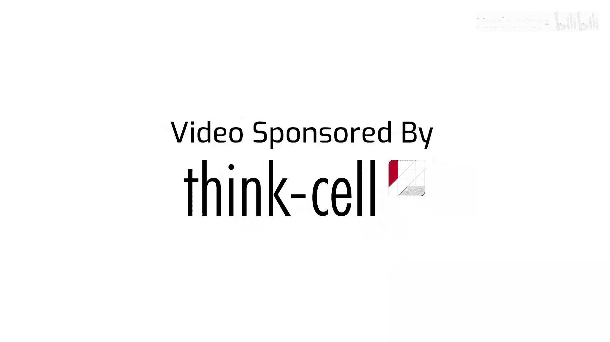
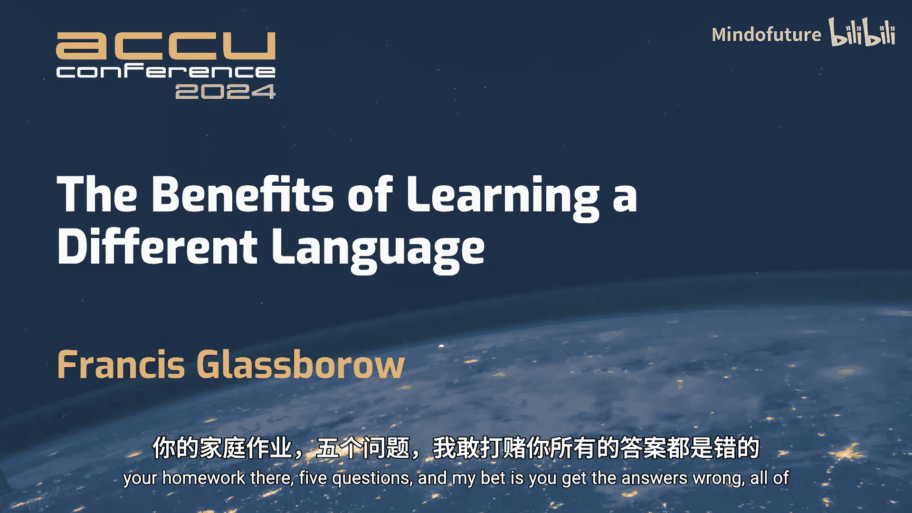
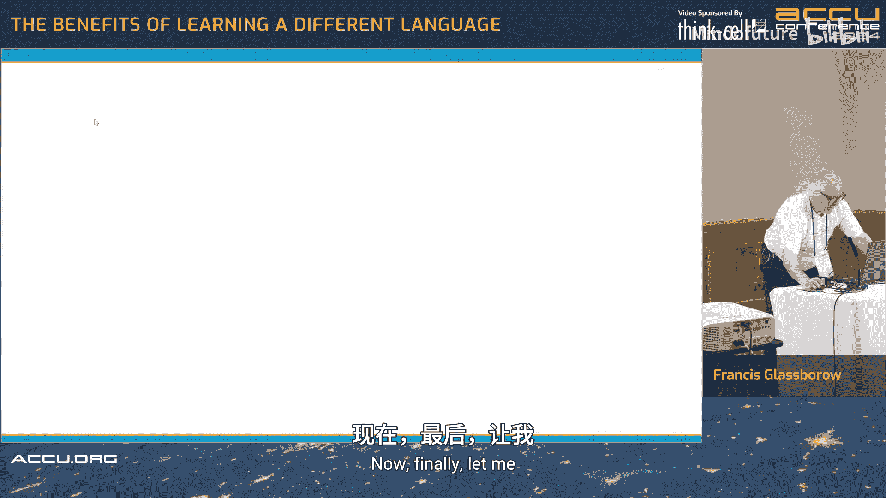
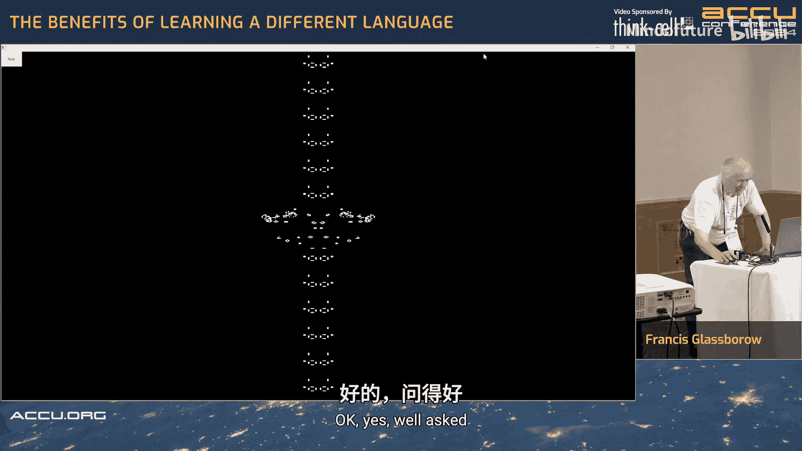
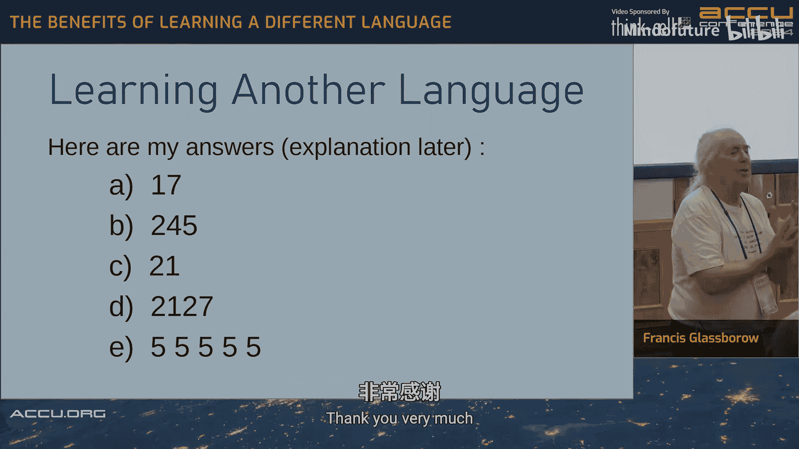
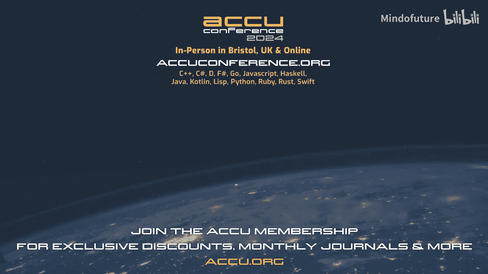

# 中英-•-C++和C语言ACCU大会2024｜人工智能｜架构｜函数编程｜静态分析｜安全｜编译器｜开发者｜垃圾回收｜链接器｜代码生成｜cmake-p10-P12-The-Benefits-of-Learning-a-Different-Programming-Language---Francis-Glassbor--BV1pNotYYELk_p10-

在是 homework诶。Five questions and my bet is you get the answers wrong， all of them。😡。

Because， of course， there is information I've got， you haven't。还是这个。What。

Presidentence of operations matters。 Yes， but that's not all。

The operators aren't what they seem to be。This is just sort taster in actual fact。

 It's the end before we start。I think there more that coming up to start time。

 So just let me give you a quick view of the answers。And then we'll get on with the talk itself。

And anybody who got the last one， right。Shouldn't be here。 They already know too much。Okay。

I think I'm about ready to start now。Interesting question。Why would one want to learn a new language？

😡，And notice， I didn't say a new computer language， a new language。Well。

Perhaps you just need it for work， you know， if you're going to go and work in Japan。

 it's probably a fairly good idea to learn some Japanese。You may think you can pify it without。

 but it's probably a good idea。It may be just fun。I had a great aunt who was teaching herself Russian at the age of 83。

No other purpose than just fun。😡，So。That's one possibility。You want to improve your skills。

Not necessarily just。Computing skills。 But you want to improve your skills。Quite important。😮。

And if you're going to go on the job market， of course， it may be fairly vital。

Improve your problem solving。How do you look at things。That's actually quite important。

I am amazed at how bad some people's problem solving is。On the other hand。

 I'm amazed how good some peoples are。Or something else。还是嗯。

People do things for all sorts of reasons。I'll give you something else at this case。

Where did this talk start， This talk started。With a column our Russian seaview。In which I。

在 hunger challenge to people。And I thought， I'd have a bit of fun this time。

Let's give the homework challenge to chat GT。And what's more？

Let's ask it to do it in some arcane language that I know nothing about。

So I asked you to do the challenge in APL。And it produced a program。Thats sort of looked like。哎辟要。

Does she work， I don't know。I hadn't got an APL interpreter or compiler。

So also entrepreneur the that。And I found。An APO。Compilr produced by a company called dialogue。

Commercial compile， which they would give a license to anybody who just wanted to use it for non commercial reasons。

Fuol license。Full support。 Am support。Fu documentation。So that started me off。

 So my something else was I wanted to discover whether chat GT。Ha got it right or not。

And it won't be any surprise to you know that it hasn。Its program was complete rubbish。So。

Before we get on to computing languages， let's look at some of the human languages that I have interacted with。

Choose that word because don't go away and think， I can speak all those languages。The first four。

Arabic， Italian， French and Latin。 I was having to learn at the age of nine。Why， because I went to a。

Large boys。Mision school。In costume。And they used three teaching languages。

Arabic for the Arabic speakers。Native language of the country。Italian for the commercial classes。

Because it was the commercial language of the country。

 I have no idea why I telling him what the commercial language， but it was。

And English for everybody else。And during my entire time there。In a school of 2000 pupils。

 there were never more than six native English speakers。I know what it's like to be in a minority。

And if， whichever language you were being taught in， you had to do the other two。嗯，是。

Second and third languages。My Arabic was once described by a teacher as sounding like the last gaspas of the dying man。

However， I did remember not Arabic so that many years later， as a young teacher。

Having to interview a Syrian student。Do discover what level of mass。I couldn't speak any English。

That I managed to。With diagrams， geometry and all the rest of it and knowing how the Arabic new rooms actually work in Arabic rather than in Europe。

Allowed me to interact with that student and assess their mathematical level。French and Russian。

What I was being prepared to go back to a。Pp school。In England when I was 11。

So I was only French from my mother。Who was a fluent French speaker and Latin。For our private tutor。

Let's move on to the languages individually， because each one of them taught me something。

Arabic taught me。The difficulties of pronunciation。啊。

If you want to test on Arab's fluency in in European languages。Ask him to say。Ataea Park station。

He wealth't manage。Because Arabic is a language in which there are only two kinds of syllables。

Conssonant vow。And constant foul conflict。纳收。You cannot have two adjacent consonants。

It doesn't have a letter。 the letters B and P。I just unified like the letters A and I were unified in。

The far east。2 singles sound。So Arabic taught me。Problems of pronunciation。

And some things that I have never mastered。How do you distinguish in a glal stop？Gloel stop。

 Any know what a Gotel stop is。Cockney English B， the gap in there is a go stop。😡，The short is。

 is that Arabic allows a glass stop to be the first consonant。Of a word。Worse。

 it's got a semi gl of stop。I doubt that I could tell the difference。Between a and semi。They can。

Anyway， so Arabic taught me this thing about。The ennunciation of languages。

And the possible confusion。It also taught me another thing。It's not an indo Europeanopan language。

It's a semitic language。Like Hebrew。And that has a lot of consequences。

And one of them is that the consonants carry the meaning。The ball is just qualified。

That's why they leave the our most of the time。您是新爱这。Moving on， Italian， you know。啊か。发告声欧 your唱人。

Even。5 or six years later， when I was in holiday in Italy。No hard left。So what does Italian teach me。

Well。It's very easy to forget a language if you don't have any motive for remembering it。French。

Curious。People are think of French as being just a sort of another sort of English。Well。

It's interesting because French and English are both indo European languages。

They have a similar sort of general structure。 until you realize that in English， simple sentence。

Is subject verb or subject verb object。And in French。The ver comes through。The simple sentence。

Subject， object and verb that gives you， in fact， if you think about it， six different orderings。

And to my amazement。There is a language somewhere in the world， which uses each。Of those ordering。

But our languages it to put the verb first。Through are languages that put the object first。So anyway。

French。French。Talaught me something many years later is that in extremism， when you are desperate。

 your memory can be your saviour。I was in Belgium。Went for a walk from the hotel。

I had a plane tocapsulate it that day。And got lost。In a French speaking city。

With these proud Belgians who wouldn't possibly admit to being able to speak English。

And I managed to rescue enough of my school friends to actually hold a conversation asking for help and guidance to the hotel。

So I did catch the plane all right。Washington。Well。The thing I I noticeds about Latin。

Is there an whole lot of words for battles。And fighting。And by contrast， going back in Arabic。

 there are an awful lot of words for gardens。Arabic has at least seven words for gardens。

 one of them specifically the Garden of Eden。And this is an interesting thing that some languages seem to have some focus。

 Now， it may be that the Latin is because the surviving works。

 which were taught in school or things like。Caesars book。It's flious。Episodes。Tsco Greek。

I think I was。I was 12 when I was exposed to classical Greek。And there's an interesting thing。

 You have a language which actually doesn't have singular and plural， but has a jewel in the middle。

You had a language which was written in a different alphabet。 Well， that was true of Arabic as well。

啊。I don't know much about my classical Greek。 I managed to forget most of it。嗯。But。Chinese。No。

 I never learned Chinese。But I needed to be able to read Chinese characters。Because two of my hands。

 my major sport when I was at university was Judo。And my major intellectual game is go。Both of them。

Japanese based these days go as Chinese in the origin。And all the authoritative texts。In。

For Go at was how I was learning it were in Japanese and Japanese rights， largely in Chinese script。

Now。The problems that would be presented were fine because it would be a go board and the moves would be numbered in surprisingly。

European numbers were not Japanese numbers。 I don't know why， but they they were。

But it's rather important when you got up a thing which is a problem to solve。

Because you should't know what the problem is。And that meant I had to be able to follow the text。

Can't speak a word of Japanese， can't speak a word of Chinese。 And anyway， which Chinese？

And what Chinese showed me。Wass that。Alphabetic languages are not the be all an end all。

Character based languages have a great advantage。They are independent of the way you pronounce them。

The symbols are not directly connected with the sounds。You know also talk me about。

B some people have。Of the belief that you couldn't possibly have a Chinese dictionary。

Because what order do you put them in？Well， I've got two Chinese dictionaries sitting on my bookshelf。

So obviously， you can。And the answer is the secret。Is you count the number of strokes。

 every character， you count the number of strokes that make it up。Come anything from1 to 17。

And you identify the thing called the master stroke。

 and there a whole lot of possible master strokes。The very finite set。

We you've identified the master stroke？You go to that part of the dictionary。

And go down to the section for that number of strokes。

And you preface with perhaps three or four characters at match。

So it's perfectly possible to have dictionaries for non alphabetic languages。Also。

 another thing from non alphameic languages。It it exposes this policy that it doesn't matter what language you speak。

You can have the same sort of ideas。I challenge any of you to come up with a Chinese crossword。

On the other hand， Chinese is a language are all versions of Chinese， Mandarin and so on。

Are phoneme deficient。 They have a very limited number of sounds。

And that makes them beautiful languages for puns。Fortunately， English is not bad for puns。

 but there are other languages in which puns are almost impossible。啊。And instantlyally。

 those people would like to think about this beautiful machine language translation。

Machine languages， machines cannot translate puns。Because planss don't translate。

So next time you hear somebody talk about how good it will be， just remember they don't。

My everything。Japanese， what I've already sort of alled is that。

 except we wanted to interesting about Japanese except of。Annotating a word。

 did you look at the piece of Japanese。Youll sometimes find Japanese might refer to writing characters rather than in。

One of their two。Scrts。You'll find across the top of a character， a set of。Japanese syllables。

It's an annotation or qualification。啊。One of the delights I had when we got to。啊。

Word processor and so on is the ability to split line as you know。

 you're finished up with a concept which is， I that or that。You know。

 it's a sort of halfway in between two things。Well， why not write them both one above the other？

And leave the breeder to pick。And finally， my favorite。

 Have has have any has anybody here red densely there are snakes。One of you。Fantastic read。Basically。

The author， Daniel Everett。Was a Christian mission， right？Who was also。Unlingushed。安。

He went as a missionary？就什么啊。Amazonian tribe。About 350 people here。在82号。Who also speak。

On language called Paraha。The definitelyary was for。Is。That it has no mechanism。

For talking about thirdhand。Experience。I can tell you what I saw yesterday。And you could。you。

 you will believe me because that's what I saw。 I'm attesting to the fact。 I saw that。

But you can't tell your wife。Or your husband or your children that Francis saw a cat yesterday。

 There is no mechanism in the language for that。Theshot of that is it's a language which you cannot have history。

It broke。Daniel over its face。Because he couldn't translate the Bible。Despite years of trying。

 he couldn't communicate the Bible。这对 strong。It's a tiny language。

It's a language in which there's been a large amount of argument。But it's interesting， and。Tom Wolf。

Wte a little bit more about our episode。In kingdom of speech， I'm not enamoured about with。唱不屎。

Writing。嗯。Very。You know。你 can是。Have a very dogmatic personal view。For example。

Who developed a theory of evolution。Well we know， in actual fact， there were two people。

 But the way he contrasts them sort of banks。It looked as if somebody was having。这几个。

A class advantage。But don't sleep there are snakes is well worth reading。A of short languages。

Esperanto， yeah， I did study Esperanto at one time。It's based on a completely false idea。

Because it really takes。Not only Indo Europeanop， but European languages and France of C a generalized。

For。And it's great if you talk to Romanian to translate and you need to translate it into。Ukrainian。

 you know， if you don't have somebody who speaks both， how do you do it。

 and the answer is you translate the Romanian into Esperana and the Esperanto gets translated into Ukrainians。

But it。Actually doesn't generalize the world as a whole。So that's why I take away from Esperanto。

老庄老蛳房。How many people have heard of the either of those。哦。

Lchland was invented originally to test the hypothesis that what you speak controls what you think。

And it's a language which is supposed to be culturally useful。

It doesn't matter whether you pronounce J the way we do in English or the way you do in France。

It has five vows， it doesn't matter which particular accent you use for those vows。你 doesn是骂他。

Interesting feature though， of long Gr and shows how focused academics can be。It was 10 years。😔。

Before somebody realized。That they had no way of referring to those basic human functions。Piss， shit。

 fuck。No way of doing it。Of course， the language is based again， on a a more semitic version。

You have a root word which can be modified according to set of rules。

 so they's only got to introduce three new words into the language。But 10 years。

Before they realised that they were deficient in me to talk about ordinary English。

I an ordinary human。系边。老师8。Large bond is a result of。啊。Copyright。Problemです。

The originalal authors of Long Island held the intellectual property rights。

And it was difficult because some proof of other people want you to do it。

A rather different development。But that's the origin of those。And。

It's claimed that you can't tell lies in loggland being a purelylogical language。

And that's a mistake。 Of course， you can tell lies。

 you can deceive people just because you have to say what you mean doesnn't mean that you mean what you say。

The last one。Many different draws。sign。Why do we think the sign is a language？For则这份账。

S probably more extensive， language。In this country， and I think in most countries。

They get it wrong when they talk about teaching a second language in their schools。

Sign should be the second language for everyone。Why。😮，Because there are so many instances where you。

 as an ordinary person， would benefit by being able to communicate with your hands instead of with your voice。

Noisy environments， engineering environments。 be able to talk to somebody across a crowded room as a party。

Sign is a valuable， powerful language。 And if everybody。Could at least be one dialective sign。啊。

They would benefit and they would。 and what more， they would be able to see the benefit。

Why do we teach French and English schools？给你搬家电钥匙。Because there are French teachers。

One of my local schools in Abingdon。有是望创饮水来吧。From Mandarin， Chinese。

They had to abandon the course because they couldn't find Henry could teach it。So often。

 what we do in schools isn't governed by what is best。Best practice。

 best in the interests of the students。播膊万太哦。Person power you have available to you。So。Moving on。

To what the talk is really about。Computer language types。Computture languages。Well。

 we roughly can divide them into low level and high level。Arbitrary division line。It's a continuum。

 and not a。Barary choice。But the binary choice works fairly well for some purposes。I have been。

I have written programs in all four of those languages。The right first。

Low level language I learned was IBM 1130。Asmbler code。Oh boy。怎么样晚前 here。You have no idea what。

Challenge writing programs for a machine which has got a massive 8 K of 16 B words。And what's more。

 It's got a Winchester drive， which is sort of an ancestor of。Hard drives。Every was。

I had just done the only course I have ever done。😡，Learning for。We'll come to that in a moment。

But the upshot was one of。Several of us had just got hold of。Dr。 Conway's Game of life。没说忘。

We tried to program out。Re何 is是嗯。Iin cash 16 bit Woods。You're pushed。And。

What's more no visual displays， the only output is to a line printer。

So I got hold of a book on IBM 11130 and taught myself that。Learned about。

I couldn't really input on output。In Assra。 So I had to use fortunen for that。But。你面为么首先还你本 to配件。

An entire new section。And so we had this whole area of common from Port Ri， which was the data。And你。

Actual programs side of it。Was paid through。For the。Then the mine thing。For上 from out。

And how did I switch， Because I could read the console。 Now。

 that's something that you don't do these days。Of actually flicking in a switch。

To communicate to your program。啊。It was an interesting exercise。 And by the time I had finished。

I had one word to spare。Now， imagine the problem of debugging。Where your program occupies。99。

99% of the。Available resources。And， what would happen was I'd start the program running。

 and I'd watch the console lights。 And when they started going。Obviously， in a loop。

Program was stock。So I've been asked for a call on。

And that was an experience because in a line printer。There are these spinning wheel。

And hammers and the hammer hammers of paper onto the wheel when they in。

We are these in the right place。Now I me take a call on。You'll get some cases which are all zeros。

A complete line，128 zero。Hundred and 28 hammers hit the paper at the same time。The floor shakes。放。上诉。

Cecil stands for Computer Education in Schools introductory Lanage。

And it was the thing which when we first were introducing， computing into schools。In the late 1970s。

It was。We used to teach the basics。Here is the entire subtle。lananguage。Iio。In out line and print。😡。

Oh， it's a language in which you have an accumulator， one accumulator。

And everything is done through the accumulator。 So in would be to take data from outside the program into the accumulator。

And out would be take what's in the accumulator。And send it out。

Line allowed you to have some control over the output。And print message allowed you to。

Do要 print message。Memory is。You could start a location。Or you could load from a location。啊。

M multiple instructions， sub multiplely and divide。 and in each case， you can either use a constant。

On a location， so if I wanted to add。3 you 5。I would have put three in。😔。

Can you accumulate her and then I could write。I 5。And finally。Program control， jump。

 unconditional jump。John labeled address。Jump is negative。Jump of0。 and finally。

 the all important hope to stop your program。Now。What that language taught me。Or surprise me。

Was if you put this in front of a group of intelligent children。

Second can to absolutely unbelievable things。I'm not going into all the details。

 but I had a Jewish student who was only with me for a year。And for his coursework。

 he needed to provide。5 pieces。At least one in a high level language and at least one in a low level language in others。

 at least one in Cecil， at least one in Ba。And。Come Easter。 He'd got lots of stuff written in Cecil。

 fine。But he needed a high level thing， So I gave him one of my takeaway problems and polyomic number of problems。

is any number。Reverse it。Ad。If it's a peninro， stop， if not， repeat。Now， at those days。

Without intense computer analysis， nobody knew。Any number。对。Holdted。After 32 reversals。

Either finished after 32 reversals or。Nobody knew how long it would go wrong for。

What is it and what's fun about this is this a problem which is dependent upon what base you're writing in。

So my thing is， write me a program which will take a number in a specified base。

And determine how many revvers were needed to turn out upon Rome。

And stop if you haven't succeeded after such a number。Not based。人白。Well。

 we limited it up to for this particular case， up to verse 10。It was intended to be written in basic。

你就是。Eaast holidays。God came back and presented me with the solution written in Cil。体くちたね。

And I doubted many of you could do it。Think of the problems you have to working in a Csil space assumed you were in base 10。

Absolutely phenomenal piece of work。And it showed that。

The biggest limitation in solving problems is not the language you use。But the brand you。

Your own insights。Plan， that's an ICL 1900 series machine asmbr language。And I wanted to take Cecil。

And arranged it was no longer back to processed。My students had access to。

The local polytechnic not university， but the Potechnic had access to the commuting facilities。

AndHow telett machines。As everybody is， cecil was a sanctionly batch processed。这呀怎么看呢？往后越长 hundred人。

With a bit of luck， 24 hours later， the machine room would provide them。The result normally put ir。

So I wanted to provide an interactive system。So some holiday come along。I0。

Get the schools to buy me a set of plan manuals。Work through this and write a program， too。

Interactively。Work with sa。And also added in a copy of。Secret extras， like an array for ftity。

ICom't remember I put an anything else in， but anyway， I added a little bit， which was truck towards。

Students will't have access to this， if they proved。Good opportunity。啊。That was a real experience。

I only ever wrote one program implied。And that was his system system。Well。

 I finished it towards the end of the summer holidays。Punched up all the cards。

H it into the machine room。Came back 24 hours later to have the machine operator who was a great friend in fact。

 Come out with a whole box of fanfold paper。Think there are 400 sheets in a box。And he said。

These are the first of your error messages。Yeah。We chose not to put another box of paper in。

For the rest。Yeah， more error messages in one program that I think than I have had almost in all the other programs I've ever written。

And the fundamental thing was that I didn't hadn't understood that in a 1900 series machine。

T 8 accums。Were different。 The first four had a different set of instructions than the second four。

🤧Yeah。So I had to teach for the next term。Come around， Christmas holidays。Rewrite everything。

 I should remember。January the third。Ca remote year， it was。嗯。Sometime in the late 70s。

I SAT down to test the program， pushing it to it。Limits in every direction。 You know， how many。

Instructions were allowed in the program。 The language specifies 200， and I'd worked for 500。

How many different labels would you have and so on and literally spent two hours？

Imputing stuff that would actually demonstrate that it failed safe。In every resource failure。

It was then used by my students for some time， and I never wrote another line of plan。现在谁。Yeah。

 the school had was going to have a 380 said。Research machines machine based on its。Tip。

Theyre currently。Sort of very in the same time frame。Sinclair had produced a。啊。The spectrum。

And I wanted a language which my students could run on a machine at home。

 which they could afford to buy out of their pocket money。Because I hadn working in a school。

 which was very divisive in the sense of it。Half the students came from academic household。

 and the other half came from the university。Servants， households。Very different background。

 Very different。Financial resources， priorities。 So it was very important to me that we did not waste stuff on the BBC machine because that would just have created an elitist class。

Our half the students would be completely disenfranchised。So。I learn， said80。To write forth。

Interesting experience。Because I had my own， 380 said。Which had。What you just drive。No hard drive。

你 can怕了。No interpreter。驾驶员本个身备上。Front panel of being able to type this stuff in for myself。

So I had to become my own interpreter。Became very fluent at。Calculating your stuff in hack decimal。

And it was an interesting experience。That was the last time， I actually。

Spend any time on assembly languages。What did I learn from mansem languages， It's hard to work。

It's easy to get things wrong。You need to be very persistent。You need to really， really， really want。

😡，To do whatever it is to doing。I certainly also you 80 on the research machine3 edge said。

To enhance research machine is basic。Additing 30 new commands to do list processing。

But that's know the story。During my life， I have interacted。With these languages。

Notice the term interacting。 That doesn't mean I actually ever wrote a successful program。Fortron。父母。

Was a language， which I。Did for an evening course。Apolish ethnic Nick。I sort。

 very interesting in things in programming。The tutor for the cause was in that case。First of all。

 he believed that you should For should always be written in free format no know。Not the strict。

Fort and formatting， but the free form of it。The second thing is that he was a carinologist。

 bell ringer。And he believed that the most exciting。

 motivating thing you could do to write a program to work out the changes on a Toa bells。😊。

And it never crossed his mind that none of his students found this in any way。Exciting。啊。

So that's practice problems are personal。😡，Something I took into my teaching。

Do not tell a student this is the program you're going to write。you know， bit a piece of coursework。

Sory to discover from them。What they're interested in。And student who said， oh。

 I want it easy to play chess。 You then had to say， well， actually， I think that goes a bit far。

 Come we start with something simpler than like。Take a chess board。

 put a knife on it somewhere and work out which squares it can get to。Because。

Young people's ambitions。Can be somewhat extreme。But the important thing is。

 if you're going to ask somebody to dedicate a considerable amount of their personal time。

Learning something。Make it something they want to do。And then they will join。Remarkably， effectively。

Avoid extensions。 Oh， this was a terrible thing。 I I got this whole thing written。The me see it was。

ItMust have been in the IBM 1130 that I had got something written entirely in Fortran， IBM Fortran。

And I completely ignored the fact that probably unaware of the fact that IBM had all sorts of extensions You could do character processing。

Which wasn't part of the original false flag。So the Poch got rid of its high beam in 1130 and gets a。

Which was only honest hard anyway。 and get some。ICL 1900 seriesage machine and that was a for time it was。

By the book。I had this whole pocket card。With my Fortran program whatever it wasn't supposed to be doing。

And。None of it would work。Because not intensely character processing。

And so I grade the project up and I couldn't be bother go and rewrite it。It was up。

Bd experience in that sense。If you are going to write something， the writer is only once。就付出来。这是马上。

你 extension 집な。But if you write something which you expect to be over to use next year on a different machine。

No个 start。Very important。They really are。And it's one of those things I would。

 if I could go back in with a time machine， and it's one of the things I would tell myself。Basic。

Much derided。I lost kind of how many dialects are basically I learned。

Each with its own little twists。4 loops and so on went not quite the same from one to another。

Compterpreed or compiled。嗯。English flagship， the BBC machine is interpreted basic。

And boasted about how fast it was。Well， yes， for an interpreted like version， it was quite fast。

But for。Compared with the compiled version running on CPM machines， it was path。

So there was a thing that I learned earlier earlier on was the difference between running something interpreting and something compiled。

Many initial programs sharing an ad hoc data structure。I was commissioned。To run the。Results center。

For the English national schools。啊。Anual Reggata。 that's a seven day event。Multiple races。Racs。

 which would have embedded in them。Separate groups within the same race。So， I SAT down。

And constructed。 Well， first of all， I bought a very cheap CPM machine。And。I constructed。

A data structure， I won't call it a database， a data structure。And。

Then operated on this data structure。Where lit programs。

The first three lines of each program would be boil up plate。

 which basically described in the program what the legislature was。

And the next sovereign eight lines would do whatever it was。

It was an interesting exercise and worked surprisingly inefficient。I can remember on the second day。

😔，One of the race organizers coming。 We've just discovered that we've got seven boats in。

What have a class it was。In the handica races。Can you。Take those down and create a subus of results。

For that， sub。How long to吹。So come back in 20 minutes。And for that mean 20 minutes。Because。

The mechanism of an idea of writing little programs for operation a data structure。And finally。

 in my experiences with basic is super basic。因为。Come across super basics。Fabulous language。

 mostly taskking。啊。In fact， to do I O from the QL you needed。five。😔，Programmed， interacting。So。啊。

It was an interesting experience。 It was also interesting because it was believed that it was not compilable。

Until somebody actually produce a compiler for it。You can still could play around with it today。

 It's an interesting。Fent on basic。Fourse啊。First time I has a language which I was in control。

 This isn't a language I wanted for my students。 People thought I was in that case， Probably was。

But this is what the language I use I taught my students。짜 thought 차 보 거。

Once I got past the basic stage。I had a version of fourth。Red by myself。Which。

Rang on both a spectrum。And the research machine，3，806。Completely impossible。

And the geographyography teacher that I friend mine I written me a hardware leg。From the spectrum。

To the provided the hardware for linking a spectrum for 380 said。

I sat down and worked out a protocol， which allowed me to move data between the two。

And so a student could do this。Homework orange challenge spectrum。Come in your school。

From the spectrum into this。School 380 is said。 France a whole lot of cost and it would done on 38s said。

Interesting exercise possibility。However， the thing that caused most of my colleagues to think I was completely mad。

Was is that fourthitude is reverse polish notation。No boxs。No priorities with your operator。

 no operator presidents。You said， you're crazy。那么这这事的半上。No， if you're under 20， it's not a problem。😡。

I use the say of why the example I， you're going to paint a rule， what do you do？You get the paint。

 you get the brushes， you get all the tools together。 And when you got all together。

 you get on to do the job。And they are worse Po。Decorating。So。That opened up to me the next factor。

I don't have how they of God got their brains frozen down to the perception as to what it ought to be。

Reverse polish nottation， which was used on the hewlett Pack。Hand cs。啊。It's a problem for adults。

But not for children。Reability is not a language problem。I had given my。First， geocomp studies。

Stents。That first piece of coursework。Which went like this。Working in twombs or threes。

 no singletons， no groups larger than three。I want you to provide me a program。four。Educational use。

By a child in the age range5 to 11。他是。I had some marvelous results produced。

But one of them was the one where。The two concerned had produced a very simple program to do single figure number one。

3 plus5。爱。Nothing particular about that。 Did you realize that they actually thought about a person who was doing it。

The first problem is they're not going to like little lessons。You know， typical thing on the screen。

 So they'd used the graphics facilities I had provided。

And realized I could use this to magnify things so you've got big numbers。

The whole of the video screen was three plus five。A cause。The next thing is。

 how much do you think a five year old is going to get to。Pssing the answer and then return to you。

No， you need a raw keyboard read。My god。The last element was。The moivator。

What five year old is going to sit there and do it for no， you know， just do it。

It had a little railway engine， and started at the。Le's hand side of the screen。

And every time you got the right answer， the thing chunked one station。St range。Ps。

If you got the answer are wrong。He took part one station。And finally。

 when you got up to all the10 stations， it went into the railway shade and a man comes out and waves fixed。

That was the first programme those two children had ever written。

So I was showing this to one of my colleagues from the another school。啊，你说啊。That's fantastic。

Can I see the source code？I said， yes， but you might understand it。 It's already enforce。But anyway。

 here it is。And said， that's not a problem， I can read it。

And the whole point was that their children had chosen their names。Affect of function names。

So that the thing actually read。Engine， piston go， smoke ring。哎 you can read it。

The language might not seem to be particularly inducive to peer writing kind of unutterable names。

 How many of you know what an unutterable name is。When I had done my。Conmotion of fourth to run on。

Which I started with the fourth interest group forth and then。C modify发展落层 lots waste。

But there was one small element。Forth has a tree of words。

 and they have junctions where vocabulary springs off。I。Noode has a known。

But it's very important that nobody can name。The junction node。

Because that could pull the entire system down， Yes， you can redefine plus。

To do something quite different。喂。You don't want to get to。安全。

All I knew was that there was this thing in this structure and if I changed it。

The system didn't work。And it was 18 months later。And I came to realize that。0， a。0，1。

Maans one blank。Because the structure of force liness is a string。Od characters。F by。后尾。

Characs around the form thing。 So you could it allows you to use just the first three or four lessons well。

Veryable name。I have。I friend other lessons if you wanted。It a way of condensing your data。

But it was， I can remember so when the ball went up in my head。 Of course， that's a blank space。

 and you can't type a blank space。At the name of something， it's unasserable。So unassable names。

 important features in some aspects。Beware of authors who lack understanding。Yeah。

 awful lot of books written and on forth。And most of them were trivial。

 and most of them didn't understand the language。😔，Pascal。Not eight languages。

Whole generation of people went to university。And this relates to what Herber was talking about earlier on today。

They came out with pastcal。And the point about past was it was supposed to protection。

 supposed to stop you making idiot mistakes。The difficulty was a level of protection。

Meant that it wouldn't allow you to do things。That the intelligent programmer knew you could do。So。

It created two groups of people。Those who trusted the compiler， if a compiler will compile it。

 It must be okay。And another group of people who。Think forget what the language is stopping me doing。

 I'll find a way of doing it。And the most dramatic example of that is dog loss。Meapform。啊嗯，你走吧。

嗯 general software。In those days。His programs。Needed initialization。

And the initialization data took over half an hour。To initialize on startup。

And he needed a way in which you could initialize once， and that was it。

And the only way that he would do it would be to create a ch on。

Which could be reloaded and restarted。So he introduced a thing which he called a crush switch。申工。

Binary bail， if it's true。You be nationalized。Get什问。If it is false。This was the first initialisation。

Crush so that we get to close them。One of the few cases I know of of a programmerrosher program。

Deliberately to crush it。Not sure the later iterations， I it。So hacking to achieve objectives。啊。

Think of that tro of students coming out in the real world， which wasn't using Coco。因经 say。什么证在证。

Get好了，开个微。Quickly read it。Told your employer， I can do it。 But now you have to。

And there' everybody is， if you。Res。The same programming language。It doesn't mention Li。Anyway。

It doesn't mention the tools。It just talks about the language。

 it's assumed you your unique system and you're understand the what you're doing。

And so you've got this group of people。Who。Complain about all sorts of things， you know。3。毛似部音月生日。啊。

Unspecified behaviors。很上网。And an awful lot of really， really bad sea Britain。

Because people were taught Pacal。Well that's my anyway。Dnges， I think it was。Trussting your compiler。

Oh， boy。Theres so much stuff out there， not knowing your tools。

It's important to know about things like Ly。啊。Of course， these days。

 we have sanitizers and have a whole lot of other things。 But back in the 1980s。

 the world was a simpler place。And learn about implementation defined features。

Because they can take a program that works perfectly on your machine and completely fails on someone else's。

When Herb was talking about the the overlap between C and C plus plus and thought， actually。

 there is another group of programme。That compiler C。Uncomp C plus plus， but do different things。

Because from one of two features。There are not。Transferable， the size of a character used to be。

 and I know if talk from but the size of a character used to be important。Hascom。

Hascar taught me what pure functions were？Quite important because its super fast programmers。

Temp meta programming as so is。啊。Strongly related to functional programming。Avoiding side effects。

One of the biggest problems with。Not just super， but with most high level languages is。3这份是给我。

You don't have the mechanism to say this function mustn't have side effects。

I know we explored it in Wg21。그真。Decided that the cost was too high。On the other hand。

 side effects are necessary。You can't do IO without sight because IO is a side effect of whatever you're doing。

So you do some of。Try along。Oh boy， if you've ever come across prologue。

You really have to bend your mind to an entirely different view of programming。

 I'm not going to say anything more about that one。This。I struggled with this。 I really struggled。

He uses Polish notnotation incidentally， pseudo open because you can put the operator first and then you want to add 20 numbers to go bracket plus。

The numbers of the list。Close market。In other words， it doesn't use。啊啊。The。

 the normal format we use forri。The idea that programming instructions are just data。那说了没了。

It's a new way of thinking， mastered me， I never really mastered it。 I keep on thinking。

 I think you must go back and have another go because I know lots of people probably lots of people here can can work with languages like this。

そ。Logo。Nogo is a great site。Total graphics too。좋 할라 카 뭐。And very。

 very few people ever got beyond the social problem。Part moment。

 he asked because largely teachers didn't understand it。

So a sad thing about logo is a number of places that people simply stopped。

 they did the total graphics。Great。😊，능력영이 찾아서 그렇런닝가 한 거。Well， any language would support Scs。

Or control systems。Scratch。How many of you are familiar with Scotch？Goge。Scratches are extraordinary。

And it's an example of。How。Teachers must stop teaching。

Teach your children the basic rules and then let them go。

Because the way scratch allows you to allows you young。To explore their imaginations。It's fantastic。

But you must't have to teach yourself， well， that's not how you do it。If it works。

 that's the way you do it。You may say perhaps it would do better like this。 you know。

 you have some input。But there is a great tendency to overteach。S you plus plususe。

What's this thing about the ignorance of experts？I was upalled during the 1990s。

Of the number of people speaking at conferences who clearly didn't know what the language was。

They had a C perspective。啊。那设置。It took years。You took years to get the two。IntoIo standing groups。

 even talking to each other。We have。For which country it was in。

 but we had one time when we had a range back to back。W G14， WG21 meetings。With a joint reception。

 and it was all tragic。All the members of W G 40 got together in their own little group。

And all the memberss of W G 21 got together in their group and never de twined shall mix。

We didn't manage to improve things over the years， but。This。Anyway， these one of experts。

Multiple paradigms are difficult to combine。 the way difficult is you get language it supports a lot of paradigms which C+ us does。

People they sort of fight into each other。T don't switch， particularly well。

They don't seem to really know which one they're doing。

That's what makes C plus plus a difficult language。Finally， where it all started。I feel。

AO stands for a programming栏。It was developed。我正是。7s，80s。Wasn't terribly popular at that time。

 apart from among mathematicians。Because it is all sorts of arcane symbols。

Which weren't on your keyboards。W's changing， all days。Those arcane symbols are all in Unicode。

 ands a do to remch your keyboards。啊，嗯。So but breaking the loop habit。

We think of all you like your program。 how many of your programs don't have any loops in them。

Any explicit loops in them？你声音。And yet。Good AL programmers。 And we're going have one in a moment。

 Don't have roots in them， Not explicit ones。 Of course， deep down under the covers。

There are aerations going on， but that deep down under the cuants。

Matching the language to the problem。APPL is an array based language。

There are only two types of objects in APR。三 alone object。And rise。And you know。

 AR allows you an array。Of zero dimensions。Of course it's got zero dimension。

 So it's got nothing in it。But you need to be able to think in zero as a number。按。I completely。Empty。

 well not there's nothing there。 You cant。 empty suggests that you could put something in it。嗯诶。

And dollar right， you。It's what's outside the universe。And picograms go back to the Chinese。

Pictureograms are useful。They allow you to condened stuff。

 Well chosen pictureicograms will help communicate what's going on。

I have some advantages over alphabets。Finally， I want to spend some time looking at。

An AO implementation of life to try and。Let can see how an array view of life。didn't mean that。

And a you。If it matches the problem， makes things very simple。Dr。

 Conway's game applies is it array based thing， It's about a two dimension of array。

Indent the AO handle array up to 16，17，18 dimensions。How many dimensions depends upon。

How many dement influenceers allowed。So。With' life。There are two things you want to do。

You want to take an array。哦。嗯。不认识。No what the minds。And from that， you want to generate the next。

Generation。I calling the C of Rose。And when't you have done that？You would want to display it。So。

Let's time a look at these things。There is。诶。放生。啊 two。Generate the next。

Let me walk you through this one。😔，Let's set the on， generate。Good name ignore。

APL has all APL functions either have no。Argument， one argument which comes after it。

Or two arguments， one on the left and one on the right。Those it the only。

Formats for functions in APL。Why ignore well， because actually this is going to be？啊。

It's going to be used where necessarily。The think calling generation is going to provide you with。

An argument which you have no use for。Now semico on T1， semico on T2 and so on。

 those declare your local variables。If you use a variable without having annotated as being local。

 it is also unlikely。😡，赵荣。So。U won， no， note to the arrow。 the arrow is an assignment。Much much。

The difference between equals， which is a logical operation， an assignment。

 which is to put something in。So what does it do， it said。Wow。

 what's that weird character of the lines。😮，Well， it actually says， take your away。A move。在嗯。

这 a makes right？Move the line on the right。Over to the left， rotating you。Right to left。

Well the one says just one line across。😡，So there you have， take your universe。It's global variable。

Because it wasn't listed anywhere else， here's the global variable。Take your universe。And shift。

What's at one end？我撞死料了。Then added on to the universe。And if you know， very sense， me said。

 what do you mean when you add two a race together， you add the elements。And now。Don't miss。

That thing called a high minus。APO distinguishes between minus as a。Qualify， negative。

And violence is an operation。Yry。Monet is an operation。High minus， so this is negative one。

And all negative one though says， instead of rotating it。That way， do it the opposite way。

So what you basically have out of that line now is to take your initial universe。And then replace it。

So that each element of the。New发。Is the sum of。不是。The thing which was there originally and the two objects on either side。

You wish me with that。Okay。So that's done that one and now you too。Local variable。It says。

 take what you've done up there。And this time， rotate it the other way， Z side to side。

T football bottom。slightly different symbol。 but it has this。

It feeling and I can understand what's happening because the symbol relates to the operation。And。

Do very similarly to what you do before。But if you do the math， you'll find now that each element。

Of you， too， will be the sum of the original。And8 numbers wrong。DAC。Kings moved away。Now。

In your universe。That's an all right。Of unspecified size。More surprise。By a new array。

 and just like for edition， multiplying two arrays together that says multiply the corresponding elements。

哦。The array you get from you to。😡，Compared with4。And so what a God happens is he goes through。

 And every time in you two influence number four。John性 one。True。Everywhere else we know。

So now you're new away。Has。1。Replacing all the flooraws and nots everywhere else。

And the anger result of that。Is that T1？Conent is an array whose elements are all the ones of the original。

You have。孩子。Were alive and have three neighbours。我 have。啊，4。Now to a similar comparison。

我在上看 last night wrong。After numbering is four， it either of the thing was alive and it's got three neighbors。

Re gender Comway's going of life means it will live next time。Or it was not alive。说完。It works yeah。

Similar thing。So things that have got three in them。Add the two versions together。

And you now find where all the live things are。And the final two lines here basically said this says display it。

I'm seeing that out in the man around and citeted。Update。😡，And that lives a complete generation。

Displaying it。Right， function cord display。Deplay your world。Your argument。啊。Con back jaw。

Global variable universe， so it now contains world。This fish is here I don't want to go to。

 They are provided by dialogue。 They are the things that allow me to interface to a window。

And do their graphical work。In very simple terms， this one said。Greate me a bit mo。From。远port。

And display it。And this next one says。啊。Using the bit。呃，不。Muse move， the mouse moves call generator。

 So that's your call back function。 And that's why the generate user the call back function has to have this completely ignored argument。

Because when you use， I。Callback， the callback system from Windows will provide you。With an argument。

It needs just to be ignored。H。Second call back。If you press the button。Wt you' got a cap what's next？

The event is， again。Generate。And put the button up cord and it's not not。 But those aren't AL。

 Those are just。The graphics features provided by dialogue。So does it work？我。

What are the advantages of working this way？Is that if you wanted to change the rules。

Supposing you decide that you wanted things to be alive if they've got eight neighbors。😡，You know。

 overcrowding， okay。Just one extra case of life。Then all you'll have to do is you writing one extra line there。

 And then he has eight neighbors。The result of the earlier rement Jacob come here。

Willll be to create nine。Any nine in that array will be something which was alive originally and has eight neighbors。

And that would give you a team story0。Which you would have to add in as well。 In Otherwise words。

 you can play around with the rules very easily。And if you don't believe remember that。

I'm not going to see 80 again。And I managed to get my mind around this。

AndI managed to get it to work。Now。Finally。

Let me。Go back to something I had done earlier。啊。哦。😮，哦，那。Large glider factory。Okay。Wops。

Made that same mistake earlier on。啊。Auto completion doesn't work unless you actually do the auto completion。

Right。Let's blow it up to full size。😔，There's your button next up the top there。😡。

So if I want to single step through the generations， I just have to press。You see on the screen once。

I'm sorry， I don't can't magnify this one as it is。Or because it's washing the mouse。

I move the mouse around， remember the mouse move every time it spots a mouse moving。Genes。

And you can see actually it's working。Reaisingably effective。

 I think that was a universe of about 1000 by 1000。In other words。

 there's a million elements in that。嗯。s try one of the others， you know。

I never know how much people actually know about。The elements like。嗯嗯。

That's a very complicated life object that moves along the screen。啊。

The interesting feature of this particular program to run in life。Is it the thing rocks。

It deals with the boundary problem simply by producing a finite universe in which the top rats to the bottom。

And the size run。 So they're thing wraps。Which means that instead of the puffet train going on forever。

It collides with its own trial。Right， that's all I have for you。

 and I'll take questions and warn you my hearing is very bad。

 but I'll take questions if there's anybody who wants。

You challenged us at the very beginning with this additional。But you。Some answers and some reasons。

 Okay， yes， well asked。

Let me get back to。啊。Just bear with me from。嗯。As a slidehow。Right， so there are the questions。

And now let me explain to you the answers or how the answers arrive。First of all。

 APL worked right to left。Secondly， it has no precedence for operators。

So that first line says multiply5 by three。15。I true。社份之一。啊。That one you might。😡，Well have got right。

A you years presidents。啊。The second one。Most of you think a star means multiply。Well， not in API。

 that stars is in an exponentciation function。So that says race  three to the power of five。😡，安那那镇。

3 to the power of5。啊冇。thre nine， twenty seven， eighty one。

2 hundred forty3 plus two2 hundred forty five，Again。

 AL uses real mathematical sign that you would have learned in school。

 So this one is looks like three times 5 plus2。 No， it isn't。It's 2 plus 5 is 7 times 3。说句 want。

No operator presidents。啊。This one here。2。Plus 5。12分钟。Rise 3 to the pile of7。我审本来看的是。

Something pretty nice。 And then last one down here。

 this is the one which I think is quite interesting。

Because you think of this symbol here as being divide。I。OPL， its a replicate symbol。It says。

This particular version on it would be different if it's in a array here。

 but this particular version saysre two five times。Give you2，2，2，2，2。5 toolss。

That's an array of tunes。 and's array of dimension  one。Add three onto an array。

 If you add a single thing onto an array， you add it onto every element。

 So that says add three sweet each of these5 twos。 Thank gives you。5，5。Let's check。没啊。Yes。

 three to the seventh is2，127。The reason for these questions is try to show you。Be very。

 very careful when you read something and I think you understand it。

Make sure you understand the context。And this is particularly dangerous when you're moving from one language to a very similar language。

You look at something you think， I know what that means。I should you you这。You only think you do。

 And that's a very dangerous situation to be in。Part English languages are very similar to each other that have nuances。

You know， languages in which have strict order of evaluation。

Languages that do or do not use presidents。I so on。So that was the purpose of that exercise。I think。

Most people would have got the7 gene for the wrong reasons。

And very few people would have got the last one and they send you AP。Well， any other questions？

Have questions。诶。You said at the beginning you'd asked chat GT or some similar large language model to write this code for you sorry。

 you said that you'd use chat GT to write this code for you what was wrong with what it did No don you misunderstood that I said an exercise for Reg seaview a producer a program to do。

It was some sort of word processing。And I taught exactly the same text that I gave to the readers。

And put it into tract and so。But do it do it in APL。The readers can choose any language they like。

 when I specified it。 in fact， I' tried。Chat GBT with quite a number of different languages。

 And the only one which he refused even to try to do was scratch。

All the others I to think of snowball and so on， it produced something。Almost certainly rubbish。

One I taught the better language and it produced something which would work but not efficiently。

But it's a very soary warning to people about chat GT。Just because it looks sensible。

 doesn't mean it is。All any other questions？ I think we are to the end of our time。

 thank you very much。 let's thank our speaker。

