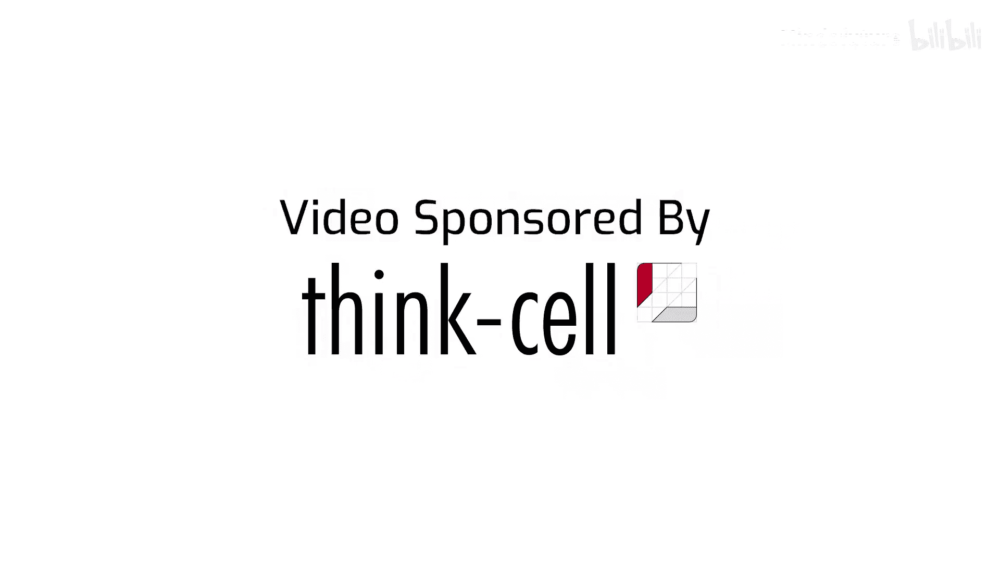
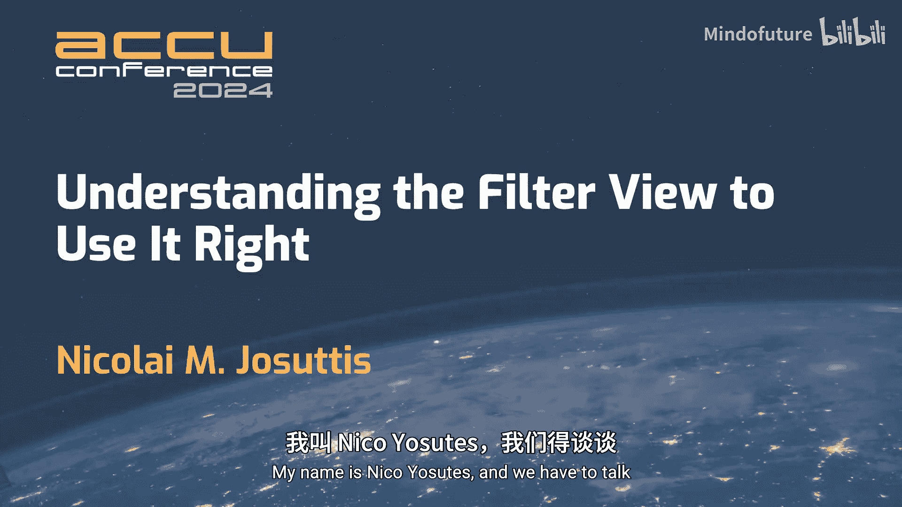
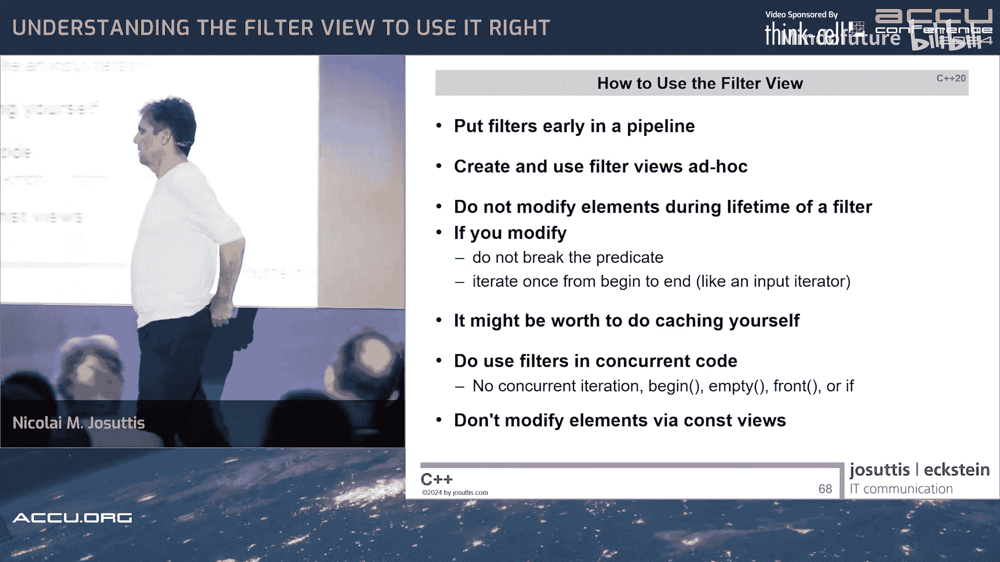

# 中英-•-C++和C语言ACCU大会2024｜人工智能｜架构｜函数编程｜静态分析｜安全｜编译器｜开发者｜垃圾回收｜链接器｜代码生成｜cmake-p12-P14-Understanding-the-Filter-View-to-Use-It-Right---Nicolai-M.-Josuttis--BV1pNotYYELk_p12-

My name is Nikko Yootts and we have to talk。

Well， I have to talk。But I also would like to see some feedback。This will be。This is a talk。 I。

I'm desperate to talk about。Because we have to talk about a key component。

Of what was introduced in C++ 20， the filter view of use in general。And。

You should know a few things about that， which might not be obvious。So to introduce myself， Hiots。

 I've written some books， I've given some talks。And I do C plus plus and standardization of C plus plus for more than 25 years now。

 So part， it's all my fault。Also， the fit of view is my fault。

I didn't know what I voted in when I voted it in， I would not have voted it in that way。

So let's see why I'm not that happy。And how to deal with that。Because we have it now in the standup。

And we have to deal with it。So we are talking about a component that was introduced as C plus plus 20 in C plus plus 23。

 we already have some fixes for that。嗯。Cup of things I will tell you specific to further use。

 couple of things are。And general， an issue of views。So let's see where we are。First of all。

 let me introduce views a little bit just in case you haven't seen them or haven't used them a lot。

So this is a little example of a function that prints a vector。

The printing is done by a helper function， the helper function you see on the top。

Takes a template parameter， Iterates all the elements。

 So it's a generic function printing out all the elements。And as an output。

 you see the values of the elements written to sea。Okay。

That can be done with other containers like a set。 set is automatically sorting the elements。

So initialize with the same value。 So you get a different output。In C plus 20。

 we introduced a few new things。 So one is， you no longer need a template parameter to have a generic parameter instead of saying for some type called or named call T。

 let use autoto。But this is still a template， a function template。

 It's just that you have a different syntax for that。

And you can qualify this by saying we have concepts。To some extent。

 require or constrain this function template so that the past argument has to fulfill a couple of requirements。

Which fall unspecified under the name。 It has to be an input view input range。Roughly speaking。

 that means we can iterate from begin to end with。Using this object。And。That's roughly it。 Yeah。

 Big has to be in front of end and so on。Okay。So now let's come to views。Views。

We are introduced in a way to say， well， guess we want to have some collection， some range。

 and we want to only use deal with part of it， or we want to deal with the values of it in a different way。

 but we don't want to create new， temporary objects， new temporary containers。

And so you can define a view。 The basic way to define a view is to say， well， let's。Take a view。

 Let's call a function。AFact， no， excuse me。 Ader that getss。

Where do we iterate over and say something what we want to do with this。Rang， so in this case here。

 we say， let's only take the first three elements。You can pass that to print。 So obviously。

 that is still something you can iterate over。 So we print the first three elements here。😊，Now。

 the interesting part of this is we have a different syntax for that， another syntax。

 which allows you to use the pipe symbol。Well， which let's see bit bys all operator I want we use it as a pipe symbol here。

So a collection can be piped， whatever the type is into take view and the take view then says， oh。

 let's use three elements of that。 This looks like Unix pipes， but this。It's。

 it's significantly different from that。 We will come to that in a moment。So。

We pipe this into a take view and we can further pipe this into a transform view。

 taking the value and saying， let's convert it to a string and append an S。 And as you see。

 the print function will now print the first three elements of this collection as a string with an S behind。

Good， so there are a couple of other examples， pretty compelling examples。 how nice this is。

 So you didn't see a filter view yet。 So let's start with it。

 So let's have a map of composers of classic music。😊，Let's iterate over them。 But with some。Views。😮。

Let's filter out and only use those who were born。After 700。Let's take the first three of them， and。

What we have here on the map is key value pair。 Let's only take the keys keys。

 which means we only want to have the names。 and that's what we iterate over。

 And when we print out these elements， these are the strings， the correspondinging strings。

 and you see the names here printed out。Yes， a third example views not only are views to that adapt existing ranges。

 they can also themselves generate values。 The key aspect is that they are not heavyweight。

 So they it's not allowed that they store a lot of elements well。With some exception。

And so they usually should be easy and cheap to copy。 That's， that's a point we would like to have。

So yota is is also a view， but not。In the middle of a pipe， it just at the beginning of a pipe。

 you can say， let's generate all the values starting with one。 This， by the way， is in。

A view that is unlimited。 It will generate forever。

 if you loop over it and don't stop the loop sometime， This will loop forever。

That's let's only take those。Values that are multiples of three。 So here you， we see a filter。Again。

Let's drop the first three of them。 Let's take the next eight of them。

 So here we have a limit that we don't have an un endless loop here。And let's transform to a string。

 a pending an S。 Andvoa， that's it。 You see the view defined before。

 We put it on the right hand side of a range based follow loop， and it works。Awesome。

So that's a point when I give trainings about C++， everybody says，Great。I want to have that。Well。

 there's nothing in C++ grade。Well， without a bat。So that means， be careful。 there are some。Yeses。😊。

There are some things you should know to use things right。

And we will concentrate on the filter view to look how to use these things right and which and why you have to be careful here and there。

So。To talk about and explain that， I， I don't want to show you symptoms。

 I want to explain how this works so that you understand yourself the symptoms and can see them coming。

So that means let's look how views work internally。So。Think about we have the following situation。

 We have a vector。And then we want to print the elements。So more or less。

 every function that prints the elements of some range， some container。

 some sequence of elements iterates over the values from beginning to end。

So it doesn't matter whether you call it directly， you might call this indirectly using a range based follow loop。

😡，Or what。But that is the essence of our cult。 that is。

What always has to be called to iterate from beginning to end。So let's take an iterator。

Initially referring to the first element， then why we are not at the end incrementing over the loop and for each and every value。

 we print it out with a star， and we do this except with the last element because ats the end that's the position behind the last element。

Remember that that will be important in a moment。Good， so essentially。

 when I let in my assembly called print run， it calls begin。

 It called gets back the position of the 47。 It goes to the value， print it out。

 with increments to the next value， print it out next value， print it out。

 And this is done in a loop by always calling and。 So if you write that loop that way。

 You can write it differently。 We call begin once。😊，And end multiple times。That will be important。

Good。Now， that was how iterate， how to iterate of a container。 Now， what happens if you have views？

 Well， views are not。Working like in UniX that you say。

 I start to process all the elements and store the resulting elements in a temporary buffer so that the next element of the pipe can then process them。

Using a couple of parallel running processes， this is a totally different model。

 This is what we call a pool model。 and the pull model works the following way。

 We don't compute anything， any element and any value unless somebody ask to do so。

So what you specify for that？When you specify， let's pipe call into a filter。

 and let's pipe that into transform is you only declare a wrapper。

Around the collection and then a wrapper around this wrapper。So essentially。

 these two lines you see here are equivalent to what we pass to print here。

And you see that the wrap of the filter just refers to the original range， the underlying range。

 and just saying， I only let values through that are less than 20。And then here。

 the transformation view says， I refer to the other view。

 and whenever somebody wants to have a value， I have to negate it。 All of these lever。

 all of these layers provide the same API with begin。 you see the position of the first element。

The with star， you see the value with you see the position behind the last element with plus plus when you you see it a that was returned from begin。

 you get to go to the next element and you can with equal equal or not equal check whether you are at the end or not。

Containers provided their APIs。Filt us do that。Transforms do that。 All views do that。So now。

 how is that implemented？ So what happens if we start to run this loop， well。

The first thing we call is we call begin to get the first element。 So this call goes to the。

Transformation view。That delegates us to the filter view。 that delegates us to the collection。

So we call a sequence of begin cards。We come at the beginning of the collection。

 and the collection says， yeah， here。 So first element， it's what I give you back the position of 42。

So it's not 42， but we get it。An iterator to 42。 So the position of 42 reference whatsoever。

So filter gets it。Filta has a task to give back the first element here that is less than 20。Well。

 to decide whether it's okay， what。To let it through this element， the position of this element。

It has to look at the value。So and the value， that means the filter will call star for that。

Look at the value。And then say， oh， no， that's not less than 20。That's not acceptable。

So what does the filter do， I the filter still in the begin call。 The filter says， oh。

 let's increment。To the next value。 So it goes to the container and says。

 please give me the next value。 And the that comes now。 Well， again。

 what the container gives you is the position of the next element。

 And then the filter called star to look at the value。 So already in this phase。

 filter has called begin star plus plus star。😊，To call to find out whether this is the right first position of an element。

 not the value， because the filter returns an iterator， not the value。 So the filter says， okay。

 that's okay。 So let's hand out the position of the 11 to the transformation the transformation。

 will then say wait a minute。 I don't need。To look at the value yet。

 because we only have to give back the position， I just pass it position back to position。

 And that's the end of this call position。Now it's initialized。 There were a couple of hands up。 why。

It。Also has to go end。 Yes， you're right， because when I call plus plus， of course。

 I have to find out whether I understand。 Yes， you're right。

 So even this initial begin will also call end。 You're right。 same question there。 Awe。😊，Good。So。

Done with the first call， Well， we don't have the value。We have the position of the first element。

And now let's call star。 Bo star。 We go along the chain and go to the container。 container says。

 oh here's the 11。 That's a value value go this passed through by the filter to the transformation。

 transformation says， wait a minute for each and every value。 I have to negate the value。

 So it gives back the negated value。 then to the calling side。 And that is printed out。

And that way we iterate over the container。 So next time from the outside we call plus plus we try to find the next element with the help of the filter。

 if an element doesn't fit， the filter will automatically not only call once plus plus it will call multiple times plus plus comparing with just that I don't forget that and yeah。

 and then when we need the value， we will call star。

 star will just be transparently pass through the filter。

 but here the transformation will do something with the value。That's how it works， yeah。

A wiset star called twice。 Well， because in general， we should not cash all these values， we could。

But the filter is， in fact， really not caching the value because it might not， you might not call。

Star again。 you might call come back， etc cetera。 and caching it needs space。 So it's really that。

Filter looking at the value called star。 And also at the end， when we call then star。

 we also look at the value。 And so， yeah， twice， we look at the value in this situation。

应该 the value有。The start。We checked again by B1 filter。Then we passed to each or visit direct。

It's kind of a direct access。 So， yeah， so。This is a simplification of what I what I specified。

 Some useful things are on here。 Some of the functions are just inline functions are optimized away。

 so roughly it works well。 but it's it's good to know that， well。

 the filter are very rarely caches values。 that is， for example， one thing here yeah。😊，对对这。Sa it嘅。

What happens if we change in between， that's a talk about， so that things become interesting。So yes。

Good， so first of all， let's see that that we got everything right， and understood。

 that's a basic principle we have。We call this a pull model。 So next element。So next it the。

 next position of an element and next value is always computed on demand。

What is the performance of this， Well， first of all。

 you might be very worrying that we have so many functions involved and they play together。

 etc cetera。 So， again， collection pipe into a filter， pipe into a transformation。

That is what these just see here。 Well， let's， let's add a print statement And thus to prove that I was right。

 I told you right， yes。嗯。Filter looks at the8， rejects it。 filterter looks at the 15。

 The fifth is passed to transform， and that is then passed to the range base follow。

 which is internally iterating and asking for this first element， and then for the value。

 And then we have the right value， which is -15， and it's printed。Well。In this case。The filteril are。

Keeps the value。But there is another version of this， which is transform and filter our cult。

So when transforming filter alcohol。Then the following happens。

 The transformation has to be done before we call the filter。So when we start the loop。

We will have this output。 So the transformation， Well， we asked for begin。 begin goes to filter。

 filter goes to transform， transformform goes to the container。

 Con gives a position of the first value。 Transform says， oh， wait a minute。 I need the value there。

So， it' called star。And so that， well， but transform only needs the value when you ask for it。

 So the question is， when are you asked for the value， Well。

 transform just says this is the first element and pass it it to the filter。 But the filter says， oh。

 I need the value to decide whether I light it through。

So that means the filter goes back to transform via transform to the container and called star to say。

 I want to look at the value。And that value is。D sand back。 So the。

That's why we get a transformation here。 and the filter got the  -8。

So here this value requires that we have called star already。And then rejects it。

So then we get the next element， and that is transform gives us the position of the 15 trans field tasks for the value gets the 15 as a value。

That the filter adds through。Well， but transform had to transfer it into -15。 So。

 and then the trans then this filter is passed。Passes this position of the 15 to the end loop。

 The end loop gets only the iterator。 And then in the end loop。

 we ask once again for the value because we want to print out the value。So that means once again。

 we go this queue and say this chain and say， we want to have the value and transformation once again has to compute the transformation to the value of 15。

 So therefore， you see it twice here。 The filter needed once。😊，And to decide filtering。

 And then the color finally needs the value。 That's the next time we look at the value。

 and it really transform is called twice here。That's not good， well， maybe is it bad， is it good。

 is it not so good？😀嗯嗯哼。😊，But this is the problem we have， the first problem we have is a filter。

A filter might lead in this chain to the effect that at least for positive values we let pass through。

 and where at the end。A user wants to see the value。We have to。Look at the value twice。

 once to decide。Yes or no。 And the other when the user wants to see the value。And that， by the way。

 happens with each and every filter once more。So that's a good thing to say， well， use filters early。

Or avoid expensive stuff before using them。Is that already a show stopper for the whole game。 No， no。

 no。 Wait a minute。 compilers optimize a lot。So here we have a range pipe in the filter to transform on the right hand side of a range base follow come to that in a moon。

 And that is what is essentially compiled。 Everything else is in line called。

 All the views are just  one，2，3 liners， in line functions， Everything is optimized away。

 So what you essentially the program is kind of this。 You say。

 let's iterate from beginning to end with an iterator。

 And to decide whether we want to process the element end。 We have to look at the value once。😊。

To decide whether it's a multiple of three。 And then when we let it through。

 we have to look at it again to pass it to somewhere。 And if we have。

 in addition a transformation before the filtering， that means before we look at the value。

 we have to do the transformation。 And when we look at the value again， to process it。

 we have a transformation。So the question is， is this bad coat？If this is bad coat。

 then you have a problem with this coat。Compilrs optimize when they see well two things are happen very often the same way。

 So minus star pass is called here and there。 So that might be optimized。 The other thing is。

 minus might not be very expensive。But， of course， if minus is computing and finding out whether this is a prime number or doing some very longtime stuff。

 of course， that's a problem。😊，And if that's the case。You might better do some different things。

 Like， first of all， taking the result of the transformation into a temporary。Container。

 and then use the filter。That was a question。Okay， good。So that's the first thing about performance。

this is pretty new。 Still compilers can improve the way they optimize code for views because every typical code has some special flavors。

So that it could become better， but in principle， we run into these problems or into these issues。

But there's more。 We have to talk about each and every individual operation。 We have to talk about。

 begin and。Anson。So let's look at vector。And let's look what it means if we filter the elements in this vector to say。

 let's take。Only the elements that are greater than 9。If we call begin。Then what this does。

 And you saw that， we call begin in the vector。 And then we try to find the first element that is greater than 9。

So we have two。Call a star of the value。If it doesn't fit。

 call plus plus and you're right and or call and to compare， right， I learned it now。And， yeah。

 and you have to do that in a loop until you have found your first。Element that fit。And that。

 by the way， it does matter where the filter is operating on。 So if you have a linked list。

 you more or less do the same。 It's just that plus plus takes a little bit longer。

 So begin means let's iterate over the elements until we can find and return the begin of this container。

So begin for a filter on a vector。 begin for filter on a list。Can be pretty expensive。

That's not good because in general， we assume that begin is a cheap。Ca。😡。

And that is what we are used from containers， at least。So， how do we deal with that？Well。

The goal is that we do not provide two expensive operate operations。 Well， that's a general goal。

 That's why you cannot call the index operator on the list。 You cannot call push front in a vector。

 because these would be expensive operations。 At least we want to。

Protect you a little bit from doing that accidentally or without thinking about it。

So the same idea comes here in when we deal with the design of views and here of the filter view。

So the question is， how expensive is begin？So think about we want to have the multiples of far well we can see what this means。

Begin might be as expensive in a way that we have to iterate to some elements。 Now。

 the interesting question is is。What happens if we double the size of this range？

Does it get worse or not？ThatThat highly depends on your use case。 So if you have a couple of values。

 just 1，2，3， and all the time they are distributed over your collection。

 thus doubling the size does not mean it's getting less。It's。

 it's getting worse to find the beginning， because at least if values are pretty equally distributed。

Well， if4 is only once， done't time there and you， you search for the four。

 you filter only the element that has the value of4。

 it could happen that begin has to go over all the elements until the end。

And that means conceptually， you can say， oh you have to say that begin has linear complexity。

 So the more elements you have in the container。The more time it might take。To call begin。

So we are slow。 We have， we have to compute the predicate for all leading elements。

 for all elements that do not fit with that。So call begin and forward until you reach the first tro。

 That's roughly what we implement here。How about An？Well。😮，And it's interesting。

 we wanted to have it cheap。So you might think now and as a position behind the 12th。

But we can do it even cheaper。 We can say， well， no， no， and is yet it。阿萨。

So that's a cheap operation。Because we just pass and through the filter。Good。How expensive is empty。

Lna喂。Yeah， we just call begin and end and see whether they are equal。呆仔。So yeah， so same as Big。

How about science？Linear， but worse linear。So again， only there has to find the first element。

While size has to look at each and every element from beginning to end。Until it has an answer。

So it's slow。 This is bolt slow。 This is light slow。Okay。It's both linear。

 but complexity is not always good enough to see the difference between these two。

Performance aspects of the view。Front gave me the first element。The value of the first element。

Linear， yeah， that's like begin。 We just call begin and look at the value。Good， like biggerot。Back。

唔冇。哦。It depends， I would say， the question is， can we go backward through that？

So if we can go backward， we go to the end， and then we iterate backwards。Through the first element。

 But the bigger the element is， we have the same problem as with big。So back is somehow， yeah。

 somehow slow。 Yeah， it's an interesting question。 What does it mean if。

 if we call this and you have only a forward range。Then it gets worse。Index。

 jump to the tenthth element。Yeah， we have to look at， begin and， and then from that count。

 find the 10th element that fulfills the predicate。 So we have to。

The same problem as was begin but a couple of times。对。So that is the situation we have。

We don't like expensive member functions， expensive operations。

So let's not provide them unless it doesn't make sense。 ass all it has to be。

 So what you' see here is roughly what each and every view and principle could do。 In fact。

 all the view types are derived from the base class that provides all these views。

 all these operations provided。 it makes sense。And that is， they have constraints。

Using the new feature of concept。And with these constraints。

 size and the index operator are not provided for for a filter。So the others are。 So back。

 for example， front empty。Are provided。Good。Can we improve the situation a little bit？Yeah， oh。

 then the designers offer。Of the filter had a great idea。The great idea was when we call begin。

And you might indirectly call begin by calling empty off front。Once we find it。

 let's cache it into the view。Awesome， hubb Saa today said， yeah， caching helps。Okay。

 well see what their consequences are。So that happens all the time。 We have other views that cache。

 So sometimes it gets really funny because they cash on a list， but not on a vector。

 But that's a different story。 That's other views that have found our problems。😊，さあ！

They cash whenever they have， for the first time called begin。

 which might be they have just called empty。Because empty callss began。Okay。Here。

The C plus plus 20 views that cache， some of them cache always some of them sometimes。Good。

 so that means look coming back to the slide that the slow operations we have are maybe not that slow。

 Well， they are slow only once。And in combination。 So if somebody called empty already。

The game is no longer slow。Good， that's an improvement， isn't it？Good。

 so the only available and really slow function is back。Okay。嗯。So this。

 to make it a little bit more technical， what does that mean， if you compare ordinary containers。

 you call begin and size and empty。 It's all constant functions。

 It doesn' matter how much elements you have inside。But with a V filter operating on some container。

 the first begin has linear complexity。 The second and further is and constant。

 The same is true for empty， and size is not available。Good。

 we have a term for that in the C plus bus standard。 It's called amortized constant。

This is amortized constant。 The call of begin has amortized constant complexity。

So you might have had that time before in vectors when they。When pushback is called。

 you insert an element。So the first time you answered， you might have to double the memory。

That takes a lot of time。 And the time depends on the number of elements you have。

 But then you not just add one space for one， one use slot for one element。

 You just double the size or so or add 50%。 And that means over time， this。

Penalty amortizes so that over time calling this multiple times， we have an amortized。

Constant complexity。So that is the case here， But it's， it's a little bit of of a fake。

 or maybe good marketing。Because in a vector， I would say it's pretty likely if we insert one element。

 we will add more element。Now， the interesting question is， if we call begin once。

 where we call begin more than once。And my prediction is。

 that's not that likely as for vector calling multiple times pushback。 because if we iterate。

 we only call one begin。So be careful。And by the way。

 we have a concept for rangers and so that a view is a valid range， we switch for just for views。

 we switch to the statement that in a range， the requirement is that both begin and end have amortized constant time。

 so not constant time amorized concepts， so sometimes it might be expensive。

So Drop is a little bit funny。 Drop sometimes has this problem because it cachees only when it works on a list。

 not on a vector。 So it changing the underlying container might switch from constant complexity to linear complexity。

 just calling begin。😊，But that's here not the drop talk。 that's a filter talk， but it could be worse。

Then， with a filter。So what are the consequences of this design。So this looks like an improvement。

But we pay a price。The process the following。Guess you're starting with views。

You want to play a games with this cool new feature。So， oh。

 let's pipe the back to take view print only the first three elements。Awesome。😊。

Let's pipe the vector into a transformation， negating the elements。 Awesome。 Oh， it's great。

 I love this technology。 So let's pipe the vector into a filter and the preds。

 let's only accept the elements that are greater than 9。😊，AI want to see the result， but。

Comply time error。Wait a minute， why is that a compile time error？You should see the error message。

 It's a little bit strange what it says。Somewhere in between the code， there's something wrong。嗯。😊。

Let me try out something。 Let me see。 So though that means you cannot pipe a vector into a filter。

Let me directly using an arrange based follow oh， that compiles。Wait a minute。

So we can iterate over the elements of a vector， the filtered elements of a vector。

 when it's directly on the right hand side of a range base follow。

But not when we pass a whole thing to a generic function， iterating all the elements。

So this is a moment where each and every programmer starting with having the first early adoption of youth gets crazy。

And the usual reaction in C plus plus。 Now， it's my fault。

 And I always learn C plus plus is too complex。 There's something wrong。 I'm an idiot。 Forget it。

 Go to rust。What happened？Anybody guessing what happened？It's not cons when it works。

 but here it gets cons。 Yes， the cons is a problem。And why is Kants the problem？Because we catch。

 because when we call begin。We cache the result， and that means we modify the view。It's that easy。

How about mutable， we will answer that question in a moment。So， yes， that is the effect， no warning。

 nothing else。 it's just， you have to know that to understand the problem。So。

 and then you need to work around。 How do you deal with that situation。

 So there are a couple of ways to deal with that situation that just for fun。

 go through some of them。So， you can say。Let me define this filter view。

And then passes filter of view to a subrange。At some， there's also a view。

Although you cannot create it with a helper function。

 So you have to use stood rangeless subrange instead of stood View subrange。

 So we are not that consistent in this library。And then。What does subrange do。

 Subrange is a view that。at construction time， cards began。So it does not have to call begin later。

Which means， we compute。during initialization。And with that。

 we can now use that to iterate even later a calling begin again and again。So that's a whole trick。

So I only have to teach to programrs， do that。Well， this was the beginning of the talk。Let's see you。

What time is it， okay。So。By the way， for some reasons of class template argument deduction。

 you cannot pass the whole thing just to its sub branch。 You need these two lines。一。😡，Thats question。

点上。It's a scenario where you won't call begin。啊。Beg value。

why don't we cash begin value on construction， That is an interesting other optimize。

 So now you are questioning the design。 I just wanted to deal with the symptoms。But okay。

 let's talk about the design。 So the reason we don't catch it in the construction is that makes construction expensive。

 and you might never iterate over the elements。So the design discussion boss， it's better to delay。

The construction。The could first call off begin until we really know we need begin。

That's a design decision。 You could have done it differently。Get。Okay， there are other options。

 You can use a universal reference。 Well， it the standard calls it forwarding reference。

 but that's a lie it only sometimes is used for forwarding for perfect forwarding。 here。

 it's really a universal reference。 It can universally refer to everything without making it con。

Because we need a function that takes both our values and our values。

 So objects with names and objects that are temporary。 And for that， we have universal references。

 And with that， the code works。 So I only have to teach for each and every programmer and to go through all my。

Generic functions that take a container and convert to a universal reference。Awesome。😊。

But be careful。 now here was the question， why didn't we hide cashching？

Why didn't we say let's internally use make things mutable？Well。Be careful。

If you do that or if you do it that way， you have a problem。The call of begin is no longer threatsa。

The call of anti is no longer threats safe。Which means if directly or indirectly。

 two different functions use the same view。At the same time and call at the same time。

 begin directly by iterating or indirectly by calling empty。O front。You have undefined behavior。

So having this ruled out， well， this would be a problem if I do it that way， for example。

 but it would be enough to say one thread calls empty， the other calls front。

That is undefined behavior now。Which is a break of what we have standardized for containers in containers。

 There's an explicit statement for in the standard saying， begin is threat safe。

Is always considered to be cons， even if it's not conants。So。Therefore， if you do that。

 you better take the argument that way because that protects you from this problem。

So that was the reason。Probably the designers of this library thought mutable is not the right answer because then you hide this even more。

If you use mutable， you should then internally use mut taxes so you should make your cash begin。心号。

Atomic， a。Protect with a mutex。Yep。なさん。You at some point switched。啊，刚才。对二。

Would that work with the field of here？Yeah， you can even in front of Alto， you can also write。

 this is a stood range input range， and you can write it in front of Alto and still use it to MP。

Despite。nothing。Yeah， because。Well， at the begin， we use Kt。😡，Reference， that does not work。 Yeah。

 so if you use 2 m%， then you can， then you can still qualify it with。In addition。

 qualified with some constraints。There's another option， we can take things by value。

So that was an interesting answer giving when this was discussed because， yeah。

 one of the key designs of a view， it's cheap， it doesn't contain any elements。

 so it's cheap to copy， so why don't pass it by value。But the problem is。

 we might want to call this function with both。Containers and views。

So call passing by value would make calling print for vector expensive。

So maybe we would require that。The parameter standard view。 Yeah， we have concepts， and we can say。

 yeah， here's a constraint that this function is only available for views。

But then printing a vector does no longer comp。Okay， can we somehow make it a view， Yeah。

 there's a way to say， let's take all the elements and make it view。

 Well put a view as wrapper around them。 The view is called all， Let's take all the elements。

But make it a view。 And now it works。 I only have to teach that to the programmers。Okay。

And there's another option you might say， But wait a minute。

 maybe we can with the following way for views， we take by value。And then for containers。

 we take by reference。So that's overloading。So the one on top should be more special than the one on bottom。

That's， by the way， not true。Because it's not that on usually。

 you can say something more constrained is more has higher priority than the other。

 But unfortunately， the rest of the signature is not the same。

So there are different rules when which is called。So what you have to do then here is not just to say that has no constraint。

 You have to say， no， no， and this is not for views。So we require， this is not a view。

 then we call the below the print。 And otherwise， we call the upper。

 So the only thing you have to do is all you。All your processing of containers now making to make them viewable。

You need two functions。You like that？Now， me neither。Good， and somebody said that。

 how about when we modify him？So far， we didn't modify elements。So now comes the real fun part。

Of the filter view design。This is a very， very simple program。Vc Talk having four elements。

And we call print。Now， let me define， I want to deal only with the even elements of this collection。

So that would mean I define a filter operating on this collection。

And the predicate is Modello 2 equals 0。And now let me use that view。To modify the elements。

What this means is we want to find the evening elements， and we do something with them。

This can be a modification。奥的。So we can modify the value。Adding 2， okay， now we have 1，6，7。

12 after that。 Do it once again。 We have 1，8，7。14 after that， awesome。Works， yes。

 you can use views to。Work with。Ranges。Even when you want to modify the elements。嗯。

Let me try something。 different。 Let me add one。Hm， okay， works， awesome。

So why the hell is this guy coming up with these crazy slides。 This will， of course， work。 Why not？

 So let's call it once again。哦。哦。Oh my god。Oh we use that view another time。Well， yes。

 the first time we used the view， we cache began。Let's begin。 The second element is begin。 Now。

 using it another time means we start there。And then starting there， we only cash begin。

 But from that， we double check the values before we process them。So that has this nice effect。O。

Well， we are not stupid in the Standard committee。 Well， maybe we are， but。

This is officially a runtime error。Well， the runtime error is precisely specified as follows For a filter view。

 We have the following statement。Modifications with the filter view iterator。Its panmed。

But results in undefined behavior， if the resulting value does no longer satisfy the filter predicate。

So problem solved， you only have to know that rule and you won't make this mistake。

We had in the keynote today what this means。Okay。And， an interesting example that one。

 another guy in the Stan committee came up with us says， oh。

 though that means I cannot use a filter view to heal broken elements。

I cannot use a filter view to hearal broken elements。So you look， for example。

 in your computer game of at the monsters and look for them who are dead and you want to resurrect them。

That's undefined behavior because they are no longer dead。According to this statement。

You have made a mistake in your program。 It's not a compile time error。 It's a runtime error。Well。

 you can burn them。😡，Provided thus will not resurrect them。So you never know with monsters。O。

So first time it works。So maybe we only use the view always the first time。 So instead of defining。

The view and then using it twice， let's use it only once。So we only would call it once begin。Why。

 then do we cash the game？If that is solution。Okay。

When I was at this point understanding what we design and our standardized。

 I really got a little bit。Sad。So the next guide done is use and reuse views at hoc。

And that applies to the third of you。That's better。 at least if you modify elements。So。

 but it gets worse。So it's not only that we might modify the values。

 It's also that others might modify our container。Well， in principle。

 anything can happen if you iterate about some over something that is getting modified， for sure。

 The question is， can we somehow allow some things maybe when we think with our hand and see this should have worked that way。

 So that should work。 That should be safe。So look at this example we have here a vector on the list initialized with four values。

1，2，3，4。We call drop on that。And then we insert some new values， and then we call print。

 and then we call insert， and then we call print。Now。

 the drop view is a little bit tricky because it catches sometimes。It cashes on the list。

 but not on a vector。Well， a filter always cachees。 So when we do the same with a filter， sorry。

 this example is not using the filter。 We would have the behavior which you see here for the list in the second row。

 That would be the behavior if we use a filter here。I should change the slide。And finally。

 if you copy the cache， cached view， the cache is removed。So suddenly it works again。But the real。

 real， real problem is the following。You don't understand what's going on here。

 So let me add a print statement。 This print statement changes the behavior of the program。

Because we cash earlier。Oh my goodness。We have honestlyy standardized a component in the C plus standard library。

Where read iterations change or can change with the state of a program。And that is the case。

When we catch and because of。Cashching， we catch earlier。So before we add another value， so okay。不。

Don't get me wrong， if you modify。You cannot protect yourself against everything。😡。

If you modify value and you have a filter view and youll go forward and then you go back and your predicate no longer applies。

 there's a problem， for sure。But here， we just iterate from begin to end。

 So why shouldn't it just work the way， Let's restart start from beginning with this predicate。

 And all is good。 Yeah， because we know why to make begin cheap。But as a consequence， we learn。

 you better use it at heart。Okay， so the come to the interesting question is cashing worth it。

So here are the roughly metrics where using the filter view is fine or using a filter view is broken。

So you have just one iteration from begin to end。 If you only read great。

 If you modify and keep the predicate valid。Fine， if you modify and break the predicate。

 you have undefined behavior， but it works。The first step only the first step， one iteration。

If you have multiple iterations from beginning to end。Similar， if just that from the second original。

 it no longer works。If you start not just to go from beginning to end。

 you go back and forth and back and forth。Obviously， if that breaks the predicate somewhere。

 the modification， suddenly theres something strange going on。 It will not work properly anymore。

 And that's for sure， something that's inherently in the problem。So that is nothing we can fix。

That's not a surprise。Concurrent iterations， even if we breathe are broken。

And con calls of begin front empty。 And if is also available。 So is。

 but the opposite of checking whether it's empty。It's also problem。You should't know that。

When you use the F have you。So please note the blue。

Slots in this matrix are the ones that are caused by cashing。So without caching。

 it would look like that， so read would always work。😡。

That would be great if just read would always work。And here we also have no issues。

 We would not have this strange， undefinunded behavior when we were no phone to fixed elements。

 So the， the question is， is it worth it， all the traps， all the problems you saw。

 Is it worth it that we cash。So let's look， what is the benefit of cashching。So yeah。

 you saw a second call of beginner cheap。Which is a use case that helps us。

 where really gives us benefits。So let's take look at some examples。

So we have here a range that is piped into a filter。

 and this filter just wants only to use the elements that are not zero。So this is just assuming。

Maybe a very typical situation where you say， yeah， you have a couple of values。 Some of them are 0。

 some are not。In some distribution。Okay。The use way we iterate is we call begin。

And while we are all that the end？We call plus plus， which means we call multiple times。

 and we call only once again。 You can program that differently。

 But that's a very typical piece of code。 You write to iterate over elements。

So the first iteration has to find。Began。But she has two elements。A heck。

We go chose the third element。Pretty okay， I would say。And then we iterate and with the iteration。

 we iterate。St step over the al elements。For that， while reiterate iterate， we have to call big end。

A couple of times， even to find the first element to know that this is not beyond the end。

 So there is none。So but and as it' cheap。So green， cheap， yellow。R means yeah。

 we have to linearly visit each and every element there。

 independent from whether these elements fits or not。And a second duration is in that way。

 optimized by this optimization that we say。 And then when we use the same view once again to call another time begin。

 that is cheaper than before。How much cheaper depends on how likely it is that there's an element early。

That fits the preddiup。Very different use cases can exist there。

So we have few benefits from cashching， I would say， in such a use case。I would say in this case。

 it's not worth it。Maybeumb。And it always depends。So let's come up with another use case。

 Let's assume we have only one or two elements in the middle of the range that fit our predicate。

So that's a significant distance from the beginning。So。The first time we call begin。We。

Have to look at each and every element。 And then we iterate over the rest。 And by finding the begin。

 we also have to call end。 And also while iterating to the end， we have to call end。

 So we call a couple of times the green function here， which is cheap。放这点。

Because we don't do anything there。In a second iteration， yeah， we have significant improvement。

 So we benefit from caching when we， a second time iterate over the elements。

 Please note there's a special con case that your first iteration of your first finding of the game might be。

 you asked for the size。😊，Remember， when we asked for the size。

 we already call begin for the first time。So calling， size and iterating all the elements。

As here already。Better。And of course。The later the first match comes， the better saca。

In the example we saw here， we had end and end was right behind the last match。 that's here。Well。

 what happens if we don't have that something？Well， I told you that already。

 which is we do not cash at。Well， we， we， we know what the end is。 We make it cheap。

 We don't cash and in a way that we say and is the， the position behind the last element。

 according to the predicate。So even in this scenario， end is there。That is not good。

Because that means， yeah， we， we benefit from optimizing， begin in a。Second call。

 we benefit from that。 But in the second iteration。

 we will still iterate over all the elementss from the middle to the end。

 although this is not necessary。Yeah， in this case， we clearly could say， well。

 that's only it a rate twice。 And here is the end。 and that's it。

This is not implemented in the filter view。It's not。Is it a good decision or not？特首。

So we benefit from caching and the second iteration， but not from caching for the remaining elements。

 So， if there are a lot of elements not fitting， you're predicate。That's not a good situation。

 you just have your element right at the beginning and nowhere where else Yourre Maggie。

That will have that performance。Unnecessarily bad performance。

And it's all always about at least once we have to look at each and every element。

Because we have n and compare against n， and we have to look at all the elements。Well， at least。

When we iterate after we found begin。Good。So it's a use case。Where just the first iteration pays off。

Yes， there's one。 Well， there are couple， but the interesting thing is what happens after a filter when we have a pipeline。

So maybe the thing after filtered， for some reason， causes。Multiple cards of begin。

So the example is reverse。Because reverse works the following way。

 If somebody calls begin from the outside， we map it to end。And the other way around。

 But we have also deal with one offset， that that's details。

So that means if we have that situation and we call。Begin。So for the thing as a whole。

 this is by reverse map 2 call to end。Which is。Where we are。 And then from there we。We try to find。

 begin。And we iterate， and then we call begin。And we compare with N。 So each time we compare with N。

 we call begin。And beginner is now computed and beginners in this scenario called multiple times。So。

First begin it's expensive， but then after that， E and every other begin is cheap。

So this already might happen。On initialization。 And then when we start to it to find the other elements。

 we call。Againg again。So the first begin might be called multiple times because we iterate to find。

Begin。And while we are finding begin， we have to double check that we are not at the end。

 And the next thing is， when we are there， here is see real iteration。Here should be a green arrow。

 I don't know what has gone。But okay， it's there。The next time we have the second iteration。

 we also benefit from that a little bit more even because the first begin was also already cash。So。

 that means。No more expensive begin cards here。So there we have， and that's a point。

 even in the first duration。A benefit。From caing。Well， unfortunately or not。😊。

This is not the way usually， well at least in the standard library， we work。

We are not that stupid that we call begin all the time， again and again and again and again。So the。

 the most important example is the range base follow。The range base follow is not working that way。

The range paper followup is essentially working that way。 It says。

 let me call once begin and one end at the beginning。

And then we it just comparing these two values I've computed all the once。So， which means。Yeah。

 we own the。We only call begin and once。 And that means we call this begin only once。

 And that might need that we need once to get it here and once then to start the loop or enter the loop。

 So yeah， so multiple chor of begin are no longer there。That's one insight。The view en one outside。

We still benefit from the second iteration。 but the benefit here is not。Not the best。 and again。

 we have the scenario where we will iterate over all these values。Because end is not cashd。

Do you like the design？Consistent。冇啊。So not consistent as an interesting answer， yeah。Get。So。

You can do better， by the way。So I have some programs that measure all these scenarios。

 and you can really measure。That where the time is wasted。And so I just for fun， get the following。

 I said， oh， maybe I cash myself。😊，Because I can do better than the filter。

 And because I what I can do better is when I know it's worth it， I can say。

 let me compute the begin and let me compute the end。 But the real ad。

 So the one slot behind the five。そう啊。Let's do that。 How do you do that？ Yeah。

 you can write your own helper function to do that。But can you also compute， begin and end。

With the views， yeah。有。Filter up from the reverse to cache and。 but we also need to cache from begin。

 So we want to have both。 But yeah， you can say the filter does the other anyway。Just for fun。

 I had the task， maybe I want to myself。Write a perfect cachehe for this saying。

 let's compute the beginning and end of this。So how with you。Tools， could you do that？Subrange。

But the sub range is just， well， the sub branchch does not compute anything。

 You can initialize the sub with some begin and end。 But how do you compute begin and end。Well， here。

 this's a trick。 Take the range and drop why there are zeros。

 then reverse and drop why there are zeros and then reverse again to have the right order again。

That's a magic trick。And then you can pass that to the filter because there might be elements inside that match or might not match。

 You cannot just take all of them。Yeah， and if I do that and I me of that and I look into my coatb and see now how fast is that。

 Oh， yeah， awesome。 That's really fast now。 now， just。😊。

Interating over the elements is really incredible fast。

 doesn't matter whether I go forward or reverse。😊，O。So is cashching worth it。

The caching we have implemented in the filter。 I don't know。 That's maybe a different question。

A final note， though， there's another issue with views。It's regarding consciousnessness。

 And that also affects a filter。 If you， if you wonder what is the exact type of the view。

 it depends how it is created。And one of the key questions is。

 does it run over a range that is an R value or over a range that is an L value。So when we。

Iitialize a filter on an L value。 So on a container on a range that's there。We can easily say， oh。

 you know what。 This is。This is just referring。Underly container。

 we cannot do that if that is a temporary object， because the temporary object will die at the end of this statement。

So in that case， we do something different。 We use。A so called owning view helper。

 So both filter view， filter view just delegates the question how to deal with the data it gets when it's coming not as a view。

 but as a range。In the following way that it either uses a ref or an naing view。

 the ref refers to the existing object。 when it's an L value。 we can go with that。

When it's in R value， we move the whole value into the view。

 That is the example where even the view can have multiple elements start。But to some extent。

 that's not expensive because they were created before。 We just moved them into the view。And。Yeah。

That's a general issue we have， by the way， ownwning views were not part of the C plus plus standard。

 initially that this would not compile。 They came as a faked back fix So it was not a back fix。

 This was a feature increase。 But we call this a back fix。

 And so it's part officially of C plus plus 20。 But you will not find anything about owning view in the C plus standard manual。

 C plus 20 standard manual。We will want to find something in C plus plus 23 standard manual。

 of course。 But there are a couple of other things also。So we had。

 we don't have a a manual describing just C plus plus 20 as it is specified now。

That's sometimes a little bit tricky， but we have CPV reference。 That's good。So。The interesting。

 that's an interesting consequence of that。 The consequence is that。

What happens if you make that view can't？So we might not do that for a good reason。

 because we may no longer be able to iterate。 depends whether the view cache or not。

But if we make the view cons。Different things happen。So if you have a view that has a ref。We have。

We do not propagate cons。😡，So if the viewers can't， the elements are still not const。

This is not the case。 If we have an owning view。 If we have an owning view。

 then I should explain that here。 So unfortunately， in a filter。

 you cannot see that easily because you cannot use that but if you were if I would use a drop view。

 you could see that easily， you could just modify the elements of a construct drop view in a filter view。

 you can't that easily because we are not allowed to to call for this view。

 So but you can see it in kind of a trick， you cannot ask。

 Can you give me the underlying container and can I modify that value there。 Yes。

 you're allowed to do that。That is supported。And if you have an owning view， K is propagated。

So that means the elements are cons when the filter view that refers to the view is cons。

 So that means depending on how we create the view， whether in the creation。

 we use an L value on our value， we propagate guns or we don't propagate cons。

Condistency would now be the word to say something。 Yeah。 Yeah， and by the way。

The common penon we had so far in C plus plus is that we do not propagate conness in containers and collections and ranges。

 This is completely new。And it happens sometimes。I'm not happy with that。Okay， but you know that。

 I told you so。So be a little bit careful with conness。Goodt。Summary。

So we have seen that we have interesting behavior。Rgan and Caing。And a filteril of view。

And we saw some of them。Mean that especially for hatching the second begin。

 which means also the second front empty call。A optimized if you have a reverse view that effect。Yes。

Is delegated to end。So that's the first thing we learned。

So a filter view has interesting performance。Complexity or complexity guarantees。Then in general。

 a filter view is part of the game of the views and views in general， break a several。s。

Wellll established patterns of programming in C++。So you can iterate of the range discons broken by a filterilth of you。

Any reiteration does not change state broke。Concurd reiterations are safe， broke。

Kant's collections have Ks elements， broke， or not always sometimes， which is's not better。

And there are a couple of examples I didn't have here。 or I could not show。

 because in filters does apply。 There are other views where these things apply。 For example。

 C begin might type of problem。 you have seen that copying state might。

A copy of a view might have a different state because the cache is removed。

And there's another problem with the zip view， which I don't explain now。 We have standardized。

 completely bullshit。But anyway， sorry， oh， this is recordedhuh。B。Good。So to make this constructive。

 to say， how， what does it mean for you， besides saying， I don't use use views。 I know a couple of。

A couple of projects that say the way the filter view and other views are designed is a show steper for me to allow this to give to ordinary programmers。

 too many problems can exist。 both compile time errors and even worse runtime errors。But if you say。

 no， I want to， I know what I do。 That's， by the way， what the rangeless people tell me。

 if I complain， they say， just teach it Nikco。They only have to know what they do。

If it's not self explanatory。Good， so please。是。In the whole world。

 please tell everybody they should buy my book。4 million programmers， I will be a rich man。Good。

So here are the recommendations we have。Put filters early in the pipeline。

Create and use filter views at hoc。Do not modify elements during the lifetime of a filter。 Well， or。

 if you modify。Do not break the predicate， or only it orerate one from begin to add。

 So use it like an input iterator。 The rest is kind of a heck。Because formally。

 that's undefined behavior， but it works。It might be worth to do cashching yourself。

So because the existing caching might not be the best。Do not use filters in con code Never， never。

 Well， O， at least do not con the call， begin empty front door for them。

 That means do not con the iterate over them and call somebody else empty。 don't do that。 I。

 I'm sure we will see problems with that。 I'm sure in practice， they might not have an。😡，Effect。

 unless they have。Because it's very unlikely that you really call begin at the same time。

 But if you do， you have an interesting effect。 You will never find this back and you will never understand what word it wrong。

 and you will never never be able to debug it。 I was not able to create this situation so far for me。

这边到现在啊。喂。Oh， yes。Of course， there should be a nod。 That was just to find out whether you are still awaken after at the end of this talk。

 So it was a test。You won the price。Awesome， of course。And by the way， there is a knot。Oh。

 that's not， why not， I don't understand PowerPoint， but there will be， okay， there should be one。嗯。

😊，Good。Last advice。Should be updated。 Anyway， don't modify element。

Don't modify elements via can't view。 So if you can do that directly indirectly。

 be prepared that if somebody that gives you the view switches from an L value initialization to another value initialization。

 Sometimes suddenly your code is broken。

That's it。I hope you'll learn a few thanks。Thank you very much for the moment。

And let's see whether we have some questions。Time for future。

