# 中英-•-C++和C语言ACCU大会2024｜人工智能｜架构｜函数编程｜静态分析｜安全｜编译器｜开发者｜垃圾回收｜链接器｜代码生成｜cmake-p13-P15-Contracts-for-C++---Timur-Doumler--BV1pNotYYELk_p13-

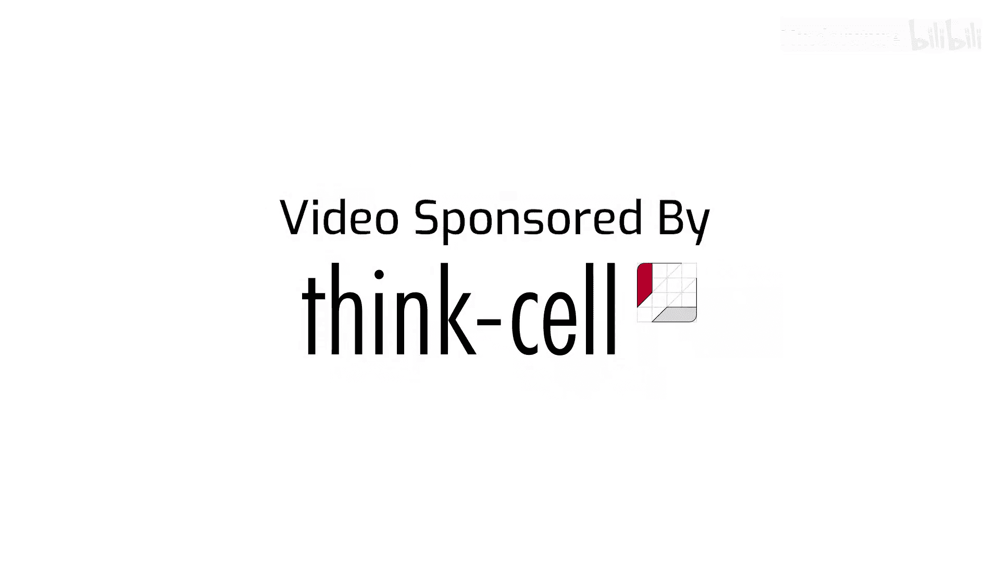

Hello， everybody。 Welcome to my talk。 My name is Timma Dunna。

 I wan to talk to you about contracts and particularly the ongoing effort to put contracts into the C plus class standard。

😊。

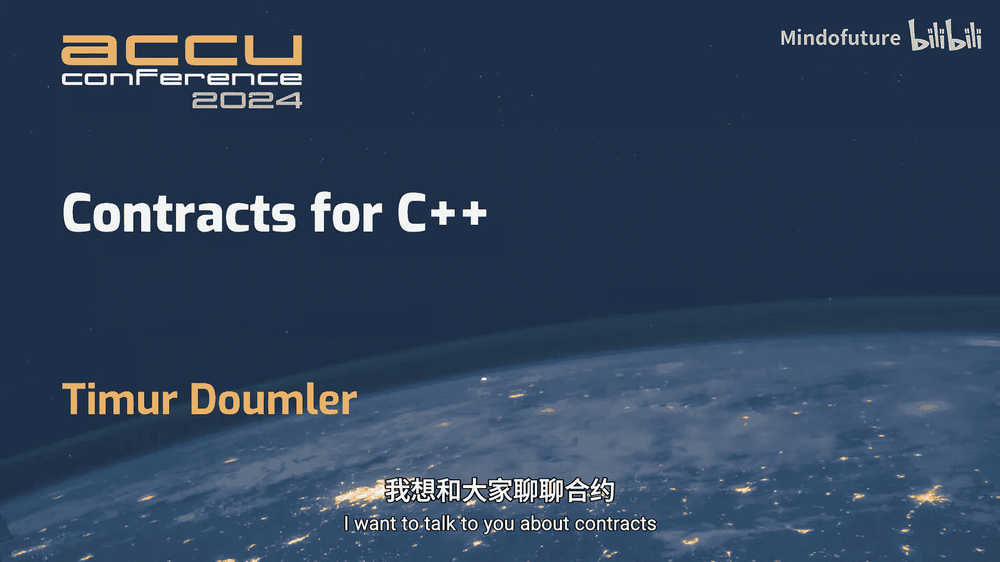

I like the A U title slide。 I actually do have my own title slide， though。

 So I'm gonna switch to to that。 And the reason I have my own titleless slide is that it also has the date and a version number in addition to the name of the talk and my name。

😊，Which is important in this case， because this is the third time I'm giving this talk。

 is is the first time I'm giving at a conference。 The first two were meet ups， local meetups。

 Munich and London。But every time I give this talk。

 stuff changes because it's ongoing committee work， it's not understand yet。

So there's like little things that are changing。 So this is version 3 or version 0。

3 because it's not understand standard yet。 So it's a version 0。3。 It's not version 1 yet。

And probably next time I'm going to give this talk， it's going to be verse 0。4。

 and things are going to be different again。This is a snapshot in time。 Last month。

 we had a committee meeting， C S Committee meeting in Tokyo， Japan。

 where we made very good progress with this。 We are very close。 So having something that we agree。

 you know， can go into C S 26。 We're not quite there yet。 I'm gonna talk about， you know。

 what is still missing。 What other little things that we saw don't agree on on the committee。😊。

But this is the Post Tokyo edition of this talk。Here at AU。 And this is an overview U。

 What I'm gonna be talking about。 I'm gonna first have a little general section about what contracts。

 we're just gonna have some heavy overlap with。Tt we just heard from John Lecos here if who has been。

 who was in the room for the last talk。 Okay， most people， but not everybody。

 So I'm gonna go through this maybe a bit faster then and then a little bit about the history and motivation of getting C plus us getting contracts to U S design principles of the current proposal that we have and then what's in the proposal。

 like the language spec， the library spec we're gonna go over all of that。

 And then I'm gonna mention what are the open questions currently that we still don't quite agree on yet on the committee and then what are future extensions that are not in the paper but will be there later。

Maybe it' the U 26， maybe it' the U 29。So what are contracts。

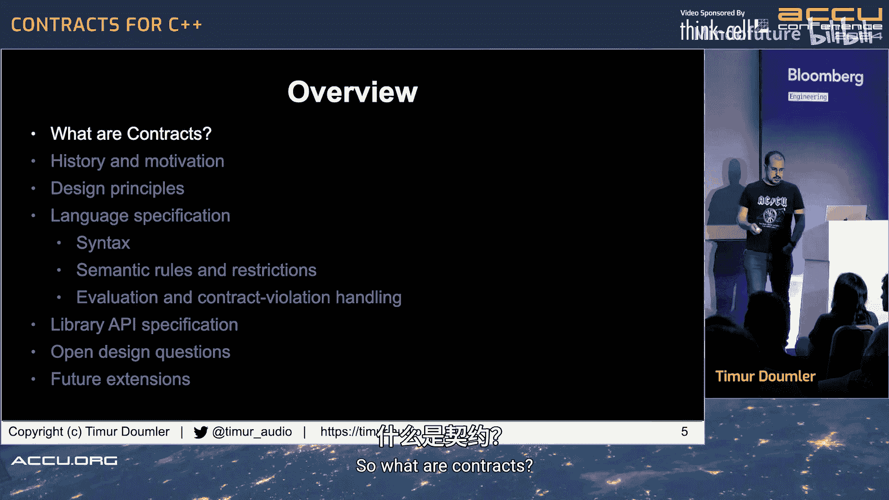

It's a concept that was developed in the 80s。 Berton Mayer was the key person there。

 This approach for software design， which says that， you know， you can specify formal。

 precise and verifiable specifications for the interface of software components。嗯。Some of which are。

 why is this so yellow this slide is this。So it's gonna be on the video like this。 Okay， well。

 I think it's readable。 So it's fine。 So we have precondition， post conditions and variants。

 And also are collectively referred to as contracts in accordance with the conceptual metaphor with the conditions and obligations of business contract。

Now， what is a contract， contract is a set of conditions that expresses expectations on a correct program。

 right， If the contract is not fulfilled， the program is incorrect。Now。

 one type of contract is a function contract， which is a contract on a function dial。

Comes in two parts， precondition and post conditions。

A precondition is the part of the contract that is on the side of the caller。

 What the caller of that function should satisfy in order for the problem to be correct。

Those are requirements on the arguments you pass in or some other state visible to the function at the moment。

 you call it。And a post condition is the part of the contract that the function implementation itself is responsible for for satisfying。

 So what does a function guarantee， maybe the return value or maybe some other state that is observable。

Is observable after the function has returned。There are a few other types of contracts。

 class andvaris and loop invaris。I'm going to talk about those because you don't yet have a proposal to standardize them and put them into serious class。

So we're gonna focus a lot on function contracts。 Here's a little bit of terminology as well that is used throughout a lot of talks and papers that talk about the stuff just to get us all on the same page or were like what words we use and what they mean。

So as John already covered in his talk， a function has no preconditions。

 He's a white contract and a function preconditions that has preconditions has a narrow contract。

And for such a function with the narrow contract， If you call it in contract。

 then we satisfy the preconditions。 If you call it out of contract， we don't satisfy them。

 And out of contract call is a bug。We also call that contract violation。 right。

 So let's do this exercise again， Let's see。How good you are with this。

 What functions have wide contracts， What functions have narrow contracts in the standard library。

 you all know vector。 Ve is a good one。😊，Or exercise。

 Does it have a wide contract or does it have a narrow contract， narrow or wide。W， Okay。

 good Re empty。W wide operate square bracket narrow， right， It is。

 It is always a bug to call vector operator square bracket with an out of bounds index。Operator app。

Why， right？ So it's not a bug to call it with an out of bond index。 It's not unfined behavior。

 It's anything like that。 It's perfectly fine to do that。 It's gonna throw an exception， right。

It's not a contract violation。 So that has a wide contract back to front， narrow or wide。Narrow。

 right， It's a bug to call it on an empty vector。 vector back。 narrow。 Okay， vector reserve。Why。

 wait， it's never a bike to call vector reserve vector begin。W， you're good。 You're good。

 You got some practice with the previous talk。 So got it's good stuff。 Right to end， wide。😊。

Back to push back。Why do we know this， right？ So if pushback fails。

 it's still perfectly well defined behavior。 It's not a bug。

 It's gonna guarantee that the vector is still the same。 It's gonna throw an exception， right。

 It's all fine。Back to swapamp。 now I got you N wide。 why， you know this。 So and so yeah， okay。

 you know this。 everybody else， N wide。So depends， right。 So the standard actually says that。If。

If they have the same allocator， you're good。Otherwise。

 the allocators shall not be swapped and the behavior is undefined unless less allocator unless they compare equal。

 basically。So it， it depends on the type， right， It depends on the allocator type。

 and it also then might depend on whether they actually have the same allocator。Right。

 so what happens when you have a contact violation。

 So the first really important thing in this kind of mental framework is that a contact violation is not an error。

 right， An error is something like corrupt data or like out of memory or some other thing that does not depend on your code。

 but something that comes from the outside， right。No， no， contact violation is a bug in your code。

 right， It's， it's a bug in the program。 So it's very important to separate error handling from contact violation handling。

 Those are completely different things。So， and who' is responsible for the contact violation Well，'s。

 if it's a precondition violation。The call of the function， as you said already。

 and if it's the post condition， then it's implementation of the function itself。

And for the other contracts that we don't yet propose to add to standard Cspace。

If it's a class invariant， then it's on the implementation of the class to satisfy that。

 If it's a loop invariant， it's still。Whether you implemented the body of your loop， correctly。

 et cetera， et cetera。 So what happens when there is a contact violation？ Well。

 that depends in different contexts， different things might happen。

In the CS Standard Library specifically， it's undefined behavior。Right。

 so if you look in the standard and in the preamble of the library section， the standard。

 it says that recognitioncon is a condition that the function assume to hold whenever it's caught。

 So it's like a very specific interpretation of this broader， broader concept。

And violation of AD precond results in undefined behavior。

The other important bit here is that the standard doesn't distinguish between library undefined behavior language。

 undefined behavior。 It's just all undefined behavior。 Right。

 So if you call vector or the core bracket with an auto bound index。

 according to the standard that undefined behavior， editing can happen。And for post conditions。

 it doesn't really say that， but if proposed post conditions is violated。

 That's a bug in the standard library。 So that's also kind of outside of。

The scope of the standard document， I guess。So how do we specify a contract？😊，嗯。More often than not。

 it's specified somehow in the documentation or in a specification of a function， right。

 And whenever that's the case， we call that a plain language contract， right。

 So there's different ways to do this very commonly in source code comments， right。

 Just comment above the above the function， right， The behavior is undefined unless this condition is satisfied。

 Another way to do this is to do this in a separate specification document。

 we do this in the standard。 precondition of post conditions are defined in that separate document。

Or possibly both， right， you can generate oxygen documentation from comments and stuff like that。

Sometimes it's implicit， It's not written down anywhere， but it's just an agreed upon convention。

 like。Generally， like part of contract of a function is that you can call it from multiple threads simultaneously and it's not gonna introduce a race condition。

 You don't have typically have to write that。 That's like a assumed contract。

 but it's part of the contract of such a function。So this is one way to define contracts。

 And I would say it's the most common one。Another way to specify contract is in code， right。

 And when we have some kind of syntactic contract that lets us specify contract a part of a contract in code for the purposes of this presentation。

 we call this a contract assertion。So these are two really， really important pieces of terminology。

 When you just say contract， it's a very ambiguous term。

 So I just encourage us to not use just the naked word contract because it's very vague。 Like。

 it can mean different things。 But instead to talk about plain language contract and contract assertion。

 right， If it's a contract that's written down somewhere， it's a plain language contract。

 If it's a contract that youre。Like expressing and code， is's a contract assertion。

 So let's just use those two termsrks。And so。Conduct assertions con specifications in code is a programming language Lets us do that。

 We call that a contact facility。 So a contact facility is is a feature。 lets us do this， right。

 And it can be a language feature。 It can be a library feature。

 There's a bunch of programming languages that。Have that as a language feature。

 like the ISL programming language。 I think pi near this。 we have them in D。 we have them in ADda。

There's other programming language like I think， I think C shop， I think has it as a library。

 if I'm not mistaken。And so what this paper proposal for the standard that we're aiming to get in C S 26 that I'm gonna be talking about is proposing is to add a contracts facility。

A wayay to express contract assertions and code to C plus fast as a language feature， okay。Now。

 if we have a way to write such contract assertions like here， for example。

 a precondition and this is the syntax we're currently proposing。

 And I'm gonna talk a lot more about how this all works in a second。 But if we have such a feature。

 such a contract facility。It's important to remember that that typically does not express the entire contract of that function。

 And that's impossible in general。 So typically， if you have a contract assertion like this。

 it expresses a particular provision of the plain language contract。

 So the plain language contract has a bunch of stuff， you know。This is a precondition。

 This is a precondition。 This is what the function guarantees。 This is， you know。

 what the function upholds， whatever。 And then some of those you can express in this way。

And the way you express this is to basically specify。

An algorithm a kind of general sense that allows you to。Either verify that。

 that provision of the contract， that subset of the contract that we are expressing here has been complied with。

Or whether that particular provision of the contract has been violated， right。

 So there's an algorithm that lets you determine that。We call that contract check。

And so in this paper， P 100 R 6 that we' are proposing to add to C plus。

 the way to express such an algorithm is via a boolean expression， which evaluates the true or false。

 right And so we call that boolean expression， which is the red bit here inside the a parentheses。

 a contract predicate。 So that's another word that's gonna reappear a lot in this talk。 a predicate。

 So that's this boolean expression there， which is gonna tell you whether the contract has been violated or not。

Actually， that， that particular provision of the contract because of plain language contract might be bigger than that。

Al， so we can check provision of the contract。Like this by evaluating this expression， sometimes。

 you know， that is very straightforward to do。 for example， with operate the square bracket。

 It's just a comparison， right， so we can very straightforward。

 leaveve come up with a bullying expression that checks that part of the contract。😊。

Sometimes we can do it in code。But it is very expensive computationally。

 Or the act of checking a precondition actually itself violates another precondition or another part of the contract。

So， for example， you might have a binary search， which is log n but then the precondition is that the range is sorted。

 but verifying that the range is sorted as log n is not log n， but actually O N， right。

 so that like checking that would actually break the other parts of the contract of that function。

 The guarantees that it provides about algorithmic complexity。

 And so you probably don't want to just check that precondition everywhere even probably in your debug build。

 Maybe you want to check it only in a special super debug build or something like this， right。

 depends on what you're doing。Or maybe you don't want to check it at all。

 but you still want to have it there in case one day you do。Sometimes it's not only expensive。

 but actually impossible to check just with a C plus plus expression without some kind of additional instrumentation。

 like a sanitizer。 Like， for example， a very， very common precondition is that this pointer points to a valid object。

Right， but we can't write a C expression that verifies that。 That's just not possible， right。

 So you have to do something like a sanitizer。 where you have a bunch of additional instrumentation that tracks the memory。

 which obviously has a huge impact on performance and size and everything in order to be able to check。

Such a precondition programmatically。 And sometimes you just can't do it， right。

 Imagine a function that takes another function。 And the precondition is that that other function pulses。

 which is the halt problem， right， There's no algorithm to do this in general。

So you can't check it programmatically。嗯。So again， contact assertions in general。

 they only specify a subset of the plain language contract， right， So that's， again。

 this distinction between plain language contract and contact assertions and contact assertions typically only express and specify a subset of the plain language contract。

 Thats very， very important to remember。Right， so now we are moving forward to， kind of， okay。

 let's take these concepts and see how we can build a feature。😊。

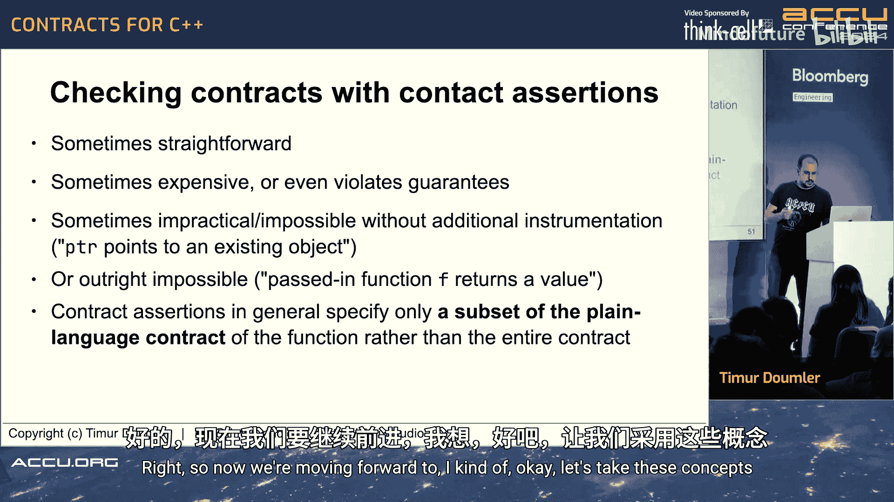

For C plus plus that actually lets us do this。

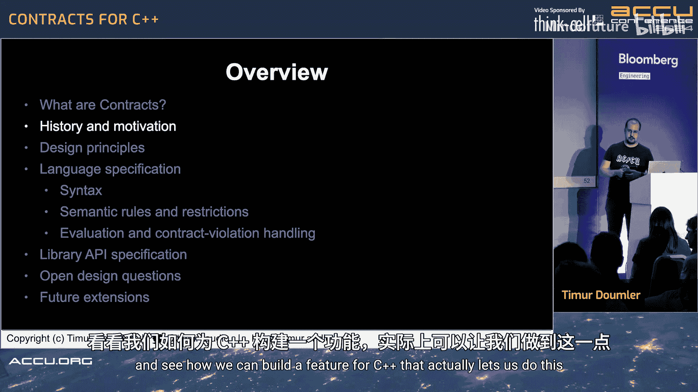

So I'm gonna to talk about the history of that and why you would want to do that。

 Turns out C actually does already have a contract facility。Who knows what that is。It's a。 Yes， C。

 As is a contact facility。 Let's see us express。😊，Precondition。

 post conditions assertions in code and check them。 that's a contract facility。So， I mean。

 it's a very limited contract facility。 So you can't put， for example。

 a precondition check on a function declaration on the interface。 You can。

 you have to put it in the body， typically as the first thing。

Very often you see assertions as a first thing in a function body。

You can't customize the behavior when the contact relation has been detected。 right， It's just gonna。

It can do two things， right， If any bug is not is defined。

 then it's gonna to and ignore the entire macro。 And otherwise it's gonna call a board like print something to stood out and call a board。

 That's what's stood earth'm not sure。And， and call a bo。 That's all it does。

 You can't customize that。There's no information about what happened programmatically available。

 right， you can't query in code like what went wrong and where like that's just not， not there。And。

Also， it's a macro。 Maccro has had lots of problems。 There's certain things like。

It kindly brace us with a comma that you just can't put there because it's going to break the PAser。

If， if you， if you like， ignore them， they're actually gonna be token ignored， which means， you know。

 you might get bitroought because that code is actually not being compiled。

 It' being just removed textually and even nasty year problem with micro assertions are or the as。

 right， If you have the same function， you compile it once with assertions on and once with assertions off。

 And then you link those together in the same program， you're not gonna have a good time。So。

 and like for all of those reasons and more reasons。

 we really need a conflict facility as a language feature。

Not as a library feature in form of a macro。So we can put preconditioned post condition search on declarations。

 on function declarations。So we can use these things portable across different code bases。

 across different libraries。 So there's like one way to do this。

That everybody can agree on that works across API boundaries。

 We can customize the behavior without running into audio violations。So yeah。

 and we don't want to like macro ignore stuff。 You want that code still to be checked by the compiler to avoid bit right。

 right， there's this problem that if you have some assertions that are just off for a while and then you like。

 you know， undefinine andbug， then everything just explodes。Like， you don't want that。

 You don't want that code。 You want that code to be paused even if you don't actually check。The。

 the predicate。And you want some information about the conduct relation to be available programmatic。

 you can do something with it。 You can like。You know。

 have some custom function that calls phones home and tells the server know what line of code the violation was and stopped like this。

And the other reason why you want this as a language feature is you want that to be accessible to tooling。

 right， So you want like the entire ecosystem to agree。 this the syntax。

 how you express these things so that an I D E， for example。

 can like nicely color them and have like a little pop up here。

 the preconditional postcon of that function or a static analysis tool can go ahead and do something with them。

 right， because it knows what they look like。😊，So these are all very good reasons why you want that as a library the language feature rather than as library feature。

 so。😊，CO has been around for like 40 years。We want something better。 So for already 20 years now。

 people have tried to put this into C plus plus。 It's a a very long and storied history behind putting contracts into C plus plus。

 So the first。Proposal to add a fully featured contract facility as a language feature to。

Was actually by 2004 by Torsin Autan。 that's 20 years ago。 Okay， this paper in 1962。

 and he basically was inspired by D， the D language and the proposal was。Basically。

 let's take the way it's done indeed D and just do that and see plus bus。

 So it looks something like this where you have this preconed and post conditioned blocks。

Like one one each， and then you can put different statements into those blocks。嗯。

It went on for a couple years。 but like， it was away before my time on the committee。

 So I'm not exactly sure what happened to that proposal。 Ki of the。

 the paper trail just goes cold at some point。 I think it kind of fizzled out because there were not not enough people to help out with actually specifying this and。

So that it's like can be put into the standard。 So it kind of fizzled out。Then there was a。

 a second phase。 It's a bit like with the， you know， the M C U， the Marvel cinematic universe。

 It has like different phases。 And like， it's like this。 Like， this is phase  one。😊。

Phase 2 was an effort by John Lakes and a bunch of other people from Bloomberg。

To standardize something that is very similar to what they have in their B D E library。

Which are these kind of macros or macro like entities that were proposed for the standard library。

So they don't go in interfaces。 They don't go on declarations。 They go in a function body。

But they can do more than than just。Good， like old C macros that like more configurable more stuff going on there。

This was like the， the synt also went through a bunch of iterations。 I think initially。

 it was in all caps。 and it was changed。The last iteration of this have this syntax。

 which ironically， is a syntax that we now have also in the latest proposal。嗯。

That went on for a couple years， That effort， but then horribly failed in plenary。

Ca people didn't want anything resembling macros in the standard library。

From the ashes of that project and some other work that simultaneously has been going on by Si Daniela Garcia and。

Gabriel' race and a bunch of other people like were in parallel working on。

 on another way of doing this。 So they all kind of joined forces and。

That launched phase 3 of the epic Let standardize contracts receiptpa saga， which went on until 2019。

And they got as far as actually getting in the into the seat。 Let's start see a 20 working graft。

It had this attribute like syntax with these doubles square brackets， Exps for preconditions。

 ensuresure us for post conditions and assert for kind of mid function by the assertions。

And that went all the way into the working draft。 Then some issues were discovered with it。

 and then people didn't。Quite agree on what these issues are and what the right way is to fix them and。

Yeah， we had this meeting。 I think it was summer 2019 and Cologne。

 we had a committee meeting where things got quite， but heated。And at the end of that， basically。

 the entire feature got ripped out of the working draft。

And that was the last meeting like because the feature freeze meeting for it was us 20。

 So the result of that was that。None of it made it into the standard。

And a lot of people were upset and sad。That was also kind of the。

 the time around which I got dragged into all of this because I was like， oh， okay， well。

 how hard could it be。 Let me， let me try and figure this out。Yeah， so here we are today。That was。

 yeah， that was kind of the epic conclusion of the。

 of the third phase of the the three first three phases of this saga。 and then。

That kind of launched phase 4， which is where we are today， which is。

 we call this the contracts M VP。 This is the latest effort that's been going on。

 Also ready for five years now。So what happened in Cologne after 2019 after the feature got ripped out is that we actually created a new study group on the committee。

 So we have this kind of three tier structure on the committee we have。Actually。

 four tiers at the very top， we have the plenary， which is the everybody， like everybody votes。

 And we agree on this goes into the standard below that。 we have the wording groups。

 which approve the wording below that。 We have the evolution groups that approve the design。

For library and language separately。 And below that。

 we have these study groups that are doing kind of work that's more kind of specific to one topic。

 And we started S C 21， which is a study group for contracts。

 which I am chairing together with John Spicer。And so that started in 2019。

 And the first thing that we did there was we realized that one of the reasons why it took so long and we still didn't have anything that people agreed on would be good enough for the standard。

Is that people didn't really agree on。What contracts are for。

 like what you're supposed to do with them， how are you're supposed to use them。So。

 so there was a lot of disagreement on that kind of very basic question， like。What are they four。

 So we went and looked into this。 There was this paper from， yeah， early 2020。

Where we collected use cases for a contract facility and that paper lists 196 use cases。

 And itd be then an electric electronic poll， where we ask the committee which of these use cases you consider more important or less important or like a must have or don't care about this。

 And quite a few people actually click through all of196 of them。 And so we rank them。

 huge effort going on。So， yeah，196 use cases。 but most of them kind of fall into Fs buckets。

First one would be， okay， we want to have a contact facility so we can document contracts and code rather than in plain language。

Right， so people can read it， but also tools can read it。 That's， that's good， right。

Second motivation is that you want to check those things at runtime。

 much in the same way you do it with a cer today， you can turn shakes on and then know if。

 if any of those checks fail， you， you get something you can do something with。

People also want to use them for static analysis。😊，So that static analysis tool can go ahead and say。

 okay， this function is calling this function。 and this function has this post condition。

 and this function has that post con precondition。 And I can kind of tell a compile time or like during static analysis time that like。

 you might not actually satisfy this precondition here。 Like， there is like a logical thing where。😊。

You know， this might not be satisfied here。 You might have a bug here。

And then the kind of more extreme version of that is formal verification， right。

 where you can actually。For certain limited problems。

 formally prove that the precondition and post conditions and assertions will always be satisfied。

And then the fifth use case， which is kind of independent from all the others is that people want to。

 instead of checking contracts， They want to assume them basically have a way to tell the compile。

 Okay， and know， this is always going to be true。So just don't check that and just basically optimize based on the assumption that this is always gonna be true。

And then we get faster code。Right。And so， I mean， this is essentially what happens today with like vector orbittic square bracket。

 right， Like the compiler can assume that you're never gonna quote it all of bounds because that's undefined behavior。

 Unfined behavior can never happen。 So， you know， the compilers free to optimize your program based on the assumption that that's never gonna happen。

And then you get weird things。That so， so those are roughly the five buckets of things that people wantan to do with contracts。

 And， of course， as it always is， it's not actually exclusive to contracts。 I think it's with。

Kind of other big features as well。 But I think with contract。

 especially what happens on the committee。Is that people want everything， right？

 So they want this thing。 I don't know if you're familiar with German folklore。

 but there is this mythical beast and German folklore， which is called the egg laying woolm pig。

 The German word for this is more fun。 It's obviously one word。

So it's like this thing that just does everything simultaneously and satisfies all the needs of everybody。

 right？And then when you're in this situation， you realize。Well。We can't do that， because。

If you w to do all of this。It will take us another 20 years to agree。On like。

 whether this is the right specification for that and， you know。

The rate at which new like issues come up will be faster than the rate at which we can agree on solutions。

 And so we will never be done。And， and this will never be in standard。 which is kind of what。

Has been going on。But then we realized， okay， well。

 maybe we don't have to satisfy all features in the first version。

 Maybe we can do something more limited first and then add to it later。

 And then once we realize that stuff gets better。And then the next problem that typically happens。 I。

 I think this is kind of like so psychology。 It doesn't actually have much to do with C plus plus。

 but it's one instance where you can see it playing out is that typically once you realize that you can't。

 that the egg laying woolm pig is unattainable。嗯。And you have to limit yourself to something。

 The next thing that happens is this。 This is something that comes from Russian folklore。

 So anybody who grew up in Russia will know this this the fable of this snder pike and the crab who are like this。

 this， this cart with something really valuable in there so they want to get that home so they can get to the valuable stuff inside so they kind of pull it from wherever it is。

😊，But everybody's pulling in a different direction。

 right so the swan is pulling upwards towards the sky and the pike is pulling down to the river and the crab is going sideways。

 and then basically this car is not going anywhere。So we had to overcome that problem。

 But we kind of did that。 So we kind of agreed that， okay， we can't get everything。

 So let's limit ourselves to， you know， those things。And we managed to actually agree， okay。

 those are the things we want in the first version and the rest we can tackle later。

And that a rise to the contracts MP， which is what we call the current proposal。

 It's a meaningful viable products that does not yet support all the use cases。

 but we explicitly design it for accesssibility。 So whenever somebody says， oh。

 but I want this other thing， which is not here。Instead of saying， okay， we're gonna add this now。

 I'm gonna spend another 20 years arguing about how to specify this。 And nobody's gonna get anything。

 We say， okay， here's an evolution path how we can do that afterwards。

 So let's first standardize this。 And then， but it's designed in such a way that you can add this other thing on top in。

 you know， C S 29 or whatever。😊，And it already provides immediate value for enough people that is worth specifying and standardizing。

 but not for everybody。 doesn't specify satisfy everybody's use case。

 And that's okay because we can do that in the next verse。

So the latest public version of this proposal can always be found at this URL。 Like in general。

 that holds for every paper number on the committee。 It's like usually P， something。

 something number。 When you see that， you can type W G21 dot link slash paper number。

 and then you get the latest version of that paper。And if you put our number。

 then you get a specific revision as well。So we are currently R 6。

 That's the latest published version as of now， April 2024。

 So that's the version where S 21 I C agreed that this is what you wanna put understand it。

And move forward to the nextus。Level on the committee。 Remember， there's this four tiers。

 The next level is。Evolution working group and library evolution working group that are the non topic specific groups that look at all the features and approve the design of those features。

So they looked at our design， and they had a few。Let's say questions that need to be addressed。

So now it's going back to us。 So it's gonna be an R 7 very soon。

 I guess in the May mailing next month that addresses that feedback。 we already addressed some of it。

 but we didn't publish that yet because it's still gonna in the middle of that process。

 We have telecoms every week。So yeah， you have to address the feedback from those groups。

So going back to these five buckets。 So what does the context MP give us， Obviously。

 it's gonna give us self documenting code because we there's a syntax to put these conduct assertions on things。

 right， So you get that。Humans can read it。 Tools can read it。 I D can read it， etc cetera。

 et cetera。We also get the second bucket， which is runtime contract checks。

So we are aiming for this to be a better replacement for C asserter。

 So you should not have to use C asserter anymore。 You should not have to use custom assertion macros anymore。

 Who here uses either C As or custom assertion macros in their code base。That's almost everybody。

 I have firstly never worked on a code base that didn't use some form of assertion macro。

Mostly custom because CSR is just kind of too limited。Hopefully。

 none of us will ever have to do this with macros again。嗯。

Gives you customizable behavior can go and decors all the stuff， no macros。Now。

 the the remaining three buckets。So we don't explicitly not support them。

 but we don't have any facilities in the first version specific for those cases。

 like we have a syntax which a static analysis tool can consume and do something useful with。

 And that's great。 And we hope that they're gonna do that。

 we don't have any features specifically targeted at static analysis， for example。

 we don't have any feature where you can say， oh， this assertion。

 it needs to be valuable at compile time。 So that static analysis tool can definitely do something with this。

 right。😊，We don't have that feature。 We might add that later， or maybe not。 but currently we。

 we don't have that in this paper。 And we also don't have a way for the to tell the compiler。 Okay。

 you know what， I know this is always gonna be true optimized based in that assumption。

Like compiler can offer that mode ass an extension， and we might add it later。 In fact。

 I very much hope we will。 but not in this kind of first version of the contact MP that we are aiming to get into CS S 26。

So what happened before Tokyo， which is was the committee meeting last month， is that S21 agreed。

 this is the design you want。You approved that great。 You forwarded to the next level。And yeah。

 as I said， they had some feedback。 So we have some more work to do。If you look at the timeline。

 this is kind of the CB S 26 kind of release schedule。

 Like we have three committee meetings per year。We are currently here。 right。

 so next one is gonna be in June， the second meeting of 2024 in St Louis。And。

We have three committee meetings left before the evolution study group needs to approve this design and forward it to the worded groups。

 And if you miss that， deadline is not gonna be in S 26。

 So we have three more committee meetings to figure out our differences with the evolution groups。

I'm really sure be're going to get there three committee meetings is a lot of time。

 It's basically a year。Where we can do a lot of work。

 we also work obviously a lot in between these meetings。 So I'm fairly confident that， you know。

 we're gonna get this in 26。😊，Obviously， can't be 100% certain。But I't much tro you do it。

 I think it's very realistic。 We are doing a lot of work we're meeting every week。 So， so very good。

😊。

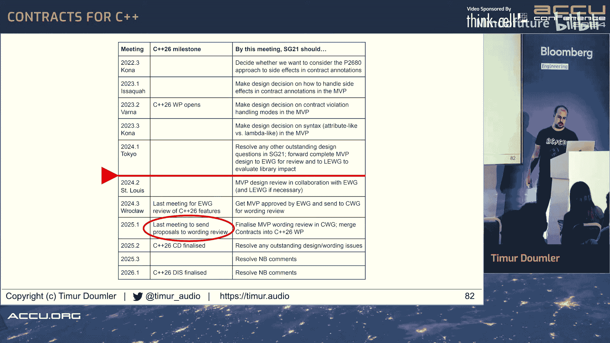

Right。Design principles。嗯。So how did we design the cons M VP and what are the guiding principles。

 the guiding things that we want the design to fulfill， right。

 so before we talk about the concrete of syntax and stuff， we're gonna talk about that in a minute。

 Let's talk about， you know。How we designed that， There's a few things that， for example。

 the previous C S 20 proposal did in a certain way。

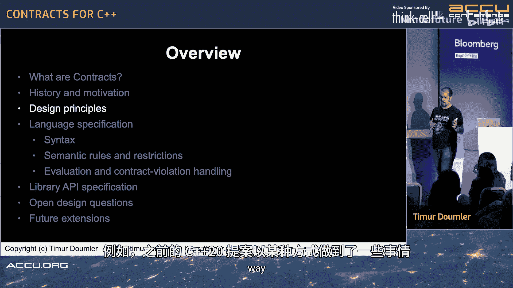

Where we said， maybe that's not a good way to do this and not just like concrete properties of a specification。

 but more like on a meta level。 Yeah， this approach。Maybe it's not good。

 Maybe that's part of the reason why， you know， it then blew up horribly in Cologne。

 Maybe let's not do that again。So。One of those principles is that contact assertions are there to help identify bugs in existing programs。

 right， So you have a program which might have a bug。 You add contact assertions to it。

And you turn those checks on and， they should tell you if that program has a bug。

 What they should not do is to change that program and make it into a different program， right。

 because then you are， you're not checking the program you wrote。 You're checking some other program。

 right， So， so adding a conduct assertion to your code should not change the compile term semantics。

Of your program， because otherwise， it's gonna be a different program。 obviously at runtime， like。

 if you're checking something， you're evaluating code that you're not otherwise evaluating。

 that's fine， but it shouldn't。Fundamentally change what your program does。 And to be very concrete。

 there's like three sub principlesles here。 One is something that。Josh。

 one of the other authors of this paper calls conceptcepts to Nazi contracts。

So contract annotations should not be seen by concepts， right， It shouldn't change whether a concept。

 which is a compile term thing is satisfying。Conduct annotation should not affect over resolution。

 You should never have a situation where you add。Contact assert is an existing program。

 and that will trigger another overload to be chosen。

Those things are really bad because then maybe the other overload that's going to be chosen does not have a bug。

So you're looking for a bug， you add a conduct access to find a bug。

 But then you end up with a different overload that doesn't have the bug。

And then you turn it off again。 and then you have the bug again。

 So that you get like a has bug right， That's not。 We don't want that。 That's bad。 Like。

 if we get ended up in that situation， then we fail to provide a feature that finds bugs and programs。

 right， So we don't want adding a contract assertion to effect all that resolution effect。

Type trades affect the result of a no accept operator。 That's an important one。

 Whether no accept is true or false， There's an operator that you can branch on at compile time。

 You don't want to end up in a different branch just because you added the contact as that would be very bad。

We shouldn't be able to sna on it， et cetera， et cetera， et cetera。So the other sub principle is a 0。

0 overhead principle， which means that。If you add a contract assertion， actually。

 this says annotation。 This is outdated terminology。 We don't call them like that anymore。

 You call them conduct assertions。 Now。 I'm gonna fix that on that slide。 apologies。

 an ignored contract assertion should not cause additional copies or distractions of objects or other code to be performed。

 right， obviously。If you're checking the predicate。

 you will perform extra operations because you're evaluating a Boolean expression。

 But if that check is off。 if it's not doing anything， if you decided to not check it。

 then the mere presence of the conduct assertion in your code should not lead to more work somehow being done。

Then it would be without that assertion being there。

 We're gonna see a case later where that might happen。

 And we have to add a special rule to make that not allowed。嗯。

And then the third subprincple is semantic independence。

 We don't want to have a facility in the standard that lets you basically detect that compile time whether the checks are on or off something like anybody that you can branch that compile time。

 We don't want to have that kind of feature because then you could circumvent this whole principle and and do bad things。

 And we don't， we don't want that。 Of course， when reflection enters the arena。

 it's gonna be interesting because you might want to reflect on whether， for example。

 the function has preconditions that would be very interesting。

And we don't necessarily want to preclude that， because if you are reflecting on something， then。

You are kind of already saying， okay， I'm just gonna。

They' look at the language from above and do some stuff that I'm not otherwise able to do。

 So I think reflecting on conduct As is fine， but we need to be very careful。

 like what we allow there。And how is going to work。

And it's fine because the reflection people told us that they're not gonna plan to add， you know。

 the ability to reflect when contract assertions for US 26。 Like reflection is heading for US 26。

 is's very exciting。 But like， there's not gonna be initially a feature there to reflect on。

Conduct assertion。 So we have a little bit more time to figure this out， which is， which is fine。So。

 so in CS S 26 there's not going to be an ability to reflect on the presence of contract asserts of whether they're enabled or disabled or or something like that。

 which is good。Another principle， compatibility with existing code。 We don't wantna break stuff。

 I mean， that should be obvious， but。Maybe it's not obvious。 So we need to state this。

 This is something that， for example， it was 20 iteration of contracts did。Very badly。

A lot of stuff there was defined to be undefined behavior。 If a predicate has side effects。

 that's undefined behavior。 If， you know， this happens， this is undefined behavior。

 This is one of the reasons why， you know， that didn't go well。

 So one design principle that we have is that we are not intentionally introducing new undefined behavior。

To the language with this feature。 Okay， we're not， we're not doing that。So。

 so adding contracts to the language should not know add U B that wasn't already there before。

And the other thing is that we don't want to break AI， right。

 So if you have a function and you have a declaration of that function and then you have a binary that。

 you know， has a implementation of that function。 And now we add you know。

 precondition post condition checks to that function declaration in the header。

We don't want the A BI to break。 You should still be able to compile with， with like that。

 that binary we don't want， we don't want the AI to change。

 So adding those things should not be an AI break。And here's another set of principles。

 How to conduct annotations Again， this should say assertions。 I we need to fix those slides。

Relationship between conduct assertions and plain language contracts。

So this is kind of stuff that you partially already discussed。

So precondition post condition specifiers are specifying a subset of the plain language contract over function。

But what's really important here is that they specify a subset of the plain language contract of that function and not some other function。

 So we don't want。Contract assertions to somehow appear from， from， from somewhere else。

 And then all of a sudden， assertions being there when things that I should not part of the。

Plain language contact of of that function， which is。You know。

 it's going to get interesting when you start interacting with inheritance and things like that。

Or another another one here is if you have a template function template and it has precondition post conditions and you specialize that function template。

 You have a specialization。 You don't want to just get the automatically get the pre impose post conditions from like the primary template because you're specifying a different function。

 You don't want them to just be pulled in without your knowledge。 No。

 you want to specify your own function contracts。So function contracts are function contract assertions are specifying the subset of the contract of that function that you wrote。

 where you wrote them， okay。The other thing is， it's kind of a longstanding confusion， I guess。

 whether if you have pre and post conditions on a function。

 whether that's part of the interface or that's part of the implementation。

And whenever people are arguing about this， it's a symptom of。

Kind of now you're thinking about this wrong。 They're neither。 they're both at the same time。

 They're like the thing that's in between， the thing that like。

Connects the interface and implementation and decides what things can go through that boundary。

 right。So that's why， for example， pre and conditions can be specified on the declaration。

 which is part of the interface， but they can also refer to private members， which are part。

 for example， of a member function， which are part of the implementation and things like that。

So they're the thing that connects interface and implementation。 They' are not part of either。

 and they're part of both。 That's the right way to think about this。And finally。

 we already discussed this contact assertions are not。 they're there to find bugs in your program。

 They're not there to control program flow。 That one is really， really important。

If you want to control program flow。They're a great feature in the language for that。

 which is called an if statement， right？ So conduct assertions are not there to do error handling to do input validation。

 to do things that you always want to do right， because you can turn them off， right。

 And then it's as if they were not there and you don't want your error handling to disappear if somebody has a different compiles like。

 right， So if there's something that always needs to happen whenever you run your program。

 use an if statement。 Don't use conduct assertions。 Con assertions are。😊。

If the salient kind of difference within conduct assertions and if statements or things like that is that you can turn them off。

And the decision， whether or not to turn them off is not made in the code。

 but it's made when you compile the program。Alright， so that。

 that is the one kind of key difference between conduct assertions and all the other。

Language features that we have。 So if that's not what you want， then don't use。

And this is the last slide about design principles。 We designed the coin MP for extensibility。

 So whenever somebody says， I want this， and we are like， well。

 we don't know yet how to do this or like， this is a huge amount of work。 If you do this now。

 We're not gonna get this feature C 26。 whenever we hit something like this， we， we're gonna be like。

 okay， but we're gonna make sure that we can add that later that we don't close that design door。

 We're gonna like keep the design open so that we can extend it later。 That's super important。

 That's this whole， like。Thing has been designed with this requirement in mind。 And finally。

 whenever we are not sure what to do， it's like， oh， theres， we could do this or we could do that。

And there's really good reasons do this。 and really good reasons to do that。

 And they're mutual exclusive。 And we're not sure what the right tradeoff is。 And we don't agree。

 We just bake the whole thing all formed。 like， so that we don't paint ourselves into a corner。

 you know， And then we can decide later。 So we don't choose one or the other if you're not sure。

 And we also don't make it unspecified or underlying behavior because that's just。Bad for the user。

 we just make it little form instead。

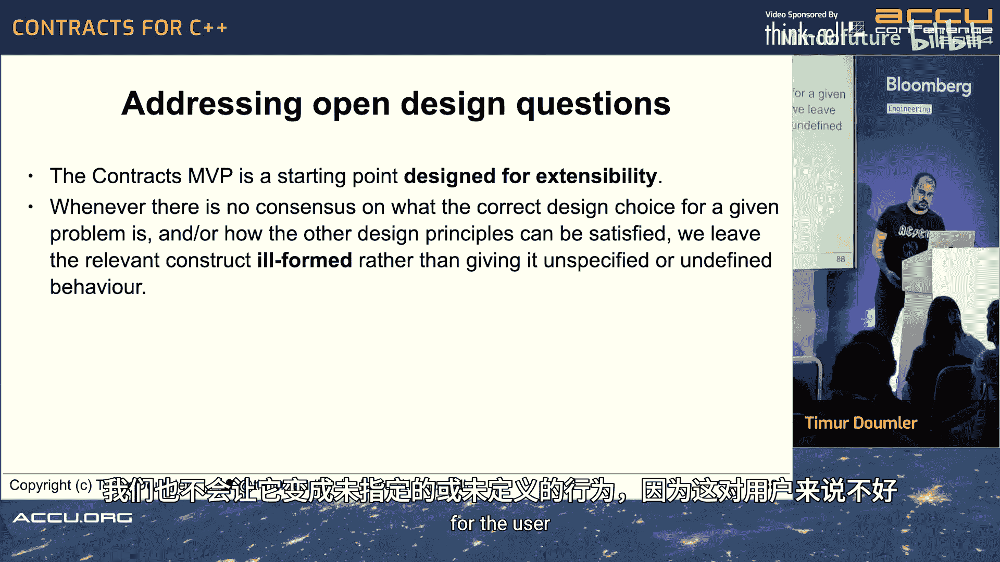

Right， so now let's dive into the actual specification。 Am I about half my time is up now， right。

 I that correct， I started at 4。 Okay， so now you're actually gonna talk about what's in the proposal。

 which is what you've all been waiting for。 So thanks for bearing with me for the last 45 minutes。

 That's what is actually being proposed。😊。

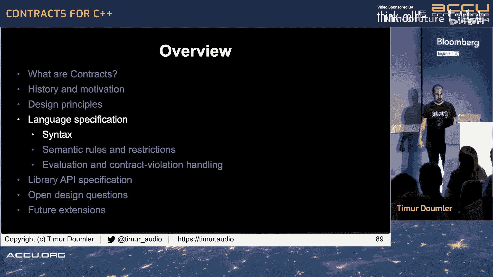

So， we have。This syntax are pre。Pren's Boolean expression to specify a preconditioned assertion on a function。

We have post pers to specify a post condition assertion。 And that one has a little extra feature。

 You can put like any name that you want， for example， R。

 to refer to the return value to the value that this function is gonna return。 And you can use that。

 You can give it a name like R or red or whatever。 And then you write colon。

 And then you write your expression。 And then you can， you can use that there。That's optional， right。

 You don't have to write the R column。 You can just omit that。

 like not every post condition needs that， right？ So， for example。

 the post condition of empty on the vector that size is equals 0 afterwards。

 It's not talking about the return value。 That's fine。 So that's optional。

 pre and post are contextual keywords。 They're not full keywords。Which is really important。

 It means that it's not gonna break your code to add this feature。

 like whenever you use pre and post as a variable name or a function name or whatever。

 it's all still gonna to work。 They're all going only going to be passed as contact assertions in that exact syntactic position。

 which is the last thing before the semicolon， or if it's a definition。

 the last thing before the opening price。 only in that position are they passed as contact assertions。

 Otherwise they're passed away。 They're passed today。 Nothing's gonna break。

 We made sure that this works。So， yeah， they can go on declarations。 They can go on definitions。

 They can also go on Lada expressions because those are kind of also functions。

 If you put pre and post on a landda expression， it applies to the operator parent parent of that。

 the underlying closure time。And then we have a third kind of contract assertion。

 which is called contract As。 and it's different because it's not going on the declaration。

 It's going inside the definition。 It's a statement。That one is quite similar to micro asserter。

 except it's not a macro。And so context set is actually a full keyword。

 and we need to do that so we can disambiguate this from a function call expression。😊。

And it's also not assert。 Like we really， really， really wanted to use the assert keyword for this。

 because that's what every other programmer language does。 Unfortunately。

 that is already taken by the assert macro。And we spend a lot of time trying to figure out。

Because the fun thing is contact assert by default is doing exactly the same thing as a。Like。

 it checks the expression。 And if that's falses， it prints something to stood out and terminate。

 right， So it's exactly the same behavior by default， right。

 you can obviously customize it a lot more。 But so if you were like， oh。

 can we somehow show on like macro aser into this so you can reuse the macro like the assert keyword and and have this and it's kind of。

It turns out it doesn't really work because as soon as you define any bug， like。

 it's doing something else and。Yeah， basically， we can't break macro asserter and we can't also have code that means different things in different places。

 So we had to choose a different keyword。 We spent a lot of time trying to figure out what would be a good keyword that's not a search。

 We looked at 100 different keywords。 We rank them all。 According to 10 different criteria。

 It was a lot of work。And at the end， we agreed that contract As is， is the best match here。

So that's the keyword you now have。The other difference between assert and contract assert is that contract assert is cannot be used as an expression。

 It can only be used as a statement。Right， so you can't put it as a stop expression inside。

Like initializer or something like this。 There's a workaround。

 you can like put immediately invoke Lambda and put that in there。 It's a bit ugly。

 but you almost never wanna do that， so。That's fine。

 I don't think that limitation is really important。 If you wan to know why it's not the expression。

 I'll tell you later at the bar。 It's a long story。 It's quite entertaining。

W it can't be an expression， but there are， there are reasons。

So we have these three kinds of contract assertions。 We call them contact assertion kinds。

 pre post and contract assert。So pre introduces a preconditioned assertion post is introducing a post condition assertion。

 and conduct assert is introducing an assertion statement because it's a statement。

So those are the three assert kinds we have。Precondition insertions and post condition insertions are collectively called function contract assertions because they go on functions。

And then all three together are collective called contact assertions。

 The terminology is maybe tiny bit confusing because we have keyword contact assert。

 which is an assertion statement。 But then contact assertions are all three of them。

We know that this terminology is not absolutely perfect， but you argued a lot about this。

 and nobody has any better ideas。 So that's what we have。嗯。

So let's talk about the function conduct assertions， Pre and post。

So there's another conceptual thing here， which is really important to distinguish。

 I like people confused this。 I was confused about this for a while。 Really important。

 So a precondition is usually expressed by a preconditioned assertion， but not always。 it's again。

 this difference。 I contracts and contract assertions， right。

 preconditioned and precondition assertions。 A precondition is the conceptual thing。

 A precondition is a conceptual plain language contract that your function has。

 A precondition assertion is the code thing。 and they don't map always one to one to one another。

 right， So。Precondition and post condition conceptually。

 the difference between them is who's responsible if it fails， right。

 Is it the core or is it the call E。A precondition positive assertions are distinguished by when are they evaluated。

 when a function is being called， when a function returns， right， So it's a different。

difference there。 So， for example， you might want to use a certain statement。To check a precondition。

 And there are even rare cases where you want to use a post condition assertion to to like check a precondition because it's just cheaper to check that precondition after you run the body of the function algorithmically in some cases。

 So then you're gonna use a post condition assertion to check a precondition。

 a conceptual precondition。 Nothing wrong with that。 Just remember。

 Preconditions and post conditions are the conceptual thing。

 Precondition post condition assertions are the code thing。Now， where can you put these things。

So you can put them on function and function templates。

You have to put them on the first declaration of the function， if you have。Redlars， for example。

 a definition further below， you can put it there， but it's optional。 right。

 If you have deduced return type， you have to put it on the first declaration。

 and that has to be a definition， because otherwise， you don't know what the return type is。

 And then you can't refer to it in a post condition。 You have to have know what the return type is。

You can put them in Las and connect the you can put anywhere。 you can put a statement。

As a few limitations， you can't put pre and post and delete the functions。 Does't make sense。

 You would never evaluate them。You can't put them on functions that are defaulted on the first declaration because equals default basically you're saying。

I want to have the default implementation and that doesn't。 and the default interface as well。

 And that doesn't。Doesn't contain any contract assertions。 And if you were to allow this。

 there would be all kinds of problems。 But like， what happens when you add P and post to like a trivial constructor。

 for example， is that they're no longer trivial or like a trivial copy constructor that can replace with Me copy。

 but then you wouldn't check P and post anymore， so。Yeah， it's kind of a bit of a kind of worm。

 So we just said， let's make it little form。 You can't do it。We can't put them on virtual functions。

 Now， that's a limitation that we're hoping to resolve soon。

 We just haven't figured out how to do this。 you can't put them on function pointers。

That you just don't know how how that would work like that that's not。Clear at all。

 But if you call a function through a function pointer。

 even though the function pointer doesn't know about the preposed condition assertions。

 they will still be checked。So don't worry， they will still be checked。

 either as yourre call through function pointer or through st function or some other indirect mechanism。

And you can't have pre andposed on quarantines again。

 for complicated reasons that I don't have time to explain。 it doesn't quite work。

 Conduct assert is allowed inside a quarantine in the body。

 but you can't have a yield or weight expression inside the cont assertion predicate。Again。

 for reasons。 but if it's an N nest at lambda， it's okay because there's not the suspension context of that function。

 Those are all technical details I don't think I have to go into right now。

 Those are kind of like little corner cases that we have to fix。 There's a lot of that in the paper。

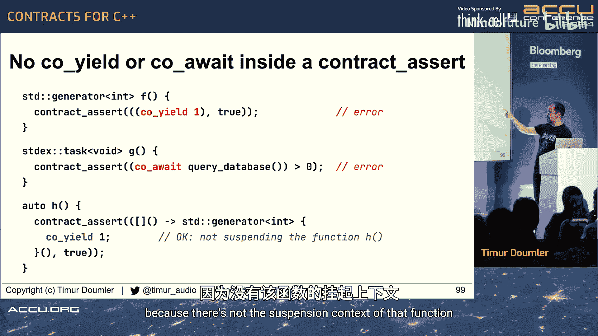

Okay， that's the syntax semantics。 like， what does it do。How does it work？

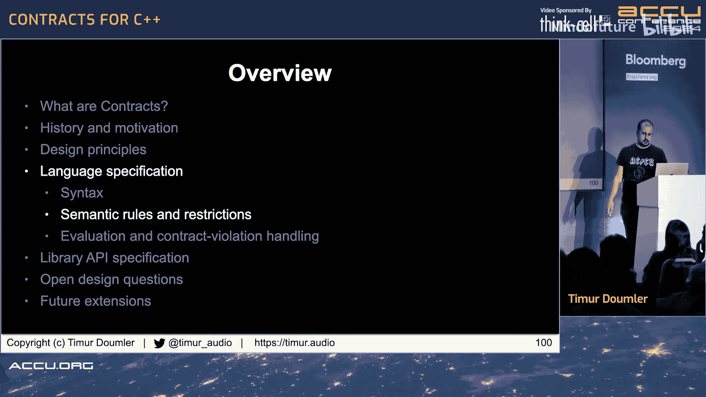

Name， look up and access control is the first thing。

 like it happens for pre and post as if it was the first statement in the body。

 which means that you can access private members。Another one， which was slightly controversial。

 But we， in the end agree that this is the better trade off is we decided that local variables are implicitly con and a precondition post condition and contract assertion predicate。

 So it's a little bit like a con member function or maybe a Lada where you capture something that's by default con as well。

 right， So if you're trying to assign to local variable inside a contract assertion that's not gonna compile。

嗯。And， until you， you can obviously， you can put a contrast cast around it and like circumvent that。

 But don't do that。 That's just like， you don't wantna modify things in in contract assertions。

 That's not what therefore' theyre Therefore checking things， not for modifying。

So referring to result value in and post。 So if this R thing， like， what is it， actually。

 is it a copy， Is it a reference， What is it， It's neither of those things。

The best way to think about this is it's like the name and a structured binding。

 It's another name for an entity that has been declared elsewhere， but didn't get a name there。

 So it is very similar to a structured binding kind of identifier in that sense。

 It's a name for an object that has been declared elsewhere。 In this case。

 It's a name for the return object of that function。 Again， it's implic con。 You can't。

Incremental return value of a function inside the post condition assertions。

 That would be a very bad thing to do that's not gonna compile unless you put con cast around that please。

 please don't do that。So yeah， it's an， it's， theres is the standardese way of saying this is an L value of type quantity referring to a result object。

What else do we have here？Oh， yeah， it has some， some interesting properties， so。嗯。Basically。

If you have a at the bottom there， if you， if you initialize a variable with a some kind of initializer and that calls a function。

 it turns out that this object on the left hand side is initialized before。

Before the arguments of the function are destroyed and the arguments of the function are destroyed before the like。

Sorry， yeah。 And the post conditions I evaluated before that happened。 So basically。Oh， after， okay。

 I'm confused now。 So basically， why here at the bottom is initialized before you check the post condition of F。

 So that's a bit weird， but it works。Like， I'm not gonna dive into this now。

 I have a lot more slides， but it's all in the paper。

But you can do these really interesting things with it。 Like， don't do that。

 Just like to demonstrate how it works。 like what the mechanics are。 If you。

 if you have X and then you， you initialize x with F and you pass the address of x into F。

Then by the time you， you get to the post condition of S X has already been initialized， right。

 So then that post condition will actually always succeed。Which is surprising。

But that's how it works。Except if X is trivially copyable because then like in order to not have an A BI break。

 That's again， one of our principles， we need to allow X to be passed in a register。

 in which case that might not work。That's already an exception we have in the language。

 So we just apply it to that here。 If this is confusing， like， look at it in the paper。

 It's all explained there。 It's， it's kind of。We had coordinate cases of the language。

 And for each one of those。 And there's a lot of them， you have to like。

 make sure it works in a way that fits into the rest of the language。嗯。This is about， yeah。

 not being able to refer to the。Result value。 if you have an auto return type。

 you don't know what that type is。 I already covered that。 Oh， this is an interesting one。

 So if you refer to parameters in a post condition。Those parameters have to be declared cons。

 otherwise that's not going to compile。And that's a really， really important rule。 Like。

 this is a clamp function， right， You get min Max and V， and then you return a value， which is V。

 but not smaller than min and not larger than max， right， So you clamp it to this interval。

 hopefully。People are familiar with this。 These are the post conditions of that function。 right。

 Hopefully， that's also not surprising。But is， if that were not quanted， if you could write this。

 you could then satisfy those post conditions by just doing that， right。Post conditions would pass。

 You don't want that， right。 So also， that body， could be in a different， could be somewhere else。

 right？ So you could， if you look at the declaration of this function and you look at parameters and you have these。

 you refer to these parameters and the post condition。

 you want to make sure that those are actually the parameters that are going to be passed in and they're not going be modified to some random other value that you can't reason about when you just see the declaration of that function。

 right， that does not make sense。 Like you like those post conditions。

Anything in there could have any value。 You wouldn't be able to say anything about that。

 They would be useless， so。Prameters have to be coned if you want to refer to them in a post condition。

What else do we have here， not part of the immediate context。Wait， is this the。还还有他 just。

Break for a second。Okay， so I have those slides in there。 Inter。 Those are some corner cases。

 which I don't really wanna spend much time on。嗯。You got to make the template specificizations independent on the primary template。

You have to make them not part of the immediate context。 You can't spinna on them Again。

 don't wantna spend too much time on this。 This is a more interesting one。 You should not be able to。

Cture a variable in a contact assertion。 if it's on a lambda。

So we even edit this rule that if you refer to this I here from a P or postcononic asserter。

 And if that would trigger a implicit capture because this Lada has a default capture there。

 you make that old form because otherwise， the mere act of adding the contact assertion， even。

 even of us never checked。You know， would make a copy， change the properties of the Lambda type。

 right， It would， it would have。 it would actually slow down your code because you would have to copy the thing so that it's captured in a Lada。

 It might make your Lada no longer too really copyable all that stuff。

 Even if you're not checking the assertion at all， right， It would modify your program。

potentially lead to extra things happening。 We don't want that。

 So we make that of forms for pre for post， also for contract a。Right。

 but if you have another statement there that captures the， the， the eye here。

 then it's fine because then the contact assert is not the thing that's triggering the capture。

 It's you's already triggered from somewhere else。 that's fine。Also， if it's。Explicitly captured。

 That's fine because， again， like， it's still gonna be。

 it's still gonna be captured if you don't have this contract to start there。

Referring to static variables， it's fine because they're not going to be captured， right， they。

 you can just refer to them。 You don't have to capture them。

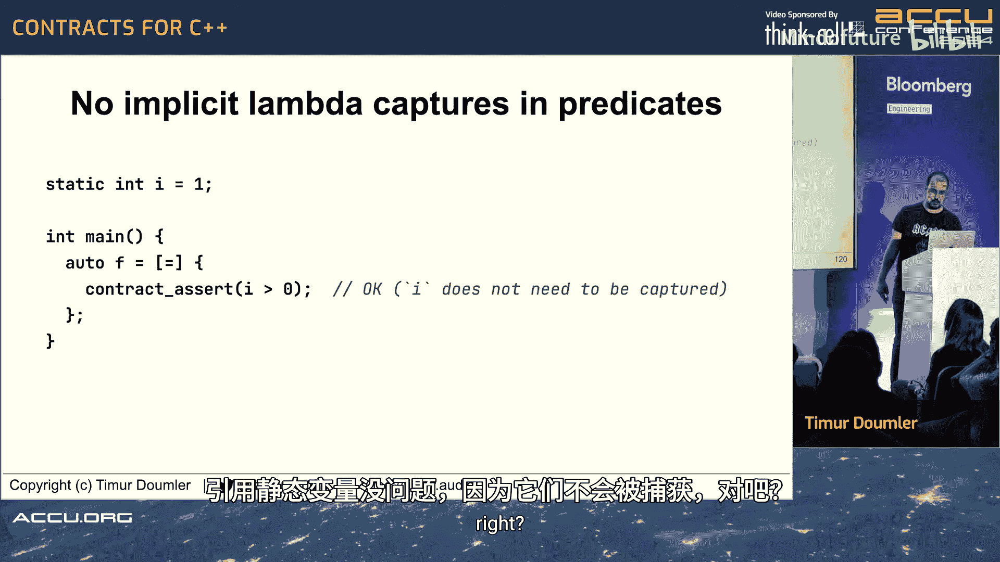

Right， so what happens then when you actually evaluate one of those contract assertions。 So we have。

 we have these three kinds peoples contract assert。

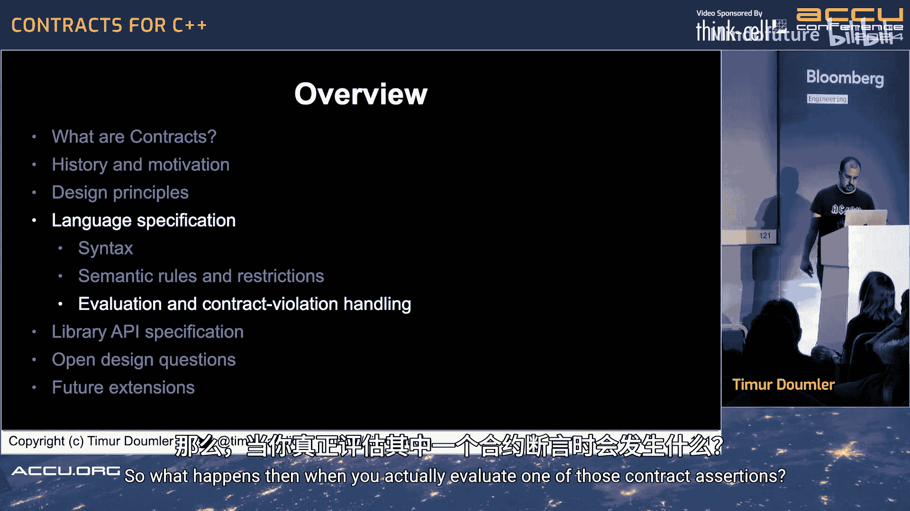

So they are evaluated at different times。 This is effectively the main difference between them。

So we we evaluate precon sessions。When we call the function after initialization of the function parameters and before we started byrating the body。

We evaluate post conditions。That was the thing I was kind of referring to earlier after the result object value have been initialized。

And after local variables have been destroyed， before destruction of the function parameters。

And then assertion statements are just executed whenever you reach that statement， right。

 So that's when we're gonna evaluate these things。 What happens when we evaluate them， right， So。

 for example， here， we start calling this function， right。

 Some of these calls violate some of those contract assertions。What happens。Right。

 so we need some kind of switch， right to like either turn the checks on or off。

 That's kind of the simplest thing。 But we actually have more than just one switch。 In fact。

 we have four possible evaluation semantics。 and every contact assertion can be validated one of those four。

 So those are the four options that we're giving you。😊，You can either ignore。

Which means don't do anything。You can observe， which means check the Boolean expression if it fails。

Call the quantum violation handler， then keep going。Then we have enforce force， which is。

If there's a contact relation， call a contact relation handler and then terminate。

And then the fourth one， we just added in Tokyo。 So this is like fresh on the press， brand new。

Quick and enforce， which is check the credit cut。 And if that fails， just immediately terminate。

 don't call the violation end， don't call anything， just immediately terminate the program。

 which is kind of what you wanna do in a safety， critical context， right。

You wanna minimize the attack surface。 You don't wantanna stop calling into other functions。

 If you know， there's something really wrong here， you just want to terminate as quickly as possible。

 And the other reason to have this is you want to minimize code loads。 So instead of calling。

 you know， terminate， which is a。Function call and in call call， a violation handleo。

 which is another function call。 You wan to be able to just say， okay。

 we're gonna just insert one trap instruction there。 like Gang， for example， built in trap。

 one instruction，1 bite。 You're dead， right。So， so to just have like minimal codes。

 So this is what you would do， for example， in a hardened release build where you wantna have a release build that's like really fast and small。

But you still want your contract assertions to be enforced because， for example。

 all of balance access is just。Unacceptably bad， in a safety critical context。

 right So that's the semantic you want to use。来。I should say terminated program doesn't mean call a board or call terminate。

 We have been going on like back and forth on this a lot。

 And then we agree we don't specify how the program is terminated， right So in some cases。

 you want to call a board because that's the thing that C assertt does if you want to be compatible that in other cases you w to maybe just call trap instruction So you don't specify what you get the compiler can choose whatever is most appropriate for that particular semantic。

 So we you just say terminate the program in some implementation to find a way。

 and the compiler can basically choose whatever， whatever is most appropriate for their uses。

So we don't specify that。 Iir， we call an unchecked semantic because it's not checking the predicate。

 The other three are called check semantics because they do check the predicate。

And the last two enforce and quick enforce， we are calling enforcing semantics because they are enforcing the conduct assertion in the sense that if you have a violation。

 you're not gonna keep going。And so we have these four implementation also allowed to add more non standard one as an extension。

 And then we say that the mechanism which one you get is implementation defined。 So you're not。

Standardizing anything like N D Bog or built modes， which is something that's US S 20。

 This C S 20 version standardized built modes。You figured out that's， that's basically not good。

 because gonna force everybody to like。Like ship multiple binaries of everything。 Like。

 we don't want that necessarily。 So， so if you say the mechanism。

 how you choose which contract semantic applies is implementation defined， right。

 We don't say anything about this in the standard。 The compilers can figure out whatever flags or settings or build modes。

They find most appropriate。 They can do this compile time at link time at runtime。 For example。

 if you have a C interpreter， you might want to change at runtime what the semantic is。

 That should all be conformant。 You do have three pieces of recommended practice， though。

It's like a compiler doesn't have to do this to be conformant。

 but it's strongly recommended that you have a mode where all contract restrictions are ignored。

There's a mode where they're all enforced and that enforced is the default， right。

 But that's basically what。What CSer does as well。 So that maps to like debug and release where in debug。

 everything is enforced and in release， everything's ignored and debug is the default。

 If you don't specify any compiler flags， right， So that very like intuitively maps to like the typical compiler flags that we have today where you don't prescribe that a compiler has to do it exactly this way。

 you can do something else。So when you check the contract predicate， multiple things can happen。

 The predicate can value to true。 And then we know there's no conduct violation good。

It can evaluate your false。 And let me know there's a contact violation。

 And then there's two more things that can happen。One thing that can happen is that we failed to evaluate the predicate because。

 for example， while we were were evaluating this bulloyan expression， there was an exception。

 So we didn't finish。A。So。We call this a contact violation as well。

 I put this in quotes because you didn't actually manage to check whether its a contact violation。

 So technically， it's not necessarily a contact violation。

And people have commented on this that I'm not sure if this is the right terminology。

 but we decided to call it the contact violation anyway。

 because you wanted to end up in the same handler and the same callback。

 It doesn't make sense to have like a second different callback for the situation。

 And it's called the contact violation handler。 So it's kind of you want to treat it as if it was a contact violation because it's you know。

 something that went wrong， you know， while be're checking it。

 we're not sure if the contract is not violated， right， So might be violated。 So we can't tell。

 So we we treat this as a contact violation。And the fourth case is we don't finish evaluation of the predicate。

 but we also。Don't know， because control flow just left and never comes back like long jump or terminate。

 or maybe the thread is infinitely suspended。 and we never return back to the。Kind of check the， the。

 the， the contract check。 So in that case， you just get what you get。

 If you long jump while you're evaluating a predicate， you just lumped up， okay。

So now when we have detected contact violation and we are in observer or enforce So not quicken force。

 quicken force just terminate immediately， but observe and enforce force call the contact violation handler。

 So what is that。So what will happen then is that the compiler will create an object of type contact violation。

 That's an object that has a bit more info about what happened。

It's going to call the contact violation handler， and it's going to pass this contact violation in bycon's reference。

And the other thing is that if you got an exception while we were evaluated in the preddicate。

 you also get to access that exception via the current exception。

And so the contact correlation itself is a function that's named Hand contact violation with that exact name in the global namespace。

 It takes that argument。 It returns avoid。 It might be no except false or no except true。

 You don't specify that。 That's interesting。There's no declaration of it provided in the standard library。

 but there's default implementation， which recommended practices are just prints。

Some info just stood out， which is kind of what the c does as well。

 And then we allow it to be replaceable， which is the same mechanism we already use for operate new and delete。

 If you wan to define your own， you just supply your own definition of that function at link time and you link that in。

 Okay， so at link time， you can replace I think the。

 the kind of compiler term for this as weak symbols。 Maybe somebody is familiar with that。

 That's exactly what this is。😊，You provide your own definition。

 It's gonna replace the default definition。 And your own definition can do whatever it wants， right。

 It just has to have the right name， the right signature。

 And then you get this contact violation object。 You can log it yourself。

 If you wantan to do your own logging， You can phone home and like。

 send it to the server or something。You can also then call the default one afterwards if you w to fall back to that。

 There's a special function for that in default conduct relation handler。 You can do other stuff。

 You can set a break point。 There's another feature that we're gonna get in CS S 26， Yeah。

 and you can your own exception。 So that's that's that's interesting。

 That's what kind of was talking about in his talk earlier， that might be very useful。

 if you want to handle portableably handle a conduct relation without terminating and also without continuing into buggy code。

😊，嗯。You kinda have to follow the Laos rule if you want to do that。

 So you can't sprinkle no except all over the place。

 Don talked about that quite extensively in his talks。

 I'm not gonna repeat all of that except that the way we specified this is that if you do have no accept here and you throw from this pre。

 this is considered to be within the no except boundary， right， So if you do that。You get terminate。

 So you still have to follow the Lake route， even with a new shiny context feature。

Which is why sprinkling， though， except all over your code is a bad idea。

 John Du gave a talk on this topic。 I also covered this in my other talk last year。

 That was the CPP and North keynote where it touched in this well。

 There's a bunch of papers that a bunch of people wrote why this is a bad idea， etc cetera， etc ce。

Conduct assertion doing constant evaluation。 I'm kind of running out of time。

 So I'm gonna skip through this very， very quickly。 Basically。

 what you want is you don't want to repeat， like， if you have a function that can be either called at compile time or run time。

 you want the conduct assertions to be checked in both cases。

 You don't want to have to repeat them as static asserts If you wanna be them to be checked with compile time。

 right。So， so you wanna have a conduct relation， either run time or at compile time。

Depending on whether that function is gonna be called in a constant evaluated context or not。

 So that just works。 So if it evaluates true。It's fine。 if it's it's the false。

 you get a contact violation。 If it's not constant expression， that's an interesting case。

If we can't then make the whole thing not a constant expression because you can spinna on that。

 that will violate our principle that you shouldn't be able to spinna or reflect on whether the assert is there。

 So what we say is， well， if the predict is not a expression， The actual assertion still is one。

 but it's a contract violation。 So what happens if you get a contract relation， compile time。

 Obviously， you can't get their violation handr call at compile time。

 So what you get instead is again， the compiler is free to choose what semantic is going to be applied。

So Iore does nothing and observe and enforce。Perform constant evaluation。 And then if it fails。

 observe gives you a warning。 and then force makes a program formed。

 And the fourth one quicken for is not on the slide yet， but it's gonna do the same thing as a force。

 It's gonna make your program formed It's real thing called trial constant evaluation for which we need a special rule because you have functions that might or might not。

Be no exception And if you use them to initialize a constant inch。

 that might be initialized at compile time or at runtime。 And by adding a contract assertion。

 you don't want to flip which one it is。 that would be bad。 That would again violate the principle。

 So we need a bunch of extra rules to make sure that never happens。 Recursive contact violations。

 There's two options。Either we could prevent recursion because that seems like bad， right。

 if you could would get like a contact violation while youre handling a contact violation。

 So previous proposals said， okay， you're gonna prevent this by saying that while you're hand a contact violation。

 you're gonna disable contact checking。Turns out that's actually really bad because then all the code you're running while you handle your contract。

No， violation is potentially unsafe because all checks are off。 That's really bad。

 So we decided that the safer thing to do is to do nothing。 You get what you get。

If you hit another contact violation while you're handling a contact violation。

 you get a recursive call of the violation handler。 and it's up to you to handle that。

 And if you don't， you get a stack overflow and you crash。

 And that's hopefully going to be something that's really obvious and easy to fix。Rather than。

 you know， just disabling checking that which is not obvious and a lot more unsafe。

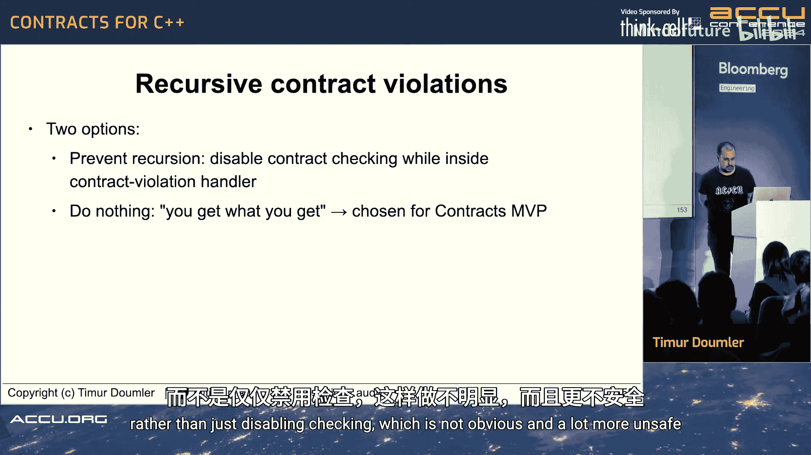

We have a little bit of library API here in this proposal。 I'm gonna go through this very quickly。

 You only ever， ever need this。 if you want to implement your own violation handler。

 not just to use contracts。 So there's a very limited set of people that will ever have to do that。

 at most one person per company。 I think everything isn't head of contracts。

 Everything is within that in namespace complex。 that was a little bit controversial that we want to have a nest name space。

 But we decided we really， really do。

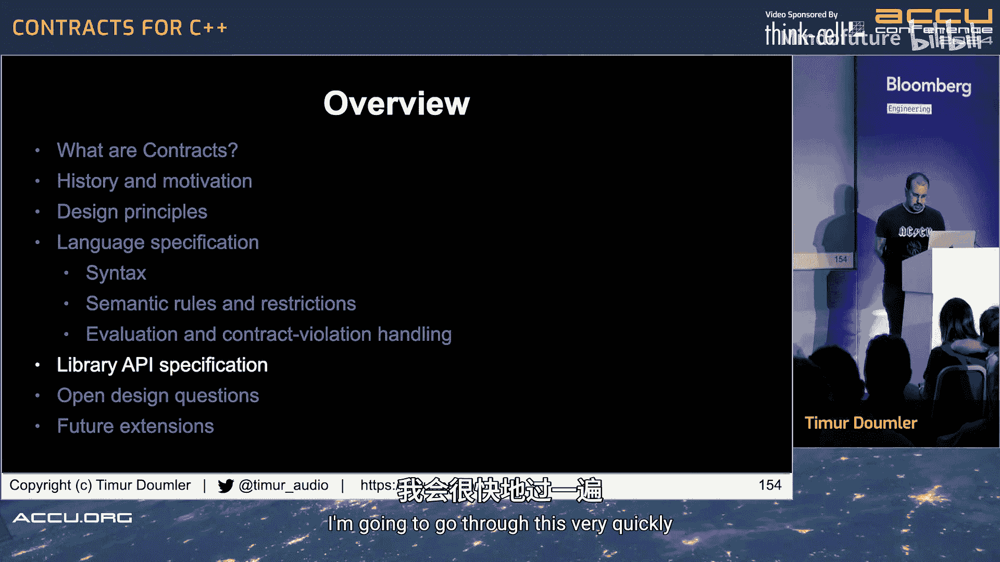

Let's see what Luke says about that。 next meeting。 We have this one class contract violation。

 It has this API。Source location， location。 That's a main function that tells you where the contract relation happened。

Comment， which tells you what the expression was that was violated as text， human readable text。

 Both of those don't have to give you that。 Like if you for， for whatever reason。

You don't wanna store your code and plain text or you don't wantanna store source locations in your binary for safety reasons or binary size reasons or whatever。

 You can just return an empty string in a default constructed source location。

 That's also conformant。 It's just a recommendation that that information is returned。

Detection mode returns a little inum that tells you what happened。

Did the the violation falses or did I get an exception， We have a semantic。

 which returns another little enum that tells you， is the contact enforced or observed。

 Note that ignore and enforce fast are not in this enum。

 because those semantics never call the contact violation standard。And then the last one is kind。

 which tells you， was it a pre post or a contract assert。

 We can't use contact As there because it's a keyword。 So we just use a。 Hopefully。

 that's not gonna to be confusing。And then we have this little free function here that lets you call the default violation from your own violation animal。

Right， we'd say that the standard library itself does not have to add any of the stuff。

 like we don't add。Contract assertions to the specification of the Senate Library。

 But we allow implementations to。Use them internally。 So that's fine。

 If an implementation of the standard library chooses to use these things in their own implementation。

 That's cool。 But we don't demand that。 We don't say that every precondition in the standard now has to be a preconditioned assertion on that standard library function。

 And there are good reasons why you don't want to do that。

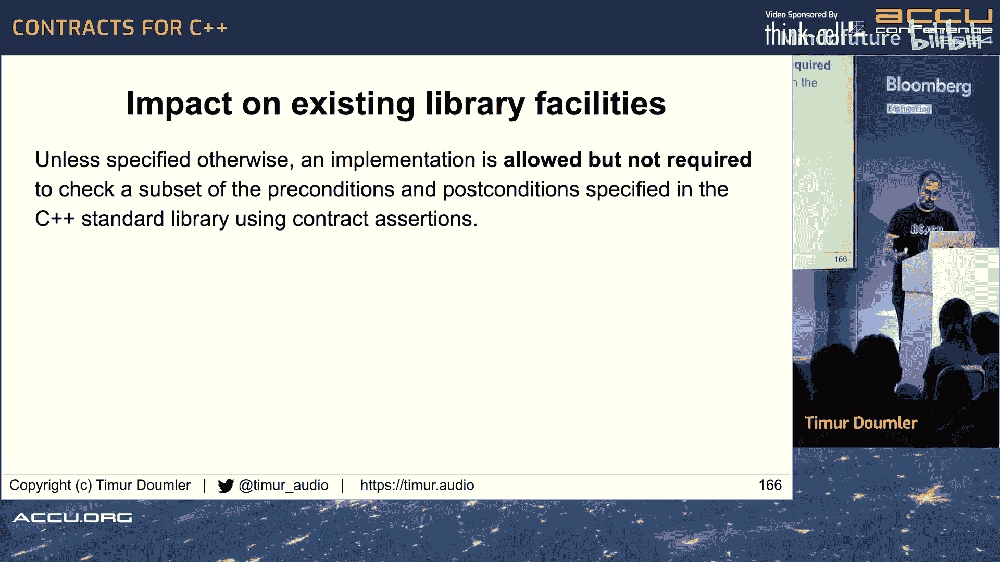

Alright， so that's the proposal。 in the last 10 minutes that I have。

 I wanna quickly go through the open design questions that we still have that we thought we didn't because in issue 21 of you agreed。

 this looks great。 This is what we want to ship。 But then it went to the next level。

 The design revision groups， evolution library evolution。 They said。😊，I'm not sure。

 I'm not sure this is a good idea。 So we have to rediscus this。So let's， let's go through those。

 So we have basically five of those。 There's more things that individual people kind of disagreed with or had concerns about。

 But those are the five things that evolution as a whole， the evolution working group as a whole。

 you know， voted。 and there was a significant number of people that said this is a concern for us。

 So those are those five things。

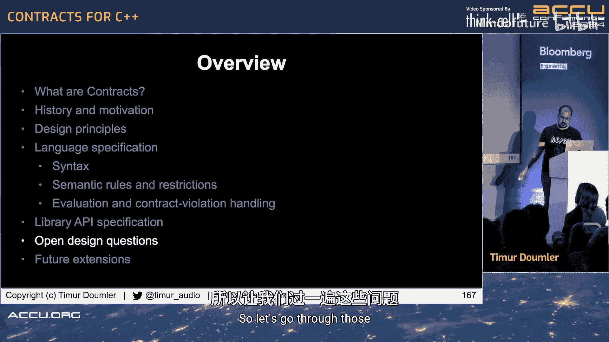

First one is。What do we do about U B， There's two cases here。 One is。Well。

 it's kind of maybe surprising because contracts are there。

 Con exertions are there to prevent U B mitigate U B。 But turns out if you。

 you can still get U B and just some interesting situations。 there one is。Okay。

 here's a function that has U B。 right， We are dereencing a pointer。

And we're passing it another a pointer。 right， So that that's， hopefully you can all agree thats C B。

 Now we add a precondition assertion that that pointer is not now。So hopefully。

 that's no longer you be， right， we， we like， we're gonna find， find the bug。 Well， obviously。

 if you ignore the precondition。Then it's still you be because you're ignoring and you're not checking it。

 right， If you're enforcing it or quick enforcing it。You're gonna terminate。

 right at the point where we hit that。 So we're never gonna go into the body of that function。 So。

 again， we don't have U B。 This is well defined behavior。 This is fine。

But if we have to observe semantic， then we keep going into the function body， right。

And so it turns out that if we keep going into the function body， the compiler can say， oh。

 but that's U B。 I can't get there。So， and then it can optimize all quote parts leading to that sty outline。

 including the precondition assertion can just optimize that whole thing out。 And people are saying。

maybe not good。 We should maybe do something about this。 But the problem has U B， so。What do we do。

 And the other cases， if you have， you be inside the predicate itself， for example， here。

We have a function that adds 100 to another integer。W， so。That might overflow， right， but。

It's undefined behavior if it overflows so the compiler can assume that it never overflows， right。

 and optimize based on that assumption。 That's what the U B is。Right。

 and so then if you have a preconditioned assertion that tests that S of a really is bigger than a。

 the compiler can say， well， this can never overflow。Therefore。

 the result will always be bigger than a because we're adding 100 to it。

 and that will never overflow， therefore。This is just pre true， right， It will always be true。

 And it can just elight this entire precondition check there。 just eied it out。

 even if it's enforced， right。And so again， people say， that's not good。The problem is。

 what do we do about it。 So the first case is where we have underfined behavior after like we don't have anything in the language to mitigate that because U B is U B。

 the， the standard does not place any restriction on a program that has U B。

 but maybe we can do something。 There is this paper by Davis Herring to introduce the concept of an optimization barrier so that time travel optimization cannot like that So we can specify that a conduct assertion is such an optimization barrier。

 That paper is not in a standard yet。 It's not past evolution。So maybe we can do it。 Maybe not。

Let's see。嗯。And the case B is identifying find behavior while evaluating the chronic exertion。Well。

 we just really don't know how to do this because this reduces to the problem of how to have a language that has no U B。

 essentially， right， There's a paper at between 2860 tweet P 26，80 or1， which says， well。

 maybe we should constrain contract predicates to a subset of the language that we know doesn't have U B。

We discussed this at length。 We like S 21 doesn't feel this is the right approach。 Like。

 if you wan to specify a safe subset of CB， you should probably do this for the whole language and not just for predates inside contract checks that that's kind of weird。

 So we decided not to do that。 But then it came back。 And now S23。

 which is the same security study group is considering this idea。

 And we're basically going to do whatever they tell us。 So this topic is gonna come back。

 The second one is。Should the compiler be allowed to all or duplicate assertion evaluation。

 So that's a tricky one。So， so this comes back to the question。

 what happens if a contract predicate check has side effects。

 which is something you don't really want to do。 You wanna check something， observeer something。

 You don't want to modify anything， right？ So you don't really wantna have side effects。

 but sometimes。They're useful。 They're， they're good use to for this。

 maybe you want to check something and the algorithm that requires an location。

 or you want to check abuoleyant flag， which is behind a muttex because many threads are like checking it。

 And then you want to be able to lock and unlock that mutex to， to do that check， right， So you。

 you have to allow side effects。C last 20 contract just said it's old U B。

 And I think that's a spectacularly bad approach。 So we're not gonna do that。

 So we're just gonna allow them。But then， the current paper says that。

If the compiler can tell whether the predicate evaluate the true or false。

Somehow prove it statically， It doesn't actually have to evaluate it。

 which if it's side effect free expression， you're not gonna to observe the difference， right。

 But if it has side effects， those side effects might just not occur。

A little bit like copy a where you have a copy constructor that prints something。

 but then you actually end up not printing anything because that copy was aed。

 So it's a little bit like this。And the paper also says that these side effects could occur multiple times。

And there are a bunch of reasons for that。 Two of them are。

 we want to discourage preicas that have side effects。Further by saying， well。

 you can't rely on those flat effects happening at all or one time or twice or any a number of times you just don't know。

 So don't rely on them。And the other interesting reason to do this is that you want， for example。

 if you have a program， if you have an application and a dynamic library。

You want to enable callee site checking and the in the application and caller site checking。 Sorry。

 the other run。 You wanna be able to either enable contract checks on a library or disable them and also enable caller side contract checks on a program that's calling that library。

What disabled them。 And you want to have。Both versions， the applications。

 which checks on or off and the library which checks on or off， be able to like。

Talk to each other like load the dynamic library without having to care about which one it is without that being an AI break or having to recompile。

 and in that situation if if both the application and the library have checks enabled。

 you might end up checking something twice。And like， in order to not have that。

 we would have to then recompile the program with caller side checks off。

Or introduce some kind of mechanism to detect that。

 which would be an AI break and potentially more symbols in your library and stuff like that。

 We don't want that。 So you might wantanna。You know， enable checking something twice。So effectively。

 if you have a side effect in your precondition check。That increments something like， don't do that。

 This is just to show off like what the specification is， But don't actually do that。

 You can't rely on what I is。 It might be 0。 It might be 1。 It might be 42。 You you don't know。

But then like the observation was， well， but there are assertions。

 This is like an example adapted from the Kang source code。

 And those things are actually quite common。For example。

 an assertion that something isn't called recursively more than1 times。 And there。

 the assertion maintains a counter。And if you can't rely on that counter being evaluated like incrementalcr exactly once whenever this thing is checked and。

Just can't write that。 I mean， there's other reasons why you can't write that with contracts。

 We don't have anything like anybodybug that lets you selectively not declare that variable when contract checkers are off。

 We don't have that kind of mechanism。 But that's another topic。 Like， even if you have that， like。

 you can't rely on the plus plus depth occurring once when you check that， which means。

Those counter assertions， they don't work。 And there are people who say that's bad。

 That means we can't migrate from macros to contract assertions because we can't write those if you don't know how many times it's gonna be evaluated。

 So some people are saying， no， it must be like this。 Other people are saying， no。

 this is really bad。 The room is kind of split halfway on this topic， at least an evolution。

 I think in S 21， we have more of a we want what's in the paper right now。

 But like evolution is split halfway， we need their consent to put anything in the standard。 So。

You're going to spend more time discussing this。The third op question is。

 should the contra bilation element be allowed to throw。And there's a massive upside to this。

 which is we really need that。 So we have some mechanism that if we have a contract assertion violation。

We don't want to continue into the buggy code that would be really bad。

 but we also don't want to terminate the app because there are use cases where you can't terminate the app like。

 as John was saying in this talk at the financial industry， for example。

 you gotta keep the exchange running。 You can't just terminate。

 So the only other portable thing we can do is to throw an exception andwin the stack。

But the con of that as well。 Then it means any assertion control from anywhere。

 Some people have a problem with that。 And also， if you sprinkle， no except all over your code。

That's just not gonna work because then you're gonna terminate。

 which is the exact thing that you wanted to prevent by using a throwing violation number。 So again。

 the room is split on whether we should allow those。

 You're gonna discuss this more at the next meeting。

 There's a question whether we should allow observing and ignoring contact violation that compile time。

 the argument against it is， well， if you know compile time， there's a violation。

 we should always error out the argument for it is。

 But then we need to check all predates at compile time。

 that might be very expensive in terms of compile time。

 You w not be able to switch that off without having to put it behind macros。

And the last one is virtual function support， which we just didn't get done yet。 It's complicated。

 I don't have time to go into this。 I have 20 seconds left。So yeah， it's。

 there's all of these approaches that have been used in the past。 They don't quite work。

 We have a possible solution。 There's this paper。 We haven't had time to discuss it yet。

 So we decided， let's keep it all of the MVP。 Let's add it later， but then evolution said， well。

 maybe if you don't even support virtual functions。 Maybe it's not really viable as a proposal。

 You should really add that and then come back。

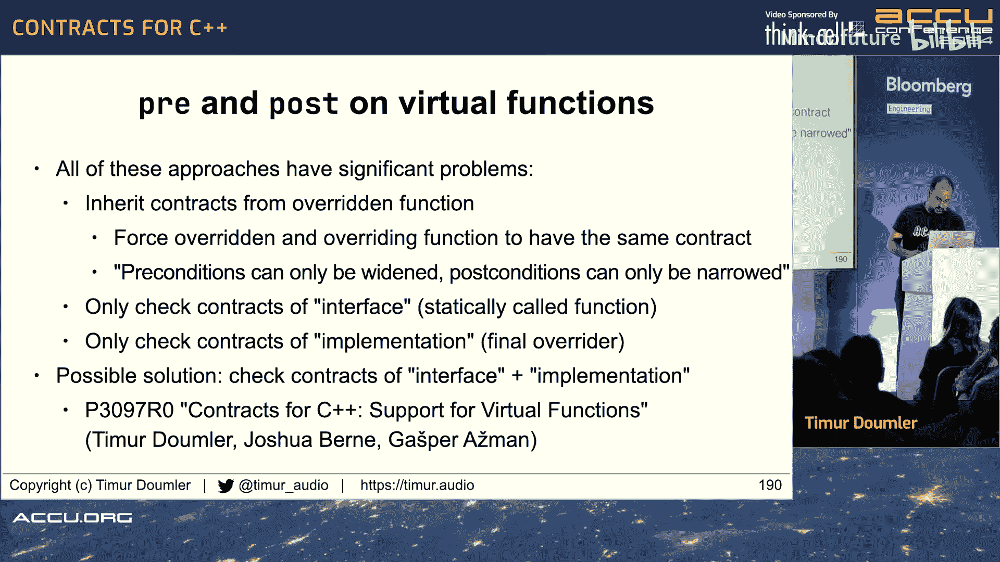

So we're gonna do that。 we have a bunch of things that we already know we're not gonna add in this revision。

 This is this list。 Viual functions are an exception。 They might get into the MVP。

 Everything else here， there's a lot of interesting features here。

 which we know we are not going to add to the MP， but we'll get later， possibly in C S 29。

 or maybe even within still this U 26 time frame， but not in this paper。 Okay， and that's all I have。

 Thank you very much。😊。

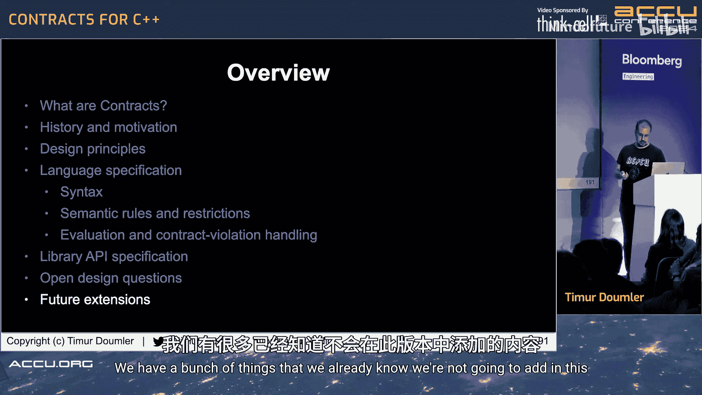

