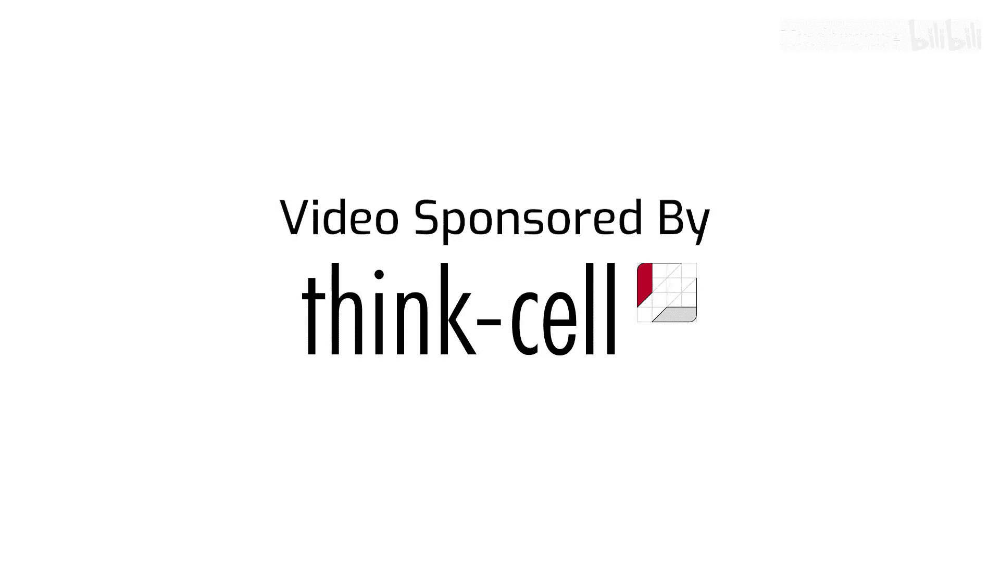
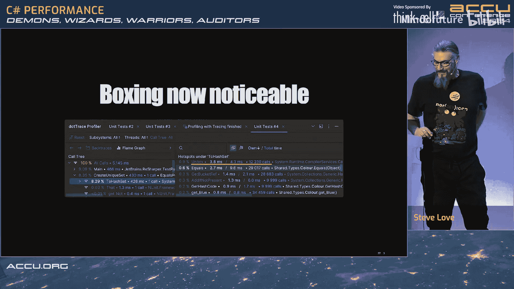

# 中英-•-C++和C语言ACCU大会2024｜人工智能｜架构｜函数编程｜静态分析｜安全｜编译器｜开发者｜垃圾回收｜链接器｜代码生成｜cmake-p14-P16-C#-Performance---Demons,-Wizards,-Warriors,-Auditors---Steve-Love--BV1pNotYYELk_p14-

Thanks， everybody for coming。 I'm Steve and。

It's not a bad turnout for a C sharp talker at a C plus plus conference， I think。

So want to talk to you this afternoon about sea sharp performance。嗯。This is me， if then。

Email and various。Socis you can find beyond probably not very difficult to discover me。But。

Going to start to think about the things that I've always been told， don't。

So don't work with children or animals。 I don't think there's very much danger to that today。

Hopefully， don't offer to present on sea sharp performance at a C plus plus conferences。

Sounds like a bad idea。We are going talk about C sharp performance。 and I， yes， I。

 I did intentionally and pitched the talk。 And then it almost immediately regretted it。

 But here we are。 Hopefully， you won't regret it as much as I did。

And they definitely don't attempt live coding， ever。

There's only going to be a small amount of that because I'm not very pd in it。

 So I'm ever so slightly out of my comfort thing。You may。

 you may have noticed by the tremor in my voice and fiddling with my wings， so。

Why do I want to talk about？Performance in C sharp。 Well， optimization is hard。嗯。Famously。

 we'll get to that and。A few kind of misconceptions that we're gonna cover。

 I've got a little roadmap that we'll talk about in a bit。But a little learning。

Is a dangerous thing famously。It comes from Alexander Pope。We went to say。

Little learning is a dangerous thing。 D deep。Or taste not appear appeare in spring。

 So we're not gonna drink really， really deeply this afternoon。

 but we are going to take a look at some of the internals of sea sharp。

 And we might even do a little bit of comparison with C plus price。 That's gonna be fine， isn't it。😊。

Go also goes on say about。Drinking largely instead of just a sip。Can be sobering。

 So looking more deeplyly。Particularly in when we're talking about optimization and performance。

It can be sobering。When you find out what's really wrong with your code。

 So we're gonna talk a little bit about just by example。

 some of the mistakes the programmers might make。 And this applies not just to C sharp。

 applies to it。All programming， its。We are going to try to talk a little bit more generally。嗯。

Hope also had a couple of other。Quachable。Pach。Including the one about where angels fear to trade。

Which is。Quite often， misquoted and taken out of context。

I think that goes back to talking about C sharp performance at A C plus plus conference。

 So the talking of mis quoteotes。Here's the famous one about optimization。

Being the root of all evil itself often taken out of context and left it。

Optimization is the root of all evil。Prematory is， is a word that's carrying quite a lot of weight in that。

But also， the bit where it says， or at least most of it。And。Optimization as。嗯。

An activity that you try to do， as you go。So what。Initially coding something。

Is mostly what Kanu is getting at of trying to write。Optimally， fast code， first time。And。

That's the the root of all evil part， because it very often results in。

Very convoluted code that probably isn't necessarily faster than it would have been。

 had it just been written。As。Ordinary human read code， let's say。

So this is a quote that goes back to 1974。It's almost as long as I go back。So this isn't a new idea。

 And I'm sorry everybody in the room has heard the quote before。

So we are going to talk a bit about optimization。And I also want to compare it with the idea of pessimization。

 which is。That's the term my first heard from。Somebody at this conference， Jason McGinniness。

 about writing。Almost， well， it's very often unintentional。

 rather than intentionally writing suboptimal code。

 But there are practices which are well known to be。Bad for performance。

 And we're going to look at one particular one of those in sea sharp。But more generally。

 the same principles apply， I think。So someway points along the way。A fewew misconceptionions。

 particularly about C sharpen comparison with other languages。嗯。

A little bit of measuring performance in the wild。 This is where the live coding comes in。

I'm not gonna to do very much of the live coding thing， but we're gonna look at some tools in。

 in the kind of dotnet landscape and see where。We can best make use of them to try and find out where bottlenecks in code occur。

And we're going look at what equality comparisons have to do with pool。

 This is pool in the sense of balls on the table played with stick like snooker or billiard。诶。

冇冇 po路那个。不会改出来。A little later。So。In the beginning， or then things got interesting for C sharp。

Cea shop was designed。Not really is a C+ plus successor， but more like a Java successor。Kind of。

That's a slightly political。 It stance for that。But both Java and Car arose because C plus+ was considered to be very complicated。

 hard to learn。嗯。C plus plus templates had。They were really quite young。

 but already the idea behind the all some of the ideas behind template letter programming had arisen。

 So the the whole tu and complete comp time computation。嗯。

But C sharp wanted you also to be more sophisticated than Java to provide。In particular。

 around type safety。So。Around theabout。C sharp 2， when generics were introduced。

 That's what I mean about when things get interesting。

 So C sharp took a very different approach to generics to both sea forsrus and Java。嗯。

And try to make things。A little bit easier for programmers to grasp and learn。And。Hopefully。

 remove some of the wars that were really quite obvious in C++ at the time。

So whether they achieve that or not that's a subject of a different talk。Because Cp， for sure。

 has its own。Collction of wars and problems and difficulties。Especially since， as with。

All useful languages。 It's grown and evolved over the years。 And new features have been introduced。

 And sometimes those features pretty nicely with the existing stuff。 Sometimes they don't。

 I'm sure that sounds familiar to everybody that's followed C plus plus standardization over the years。

But。There were criticisms， particularly from。哦。Old C plus plus programme。 C programmers that。

C sharp and Java。 and most of these play there is that there are four main things that are obstacles to high performance computing。

えぱ。With a small HPC， rather than。What's commonly known taken to the HPC， but。

Garbish collection is the big one。Where。C sharp lives in a managed memory world with an automatic garbage collector that runs out of band to the program。

あれの。Necessarily predictable when it's going to happen。So this obviously goes against the grain of。嗯。

C plus， plus being entirely deterministic。 And it's the operation of a program。

 You know what's going to happen and when it's going happen。In a single spread world anyway。

So the idea of some system level thing hijacking your program in the， in the middle of a。嗯。

An important computation。 that's time sensitive。嗯。So it's not an unreasonable criticism。

Boxing is about how C sharp treats types。 It makes a distinction in the language between value types and reference types。

So reference types are， for the most part， the most widely used types。 And that's。

Refers to the way that sea sharp allocates things on a managed he。

 which is what allows the garbage collected to operate。嗯。And。They are the。

 the general purpose type in C sharp， but it has a specialized type called a value type。

 which doesn't live on the managed heap。AndFor the most part。For performance reasons。

It's commonly held that they live on the stack。 And that's sometimes true， but。

They are the point about value types isn't so much about where they live is the fact that they're not individually subject to garbage collection。

 So they live in the scope of another thing， whether it's a member of an object on the heap or whether it's on this。

 you know， the。Execution stack of a local functional， whatever it is。

Boxing is when it occurs when you need a reference variable to refer to a value。 So Java has this。

 I think， only for intrinsic numeric times， whereas C sharp has a more generalized concept of a value type。

But。If you need a reference variable， for whatever reason。AndThe common one being object being。

Kind of the ultimate route of the type system。Object variables are always references。

 So if you take an object reference to a value。Then it has to be boxed。

 which means it's copied to the heap。And the box becomes subject to garbage connection。

And that is that copying。 So value types are copied by value。

 That is their definition for C sharp programmers。 There's a whole different discussion about what value type in a more general sense means。

 but。In terms of Car as a language。Value types have copied by value， semantics。And。References。

Whils they have， the reference itself is copied by value。

 The thing it referred to very infrequently copied。 And we'll talk a little bit about that。

And then reflection。 So we're not really。gonna to mention reflection a little later because it's relevant。

 but。C sharp has had reflection from the vet go where you introspect your code。

 Ref on it in order to determine。What the underlyingd。In the intrinsic mechanisms of a compiledty R。

 but also be able to generate code or alter behavior。

And the point here is it's not really commonly associated with high performance for pretty good reason。

But it doesn't usually lead to me。So picking on the first one about garbage collection being it's unpredictable。

 takes a long time in truck's program flow。These things， whilst true。

 have become less true over the years。 So the garbage collection for seachar dotnet programs more generally。

It's the same mechanism。Has been carefully optimized over the years， too。

Minimise all of these things， apart unpredictability。

Is much less of a problem than most people think it is。The fact that it occurs。

 but it can be controlled to an extent。Because。Vanue types aren subject to garbage collection。 Again。

 this is something we'll cover。And then it， it takes a long time in interrupt's program flow。

Have become they the garbage culture has been optimized in in ways that minimize both of those things。

 so。嗯。Garbage collection in sea H has always been generational。By which I mean。Back。

Object are in when an object is initially allocated in memory， it's put in Gene1。

 and that's garbage connected much more frequently。If an object survives a garbage collection。

 there is still a reference to it somewhere。It is transferred to Gene 2。

 and Generation 2 is collected much less frequently。So the object stays alive longer。

But you're optimizing the amount of time that you need in the garbage collective。

 So collecting generation one may happen relatively frequently。

 but it's fast because it's going to pick up all of。The short lived object。

In touching program flows become less of an issue with multi pipeline， multi CPU architectures。

 because the garbage collect is multifl unless you're absolutely saturating your CPU with your dotnet program。

 then。Garbage collection isn't likely。To inrop your program flow anyway。And。

The the deterministic destruction in C plus plus has its own cost。So if you've got。

 and this is a problem for it。Any language， if you allocate。

Huge numbers of very small objects in memory。 And you have to get rid of them somehow。In C plus plus。

 you have to disrupt them。 even if a deor does nothing。The option。

An optimized program may be able to optimize the calls that is tued away， but it might not。

So it can still be an issue。 It can still have a measurable cost。Similar thing applies in sea sharp。

 because if you allocate lots of short lived objects on the ball heap。

 you're putting the garbage connector under undue pressure。And so you're provoking。

The problems associated with taking a long time and interrupting program for。

So we come back to this idea that value types aren't individually collected， Dave。

The use of value types。Quite a lot of C sharp programmers shy away from vto because the semantics are not commonly well understood。

By。Probably the majority of seasll programmers I've ever met。嗯。And。

The fact that they' are not individually garbage collected。

 is a mechanism that you can use to reduce pressure on the garbage collector and make it more efficient。

So we are going to talk about value types， because it's。

Family types are the most interesting thing about the sea sharp type system。

 Ref types are just not interesting at all。Or rather。

 there are very many more use cases for them that it's impossible to cover every case。

But in particular， we'll talk about what the。The hybrid garbage collector fits into that。

So these are the recommend。 This is the recommendation in the Microsoft documentation。

 This is long standinging。嗯。So I've been working in C sharp since。2002 or3。

 I think took quite a long。Two decades worth of。 And this。

 this recommendation has been in the documentation at the least thattum。

So the idea of defining astruct。 So defining astruct in C sharp is what dens it as a value type rather than a reference time。

Deefinestructive instances of the type of small。And commonly short lived。 So by small。That varies。

 but。Small really is quite small。Commonly sort of 24 to 32。Bite。嗯。

And the purpose behind that recommendation is about copying。 So when you copy a value type。

 as I said before， it's copied by value， which means that。You copy the variable。

 You get an entire copy of the entire contents of the type。 So you， if a large type。

 if you're copying。Variables around or copying the values of variables around。

 You're getting lots of possibly， probably redundant copies of the data。 And if it's big， it。

Costs more in memory space and time。To make the copy。 So making them small reduces that。嗯。

Commonly short lived is， again， about the garbage collection， so。

If your objects are going in and out of scope， a lot。Just。Scope is a little bit of a measly word。

 but。Hopefully， hopefully you understand what I mean if。

Very small objects are being created and immediately going out of scope or being copied into containers and the originals going out of scope。

嗯。If they're being managed on the managed he and subject to garbage collection。

 then that's undue pressure on the garbage collector。成。Making the value types reduces that pressure。

And if they're commonly embedded in other objects， and that's another。

That relates to both of these things， about short lived and small size。

Embbedded in other objects can mean effectively two things stored as a member of an array or an attraction or as a member variable。

 And what this really refers to as collections of stuff。So you've got large numbers of them。

But as said before。Value types。They're not very well understood by quite a lot donet programmers。

Being at the C++ conference， I thought I'd make that distinction instead。

So thinking about sea sharp stream。Which is。A little bit more like the C plus plus string viewing than it is the standard string。

 because。Strings are immutable。嗯。They know they。The string is a reference type。 So the。

 the contents of the string isn't copied frequently。And that relates to the immutability。

 because you can have two references to the same string object。

 And the fact that it' is immutable means that。YouCo by reference， so to speak。

 is benign because you're never gonna to introduce a race collision or any other kind of side effect problem。

If you can't update the data by any of the references。

The important thing in C sharp is that a C sharp string will never be boxed because it's not a value type because it lives on the managed team。

It is subject to garbage collection， which might be a problem for。The short lived object。

Recommendation。But see， a string is a value type semantically。

Because what we're interested in with stream is。When you compare two objects for to see if they're equal。

 you don't usually care if it's actually two references to the same strain。

 what you care about is whether the content are the same。

Irrespective of whether you have two references to one string or it references to independent strings with the same content。

And it turns out that equality is quite important when we'm talking about value types。

For multiple reasons。Which I hope to explore。But before we do that， we need to talk about boxing。嗯。

The Guid type is a built in value type。 It's actually quite large。I can't remember heavier。 I 96 bys。

 I think I can't remember off the top of my head。嗯。But this is an example of how boxing occurs。

 The example at the top， console up right line again， it's another。Good。Standard library type。

 if you like。Takes a format string。And then。effectivelyffectively， a verytic array of objects。

So the fact that I D is a good， which is a value time， means it will be boxed into the argument。

On the right。So you can avoid boxing in this case， because all bright line is going to do is called two string on it。

 which is。A virtual method defined on the object based class。So。Every。

Incitence of an object in T sharp has a two strain。So if we call two string up front。

We avoid the box。Part of the question is， is this a good or a bad thing to avoid the box？

 So arguably， this second example is a bit worthier。And it may avoid the bongs。Would anybody notice。

In terms of performance， well， the answer is unlikely because we're writing to the screen here and the performance of that will swamp the cost of any box by many orders of magnitude。

So the argument is， is that the first example， was it causes a box。And， therefore。It七薄情冇好劲。

But it is introducing something on the matter steep that might not be necessary。

But the code itself is slightly clearer because you've not got the extra kind of。

Mental noise of whats why am I calling two string。 And if it's just to avoid a box。

 then it is just noise。So performance is a manifestted thing。

There is the idea of being optimally perform， but you might want to optimize for other things like code readability or testability。

Or memory use。And okay， this would fall fall out of memory use because。The top one would。

 because it's creating the extra copy on the managed heap。 And therefore。

 that becomes subject to garbage extension。 But is it more readable。 I think I it's a fine line。

 I know。Just an example， but。There are more than。 is more than just speed to consider。

So back to string again。started talking about。Equality being important。

Stringings are copied by reference because they're reference time。 So when you copy a variable。

 as we do here。Take a copy of original。All we're doing is creating a a new reference to the same。

String literal here， age string。I would have made it a slightly better example。

 but I didn't have time， sorry。嗯。And the assumption is that。This is an end unit assertion。

 you may or not be familiar with it。 Hopefully， it's clear enough。

 what we're saying is we're certaining that the original is a reference to the same string as copy。

 They are two references to the same object in memory。 And that passes。

So strings are copied by reference， but they are compared by value。

 when you compare them for equality。Or even less than。 they are compared。

 That is the value that you're comparing not， not the value of the reference。

So here we're deliberately creating。2 references to strings with the same content。

But they will end up with two separate references。Because C shop has a built in optimization to do with a string table where string lital。

A string little literal in a program is put into a table so that if it's used more than once in the program。

 you still only get one reference to it。So I'm hijacking that deliberately by creating a string builder and。

Pulling out its content。So here， the assertion with asserting that it's not the same as we've got two independent references。

 two references to independent objects in memory。 But they are equal because the comparison。

 the equals comparison is comparing the content， not the reference。So， sea sharps。For this example。

Equals is a method that's defined on the object based cast like two string。 It's virtual。

 so you can override it。And the string class does， it overrides equals method to compare content。

And that's important。 this is what makes string a value like type。嗯。In semantic context。

 strings our values。 It's the content of the string that's important， not。

The location in memory or its identity。But there's more to equality comparisons than equals。嗯。

He is some不。To value type as noted by Str。Pey word， in definition。It read only， so it's immutable。

And it's just got three inte of properties。Which are in it only with So in it as a property access is relatively new。

Feature in sea sharp， which means that you can。You can write to it when you're creating a new object。

 And then once the object is actually fully initialised， those properties are read only。And。

Here it is in the code。The annotations， so I'm using jettbras rider。

 I'm not being paid by jet brains to use their tools。 It's just my preference。嗯。And。

We're going to use this type。什么。And make a hashetag。Of these。

And just want to go back to this this is。The default structure type。

 All we're doing is defining properties on it。Dotnet provides a few other bits and pieces。

 And we're going to talk about that。why it's important。To demonstrate what's going on。

Here we've just got a little bit of of link code， which I'm creating a sequence of 10000。Object。嗯。

Effectively，10000 pseudo random numbers。And for each of the， so R N G dot next returns me an int。

 which is always 32 bit wide in dotnet。诶。And I'm using bit shifting and casting to bike。

To create a one of those color objects。诶。And then you we're gonna to see this again。

 This is going to be a common pattern。The idea being， I want to create a reasonably。Realistic。

Collection of 10000。Probably different。Intances of colour。So I'm using this seed。

The reason I use 210 minutes to see this is just to make it obvious。

 because we're gonna see that again， as well。It's important because this is a pseudo random number generator。

 if I use same seed in the same program。F。The same if I run the program on the same version， don't I。

It will generate me the same sequence each time I running。

 And that's important because we're going to run the test multiple times。

And I want it to be the same population of colour， but I want it to be reasonably randomly distributed。

And then at the end of that。 So I've got the sequence of colour。 And I'm using two haset。

 and that returns me。A system has set of type colour。For each。Of those 10000 rendered numbers。

And I' just assert that it's not empty at the end just to make sure that it doesn't get optimized away。

Any questions on that？Hey， good。3日。Here's that test。In a test。你发呢。That's passed。

What I want to draw your attention to here is how long it took。On the right hand side。

 So that that run took 15 millisecond。 That's not bad for 10000 objects， right， I think。

 that's pretty quick。So。Somebody comes along and says， well， because。Really using。

256 possible colour for each of the red， green and blue properties。

It's going to be more efficient in memory。If we make those bites。Because。

A bite is always api than near quarter of the sizeismment end。是不给了。Use less memory for each of those。

Completely unreasonable thing to speak。To about。So I'm going to reboundrun the same test。

 It's using the same type。I hope he is。Well hold on。 That was 15 milliseconds， a second ago。

577 milliseconds。 That'，'s I can run it again。 Itll be。Approximately3。5，5，5。 okay。

 couple of milliseconds off， but running it again。Who knows？One thing I want。

To pull out from this is that。Recaling the timings of your unit test turns out to be useful a useful piece of information in your automated build。

 which you will have， right。Regardless of the language that you're using。

Paying attention to these things can highlight potential problems。嗯。Partly， if you。

Craft them over time。And I'm sure you can imagine that if we used our previous colour structure for a number of years and we had this little graph of testing times。

 And then we've just suddenly gone。And if you pay attention into that。That might be。

The indication of the problem。So。You can do this at。From a command line， as well。就是。

The verbosity flags a document test for that。Not the point here。So we made that difference， too。Bite。

What could possibly be using。What I mean， we've we've effectively got up two orders of magnitude。嗯。

Pretty close， too。What's going's going to be causing that？上。To go back to here。

 we can profile the unit test。And have a look at。Somethingling。嗯。

What this is doing is taking periodic samples in the code。

 It effectively instruments the code as it runs。To try and report。Information bank。系龙。

Different bits of the code。And what we can see here is that。It's create unique set。

 which is an internal method to creating a hashet。It's taking all the time。 and it's the two cent。

Is a particular problem within that。And we're going to look at this， as if not present。

Method in haveet。In a bit more detail， because that's。Obviously， where the cost of the problem is。

And。But it's very okay， equals his being。A bit of a problem。So system value type equals。

 this is what。A default structure in seahawkrk gass。The allstructs。In C sharp have a common。

 their own common base class between thestruct itself and an object called value type。

 And that overrides amongst other。 Well， it overrides two string to do the same thing as the object based class。

And the equals method。so。Because the Eagle's method is called。Quite a lot when creating， it turns。

We're gonna talk a bit about that in bit more detail， in a moment。Fn。I can look at。With my unit test。

嗯哼。Right， let's look five is dead。He's when I ran earlier。嗯。😊，For the same thing。

 for those 10000 strucks， we look down at two Haet。 We see equals is being cut of 49。

Nearly 50 million times。And this is to create a has set of 10000 objects。So that's a clue。

 So that this is done with tracing。Profiling， so where something is telling you。How long things took。

Tracing tells you what's actually taking the time。嗯。

And it tells you the cold counts for each of the methods。Said earlier。

 I'm using the jet range tools for this。 it's actually quite important because the visual studio profile doesn't give you this level of detail。

For donnet programs。So the jetbras dot trace one。Is your friend。

 And the other really good one is red cakes。Profoer。

 which is gives you similar level of detail and facilities and this。🤧K。

So why might we be calling equals？50 million times。 give or take。For 10000 objects， well。

If we revert our change to bitete。And turn them back to be inch properties。

And rerun the tracing call。We can see the equals upon the top right hand side is still being called nearly 200000 times for 10000 objects。

So the problem isn't just about equals。And it's not really about bike fields。Although it kind of is。

The value type based class also overrides get has code。食。For the worst case。

 with bike fields that we saw where it equals was being called 50 million times。

The default behavior of get has code considers only the first nonno field in the type。

 So that's the red property。Why did Why the distinction between。With bike fields and event fields。

When the fields are int。There is some magic code。In the Z framework。

 which uses a slightly different algorithm。 and it effectively does a bit wise comparison for the whole。

 the type of the whole。It's a me， if you like， for the whole type。

The reason it can do that for infield and not white fields is to do with padding。

So it turns out that bikes don't really take up less memory than in in fields or properties anyway。

 because they are put in their own word position。With partyty。You can control that to an extent。

 but it doesn't change the algorithm chosen at runtime to do debt hashcope。So what。

 what that means is that we've now got， because it's only considering the first non null field。

 the red property in the the color type。We've got a maximum。Of 256 unique。

Hash codes for 10000 objects， Irespective of how different they are。And the way that。

Howsh tables work？Pretty universally， I think， is that there are a sparse array of buckets and each bucket corresponds to a hash code。

 So if you've only got。256 unique hash codes you're going to end up with buckets with lots of objects in。

What does that mean。Well， let's take the worst case where we end up with only one hash code for our 10000 objects。

So we've got has we begin with one element in our bucket。

So it's going to be the same bucket because we've got one haskeat， remember。

So we've already got one element in and we want to put a new one in。So we。

 we perform one comparison to see if。The element we want to add is already there because hash tables。

 are collections generally of a unique object。They're a excuse name。

There are different types of hash table that exist， but the most common behaviour。

Its that has tables art collections of unique objects。

So we want to see if our new object is already in the hash table or not。So we make one comparison。

We've already done the get hash code to determine the bucket。 We found that there's。

 it's a non empty bucket。 So we now have to call equals。With the element in the bucket。

 So we form one comparison， they're not the same。 So it gets added。All good。 when I add another one。

So we've only made one comparison。 We now have to make two comparisons。

To see if we can add our new element in。Giving us three comparisons in total。

This one also is not already in the bucket。So， we had it。And so on。

The next time we want to lie an element， we have to make。Another three comparisons。

 which is now 6 in total。And they get excited。And the results。Is that we've now made 10 comparisons。

T had four elements。And I'm sure you can see the pattern。This is what equals has got to do with。

It's triangular numbers。 So every time you add an element。

 you'll make an increasing number of comparisons。The number of comparisons you need to make in that worst case。

Is the triangle number of the number of elements。Which。Simply is n squared plus n over2。N squared。

好欢你 that。Bringing some sort of alarm bell for anybody that knows about performance。And own notation。

Not as bad as it could possibly be， but it's not brilliant。So I。

 how does this relate to our 50 million calls to equals？ Well， we had 10000 colour objects。

Which was causing。Very nearly 50 million calls to that equals method。

So 10000 squared plus 10000 n squared plus n over 2 is。fifty million。5 out。

 that's suspiciously closed， isn't it。That really is suspiciously close。It is because。

Of it all ties back to that default value type。Implementation of get hash code。

 because it's not generating well distributed hash codes。

We're ending up with almost every time we add an oven。 We we probably hitting one bucket。

I did look into that。And in the version of bonet that I was using， it I had。I think it was 8。

Buckets that were populated in the， in the collection of the 10000。

And one of those buckets had the overwhelming majority of the other buckets had two or three objects in。

So that explains the discrepancy between the actual 505000 and 49960 by every。

So there was a little bit of distribution going on because there's this maximum of 256 possible。

 unique has codes， but we weren't getting that。And that's probably just to do with the way that。

Haash could have been created by。Don't know。That it does have an algorithm to generate hash code using prime numbers and bit shifting。

 and some other complicated arithmetic。But。It's not brilliant。It's not， in our case。

 it's not hard to generate uniquei cash codes for every uniquei object。

Because we use bit shifting to put pant them in from an end。

We can use the reverse bit shifting to pad them out。To an in。And this little algorithm will all。

 will give us。Aash codes to obey the rules。 Firstly。 So the rules are that。

Two objects that are equal to each other by value。Have the same hash code。

And that hash codes don't change。 Those are basically the tools。

What this algorithm also gives us is the hash codes for objects that are different。Will。

 well it's actually guaranteed to give you a different value， different iceco。

Every unique color object will have its own has code just because of the way that we were creating color objects in the first place。

So。No prime numbers going on。 No complicated arithmetic， just a little bit bit shifting。

 And we've got what is an optimal hashco generator。Okay， for our。

I know life is not always that simple。 Sorry about that。But for cases like this。

 it's really simple to create。Haash codes are well distributed。

Donnet has a built in or modern versions of have a built in hash code dot combine。

Which also works really is efficient。In this case， it's not quite as efficient。

 but I've got other motives for not using it， which will become apparent。

So we can override our own hash code in colour。To override the one that value type provides。

If we do so， we should also override equals。嗯。And that's， you know， straightforward enough。

 What we're doing here is。Effectively using pattern matching to make sure that our object reference really is a colour type。

And then we are checking the properties in turn to see if they're equal。So that's a very simple。

Implementation of equality。So let's up the an a bit。Without， our new implementation。Of colour and。

 and create hasets of a million items。🤧So last time we were using 10000 and。We go。

Horrible performance when changing the fields to bite。Not going to do the change the field bite。嗯。

But， it doesn't affect。Because of our new implementation of hash code and equals。It's not having。

Though horribly faint。嗯。And that it was previously。What it does show。When we create a haset。

 So remember， we， we， we're doing a million items now。

 So it's not gonna to be the same performance profile。

 But because we've effectively used a bigger lens。We've magnified the effect of everything。

We can actually see the effect of boxing。Going on。 So every time equals is called。2。

Every time the equals method is called。The object argument。

Or the argument to the object parameter will be a colour， a value type。

 It's being cast to an object reference， which means it's going to be boxed。

So copied to the heap and also subject to garbage extraction。 And we are seeing the effects of that。

We're back to sampling。 Oh know， we're still still doing tracing。But we can see that the call we。

 we're making。我的意思。12000 calls to unbox。That's probably not even all of them。

 There would have been a corresponding box for a unboxed to map against。嗯。And okay。

 even though it's not showing up for all 1 million object of our objects。

 it's still a measurable cost。睡。Our next stage， then， is to implement the I equitable。Interface。

 which is defined by don't it。And it's。Basically， a typea version of the equals method。嗯。

Where by type shape， instead of taking an object parameter， it takes a color parameter。

 It's the type， the type of the containing type。Key to that is that calling that method。

Doesn't box the argument at all。We still have the override that takes an object。

But Dont has magic in its collections， to determine that。

If your health type is a value type and over even if it's a reference type。

 you can override I equiible， or you're going implement I equiible for reference types， too。

If there is an implementation of I equitable tea。It will it will prefer。The type safe calls to equal。

 So the one taking object parameter ends up not being called。More modernly。

 we can use primary constructors。To do a similar kind of thing。

 But there is no real significant difference here。Primary constructors are an annotation on the type taking parameters。

 rather than an explicit constructor。AndThe， the names in the primary constructor are effectively in scope for the whole of the class definition or struck definition in this case。

 So here were just using those names to give initial values to those properties。

The performance profile of both。Based on the previous one。

 where we used an ordinary classic construct basically the same。Even more compactly。Since dot net 5。

嗯。We can use a sealed record。And since。Dontnet 6， a record structure。

 So the difference here is that a record is a trust that implements I equitable and has other compiler marks。

 A record structure， as its name suggests， is astructed。 It's a true value type。 So the first one is。

 is a reference type lives on the heap， a bit like string。

With overridden equals method and overridden get hash code method and。

Because the compiler is generating those methods rather than using a base class implementation。嗯。

It can generate pretty optimal code for those。 And it， in fact， generates。

Almost what we saw for our customer implementation。 It's pretty much the same as the equals method。

 and the get hash code method uses hash code combined。嗯。So， you know。

 they're comparable to each other， but it ends up with pretty succinct code。Sheeng。

We had a quick look at optimizations in the wild。So a look at benchmarks。

 So benchmarks are slightly different。 They give you more accurate timings than profiling。

 Profiling can give you an idea of where hotspots in the code are。

 So the sampling profiling the sampling tells you which methods are taken most time。

And then profiling with tracing tells you which methods are being called most frequently。

 And those two things together that can really help you pinpoint hotspots in your code。

But if you really want to know how long things are going to take。Then benchmarking is your friend。

 It's a much more accurate way of measuring programs。

 but it's much more difficult to measure just the unit test what I was doing in the idea of just right click and click profilefil benchmarks are a little bit more difficult。

And as a result that， the results are slightly less fine grained， so。

Whilst we can run profiling on individual unit tests and have different unit tests for different implementation characteristics。

 It's a little bit more difficult with benchmarking because they you benchmarking a program。

Most commonly。We're going to use a dotnet benchmarking talk called benchmark dotnet originally and imaginative。

 And， but it's actually quite good in it's pretty much。The industry standard for dotnet benchmarks。

And here's what we're going to run。So， first， we're going have。We're not gonna try the， the。

 the default structure where we've not overridden anything because that would take too long。

We are going to be doing this with a million items。

A simple strip with overridden virtual method for equals and get has code。

So that's the version of thestruct wave。Equals method taking an object parameter。

 and then get hash code doing。That。Compare that with a structure implements I equitable T。

 So as a structure that has the typea version of equals。

Some of the results youre going to use the primary constructor。

 hoping not to see too much difference between those two things。We're also going to look at class。

 implementing eyeeququi。Because。I want to kind of pull out this idea about living on the managed heat versus not being subject to garbage collection。

 okay。And then we'll look at record and record structures as well， and see how they compare to I。

Custom implementations。Not going to run this because it it does take a little bit of time to run。

This is for 10000 objects。 I thought it is only for 10000。And it's the same。

 It's basically the same code that we've already seen in the unit test。

But hoist it out into with the main。In fact， I think I can。Sa。No， perhaps I can't。

 But just for memory， it's basically running this code again。In so benchmark got there。

 You annotate a。Static class method with benchmark。 And then you run the program and。

It does a little warm up to basically flash caches and pipelines and stuff。And then， runs that。

Method multiple times。In this case， it's probably run them a few thousand times and takes a mean。

Arithmetic mean of the results and discard outliers and stuff。

 And does all sorts of funky statistical or stuff。And。

To try to ensure that you're getting meaningful results。And。What do we see here。

 We see that So the top one， equitable colour。So， this is the class。

Reference type that implements higher equitable。F。That's the worst performer， not by a huge man。

As we explain。The equitable color and the equitable primary constructor。They're， you know， within。

Spitting distance to each other and significantly better。 And that that。

Directly because of the results of garbage collection and the overhead associated with that。

The equitable colour and equitable primary colour are struck types。

And so on subject to garbage collection。 and the rest of the cost。

With the equiable colour class is about garbage collection。So it is a measurable cost。

 even though it's not really a huge man。The percentage difference is slightly。

That's a little bit misleading。 If we up the element count to a million。We're not going to get。

And and。A corresponding increase in the difference between equitable colour and equitable colour class。

 It will be collapsed because it's diminishing returns at that point。Interestingly， our type that。

Only had the override taking an object parameter。Is the best performer？That's a bit of a shocker。

 I wasn't expecting that。That won't just be an outlier。

 but repeated runs of this test actually show that it's。

The boxing is having much less of an effect than even I thought。 It was a surprise to me。

For that was the the best performer here。And then record of recordstruct。They are comparable。

 So record is comparable to the equitable colour， as you'd expect。

 and record structures is comparable， actually， a little bit better than our customer implementations。

 And again， that's repeatable。And this is because the implementation。

 the underlying implementation of equals and get hash code for records and record structure。

The dotnet designer or the sea sharp design team went to a lot of effort to make those as as performant as they could be whilst saving you。

 having to write all the boilerplate。For overriding equals。So。

Back to our common criticisms of sea shop。About being predictable versus being fast。

The managers run time。嗯。Is helping find here。Okay， we can use value types to reduce the amount of time。

That the GC needs the spend in clearing our stuff up。

And then there is also the idea of just in time compilation versus ahead of time。

 It turns out that just in time compile is pretty good at optimizing on the fly。

And a lot of work has gone in to making sure that it's not trying to re optimizeimize Covid。

 It's already done。Whereas ahead of time， it gives you better start times for your programs， but。

There are far fewer optimizations available for it because it doesn't know what the runtime。

Overall environment is going to look like which the the J compiler has access to that information。

But， he's fun。This is a colour time。 at this time， it's in C plus plus。So remember。

 this is just for fun。Please。And we're gonna， I'm gonna to try and construct。A representative test。

That's comparable to the sea sharp person。So here's our creating a。 we're gonna to use unor map。

Rather， because that's what Ha sex called it C+。In the standard C plus plus。

But here we're just creating a sequence as a vector。

Using the built in random number distribution and using a little bit of ranges just because I needed to practice on C plus plus ranges。

So View Iiota is a bit like innumerable or range。View transform is a bit like innumerable dot select。

And then we're doing the same here where we're generating a random number。

And using transform to take turn that the in。 So we've got an in type。

 It's basically we're generating int。 But the in type is specified。 There's in 32 T here。

Just to make it。Excuse me。If I didn't want。I I'm running on a 64 B platform。

 So my default in in C plus plus is 64 B。In C sharp， it's always 32。

 The default int in C sharp is 32 B， regardless of the platform you run out。

 So I wanted it to be comparable。So， the inter is。Aliaas to in 32 T。

And we're using the same bit shifting algorithm to， to separate out the red， green and blue。

Properties of our。Color type。run wait。对。And it's the same in type things here。And。

We're overriding operator equals equals because there is no ultimate base class C plus plus video。

And that's a good and bad thing。 for reasons that are far beyond the the confines of this talk。

 So operator equals equals is the first step that will allow us to put these things in an unored map。

It has to be defined its。Most efficiently， in this case， defined。As a member operator。

 we can define it outside in C plus plus， which is something we can't do in C sharp。

But then we are risking the overhead of effectively inline method calls， which also be negligible。

 But I wanted it to be comparable because it's fun。So here we're just creating a vector of colour。

We're not going to be measuring this， by the way。ThereThere's no point in measuring ranges。

Tina Rob has already done this for you。She's got a great talk about throwing tools at C++ range about。

😊，Their performance and memory characteristics and all sorts of stuff。

 I'll leave the link in there for you to investigate later。 It's a great talk。

But we' are all going do what I'm using。Google bench。To do。The benchmark test。So， here we。

Set up some global state with our create seeds methods。 So that's the thing that's。

Creates these method， creates the vector of stuff。And。

What we also need in order to use an order map is a has code generator。

So here's our hash code generator， which is just because C plus plus is。

Defins these things differently。 So the get has code method is defined on the object based class in C sharp。

 We don't have object based class in C， plus plus。We create a functional object for it。

And we're doing exactly the same thing。All we're doing is calling into each of the properties and shifting the other way to the way that we constructed it。

 So it， we are going to be creating unique has codes for every unique color object。

Is this a fair comparison， Any think not。Well， that's good。So， here's the benchmark。At the bottom is。

What actually does the thing the setup is the thing that creates the global state and is not measured。

And then。The measured thing is the benchmark and the unit we wanted to report in microsecond。

 because that is。The， the basically the same world of magnitude recordinging is the other one。嗯。

We're basically taking our global state， creating an unored set from it。Sorry。

 it's run off run off the side。嗯。I ought able just call it。So， hopefully。

There's nothing unexpected about that。 That's doing what。

Everyday Joe programmer would do to create an un un all set from sequence of what Earth me， right。

Joe ordinary programmer。The reason for calling do not optimize。

It's probably clear that camp ros unused。 So we don't really want the compiler to optimize it away because if it optimizes the camp rover away。

 it might realize it doesn't be the result at all and optimize that way as well。

 And that would be really pointless。He'd be really quick。It would certainly be a winner。

 which that code isn't。So here's our benchmark for the C benchmark。 is 681。Microseconds。

Still with 10000 of those color of。Don don't know whether you can remember。Here's the sea shot  one。

We're effectively。Our comparison is really with。One of these two。

Equitable color or equitable primary color， because we're talking about value types。

 So we're not trying to use pointers or any references in C plus plus。 It really is a value type。

And we've written our own equals method。 We've written our own get hash code method。

 So that's the comparison。 We've got 1 hundred35 microseconds here。

 and it's not even the fastest one。ok。Nobody's actually jumping up from there。

The owner map is much faster than the sea sharp for lookups。

But what the point I'm trying to make here。Is that there is this headline idea that C plus plus is faster than C sharp。

 And I hear it all the time。And by and large， it probably is。 but there are cases where it's not。

 and it's really important。That。你没说。These things。Because just taking kind of the common view might lead you to incorrect results。

I to be honest， this result really surprised me。 This is using visualual Studio on Windows in a release build。

And again， with the C sharp on this on windows in a release build。 Obviously， C plus plus compiler。

 C sharp compiler the optimizations are gonna be different。

 The underlying implementation of hashet and an order map， on， an all set are gonna be different。

 and they have different。Optimization targets。 So I didn't really look very deeply into why this might be the case。

 although I did do the， the relevant code to do lookups for each of the things。 and that。

The C plus plus one is outperforms C sharp by two to three times。So it's optimized for lookup。

Whereas the sea shot one is。While the optimizations lean more towards building the data structure in the first place。

I did think it was interesting。 We were also getting 1000 iterations here。 It's probably。

 I think the C sharp 1 was was doing about 4000 iterations， so。Google Bench， mark。If under the hood。

 it's doing very similar things to the benchmark got。 It's doing the CPU warm up。

 It's doing a test run to see how many it can do in probably in a second and then doing a run。

Of one second each。 and however many iterations that is turned out to be about of thousands。

In order to give you a meaningful average result at the end。So。The story really is measure。

Don't assume the option， know， the code that you write first time is going to be optimal efficient。

It probably won't be。It is possible to not with a little bit of thought。

I mentioned pessimization earlier。 and our defaultstruct that depended on the original C sharp implementation provided by the value type based class。

 I consider that a pessimization。 It's not hard to override that behavior。 And as we saw。

 the performance improvement that you get from that。Is huge。For very little effort。 And that I， I。

 it's my opinion that that doesn't come under the blanket of Luth's original。Pmature optimization。

 I think that that is avoiding pessimization to do that。

Even more so than perhaps choosing to use the more modern features of record and record structure。我比。

There， you know， there are other concerns that play in that decision as well。

But the worst performance culprit is always the programmers。It's always the assumptions。

 that you make。In every case。And I proved it to myself with the C plus plus  one。 So again。

It was just a bit of fun， but I'm happy to， you know。

 dig into that a little bit more if anybody who's really interested。 We can。

 we can get together over a point。😊，And I would be interested to， you know。

 hear other people's opinions on that。 People with more knowledge about it than I did。

So here's a couple of hand links。 benchmarkmark donet。嗯。Is just a new get package you would。

Effectively builds your code against it。 And it's a library。

 But it hijacks the compilation step to ensure that you always get a release build that it always has optimizations enabled。

 And then it reruns your code in a a sane environment， if you like。Google benchmarkmark is。

Just effectively a static lid for C plus plus。 Most easily。

 I used a Cmic project to play the Google benchmarkmark。Website has very comprehensive documentation。

 but very clear documentation on how to get set up。If you're using cm。And it just works。

As long as you've got access to the Internet from the machine you're doing on。And。

It is possible to do it in the kind of manually by downloading the header in a pre builtil library。

 but C make actually did make that a lot easier for me。 And it did just work。 Again。

 I was doing that in visual studio。 I have done similar kind of thing with。诶。

GCC doing it in jettbra sea lion。 only it was similarly easy to do。

 So their documentation is really good， all available via that link。And again。

 anybody that's interested， I can go through the the project。C sea sharp performance then I wrote。

Books not really about C sharp performance。 It's about value types。But。I did do a chapter。

On which this talk is kind of broadly， broadly speaking based。 I didn't in the book。

 have the extra level of fun of comparing with C plus plus。 Thank you all for being kind about that。

If you're interested， you can。Bu the book， either these links or come and see me。

 I've got a couple of copies。 I should be。At the wine reception later this afternoon。

 If anybody wants one， come and， come and find me。And let's me done。Thank you very much。

 Any questions。嗯。So you didn't show the the benchmark dot net code。

 I was assuming that you did the same thing in the C plus where you built an array of those colours first before then doing the two hash code in natural benchmarkmark。

 I， and you right， I didn't show that code because I'd forgotten to preload it And in the presentation mode of writer there。

 I don't get the solution Expr and it's。哦。Happy to share that。Sort of I'll do it if you like。

 But yeah， basically doing the same thing。 I'm not。

 I'm deliberately not measuring the building up the original sequence with all the random number generation and the bit shifting。

 All I'm measuring is the two hash set in the sea shop one。

The parts where you showed that the colors you generated were map to basically the same bucket。

 the 10，000 colors by the sea sharp run time。That has to be a buck no。

 any hash function that maps like 10，000 unique values to the two basically one bucket that just seems broken。

Where were we looking on this one， before you overrote the， the generate hash function。

In the sea shop。Yeah， but basically this like that everything ends up in the same bucket。Yeah， so。

It all comes down to this type， this defaultstruct。诶。The compiler doesn't give you any help here。

But all structuress inherit from value type， and value type has this default implementation of get hash code。

 which only considers the first field。The reason it does that is because it has， it has to be。

Applicable to any possiblestruct。At this。There is a similar problem with the implementation of equals。

 where for in properties， as they are here， theres a more it's basically a me to do。Because苦。

Changing it to bitete forces the path through the value type implementation that uses reflection to go in and pull out each one in turn。

And do object comparison。 So you're getting boxing as well as reflection。

 as well as everything's as bad as it could possibly be。

 But the reason it's that way is in the when the structure have been with C sharp since the very beginning。

 And it was the only way that they could have the efficiency in the compiler not trying to generate stuff。

 which they've， you know， obviously， as the years gone by learn how to do better。

 But they had to create a base class that would be generally enough to be able to work correctly。

Not necessarily optimally for any possiblestruct。 So I， I understand what you mean。 Yeah。

 Al mean it a it would It would today be considered a horrible bug。

 but the constraints under the which。These operate is such that it's a reasonable， you know。

 it's a reasonable implementation and it is correct。 It does the right thing。

But not necessarily the optimal thing。Hi， Steve， Patrick， following on the results。

 Miss sharp penmarking， the record colour strucks。 you've got a table for that。 That was pretty good。

 It was pretty good。 And it also had a， I'll let you scroll。The quite a large error。

 And I was trying to。Is that the size matter， Is that worth discussinging thinking about。I so。Yeah。

 that's really just the confidence level。And it's a significant proportion I don't know enough about statistics to pull that apart。

Turns out that the。But the level of error isn't repeatable across different runs。

But I'd be happy to take。嗯。we probably run it again I've got other questions。

It about you just dashed off something about how the compile generator get hash could。

Seems to inspect the strap and generate the optimal。Get hash code。For a particular type thats。

 that seems kind of magical。 How does it known to do that， Is it a reflection compiler。

So the compiler knows what your type looks like。诶。In short， it's using。

System functions that do the magic to determine whether your type implements are equitable interface。

But the compiler generates in line。All of the comparisons for the properties and fields that you've got defined。

It's clever enough where youve we Im I'm not going to go to searching for the type。

 The properties that we've got are automatic properties。

 So the compiler has already generated backing hidden backing fields for those。And the。

Same with record of record struck。Where they end up being defined as automatic properties with backing fields and the equals comparison is。

 or the compiler clever enough to make the equals comparison use the backing fields rather than calling into the properties。

 But because when you define a record。Okay。Or a record str。

 This is the same principle constructor syntax that I pulled out earlier where it's parameters on the type itself rather than on parameters to a written constructor。

And this provokes the compiler into just from this definition。

 generating a construct taking in those parameters。Through properties with the names。

 same names they are。 in this case， they'll be in it only because it's a read only record stunt。

An equals method， a get has code method， and equals override。

 a much funnier two string implementation， which does basically it shows you the。

Packed contents of each of the fields in a nicely formatted way。

And a couple of other bits of which are used internally。 But because it's the compiler。

 like So it knows what。喂。Structure of the type is in terms of its fields。

 So we can then easily use that to generate the code to implement equals efficiently。

By comparing the fields rather than using reflection at one time， it it's all done at compile time。

 Does that answer your question， Got it。I you mentioned that。

Your attempt to save memory by turning ins into bys doesn't really work that well because of alignment packing。

 If you had to deal with billions of these objects。

 what would you do to make it memory efficient as well as runtime efficient？嗯。

A different implementation altogether， for。So if you were really that concerned about。

How much memory each instance was taking up。 Then T sharp has a number， you know， there are。Kind of。

Programr level optimizations that you where you can use， you can control the packing。

 You can control the padding。But you probably won。Much more fine grain control over that with your own customized packed。

Value for each one to the。And you'd probably want to be thinking about sharing representation。

 as well。So there are tools that allow you that find grain control。But they're not really a。

 you know， if you really were working with billions of them， then you might care enough to。

 to dig into that。 But for most applications， it probably isn't going make enough of a difference。

Yeah， I was gonna comment on the hash code thing being by again I've seen like in C+ bus code being quite a reasonable optimization。

 which can lead into poor performance because of the same like binning problem with stuff like strings where actually truunkate like the first n bytes and then forgets the rest of string because it's faster to process those first n and then ignore the rest So it's a reasonable performance optimization。

 but as you saw as you got down to a type where it's smaller。

 I'm guessing ball would be even a worse candidate。Probably， yeah， sorry we didn't measure that。

 But yeah， it's that seems not unreasonable。 The other thing about the hash code combined。え。

Kind of has the same constraints as the。Value type base class implementation。

 So it has to be general。Enough to generate reasonable hash codes for a wide variety of types。

 whereas we wrote our own because we had complete control over the type。

 And it's easy to see that just shifting the bits back it in is the same as shifting them in in the first place。

嗯。Haash code combine and things like boost hash code combined。The implementations are different。

 but the ideas behind them are similar， where the whole purpose of doing prime number and or multiple prime number and lots of bit shifting。

 and combining of values。That's done to try to address the fact that it has no idea of the type that it's working with。

So it is a design constraint。Of those kinds of functions。嗯。But they are good enough in most cases。

 but it requires a bit much bigger brain than I to determine why those algorithms are any good。

But it's still not going to be as quick as the one we wrote for colour。Hi。

 I' on your slide when where you were looking at the larger。Case for benchmarking for profiling。

 Sorry you were looking at a million。Cases， yeah， you were worried that。

Where you saw the young books， you weren't getting as many as you expected。

 And you said you were worried for it hadn't counted them all。

But surely you expect a small number there because you're not actually hitting your equals method very often。

Because you've got a property working hash code。Partly。你叔诶。I think the probably the the。

 the more significant factor is going to be inlining。Because these are release bills。

That's really bright。It's going to be in like， was it this one that you meant about a call outside？嗯。

So unbox is， is it's a built in system thing， but it is effectively a function。 And the， yeah。

 the optr is free to， to inline it， if it can， the same as any user defined code。

 So I would probably expect that there will be。Apart from the collapsed report that I'm displaying here。

 there will be further calls that might have 100 calls to unbox and actual。

The unboxing is the more expensive operation between boxing and unboxing。

 and unboxing still causes a copy， but it also provokes some checks to make sure that you type that you're unboxing to matches and things like that。

 So it is slightly more expensive， but。Hopefully， a later demonstration showed that actually。

 the cost of boxing and unboxing is mostly not significant。Any move for anymore。Fantastic， well。

 thank you very much for coming。 I don't I don't even know what time is。😊，嗯，' not白了。

Have eight minutes back。

