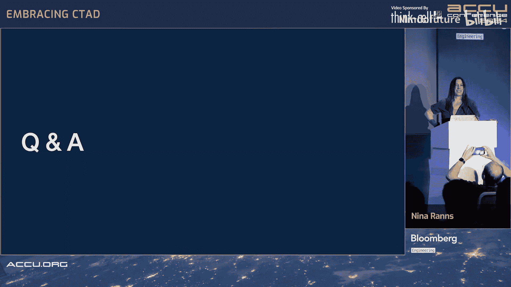

# 中英-•-C++和C语言ACCU大会2024｜人工智能｜架构｜函数编程｜静态分析｜安全｜编译器｜开发者｜垃圾回收｜链接器｜代码生成｜cmake-p15-P17-CTAD---Complete-Guide-to-Class-Template-Argument-Deduction---Nina-Ranns--BV1pNotYYELk_p15-

Welcome， thank you for coming to my talk。I guess I should start by introducing myself。

 My name is Nina Rs。Why should you be listening to me and what I have to say。

 I have been a committee member since 2013。 In fact。

 the first committee meeting I attended was right here in Bristol after one of the ACC was 11 years ago。

 it was quite a lot of fun。 I somehow stuck around these days， I'm also the committee secretary。

 and I am the CC+ plusifier Z Group chair。 C C plus plusifier Z Group is a study group that helps facilitate conversations between C and the C++ Committee in Hope was。

😊，Evolving in a。As much of a compatible direction as we possibly can。 I mean。

 the two languages do have slightly different approaches to life。 So we do have some challenges。

 but at least we don't want to diver too much。 want to stay compatible。

 So the the group kind of just puts everyone together to talk。 I'm also a crazy cat lady。

 I like coffee。 I like chocolate。 I， for some reason， how an obsession with the letter C。

 I don't really know why。 I'm also joking with a commerce supervisor of the committee。So。If you ever。

 if you ever attend a committee meeting， which I really advise you do because it it's a greater experience and you really understand how the committee works and how the language evolves。

 And if you do try and attend different groups， we have quite a lot of groups these days。

 they think that's about four main groups and then 23 subgroups and they are work in different ways。

 they look at different parts of the problem。 So you know you can you can really figure out why the language is the way it is。

 why it takes。So much time to develop certain things。 And it also gives you a perspective。

 because quite often， you think， you know why something， how something should work。

 and then you talk to other people， and you realize that in their world。

 that's not the right thing to do。 At anyway， I did that。 And I went around all the different groups。

 And I went to core group。 And the core group is kind of like the language lawyer part of the group。

 They maintain the first 15 parts of the first 15 chapters of the standard。

 And they just make sure that the wording is unambiguous and clear。 And it says what it needs to say。

 they're also very obsessive about grammar。 And my first contributions were Comas。

 So now I'm a commerce supervisor。 And I will have， you know。

 all the commas in this talk have been taken from the standard。 They are the standard commerce。

 And I shall return them at the end of this talk。 So fear not。

What it all sums out to is I'm a sleep plus nerd， and I'm here to talk about class template argument deduction。

Why am I here？A few years ago， I helped very smart groupss people write a book on modern Cus plus features。

These were the features of Cpo plus 11 and 14。 Why 11 and 14 are not other ones still。

 because there's just so much。 And we couldn't put it all in one book。

But we did cover all the features of 11 and 14。 We covered them in what they do。

 how you should use them， what you should be careful of。

 what pitfalls they might have and how safe they are to use based on how likely you are to get something wrong。

The book is out now。And it's a really good book。 so I'm not so biased。 go get。

If someone was to write the next part， they would probably focus on C+ plus 17 features。

 And as part of this research for this theoretical book。

 one of the features that I looked into was class andque argument deduction。

And I realized it would make for a very nice talk。Because it doesn't just talk about a feature that I find useful。

 but it also shows the evolution of the language， and it shows how some problems and contents are resolved。

And what one should。Do when faced with such problems。So what shall we be talking about today。

 We will talk about class template argument deduction and how it makes our life easier。

 I am trying to stay close to the microphone。 I'm quite energetic。 So if they run away。

 please pull me back。We will talk about the principles of how the class template argument induction works。

And we will talk about things that you need to be aware of if you're faced with class input argument deduction。

There are certain things that we won't be covering in this talk。

 We will not go into in depth explanation of exactly all the rules that exist in the standard for cast template argument deduction or even template argument deduction。

 Thus， these rules are quite complex and knowing all the little intricacies of all the corner cases。

It's useful if you're in a core group， but if you're a user of C+ plus。

 you probably don't have to worry about it。 And even if you ever have to worry about if I hope you're not relying on an ACC talk to give you the truth。

 if you， if you do have an issue and you want to figure out how something works。

 go and check the relevant standard for the compiler that you're using。

So it will just go high level important things as opposed to corner cases。

We also won be doing an extensive tutorial on writing your own deduction guides。

 We will see later what deduction guides are， but they're really an element of a library。

 So if you're designing your library， you should also be designing your deduction guides。

 and that is a slightly different problem。 This is the library designed domain。

 While my talk is going to focus on the syntax and the feature of fault， the language itself。

When I decided to give this talk。I spoke to a few of my committee members， and they went。

 see it Todd。I really have a headache。 And I said， why， What you mind about Cad。

 So they told me what they think the downsides of Car are。

 And I went and found out why the rules are the way they are， and I will present。The criticisms。

 and I will present the reasons why we got there。 and you can make up your own mind whether this is something that really applies in your world or not。

But we will not be taking down CTTAD， I think CTAD is a useful feature。Having said that。

 I'm also not here to tell you that C tar is the best thing since I spread。

 It's a very nice convenience feature， but it isn't something on the lines of moves semantics and I don't have contracts。

It's just nice。 makes your life easier。 It's cute， but you shouldn't rely on it to solve all of your problems。

This is also bringing you on popcorn talk。 If you do。

 please don't make mess and un throw anything at me。 Thank you。So。😡，What is Ccad。Here。

 we have a template function。 It takes one template argument。And it has a function parameter。

 And if I want to invoke it， I can provide the template argument explicitly。 And I say my funk vent。

 and that invokes my fun in specialization， and it binds the parameter to the literal one。

I don't have to specify the argument。 I can just say my funk of v of one， sorry。

And then the compiler goes away， and it looks at the parameter provided。 and it says。

 you want to invoke to my funk into specialization。 So I will give you that specialization。

 And that's what I will invoke。That's called template argument deduction。

 and we've had it pretty much since forever。 you probably intuitively understand how the rules work。

It's not magic。 Does't always work。Here， I have。My fun that takes two temper arguments。

 but only one parameter。 So there is no way of deduing the template argument。

 you from an invocation of this。 So in this case， temper argument deduction can't really help you。

It also can't help you in certain cases that we call nondduced contexts。

 so here my argument is not actually T， it's a inner type of my template argument T。

 so if I try and invoke it without explicitly specifying the template arguments。

 the compile will say sorry， can't help you there。It is still helpful， or still used it a lot。😊。

In C+ class， other than template functions， we can also have template classes and template variables。

 but that's a different story。With our template classes。

 if we wanted to create an instance of a template class before C++ 17。

 we had to explicitly provide a template argument， something like this。

 which would create mystruct end specialization and then in bulk the relevant constructor of it。

If I try to not provide the template argument， then the compiler would tell me， Na， sorry。

 can't do that。 doesn't like the classes。But people are resourceful， and people are smart。

 So they always try and make do with the things that they have and tools that they have， so。

What library writers used to do is they wouldn't write， make functions。

And they would use the template argument deduction that they had for functions to get the template argument deduction for classes。

 so they would write something like this。 They would call it to make mystruct。

 They would have the thing that the parameters that they want to match。

 and then usually the return type would be the deduced class type。

And then you could do something like this instead of initializing your。your object directly。

 you would call this make function， which would do the temper diagram deduction。

 and then using auto types， which， again， do their own type deduction。

 You would get an instance of class templates that you wanted。 We have this in the library。

 things like make optional， for example。The thing is。

 if you wanted to do this for any sort of complex type。

 you have to provide quite a lot of make functions to match all the ways that you want your user to create the types。

Which brings a lot of boilerplate codes。 And not only that before C++ 17， there were also。

 all sorts of issues where you could get into creating unnecessary copies。

 But that's kind of resolved now because we have。obligatory return value optimization。

 So that's no longer an an issue， but you still had to provide a lot of boilerplate code and and why we have template argument deduction in the standard。

 Why not just reuse it to get it working for classes。Which is what we did。

 So in sequence plus plus 17， you can just say mystruct and not provide you template argument and have the compiler deduceive for you。

 And you no longer have to write， make my struts。 It all just works as is。 And life is good。

This there is the class template argument deduction and that's what we will be talking about today。

So what do you get， it' C Tad？Before， if I wanted to create a vector event。

 I had to say vector of end， even though I had the initializerr that made it pretty obvious that I want an vector of vintagetegers。

 It' see it had。 I can just say vector and the integer part gets deduced for me。

It doesn't work just for type type arguments。 It also works for non-type template arguments。

 So an array takes two template arguments。 One is the value type one is the length of the array and it C ta。

 I don't have to provide either。 I just provide the initializer and then both the type of my array and the length of the array get de from the initializer。

But these type names are quite short。And realize we have much longer like names。

 And you can get into a situation where you have a declaration where majority of declaration is actually the type of the class template。

 Sorry， the template argument of the class template。 you get something like this where。My， my。

 my arguments really take up the majority of the line。With Cad。

 I just say pair of these two things I。Seey， much simpler。Similar thing that iterators。

 we have auto templates sorry auto type deduction for variables where you don't have to specify the type of the variable gets to use from the initializer。

 So I don't really have to think about iterators much。 they just come back from my algorithms。

 I store them mean will they iterate， I need to store。

 just think about whether it's a coniterator or reverse iterator or whatever。

 But then if I want to store it in in some container。 Now I have to think about what that's。

Iterator is。 It's much easier with Cita and I just say， create me a tuple the citerturn again。

 The type gets deduced for me。There is a really lovely talk by Marshal Kough。

 who I'm not choice at this conference this time。 He also talked about class template argument aduction。

 but he had a different approach。 And he put class template argument aduction。

Together with all the other deductions that we have now understand and including some of the。Nice。

Other nice features that we have that， and then demonstrated how you can have this。Jumble of codes。

 And using all the。Tight deductions， things that we have in the standard right now。

 you end up on this really， really succinct piece of code。 And all of a sudden。

 when you take away all this。嗯。Fuzz， you see what the code does and it becomes much easier to reason about whether it has any issues。

 whether it has any bugs。 and in general， what it does and what it's supposed to do。

So I suggest you take a look at that talk。I swear I'm not changing topics。In C++ 20， we got rangers。

Rangers is a new library that's。Helps you manipulate these lightweight objects which represent iterable sequences。

And with that， you get a whole set of algorithms and things and types and features to use。

 but it does。Require you to start thinking about iterations in a slightly different way。对。😡，You know。

 great developers were constantly learning new things。

So but just go and start playing with something， right。 And if I want to get into ranges。

 I'm going to find something from that range library like this joint view。

 which CP P P reference tells me is a range adapter that represents view consisting of the sequence obtained from flattening a view of ranges。

Now for someone that it's never worked with rangers I can't really make sense of that sentence。

 but say not， I'll just try and see what it does。So I write a piece of code。

 I write something like this。 I have a vector vector of vince。

And then I try and print out this join view。And I get this。 Ha ha， right。

 I understand what flattening of your ranges means now。Excellent。

 I can go and learn something else about Rs。 Thiss quite useful。😊。

What isn't obvious is that right there， I have seat ta。Because Jo view is a template class。

And when I wrote Join view or vexed， the compiler deduced the template arguments of Join view for me。

If I didn't have Cts， I would have to specify the tempered arguments。Oh I cannot eat right， I mean。

I'm joining vector of vectors。 So it's probably joint view of vector vectors。 it isn't。In fact。

 what it deduces is something called a w view of vector of vector events。

If I didn't have C ta and I was in disposition， I had no idea what rangers are。

 but not only do I have to learn about join view what the flattening rangers are。 now。

 I also have to understand what a ref view is。 and the fact that the ref needs to be a template argument to join view。

 and all of a sudden， the barrier return becomes much higher and。You have to start focusing on。

Specific details when you really just want to learn。High level。How a new library works。

 So this is a very nice。Use case of seattd。Much like lots of other features in C plus plus。

 Car didn't come in fully baked。That's pretty normal。 For example。

 Cont Expra in C plus plus 11 was really limited。 And these days。

 I spoke to Hannah de Shikoa just the other day， and she was experimenting without any exceptions at compile time。

 So， you know， skys the limit。The way it works is we try and find。

Parts of the problem that we know we can solve。 and then we solve those。

 And if there are additional cases that we want to support， we work on those cases。

 and as they become ready as we agree on what the right thing is and as we gain experience and what the user wants。

 we add more and more things to each feature。 So， for example， with contracts。

 which are aimed at C++ 26， we're going to get a minimal viable product product。

 which is going to do some contract checking， and then we're going to add more things to it to make it even better。

And even Z。 So that's just how language works in general。 And the same thing would happen with C tad。

 So in C plus plus 17， mi was introduced。It was based around constructors of a class。Now。

 we have two types of。Classes when it comes to initialization in this way。

 one of them gets initialized using constructors。 They're called non aggregates。

 And then the other set of classes called aggregates get initialized using something called aggregates initialization。

 which doesn't actually involve any constructors。 It just does meant wise initialization。 In fact。

 last year at ACC C U， I gave a talk about all these special types in C plus plus that that give you different provisions depending on what your class does that you can do certain funky things。

 And one of them was aggregates。 Now， aggregates do allow you。

Things and provisions that non aggregates can't do， but in Cquest+ 17。

 you couldn't get seat ta with them。However。People thought， having seat had。

For non aggregates is a useful sort of thing。 So they wrote a proposal。So。In fact。

 I see one of the authorss of this proposal right here in the room。Dimma。And they wrote P 1，0，2，1。

 which she can go and read that extends Ct support to also include support for aggregates。

 as in types that are not initialised using。A constructor。 so I can write something like this。

 I would get B1， and then I can get the juice。 that tea is an integer。

 and my team memberberggu initialized to one。Not only did we get support for aggregates in C+ plus 20。

 we also got support for alias templates， so you can do something like this。

 and then even for my alias template arguments， you can get deduction there too。

There was another part of that paper that didn't make it into C++ 20， but has made it into C++ 23。

And that's support for inherited constructors。 So here I have。嗯，哦。Here I have a typo。

 which everybody will ignore。I have a base which is a template class， it has some constructors。

 and then I have a derived class that inherits from base， and I have inherited chducts from base。

 I introduced them， However my derived class doesn't actually have any of the declare constructors itself。

However， in C++ 23， if I try and initialize my derived like this。

 it will look even into the constructors of the base class to get me the class template argument deduction。

And I get an induction of derived event。So where does it work？It works in all sorts of cases。

 It works in cop initialization， like X one。 It works in direct initialization， like the X two。

It even sometimes works if you don't have an initializer， so in X3。

 because I have a default template argument or， I can deduce the default template argument and get that case working too。

It also works in new expressions。It works in function style casts。 And this is， again。

 a very common use C tad。 instead of saying which type of muttics I'm creating a lot guard for。

 I can just say lot guard of muttics。 And the type gets deduced for me。

Where it doesn't work is pointer types。It doesn't work in reference types。

It doesn't wipe for the race。Which is a bit of a shame because technically， array is an aggregate。

不里的什么？In general， it doesn't work with built in types。

You can kind of get away by using the autotype deduction。

To get some cases working without having to specify the type。

 And despite the fact that my slide says not seated in the first one。

 you do actually have seated on the right hand side when you say U。

 there's a type de happening there。But you don't get seat out for the type of the pointer。

It's it's not really the same thing as using seatAT。 you do lose some information。

 It won't work in all the cases where a seatt might work。But you can't do that for a raise at all。

 for a raise， you simply have to specify the value type。I'm not sure this isnt an unsolvable problem。

 I think this might be possible to solve。 It just， we just didn't。 We just didn't。 Nobody。

 Nobody SAT down， researched it， found the rules that would need to be made in order for this to work and then pop implement。

 bring it to the committee and have us all discuss whether this is a good idea or not。

So we don't have it。 But I don't know。 Maybe someone will。

 Maybe maybe we will have this in a furious time。 Maybe somebody in this group will go away and say。

 oh， this is an interesting problem to solve。 I'll do this。But this is where we are。And C+ plus 20。

We also got something called a structural type。 Again。

 one of the types that they did cover last year。And just to sum up。

 structural type is a type that you can use as a non type template argument。

It does need to satisfy a few rules。 you need to be able to create as a compile time。

 meaning that it needs to have context for constructors。

And it also needs to have all its part constant。 So my structural type here satisfies that because it has a constant per constructor。

 and the only the non static data member is constant。So， when I。Call my funks with a literal 0。

I will get structural type in。E instantiate instantiateated， Iized with a0。 I's so fine。

The structural type itself can also be a template。So what I've done is just added a template argument。

 and this is still a structural type。 It still has a concepts per constructor。

 It still has all its parts constant， and I can use this in a non type template argument。

 but I get CA。 So I don't actually have to specify which T of structural type I want。

 I can just have the compiler use that for me。So when I call fun of0。

 it will do the whole class input argument deduction dance， and it will deduce structural type of in。

This does mean that you can actually get different structural type instances for this function。

 that's that's pretty much。 well， that's it's a good thing。

What you can't do is you can't get class template argument deduction in type arguments。

 So here I have a vector of vectors and I can't not provide the inner vectors element type。

 That doesn't work。What also doesn't work is C in functional parameters。

 if you have a functional parameter and it's a class template。

 you have to narrow down which instantiation of that class template。Okay。At one of these talks。

 I was drinking an energy drink， and I spill it over my laptop。So now I have to be extra careful。

Didn't make my laptop of work any faster， unfortunately。So Ct， how does it work？

Let's just walk through an example。 I have a structure that serve templates type。

 It has two constructors， one taking a constant ref and one taking an optional of D。

And then they write something like。S， variable X initialize it with once。 When I do that。

The compilea goes away and creates a set of notional template functions。

 which I will call the juice S here。And they are based on the constructors of the primary class template。

Primary B is relevant。And then when I have this set of notional template functions。

 I use the template argument deduction that I have functions to deduce the T。

Then I substitute that T back into my statement， and I initialize an object of the instance that I have created。

Now， you will note the stars here。These stars mean that I lie to you。It's， it's a minor lie。

 And by the end of the lecture， we will see the truth。

But this is a very useful way of looking at CTTD when you're just starting to understand seatTD。

So what does that mean？I， I see an initialization like this。 S x equals one。

My compiler creates notional template functions based on the constructors of the class。

 so I have one that's based on the constructor that takes constant T ref and it returns S of T and the second one takes an optional of T and returns S of T S of T is kind of a default thing that you did use。

And then it has those two functions。It tries to deduce D from invocation of those ded S with one。

This will do the function template argument deuction。 I will get T to be int。

Then it will substitute that int back into the declaration to say S of int x equals1。

 and then it will initialize an object of that instance。

The thing to note here is these are two steps。 One is deducuce template arguments。

 and then the second one is initialize an instance of the deduced template argument instantiation。

The reason I say that is， if you remember just a while ago。

 I said that these notional function templates are made based on the constructors of the primary class template。

It does mean that if you have a specialization with different constructors。

 then you may possibly hit a specialization when you deduce the type。

 and then your initializer will be looking in a completely different set of constructors。

This may be a good thing。 This may be what you want。

 but it also may be something that you don't want。 So it's just， it's just worth keeping in mind。

These deduce S notional functions are called deduction guides。

And they don't actually exist as deduce S。 I just made up that name。They， they do exist。

 and we do need to be able to differentiate them from some template functions that the user write。

 So they have a slightly different syntax。And this is the syntax of a deduction guide。

 You have a template header， which is optional。You have the name of the class that you want to deduce。

Then you put what you want to match for that deduction and then the type that you want to deduce if you hit that deduction guide。

 So if I was to rewrite these deduce S functions as real guides。

The first one would be have the same template header。It's the class S that I want to deduce。

 I want to match con T ref。 And if I do， I will deduce S sub T。And the second one would look again。

 samee。 I have the same header。 I have class S。 I want to match optional T。

 and I want to deduce S of D。Those are called implicit deduction guides。

These implicit deduction guides work with all sorts of things。

 So here I have almost the same example where I have a default template argument。

So the default template argument is also reflected in my guides here。

I can also have veric template arguments。 Those veric template arguments are also reflected in my deduction guide。

 both in the template arguments and in the parameters。I can also have template constructors。

 And if I have template constructors， then the template arguments of my template constructor are added。

After the template arguments of the class。 and again。

 I have the same parameters at my template constructor。And I deduce S of D。

 it's always S of D for implicit deduction guides。It works with concepts2。

 So if I have a concept be it in the class or in the constructor。

 that also gets added to my deduction guides。 so my deduction guides are constrained just like the initialization would be。

But just like function template argument deduction， this is not magic。

It doesn't always work for the same reason that a template argument inductionuction doesn't always work。

For example， here。I have a template constructor that takes a constant U ref。

 but from the invocation of that constructor， I can't actually deduce D。

So this implicit aduction guide will not help。Similarly， if I have some sort of non context。

 like here where I have。I have the parameter that's not actually the type that I'm taking。

 but some sort of inner type the that's reflected in the guide by but I expand my T just so you can see what's going on。

 And again， this is a nondduc context and C I just can't do anything with this just like it wouldn't be able to do that with function template arguments。

Other than the deduction guides that are based on the constructed class on the constructed level the class。

 we also have two other types of implicit deduction guides。One is a conditional deduction guide。

That you get if your class doesn't have a definition or doesn't declare any constructors。

 and it imitates a default constructor。 looks like this。

 So I get my default template arguments in my template header。

 I get S of nothing because that's a the default constructor and I use S of T。

 and it can be useful because sometimes you might have your primary template。

Not meant to be instanttiiated。 You only have a specialization that's meant to be used。

 So in that case， you can still get some temporary deduction。

The one that's more often spoke about is the copy deduction guide。

 which imitates a construct that takes an object of the same type by valueu。It looks like this。

 It has the same header as the the class template， and they takes the type that is trying to instantiate。

 and then S T as the deduced type。So if I'm to plug those deduction guides。

 those additional ones into my example， we can see the full set。 Now。

 we have the two deduction guides that are based on the constructors of the primary class template。

 the T constant F and the optional T。I don't get the conditional one because I have declared some constructor so that one doesn't kick in。

 but the copy deduction guide does。 looks like this。

And then if I try to initialize an instance of S1。The second one。

 one kick in because it's not an optional。 The third one doesn't kick in because I'm not initializing with an object of S。

 But the first one does。 And I get deduction of n。 No difference。However。

 if I try to initialize another one with X。The first one can kick in。 The second one can't。

 and the third one can。 But because the third one takes by value and we'll see more in depth later on。

 Third one wins and I get deduction of the int。 So my Y next have the same type。

I did say earlier that it also works for aggregates and aggregates don't get initialized with constructs。

 So how does it work for aggregates then。Well， for aggregates。

 we also get the two implicit deduction guide that we mentioned the conditional one。

 which we always get because aggregates don't have any constructors。

And we get the copy deduction guide。And then。When we write。

When we write a declaration of an aggregates instance。

We get a special deduction guide based on that initialization that tries to match the elements of the aggregate to the initializer elements and and give you a function template that would correspond to that particular initializer。

So something like this， it has the two template arguments of the class， which it always does。

 it takes the T， then it takes the U and then an int。

 and then it matches that against the initializer and deuces T to be int and U to B char。

The rules are much more complex， but this is roughly how to understand it。

 You have the two implicit ones that you always get， and then you get additional one。

That matches the initializer that you have provided。Again， it's not， it's not superpower。 I mean。

 it's not magic。 So if you provide an initialr that only has one element and you have two things that you need to deduce。

 you will get this deduction guide that imitates your inizer and you can't deduce you from that。

 But like that's just， that's just life。 if you don't provide something to deduce from。

 we can't deduce it。😊，So here I would get the deduction failure。Now。

 other than the implicit deduction guys that you get， you can write your own。

 you're not limited just to the implicit ones。And here is one of the reasons why you would want to do that。

So if I take something like a vector， a very， very simplified vector。

 I would have a constructor that takes two in pererators one to the first one to the last element。

And I want to create a vector from it。 The deduction guide that I get for that specific constructor has the template argument of the class。

 followed by the template argument of the constructor。

 It has the signature of the constructor and introduces spectrum of D。If you remember。

 this is one of those cases when we couldn't do the tempered argument deduction， even with functions。

 So this deduction guide can't help us。In fact。If we were to write a make function。

 it would have a slightly different signature， it would be templated on the input iterator。

 which we can de from the arguments given to make vector。

 and then the type that we is actually the value type of the iterator traits。

That's what we want in our deduction guide。 So that's what we write。 Instead of calling it mate Weta。

 we just say vector， we have what we want to match each other two infant iterators。

 and then we have the type that we want to juice。 And this is our user defined deduction guide。

In fact， if you go to CPP reference and you look at deduction guides first de。

 youll find it right there。Except there's also an allocator which I don't care about in this instance。

 which is unusual because I usually care about allocators。 I like my allocators。

 Allocators are your friend。But in this case， we don't。

 and it's just a simplified version of what we have for aD vector。

The deduction guys that you write don't actually have to be templates。

 You might want your deduction guy to be a non template。 Why would you want to do that？ Well。

 for example， here I have a shot S。 The primary template is not defined。

 but I do have a specialization for int， and that one does have some constructors。

The implicit guides that I get for thisstruct， I get that conditional one because my primary template isn't defined。

 I get the copy deduction guide。 and that's it。 I don't get anything based on this event because that's not the primary class template。

If I try to initialize an object of S now with one。

 my deduction will fail because neither of these two implicit guides can help me。

 but I can write my own。However， in this case， because I'm writing it for the specific specialization。

 I don't actually have a template header。 I just want to match an int。So this is not a generic thing。

 I want to， I want to deduce S。 I want to deduce S when I see an integer。 and when I see an integer。

 I want to get an S of integer specialization。 And once I have that as my use the defined deduction guide。

My declaration now works， and I get deduction。There are a few things to note where it comes to use defined deduction guides。

One is you can't have two user defined deduction guides with the same parameter clause。

 or in other words。You can't have one that says if you match S D vector of D， give me an S of D。

 and then another one that says if you match S D vector of D， give me an S vector of D。

 that just doesn't work。 They clash。However， you can have a user deduction。

 user defined deduction guide that matches one of the implicit ones。 That's perfectly fine。

 And in fact， your user defined deduction guide will take preference because obviously， as a user。

 you know better than the compiler。The second thing is。

 don't define deduction guides for classes that you don't own。That is always a bad idea。

It is not how the you the author of that class meant to do， and not only that。

 you can get all sorts of undeified behavior。 you have different deduction guide in different places。

 and you do this different things in different places。 just don't do that。In fact， in standard。

 we have a sentence that says the behavior of a C plus plus program is undefined if it declares a deduction guide for any standard library class template。

 So stay away from classes that are not your own。And the third thing to note is that if you provide a user defined guides for an aggregate。

You will disable the generation of that additional， implicit guide。So what does that mean？

Let's go back to our aggregate。 It's the same aggregate we had in the previous example。

 It takes two template arguments。 It has four elements。It gets one implicit deduction guide。

 which is the conditional， one， it has no constructors。 It gets one， which is a copy deduction guide。

 because that one always hits。And then when I try to initialize the X。

 it gets the third one that matches that specific initializer。Now。

 if I provide a special one for my aggregate， because I know how my aggregate works。

 And I want to say that if I just provide one element。

 I want to use the other one to be exactly the same。 I can do so。

 I can provide my use defined deduction guide who looks something like this。 I say if you match a T。

 then you give me an instance that has both tea and you。The same。However， now。

 if I try to initialize my X with the same initializer。

I will not get additional implicit user guides， and deduction of this will fail。

 but that's probably okay， because what I really wanted to support is this case。

 If I provide one thing， then I want the other thing to be deed from that one thing。

 And that works fine。Okay。Now， let's talk about the truth。Because we can handle the truth。

It's not a set of notional template functions based on the constructors of the primary class template。

 There are other things happening here。What we get。Is a set of deduction guides for the class。

 which includes the implicit deduction guides possibly based on the constructors of the primary template。

 plus the two additional ones， and then also any user defined ones that we have。 That's to set。

And then we deduce the， the T in our example， from the set of those deduction guides using template argument deduction。

Except there's still a star there。 The reason there's a star is because。

It's not exactly template argument aduction。 It's not exactly the same rules as as the function argument aduction。

 There have been slightly modified to match the class case better。

So let's look at the differences between a function template argument deduction and a class template argument。

嗯。In C+ plus 11， we got move semantics。W semantics are great。

 It means that we can reuse objects that are going out of scope or are no longer going to be used。

 And to do that， we introduced our value references。

 which bind to these objects that can be moved from。The thing is that in generic codes。

You don't always know。 You can't。 You don't need to write a generic code that works with boasts。

Objects that are going out of scope and objects that are not going out of scope。

 So we also have theft forwarding， which allows us to take an object and carry information of its value category。

 meaning its its going up of scope or not。 down to the place where it can be used So you can write functions like So here that takes a template argument and then forwards it into another function all the way down until someone can make use of the fact that this is either an R value or an L value。

For those who don't know， ill values are objects that are still going to be used and our values are things that can have their gut ripped out and reused。

The way it kind of works is that if I try and evoke my function through with an L value I。

The compiler will say， aha， you're trying to match against an L value。

 and I will go down this special route， and I will put a reference to the type that I deduce。

 So instead of deduing T to B an int in this specific case， because I'm calling it with an L value。

 I will deduce int R。 And then when I substitute the in ref into T ref Ref。

 which is the signature of the function。 I will get reference collapsing rules。

And the resulting signature will be in ref， and I can bind it to all value。

 and I have kept information about what it is that I'm carrying。

If I try to invoke through within R value， meaning the one is going out of scope。

The compiler will not do this special add reference。 It will just deduce as normal。

 It will get an int。 It will substitute it back into the signature。

 and it will get an in reference which which an our value reference it。

 and it still carries the type。This T ref， where T is a function template argument。

 is also sometimes referred to as the forwarding reference。

It's still kind of like an R value reference， but it just means that deduction rules when you see that are special。

And that's a good thing。 And， and thing to note is that we actually get two different instantis based on the value category of the thing that we're invoking it。

Not just the type， but also the value category。This is good。The classes。

Things are slightly different If we have a constructor of a class where it takes a con T ref and a T ref F where T is a template argument of the class。

 those two things really， those deco constructnstruors really are meant to bind either to an L value or to an R value。

 So if I was to explicitly specify the template arguments of my S and say。

 is that instantiation and I evoke it with an I， which is an L value。

 I do want invoke the first constructor。 And if I initialize it in an R value。

 I want invoke the second constructor。If I now have my compiler de the templateed arguments for me。

 I really want to get the same behavior。I don't want to get anything different。 if I。

 if I initialize it with an eye， I want to get deduction of event and invocation of the first constructor。

 And if I invoke it in an R value， I want to get again。

 deduction event and invocation of the second constructor。

These are the two deduction guys that you get from those two constructors。 And if you can see。

 the second one kind of looks like forwarding reference， but it isn't because in this case。

The the template argument is not a function template argument。 It's a class template argument。

 And I don't want those special rules to kick in。 and all of a sudden start deducing reference types。

 because reference types are not what we want here， and it will mess up my initialization。

 So when a compiler does the template argument auction and sees that the T is a class template argument。

 it doesn't fall down that。Root that adds reference。

That doesn't mean that you can't get forwarding with classes。

 You still get forwarding if you have template constructors。 So here I have an S。

 and it has a template constructor that takes T ref F and a U ref Ref。

Youre is a template argument of a function。 It's a constructor， but it's still a function。

So in this case， that is a forwarding reference。The implicit deduction guys that I get from that has the two temper arguments。

 one of the class。One of the constructor， it has the signature the constructor reduces S of D。

So if I provide it a one， which is an R value and an I， which is an L value。

It will do the plain deduction for T。 It will deduce it to be int， and then for you。

 it will deduce it to be int ref， and it will invoke the constructor， and it will all be fine。

If I provide two R values， the first one will deduce T to be int。

 The second one will deduce u to be in。 And again， I can instantiate this。 It works just fine。

However， because T ref， like we said， is not actually。A forwarding reference。

 it really is meant to be an R value reference。 It's only meant to bind to our value。 our values。

 If I try and instantiate my class with an L value of I， I will get errorer。 And this is。

 as intended， This is what the user should want in this case。

The other difference between function template arguments and class template arguments is that class template arguments are all or nothing。

So here I have a function template and a class template。 They both have two template arguments。

And if I want invoke fool with no explicit temper arguments at all， I can do that。 I will deduce the。

 and I will deduce you。对对对。But。I may want to just deduce you and explicitly specified tea。

I can do that， too。 I provide int for T， and I let the compiler introduce you。This can be useful if。

 for example， you always want to force the first argument to be an integer because you can， you can。

 you can possibly get a conversion there in this case。 So this is a good thing。

 and we do make use of it sometimes。If you have a class。And you don't provide any template arguments。

 and you can deduce them from the。From the initializer， you get the deduction as normal。However。

 if you try and provide one and have the other one deduced， this doesn't work。

Because as soon as you provide one， you disable class number arguments。Reducuction。And in fact。

 if you go onto Google， this is one of the main criticisms of C town。 and people are saying， oh。

 this not working。 I I want this to work。And Tima being the hero that he is。

Wrote a proposal to make this work。And then， we。Discussed it。 And we realized that， well。

 the problem isn't。Though simple to solve。When you start looking into different use cases。

 you realize that it really isn't all that obvious what a partial class template argument auction should do。

So for an example， here I have astruct S。 it has two template arguments。

 and the second one is defaulted。And then when I say S of nt。What is it that I want？

Do I want the second one to be the default one that I provided。

 or do I want the second one to be the Ju。The answer to this question isn't obvious。

Different people on different things， and providing one means that we really。

Making it quite difficult for the lives of other people。And in this case。

 there was no prevailing majority。 And we just decided it's， it's not worth doing。 For now。

 it would cause more issues than it would solve problems， and。Again， maybe one day。

 we'll find a way of making this work。 and then we will make it work。 But for now， there's just。

 there's no obvious answer。 And this is not the only use case you have other use cases that would not work。

 For example， this one， where I have veryadic template arguments， And I provide one。

 Do they want to provide one and have the other one deduced。哦。How I specified all of them。

 iss not obvious。So this is another reason why decided to not pursue this direction。Okay， so。

What should you be aware of when you're working with seat Tad？

One thing is that C T prefers copying of a conversion。What does that mean？I have two vectors here。

First one， I initialize with a list of integers， and it becomes a vector of integers。

 and then I initialize B from the first vector of integers。The question is。

Should those two things have the same type。And I'm not asking you to reflect on what I've told you and what the rules are。

 I'm saying， think intuitively， when you look at this line of code， which one of you。

 how many of you think that A And B should have the same type。Excellent。Not right or wrong answers。

 This is really just about what you intuitively feel。Now， let's say you're a library writer。

And you make a function called make vector。And this make vector function takes whatever you give it。

 and then creates a vector of that thing that you give it。So as a user。

 you invoke it with an integer and you get a vector integer。

And then you invoke it with a vector integer。How many of you would expect to get back a vector of vector of integers。

Excellent， again， now， write a wrong answers。 this is。

 this is just what you feel intuitively as as developers be using the code for so long。

 it is perfectly normal to expect a vector of vector of vintages。😊。

And what it really comes down to is when you have a declaration like this。And B is a container。

When you initialize B with another container， what is more intuitive for people。

 I it to get a container that has the same type as the one you're initializing it with or whether you get a container of the container you're initializing it with。

And after relating this， we have decided that what is intuitive to a majority of people is to get the same type。

And because that's what we thought is intuitive。We made that the default。

And he made that default by providing。The copy deduction guide。

It doesn't mean that you can't have other use cases。 I mean。

 if you have a make vector function and you're writing a generic code。

 you can still provide a make vector function that creates a vector of vectors。

 You just don't use CTtt。And this is one of the cases where you don't want to use seatt。

 This is not what seatt was intended for。 If you're in a generic code and you always want to make sure that you creating a vector of the thing that was given to you than you seatt。

 be explicit。So how does it work， Why does it preferfer copying over conversion。

The implicit guides that you get， as we already know。

 are the implicit are based on the constructors of the primary class template。 So in this case。

 it is a S sub constant Ref。We don't get the conditional one because we have constructors。

 but we get the copy deduction guide。And I did earlier call out that the copy deduction guide takes S of T object by value。

 which is important。When they try and initialize x with an integer。

The copy deduction guide doesn't kick in because I don't have an object of type S on the right hand side。

 So the first implicit deduction guide is used。 and I get deduction of it。

If I try to initialize an object of type S with an X。

Both the first deduction guide and the second deduction guide can deduce something。

 The first one will deduce S of n。And the second one will deduce an in。Now。

 in instances where you get more than one deduction guide deducing something。

 we order them based on how good of a match they are。 And in this case。

 because the copy deduction guide takes by value， it doesn't require any conversion to a reference。

 and therefore， it is a better match than the first one。

 and the resulting type is is T equals int or y guess the same type as x。Again。

 if that's not what you want， if you have some sort of an unusual special case。

 you can still make it work。 You just have to provide your own user deduction guide and your user deduction guide needs to have the same signature as the copy deduction guide。

 As you said earlier， you cannot provide to a user defined ones that have the same parameters。

 but you can provide the user one that matches an implicit one。

 And then that one will take preference。 So this is now my set。

I still I get the copy deduction guide。 It isn't。 It doesn't stop existing。 I justt thou have three。

 the two implicit ones and the third one that I have defined。If I try and initialize it with one。

 neither two or three will match because they don't take the the red hand sound is not an instance of S。

 But if I do put an instance of S， all three can now ded。 The first one will deduce S or nt。

 The second one will deduce an int。 and my user defined will define S or n。 Now。

 I immediately get with a one because that one has a conversion to reference。

 So that was not a good match。 And then I have the two ones that are。

That look like they should be the same match， but they're not because the user define ones。

 take precedence because， again， as a user， you know。

 better than the compiler and you get a deduction of S N。 So in this case。

Because I have made something special for my special use case。 I can get conversion when I want to。😊。

It doesn't work just with the conversion。 in general。

 you have to be careful when you're using seat ta with containers。And。

 and the best way to do that is just to read the documents。 So here I have a pair。

 and I have a tuple， and then I create the tuple from my pair。 And the question is。

 what is the deduced type here。Don't guess。Why why would I guess， I mean， I have internet。

 I have a Google。 I just go to CPP reference， and I take a look at the tuple type。板子。

The CP reference tells me， well you do have special constructors for two that take a pair。

 and I can even read what those constructors do。Those constructors create a two element two pole with each element constructed from the corresponding element of B。

I have a pretty good idea when I'm going to get the juice here， but I still don't have to guess。

 because even the deduction guy， even the deduction guys for stupple are documented on C P reference。

 And I can just go， and I can see that if I initialise it with a pair。

 I'm going to get a tuple that has the same templateate arguments as the pair， so。😊。

What is the juice type of tuple here， Can anyone tell me。Check this job。Well done， yay。嗯。Excellent。哎。

The other thing that people sometimes don't like about CtD is the fact that you can get its when you don't really want it。

So let's say I'm a library writer。And I wrote my code in C++ 14 before class template argument deduction was even a thing。

I didn't provide make functions because I didn't want any tempered argument deduction at all。

And my user， who has a newer compiler， writes something like this and gets class template argument aduction。

It works。 It does the right thing， by accident。And。We just carry on。And then as a library writer。

 you go and you make some changes to your type。 It accidentally disables the class template argument aduction in that specific case。

 and all of a sudden。Your client has a non compiling code。

 and then you get an angry customer on the phone。And you have to explain to them， Well。

 I didn't really intend you to do， to have this deduction。 And then you have to back and forth。 So。

 yes， this is。This is really an issue， but。Whether it's an issue worthy of。

Not having seats is a different matter。In fact， you can use this sort of nonju context to deliberately disable class stamp argument auction for some constructors if that's what you want to do。

 so you would do something like this， you would have a type identity and then you would use this alias in your construct signature and then you will not get。

Class them put deduction for their specific constructs。 if that's what you want to do。

You still get the copy deduction guide so you can't fully disable class template argument deduction。

I've put this here as a question to Car or not tickar。

 because sometimes people discuss whether they should be using it or not。

I'm not convinced that's a good question。The thing is。You get seat h。It's just that。

There's no way of disabling it。So you can。Argueel。Whether it's useful for you or not useful for you。

 whether it。You like it or not。 But what you really need to consider is that it's there and you simply have to be aware of it。

And if you know how to use this feature， if you know what it does， if you understand it。

 then it can be your friend。But all it needs is getting familiar with it。

Instead of asking to see Td or not to see Td。Was just going to say。

 what do you need to be aware of now that we have seat hand。If you're a user or a library。

There will almost certainly be times Be seated。 it will be of great help to you， almost certainly。

But it is not magic， just like function type with argument auction is in magic。

 There are certain cases where CTta just can't work。Also， if you're writing a generic code。

Be careful。 If you know exactly what the temperate arguments should be in your writing generic code and you can get any sort of thing。

 Just be explicit。 Don't me why on seat tad。 This is not the place to use seat tad。Similarly。

 if you're working with containers and you're converting between different containers。Checkck。

Check the documentation。 Make sure that you're doing the right thing。 taste your code。

To know that you're doing the right thing。 And if you're done， then talk to your library providers。

 don't write your own guides。 That will not end well。If you're a library。You again。

 can't prevent your users from getting deduction。 You just can't。

 There will always be at least the copy deduction guide and possibly the conditional ones。

 So what you have to do is just test your code with a deduction guides in mind make sure that the deduction that your user is getting is a deduction that you want them to get。

If it isn't， provide additional， provide the ones that you do want your users to get。

You can also consider whether you want to disable some of them for certain constructors， if that。

The best thing， but。Whatever you do， just。Write the guide that you need。

 Test your deduction and most importantly， document your decisions。

 So the users that are using your library see how they should be using it and whether what they have is correct。

😀And we get to Q And A because I have been shy on caffeine。😊，And rush through my slides。

 so does anyone have any questions？😊。

会会长。

