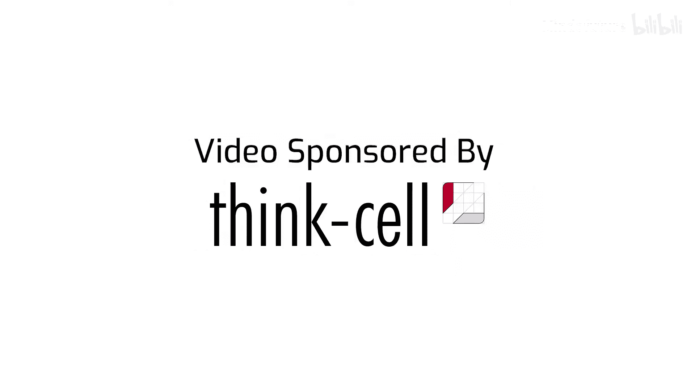
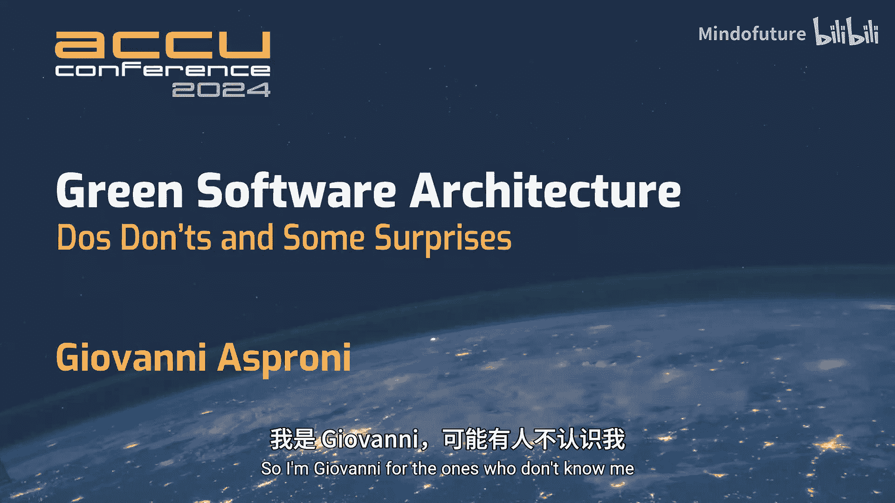
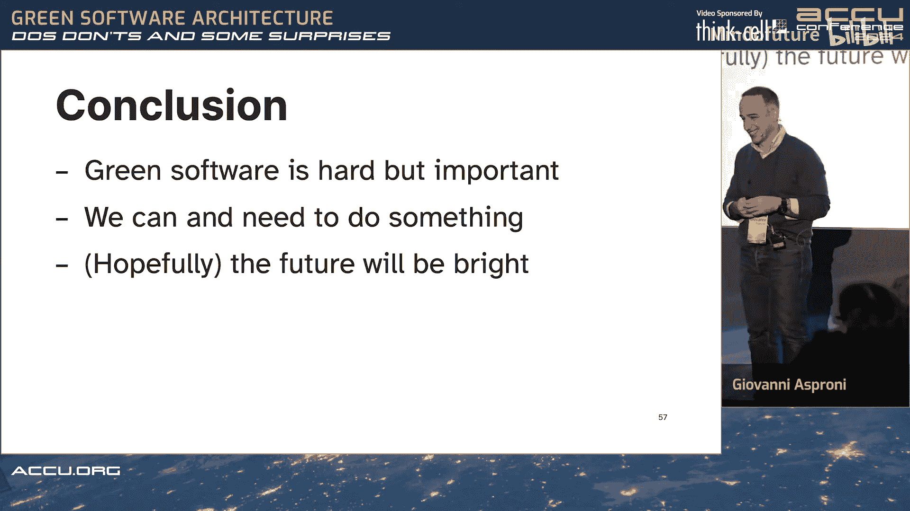
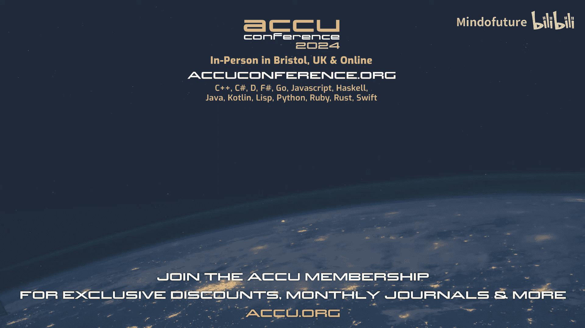

# 中英-•-C++和C语言ACCU大会2024｜人工智能｜架构｜函数编程｜静态分析｜安全｜编译器｜开发者｜垃圾回收｜链接器｜代码生成｜cmake-p16-P18-Green-Software-Architecture---Dos-Donts-and-Some-Surprises---Giovanni-Aspron--BV1pNotYYELk_p16-

Okay， thank you all so。

I'm Joananni for the ones who don't know me。 I used to be also confidence chair here many years ago。

So I'm always happy to come back。And today we' be talking about green software architecture。

 So you know those don't send some surprises now。It will be more。

 think of it more of an introduction to to the subject。 Yeah。

 so I will give you some information hints， but not is' not going to be a comprehensive talk about everything。

 okay。And also， I'm not yet an expert in this， but I have a strong interest in it。

 So I started having an interest in green software a long ago。

 I think was reading some article in the IT police software magazine at the time。

 I even bought a power meter to measure the consumption of my computer and do some experiments at home。

 but then I forgot about it because I got busy。But then recently， in my。

Other volunteer job as a host for the software engineering radio podcast。

I had the chance to interview two people to researchers in the field of engineering。

 They are called Coral Callero and。对。Sorry， I forgot the other name now。清笔书贴了没？

But the surname is Gathea。诶。And so I got interested in it again， because looking to it， first of all。

 is important。 Yeah， so we need to consume with less power than what we do than we do。And。

B is also quite interesting， from an engineering perspective。Yeah。Yeah。

 and then I also borrow some images and quotes from various research checks and papers。

 So I put all the references at the end。 so you'll find them in the deck。对。Felix Gaia， sorry， Felix。

 I remember your name now。Now， let's look at the problem。 Yeah， the our sector， the well。

 information technology sector， So including software and hardware， yeah。At the moment。

 consumes about 10% of worldwide electricity and is forecast to increase up to 20% by 2030。

 okay which is significant， if you ask me。嗯。In terms of CO2 emissions is pretty much at the same level of the aviation industry。

2，3%。Forecast some forecast predict with an increase of to 14% by 2040。Yeah。So is， again。

 is not really a very sustainable trend。So we need to do something about this。 Yeah。

 so this talk is really about what we can do。Yeah， as I said before。

 it is better for the environment for sure， yeah。But is also good for companies。

 Green software is very often cheaper to operate。So they can save money。

 and as I mentioned before is good for developers as well。

 because there are some really proper interesting engineering challenges。In solving these problems。

Now， I'll mention some of them。Now。The thing is to decide what to do。

 we need to check how the CO2 is emitted。 Yeah， in the power use now。These diagrams chose。

The total carbon emitted by different devices。 So this includes。The production of the device itself。

 which is the gray area and the blue area is actually the use， the software。Okay。

 blue is the software contribution during the， its lifetime。

 So for each device here is the emissions for the average lifetime of each device， yeah。

So as you can see， this computer has quite a lot of carbon to be built some when it is in use。

This thing， FPTV， FTP TV is actually quite interesting。

 These are the flat flat panel Tvs that are so in fashion nowadays。Look。

 actually producing them is extremely expensive。And this is smartphones。

 which seem like the software doesn't really。Can't much for them。But the smartphones。

 that is an interesting thing。 Now， when you look at this diagram， this is pair device， okay。

 so it's not total this per device。At the moment， I think we have around 8 billion smartphones in the world。

 So the total CO2 emitted by well or consume。For smartphones， dwarfs。

 the total for desktops and laptops。So if you look at this pair device， this is green。

 if you consider the total impact。This is enormous， compared to the announced。嗯。Now。Looking at this。

 we say， well。The problem is hardware。Yeah， so what can we do。

Has anybody got any ideas of what we can do？嗯算。more existing。That's a very good one。

 So writing software for existing hardware that is backward compatible for time。 for a long time。

 In fact， this is one of the things that I mentioned as well。So the general thing。

 if you think about this， yeah。Is pretty much what you suggested that is we can use the algorithm back and make it last longer。

Yeah， this is how the contribution we can make， yeah。Today， I will not be talking about。

What companies should do in terms of their marketing efforts。 Yeah， because， of course。

 if you talk to Apple， they want to sell new iPhones every year， which is not really。

 which goes against greenness。You know， green Air It or Apple or any other producer is pretty much the same。

 So this requires also a change in business strategies from these companies。

 which are not the subject of this particular talk today。

 try to focus on what we as developers can do， yeah。Okay， but this is pretty much what we need to do。

Make sure that we use hardware for longer。 One of the papers I found as an interesting mention。

 some interesting stuff about， I think is a Microsoft text box。 I think the first one， if I。

 if I'm not mistaken， was designed to last 10 years。So， by design。Yeah， they decide， okay。

 this thing is going to last 10 years。And they made it work。That there are really no excuses。

 If we want to make this happens， we can do that。 You know， think also about cars。 I mean。

 we don't buy a car every three years。 maybe some people do， but most than typical for 1020 years。

 maybe。两。now。This is all good。 Unfortunately， there is a tennis na。

To create creating and operating energy efficient software is hard。一。

I's that because as we'll see some things are just difficult to do but we don't even have the tools。

 so even if the research has gone on for number of years， yeah many I think probably two。

 three decades， we still don't have many tools available so for example。

 do you know of any Ps you can use to check how much power your application is consuming the all time。

Yeah， this will be a basic tool for testing what we are doing。没。

SoBut we'll see we have some proxies we can use， to give you an example。

 so the tools are not there yet。嗯。So， this is one aspect。

 And then we see also that there are other other aspects related to software design and how we。

 we deal with it。 Yeah， I'll give you。And and hint。

Not all good software engineering practices are actually good for the environment。

And this turns out to be a significant problem as well。有。Now， before looking at what we can do， yeah。

 let's look at some definition。 So when we talk about green software in general。

 is software that emits fewer greenhouse gases， yeah and consumes less power。

 Yeah now the two things are not synonymous because if you run the software in using some renewable energy。

 the CO emitted is much less independently how much power do you use。Yeah。

 it's probably not even going to increase， even if you use more power so。With the current situation。

 the power use is a good proxy for CO2 emissions at the current stage of affairs。养。Now。The。

 an important aspect is that the focus is on reduction， not naturalization。

 So we are not aiming at zero emissions in total。 Yeah。

 this is probably unachievable because if you consider the hardware that still has to be produced。

Yeah， and even。诶。Tools that we create for renewable energy emitid carbon， you know， solar panels。

 building a nuclear。central anything else。 So there is still carbon there。 Okay。

 so we are not going to。Go to 0， But we are trying to go as close as 0。That's postbo， yeah。哎。

When we look also the green So now there is also， I'll give you links to the Green So Foundation which is nonprofit where also big companies financed by big companies。

 I think Microsoft is one of them probably Google and others。

 so they are doing lots of work around green software patterns and all these kind of things。

They have this category categorization of green software。

 So you say that green software can be carbon efficient or carbon aware。 Yeah， now。

 these categories are not mutually exclusive。The same system can be everything。你。

So when we go with that。Carbon efficient， yeah， is about emitting less carbon。

So these are the situations where it could be energy efficient， use less power。

 and so less carbon as a result， or hardware efficient needs smaller hardware and so again。

 less carbon as a result because the smaller hardware is produced more easily yeah。Okay， and。

Carbonware is an interesting thing， because is。About。Mostly about how you run the software。So I say。

 you know what， I am deploying my systems in AWS。And I choose that particular data center because I know that in that data center。

 they're using renewable energy。杨。So， this is just an example。

 But to give so is not necessarily the software itself that is particularly efficient， but it is。

Since we are aware， we tried to run it in ways。That will save carbon anyway。原。Okay。And。

Then when we talk about green software also， this is a classification from Coral Callera Phlys Gara。

 the people I mentioned before。There are different aspects。

 So this is diagram I copied from one of the books。

AndSo you say when we talk about green I T in general， which includes everything。 Yeah。

 that includes two。Categories green in I T A， green by I。 What does it mean。

 green in I T is making I T greener， producing hardware， emitting less carbon。

 making software more efficient， so。Amid less carbon。 all this。

 This is green in I T green by I T is using I T to help carbon reductions in other systems。

 I don't know。 Imagine， I don't。Some maybe electronics of your car that check the full consumption Yeah。

 in the injection that nowadays there is plenty of software and the car sometimes also the car of my parents has  blips you should switch gear gear because otherwise you are consuming too much know things like this。

 So that is buy it so the system checks and say hold on you are consuming a lot Yeah。

 do something okay so in general， when it is green in is you' are talking about making the thing green and green by is using this thing to make green something else okay。

And so the same goes with software， green in software， green by software。 Yeah， green in software。

 let's make applications efficient。 green by software， Let's automate some processes that will。

Deploy something in a greener play in a， you know， with kind of load shifting into a greener data center at the appropriate time。

 Yeah， so the the automation itself is for the green bank。 Yeah， is it clear。Okay。哎。

Then there is the concept of greenability。 I took this definition again from one of the references。

Making it short， green abilities， if you like， is the software quality that defines greenness of an application。

 Yeah， the same way we talk about security， scalability， green abilities， how。

 how green is this thing， yeah。Yeah， scalability， make it more scalable。

 We need to handle more connections per unit of tank green abilities， make it make it greener。

 use less power， emit less carbon。两。Then there is， of course。

 another aspect that we have to keep in mind， because remember that everything is a matter of trade offs。

So sustainability is such a tradeoff。 So when we talk about sustainability， in this case。

 we talk about there is economic sustainability。 So if you think from a software perspective。

 is this thing cost effective if I'm producing this， I I going to make money out of it。

Because if I'm only going to spend money just to make it green and don't earn anything。

 it's a problem。Yeah。Humans that the sustainability here is about， is actually。

Possible to do that in a sensible manner。 Yeah， so it's about well， sustainable pace in a。

Kind of X agile fashion， yeah。But what I like to see this is also more sustainability。

 I would extend that meaning here is also to the users。Think in these terms。Nowadays。

 we have the ability to create systems that are accessible that people with disabilities can use their computers to access the services yeah。

And this is actually becoming very important， because。I mean。Anything。

 everything needs to be done by connecting to the Internet or to some。Systems out there， you know。

Things with banks， bureaucracy， all sorts of things。

So it's super important that these systems are accessible。 now imagine this。Let let's say。

 we are creating the system， but to make it。Accessible， we need to make it less carbon efficient。Now。

 my take there would be， well， let's make it less carbon efficient because otherwise wouldn't really be sustainable。

 Yeah， why should we cut out you know， sensible percent of the population potentially removing some rights they have。

Because we want to make things greener。两。So， you know， as humans， we don't try to。In a sense。

 we believe in evolution， but we don't try to or natural selection in some aspects。

 we don't do natural selections with humans for good reasons。Okay， doing this kind。

 not considering these aspects would be a problem。 Yeah。

 so think calls in these terms is sustainable from a society perspective， yeah。

And then when we look at this， there is the environmental sustainability。The software perspective。

 And here， what the green in software is the thing that is in the software sustainability。 Yeah。

 because it's basically we are to making this sustainable。

 The green by software is a bit out of this。 It's not about software sustainability It about sustainability more general。

Clssify。嗯。Now。As I said before。对。Solving all these problems is。

 But there are some things that we can do now。 And then late at the， at the end Ill。

AtLe some things that I hope willll be able to do in the future。一。So。What can we actually achieve。

Now， let's look at how we work。 Yeah， so general nowadays， we our typical activities can be usually。

 you know， doing gathering requirements， the engineering bits， implementing them。

And then operating the systems。 This is very broadly what we do in our software development work every day。

Now， in modern times， now， we have also machine learning。

 I put it in its own category because doesn't really fit neatly in the others and。

Comes with its own special problems。Yeah， so make it sense。 it makes sense to keep it separate from。

 from the others， yeah。哎。One thing that is important to say is。At the present time。

Our biggest wins in terms of saving CO2 and power。Is with operations。Yeah。

 because we'll see that there is easier to improve probability of systems than making them more efficient。

Yeah， so if we acquire the ability to make our systems more efficient， the winds can be much。

 much bigger than simply improving opability。嗯。However。

 the costs we see that are much higher is more difficult。That said。

Requirements in engineering are still important because they are enablers for operations。Yeah。

 we see that。So let's talk about the requirements。杨。Any ideas of what we can do。

To make our requirements a bit greener。Make sure that we only require what is actually needed。

 that is excellent， anything else。啊。I to so。First all， make greenability a first class requirement。

Yeah， so。Its not simply make the system scalable perform or device also， well。

 let's look at how much we are polluting here。Yeah， so let's talk about this。And then。Do less。Do。

Only what is absolutely required。 Yeah， this seems to be obvious。 but as we know。

 especially the dola is not that obvious in most projects。 Yeah， everything is important。

 Everything is a priority。And can be quite。Qu challenging。两。In fact。I don't know。

 but in most projects we are working in is they doing list is a real problem because required some proper management in terms of product management and prioritization。

And people are always afraid of saying no to things。Yeah， and this would be an easy win。

Doing less basically means we write less code。 we test less things。

 So basically we consume less energy for everything， yeah。

And then we'll see making green a first car requirement is important because if we don't talk about qualities。

 we don't implement them， yeah。Is just a random example， security。Very rarely。

 people talk about security， but they kind of expect it。And this of for。嗯。So。

Some examples that we can do with for greenability requirements， you know。Things like。We can。

 you see at the requirement level。 sometimes we have requests like， I don't know。

 retention times for log files， maybe some information that we need to have to check what the systems are doing。

 reducing these retention times means saving energy， creating those。

 but also saving energy in terms of storage space and processing this and all this stuff。 Yeah。

 so I think they are。Vi about that service level agreements。 The system has to be 59s available， why。

Yeah， why not for nines or three nines， Usually a single nine means an enormous amount of work。

 you know， done or said， depending which direction you are going yeah。

And this could be one of the easiest twins if we can negotiate something。啊。

ARuce over specified goals。Again。Be careful with what you ask for People often ask things。

In a kind of Google level scalability or all sorts of crazy things。Yeah， for no good reason。没有。

But also imagine this， imagine quality of service as well， you know。

 having this very high quality of service， well what if we allow services to degrad in quality。

 think what happens， for example， with Zoom or video conferencing tools， what they typically do。

 they match the quality of service to the available bandwidth。Yeah。

So if you don't have enough bandwidth， all of a sudden the image becomes a bit grainy。

 maybe you have some small delays in the voice， but you can still have your video conference， yeah。

Now， ideally， we would like to do this。Instead of checking bandwidth， checking the power usage。Yeah。

 how much power we are doing say， oh， hold on。 We are consuming a bit too much。 This is be great。

 Or we are running， we know that you are running in using coal， produce power。 So we'll be careful。

 we know that this is is in。Running in a place where the energy is all renewable from renewables。

 and we are fine。But you see allowing this， these requirements to fluctuate with availability or of energy。

Okay， now。The problem with these kind of green requirements。Well。

 one problem because there are many problems。Is that we don't have a reference points。

Think about this。We are creating a website where we want to serve 00000 users per second。

 We have a reference point。 and we know that maybe some sites are able to do that。

 So we know that it's possible， that is not。A number coming from Tina。

What are the reference points to say， look， to do this action， we have to consume。Only 10 kW hour。

We have no idea。Yeah， because we never looked into that。As an nation。

 so we have no idea of what we can actually achieve。Yeah， or what we should achieve。

So this is a big problem because especially when defining requirements。

 what you want to do is also give some measurable。Acceptance criteria。行。Now。

 an interesting thing with also the requirements is that sometimes some greenability requirements。

 well， they may or may not affect other qualities。 but often you don't really affect other qualities that badly。

 So think in terms of saying even。Availability， I mentioned before， yeah。

It's like we still need our 59s。 Then you think about this。 Well， can we actually use， for example。

 server less。Systems， so instead of designing our system to run a box， we use， I don't know。

 deploy on Amazon with the Lada and that is auto scaling。You know， scaling up and down automatically。

 So you use only the power you need， for example。Yeah， so sometimes。The。

 the trade off is that really， there isn't much of a trade off。 Everything is actually fine。

Not always， but sometimes it's like that， yeah。Or。呃。

Improving availability also by working differently。

 So instead of over provisioning puts lots putting in lots of boxes to make things work。 Yeah。

 why not having better access practices A system that say oh it's gone down。 Well。 You know what。

 they push a buttonton and jar has started again very， very quickly。Yeah。

 which is quite common nowadays。Yeah， because often。

 the over provisioning is like maybe hot systems waiting that if disasters happens and then。

I worked in banks， and I remember that we had these kind of systems。

And we had disaster recovery exercises， and as a friend of mine needs to say。

 the disaster part works always very well。Who have， we have some challenges in the recovery one。

So we may actually spend a lot of money to create this redundant， big existence。

 and then nobody ever tests them。For a long time。 and then when you try them， nothing works。Yeah。

 which is even a worst problem， yeah。诶。So。They do less that we mentioned before avoid implementing N features now。

I know that we said a few things before， but also one thing that I want to add is。

It seems that the usage of features also follows some kind of par rule， the 8020 rule。

 in most applications， people use。A small chunk of all the features available， yeah。One example is。

 for example， for this is the rare times I use PowerPoint。 I just use two。

 three pieces of functionality。 and the rest for me is just a confusing mess of stuff。Yeah。

You might have the same experience with these tools。 Yeah， so it's like， why are those things there。

Because there are may be three people that use them， so do let avoid that，嗯。

Other aspects of doing less is that apart from what you mentioned before about product management and prioritization is that doing less apart from saving money actually helps other qualities like security。

The smaller your codeb is， the the fewer things it the code base does。

The smaller the attack surface for hackers。This is a video。Standard thing in in software security。

 Okay， so actually， in a sense， greenability helps in keeping in improving security as well。Which。

 if you ask me， is a big win。行。Okay， then these are the things。

 of course I'm sure I'm not exhaustive here， but these are some things I can think about that we can immediately do with the requirements。

Now let's talk about engineering， yeah。Engineering， as I said before， includes all the。Activities。

We do， we'll see in a moment that Bob。From a green software perspective。

 is pretty much about energy efficiency。Okay， so if we look from the green softwareran and engineering。

 it's like， how do we save energy。 So we。Produce less carbon。嗯。Now。

The problem with efficiencies that， as I mentioned earlier， may not be viable for small businesses。

Now， we'll see that。EFor example， implementing highly efficient code， Yeah。

 can be as skill in itself。Okay， maintaining highly efficient code requires time is expensive。Yeah。

 so。Sometimes it's simply not feasible。In this aspect， we also need to。Remember， again。

 the trade offs in sustainability。Yeah， so this thread of mentioned is probably several times and because it's important yeah。

Okay， so this is a warning。 so high efficiency is probably very possible at Google， big companies。

 Amazon， Microsoft but small startups。Weri highly efficient， highly efficient cold。未来。

It's probably not possible， even if I have to say。That working in some startups。

 Sometimes they think they are writing highly efficient code。Yeah。But iss actually highly， well。

 I don't want to use。The words are usually used to describe this stuff。Okay。

 so it's not only inefficient， but it's also unmanageable。Okay， so I said。

 its hard time consuming and expensive。对。And there is the other， another aspect that。

Efficiency can reduce resilience。So。Part of efficiency is。

When you try to create a system that is efficient， yeah， you try to well see， we'll try to use。

 for example， the hardware to the maximum multitenancy， running several things。

 the same hardware and now think of situations where several I don't know which are machines running the same hardware and then you have a bug in the system and then one of the machines affect the other so you may have your own business running on one of the machines mine。

 there is a bug and somehow something that happens in mine affects your application yeah。Okay。

 so this is could be performance。 It could be。MoreA more serious security risk。Okay， so。

Is not improving efficiency。 It does not come for free。Yeah。

Soy privacy and security become harder to manage。嗯。So again， these are only some examples。

 but we need to keep this in mind。嗯。Now， when look at engineering activities， another broad。

Division I do is design implementation testing， more or less。还没。Let's be clear here。

 I'm not saying that you have to design， then implement then test。Okay。So the F pets。

 if any of you thinks that I'm proposing waterfall， please don't。Yeah。

 these are just broad categories of activities。Interminingal， summer we do them。

Almost at the same time， an over lab as well。So there are aspects of implementation that， to me。

 are architecture。两。And vice vera。And testing， of course。

 I'm a proponent of test event development and all this kind of stuff。

 So you do that at the same time as well。 That least a big chunk of it， yeah。Okay。呃 now。

These are the activities where the lack of real time tools to measure power usage。

 power consumption is actually the most problematic。Now because I think you know。

 it let's think from a testing perspective。 if I've done something and I and I believe it's highly efficient cold。

 I want to test this in a way that。Gives me confidence that I've done that。 I think that is， in fact。

 highly efficient and cold。Yeah， how do I do that if I don't have the appropriate tools？Yeah。

 so when I test something for speed， I can always take that time before running the function。

 maybe running it a thousand times to try to go to a steady state， take that time when I'm done。

 and then I can have a pretty good estimate of how fast it is。I don't have it。 I say， okay。

 give me the power used so far。 run this thing， didn't give me the power now。

Or something you people me yeah。Okay。However。There are some proime trick we can use。Yeah。

 so is CPU GPU cycles， the GPU cycles are particularly important for people that use machine learning。

Moreです。And the running costs。Yeah。So。Now， also on top of this。

 we can assume I think I mentioned this at the very beginning that power usage is a good proxy to measure carbon efficiency。

 at least。Nowadays， yeah， and the current state of affair with， we are moving towards more。

 more renewable sorry， renewable energy， but。Most of it is still not reable， Yeah。

 so they are kind of is a good proxy， yeah。So we are going to do kind of to the second derivative of the proxy here。

 because。What happens is that。CP utilization is a proxy we can use to measure power consumption is imperfect。

Yeah， is， is approximate， very approximate， but is。Something we can use。 We can already measure that。

In a decent manner， in systems。Okay， so it' an approximation。

 but we can live with that for for a while。没有。The fact that is an approximation is also important to notice because the power we a and uses this is not only the CPU。

 there is everything else， there is the memory， the disks， peripheralphers， network， water。

 all sorts of。Of other things that are used， yeah。嗯。And I'll see。

 I'll show you an example about that in a minute。 The other aspect is running costs。 Again。

 these are， especially if you。Well， I think they work very well in the cloud。

 but probably also on systems on premises。 Yeah， if you're。

If your electricity bill is increasing or decreasing， we'll tell you if your systems are running。

You know inefficiently or more efficiently， but with cloud deployment is particularly interesting because there。

 you know， depending on how much stuff you deploy on Amazon or Google or Azure you can see or build that skyrocketets。

 yeah。And when you reduce the number of things you need and you pay less。

 it's actually a pretty good proxy。 Also， those are。

Those call providers are highly optimized to save energy。 Yeah。

 because the less theyre spend in energy， the higher their earnings are。Yeah so we can use that。

 but the running costs， unfortunately。Not really useful for testing， you know。

 kind of real time testing of things。We'll see that they have a place in operations， though。嗯。Now。

 this is an example I took from one of the references just to show you mobile and mobile phone power use。

 as you can see， so this is the power consumption in milliWts。And these are the various devices。

 How much consume。 So you see， that is。Quite a lot of stuff there。

That uses the power of the batteries。 Yeah， so we say we go with the CPU edge。 but， you know。

 that is quite a bit of other stuff going on。Now， with mobile phones。

 we are a bit more in luck because applications can check the how much battery is left。

And so the applications are easier to write that in a self adapting manner and save power。

With backend servers， we are not in such luck at the moment。没有。And again。Trade offs。

Focus your attention on applications that matter。This is a guy that is an expert in sustainability and says if you are building a high scale cloud service。

 then squeeze everything you can out of your programming language。

If you are building an internal tool use by four people in the office dog。

 unless it's going to utilize 10 MgaW of electricity， it is irrelevant。Yeah。Now。

 this to the most experienced in the room。May remind you of the premature optimization kind of problem。

 yeah。This has to be fast。 Its scalable。 It has to be scalable， yeah。And then he said， well。

 it's just the photo of you。Again， this is important。Yeah， because， as we said before。

Optimizing things can be really difficult。 and you don't want to spend your time。

Doing things that don't bring a lot of value。行。Then let's have a look at what you can do in terms of design design here。

 I don't mean UX， I mean software design， yeah。Okay， so is architecture。

 how we design our system is a bit more high level than implementation。 Usually。

 we said that things can overlap a bit。Now， when we talk about greenability， like。

Any other qualities， design has to be intentional。Yeah， no。Many systems evolve in a way that。

They just evolved in organic manner。Yeah， oh， we have to influence this new functionality。

 we have no time。 let's do this in this way。 Then we'll come back later and make it secure。

 make it green， make it scalable， make it whatever。And then we forget。

 because that is the next high priority to deal with。

And we know that for all qualities of our systems， the design has to be intentional。杨。

A retrofitting inequality is going to be extremely difficult。Okay， so this is。

I think should be obvious。 I mean， probably'm stating what should be obvious。

 but is unfortunately less obvious than。Then it seems。And thats intentionally， and we can。

 as I mentioned several times， they can be designed in a way that they are more carbon aware or more energy efficient or hardware efficient or a mix of these based on the tradeoffs we have to balance。

没有。So if you have a problem that。In our company， we really need to do this。

 but all we know is Python， which is not very carbon efficient。What can we do this， Well， you know。

 we can deploy this in this data center that is powered by renewable renewable energy。

 Great carbon aware。We solve a problem。没有。ok。Or you know。

 we may have to decide that we cannot deploy this somewhere else because we the only data center we have is actually carbon intensive。

 And they say， you know， for this particular system。

 we have to use some different technology and learn it and spend more。Okay。

 so this is part of the intentional needs yeah。嗯。Some things we can consider。

When we design something， so reduce the amount of data transfer。Example， yeah。

So these using efficient protocols。 So just。An example from everyday's coding。

 Most systems nowadays use things like rest， but as protocols。 Yeah， some still use soap。It is。

 I mean， terrible。Every time I remember about that because I've done some work with it。

 I just have bad memories coming back。And。The problem with these protocols is that they。

Expensive from a power， from an energy perspective。

 if you use binary protocols like the protocol buffers of Google。

 Pro buffers could be around 20 times faster。 and compressor use faster because it's smaller and use less energy and everything。

 yeah。But again， there are tradeoffs。 binaryary protocols are more difficult to manage for humans。

 We cannot treat binary easily。Maybe some of us can， I can't。

And so there is some convenience in using human readable things。

 but maybe in applications they have to be that are used a lot。Yeah。

 we should consider going with binary protocols。So this is and also sending data through the network。

 be careful and create your applications in a way that are not too chatty。

And send the indispensable amount of data no more than that。Again， seemingly stating they obvious。

Yeah， go back to the office and check your applications and see in how many places people forgot about this。

两。Another thing that can be done is to push work to client devices。行。

So thinking about the smartphone before， the software is， is almost all harder the cost。 Yeah， now。

 if you have systems that are deployed in one of the big clouds， chances are that。

The backend services run on green green energy。Facilities， yeah。

So they're already saving quite a bit。So we can save more if we push somewhere to those devices。

 so they will be used for something。Yeah。That idea and also。If you think about smartphones。

 often they are charge charged during the night when the energy is a bit less expensive greener。

 there are some other additional benefits。 Yeah， but pushing work there also has the benefit of reducing the works on the service。

 which means can serve more clients。And then we need smaller ones or either smaller ones or scale more。

Yeah， so there are all these other benefits。Yeah， and they can improve resilience as well。

 systems designed that way may actually be designed in a way that if the network connectivity goes down。

 they keep working。Yeah， at least to an extent， there is some availability。哎。Now。

 one problem with this is though that if you are not careful。

 if you don't write a code in a way that the system in a way that is backward compatible。

 as you mentioned before and so works on all their devices。

 what happens is the user is I really need to use this application by bloody hell slow。

Now I'll buy the new fantastic， I don't know， iPhone or Samsung or any other smart device just to use this。

And so that would defy our pampos。两。诶。Another aspect we can do， yeah。This one， now。

 this seems to be a bit to me。 when I put that scene looks a bit odd。

 But then I decided to put this optimizing the databases， why。

Because I still don't understand why in almost every single team。

I see that they forget to put indexes and stuff in the databases happens so often that is really upsetting。

 I mean， we have worked with databases for a long， long time， yeah。And a couple of years ago。

 I worked also with a team that said， we need to move from， I think。

 was from Postgres to My SQL because Postgres is not performant for us， something， something res。

And my quick first question was， can I have a look at the database， if you put10 indexes in that。

 When I say the word indexes， they look at me as if I was an alien because it was like。

 I have no idea what they are talking about。putut in the indexes。

 some queries went from several seconds to。And noticeable time， yeah， milliseconds。

Yeah and this happens again and again and again。两。Recently also in system that was。

 people created the system with a high performance in mind。 Oh， the database is low。

 Let's put caching D that。 And then you look at the index。 It's like， we tried this。

Improve the indexes and no need of caching or anything else。原。So for me。

 that is a bit of a sore point。One of the。I was about to say few。

 but I would be wrong of the many things I rant about。Some other examples reduce idol times。

 This is actually quite an interesting one， because one thing that I discovered researching all these green stuff is that。

Often， a machine that is idle。 that is doing exactly nothing draws up to 60% of the power。

And compared to the full utilization。Okay， so the doing nothing is I'm doing 40% less。I mean， as。

 as a definition of doing nothing lazy really， this is not satisfactory。 Yeah， it's lots of energy。

And so what it means is that you won't use the machines as much as possible。别。In order to。

Offpset the carbon use to， to produce them。行。And in fact， multi trading can help with this。

Interestinglyly， there are， there is some later thinking detailed it published something。

 I couldn't find it again on the Web because at some point， some papers were removed， but they。

Show that。Solving a particular problem。If you parallelze the work。

The total energy consume was less when running in parallel so the energy per unit of time was more okay。

 so if you use multiple trades or multiple processes， the energy per unit of time is more。

 but the increasing speed was such that the total energy at the end of the task。

 the total energy spend was less。2。Of course， this depends on your context。

 So these things this is not a law。 Yeah， is something that may or may not work。 Yeah。

 but it's an interesting point to keep in mind。In any case， let's keep those machines busy。

And a good way to do this is， for example， to deploy things in the cloud as well。

 Often when companies have their own data centers with the hardware of that。

 maybe utilization goes 20，30%。More or less， yeah， also because to keep them bees at all times with and being able to serve the peak times requires an ability to dynamically scale。

That for a typical company， if they have their own hardware is probably。Not feasible。Yeah。诶。

Implement frugal data storage policies。 this mentioned before we data。You know。

 local attention or any other data you need。Yeah。Demand shaping。Yeah。This is， again。

 much the functionality of your services based on the carbon intensity of the local grid。 Yeah。

 this is what I mentioned before with the Zoom example。

The problem with this is that the instant power consumption from the devices。

we just don't have that for server， but what we can do as a proxy if we are able to check the CPU utilization for the particular process。

 we may be able to do something。You know， at least approximate that。Yeah， using the approximation。

Then， of course， when you go on a frame or optimization frenzy。

 you have to remember to not overdo it。I remember sustainability again， yeah。

This goes pretty much with everything we do。 I give you some random example that is not about sustainability。

 but one core taste also too。Other things that sometimes people overdo。One is reraing。

Instead of refactoring the things that we。Change the most， sometimes people by chance。

Look at some random code and say， oh， this is ugly。 And maybe that code doesn't need to be changed。

 because。It's fine。 It works。 Yeah， changing it will not give you anything back。

 but they're afactor and spend time in doing that。 So this is an analogous kind of mindset， yeah。

Always consider sustainability and the costs and everything else involved。

 Always consider the trade offs。And then， implementation。Now you will like this one。

 you like the next slide。Guess why？Language war。This is a programme that fabric。 Now。

 this is based on a study that was done to check which languages are greener in a way。As you can see。

 this conference is mostly C plus plus people， so you can be happy that he is towards the top。

 but not as good as C， sorry。哎。Now this data， also this is normalized data based on a bunch of algorithms that they study that were run during the study now。

This data has to be taken with a pinch of salt。Yeah， a big pinch of salt。嗯。Because。

The comparison has been done using some standard algorithms out there， you know。

 maybe numerical calculations， some things that don't necessarily reflect what you are going to do with those languages in your systems。

Yeah， if you look Ilan， for example， here， Iang was never designed to be efficient with algorithms。

 Erang was designed to be efficient with concurrency。

WeEn work in a network environment and a high reliability。 So you cannot expect this to be， you know。

 fast， Yeah， or maybe consume very little energy。 so again。

This is interesting information because can be used to guide some choices， but has to be taken。哎。

 carefully。Yeah。Saying， I don't choose Python because it sucks because it's slow or it consumes a lot of power。

 It's just wrong。Ting to say， yeah。Now。There is also the aspect that choosing the best language is probably not going to be the optim way to build green software。

没。So。Ecod efficiency is great， but this is not the first thing you should be optimizing。

Simple as start。And。Another aspect is also that sometimes there is this general mindset that speed equates to power consumption。

 well， it' related directly correlated to power consumption， not equates。But even this study says。

 well it's not always the case。 If you look at Python and Lua here， this just as an example。

 says that in terms of energy， Python consumes。More， but is actually than Lua for these algorithms。

 but is actually。F。So it's just the other way down。Okay， so this is just an example， but I think。

The is the。Finding a counter example basically proves that this speed correlates to。

Energy to low energy consumption。Is not a law。 Yeah， sometimes does， often does， but not always。So。

 we cannot assume that。Yeah， for our own judgments， yeah。

And then there is also the other aspect that there are， nowadays。

 there are lots of advancements in compiler technology。 now there are， for example。

 there is one I think， one system called Numbba that is pretty much a just in time Python compiler。

Comps a subset of Python and of num。 Ni is one of the most used numerical libraries in Python。And。

Bringing that the performance is very close to the performances of C。Why this is useful。

 is useful because people that do machine learning and big data tend to use Python because NumI is actually an excellent library for this stuff and so they have the tools they need。

 but in a language that may be very inefficient。So making the language more efficient is a big win。

Or that is also， Ive seen come across recently， a language called Mojo。

Which aims to be a superet of Python。But is fully compiled。

 And initial test into that this is actually more performant than trust。Why this is important。

 this module is being created with the purpose of working again on machine learning models and big data。

And the reason they decided to do a super set of pyth is for adoption。

People that work in that space at the moment and say， we use Python for this and that。

 but if you have to go high performance， we have to switch to C or RA or C++ and that's a problem because they have to know different stacks。

一。Sa which， of course， creates a problem with productivity。Instead these guys say， look。

 we are doing this， you can use the language you are comfortable with， you don't need to switch it。嗯。

So again， things that we need to improve first。 instead of improving the efficiencies of languages。

 as we said， they will see operational efficiency soon enough。

 So it's operational efficiency improvements， demand shifting and shaping。

Or choosing the right platform。 So the demand shifting and shaping is shaping is。

Pretty much what the example in Zoom， but shifting is moving the demand at a different time。

 batch jobs done when the energy costs less or is consumes less power oh sorry when the energy use is less yeah。

That said。Cd deployed at hyper scale must be optimized。imagine Google。

 AW has all these big systems when they they have systems that are used by lots of people。Yeah。

 under every usage， you want them to be optimized because。When the usage is extreme。

 the power consumption goes up with it。Okay。嗯。There are some tradeoffs， implementation。

 things like A use， libraries framework， model engineering practices， so。What， what are the crs。

 If we look at APIs libraries frameworks， they are optimized to。Increase product productivity。Yeah。

 so we use a library or an API because we don't want to do the implementation ourselves of those particular functional and simplifies our job。

And often they are also tested because are' used by many people， so they also work well。

The trouble is all these one， the ones we have， or most of them are not designed with the greenability mind。

Yeah， in fact， some of these APIs celebrities do actually a lot。

Because they need to serve a big population。 But this also means that when you use them， you drag。

 you know， all the code and everything。In your system。So。The problem there is the way they optimized。

 green ability was never a consideration。Yeah， and so this is a trade off。Yeah， so that so far。

 the tradeoff has been， we want to be more productive。 We want to use these tools。

 but we are never thought about making them greener， yeah。哎。

There are also modern software engineering practices is the same thing when we talk about anything。

 you know， modularity or。The various solid principles and all the various things。

What what we are doing there is trying to create a system in a way that we can make sense of。

If we can maintain and evolve easily。嗯。Unfortunately。S these practices。May or may not have a problem。

So this is from a study where they try to say， look， let's try all these values。

 make the system more modular， let's use these particular practices， this other。

 And the conclusion is from this particular study。Improving a characteristic of subchar of maintainability can affect greenability positively。

 negatively or not at all。So。It's like。Should I make the system more modular or not。

 and I want to begin。I don't know。 I really need to test everything now。

What should I think yeah and to me it's a very disappointing thing I mean I'd rather have something say。

 look， it will be negative all the time and we know that so at least I would have a clear choice。Now。

 I don't in a。In one study that I've seen they， what they did was they took some。

Code with a some gold class， Im objectiented code with a gold class， you know。

 for the ones that don't know， Gold class is a class that does lots of stuff。Very coupled。

 not cohesive say， and they refactor that into a more modular one and tested the power usage before and after the fat。

 And the more modular， maintainable one was actually consuming more more energy。Yeah。

 so these aspects， to me are interesting are challenges。

 but also are kind of problems because the fact that we cannot have。

 we don't have clarity in this at the moment is the problem。没有。But not all is lost。

 We can still do something also with this Mad， so cleaning up code and data。

 So cleaning up code is pretty much。Remove everything that is actually not use in your application。

 Yeah， we mentioned that before again， just。If you have that code， remove that， don't compile it。

 don't test it because if you have stuff that is not used again。

 youre going to spend money to and power to maintain it， test state compile。I would say also clean。

 keep your coat tidy。 you know， don't overdo your beautiful frameworks。Yes ago。

 I was working in a bank and I remember a colleague that was in the US。Created。

 I discovered that he created this framework of predicates。 Yeah， to avoid using if statements。

 But I discovered that by chance， when I looked at this code I to。Add to what was many condition one。

One more check。 So I I go to the con what is going on here。 I don't understand it。 Then look at that。

 I understand there was all this predicate framework all written big and lots of stuff。

And was used only in that particular place， nowhere else。Okay， so I remove everything。

 I just put if and then asking， why， why did you do that。He wanted to be reusable and flexible。

Luckily， he was in the US。 I was really upset。 It's like you see。

 these things was not solving a problem from a maintain perspective to start with。

 but also there was a lot of code that was completely unnecessary these law is loadeded in memory。

Yeah。You know， maybe the savings from removing that particular code are not a lot。

 but with other things， they compound。Yeah。They always on tasks need to be written and efficiently。

 Again， something that has to run all the time is a lot。 You want to be efficient there。

 So maybe you want to use。To keep treat that code in a specific manner。咩。

And maybe use a more platform。 This is the。A potentially a problematic one。

 because what happens with the， you know， say， okay， we can。

 we know that if we move from Python to rest in this particular system will save a lot of energy and we go faster。

 The trouble is。If， if it takes a lot of time， might not viable and might not be viable for the business。

对。And so that will be a no， no based on the fact that from a business perspective can be unsustainable。

So if you have， if you want to make a choice like this， you better be prepared to have good。

 to provide good reasons。没有。哎。So these is， again。The thing I said。

 I will be reminding you all the time。 Consider， again， productivity and sustainability as well。行。

Then， there are some。Factses seem to be a bit counterintuitive。

 Inefficient code can still be greened。 And I think by now， you should。

Be able to say why does anybody know why？We can deploy that in a place that is where they use green renewable energy。

Yeah。So this when we look at this initial it how do you mean？

But also sometimes energy efficiency doesn't really matter。

If you have ever seen situations where too much energy is actually produced。I need to burn that out。

 I mean， it's not that happens every day。 Yeah， but this could be a situation where I say。

 you know what， we still have it so we can make。use。嗯。Any questions so far。I do all awake。叼。

Now let's look at testing。Testing is， is is really the the disappointing bit because we don't have really much in terms of tools to test things in the way。

 at least in the way I would like to。Yeah， and I did some research on this。

 and I didn't find anything。 I mean， there are some framework testing， green testing。

 framework or proposals and things， but it's pretty much research。Yeah， and where the power， I think。

 is measured by it。Plugging a power meter to the wall， which is not really。

What I can do with my AWS applications， yeah。What do we find in testing though is making the test activities themselves a bit greener。

Yeah， so executing only relevant tests， you make a change。

 just run the test for that particular change yeah。Of course。

 this assumes that your code is actually good， yeah。Which I'm sure it is， yeah。

Lower coupling and high coheion。limitimit the number of test environments。 This is a big one。Yeah。

 so I see many companies and people， especially for people that do feature branches， which are evil。

 we can talk about that in the pub。People say， oh， you have a test environment here。 so you。

 you end up with a test environment per branch。 Then， of course， when you do the merge。

 things won't work anyway。Yeah。But this costs energy。杨。

And that is only when there are code changes as well。

AndSo set up your pipelines in a way that they don't run if nothing changes。啊。

I run automated tests using green air energy。Yeah， we。

 we can do all of this or very sophisticated stuff。

 if it is possible doing some kind of demand shifting， you know， running。

 that's only a certain times of the day when the energy is greener or。And it is less carbon。

But that's about it， unfortunately， I'd rather have more to say about testing。

 but you cannot find much around。有。Now， the next one will be operations。

 this is the part where we said we have the biggest chance of savings with the current state of affairs。

嗯。So when we talk about operational operations in the context of green software is about operational efficiency。

有。Minimize the resources to provide the services without affecting other qualities。

So we have to provide some services。 We have some requirements for the various qualities in terms of availability。

 performances， security， whatever else， and say， how do we run this thing in such a way that that we say can save energy。

一。Of course， as you can imagine。Doing theing the system appropriately helps with this， yeah。

If you want to do caching next to the users using a content delivery network。

 you probably better have some static data to cache that that is appropriate。 I mean。

 this system must work with the caching， yeah。Okay。

 so with appropriate policies for updating the the data and all these kind of stuff design any that software appropriately important。

可以。Now， apparently， improving operational efficiency can cut carbon emissions 5 to tenfold。

 This is big。Yeah， and the interesting thing is that。We don't need to use special tools with that。

Yeah。So most of the tools we have for monitoring and for deploying and everything else up there already。

 yeah。Because sometimes， it's just simply。She switched off that bloody service that nobody is using。

咩。Okay， so it's less effective than coefency。 Coeffiency can improve by much more than that。

 but cost much less to do， yeah。And requires a much lower effort。 This is， again。

 a matter of trade offs。嗯。呃。We'll see now some of the techniques。

Switch off services were not in news and the company was consulting for before what we did was we would switch off all the test environments during the night because everybody was on the same time zone and during weekends。

So nobody would do any out of out of time。 Sorry， out of working hours。Fork。But。

Kill and news applications。 This is， again， how many of you here deploy things on the cloud。Okay。

 how many of you have seen in your deployment systems that are just there that nobody uses and everybody forgot about。

And once you delete them， you say， oh， we are saving half the costs now。Yeah。😊，This is a simple one。

 very effective。Increasase machine utilization with a cloud is actually easy because it's up to them。

Yeah， but also， if you write your system better， what you can do is that you can write sizeize the machines。

You can use smaller ones。 You increase the utilization of those， and you save money as well。对啊。诶。So。

 apparently，万。This sorry， not I was saying that。 I think it was。

This using the machine small is also called co and high server density yeah。

 improving this improves the energy consumption we said before when the server is is up to 60% of big power。

 so if you are using it in full is much better。And then also there， oh， sorry， I went one slide back。

 And then there is also multi tenancy。So running different applications on the same machine。

 which is easier on the cloud on premises in general， but again。

 this can help in increasing the utilization in the server density。Or we can use manage services。

 The point to the cloud helps。 Yeah， because all the， the de scaling。

 all this stuff is usually you can choose to do that easily。Yeah， when you run your own services。

 willll cost you in hardware。And you won't be able to have the same peak do well the same machine utilization anyway because they have to provide for peak power。

Atoscaleally is scaling right provisioning and right sizing about the provisioning。

 the right size sizing that I already mentioned before is also sometimes a problem when with the play system。

 we have no idea of how much it will be used。 And so we go off。

 off scale because we have to be scalable and then。

With the department that manages course somewhere else， we don't care about them。

 And we forget about right sizeizing the machine until there is a crisis。

And somebody tells us to look into that again。 Yeah， and then， of course。

 deploying two level carbon data centers， which in the cloud nowadays is a real choice we can make。嗯。

Other things that are a bit more sophisticated， time shifting， so。Planning jobs at different times。

 when there is less carbon emitide。The location shifting is much more difficult。

 so this is not really available to small ones， I think that Google if I remember correctly is doing some work。

 it is pretty much deploy systems dynamically in places where the Ns is greener。Yeah。

 this is requires a high level of sophistication， so it's not available to everybody。

But also the problem with deploying some specific locations。

 which may happen also if you don't do location shifting。

 you deploy in a specific place could be also legal， you know。

 things GDPR and things and laws like this， privacy and security and and the legal frameworks they can get in the way yeah。

The last bit that Ill talk about and very briefly， because we have only five minutes now。

Is about machine learning， which is something that many people are enthusiastic about。

 and others are a bit more cynical about。I let you guys on which side I am。

The ones who normally me proud， already they can guess。嗯。The machine learning others。Very expensive。

So to train to run。 So some studies say that training a single model once。 this study was done。

 I think， in9 in 2019 before Ch GT we exploded and star。

And were models that was smaller than the current ones。 So a single model onces。

 according to this result， would consume。As much energy as the lifetime of five average American cars。

Now， I don't know if you know how big the average Jamaican cast。So the entire lifetime of five cars。

 okay， it's a lot。It's a lot， yeah。And you don't train models only once。Because as there。

Underline data or all， you know， there is no information。 We need to train them again。嗯。

And then there are the emissions from use that are is very difficult to find information about this。

 So this is a study I found out。But there are some studies coming up。

 So the emissions from uses what you do when you use Cha GT。 Yeah。

 how much carbon do you emit when you ask Cha GT something。These are。 And， in this particular study。

 they said， well， this is the grams of CO2。P I think1000 inferences， so a000 queries now。

What they found out is that classification tasks are less expensive in terms of energy than generation tasks。

 classification tasks is this a fox， is this givanne or is alarm。

 yeah they kind of you have a tag so it's not generating anything generations one are much more expensive especially if images are involved。

So the image generation， a single image generation， more or less。

 is equivalent to fully charging a smartphone onces。嗯。E， just to give you an anchor now。

What happens what this study concluded is a few things now。Of course。

 generative AI is more edge intensive than discriminative AI， which I just said。

Training is much more energy intensive than inference。

 So when you train the model costs more than asking questions to the model， however。

When the model is used a lot。You reach party very quickly。

 Think Chad GPT training that may be much more expensive than actually asking questions to it。

 But since there are gazillion people everywhere asking questions to chat GPT。

The energy consume is quite significant。没。Specialized models are greener than general purpose ones。

 This is important because now what is happening is that we are going towards more and more general models。

Bigger and bigger ones。Yeah， so these are a big impact。嗯。Talking about the models。Also。

 the accuracycu matters。 And there is a trade off between accuracycu and energy， so。

This is another study。 So you know what， in this particular model， we reduced accuracy from 94。

3% to 93。2 is what 1。1%。And we say a whopping 77% of energy。That is quite a lot。 Yeah。

 now why this is important， because basically this says， you know what？

Much the model to what you really want to achieve if you want to suggest someone these on Netflix。

 this movie is going to be interesting to you， even if the model is 80% accurate， 70% accurate。

 nobody cares。Yeah。Of course， if you use the model to do something that in tasks that involve loss of life。

Their game changed completely。Yeah， so again， here is about recing the things。And at the moment。

 I think the machine learning community is starting to think about this because before， of course。

 you know， the exciting bit is how， how accurate this thing can be now should be well。

 Hol on a minute with the energy we consume， we really need to be careful here。😊，行。

And now I'll be finishing， hopefully， almost on time。In the future。

 So I actually expect significant improvements。 or I， I hope so。Yeah。

 I hope that we will have real time tools to measure。

 to measure power usage so we can actually do something as engineers and run our tests。

 Green and open source libraries。 that green starts to actually have an impact also in the way we create open source software。

 we find a way to do that。Improved compilers and languages， and this is already happening。

So for example， if a compiler could actually solve for me the problem with。

 you keep your code modular and。And everything very nice and works。

 And as they care of making it efficient， that would be great。😊，Yeah， would solve some big problems。

行。Beter to test requirements， improved machine improvements in machine learning models。

 I think that there is work in that area as well。 Yeah， for the public use for so to use less power。

And then they are here with a question， Mark updated software engineering principle and practices I don't know。

But to me， this seems to be an interesting。Potentialally interesting research topic。

Because as engineers so far， we ignored what now is a requirement。

So maybe there is a way to write software that is greener， that is still doesn't。

Mean that we have to。Write some horrible stuff all the time。杨。So the conclusion。

 green software is hard but important， and we need to do something about it。

We can and need to do something， despite the incompleteness of。

The models and everything the models of the tools and the the tools available and everything and the approximations we have to use。

 And hopefully， the future will be bright。With the new expectations。

 and maybe we will still be alive and not bound down to a crisp。Thank you very much。

