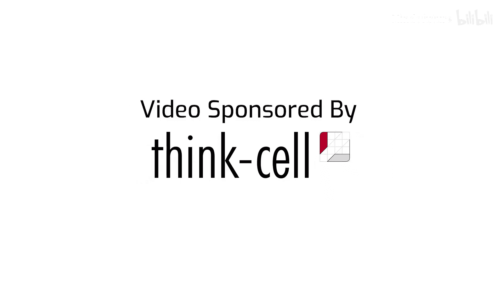

# 中英-•-C++和C语言ACCU大会2024｜人工智能｜架构｜函数编程｜静态分析｜安全｜编译器｜开发者｜垃圾回收｜链接器｜代码生成｜cmake-p17-P19-File-IO---Past,-Present-and-Future---Guy-Davidson--BV1pNotYYELk_p17-

Welcome to my talk。 file Io past present and future。

 Thank you for choosing my talk over some really quite great talks that are happening at the same time。

😊，My name is good。I'm not going to big red spot。Alright， my name is Gu Davidson。

 I'm the former head of engineering Practic at Creative Asmbly。

Last year was a pretty dreadful year in the games industry。

 where I've been for most of my adult life， and I was not spared the。

Ravages in the storms of hitica reduction that has swept through my industry。

Has anyone here heard of Cative Asmbly。A fewew of you。 That's great。 Anyone played total war games。

 Yeah， yes， that's probably how you heard of creativeative Asly， isn't it， okay。Yes。

 I started working on those in 1999。I'm on all of them，It was a privilege to work there， But。

 you know， all good things come to an end。I was employ number 30 when I joined。

 I think we almost got 1000 people。Alright， my first game in 1980。On an acorn atom in atom Ba。

 Anyone familiar with the acorn atom。one，2。😔，Through echo and Charles。 It's all right。

 Youre amongst friends。 It's fine。Yeah。😊，And I saved like Mad buy Z X 81。

 and I was 13 years old and it retailed at 70， which meant it would cost about 340 or 430 or 400 today。

 but there were no euros in 1981。My parents were impressed my industry， and they helped me out。

 And I've been programming in C plus plus。Since the late 80s。

I don't remember my first C plus plus program， but I was first paid to write C plus plus in 1992。

I am a regular participant of I S O slash IEC C JT C 1 slash S C 22 slash W G 21。

 C plus plus standards Committee。 They all matter。 All of these letters and numbers matter。

 Theyre a mechanism of distinguishing between all these people。 That's the C plus plus committee。

 But I'm also the chair of B， S I I S T slash 5。 This is the mirror group， the parent body of W G 21。

 which is S C 22。 And this is the group that standardizes。

Programming languages and system software interfaces。

And I like to style myself as the king of programming。 since the UK is a monarchy。

I started speaking at conferences in 2015， and now I tend to speak2 or three a year in addition to helping run them and。

I also deliver training at conference workshops。 Finally me later。

 if you believe that your organization could benefit from some training。Now， during the pandemic。

I can author a book。Beautiful C plus plus with cake Gregry。

 It's about the C plus plus called guidelines。 Has anyone heard of the book。

Has anyone bought the book。Has any， has anyone read the book。

Let the record show that everyone has bought and read the book。嗯。It has all rather well。

 but your careers would be greatly boosted if you all bought at least one copy， maybe two right now。

I can wait。 It's fine。 This is a short talk。Sorry。😔，The forwards by Byon Strstrip。

 And the afterward is by Herb Sutter。 I was quite pleased about that。I'm working on another book。

The game developer's guide to learning C plus plus goodness only knows when it will see the light of day。

 I'm hoping for。Summer， autumn next year， maybe winter。Or 2027， I don't know。

 It's quite an undertaking。 I don't know if you've noticed C plus plus is that big， big。

 big old language Now。 The standard exceeds 2000 pages。Anyway， the topic is file I O。Past。

 present and future。 I've broken the talk down into five questions。

 I'm going take a sip of water just one moment。So the first question is， why do we have files？

What is a file system。Why should we avoid bufferett file I O。

And how do we optimize unbffered file Io， and how might the standard help us in future。

And I'm going to divide the talk into five orthogonal sections to reveal answers to these questions。

 Okay， so it's sub megabyte days。More Ramm， more disk capacity， moving data into and out of Ram。

File I O N C plus plus from Fstream to the O S SDDK。And the 64 B address space。

 And I would like a show of hands to see who wrote code in the 2010s。In the 2000s。In the 90s。the 80s。

85。你条 four。哦。83， distinct like of beard here。Which surprises me，82。81。

 I've done this before with you。 Charles， haven't I。 Yeah， Charles actually wins。

 My first line of code was in 1980。 Charles was in， I don't know，1961， was。😊，78。嗯。Yeah。

 we've put a broad spread of people。 I like。The history of computing， we are losing it。

 If you has anyone heard of Walter Brown。Walter Brown is a god amongst men。

 And if you come across any of his talks， you should go to his talks because he。

 he's been there from a long， long time ago。And we need to know our history， because we need to。

Prevent the mistakes that we've made in the past。So there is a fair amount of historical scene setting through this talk。

 I， I hope you find it engaging。 I am a games developer。

 And Windows is my primary development platform。😊，嗯。Along with Fi Studio。

 I'm LED to believe that there are some Linux developers here。's all right。 We're amongst friends。

 It's fine But Ken here give ch ch right on， brothers， yeah。嗯。Using clang and GCC， I presume。

 but the topics I'm going to cover should be O S agnostic。

 I will be detailing examples from the Windows S K。 It's what I know。

 But sort of down there under at the bottom of the stack。

 there's hardware that we're all familiar with。 so please interrupt， ask ask awkward questions。Also。

 be advised。 I will leave time at the end for Q And A。I'm here until Saturday afternoon。

 So if you think of something in the night， hump me down。 and I'll do my best to help。

 But please wait until the morning。嗯。Don't be scared to ask me to slow down， repeatat myself。

 speake up any of those things。 I'm hoping the amplification is fine。

 We've got great audio here at this conference I've noticed。But this is your conference。

 It's your talk for you to enjoy and benefit from。 so you know。Make sure I'm giving you the best。

 Okay， everyone happy。Right，wards。嗯。Before we answer the question。

 can anyone actually answer this question。Freelix。A microphone time。John， run， run， young man。

 run to the front。Bring the staff of acoustic power。It's not the staff of acoustic power。

 It's the staff of muting。Because at that time， so sometimes you need the data。

 even if the computer later on when the computer were turn turn on again。 But more important。

 the memory at that time was so limited that you could not have all the data in memory。

 So you had to somehow swap bit or thought on this。 That's a pretty very good answer。 Great。

 Thank you。 that's。Slightly awkward。 Allright， Well I'm gonna do the next section of the talk anyway。

Despite Felix's excellent answer。Thank you for answer。 because I do have， basically。

 if nobody answers， if nobody talks， it's about a 40 minute talk。 So I need you to。Okay， thank you。嗯。

Right， he knows what this is。Yes， it is。 atex 81， you know， the the cornerstone。

 the foundation of the revolution， really。 So when I started programming。

 there was no storage attached to my motherboard， none at all。😊，The CPU was a Z 80。

 and it ran at a majestic3 and1 quarter MHz。MegaHz。 That's three orders of magnitude。

Less than this beast here。 This machine boasted 1 k of Ram，8 k of ro。 and that rum。

Contained a basic interpreter， a floating point calculator and an operating system。8ight。Killabbys。

 Okay， it can be done。嗯。There were two ways of writing programs。

 You could either use the built in basic interpreter and write quite simple things。

 or you could develop in Z 80 assembly。And really' pushed the envelope a little。

 And after three months of basic， I wanted to push the envelope。 I really， really did。

 I was completely enchan with the whole process。 The workflow required me to use a program called an asmbler。

Which would convert assembly instructions that I would type in into a stream of bytes。

For the processor to consume。And the bytes would consist of code and any data required to run the program。

 which was usually a game。Because that's what I was interested in。 I was 14 years old。

 I didn't have an unlimited supply of 1 pence coins to shhoov in arcade machines。Now。

 this is the motherboard on the left hand side， you will see 3，3 and a half millm sockets。

Yeah you know what's coming， don't you？So one was for power。That's the one at the top。

1 was for input from a cassette tape。 Who knows what a cassette tape is。 I have to ask， all right。

 So who doesn't know what a cassette tape is。who's never So who's never actually used a cassette tape in anger。

 You know， it's， it's， we're at that kind of age now。 Well， I'm not， but， you know。Where， where。

 where you know， historically data storage and all these sorts of things are just， they， theyre just。

I have never used paper tape。 I'm sure you have Francis。 You don't surprise me in the slightest。

Have you used a Jacquard loom by any chance？😊，嗯。So yes， one was for input。

 and the other was for outputs to the cassette tape。 The cassette tape was， oh。

 I don't know about the size of this adapter， maybe a little larger。

 And it was a long stream of magnetic tape on which ones and zeros would be recorded for future。

Future generations。嗯。So once I created this stream of bites in my program。

 I would insert a blank tape into a cassette tape machine。

 Every home had a cassette tape machine back in 1981。😊，And then I press record。

 And then I would tell the machine。To output the bike stream to the tape interface。 And similarly。

 I could load， the bike stream back into the machine。

But the important thing here was that there was one file。

There was the entire program to be executed and the data to be used to run my game。

It was all in one data stream。 It was extraordinarily painful。

The standard of the tight medium was variable。I can， I I can feel the PTSD emanating。嗯。

The standard of the player recorder， that was bad as well。

 and the control was out of reach of the machine itself。You know， when you say， oh right， okay。

 write to file， please， the machine takes over。 No， no， no， no， No， no。 back in these days。

 you'd say write to file， and then you go over it and you press record。On， the， on the device。

 you'd actually manually start recording and then。Then you could start the thing off。 It was all。

And control。 But it's what we had。 It was cheap。 It was really cheap， and it worked。Now。

 this is my next machine。 as that spectrum。 It wasn't much different。 It had more color。诶。

It have more RA， but still no machine controllable offline storage。That's happened there。嗯，It不能这。嗯。

My mind， that's。パフです。I did not run a floppy disturb off my spectrum。Congratulations。Wow。

 I must talk to you later about this。 You can add my talk， rather。You had one of these。 Yeah， me。

 too。I bought one of these in 1987， And it was my first exposure。😊，To files。You know， in。

 in what we understand as files， this machine came with a built in 3 and a half" floppy disk drive and 520 k of Ram。

520。 I could live in that。 Virtual existence would be mine。ItThe metaverse all， all in there。

We still haven't reached1 MBgabyte， by the way。 These are still sub sub megabyte days。

 And it also came with a desktop that that can we get this to work。

Where's the cursor when you want it there we areright， A desktop。by digital research， in fact。

 and I suddenly needed to learn a lot more about programming Gys。

 This was the first time I in to Gwey。So seven years of programming before I came against。

 up against files or goies。Graphic user interfaces。 do the kids still say that。

 Do we still say graphic user。Yes， yes， Gu。 We do。 We still say graphic user interface。 Thank you。

But my focus remained game development。 I wasn't really interested in developing， you know。

 these know desktop software。 and the offline storage really piqued my interest because until this point。

 I'd simply created my games as a long stream of bytes。

 which the user would read into Ram before transferring execution to a known starting point。 Now。

 the particular way this worked on the S T。 The Atari S T was interesting。

 You'd insert a floppy disk into the drive。😊，And it would notify the O S that a disc had just been inserted。

 So the O S would read the first sector of the disk and then work out what to do。

And if the sector contained the right bite combination。

It would treat that sector as a bootstrap program。And start executing。

And this was how games would work。 You wouldn't insert the disc and then open a window and then double click on a icon or anything like that。

 You just insert the disk， and the O S would take over。

And this had some rather severe security implications for the spread of viruses。嗯。It was。

 it was no laughing matter。 I can tell you， I trashed two Atari S Ts through poor disk hygiene。😊，So。

 yeah。Security first， O， another interesting thing about the flopppius was it could store 720 k。

And this was more data。Then the machine could contain。Okay。Because of 520 k on the machine。

720 k on a floppy。 And at first， I thought， wow， this means I can have more than one game on a disk。

 But as time went on， I realized I could do things like store multiple sound effects。

 extra graphics or even different chunks of executable code。

 specific to particular parts of any game I was writing。You， I just make my game bigger。

And this is worth dwelling on briefly because I I simply decided to swap code in and out of a running process。

This might be described as self modifying code， which was certainly something I was doing a lot back in the early days on my。

 you know， you know， assembly language on the Z spectrum。 Anyone here written self modifying code。嗯。

A'd be shy。 Yeah， O， great。 No， it's great。 It's fun。 It's hilariously dangerous。

 but it's enormous fun。😊，嗯。Because code is just a special kind of data， isn't it， you know。

 it's and modifying code while it's running， it's just a special kind of transformation of data。😊，嗯。

But it's not so strange now。 We've got D L Ls in Windows。 We've got。You know。

 and you can load and unload those whilst you're running a process。 Linux has got shared objects。

 I believe， is it shared objects that you， O， I'm LED to believe they're better。

But then Linux people tell me， everything' is better。In next slide。

But this is all rather safer and more controlled than what I was doing。 You know。

 the idea of shopping coding and that was it's embedded in the operating system。 whereas I was just。

 I was just。Tampling over Ram saying， hey， I'm gonna execute this now。Anyway。

 here we are moving data into Ram while the game is running。 this is exciting stuff。

 How can I get it to move as quickly as possible。😊，Now， there was an entire book。That book there。

Does that work。Yeah big that。嗯。It was a couple of hundred pages long。

 and it was entirely devoted to the Yaari S F 3，5，4 floppy disk drive。Okay。

 a 200 page book on a disk drive。Okay， one of the advantages of the Atari S T was that it had extremely predictable hardware。

 Every Atari S T was made with the same disk drive。

So I was able to completely understand the nature of the disk drive， how data was stored on it。

 And this enabled me to try such tricks as customizing the formatting of the disk。

 because normally that this could be formatted M S do style。 So that was with 80 tracks。

 And each track would contain 9 sectors of 512 by。 Who knows what M S Dos is。 I've just realized。😊。

Okay， that's fun， y。If you don't understand thing， do stop me。 I'm 56。 I you know。

 I assume you all are as well， even though I can。See that you want。

But if you decided to write your own disk I O software。

 then you could squeeze extra sectors into the outer tracks because it's a disk。

 and the sectors get bigger and bigger as you go out。

 And you could also squeeze in extra tracks if you tried really hard And you could customize the position of track 0 so that in the time it would take the readhead to step to the next track the disc would have spun to meet the next point so you could create a spiral。

 It was， I had so much fun just playing around with a disk drive。 But it was an entire summer。😊。

At the end of which， I managed to create a spiral of data and read about 400 k from a 360 k flouffy disk in Ram from inside track to outside track in 9 seconds。

 No one。 I， I never saw that。 I， I'd never seen that kind of speed。 I was so pleased with myself。

 I thought， I am a programming deity， clearly。😊，And all of this reading made me an extremely capable hacker and pirate。

 as well。😊，More on that later。Today， not in this talk。We're into two beer territory there。 Now。

 a close look at what I'm describing here shows that only the medium has changed。

 I've exchanged a long strip of magnetic cassette tape。Available from shops up and down the nation。

For a series of concentric rings on a magnetic floppy disk。

There is an improvement in that it's machine controlled and the random access is more， more credible。

 which means that I can reasonably overrite parts of Ram with other pieces of data from the disk while the game is running。

 But all of that's handled by me in my code with my slightly obsessive knowledge of the workings of the Atari floppy disk drive。

😊，And my knowledge of where the stream of bits， the pieces of data that I'm interested in lie。

My workflow， however。Was rather clanunky。Every time I made a change to my program。

 I would have to reassemble the entire bitstream。Onto the disk。And this wasn't necessarily a problem。

 but it seemed that I could do better。 Part， I wanted to be able to make changes to the bitstream on the disk while the game was running。

Workflow， you see， you want to be able to save your work whilst the whole thing。You know， in place。

 And that wasn't really possible。 And it was at this point that I realized what files are。Okay。

 therere portions of the data， the data stream on the disk and file names the bookmarks。

 And I moved over to using separate files for the executable in the data during development。

 And I could update them at runtime on my girlfriend's machine。Because obviously。

 I bought her a guitarari S T for her birthday。Don't laugh。

 because I Paul her an notariious T for a birthday one year。She was pleased。She told me so。嗯。

But yeah， for testing and experimentation purposes having two Atari S Ts was great。

 I could make changes whilst the game was running， and then I could make changes on the other machine and then put them back。

 brilliant。 It was。 And I introduced a retail build step。

 which would dispense all the files searching。 And， and it relied on my knowledge of the data。😊，嗯。

Writing a single stream of data to the disk。 and I was still developing games in assembly language。

 By the way， the Atari S T had a Motorola 68000 processor。

 So I'm still not to see C on C plus plus anything like that yet。Now。

 I like to separate the sections of my talks with art。Artworks。 Think of them as commercial breaks。

 And I also like to run quizzes。So I'm combining the two。In one easy to swipe hill here。

 So I want the artist the title and the year who'd like to hazard a guess。 Oh， really。啊。Mrea， O。

 would you like to speculate the title of the piece。It's one of， is's probably his most famous piece。

嗯。把他。It's really banal It's composite oh。Yeah， yes， yes。 is composition 2 in red， blue and yellow。

 No one's got that yet。 Congratulations。 Do you know what year he painted it。😊，Like one of our true。

Okay。But you know what year it was painted。 There is a clue on the painting。Yeah。😊。

If you look really， really closely， just there， it's it。It says PM 30。 He painted it in 1930。

And I chose Monrerian because Monrerian is an object oriented version of the programming language hasskell。

W knew objects areient Hakell。 What the hell。 And it's also a web based code review system written in Python by Giido Van Rossom。

 You all know who he is。 It whilst he was at Google。 alright， almost。More ra， more disccapity。

 I cheerfully carried on writing games and honing my skills throughout my math degree。

 which I did in the late 80s at Sussex University。😊，And I got my first hard disk。44 MB in capacity。

 which changed how I did everything， because my trustee Atri S T， I。Yeah， you did。 don't you。

 must be。It cost me 285， in 1990。It was a big and significant investment。

 but it was totally worth it。 It was absolutely worth it。I'm glad you asked me that。

 actually that that is that is relevant。 You know， the way that I was。

 the way that my workflow was developing。 I， I， I had a stack of floppy disk drives。 By now。

 Id upgraded to a 1。44 MB。😊，System and。I just had floppy disks lying everywhere。

 It was impossible to catalogue them all。 They And suddenly， I thought。

 I can have them all in one place。 And now then knew have files worked on what they were for and like。

 what filing was。 and like filing cabinet， all of this files thing， because， you know。

 at school at university， you don't file things。 you put them on the floor。 You know。

 suddenly it became really important。嗯。It was， it my trusty Atari S T actually lasted until summer 91 when I was burgled。

 all my kits and all my discs and all my backups and everything。 And it was a sad day。😔。

But my girlfriend had moved to a philosophy degree in the Comp science faculty and bought a Macintosh。

 So I inherited herary E S T。 Good times。😊，And I started again with the insurance money。

 but then I was burgled again about a year later and decided it was a cosmic hint that starting my own business as game developer wasn't really my destiny。

So I secured a freelance role as an interactive media company called UM and started using Windows on PCs with enormous amounts of memory。

 sometimes as much as 16 MB。😊，You could， you could put a whole family on there， you know。

I also came across sand blaster cars in Wolfenstein 3D。 And by this time。

 Ps were coming as standard with hard disk drives。And games were being released on multiple floppy disks that took advantage of the excessive capacity available to them。

And the idea of a single stream of data at retail became impossibly hard to manage。

 And some way of identifying and locating files became a necessity of development。Now。

 I had actually already been using file systems。 just hadn't been very conscious about it。

They were simply mechanisms by which you would slow down the operation of your game。

Only of used when looking for the tools on your disks and loading them into memory。

 the disc format natively supported by the Atari O S， was， in fact， fat 16。

Which was M S dos compatible。Now discs that I prepared in my Atari。Were readable from any PC。

 running M S dos。Which， as far as I was concerned， was all of them。Because back then， they were。

 in fact， running Windows 3 on top of M S Dos。But that's another talk。 I love operating systems。

 This is an operating system talk。 But does anyone remember what you had to type to start Windows from a do prompt。

When。What a great way to start your day， win。What are you gonna to do A， Gu， I'm going to win。

 I'm going win at computinging。And， let's look at Ft 16。

 It's actually short for file allocation table。We'll get to the number in a moment。

 It was originally developed in 1977。The file system uses an index table。

 which is stored on the disk。And that's the file allocation table。

 and it identifies chains of storage areas associated with with the individual files。

 The tables immovable。 It's allocated when the disk is formatted。Your form at a disc is right。

 Fire location techniques there。 And the table is a linked list of entries。 It's。

 it's basically a tree on a disk。嗯。Each entry contains the number of the next cluster in the file。

 So it like。 It's like a tree of linked lists。嗯。The root directory of the disc contains the number of the first cluster of each file in that directory。

 and the operating system can then traverse the facts。

 looking up the cluster number of each successive part of the disk。

File as a cluster chain until the end of the file is reached。If you've done， has anyone here written。

 written software before。Yeah， so， and， and have you done searching and sorting。Yeah， yeah， yeah。

 So it's， it's， it's exactly like that。Okay。So each entry in the fat linked list is a fixed number of bits。

1216 or 32， hence fat 16 and the more modern。Relatively modern fat 32。

 the maximum size of a file is the product of the largest number that can be stored in the entries and the size of the disc cluster。

 And even if only one B of storage is needed to extend a file， an entire cluster。

Must be allocated to it。 And any single cluster cannot hold more than a single file。

 So large clusters waste a lot of dis space if there are large numbers of small files。

Please hold this door。My custom format I was using for Atari S T development was completely incompatible with M S Dos。

 In fact， it was completely incompatible with At S Ts。It was a handy antipirracy technique。

D duplication was simply not an option。 The only thing you could do was write a program to intercept the loader and then disassemble it。

 work out what an earth I was doing and then replicate the writing software that I had written。Which。

 yeah， no one's going to do that。 It was a lot of reverse engineering。So fatt 16 is a disk format。

 though， not a file system。We can look at that next。 Who's heard of Posss。

These are all easy questions。 Its to lull you into a false insecurity of raising your hands and going。

 oh， yeah。The portable operating system interface， politicss。

Is a family of standards specified by the IE Computer Society for maintaining compatibility between operating systems。

 Posss defines both the system and the user level application programming interfaces。A Ps。

 along with command line shells and utility interfaces。For software compatibility。

 portability with variants of Unix and other operating systems。

 Poss is also a trademark of the archipee。 Posss is intended to be used by both application and system developers。

 So remember， I said I was a delegates to S C 22。Poss falls within our purview。

Part of the poss specification is the far system and for a far system to be compatible with posss。

It must implement strong consistency。For example， if a write happened before a read。

The read must return the data written。It must have atomic rights where a read either returns all data written by a concurrent right or none of the data。

 but is not an incomplete right。It must implement certain operations like random reads， write。

 truncates or Eync。 It must control access to files using permissions and implement calls like Chaod Cn and so on to modify them。

 How does everyone say C， H， O W N， by the way。Alright， Who says Chan and who says Chone， Chan。Zhen。

I'm wrong， clearly，I know。But it's ch。Like clown， I say jiff。 I say jiff。So right， off we go。

 let's look at the sea Runtime library in this context。😊，So we have file access。F and F closed。

 F flush。 We have direct I O。F read and Fright， and we have unformatted IO。F gets F puts。

 get Char put Char formatted Iio scan F and print F。And obviously， you've now got live format。

Victor Saravi。If you see Victorverovitch， make sure you buy him plenty of beer。

Because he's given us an extraordinary improvements to the ergonomics。Of the standard library。

 And there is a scan coming up to match print。Which I hope will make 26。嗯。We have file positioning。

 tell， seek， rewind， and we have operations on files。Remove， rename。

And when I first discovered the C file Io Library。There were two problems for me。 First。

 how do I move bitmap data into RA。Because I'm writing games。 Secondly， how do I find files。And now。

 when C was getting into its stride。The world of computers was text based。 So here's a fun fact。

That's a color picture。Right， okay， in 1974。Evans and Sutherland released the first commercial frame buffer。

 costing about $15000，1974，$15000。Okay， that's three houses。法官。

And it was capable of producing resolutions of up to 512 by 512 pixels in 8 B grayscale。😊。

I know be still my beating heart。Everything was text。 back then， when C was starting。

 everything was text。 formatted input output would insert values into strings。

 Unformatted input output would put characters into a character array and direct input output would read n bytes into avoid void star buffer。

And if we look at these APIs， you can see they all have something in common， A file star parameter。

 which we'll come to you later。 So how did I find files。I had to fall back on the operating system。

 One thing a fast system should expose is an API for selecting files and enabling reading and writing。

 C does not have one of these。But since 2017， C plus plus does。I just want to stop and mention。

What a monumental task getting stood far system into the standard was and to honour the memory of beam and doors。

Who died on December 1，2020。 And I want to quote N Douglas here。

Beeman had an unusually large impact on C plus plus over his long and very productive life。

 My personal opinion of his most monumental achievement was getting far system into standard C plus plus。

Which was probably the most tortuous， lengthy and difficult library to have ever been standardized to date。

And that followed a preceding， tortuous， lengthy and difficult boost peer review involving multiple redesigns of the proposed library。

 Beaman was on W G 21 from nearly the beginning， served as the library working group chair for some time and was one of the original co founders of the Bo C plus plus libraries。

You also have a long history of continuous contributions to open source。

 starting from many of us for still children。Many of you weren't even born。

He had periods of particularly poor health in his later years， yet kept up a work ethic。

 which would shame most of us。 He helped and advised me privately on a number of occasions for which I was。

 and still am immensely grateful。 Beaman Doors， Who's heard of Beaman Dos。

You've all heard of Beaman doorss now。Let's talk about getting a proposal into the standards。

Hard work。 The first thing you need to do is have a great idea and talk about it with your friends。

 with some experts， with plenty of people and see if they think it's a good idea。

 And then you have to implement it。Okay， this is different from a proof of concept。

 You have to actually get the whole thing working。And if it's a library feature， the chances are。

 you already have been tinkering around with something in your spare time。

 or perhaps it's a library from your， your workplace code base。

 or it's something you saw in Github and thought this is an undiscovered gem。

 And if it's a language feature， things are a little harder。

You need to implement the feature in an open source implementation of C plus plus。

 And this can't be done for MS SVC， which is one of the big three implementations。

 You have to fall back on clang and GCC。Things can get sticky here because you might have a feature that works fine in those implementations。

 but will fail terribly in MS SVC because it can't be implemented。

 Perhaps the implementation forbids some handy private feature that you need to make use of。

Once it is fully implemented， you need to socialize it。

And this can be as simple as publishing a Github repo and counting the stars。

 And if a few hundred come your way， it's likely to be a popular feature。

 This isn't so easy for new language features。Regular usage will generate feedbackb from users saying。

 hey， how about this， or this doesn't work here in this case。Once the feedback is quiet and down。

 you need to write the proposal with wording to be added to the standard。 And this is the hard part。

Okay。You might need to get help from wording experts。 And once you have a proposal。

 you can submit it to the relevant working group in the committee and let them chew it over。

And this may mean flying to a meeting。Papers can be defended remotely。

 but being able to talk after hours with interested parties in person。Its invaluable。

There will be extensive rounds of feedback and questions about the proposal and the more preparatory work you can do。

Getting field experience and implementation experience on more than one implementation。

 The easier this part will be。You know。Talking about it is really important。

 One thing I love about A U is that we actually do genuinely have a hallway track。Right behind us。

Do talk to people。 do reach out。 Just find out what each other's doing。

As the best part of this conference isn't the talks， not even mine。You know。

 the best part of the talk of the conference is the people that you meet。Anyway。

Once the language or love evolution group has finished their review。

It goes to the appropriate wording group to see if the wording will coexist with the existing standard。

And whether it obeys the drafting rules， they may have clarifyring questions。

And they may send the proposal back for design review if they're unhappy with the shape of it。嗯。

And then once it passes the wording groups， it's voted on by the full committee meeting at the end of each session。

 the plenary。And even if it passes， others may write proposals to strike it from the working draft of the standard。

 And this happened with contracts。Which you observed did not make it into C++ 20。

Although that was by group decision from the authors。It's a lot of work giving a standard in。

It takes time and money in a generous and understanding employer。 It is not to be undertaken lightly。

 taking up committee time on something you're not especially invested in。

Means that the time doesn't go to someone who is invested in their proposal。

 And I've been working on a matrix proposal for some years now。

 I worked on a drawing proposal for a couple of years， only to have it set aside。

Beieman's file system proposal。Had to straddle multiple operating systems。

 as well as C plus plus implementations。 It was indeed， a monumental achievement。ok。And know。

Would that we could all work with his。Focus and diligence。Anyway， it had to handle files。File names。

 paths all portableably。 you know， And it's a great library for all of that。

 It's also a product of a time。 It has twin error handling strategies， both error code and exception。

😊，And if you've been following the progress have stood expected。

Then you'll know that there is a preferred way of handling errors now。 who's。

 who's obviously expected。Yeah good， good， good。 Use it。嗯。

So the library differentiates files between directories， links， block files， character files。

 Sockets and so on。 And it accommodates special file names like dot and dot dot。

 And it has a full command of the vagaries of pars， including optional route names。

As well as absolute relative and canonical paths， you can iterate through directories。

Find out how much space remains in your file system， modify file system permissions。

 And you can copy files， create directories， Gi file sizes， resize and remove files。

 It's the kitchen sink。's the hole。 It's the wholeang。But this is the file system， though。

 rather than the format of the file system on disk。

And I remarked earlier that I started off using fatt 16， which was M S dot compatible。

The file system was defined by M S Dos， while the disk format。Defined by fat 16。

 And this separation is important because they often get mixed up。So let's look at this diagram。

Anyone familiar with Rer F， S。Yeah， yeah， okay。It's a great piece of work。 But unfortunately。

 the developer is currently incarcerated。嗯。Now， you can see that your application makes system calls to communicate to the Linux kernel。

Everything below that。Not your problem。Psss defines the behavior of these system calls。 The V。

 F S handles all the file system related system calls。

 and this abstracts from the underlying file system。

 This means that if your file system developer suddenly becomes unavailable。

 you can simply swap for another one。Poss is great here。 You can swap around file systems。

 and it doesn't matter as long as there is a driver that the V。

 F S can use to deal with the caution Linux mix。 All is good。

And I should point out that Linux is only partially positive compatible， by the way。

 As far as I can see， I did a lot of research for this， but I'm not a Linux user。

 So I might be talking nonsense， but reads and writes for atomic on a page level。

But a read might return some pages of a concurrent right operation。Let's believe。

Do correct me if I'm wrong。 It's worth noting that Posss。

Was developed for local file systems as well。 You know。

 all sorts of guarantees are available to you when you own a piece of hardware。 You know。

 the thing is， Poss has been so fantastically successful。😊。

That it has been the expected API for other file system solutions。

 including those whose contents are distributed over many devices。

What we seem to want from distributed file systems。The presentation of the typical file system API。

But with the opportunity to simply add more storage volumes is necessary。And many have tried。

 I went to Wikipedia。 I looked at comparison of distributed file systems。Many of them。

 particularly the proprietary ones， offer posss and one of the access APIs。

 And I spent a chunk of 2022 giving talks about abstraction。

And if you aren't familiar with the idea of abstraction， I go and view one of them。

 I think the C plus plus on C。Talk is the best one。

 and the reason I remark on this is that I believe there's an abstraction problem going on here because Posss abstracts the complexity of managing multiple processes。

 requesting I O services from local storage。Distributive file systems require additional complexities to be abstracted。

What happens when a device is temporarily unavailable or when data takes much longer than expected to arrive in Ram。

And when multiple processes on multiple machines want access to the same file， What happens then。

 that seems like a horrendous task to navigate。 And I hope you can see that the word file system does a lot of heavy lifting。

Theres a lot going on there。One of the reasons that cloud computing has done so well is that it offers a better abstraction。

For the problem of distributed storage without pretending to be a general purpose file system。Anyway。

That's file systems。 I want。The artist， the title and the year。Have a guess at the artist。

Com on it's exactly who you think it is。It is Monet， course， Matthewa Re knows。

One of your countrymen， I believe。嗯。Do you want to take a crack at the air。It's fine。 I'm being。

Ccocular here。 It's1872。 It's actually called Impress Commer sunrise。

And it's the painting that gave its name to the style and artistic movement。Impressionism， you。

 you all knew this。 You all knew this。 Monet D B is a database management system。

And multi waveleng optical networking， Monet is a method of digital fiber optic communication。Right。

Moving data into and out of Ram。 So now we have a way of finding our way to the bits on or within the storage device。

 How do we actually get that into Ram？ So now is a good time to remind everyone how long things take。

So I hope you are familiar with cash levels。Levels 1 to 3 reside on the CPU in another of my talks。

I discuss how the whole of computing is about getting data to him from the CPU， really。

And had data restored in caches to speed up the transfer as necessary。Now。

 an Intel CPU made in the last 30 years will have a memory management unit on it。

 this moves memory between Ram and the L 3 cache。然。Conceptualally， Ram is just another level of cash。

 really， It's just another storage place。 It's data that's stored further away from the CPU。😊。

Is there another level？Well， there is， because data stored in storage devices like NVME drives or SSD drives。

 any of those things。You know， that's another level of cash。

 All of these devices are connected to the motherboard controlled by hardware， local to the system。

Based store data， even when the power is off。And the cost of this convenience is that it takes quite a while。

 relatively speaking， to move data to the CPU， because first， it needs to move it to Iran。

 And that can take quite a while。 And all of these devices are connected to the motherboard by serial Thus。

 And there is a world of difference between quoted bandwidth。

And what you will see in typical applications。So Ram comes in different bandwidths as well。

 That is the amount of data that could be read from or writtenn to the Ram per second。

But these variations are dwarfed by the growing disparity of speed between the CPU and memory outside the CPU chip。

 And this is known as the memory wall。And the important reason for this disparity is the limited communication bandwidth beyond chip boundaries。

And this is known as the bandwidth wall。So between 1986 and 2000。

CPU speed improved at an annual rate of 55%， Moore's law。

While memory speed only improved at about 10%。So memory latency has become a significant bottleneck in computer performance。

Who's familiar with Big O notation。So big O notation made lots of sense when execution and data transfer took about the same time。

But the disparity between that is enormous。 We have to。

Be a bit careful when we're throwing around bigger notation calculations。嗯。

That CPU speed improvements。 They hit a physical barrier as well。 And Intel summarized this in 2005。

 which I shall read out again。 So first of all， as chip geometry shrink and clock frequencies rise。

 the transistor leakage current increases need to excess power consumption and heat。Secondly。

 the advantages of higher clock speeds are， in part， negated by memory latency。

 since memory access times have not been able to keep pace with increasing clock frequencies。

 And third， for certain applications， traditional serial architectures are becoming less efficient。

As processes get faster due to the socalled von Mouman bottlek。

Further undercutting any gains that frequency increases might otherwise buy。And in addition。

 partly due to limitations in the means of producing inductance within solid state devices。

 resistance capacitance， delays in signal transmission are growing as feature sizes shrink。

 Iosing an additional bottleneck that frequency increases don't in don't address。

We've put a disparity between Ram speed and CPU speed and thats getting broader and broader。

 And this is further implications for bigger O notation。That's another talk。

 but consider what goes on under the hood during a typical F open F F closed operation。

So here's the F open fast signature。It will create a file object for you。

 And it uses that file object to hold a buffer to the file that you're opening。

 And how big is that buffer。But if you're on Linux， the macro bes will tell you， it's usually 4 kB。

And you can use the set V buffer function to change the buffer size if you're working with large files。

When you call F Re， the C， R T， the C runs home library will ask the kernel to read some data into memory owned by the kernel and then copy it to your file buffer。

 And from there， you can copy it wherever you like。 Now。

 this seems a little suboptimal copying it to a buffer and then copying it onwards。

But consider what the rest of the API offers you。You can get individual characters。

 You can scan for runtime formatted data。 And that's really useful because what's actually happening is that the C runtime is caching data for you in the file buffer。

😊，And maintaining pointers the beginning of the end of the buffer。

 keeping track of where you are in the file itself， all of the bookkeeping。 And also。

 the amount of time to perform that copy compared to the amount of time to move from storage into Ram is tiny。

 right。What it was。You might expect C plus+ for faster operations。Let's take a look。So now。

 instead of creating and managing a file object， we are managing a stream of data。

 We have the class F stream， which also has some really nice insertion and extraction operators。😊。

Which you can see here， match up at the get and put functions of the C file I O library。

Last time I checked， and this was 15 years ago， but I don't see any reason for it have changed。

The MSVC F Stream Library was implemented in terms of the C file I O Library。

And there's a good reason for this。 The C plus plus Streams Library was a product of the 80s。Okay。

 it's a great model of design for the period。 It shows off multiple inheritance， virtual inheritance。

 good abstraction and easier to use API。But it's still a product of an era where file sizes might exceed the available ra of a machine。

Okay， the important thing for a file I O API to do then was to move a cursor around a file and move chunks of the file into Ram。

Daattase tables might contain millions of records。And whether they were on a tape or a disc。

 the job of the code is to read selected records into Ram。And make decisions based on their content。

 So look at this struct。 It models a record for member of staff。Now， pop quiz。

 one of my favorite interview questions。😊，How big is it。Oh。No hands shooting up this time。Yeah。Sir。

It depends。 Allright， That's the thing。 It depends。And that's right。 that's， that's the。

 that's the bit that gets you on the next stage of the interview。

where you don't try and guess a number。 you start asking questions about the strength。

So time T is an implementation defined type， capable of representing times。Although not defined。

 this is almost always an integral value holding the number of seconds， not counting leap seconds。

 I fell foul of that once。 Funny story。Afully， awfully not funny story。 actually。

 it's the number of seconds since midnights， January  the1 1970 U TC， It corresponds deposits time。

 We're 54 years in。 We're very close to 1。7 billion。So when he guesses now。So can we agree on 84 Bs。

64 for the chas，2 in for the time and 3" for the rest。 Does that sound incredible。😊，Because no。

 because what I didn't tell you is it's 1974。And on this platform and into 16 B， a char is 7 B。

 but stored in a single 8 byte value。Time T is a 32 bit value because honestly， by 2038。

 we'll be using something different or otherwise well have bigger problems to solve。

I'm sure there's an X K， you know， there must be an X K CD comic about that somewhere。 If anyone。

 if it brings to anyone do tell me， I'm not gonna go searching through the archive。

 The giveaway here is I D high and I D low for staff members。

Cause you don't need 18 quintillion staff members。Which is what you'd have。

 You probably need more than 65000， though。Especially for the government。 And also in 1974。

 people went on the payroll for more than 60000 of anything。Really。Anyway，'s 1974。

 the size of this structure is 74 by。 And the code we need to read a record is this。

 So I want to read to my buffer， which is likely an array of staff member objects。

10 staff member objects from the file I opened a little while ago。This will also compile。

Not only will it compile， it will also yield the required behavior。

 And that annoys me more than seems reasonable。嗯。And note I wrote size of staff member。

 This is future proofing。 If you recomp par this today， int is larger。 Time T is larger。

Who remembers the 2038 epoch bug。Okay， all right。Maybe I know more Linux than I realized。

Known as the epocalypse。It started appearing in 2006， a few years after the millennium bug。

 Can you remember the Millennium bug。Yeah， that's more like it， okay。The problem was that Euchx。

 and more particularly Posss showed no sign of waning popularity。

 And after the horrors of the millennium bug were avoided。

 the computing world swungung its case to Ex time and decided that。

Providing a solution 30 years ahead of time， rather than3 was the right thing to do。

One of the problems we have with our file O API is that we have all sorts of places where we are tempted to encode the size of a thing as an integer rather than calculate the size。

 According to the supplied implementation。 And this isn't restricted to reading data。 either。

 The corresponding right API is similarly trapladen。

We are extracting and inserting data with these operations。

 How does C plus plus help us write a better interface。😊，Operator riverloading comes to the rescue。

 and we have these beauties。And now that the type is embedded in the API rather than some terrifying void pointer。

We can write safer code。What' do you call these operators， by the way。嗯。Okay。

I'm obviously unusual in this regard。I'm a firm believer in naming them by what they are rather than what they do。

 So I call this a Chevron operator。Left him right。No， no one， okay。What about this。

 What you call this。The parenthesis operator。Oh， you're laughing now， aren't you？😊。

I don't call it the function call operating or overload may not call a function。

But that might be bad。不拉你说。Subscript up。These symbols were， in fact， brackets。Not parentheses。

 I know people who name parentheses brackets， but I don't associate with them。But yeah。

 usually it's used for index or subscripts。There's no requirement for that to be the case， though。

 I've heard this called the square operator。 Naming is hard。

 I guess you have to do the things that you expect them to do。 You don't want them to。 Yeah， anyway。

We have the chevron off races。For inserting into and extracting from a stream of data。

And this is delightful and safe and readable。 And we can spool through a file in chunks according to the size of the buffer defined by the runtime and safely read and write as needed。

 All is good。😊，But looking under the hood， there is quite a lot of work going on。

 and I'm not gonna do it here， but it's worth your time single， you know。

 single stepping away through a function which actually calls one of these instruction。

 extraction or insertion operators。And see how much code is getting called because you aren't reading a byte。

From a file， you're reading a by into a buffer which represents a window into the file。

 So there's bookkeeping to be done。 What happens when you overrun the window。

 your thread blocks while the kernel retrieves another buffer full of data。

 And it seems that we can do better than this。 We're in the modern era with machines toting 16 GB of Ram as standard。

And this idea of carefully spoon feeding files into Ram 4 k a time is surely no longer appropriate。

Why doesn't C plus offer any alternatives， Like， read the entire file into Ram right now， please。

And the most obvious answer is that there are a world of machines out there deploying C plus plus。

 This is anardduino。 Anyone here hacking around onardduinos for fun。 Yeah， it's great。

 and it's a lark。😊，And who's heard of a freestanding implementation， Who knows what freestanding。

 Yeah， Okay， so freestanding implementations。 people like me write software against SD D K。

 normally win 32， where the operating system provides lots of useful services。

But embedded systems don't usually run with such。Fripperies， no， no， no operating system for them。

 They often have very limited amounts of Ram。Back to， you know。

 sometimes as little as half a megabyte。嗯。And the very idea of dynamic allocation is enough to send implementers into a frenzy of panic。

 to be perfectly honest。So in my day job， I rely on the Windows S T K to。

 to read large files into Ram。 unbed and fast， rather than the C plus plus。Standard library。Right。

 artist title year。Oh， very good。The gentle， for the record， the gentleman said Dali，2024。It's not。

 No， I'm gazing at Matthew again。P。Why on earth would art history interest you。It's angerra。

 John Augustist Dominic Angra。Rulus victory over Akron from 1812。 A A， it was painted in 1812。

 That obviously isn't 1812。That'll be silly。 So angry is obviously there， there's the database。

 Does anybody ever use the Ang database。kindin of sank with that trace。 There's also angry paper。

It's a type of drawing paper that my。My friends tell me it's really， really good。

 but I I don't I do music。 I don't do painting。Right， let's review where we are with fileo。

 We'll start at the top with F streamre。Which is described as implemented in terms of file star。

I work on Windows for my day job， so this code would look like this。Let's go back a bit。

Lets see what's going on here。So that's your C plus plus version。

That's your C standard library version， which is also a sea plus plus program， as we learn。

Yesterday morning， to my embarrassment。And is how you're do it on Windows。

F open is implemented in terms of this on my implementation。 So I'll be finished。 Is that it。

 We all done that， And it's 3 o'clock。 We still half an hour ago。

Things were about to get a lot more interesting， to be honest。

 So remember I was talking about Intel and their processor。 In 1982， Intel started work on the I 3。

86。Releasing it in October 1985 is the 8，0，3，8，6。And it represented a big step forward in the evolution of the X 86 architecture。

 And I'm most interested in the inclusion of a memory management unit。The jump 32 processing。

And the introduction of a virtual mode。Now up to this point。

 the X 86 architecture had worked with a segmented architecture。

 Any do any segmented architecture work。呃。And you're not dead。 Look at you。 We few， we happy few。

 We band of brothers。啊。I'm，'m， I'm not。I did some work with it back in the 80s on 8，8，2，8，6 machine。

90s on 8，8，2，8，6 machines。 The last the 8，8，2，8，6 machines。 It's immensely frustrating。

 It's a topic for another talk。啊。Who said that。Get him。Like the pitchfor。 No， we're not doing it。

 We're not going back because the 3，8，6， the 3，8，6 added a launch chip memory management unit。

 and this paging， this paging translation unit made it much easier to implement operating systems that use virtual memory。

 We have 32 address spaces。 It's， it's just easier now， really。😊，Really。

You're not gonna agree with me， are you。It really is。 Anyway， look。

 extending the architecture to 32 B made it possible to address 4 GB of memory。

Without having to worry about segment offsets。嗯。basicallysically， in the before times。

16 B architectures did this complex dance with pairs of registers to address anything beyond 64 kB。

You have to。No， we're not going there。 I'm not going。So， huge pointers。

 near and far and huge pointers and all all sorts of If you look at， if you look at the wind 32 SD K。

 it still says near and far in places， it， it's。Anyway， look。

 the virtual mode made it possible to run one or more real mode programs in a protected environment and running Windows on an 80。

2，8，6 processor meant starting your computer， running Windows by typing win and double clicking on an icon to start a new acceptableable。

 And if it crashed， the entire computer ground to a halt。

So although it looked like an operating system with lots of programs running at once。

 if one of them failed。It was rebate time。Da times。 but running Windows on an 8，0，3。

86 processor in enhanced mode by type typing win slash 3。

Provided access to the virtual memory capabilities of 3，8，6 family of the processes。

 So Windows applications could use more memory than is physically available。

This is a Strath off Abbey library in Prague， by the way， It's just a beautiful building。

 And I just wanted to include it because it's amazing， isn't it。😊，Books， they're write。

 Don't forget about books。Right。It's an exciting cre。 More memory than is physically available。

And it's done by swapping between Ram and external storage。 So Ram that's not been accessed recently。

Could be swap into a hard drive。And the Ramm left behind could be repurposed to another process。

 That's basically what's going on all via the magic of an on chip memory management unit。

And a willing operating system， as well。And rather than swapping individual bytes said the O S will swap pages of data。

 rather than just doing one by at a time off one back， one back on。 it clumps them into into pages。

And that page size is determined by the processor architecture。 It's usually 4K。 Okay。

 which is why buff says is 4K。 And a system with a smaller page size would use more pages。

 requiring a page table to keep track of everything。 All the bookkeeping takes up a lot more space。

For example， if a 32 B virtual address space is mapped onto 4K pages。It'll be two to the pad 12。

It's about 12's about 20 studentss about 32。嗯。But if the page， that's about a million。

 If the page is increased to 32 K， that's2 to the 15th power。

 So only about 100000 pages are required。 So you can muck around the page size to see if you need more。

 you know， more or fewer。Pages， and this matters because since every access to memory must be met from virtual to physical address。

Then reading the page table every time can be quite costly。So a very fast kind of cache， translation。

The translation， look aside buffer， T L B is often used。 The T L B is quite small。

 And when it cannot satisfy a given request， that's called a T L B miss。

Then the page tables must be searched manually in hardware or software， you know。

 depending on the architecture for the correct mapping。 and， and everything slows down terribly。

 La page sizes means with T L B cache。Of the same size can keep track of large amounts of memory。

 which avoids the cost of T L B Miss securitycy。 There's a balancing act going on here。

 That has to be decided by the operating system implementers。Processes really fill up pages。

 So a lot of fragmentation will take place。 Lager page sizes lead to more fragmentation。

Unless you're managing the allocation of memory very carefully yourself。

Individual pages can be marked by the operating systems being read only or read， write or no。

 execute or or execute only。 That's really handy。 It stops viruses from。

Plunking memory in places or only accessible to certain categories of user。But now。

 things get interesting because since we have a direct mapping between the T L B and physical Ramm。

 we aren't actually limited by how much Ramm we have。

ButHow much total storage on a 64 B architecture， We have access to 16 exaby of address dress space。

Which is far， far more ra than you will ever find in a single machine in your lifetime。

 I'm pretty sure。That's going to come back to haunt me， isn't it。

But it means it's possible to exhaust Ram quite easily because as you add more processes to your operating environment。

 each of them will demand a few pages of address space。

And when the page table is accounted for all of the Ramm。

 modern processor can simply map the address base to other storage。嗯。

The smart thing to do is to identify the least recently used page， move it to slower storage。

And that frees up the paper brand for the new demands。Is this called swapping。

 We all know about swapping， I'm sure。If that page is required。

 the least recently used page is swapped out。 and then that page is returned back to Ram。

Let's walk through the diagram。 Okay， first of all， we have the CPU。It requests a virtual address。

 either to write to or read from。啊。I'm not old hello。There we好。I can see it here as well。

And then we have the T， L， B， either holds it locally。Not there。 Or in case of 2 A。

 or if there's a T， L B miss， it has to search the page table for it。In the case of2 B。

 and if there's a T LB Miss， the T LB is updated。And next， that page is hit for data。 If it's in RA。

 And if it isn't in Ram， then we suffer a segmentation fault。

And the O S will intercept this segmentation fault。Find out where on the secondary storage。

B we're on the secondary storage。It's still that page。

 And then the page in storage is swapped for page in Ram。系啊。And the page table is updated。

 and this hammers your external storage。Configuring a partition on your fastest drive is the best way to make this happen。

However， filling up your T L B will lead to dramatically reduced performance because。

We're looking for everything to resist the temptation to keep allocating with regard for your operating environment。

Okay， this concept。This conceptual blurring of ra， I suppose， and external storage。

It's quite interesting。 I'll wait for Felix to take his photograph。 There we are。

There's more because Windows programs， all programs contain several， you know。

 system D L Ls or shared libraries in the process address space。

 And another thing you can do is map different process addresses to the same sectors。

So you only need to load one copy of， well， on Windows， it would be N T dot D L L。

Interamment any one time， And that can be shared between multiple processes。 That's handy。

It's being loaded read only， so no process is going to change it。Indeed。

 no process is allowed to change it because one of the properties of the mapping process is whether or not the file is read only。

And we can take this a step further。We can map arbitrary files to arbitrary processes address spaces。

And this is a heavenly advance on the status quo anti， I can assure you。

 because rather than open a file and block。While it's read to a Colel buffer。

And the portion you're interested in is then copy to your buffer。

You can simply map the file into your process space and access it as normal。And， of course。

 first access to any page of the address space will still require a block as the data is read into Ram。

 but it's unbffered， which means there are savings of Ram and memory copying。And not only that。

 But if're in the habit of using only part of a file。For example。

 a father that has a header describing offsets to relevant parts。

 Then only the relevant parts of the file will need to be read。

 You' will not need to carry out multiple read instructions。 You know。

 with all of the attendant bookkeeping， you simply access the addresses you are interested in。

And endure the blocking that you would have had to endure anyway。Also。

 you can map the file on one thread and read the file on another thread。

You do this by touching addresses at 4 kiloby intervals or whatever your page size is。

And the moment you know that you're going to need a particular file， you can map it。

 Instruct your touch set to do the touching。 And once you actually need to access the file with any luck and sufficient advance warning。

It'll already be there in memory waiting for you and you'll suffer no blocks at all。

 This is incredibly important。For people right here has played a video game。

Who here has seen a loading screen？Yeah， yeah。 Who wants to look at loading screens。Now。

 this is the thing you can do。 You map as soon as you know a file， you start touch on another thread。

 Do your processing。Sppeeace things up beautifully。It comes at a big price。

 It subtracts away from the space in Windows。 So if you keep doing that， eventually。

 Windows could even find itself out of memory because it can't。

You can't map something contiguous absolutelysol， once you've mapped something， it's。

 it's a resource like any other。 And you need to unm it when you finished with it。不大词。That unmapp is。

 I'm not counting that as file Io， but you're quite right。

 That is that's absolutely what you must do。 You can't just map and， you can't map your entire。

 you know。Extent storage into memory。 That won't work。Sly。嗯。The API is slightly more involved。

Just slightly more involved than the create file read file pair。

You'll notice that this is only three lines of code rather than the four required for the prior example。

Where you had to define your own buffer， there are a lot more parameters to worry about。

Lots of of them。I mentioned that I spent a while talking to conferences about abstraction。

 Here is abstraction， writ large， the highest level of abstraction offered the simplest API。

And as we delve deeper into the O S， things become more complex。Now。

 I'm making a massive assumption here， but I'm guessing that create file re file on Windows works by mapping the file into the process and then copying it to the buffer of your specification。

And without this buffer copy， we have unbuffed file Io。

 The kernelel delegates all of the bookkeeping to the memory management unit on the chip。

That's why it's great。😊，There's an additional problem， though， because modern processor have caches。

 instruction caches， data caches， level 1，2 and 3 caches， all of which are copies of Ram。

The value of cash is is that accessing memory takes a long time。 So when you address a piece of Ram。

It's a smart move to simply get a big chunk of it and keep it handy for the next operation。

 locality of reference， you know。All of this is made possible by the memory management unit。

 It's an amazing thing。The assumption is that all changes to Ram are broken by the unit。

 you need to be completely aware of all changes to Ram so that you can update the cache。

Hold that thought。 Who has heard of DM MA。Rate， I'll skip through this then， because I'm。

Rapidly running out of time。 This is the thing we used to do age ago， direct memory access。

It enable you to tell this drive where to put data into Ram without bothering the CPU。

 except to notify the CPU when the transfer had finished。 and it was nearly kind of threaded I。

 It left the CPU free to carry on。You know， more important work rather than blocking on external hardware。

But， of course， now， all Ram updates are brokered by the onship memory management unit because of caching validation。

 So that's no longer available to us， although I suppose a read thread is a kind of DM MA。

There's an even better kind， which will come on to shortly。Right， easy one to close with。

Artist title decade。去关注。Decade， mate。菲律宾。I'm really impressed，1492 to 1498。It's， it's been 1409s。

 But honestly， you know， you get below 1800。 like， it's just a big blur for all of us。 really。

 isn't it。Probably 1900s a big2000 It is probably a big blur for a lot of us， you know。was。

 that was in the last century。So I know the I was asked， you know， I， I was marking essays。

 and I was asked， you know， can we， can we make references from the last century and I was going。

 yeah。Yes， of course you can。 It's still relevant， you know。嗯。

Texas Instrumentmentss Da Vinci is a system on a chip for digital video。

 The Da Vinci machine is a project to add dynamic language support to the Java virtualr machine。

 Da Vinci project。There's a planned subal crude spacecraft。 And there is da Vinci all of the case。

 which is a NASA mission that sends atmospheric probe to Ven to Venus。Right。

Things are got proper huge now。 Stage is huge。 I can buy a couple of ters。

ter of N VME storage for the price of a night a，64 GB of Ramms sent me back about the same amounts。

Fileles， on the other hand， have not grown at the same rate。At least not in my line of work。

 I really need to extract。 I， I rarely need to extract portions of files， really， you know。

 I just need to load textures or models or audio waves or video clips。 And I'm good to go。

 And why is C plus plus not caught up with this。So I want to close a talk by considering three potential arrivals coming to C。

 plus plus。The first of these is hash and bed。P 1040， Anyone heard of hash in bed。Excellent。Excell。

It started life as a proposal written by Jean Heed Menadiff for consideration by the C plus+ Committee。

The abstract is very simple。 A proposal for a function that allows pulling resources at compile time into a program。

 What if I could， I could store all my resources in the binary rather than externally in the file system。

 It's 1980 all over again。😊，My heart leapt for joy。I was quoted。In the paper。嗯。

So the first example looked like this。You can see what's going on there， can't you， At binary。

 iss a span of bys。Over a binary file。So the paper went round the houses in the C plus plus Committee。

 but it didn't gain them necessary traction。One of the biggest problems was dependency scanning。

But rather than going through this issue， Jean Heed tried his hand in the C committee instead。

That's exactly what he did。With proposal N 3，0，1，7。

 they do things differently in the rest of the standardization universe。

 They have N papers and C plus plus， we have P papers。 We are the biggest programming committee。

 By the way， By a country mile，250 people turned up in 2020 to Prague to verify C plus plus C plus 20。

😊，Fortran is another language that is standardized。Last plenary had 12 people。Ada has three。It's。

C plus plus is the 800 pan gorilla。 but it is just， it is the programming language。

So rather than creating a library feature， the proposal is that hashmbed be a prepro directive。

Like hash include， but for binary data， that's the way to think of it。

 It's hash include for binary data。And this was a popular position。

 The committee was mailed a physical letter of support。From a senior engineer at DM M G。

 Mori in Japan。So， you know， it's a thing。 So the example now looks like this。Of course， it's C。

 So there's no context。But it's easy to envisage your context per value being used by context per function to perform compartment time computations that would have been performed at start up or during runtime。

 Youre just shifting stuff left， sorry。It was just shifting stuff left。哦。😮。

This is the first time I've used this machine for presentations。It may be the last。

Cost expert all the things，So recall what I was doing back in the 80s。

 I would assemble a program full of code and data into a single bit stream and save it to a clunky external storage device。

😊，And then I would restore the entire stream to Ram。Embed allows me to， relive those glory days。

From the comfort of my own machine。Particularly。Okay。I want to talk at build pipelines。

So this happens in multiple stages because engineers like me will write code。

 particularly will create text filess full of code using our favorite tools on visual Studio I D or something like that。

And these text files are our human outputs， our contribution towards the game。

That code will be compiled into object files linked into a binary Laun by the user runs the game。

 Bo jobs are good， but it doesn't stop there because it's not all about engineers。 No， really。

 it's not。 Other people， artists， people completely unlike me， frankly。

 will produce images and animations and sound effects and music and walls of expository text and all manner of stuff using their favorite tools。

 but their tools don't produce text files。Rices do。Rr use text files。

Everybody else produces binary files。And not only do they produce binary files。

 but those files are often in a completely unhelpful format。

 containing information that we just don't need。Okay。

 such as who will for the file at what time with what version of the authoring software。

 that's not relevant to the gay。 This is just header stuff。

There might be all sorts of other information embedded in the file that we just don't care about。

 And rather than just ship this entirely and having the player。You know。

 pay the time penalty of filtering out all of that data while running the game。

 further increasing the amount of time the player spends looking at loading screens。

There's an intermediate process for each of the different types of data。

 which does all the filtering and produces a new file。

That is the far that can be optimally consumed by the game at runtime。 And at my last company。

 we have a system called BobBuild on one button where all of this would happen automatically。

All the non code would be fetch onto a single machine。 All the various converters would be executed。

 and then the game would be compiled， and the binary created。

 and then a shipping image would be created using the converted non code resource。And the bin。

 And then everything will be ready for uploading to steam。 One button， brilliant。

It was a purely automatic process。 Every team should have one Auto。 It's really good。 Do it。😊。

But what if I could embed that data in the executable rather than having to use the file system。

Because when you open a file， you need to pass a file name and let the file system do its work。

 even if you decide to use an archiving system like zipip。They're still pasing to do。

 to locate the file。Withinbed， I can create my own file system。

 which caters to the specific needs of the operation of the game。

So locating files becomes a matter of de referencing a pointer because I can use the C plus plus object model for all of my data。

And we need a rather more involved patching story。But it does seem entirely worth it to me。

Another core we can do is pass the binary data for relevant information once only at build time。

 rather than every time the game is locate is， is loaded。And this is the very。

 it really is the very essence of shift left doing things at build time rather than at run time。

Compile time passing is something I'm really looking forward to exploring。

 I'm very grateful to John Heed for his work。 I really am。 Unfortunately。

 it isn't implemented in my compiler of choice yet， M SVC。😊，So。

Please contact your implementation vendors and request they bump the priority of implementing hash in bed。

 It would make me very happy。😊，And if you would like to read about how hard it was to get this blindingly obvious feature into the C standard。

 John Heed ventnce entertainingly。😊，At this address。MS SVC uses any anyone using visual Studio。Good。

 good， good， good。 great， great。 So I've ever to develop a community issue that this address。

So we can go there and vote。And you can scan that Q， R code， and you can vote for embed。Now。

 I've got 10 minutes yet。 Come on。Vote， vote now。 votete early。 votete often。嗯。

I'll put all these links up at the end。 Next， we'll take a look at the paper by Nile Douglas。

 gentleman who。Gave the inmium for beamman doors。 It is P 1031。 This is a huge beast of a paper。

 attempting to propose an entire low level file I O library to supersede Io streams， I streams， V 2。

 if you like。It's a valuable paper in that it shows how much has changed since the I O Streams Library was delivered to the programming public。

 back then， spinning rust。 That's the name of the game。

A randomly placed 4 kby I O to Ram takes up to 5 microseconds while to a hard drive using perpendicular magnetic recording。

 The time is more like 26000 microseconds。 So the usability cost of the I O streams library was utterly dwarfed by the cost of the disk I O operations。

😊，A sat connected flash drive takes maybe 800 microseconds。

 but it's also highly concurrent can service in 6 between 16 and 32 random 4 kB is。 in the same time。

 it would take service1。If you do the maths， every unnecessary memory copy increases higher cost by a minimum of 20%。

And if you take N VME into consideration， we're looking at 300 microseconds rather than 800。

 And this is only going to improve。 And the question to use buffered filee over Ios streams is going to become more costly。

Anyone heard of octane。TheIntel up， yeah。When I got killed， I thought you idiots， really。

It will rise， it will rise again。The paper， though， unfortunately， P 1041，31， is way。

 way too large for the committee to review as a whole。

So the way ahead is to break it into its constituent parts and introduce those instead。 So next。

 we'll take a look at P 1883 stood file handle and stood match file handle。

 I'm sure you can guess what this is about if you've been paying attention to the talk thus far。

In revision 2， Nile offers all the furniture required to standardize farm mapping。So。

Remember earlier， I was talking about using the Windows SDK to optimize my file I O。Okay。

 the obvious problem with that is that it is non portable。 If I'm writing for Windows。

 Xbox and PlayStation， which I do， then I need to learn how each platform supports this feature。

 what each API looks like， itss foibles， its functionalities， all of all all of this。

 all of this mallaki。 And this is exactly why standard standardization is a good and necessary thing。

This is a CPU feature。 It's not a GP feature。 It's a CPU feature。

 and it's part of the Posit standard， as well as the Windows SDK。

And I'm not going to tour through the proposal。 It's 53 pages long。 It's a well written proposal。

 Mars good of these。 It's a cracking read。 Actually， it's， it's still speculative。

 and it's beyond the scope of this talk。 But I do recommend sitting down with a large pot of tea。

And studying it。After you've digested his earlier paper， you'll learn a lot about fileo。

 I certainly did in general and be ready for this feature when it finally lands。

 And if efficient fileo concerns you as much as it concerns me。

 then you can do yourself a massive favor by contacting Nile with words of encouragement and support and asking how you might help。

😊，Even if even if this proposal doesn't form the basis of Ios Dreamoms B2。

 something doesn't need to be done。I'm too busy with linear Ne algebra at the moment。

 I'm doing matrix work， but I may swing my gaze that way。Now。

 one place the standard won't help for a while is DM MA。

 but Windows is giving it a good go with direct storage。

 And this works by migrating data across the PCI bus from an N VME drive to a GPU card。诶。

Data doesn't transit through Ram。 So the CPU is not bothered at all。At the moment。

 you need Windows 11 and a G4 3090， which rules it out for a lot of hobbyists。

 But as the cards start to support direct storage。Expect to see game load times drop dramatically as the textures skip Ram and CPU time entirely。

So， we have files。Because a typical program cannot contain all the data it needs。

Either there is insufficient Ram or insufficient address space， or there's too much data。

 Maybe the data isn't ready at compile time。 It's supplied at runtime by the user or the machine。

A file system is a way of organizing files。Such that they can be easily accessed via some identification system。

Bits distributed across an SSD are organized by a file system that describes the start and end of a file。

 A file system is a series of bookmarks into the storage medium， with handy search facilities。

We should avoid buffer file I O because it is expensive and increasingly so taking the whole amount of time required to move some data from an external storage medium to your program。

 the percentage of that， which is simply moving memory from buffer to buffer。

 is increasing as storage technology improves。We optimize unbuffed file I O by using the information we have at hand。

 When we know we're going to need a file， we map it immediately。

 We start touching it on another thread。We are able to read the file if we need its data before our touch thread has reached that data because it is mapped into the address space of the process。

And the stand will help in future by supplying a new version of Ios streamam and by eliminating the need for files in a few places。

 via the new pre pressors are directive。embed， combined with context Exp。

 this will reduce runtime computation。 Here are some useful links。 Ask me two questions。嗯。

