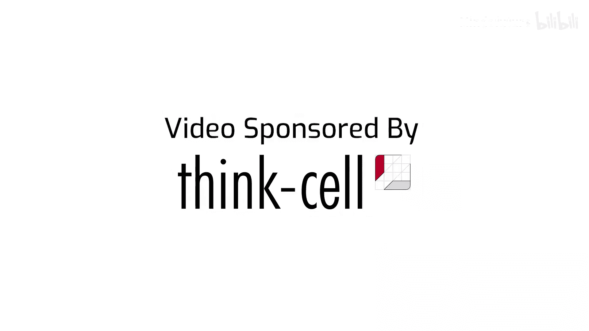
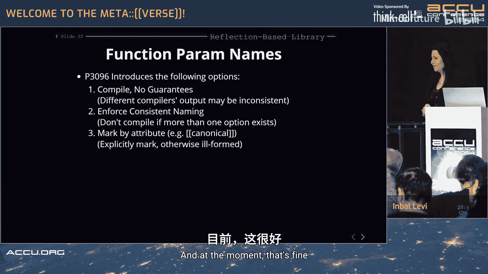
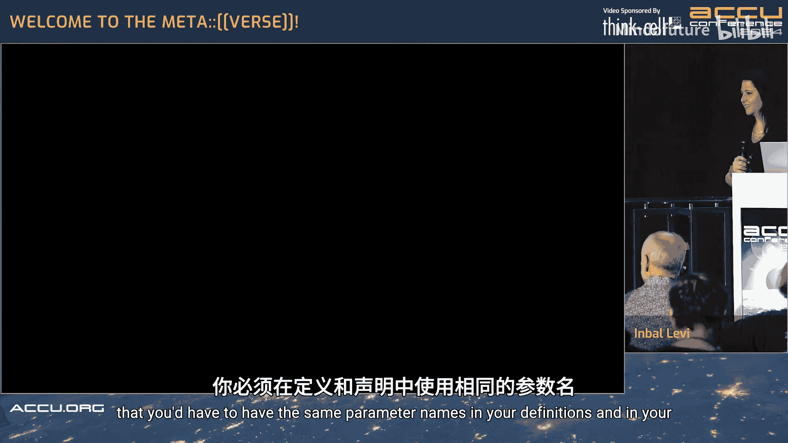
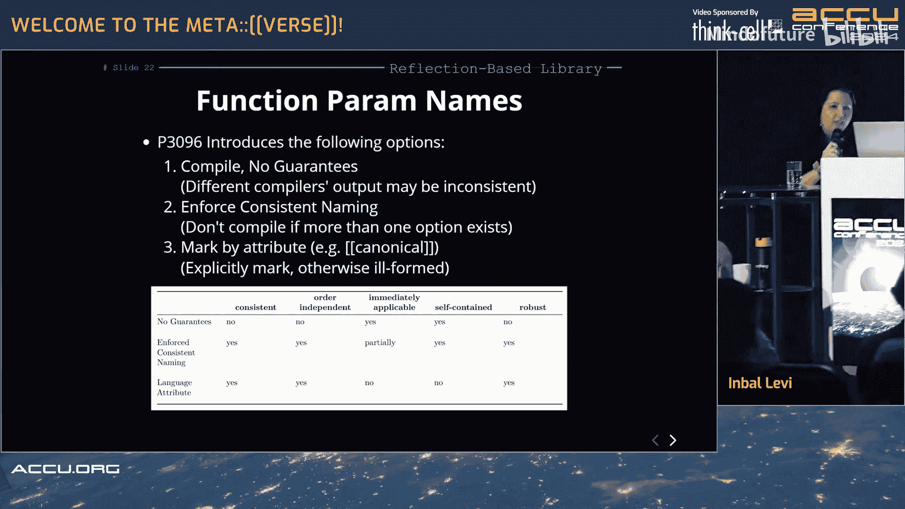
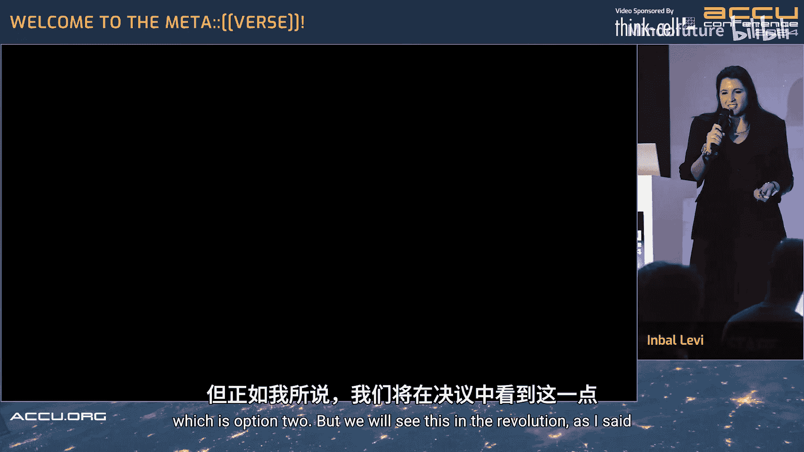
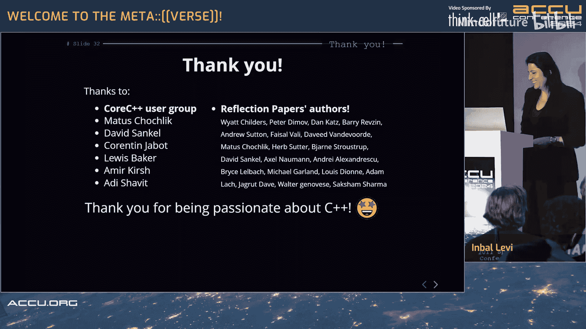

# 中英-•-C++和C语言ACCU大会2024｜人工智能｜架构｜函数编程｜静态分析｜安全｜编译器｜开发者｜垃圾回收｜链接器｜代码生成｜cmake-p18-P20-Keynote---Reflection-in-C++26---Welcome-to-v0.1-of-the-meta------verse--!----BV1pNotYYELk_p18-

Today， today is not about conferences。 It's about reflection。 So，1t of all。

 I want to welcome you all to the Meverse。 Ref is a feature being discussed for 26。

 I believe it Wilrich 26， but we'll talk about it later。 By the way， this photo was AI generated。

 but it's the only one I have。 unlike herb yesterday。 I didn't master that。😊。

Ski yet， but yeah， so thank you for coming today and picking this talk over Doers。That took sometime。

 all right。Yeah， all right， so first of all， hello everyone， my name is in Balevi。

 I'm a lead C++ developer。 I work in finance world。

 I'm also as been mentioned by Felix ISO Foundation and Boos Foundation board member。

 active member of the ISO Committee as Israeli National body chair and Library evolution workgroup chair and this is important because this talk was written with this in mind。

 So you may wonder why Library Revolution chair have you know interest in reflection。

 which is mainly a language feature but I hope that by the end of the talk you'll know better why and maybe you'll have interest from that aspect too。

 which is what I'm hoping for。😊，So what is reflection。

 Reflection is the ability of a software to expose its internal structure。Right。

So we want to use this in order to utilize code based on other code， maybe other people's code。

 maybe our own code， but we want to utilize this feature to build upon existing code。

And what we we're going to talk about today is static reflection。

 All right So this is exposing the structure at compile time。And a few disclaimers because。

Technically， you could leave the information from compile time in the runtime。

 leave it in the binary， carry it to the runtime， right that could be technically possible。

 but there may be some performance， security or other issues and the reflection proposal that I'm referring to the one that targets 26 is not referring to runtime at all。

 It's only static reflection。 So those are the disclaimers for our talk。So during the talk。

 we're going to do two things。On the first part， we're going to start with an intro to reflection。

 so we're going to see a brief history of what reflection have been so far before we got the great proposal P2996 for 26。

 then I'm going to clearly dive deeper into into this one and we're going to see some usage examples and again I focused here on library aspects。

 So what I care about is how do we use reflection to have better libraries。

Second part of the talk is going to talk about the impact of our code bases。😊，So。

I had a previous talk about customization points， and I'm going to refer to it during this talk。

 but generally speaking， reflection have been considered as a customization point mechanism And this is very interesting。

 We'll talk about it a bit later。And then we're going to talk about some pipeline integration。

 How does reflection fit into our code bases and summarize。

All the examples from this talk are taken from P2996， the reflection proposal。

 P3096 which is a proposal talking about function parameterss that you're going to also see later and EDG's implementation already exists in compiler Explorer All right。

 so let's start with a brief history。So the first mention of reflection that I've found and also by reaching out to people doing extensive search is from 2006。

 and this was a library written by Mattusuch basically using template Me programming to reflect on code。

So this is pretty early， right， Herb mentioned a few times that reflection have been considered for a couple of years。

 I guess if you include the wider definition of it， it's been considered for almost 30， so 40。

Use cases are also something that came up pretty a bit later by Mike Sparter。

 so Mike gave a really nice talk in our conference in courseCPP。

 he gave a talk about API for Cloud in Spa， I think you should definitely go and check it out。

 but he also had some thoughts about those topics， and he published his proposal。

 his review of use cases。And then we got proposals based on the mirror reflection library that I mentioned before。

So there are a few of those， but those proposals were mainly type traits。

 things that we are familiar with from Tment programming， right because as I mentioned。

 reflection at its origin started by talking about Tment programming as we know it today。

And then came Buhanna。 So this is a library implemented by Louis Don。

 It's heavily rely heavily on template data programming and been published in 2015 and also been developed afterwards。

But at that point， people started realizing that template meta programmingm is a bit of a heavy。

 have overhead in compile time， and it may not be the best tool that we can have for reflection。

So this was， I think， one of the understandings from those。At that point。

 we move to things that are more resembles to what we have today。

 so reflection with a separate syntax， right so we had a static reflection， another proposal by herb。

 as you can say， Andrew Saern， David， Louis Dion。Axel Matuchuch。

 So you can already see some explosion in proposals。 right， This。

 This means that people showed a lot of interest。2017。

 a lot of people started to care about this topic and then came the term meta objects。😊。

So meta objectsject are basically an object holding the information about your code， right。

 so you have code and you want to reflect on that code and you want to hold the information。

 And the natural thing to do is to hold it in an object。

And this term came up as part of those terminologies that came in those proposals。

 and you can see that Brna also joined the party。By our proposal in 2018。 So again。

 gathering very much support and interest。 And in 2018。

 we also had the reflection T S by David Sannkko。😊，Thank you， David。

So reflection to us didn't materialize， but again， a lot of the ideas that you can see there have reached to our proposals today。

😊，Another term that turned out around that time is value based reflection， T4 and monotypes。

 so the idea is that we can represent I mentioned objects that hold information on reflection。

We can represent information about our codeb， you could imagine a type hiarchy。

 right you could represent information in more than one type of object。

 but some considerations came up about this being too heavy for the compiler So we ended up with the proposals that talk about a monotype or value- based。

 these are all not exactly same terms of some delicate differences。

 but I didn't want to go into all the details here because that would take very long but the general idea is that we have a monotype representation of our objects in our program so this is single type called stood meta objectject。

All right。Some more interest in reflection， Corenta and Java have brought up some use cases again gathering support and we got syntax that is very similar to what we get today from this proposal and others before it again the topic of value and type and we've just reached to our main course of today's keynote which is the reflection proposal on the table so yeah in October 23。

 we got 2023， we got P2996， this is the proposal that being considered for 26 and following that sorry following that also came a different other proposals trying to utilize this in order to create things like Ptton binding JavaScriptcr binding all those use cases that we want to find when we use reflection this is I think。

Shows how this feature is already being useful in a large variety of our C+ community。All right。

 so reflection for 26， what do we have in this proposal， by the way， questions so far？😊。

Are you excited？Yeah。😊，About reflection 26， I can see the tomorrow。 It's not exactly that excited。

Yeah， this is gonna be a bit interactive。 I do I do want you to feel free to raise your hands and speak so you can even whenever I stop。

 you can even raise your hands and get a microphone and express your opinions。 But yeah。

 I think you know， a reflection is is a major feature。 We've been waiting for this for a long time。

 So let's see how it goes。 Deep Mar， do you want to express any opinions。 Allright，😊，Maybe later。

So reflection proposal for 26 have a few major pillars。 The first one is the reflection operator。

 right， This is called liftft used to code be called lift got renamed。 But still the same thing。

 This is the thing that sends things from our code domain into the reflection domain。 So basically。

 you want to take things and you want to reflect upon them。

 And then you want to use them as a building block within the reflection domain。

Second thing is splicer， so Splicer is doing the exact opposite。

 it's sending things from the reflection domain back into our code。

 so you could use a reflection operator to send things to the reflection domain。

 then you can use Splicer create to recreate a type out of it and then use it in your code based on the previous。

The reflection。I already mentioned stood meta info so stood meta info is the object holding the information about our reflected types。

 We have a single one。 this is came up from the discussions that I mentioned before and yeah and you're gonna to see quite a lot of functionality being derived from this object and functions following and of course so those seem simple but we do have large variety of meta functions so when you think about type traits when you think about things that we try to do you know in temperamental programming this is not very much different in terms of intention So we have names and locations you can query the name of things type queries of course parent of type of。

😊，Quite a lot of type prediccateates you can ask about private access modifiers。

 private override namespace member is deleted， those kind of things that you can ask about member functions in your classes。

 another type queries like a special member， for example， for special member functions。

 template arguments of member queries， again， you can query the structure of your class。

Stepitude of templates so turn these are quite interesting the ones that we saw before are basically sort of similar to type traits。

 those capture states of things how how they're represented within the compiler so in a way this basically captures the thing that the compiler see when it' substitute a template from a type so。

Reflectingvooc is similar， it basically captures the invocation of a function。And again。

 some more of those test type is basically equivalent to each same in type traits。

 something very similar， you can compare a meta object to a thing and then you get to like one of those type traits。

And sorry， I skipped the one that is very interesting in my mind。

 define class so define class is basically what we would call maybe injection or so the ability to basically build a class within the reflection domain right and this is something that is very important。

 very interesting， it's also been called generative reflection in some other proposals idea of being able to create structures based on the information that we gathered。

So yeah， it's a function， but it actually includes a whole world of possibilitiesiities。嗯。

Some more data layout things I think this is also interesting because its it dive sorry dive deeper into things that we know about the types that are not necessarily exposed in C++ domain so I'm going to talk a lot about C++ domain and reflection domain This is not like any official term but I want you to understand my way of thinking of this so we have the program and we have C++ program and there are some things that we can express in the model of a program right。

But the reflection domain contains more information。So for example， if in my program。

 I have function declarations and definitions and they all collapse into a single function within the S+SS model。

In the reflection domain， that's not necessarily the case。

 and we're going to see an example following。And another thing that I wanted to mention here some type traits。

 so type traits that I've shown here are mostly querying type traits。

 things that you can ask and get in answer whether the thing is。😊，You know， a Boolean answer。

 some typepress can be modifying your code。 So basically。

 these are not part of the proposal in intentionally。 There are some options there that you can do。

 You can use the existing ones to build those， but generally speaking。

The idea of modifying your code using reflection at the compiler， you know。

 at that stage and then getting something different。

 being injected back into the compilerss model of your program。You can imagine that this is complex。

 So for now， being left out。So yeah， we did this quick review and I want to start diving a bit deeper into some of those。

So reflection operator， I only mentioned Lyft， so we have here our our Exp our X basically we lift in into our reflection domain right。

 So now we have on the right， let's see if I can actually make this work。Can you say that， cool。

On the right， we have something from the C++ domain。On the left。

 you have something from the reflection domain， right。

 You just lifted your simple fast thing into reflection。

So we basically ship things into the meta world yeah。

 and then we can use them to reconstruct our program， but this specific code will create an error。

The problem here is that we're trying to do something with something that is not con Exp。

 Keep in mind。 we're trying to do to write code in to the compiler。

 feed the compiler with our code and get back some feedback。

 The compiler cannot do that unless we guarantee things that are con expert。 So this is the first。

 I don't know， maybe something that you want to think about when you write reflection code。

 you would need your things to be con Exp most of the time。Splicers， as I said。

 are doing the opposite thing。 So instead of taking things， yeah， sorry。

Instead of taking things from C+s past domain into reflection domain， it does the opposite it。

Send things back into the C++ domain。 So what does this code do。Just the second line。

 It's pretty simple。 someone can raise their hands or just shout， or I guess。

 am I allowed to have the audience shout or go ahead。Right， defines int a with the value of 42。

 correct？It's very nice。 It's also helpful that I provided this hint。😀Yeah。😊，Still， great answer。😊。

Right， so as I said， Splicer extract things backed into our S++ world so I can use the thing that I've defined in line 1 and create my own reflection code based on it。

 It may look simple。 But I think this idea is， is very significant。

 We should definitely understand that when we write reflection code。

 So let's try to break this expression into parts。😊，First thing we have here is there R expert。

 What is the type of this R sorry， not the type。 What is this thing that' called our expert。

And people this time take a microphone。I can't see the hands， though， so。Do you have a microphone？该。

Meta info object That's true。 You've been listening。😊，At points。True， yes。

 So this is the meta info object。 right， We need a thing that holds our information。

 and this is the thing。How about this one？Anyone want to take a chance here。

 it's written on the slide。It's pretty to straightforward， you know？Yes， it's an int。

That's true because after we evaluate this expression， we basically get back what we put in right。

 this is the opposite of what we did before， but what about this one， what is this thing？

The definition of this is in P2996， so I'm gonna read it out loud， but generally speaking。

 this is the thing that the compiler looks at in order to evaluate your expression right so it goes in and it see this syntax and it try to understand to turn this thing into a meta object or in this case the other way around but it tries to parse your thing and create some functionality that you desired。

 but this is not that trivial So basically what you see is the expression evaluating into the type。

 so this is。Think about how you capture something within the execution。 It's not。

 it's not something that we used to do in C++ programs。

 You capture the expression without evaluating it。 and and that's what the compiler sees。

 And in order to hint the compiler that this is basically supposed to be evaluated into type。

 we add this type name initiative thing。 it's not mandatory there is some conditions on which you can neglect the type name。

 but generally speaking， you want to indicate the compile you're now speaking which our compiler。

 You want to indicate the compiler that what you want to get out of this splicer is a type and not a value。

 for example。All right， so we talked about reflectionle operator and splicers。

 I just want to have a short dive into meta info and its meaning。

 so this is a slide coming from another talk ahead。

 let's talk about abstraction layers and this talk talked about AST which is the a synric tree that the compiler sees and we can look at this dump this text dump and see that there's a function declaration here。

 there's a variable declaration， there is the name of the variable the type which is in right there's also an L value is this an L value and R value。

 some parameters， sorry and this is very similar to what we get with the meta info object。

 so again I want to express and stress that what you're doing is you're looking into the compiler code。

So the meinfo object， sorry。Yeah， the meta info object can represent type and type allliaes。

 function members， variables， et cea， non static data member， constant value and expression。

 template and namespaces。But notice this restriction。 This is when I defined int a here。

 and then I defined Cons per B。And I can just use the the B in a splicer。

 but I can do that for the A because the requirement is that to have a constant value and constant expression。

So again， this is important to understand when you're using reflection code or's some limitations。

So that would work， a previous example would not。So we covered student metain for objects。

 and now we're moving to covering all of those in details until the rest of the talk。Not really。

 because that would be cruel。😊，No， we already covered those in the initial slide so I think you can figure out what's in there。

 and again， as I said， this resembles a lot like things you' familiar with from type trades。😊。

All right， so let's move on。So I do want to say a few things。

 general things about the meta functions。 again， without covering them in details。

 they are pretty much what you'd expect。 So you get a meta of name of。

 so you can reflect the name of a parameter and you generally take an info object。

 the stood meta info object that I mentioned before and get different a large variety of things。

 So you can get a string view， you can get a vector of this stood meta meta object。

 And this is interesting。 I don't know。 do you notice what's going on here。 Basically。

 within the reflection proposal。😊，We create dependency。

What are we dependent on looking at those return values from meta functions？Raise hands or shout。

Yeah， thank you， Tim。I didn't even see you， but I recognized， yes， that's true。

 We create some dependency in things that we expose in the Sun Library， like string， like vector。

 like， you know。😊，This is not just regular types。 These are dynamically allocated types， I guess。

 in compile time。 But okay， still， this is， this is things that that。

Create this dependency and we need to take this under consideration。So yeah。

 the only one that doesn't take info is the one that takes value and it's called Ref value。

 but that's out of the point。I did mention another thing。

 I did mention that there's two types of type ratess。

 There's the ones that query the type and there's the ones that modified the type。

 and I already mentioned that the ones that modify the types are quite heavy to implement to reason about they can mess with your ASD now that you know better what an ASD is。

 you understand why is these things can be problematic。 And yeah。

 and this is at least not gonna be in the first delivery of the proposal。

 but it may be interesting to see them afterwards。 personally I think that those can be a really interesting utilities。

 those are the interesting utilities。Right， so we covered the proposal。

 Now we're going to look at few reflection examples， and there are going to be pretty simple ones。

 Go ahead， Gu。关。Oh， really。 that's a good idea。 Can someone try to kill the light？

I don't know if that's like。これについて。Yeah， sorry for dropping that on you， blame guy。

Aren't you one of the organizers， are you supposed to like do things？Yeah， I'm sorry。

 I actually asked in advance if dark mode would be good。 but I asked it this during the social event。

 and people drank a few beers。 So maybe it wasn't the best time to come up with slides。

 information and queries。Yeah， I think that would be good。

 I do have some highlights for the codes itself， but。😊，It know， is this better？That's what I have。

 that's true。You'll have to deal with that if someone managed to kill the light， that would be nice。

 So yeah， we define here a function。 So here is my first example that I want you to have in mind when you think about reflection。

 This is a reflection logger。 This is a library based on reflection and what it does。

 it logs your types。😊，So I have log members。 It's basically looking at this object and log the members of the object。

 It uses sorry， report concept pair values。 So this is basically the thing that we pass you know。

 we pass the information here。 and this is what the compile are going to print， quote。

And then we do a four loop on those members and we print the members and they're basically we print member parenthe dot dot。

 sorry， and then the names。And here I got the user code。 So this was the library。

 I provided my user with this functionality。 And a user have。 and again， when I define。

 when I say user here， I'm mean the user of the library。 So technically。

 that could also be another library using this library。 But I define here the student。

 and I have members， and I get output that I expected。😊，So log members。

 take the student lift this into the reflection world， right？Because if I just passed a student here。

 what would happen？Let's say its just like an object， right， exactly， the， the meta function。

 the function that I wrote that takes a meta object doesn't know what to do with student。

 It knows what to do with the with the student In Meta object that is created that does represent the student。

Cool， so I also have QR codes here。 Yeah， I know it it's a brilliant technology。

 I don't know why I didn't thought of that in my previous talks， but I stole this from JF。

 the evolution chair because he used it in meetup。 So anyway。

 you can scan the QR codes and you can go and play with those as I mentioned。

 reflection is implemented at Godbold So by EDG mostly。 So thank you very much for that。

 And I think it's pretty awesome。😊，The second example I have。

 I think is even more interesting because now I want to talk about combination of compile time and runtime。

 so this is a piece of library and what it does is command line arguments。😊，嗯。

And and what it does is basically what you'd expect from Python as or things similar。

 we' already seen but heres here's the thing So again the implementation if you go and scan this QR code。

 you're going to see way more than this code snippet because there's the implementation there is of clLap which is the class that we inherit from here and by the way this code is from P2996 been written by Barry Rasbin。

 so thank you Barry。We basically on user side， define this a extractstruct。 We inherit from clap。

 right？ And then we need to define those optional。 Op is just a wrapper that have optional within and takes additional parameterss。

 We define this optional string。 and we tell the string that it can be passed by either short flag or long flag。

 right So this is， I hope familiar for you from other command line arguments utilities。

 And then we have another one， which is the int。 And we tell it again。

 that it can be used by short or long flag and we initialize both。So note what happened here。

 Args is something that the user of the Cap library writes。And they need to know。

The types of arguments that。That they're going to expect in their program， right？So it's interesting。

 it's an interesting mix of compile time in runtime。😊，So we get the optionals。

 and now we just create an object of our arcs and call parse function。 And again， we rely on clap。

And we can iterate over our parameters。 We take the second parameter count basically to understand how many parameters there are。

 and then we iterate over them and print them。Oh， sorry。 I don't know why I jumped forward。

 I thought I had the output， but you can imagine what the output would be。Okay。

 so we have the name and we have the count。😊，All right。So third example and again。

 please feel free to go in and explore those examples in more depth For example is from the paper that I mentioned at the beginning of the talk so this paper is very interesting this is not the reflection paper itself it's a paper come that came afterwards and by chance we're going to say it next week in library revolution so those of you who are community members I think this is a very very important topic and I'd love to see you there this paper is talking about function parameter names。

😊，So。We have the ability to reflect on function parameters， right， and parameters have names。

What happened if we reflect on those and we have different names in definition and declaration？

Interesting question， isn't it？So print parameter function is basically doing exactly that。

 And we have the user function。 This is just funk。 It have parameter， first and last。

And there's declaration of the function， have NNLN。Just as an example。

And print function is basically using the print parameteram K。

 This is the code that we expose from the library， right。

 Pri parameter K is the code that we expose from the library。

 and this is the user code trying to use this code in order to print its function parameterss。

 So if we do that after the function， declaration， we get。What we get， It's actually on the slide。

 if someone can read。Guy， go ahead and shout。That's true。

 What happened if we do that after the function definition？😊，And， and L。 N， right， Yeah， I know。

 it's hard to read。 Sorry。 So， yeah， so this is， this is not trivial， right， we。

 we haven't looked at those things before in our programs model。

 This is something new that we need to take under consideration because we're now able to reflect on more information than what we had before。

😊，So now I'm going back to reflection libraries and reflection based libraries because as I mentioned in the beginning of the talk。

 this is my personal interest。 and this is what I， I want to explore farther。

We have here a separation between。Oh sorry。Oh okay， yeah， I've been asked not to hide my own slides。

 but that's okay because。Because no one actually can read them， so that's fine。I， I'm just gonna。

 you know， I'm just gonna talk and， and you're gonna believe me that that's what's there。

 Even if I'm at a typo， no one's gonna see it。 It's perfect。😊，Alright， so reflection based library。

 We have our library code。 And when I say library is， you know。

 it could be something that is published in the standard library based on reflection。

 It could be something that someone wrote in in their Github project。

 It's a piece of code that tries to provide functionality for another piece of code。😊。

We have the user code and again when I say user， I mean it could be other library relying on this library。

 it could be application code， it could be system， something that is very。

 very delicate to errors and is been used in this reflection library that we've exposed。

 so we need to keep all of those use cases in mind。And then we do what I just said before。

 and we get the weird behavior that prints us different things in if we query the function declaration and different locations。

 I just noticed I have that。 I'll use it for now on。

 So function parameter names is introducing a few options to solve this problem。

 So everyone now understand the problem that I have the department statement what is the issue here。

 Okay now I'm going to ask the microphones to actually been move to the audience because I do want to hear your opinions and I want to get your participation。

 so the paper that I've mentioned， introduce three options to solve this problem。First option。

We compile the program and we provide no guarantees。So basically。

 what you saw in the example that I shown， you can get a different print if you call this in different locations。

That would be this outcome。In addition， if you use different compilers that implemented reflection differently。

You may get different outcomes Compr is free to choose whatever they want。😊。

But we do guarantee that this comps。Second option。Is enforcing consistency in naming。

 I cut off a few of the options in the paper because there are some details there that I didn't want to like go into。

 but。Let's jump on the。Partial guarantees option And go into the enforce consistent naming。Sorry。

 so basically， you don't compile if more than one option exists。

 So if you get a function declaration with a name and then a function definition with a different name or another function declaration with a different name。

 you basically fail to compile。So you have the reflection logger library， right。

 you included that into your code。😊，And you have a piece of code that doesn't enforce this consistency in names of paras。

Which makes sense because no one ever asked you you， right， this is not part of the C++ model。

 this is not something that we ever defined as a requirement for having the librarys support functionality。

So we don't compile。Third option is marking with an attribute。

 so basically there's a few options in the paper there。

 but to summarize there's like a way to use an attribute canonical to say this declaration is the one I care about。

😊，And this is what I want to have in my output。So if we don't explicitly mark， it's illform。So again。

 fail to compile。 what does that mean， Think about existing code bases。

So I now go and I need to mark canonical， all my function decorations that are not consistent in naming。

Otherwise， my log library wouldn't work。So those three options， I don't think any of them is great。

 but I actually want us， I， you know， as I said， I have a lot of interest in this topic。 I wantna。

 I want to hear some of your voices。 I want to hear what do you think， Let's say。

 let's imagine that we are now in library evolution meeting one second。

 I'll take your question in a sec。 Sorry， You're spelling my。😊。

I'm kidding I'm kidding let's imagine that we're in library evolution meeting。

 which will happen in about a week from now。 we're going to talk about reflection。

 we're going to talk about this paper， we're going to probably make the decision about this paper not next week but sometimes later still。

 you are all committee members and you need to decide between those three options。😊。

I don't see any other option。 maybe you have other options， I'll be happy to hear them。 Sorry。

 what's your name？s one of the comments about this。So like option2， wouldn't that be like really。

 really hard because I might have like any number of forward declarations anywhere in my code base。

 Like， how do I even detect them's all of them， Yeah。I agree。I agree。This concern have came up。

 You know， I have thought of that。 and I agree。 This is hard。 I have my code base。

 I have my application code。 I include libraries from everywhere。

 Do I now need to go and modify those libraries in order to be able to。😊。

Use my logger reflection based logger， I don't know。Any other comments？ And please。

 can we have the microphone to audience， Thank you。 Alright， So let's start from this person。 Sorry。

 I don't know your name， but。Cool， how am I in time so I don't like any of those options？

So my ID would be option four like you provide a full list of all function declarations and the definition and so on the library side you can choose which one you take。

 you might take the shortest one， the longest one， the first one。

 the last one so it would be kind of on the user side to choose which one you take So if I understood it correctly basically say if you want to use this functionality from reflection you have to explicitly provide the list of declarations and this is what you communicate to your library。

 okay sounds good， sounds like a good solution。😊，Create some burden on the user， but still go ahead。

 what's your name？Yep， Tobias。😊，I would propose a fourth option as well。

 just pick one that just pick the names from the definition。

Because you just can have one because of the ODR route right and then it's yeah。

 it's just that one and you don't yeah need to make other guarantees Tobias that's great Tobias right that's a great suggestion I thought of that and and because I forgot。

That the compiler stage， you don't know， you don't see the definition necessarily。😊，Okay，Bmer。

But yeah， I agree that could have been nice。 sorry， yeah go ahead， Terrry。

 and then we've gone ahead with consistent naming because like table and definition lookups would just in our massive code base would just be untenable。

 we could never maintain it or would take such a performance it。

 So we're just trying to force people to name things in ways that there won't be any duplicates。

 Okay， well that's good。 Yeah I agree it's a common practice。 So let's take a few more hands。

 sorry you raise hand and I miss so first let's take Franciss。

 then Nina and then we'll move to that section and then yeah go ahead Francis which option do one Well I'm sort of very concerned because there is a good in certainly in myday programming policy that definitions contain names that are meaningful to the user and declarations contain names that meaningful to。

😊，The body of the function， and these are often not the same。And at the moment， that's fine。

 But if I understand it correctly， option 2 was actually。

Abolish that policy altogether that you'd have to have the same。

Prameter names in your definitions and in your declarations I personally would find that unacceptable I think you're right。

 This is a problem and it exists。 I will say one thing I do want to say work of21 are very smart people so we do actually have a solution I keep in that you know for afterwards but don't worry you're going to be able to use reflection is just that you know these are kind of problems that we handle and deal with go ahead Nina。

按。Yes， but you're right。 You're right。 This is exactly what I had in mind。

 Let's take this person from the， the last part and then we'll go back。 And， I mean。

 I guess I do have。 yeah， I do have some time so we can。😊，And thank you everyone for your input。

 this is exciting Yeah my name is Sheman， I don't know what you always put a name on when you declare it。

 so I would just call it a12，3，4 generically。😊，All right， that's a valid suggestion。 Okay。

 let's go back so I don't see any hands here， I don't I see one hand here。

 I see one hand here and then sorry。There's some exercise， I apologize。There was someone here。

 I think， just like this person in a red shirt， go ahead。Hi hi。

 what's your name welcome to the committee meeting。So to begin with。

 I'm a bit afraid of reflection because of the Iim's rule。A what His real low。 Oh， yes， yes， yes。

 Now， everybody is gonna depend on how I implement stuff reflection。

 So I would be very happy with solution1 where like it's unstable anyway。

 that gonnana print something。😊，That is meaningful in some situation。

 but I do not depend absolutely on how I name something。

 Right the proposition of naming same variable 1 to 3。 I'm happy with either of these。 I I agree。

 and I will say that， I mean。We cannot avoid the fact that people are going to rely on things that we if from expose them。

 explicitly an API reflection makes this problem bigger， therefore， don't worry， we have solutions。

One of the solutions would be to no promise things regarding either the standard R or the code it's been reflected on。

 But this needs to be explicitly done。 But I agree。 Allright， let's take， just， sorry。

 I I'll jump on you and just move on。 And if you have time at the end。

 So there are some people here in this block。 Let's start with Guy。Go ahead， Gu。 Sorry， Oh， sorry。

 Yeah， that actually just shows our possible options， this table。So what do you think I Well。

 what I think is have the implementers been contacted because one one thing。

 anything that we do may introduce diagnostic mission for errors and we already have。

An absolutely giant。Pile of a large mess when it comes to template diagnostics。

 What's a reflection diagnostic is going to look like and how is that going to affect our choices。

 Because if we come up with it， if we come up with a solution where the diagnostic is absolutely unintelligible。

 people will walk away。So have implement is being consulted that was the first so yeah。

 so that's after implementers were consulted and the authors of P2996 were consulted。

 by the way I don't know if I mentioned that， the second option is the one recommended by the paper authors。

Well again， well be interesting discussion， go ahead。Yes， but yeah， the person， yeah。

What's your name， Stuwart， something to consider is that there may even be a name。Right。

So I skipped over this because because otherwise I would speak for there's a lot of details there for option option2。

 if there's no name in one declaration that there is name in a different one。

 then one of them is you know the single one should be picked actually for all of those and if there's no name。

 it's just going to print empty string。 But yeah， you're right， that's true， go ahead， John。

 What do you think So I wanted to ask why you didn't have option for being a combination of one and three。

So do you want to elaborate so yes， so if you can say that it's it's going to not compile why don't you simply go with one。

 but if somebody wants to pick one， they can have three， the problem with two is。

It'll stop code from compiling when you use this and people can't use it then。

 And I think two is out of the question。 But I think one is fine。 And then if you add3 to1。

 you have it all。Right and if I may add to that， basically if you could do one with warnings so that people that care about those things can fix it and the people that don't。

 So that's maybe an alternative to what you're suggesting， but yes， I agree。 that's an option。

 We'll see what happens。I think it's a really good promo for the Library revolution session。

 all right go ahead just a few more hands。Hi there。Perhaps I'm being dense here。

 but my understanding is is that the slices evaluated in particular code context correct the slices again the slices evaluates yes。

 that's true Okay， so I am a piece of code in that context。

 I can see certain names and certain accessible headers Ex I'm not using X。

 which is lunacy in this day and age。So can I not have a consistent view of the world， And therefore。

 I would pick those parameter names and those function names， and that would work。

And no one needs to change their code。Right。So how would you， how would you choose them， You just。

 the user would explicitly use canonical。 Basically。 That's what you're saying。No power does it？

There what？The compiler already Oh okay， the compiler will。 Okay， yes。

 So basically your for option one， I'd say with something printed， yes。Yes， that's true。 Thank you。

 Thank you for that comment。 Al right， let's take just few more last hands。 Go ahead， Peter。

 Peter and。😊，I don't see any more hands。 So that's。

I'd like to emphasize what Francis Glasbo just said。

 it's the names in a function declaration are completely。Arbitrary can be omitted。

 and there's no meaning to them。 So therefore， I， I think the mistake is to actually being able to reflect on them。

 right， That's another opinion that came up。 I would say I， I would not say the name of the person。

 but compiler implementer have said before that we should just not have this function as part of P2 9。

9，6。 So I want to move into the resolution that is currently on the table。 And again。

 this is not a finalized topic。 You know， you wantan to， you want to still。该。G定外fi。

I have not I have not been following this paper， so I don't know whether I'm suggesting something that we have already discussed。

 but I completely agree。 parameter names do not exist。In in， in the model。 So if we want to add them。

 they either not there or they need to be added in some way that specifically marks that this is now a parameter names up。

 Can canonical just explicitly marks one and otherwise ill formed。

 Have we discussed explicitly marked otherwise empty。No， but that's a good option。I mean。

 it's not in a paper， but we will discuss。 this actually always been only been seen by S7。

 SD 7 gave the indication that they're supportive of what the paper authors supported。

 which is option two。 but we will see this in library evolution as I said and I think this is premature to determine what's going come out of it。

 I just wanted to give you a bit of experience of things that we we have have to consider。 So yeah。

 so the solution that we that currently isn in the paper is basically to and have a separate function that does one。

So more often than not， I don't necessarily like it。 Maybe in this case， it's actually okay。

 more often than not， we can fall back into a different utility or a different function doing you know。

 to provide both behaviors that we want。 I will also say one thing。 we were talking about loggers。

 And I kind of gave you， you know。😊，嗯。Gave you like some。

 some review of loggers as part of this talk， which may have put this idea and and example into into your thoughts when you consider this。

 but there's also binding。 and binding is important to people。

 and binding is the reason that people want consistency in names。

The authors of this proposal in particular， care about binding。是不呀。

This is the solution we're going to have as of now， but stay tuned。

It's a very interesting discussion。 So I just， I just wanted to give you a bit of a preview of of the things that reflection can expose and the problems that reflection can bring up。

 And I also want to like a very strong disclaimer saying that I love the reflection proposal。

 I think reflection is an important feature。 and I want to say it in 26。

 I still want to have those topics discussed。 And I think we need to figure out what to do with them。

😊，So going back to function parameters names， I， I just wanted to bring one more thing。

 what's going on with the lights here。 This is very intimate， alright。😊，嗯。Yeah。

 now I feel like a comedian because there's like only a spotlight。😊，And I can't see any of you， oh。

 that worked。Okay， all right， so long story short， one more thing to keep in mind。

 let's say we go with option two， reinforce enforce what happens when you get juniors just like go into our codeb and they modify the pro names。

 What happens like the whole codeb is now not working。

 we cannot compile because we have a reflection based library。😊，This is alarming。That's good。

 Maybe that's good for Python binding。 actually， Yes， I agree or binding in general。 I agree。

 for some use cases， that's good。 for some use cases。😊，Maybe less so？As I mentioned， next week。

 stay tuned。Alright， so I want to move to a different topic。 Yes， I have around F an hour。

 And I think that would be enough。 I did talk in a previous talk。

 I talked about customization points。 So I don't want to repeat this talk。 But I do want to say。

 I do want to define this term。 So customization points are basically the ability of of library what library can expose in order for the users of the library。

 which again， can be other libraries to basically modify the functionality according to their needs。

 So I have a type And I know how the type needs to be logged。 I know what to print for my type。 and。

And yeah and basically， I need the library to be able to figure out this implementation。

 to pull it back into the library's usability。 So these are customization points。

 How do we basically communicate between our library code and our user code。

 How do we pass information between。 So again， the talk， I thought this was a very。

 very interesting and very important topic。 Therefore， I gave it four times， which is unusual for me。

😊，But there's the link over there and if you're interested in this topic。

 please go ahead and watch it and I think this terminology actually wasn't invented by me right it was a long time in the comeian and I think it's a very interesting and important terminology to be familiar with if you're writing S plus plus code。

 but long story short reflection have been considered as one of the options for customization。

So we could technically use reflection in order to basically build upon take our user code。

 break it apart and create the functionality of the library on top of it right and then run the code that would basically it's using a wider definition。

 but that would basically comply to what I just mentioned before as the usability that I want。

 So so far what I went over in the other talk is basically virtual functions。

 so library would declare a function and user would override that template instantiation。

 So you could just sorry， so you could just declare a template and then the user could instantiate a template for their types like you do with vector vector。

 And then there's some functionality that depend on ADL or depend on namespace basically need to detect the user implementation like things like going on with swap or writing swap。

And then we have reflection。So how would a reflection customization look like。

 I've already mentioned that a bit in very short， but let's say I have this this is， by the way。

 taken from P2 to37 meta programming paper quite an early one I think four or five years ago。

 but it's still like the functionality is still the same as what we're gonna to get for 26。

 So yeah we have a live function and we want a logger we basically just go over this user class by using meta data members of right So this is our reflection library。

Sorry， this is our reflection meta function。And then。

This is very similar to the lift operator that you saw in the current proposal。

 we iterate over the members。We do lookup by the name。

 and then we just initialize with something like。So this is copying， this was called structural copy。

 was copying a class to another class。So。I think it's very interesting because this。

 even though like you could look at this as customization point。

 you're basically doing something completely different from the user code。

 from the user's intention and you build upon it， and I think these kind of things expose even more points in the interface between user code and these kind of things are the ones that we need to keep in mind when we want to define our restrictions。

Right， so it brings me to what do we want to guarantee for reflections， libraries。

 What guarantees do we want to make when we expose this great proposal， that great feature。

 That is reflection。😊，What do we want to promise so that we wouldn't get to these corners that I've shown you。

 for example， for function prom names？So as I said， it's going to be discussed next week。

 and I would love your input， so I have my email at the end of the talk。

And if you want to go deeper into this， there's more interesting papers going on there's the narrative extensions by Bryce。

 Michael and Andre and those talking about generating classes like like I've mentioned the function that we have in meta for generating class there's A comparison with reflection that's an interesting proposal so again I've been interested in this topic for a while and I'm running over a year a group of volunteers that care about reflection and they' are interested in that and this paper actually came from one of of our members and section' is going to talk about this during the CPP now talk that he have in two weeks from now so I would encourage you to go and search for the video but basically what he does he uses reflection to put versions on our bin basically to document the A using Hashing。

Right？And A BI have been a significant topic in in the committee。 So I think this is very。

 very interesting。 I'm not saying that he doesn't offer to put this as part of the Senate Library。😊。

But I think it's very interesting use case to see that we can use。 And。

 and it's going to be interesting to see how the committee respond to that。

 That's actually been already reviewed by S T 7。😊，So the last thing I want to talk about is pipeline integration。

 so I already touched that topic in during my talk。

 I already sort of mentioned things what happened with people modify the code。

 but I want to emphasize the difference between those things between what we saw here and regular libraries。

 so in regular， you know existing for example， standard libraries， we have our library。

 we have our application code， we create our bin。And we get， I mean。And the library。Can， basically。

 according to the version that the compiler you know。

 tells the library and compilation what's the version of the standard。

 And the library can do different things based on that， right， So at that point。

We know the version of the standard。And by the way， that can also be like feature test macros。

 We know which features are exposed。What happened Oh sorry the sorry for that。

 What happens with reflection libraries， So we have our library， we have our application code。

 we create something。😊，But。No matter how many versions the compiler。

 like how many information the compiler are going to have。We don't know these problems。

 like the 1 I mentioned before about function para names until we actually try to link with the user code。

Right， so I can。Compile this Loerlib。And I try to link it with some piece of code， and it works。

 And I try to link it with a different piece of code， and it doesn't。

And it had nothing to do with like the standard version on which I compiled。

 because it's not something that is known when the compiler is compiling my reflection library。

So I think these have an impact on our pipelines as well。

 and I think that like these are the things that we want to think about and actually and CPP now and in two weeks we're going to have a talk we're gonna have few keynotes and the theme of the conference is tooling and Anaestasia here is going give one of them and I think I'm really really looking forward to it and I think Anaesthesia is one of the people that I want to consult with when I'm looking at Dao's kind of proposal because she have a lot of knowledge about how C+ community uses tooling。

 how do use our IDs coming from Jbrain right so。😊，That kind of a thing is something that I want your input on。

All right， and again， looking at backward compatibility is important。😊，So to summarize。

We need to figure out what's the guarantees we need to provide。

No compatibility between standard library versions。 I guess this ones is easy one， right。

 We would just say like every new standard version， we don't provide any guarantees。

 If you wrote a reflection library based on you know。

 anything that's been exposed by the standard library And you know， you know， we publish S 29。

 We don't provide any guarantees， This one's an easy one。

 How about backward compatibility with source code。

 So what happened when you like modify your source code。 How about no guarantees for existing code。

 So what I just mentioned like function parameters names that doesn't work for existing code for old code base。

I compile it with 26 with my reflection library and it doesn't work。

 is that a guarantee that we need to make， maybe not， but it will be interesting。And if we do fail。

 what would be the outcomes of breaking this contract。 So there was multiple talks about contracts。

 I think that you should definitely go watch if you haven't been to because contracts is another feature that's going to most likely reach 26。

 And I think it's a very exciting one， but。😊，This is breaking the contract in a wider terminology。

 using contracts in a wider way than than what the future of contracts does。

 But what do we need to do， What happens if we fail is the program ill forms so it doesn't compile。

 is the program contains undefined behavior。How about the errors should we basically indicate in some way that this have failed in the reflection stage。

 this is different than the compiler stage， we' used to working with the compiler。

 getting an indication on template meta programminggramm failures。

 this is a different stage is arguably a one that comes before。

 how do we basically recognize that those error belong to this stage and not the template meta programminggramm one。

 the one that we used to get errors from the compiler for， and last one， exceptions。So currently。

 there is。Which errorss are going to be printed is interesting， but also。

 which error mechanism is going to be used is interesting。

 And there is some consideration of using foreign exceptions on compile time when your reflection。

 library or code fails to compile。So we're going to need compartment exceptions。

 but still it's going to be very interesting， right， I think you know。

These are kind of things that we want to figure out。And last one， warnings。

So I don't know if you realize by now， this is a whole new language based on C++。

But he's a different one。How deep do we go into this realm of warning and fixing the user code。

 like user in that， in that terminology is basically the person that tries to use reflection。

 How deep do we go there。By given indication。Basically。

Reimmenting another compiler on top of C plus compiler， right， because now。

You fail to use this function is an indication。 But then you could say you passed the wrong parameter。

 you basically could go as deep as creating a whole new programming language in this realm of reflection that is running before your S+ compiler is running。

How far do we want to go there？Those are kind of questions。That are interesting。Al right。

 so to summarize。I want you to go out of this room today thinking about how reflection impactpart our code bases。

And I hope I gave you a few hints of the significance of this feature。

So this is actually from Herbsutter is publishing in IocppP。org this great table。 I really love it。

 Thank you Herb， I don't know if you're here， but thank you for that。

 and I added this reflection feature and yes， we may be getting this for 26。

 I think it will be very exciting if we do。😊，We'll have to update this table， but fine。

I think it's very exciting。 I really am looking forward to it。But we need to figure out how to do。

 how to do this correctly。All right， so thank you very much， everyone。👏Thank you。

The and it's really confusing。 I want to thank to the core CPP user group who heard an early version of this talk。

 a shorter version but thank you very much for that and for your feedback I want to thank Matttuush and David Sannkel both as you've noticed are heavily involved in reflection from its early days and both clear the time and wrote to me very detailed descriptions of their proposals of the progress and what happened because it was before I was in the committee So thank you very much for that it was super informative and also I found this fascinating Corentine Jabbt and Louis Baker for reviewing my slides and fixing typos actually till the very last minute。

 Thank you for that。😊，Air and A from our core CPP user group and Amir is right here。

 thank you Amir so much for your feedbacks both on this talk and over the years for talks I've been giving。

 I really appreciate it。 Thank you so much。And yeah， and of course， and very important。

 I want to thank reflection paper authors。 And this is not just a reflection proposal。

 but the other proposal that we saw that addresses problems by this would be Adam and Walter Saam for writing this example based on infction for A。

 Adam and sorry Jaggguro and Louis D and others that I mentioned here， all of them。

 I really value your participation in this。 And I think that that youre helping us making a better feature。

 So thank you for that。 And of course， I want to thank you for being passionate about C++。

 The fact that you are in this room and in this conference means that you are passionate about C++。

 and I want to thank you for that because without your participation。😊。

I don't think there was a point for this language， so thank you very much， everyone。Thank touch。

